# ARP

Resolução de endereços na rede local: requisição em broadcast e resposta unicast, tabela ARP e seus estados, destino remoto via gateway, proxy ARP, ARP gratuito, detecção e defesa de endereço duplicado, failover de IP e o envenenamento de cache com as defesas.

- **Categoria:** Roteamento e serviços de rede
- **Motor:** nativo (TypeScript puro, apresentado pela bancada genérica)
- **Código-fonte:** `src/sims/arp/`
- **RFCs e padrões:** [RFC 826](https://www.rfc-editor.org/rfc/rfc826) (ARP), [RFC 1027](https://www.rfc-editor.org/rfc/rfc1027) (Proxy ARP), [RFC 1122](https://www.rfc-editor.org/rfc/rfc1122) (Requisitos de hosts), [RFC 5227](https://www.rfc-editor.org/rfc/rfc5227) (Conflito de endereço)
- **Tópicos:** Requisição e resposta; Tabela ARP (REACHABLE, STALE, FAILED); Gateway e proxy ARP; ARP Probe e Announce; Conflito de endereço e failover; Envenenamento de cache e defesas (DAI, entradas estáticas)

## 1. Modos

| Modo | Cenário inicial | Cenários |
| --- | --- | --- |
| Resolução | Primeira resolução | 6.1.1 a 6.1.9 |
| ARP gratuito e conflito | Endereço novo: Probe e Announce | 6.2.1 a 6.2.7 |
| Envenenamento de cache | Sem ataque (referência) | 6.3.1 a 6.3.7 |

## 2. Como ler os diagramas

Este documento usa até dois tipos de diagrama. Cada figura traz uma legenda com o tipo, o que mostra e a que modo ou cenário se refere.

| Tipo | O que é | Vale para | Equivale, no simulador, a |
| --- | --- | --- | --- |
| A, topologia | Os elementos da rede e os enlaces que os ligam. É estático. | Um modo inteiro | A visão "Topologia" do quadro principal |
| B, sequência | As mensagens na ordem do tempo, entre os participantes. É dinâmico. | Um único cenário, com a configuração indicada | Ao diagrama de sequência e à aba Captura |

### 2.1 Legenda dos diagramas

**Tipo A (topologia)**

- Retângulo: host (computador ou servidor final).
- Hexágono: switch.
- Retângulo arredondado: roteador, ou dispositivo que encaminha ou traduz.
- Estádio (cantos bem arredondados): servidor ou rede externa.
- Retângulo vermelho: atacante (quando existe no modo).
- Linha contínua: enlace. Linha tracejada: enlace alternativo, forjado ou caído, ou ainda relação de peering (no BGP), conforme o rótulo e o cenário.
- O Mermaid posiciona os elementos automaticamente: o layout difere do simulador, as ligações não.

**Tipo B (sequência)**

- Cada coluna é um participante (cliente, servidor, roteador ou outro). O tempo corre de cima para baixo.
- Seta cheia: mensagem enviada. Seta com X: mensagem perdida.
- `[cifrado]` no início do rótulo: a mensagem viaja cifrada.
- Faixa horizontal com texto: início de uma fase do cenário.
- A ordem é a da aba Captura; os intervalos de tempo não são desenhados em escala.

### 2.2 Lista de figuras

**Tipo A (topologia)**

- [Figura 3.1](#31-resolução): topologia do modo "Resolução"
- [Figura 3.2a](#32-arp-gratuito-e-conflito): topologia do modo "ARP gratuito e conflito", variante a
- [Figura 3.2b](#32-arp-gratuito-e-conflito): topologia do modo "ARP gratuito e conflito", variante b
- [Figura 3.2c](#32-arp-gratuito-e-conflito): topologia do modo "ARP gratuito e conflito", variante c
- [Figura 3.2d](#32-arp-gratuito-e-conflito): topologia do modo "ARP gratuito e conflito", variante d
- [Figura 3.3](#33-envenenamento-de-cache): topologia do modo "Envenenamento de cache"

**Tipo B (sequência)**

- [Figura 6.1.1](#611-primeira-resolução): sequência de "Primeira resolução"
- [Figura 6.1.2](#612-entrada-já-em-cache): sequência de "Entrada já em cache"
- [Figura 6.1.3](#613-entrada-antiga-revalidação): sequência de "Entrada antiga (revalidação)"
- [Figura 6.1.4](#614-destino-remoto-via-gateway): sequência de "Destino remoto via gateway"
- [Figura 6.1.5](#615-proxy-arp-sem-gateway): sequência de "Proxy ARP (sem gateway)"
- [Figura 6.1.6](#616-sem-gateway-e-sem-proxy-arp): sequência de "Sem gateway e sem proxy ARP"
- [Figura 6.1.7](#617-destino-desligado): sequência de "Destino desligado"
- [Figura 6.1.8](#618-requisição-perdida-e-retransmitida): sequência de "Requisição perdida e retransmitida"
- [Figura 6.1.9](#619-entrada-recente-host-desligado): sequência de "Entrada recente, host desligado"
- [Figura 6.2.1](#621-endereço-novo-probe-e-announce): sequência de "Endereço novo: Probe e Announce"
- [Figura 6.2.2](#622-anúncio-sem-entradas-antigas): sequência de "Anúncio sem entradas antigas"
- [Figura 6.2.3](#623-endereço-já-em-uso-probe): sequência de "Endereço já em uso (Probe)"
- [Figura 6.2.4](#624-disputa-o-recém-chegado-cede): sequência de "Disputa: o recém-chegado cede"
- [Figura 6.2.5](#625-disputa-os-dois-defendem): sequência de "Disputa: os dois defendem"
- [Figura 6.2.6](#626-failover-com-arp-gratuito): sequência de "Failover com ARP gratuito"
- [Figura 6.2.7](#627-failover-sem-arp-gratuito): sequência de "Failover sem ARP gratuito"
- [Figura 6.3.1](#631-sem-ataque-referência): sequência de "Sem ataque (referência)"
- [Figura 6.3.2](#632-cache-envenenado-http): sequência de "Cache envenenado (HTTP)"
- [Figura 6.3.3](#633-só-a-vítima-é-enganada): sequência de "Só a vítima é enganada"
- [Figura 6.3.4](#634-mesmo-desvio-tráfego-https): sequência de "Mesmo desvio, tráfego HTTPS"
- [Figura 6.3.5](#635-defesa-entradas-estáticas): sequência de "Defesa: entradas estáticas"
- [Figura 6.3.6](#636-defesa-dai-no-switch): sequência de "Defesa: DAI no switch"
- [Figura 6.3.7](#637-detecção-mac-do-gateway-mudou): sequência de "Detecção: MAC do gateway mudou"

## 3. Topologia

Figuras do Tipo A, uma por modo (e uma por variante do desenho, quando a rede muda entre cenários). Foram geradas a partir da mesma definição de topologia que a bancada usa.

### 3.1 Resolução

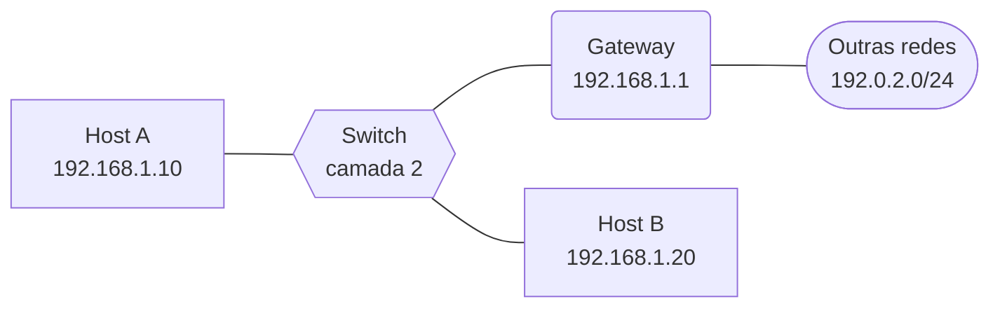

*Figura 3.1 (Tipo A, topologia).* Elementos do modo "Resolução": Host A (192.168.1.10); Switch (camada 2); Gateway (192.168.1.1); Host B (192.168.1.20); Outras redes (192.0.2.0/24). Vale para todos os cenários do modo (6.1.1 a 6.1.9).

### 3.2 ARP gratuito e conflito


*Figura 3.2a (Tipo A, topologia).* Elementos do modo "ARP gratuito e conflito": Host A (192.168.1.50); Switch (camada 2); Gateway (192.168.1.1); Host B (192.168.1.20); Outras redes (192.0.2.0/24). Vale para os cenários (6.2.1 e 6.2.2).

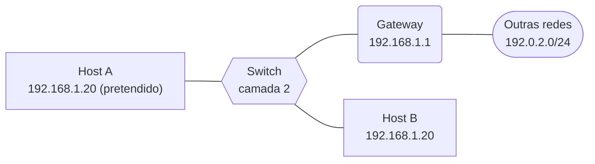

*Figura 3.2b (Tipo A, topologia).* Elementos do modo "ARP gratuito e conflito": Host A (192.168.1.20 (pretendido)); Switch (camada 2); Gateway (192.168.1.1); Host B (192.168.1.20); Outras redes (192.0.2.0/24). Vale para os cenários (6.2.3).


*Figura 3.2c (Tipo A, topologia).* Elementos do modo "ARP gratuito e conflito": Host A (192.168.1.50); Switch (camada 2); Gateway (192.168.1.1); Host B (192.168.1.50); Outras redes (192.0.2.0/24). Vale para os cenários (6.2.4 e 6.2.5).

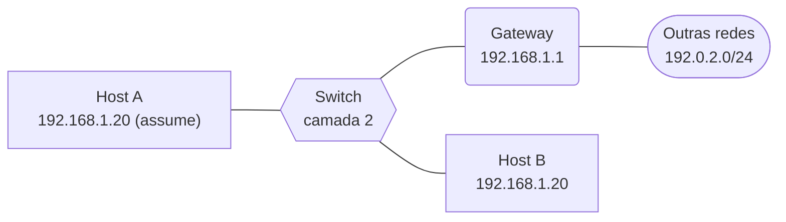

*Figura 3.2d (Tipo A, topologia).* Elementos do modo "ARP gratuito e conflito": Host A (192.168.1.20 (assume)); Switch (camada 2); Gateway (192.168.1.1); Host B (192.168.1.20); Outras redes (192.0.2.0/24). Vale para os cenários (6.2.6 e 6.2.7).

### 3.3 Envenenamento de cache

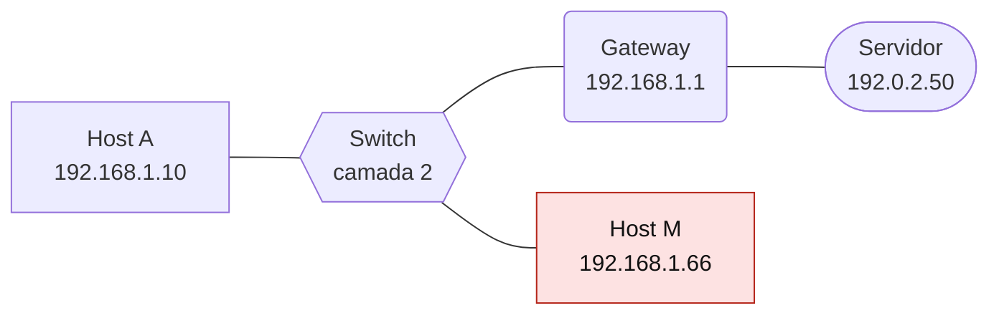

*Figura 3.3 (Tipo A, topologia).* Elementos do modo "Envenenamento de cache": Host A (192.168.1.10); Switch (camada 2); Gateway (192.168.1.1); Host M (192.168.1.66); Servidor (192.0.2.50). Vale para todos os cenários do modo (6.3.1 a 6.3.7).

## 4. Abas da bancada

Cenário, Captura, Mensagem, Tabela ARP, Experimento, Referência e Log.

## 5. Configurações (campos do painel)

### 5.1 Rede

- **RTT (ms)**. Valores: 1; 2; 5; 20; 100. Padrão: 2. Modos: todos.
  - Tempo de ida e volta na rede local.
  - Numa rede local Ethernet o RTT costuma ser de poucos milissegundos. Valores altos servem para ver o diagrama mais espaçado.
  - Não muda o que o ARP faz, só os tempos mostrados.

### 5.2 Destino

- **Para onde o host A envia**. Valores: Host B (mesma sub-rede); Destino remoto, via gateway; Destino remoto, sem gateway (máscara errada). Padrão: Host B (mesma sub-rede). Modos: Resolução.
  - Define por qual IP o ARP vai perguntar.
  - **Mesma sub-rede:** o ARP pergunta pelo IP do próprio destino.
  - **Destino remoto via gateway:** o ARP pergunta pelo IP do **gateway**, nunca pelo IP remoto. O quadro vai ao MAC do gateway, e o IP de destino continua o remoto.
  - **Sem gateway:** a máscara errada faz o host achar que o destino remoto é local e perguntar por ele. Só um roteador com proxy ARP responde.

### 5.3 Tabela ARP do host A

- **Estado inicial da entrada**. Valores: Sem entrada (primeira vez); Entrada recente (REACHABLE); Entrada antiga (STALE). Padrão: Sem entrada (primeira vez). Modos: Resolução.
  - O que o host A já sabe antes do ping.
  - **Sem entrada:** o host cria uma entrada INCOMPLETE e envia a requisição em broadcast.
  - **Recente:** acerto na tabela, nenhuma mensagem ARP.
  - **Antiga (STALE):** o host ainda usa o endereço, mas o confirma com uma requisição unicast.

### 5.4 Falhas

- **O próximo salto está ligado**. Valores: caixa de seleção. Padrão: sim. Modos: Resolução.
  - Vizinho (host B) ou gateway, conforme o destino.
  - Desmarcado, ninguém responde à requisição ARP: depois de 3 tentativas, 1 s entre elas, a entrada vira FAILED e o sistema informa "Destination Host Unreachable".
  - Com uma entrada recente na tabela, o ARP nem é consultado, e o ping falha sem resposta.
- **Proxy ARP ligado no gateway**. Valores: caixa de seleção. Padrão: não. Modos: Resolução.
  - O roteador responde no lugar de hosts de outras redes ([RFC 1027](https://www.rfc-editor.org/rfc/rfc1027)).
  - Só importa no destino remoto sem gateway. Ligado, o roteador responde ao ARP com o próprio MAC e encaminha o tráfego. Desligado, ninguém responde.
  - É um recurso de compatibilidade: esconde erros de configuração e aumenta a tabela ARP.
- **A primeira requisição se perde**. Valores: caixa de seleção. Padrão: não. Modos: Resolução.
  - Simula uma perda na rede local.
  - Se não há resposta em cerca de 1 s, o sistema retransmite a requisição. O ping demora mais, mas funciona.

### 5.5 Situação

- **O que acontece**. Valores: Endereço novo: verificação e anúncio; Endereço já em uso por outro host; Dois hosts com o mesmo endereço; Failover: o reserva assume o IP. Padrão: Endereço novo: verificação e anúncio. Modos: ARP gratuito e conflito.
  - Qual das quatro histórias do ARP gratuito será simulada.
  - **Endereço novo:** o host faz 3 Probes e 2 Announces antes de usar o endereço.
  - **Já em uso:** o dono responde ao Probe e o host desiste.
  - **Mesmo endereço:** o dono defende o endereço e a disputa se resolve (ou não).
  - **Failover:** o reserva assume o IP do principal que caiu.

### 5.6 Tabelas

- **Os vizinhos guardam um MAC antigo do endereço**. Valores: caixa de seleção. Padrão: sim. Modos: ARP gratuito e conflito.
  - Vale para o endereço novo.
  - Marcado, o gateway e o host B ainda têm uma entrada com o MAC de um dono anterior do IP, e o Announce a atualiza.
  - Desmarcado, ninguém tinha entrada e o Announce não muda nenhuma tabela.

### 5.7 Disputa

- **O host recém-chegado cede ao conflito**. Valores: caixa de seleção. Padrão: sim. Modos: ARP gratuito e conflito.
  - Vale para a disputa de endereço.
  - Marcado, o host B abandona o endereço assim que o dono o defende.
  - Desmarcado, B também defende. A recebe um segundo conflito em menos de 10 s e abandona o endereço ([RFC 5227](https://www.rfc-editor.org/rfc/rfc5227)).

### 5.8 Failover

- **Enviar ARP gratuito ao assumir o IP**. Valores: caixa de seleção. Padrão: sim. Modos: ARP gratuito e conflito.
  - Vale para o failover.
  - Marcado, o novo dono avisa a rede e o gateway atualiza a tabela na hora.
  - Desmarcado, o gateway continua enviando ao MAC do host que caiu até a entrada expirar e ser revalidada.

### 5.9 Cenário

- **Há um host malicioso na rede local**. Valores: caixa de seleção. Padrão: sim. Modos: Envenenamento de cache.
  - Liga ou desliga o ataque, para comparar com a situação normal.
  - O ataque só funciona dentro da mesma rede local (o mesmo domínio de broadcast): o ARP não atravessa roteadores.
- **Os dois lados são enganados (vítima e gateway)**. Valores: caixa de seleção. Padrão: sim. Modos: Envenenamento de cache.
  - Quem recebe respostas forjadas.
  - Marcado, o host A e o gateway são enganados: o tráfego passa pelo host M nos dois sentidos.
  - Desmarcado, só A é enganado: M vê o que A envia, mas a resposta do servidor volta direto para A.

### 5.10 Tráfego

- **Tráfego da vítima**. Valores: HTTP (texto puro); HTTPS (TLS, cifrado). Padrão: HTTP (texto puro). Modos: Envenenamento de cache.
  - O que A envia ao servidor.
  - **HTTP:** quem fica no meio do caminho lê o conteúdo, inclusive cookies de sessão.
  - **HTTPS:** o conteúdo está cifrado entre as pontas. O desvio continua acontecendo, mas M vê só tamanhos e momentos dos registros.

### 5.11 Defesa

- **Defesa na rede local**. Valores: Nenhuma; Entradas ARP estáticas (host e gateway); DAI no switch (com DHCP snooping); Monitoramento da tabela ARP (só alerta). Padrão: Nenhuma. Modos: Envenenamento de cache.
  - Como a rede reage às respostas forjadas.
  - **Entradas estáticas:** a tabela não aceita alteração, mas é trabalhosa de manter em muitos hosts.
  - **DAI (Dynamic ARP Inspection):** o switch descarta respostas ARP cujo par IP e MAC não confere com a tabela do DHCP snooping.
  - **Monitoramento:** detecta a mudança de MAC e alerta, mas não impede o desvio.

## 6. Cenários

### 6.1 Modo: Resolução

> **Grupo:** Resolução básica

O ARP traduz um endereço IP no endereço físico (MAC) do mesmo segmento. A tabela ARP guarda o resultado para que a pergunta não se repita a cada pacote.

#### 6.1.1 Primeira resolução

*Pergunta em broadcast, resposta unicast.*

**Configuração aplicada:** Para onde o host A envia = local; Estado inicial da entrada = empty; O próximo salto está ligado = sim; Proxy ARP ligado no gateway = não; A primeira requisição se perde = não

O host A quer fazer um ping no host B, na mesma rede, e **não tem o endereço físico** de B. Ele pergunta a todos (broadcast) e B responde só para A.

**Conceito.** O host A não tem o MAC de B. Ele envia uma requisição para o endereço de broadcast (ff:ff:ff:ff:ff:ff): todos recebem, mas só o dono do IP perguntado responde, e responde diretamente a A.

**O que observar**

- A requisição vai para ff:ff:ff:ff:ff:ff e o campo do MAC do alvo vai zerado.
- O gateway também recebe a pergunta e a descarta.
- B guarda o MAC de A ao receber a requisição, por isso o Echo Reply não precisa de outra consulta.

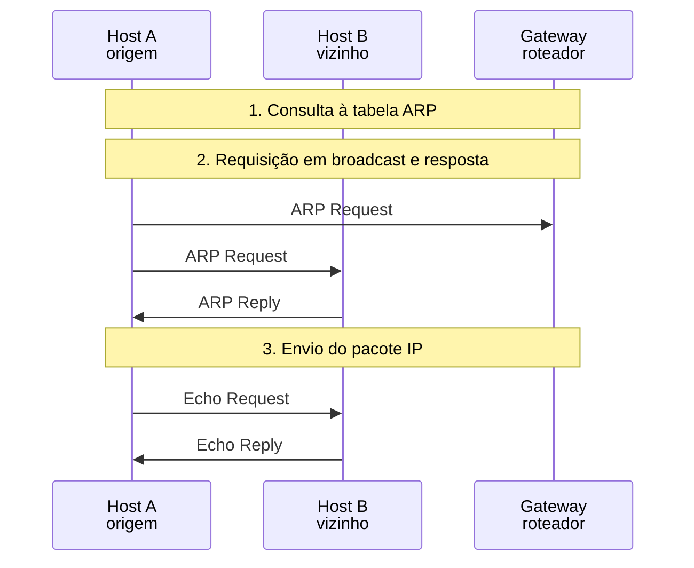

*Figura 6.1.1 (Tipo B, sequência).* Mensagens do cenário "Primeira resolução", na ordem do tempo, entre Host A, Host B, Gateway: 5 mensagens (em 3 fases). Corresponde ao diagrama de sequência e à aba Captura, no modo "Resolução", com a configuração aplicada acima.

**Mensagens**

| Mensagem | Significado | Origem |
| --- | --- | --- |
| ARP Request | quem tem 192.168.1.20? | A para todos |
| ARP Reply | 192.168.1.20 está em 00:00:5e:00:53:14 | B para A |
| Echo Request e Reply | o ping que motivou a consulta | A e B |

**Por que importa.** É o caso mais comum: todo primeiro contato numa rede local passa por aqui, e o resultado fica guardado na tabela ARP.

#### 6.1.2 Entrada já em cache

*Acerto na tabela: nenhum ARP.*

**Configuração aplicada:** Para onde o host A envia = local; Estado inicial da entrada = fresh; O próximo salto está ligado = sim; Proxy ARP ligado no gateway = não; A primeira requisição se perde = não

A tabela ARP de A já tem o endereço de B. **Nenhuma mensagem ARP** é enviada: o ping sai direto.

**Conceito.** Enquanto a entrada é válida, o host usa o MAC guardado. O ARP é consultado só quando a tabela não tem a resposta.

**O que observar**

- Não há mensagem ARP no diagrama.
- O primeiro quadro é o próprio Echo Request.

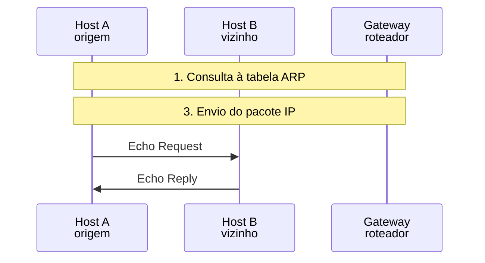

*Figura 6.1.2 (Tipo B, sequência).* Mensagens do cenário "Entrada já em cache", na ordem do tempo, entre Host A, Host B, Gateway: 2 mensagens (em 2 fases). Corresponde ao diagrama de sequência e à aba Captura, no modo "Resolução", com a configuração aplicada acima.

**Mensagens**

| Mensagem | Significado | Origem |
| --- | --- | --- |
| Echo Request e Reply | ping direto | A e B |

**Por que importa.** A tabela ARP evita uma pergunta por pacote. É também o que torna o envenenamento da tabela tão eficaz: o host confia no que já guardou.

#### 6.1.3 Entrada antiga (revalidação)

*A entrada antiga é confirmada por unicast.*

**Configuração aplicada:** Para onde o host A envia = local; Estado inicial da entrada = stale; O próximo salto está ligado = sim; Proxy ARP ligado no gateway = não; A primeira requisição se perde = não

A entrada de B está **STALE**: o host ainda a usa, mas a confirma perguntando **diretamente a B** (unicast), sem incomodar a rede toda.

**Conceito.** Uma entrada que passou do tempo de validade fica STALE. O host continua a usá-la, mas confirma em segundo plano com uma requisição unicast, direta ao dono do endereço, sem fazer broadcast.

**O que observar**

- A requisição vai para o MAC de B, e não para ff:ff:ff:ff:ff:ff.
- A resposta devolve a entrada a REACHABLE.

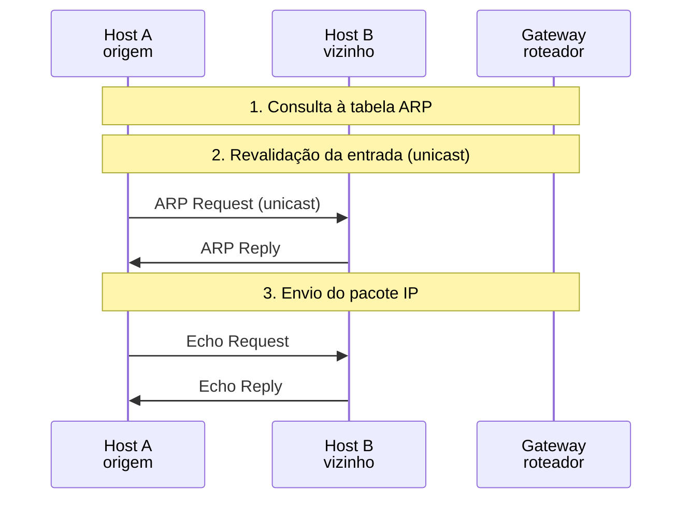

*Figura 6.1.3 (Tipo B, sequência).* Mensagens do cenário "Entrada antiga (revalidação)", na ordem do tempo, entre Host A, Host B, Gateway: 4 mensagens (em 3 fases). Corresponde ao diagrama de sequência e à aba Captura, no modo "Resolução", com a configuração aplicada acima.

**Mensagens**

| Mensagem | Significado | Origem |
| --- | --- | --- |
| ARP Request (unicast) | confirma o endereço conhecido | A para B |
| ARP Reply | confirma | B para A |

**Por que importa.** A confirmação unicast mantém a tabela correta sem sobrecarregar a rede com broadcasts.

> **Grupo:** Fora da sub-rede

O ARP só vale dentro da rede local. Para chegar a outra rede, o host resolve o endereço físico do gateway, e não o do destino remoto.

#### 6.1.4 Destino remoto via gateway

*O ARP pergunta pelo gateway, não pelo destino remoto.*

**Configuração aplicada:** Para onde o host A envia = gateway; Estado inicial da entrada = empty; O próximo salto está ligado = sim; Proxy ARP ligado no gateway = não; A primeira requisição se perde = não

O destino está em outra rede. O host A **não pergunta pelo IP remoto**: pergunta pelo IP do gateway e envia o quadro ao MAC dele.

**Conceito.** O broadcast não atravessa roteadores. Para uma rede diferente, o host envia o quadro ao gateway: o MAC de destino é o do gateway, e o IP de destino continua sendo o remoto.

**O que observar**

- O Who has pergunta por 192.168.1.1, e não por 192.0.2.50.
- No Echo Request, o MAC de destino é o do gateway e o IP de destino é o remoto.

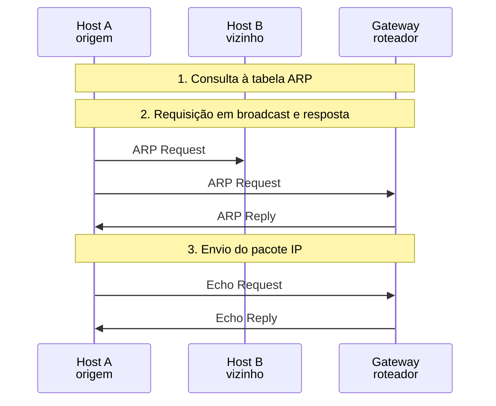

*Figura 6.1.4 (Tipo B, sequência).* Mensagens do cenário "Destino remoto via gateway", na ordem do tempo, entre Host A, Host B, Gateway: 5 mensagens (em 3 fases). Corresponde ao diagrama de sequência e à aba Captura, no modo "Resolução", com a configuração aplicada acima.

**Mensagens**

| Mensagem | Significado | Origem |
| --- | --- | --- |
| ARP Request | quem tem 192.168.1.1 (o gateway)? | A para todos |
| ARP Reply | o MAC do gateway | gateway para A |
| Echo Request | MAC do gateway, IP remoto | A para o gateway |

**Por que importa.** É o que o aluno costuma errar: o ARP nunca resolve o endereço de um host de outra rede.

#### 6.1.5 Proxy ARP (sem gateway)

*O roteador responde no lugar do destino remoto.*

**Configuração aplicada:** Para onde o host A envia = direto; Estado inicial da entrada = empty; O próximo salto está ligado = sim; Proxy ARP ligado no gateway = sim; A primeira requisição se perde = não

A máscara de A está errada e ele acha que o destino remoto é local. O roteador, com **proxy ARP**, responde com o próprio MAC e a comunicação funciona por acaso.

**Conceito.** Com a máscara errada, o host acredita que o destino está na rede local e pergunta diretamente por ele. O roteador, com proxy ARP, responde com o próprio MAC e passa a encaminhar o tráfego ([RFC 1027](https://www.rfc-editor.org/rfc/rfc1027)).

**O que observar**

- O Who has pergunta por 192.0.2.50, que não está nesta rede.
- A resposta traz o MAC do gateway, e não o do destino.


*Figura 6.1.5 (Tipo B, sequência).* Mensagens do cenário "Proxy ARP (sem gateway)", na ordem do tempo, entre Host A, Host B, Gateway: 5 mensagens (em 3 fases). Corresponde ao diagrama de sequência e à aba Captura, no modo "Resolução", com a configuração aplicada acima.

**Mensagens**

| Mensagem | Significado | Origem |
| --- | --- | --- |
| ARP Request | quem tem 192.0.2.50? | A para todos |
| ARP Reply | o gateway responde com o próprio MAC | gateway para A |

**Por que importa.** O proxy ARP faz um erro de configuração parecer funcionar, o que dificulta achar o problema e aumenta a tabela ARP.

#### 6.1.6 Sem gateway e sem proxy ARP

*Ninguém responde: o ping falha.*

**Configuração aplicada:** Para onde o host A envia = direto; Estado inicial da entrada = empty; O próximo salto está ligado = sim; Proxy ARP ligado no gateway = não; A primeira requisição se perde = não

Mesma máscara errada, mas o roteador **não faz proxy ARP**. Ninguém responde e o ping falha.

**Conceito.** Sem gateway configurado e sem proxy ARP, a pergunta por um endereço de outra rede fica sem resposta. O host repete três vezes e desiste.

**O que observar**

- As três requisições seguem sem resposta.
- A entrada de A vira FAILED.

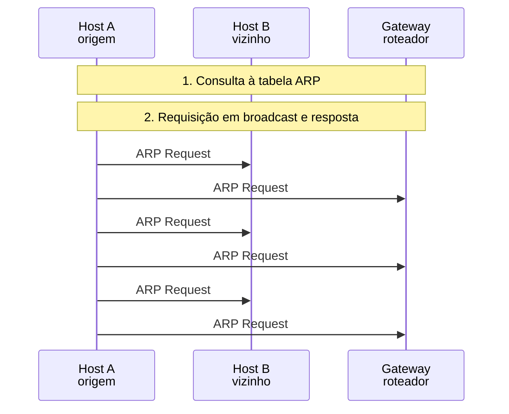

*Figura 6.1.6 (Tipo B, sequência).* Mensagens do cenário "Sem gateway e sem proxy ARP", na ordem do tempo, entre Host A, Host B, Gateway: 6 mensagens (em 3 fases). Corresponde ao diagrama de sequência e à aba Captura, no modo "Resolução", com a configuração aplicada acima.

**Mensagens**

| Mensagem | Significado | Origem |
| --- | --- | --- |
| ARP Request | repetida 3 vezes | A para todos |

**Por que importa.** O sintoma, "Destination Host Unreachable", aponta para uma falha no ARP, e não na rota. Conferir a máscara resolve.

> **Grupo:** Falhas

Sem resposta ARP o pacote IP nem chega a ser montado. A perda, o host desligado e a entrada desatualizada têm sintomas diferentes.

#### 6.1.7 Destino desligado

*Três tentativas e a entrada vira FAILED.*

**Configuração aplicada:** Para onde o host A envia = local; Estado inicial da entrada = empty; O próximo salto está ligado = não; Proxy ARP ligado no gateway = não; A primeira requisição se perde = não

B está desligado. A repete a requisição **3 vezes**, com 1 s entre elas, e desiste: a entrada vira FAILED.

**Conceito.** Se o dono do endereço não responde, o sistema repete a requisição e desiste. O pacote IP é descartado e o próprio sistema de A informa que o host está inalcançável.

**O que observar**

- São 3 requisições, 1 s entre elas.
- Nenhum ICMP circula na rede: o aviso é gerado em A.

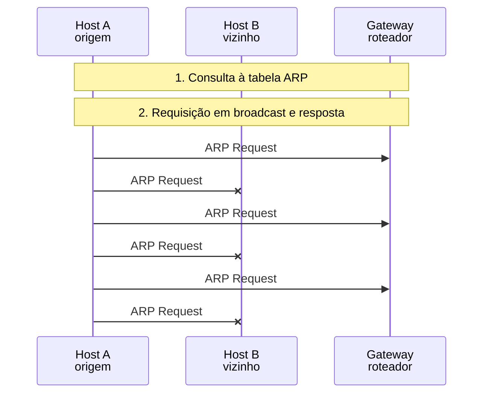

*Figura 6.1.7 (Tipo B, sequência).* Mensagens do cenário "Destino desligado", na ordem do tempo, entre Host A, Host B, Gateway: 6 mensagens (em 3 fases; 3 perdidas). Corresponde ao diagrama de sequência e à aba Captura, no modo "Resolução", com a configuração aplicada acima.

**Mensagens**

| Mensagem | Significado | Origem |
| --- | --- | --- |
| ARP Request | sem resposta, 3 vezes | A para todos |

**Por que importa.** "Destination Host Unreachable" vindo do próprio host indica falha de resolução ARP, e não uma mensagem de um roteador.

#### 6.1.8 Requisição perdida e retransmitida

*A retransmissão resolve a perda.*

**Configuração aplicada:** Para onde o host A envia = local; Estado inicial da entrada = empty; O próximo salto está ligado = sim; Proxy ARP ligado no gateway = não; A primeira requisição se perde = sim

A primeira requisição se perde. Sem resposta em 1 s, o host **retransmite** e o ping funciona, só que mais devagar.

**Conceito.** Se a requisição se perde, a resposta nunca vem. Passado cerca de 1 s, o sistema retransmite, e a segunda tentativa funciona.

**O que observar**

- A primeira requisição aparece com ✕.
- O ping demora cerca de 1 s a mais.

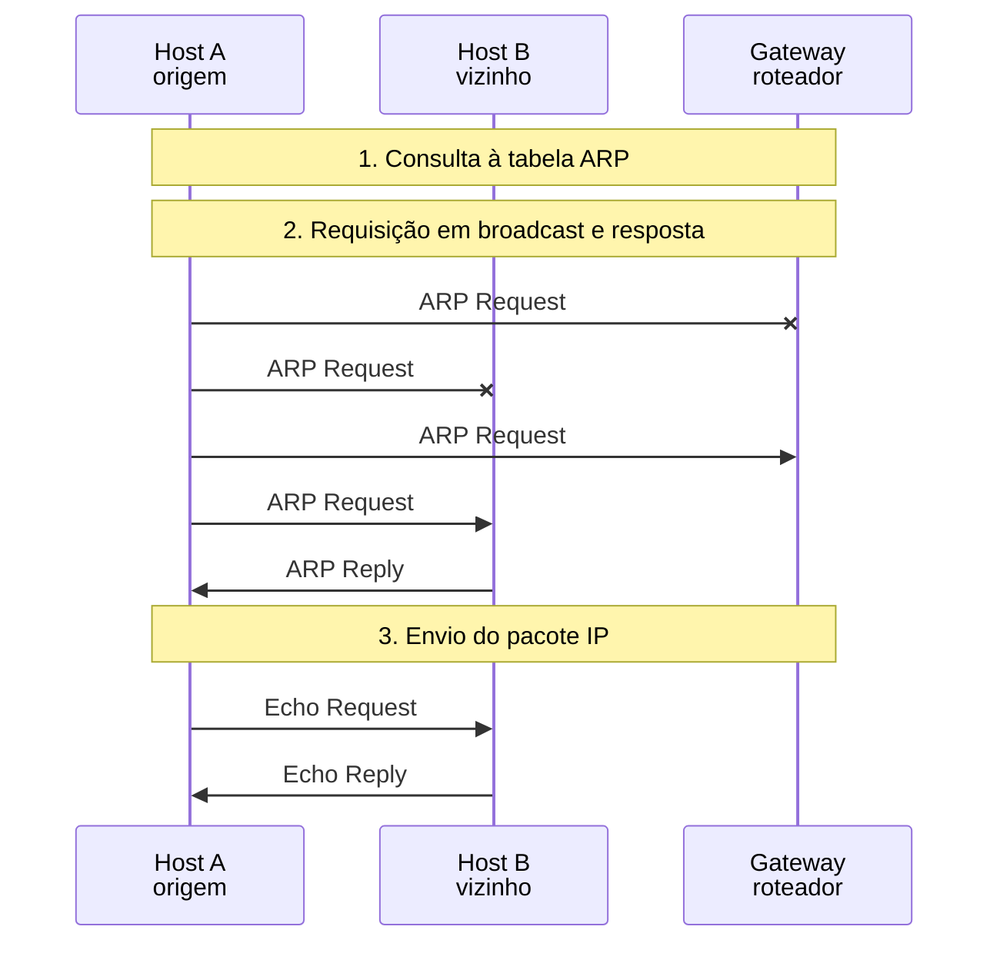

*Figura 6.1.8 (Tipo B, sequência).* Mensagens do cenário "Requisição perdida e retransmitida", na ordem do tempo, entre Host A, Host B, Gateway: 7 mensagens (em 3 fases; 2 perdidas). Corresponde ao diagrama de sequência e à aba Captura, no modo "Resolução", com a configuração aplicada acima.

**Mensagens**

| Mensagem | Significado | Origem |
| --- | --- | --- |
| ARP Request | perdida | A |
| ARP Request | retransmitida | A |
| ARP Reply | chega | B para A |

**Por que importa.** Perdas esporádicas viram atrasos de 1 s no primeiro pacote, uma assinatura típica de problemas na camada 2.

#### 6.1.9 Entrada recente, host desligado

*A tabela guardava um host que já não responde.*

**Configuração aplicada:** Para onde o host A envia = local; Estado inicial da entrada = fresh; O próximo salto está ligado = não; Proxy ARP ligado no gateway = não; A primeira requisição se perde = não

A tabela ainda guarda o endereço de B, que foi desligado. O ping sai sem consultar o ARP e **fica sem resposta**: a tabela não prova que o host está ligado.

**Conceito.** Uma entrada REACHABLE só diz que o host respondeu há pouco. Se ele sair do ar, o ping sai sem consultar o ARP e fica sem resposta, até a entrada ser revalidada.

**O que observar**

- Não há mensagem ARP.
- O Echo Request aparece com ✕.

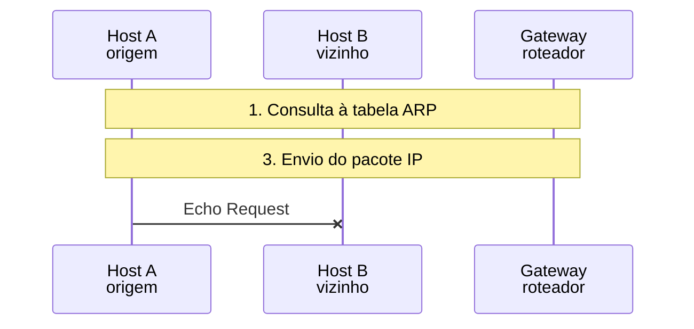

*Figura 6.1.9 (Tipo B, sequência).* Mensagens do cenário "Entrada recente, host desligado", na ordem do tempo, entre Host A, Host B, Gateway: 1 mensagem (em 2 fases; 1 perdida). Corresponde ao diagrama de sequência e à aba Captura, no modo "Resolução", com a configuração aplicada acima.

**Mensagens**

| Mensagem | Significado | Origem |
| --- | --- | --- |
| Echo Request | sem resposta | A |

**Por que importa.** A tabela ARP não é um teste de vida: um ping sem resposta pode ter a entrada ainda "boa".

### 6.2 Modo: ARP gratuito e conflito

> **Grupo:** Anúncio de endereço

Antes de usar um endereço, o host verifica se há conflito (ARP Probe) e depois o anuncia (ARP Announce), como define a [RFC 5227](https://www.rfc-editor.org/rfc/rfc5227). Os dois usam pacotes ARP comuns, com o IP do remetente e o do alvo escolhidos de propósito.

#### 6.2.1 Endereço novo: Probe e Announce

*Três Probes e dois Announces antes de usar o endereço.*

**Configuração aplicada:** O que acontece = announce; Os vizinhos guardam um MAC antigo do endereço = sim; O host recém-chegado cede ao conflito = sim; Enviar ARP gratuito ao assumir o IP = sim

O host A vai usar um endereço novo. Antes, faz **3 Probes** para saber se alguém o usa. Sem resposta, faz **2 Announces** e os vizinhos atualizam suas tabelas.

**Conceito.** Antes de configurar um endereço, o host faz 3 ARP Probes (com o IP do remetente zerado) para saber se alguém o usa. Sem resposta, espera e faz 2 ARP Announces, em que remetente e alvo têm o mesmo IP. Os vizinhos que já tinham uma entrada para o endereço a atualizam.

**O que observar**

- O Probe leva 0.0.0.0 como IP do remetente.
- O Announce leva o mesmo IP como remetente e como alvo.
- No gateway, a entrada do endereço passa do MAC antigo para o MAC de A.

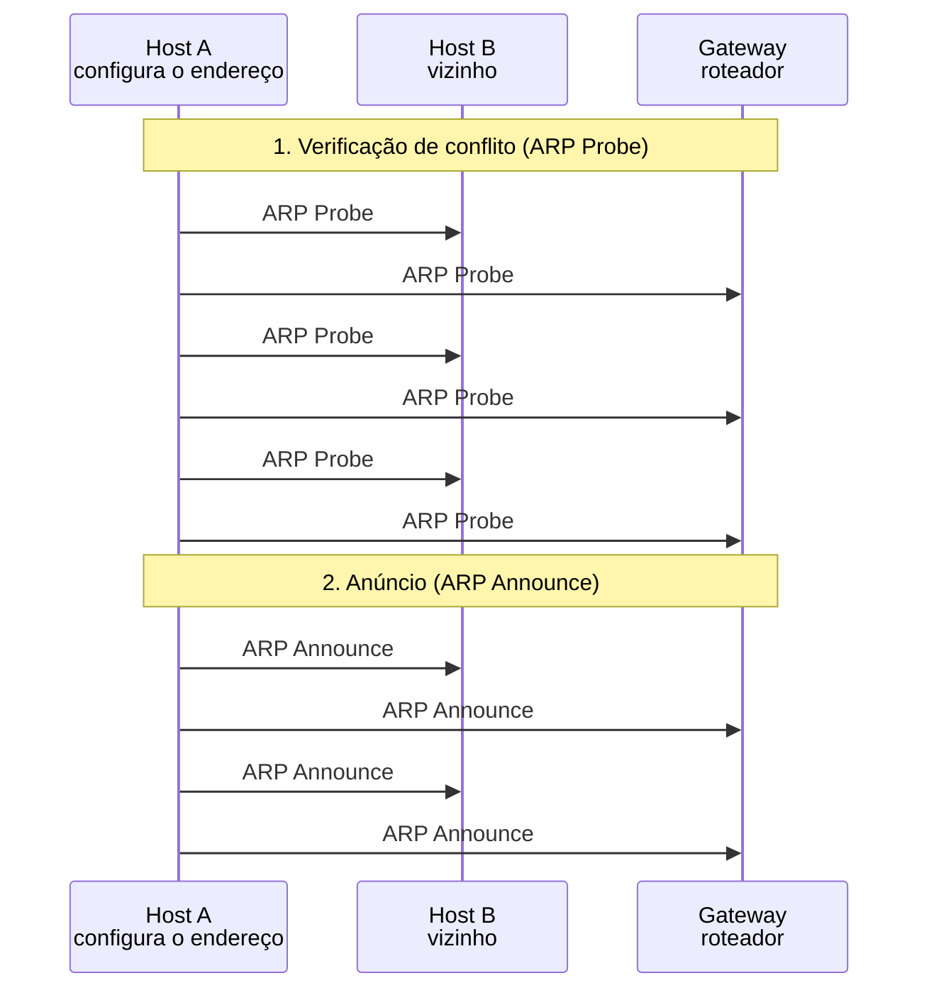

*Figura 6.2.1 (Tipo B, sequência).* Mensagens do cenário "Endereço novo: Probe e Announce", na ordem do tempo, entre Host A, Host B, Gateway: 10 mensagens (em 2 fases). Corresponde ao diagrama de sequência e à aba Captura, no modo "ARP gratuito e conflito", com a configuração aplicada acima.

**Mensagens**

| Mensagem | Significado | Origem |
| --- | --- | --- |
| ARP Probe | quem tem o endereço? (3 vezes) | A para todos |
| ARP Announce | o endereço agora é meu (2 vezes) | A para todos |

**Por que importa.** O Probe evita configurar um endereço duplicado, e o Announce faz a rede esquecer o dono anterior sem esperar as tabelas expirarem.

#### 6.2.2 Anúncio sem entradas antigas

*Se ninguém tinha entrada, o Announce não muda nenhuma tabela.*

**Configuração aplicada:** O que acontece = announce; Os vizinhos guardam um MAC antigo do endereço = não; O host recém-chegado cede ao conflito = sim; Enviar ARP gratuito ao assumir o IP = sim

Mesma sequência, mas nenhum vizinho tinha entrada para o endereço: o Announce **não muda nenhuma tabela**, e só serve para avisar.

**Conceito.** O ARP só atualiza entradas que já existem, e não cria uma por causa de um Announce. Num endereço realmente novo, o anúncio só avisa os vizinhos, que aprendem o MAC quando precisarem falar com o host.

**O que observar**

- Os vizinhos mostram "sem entrada: nada a atualizar".
- A tabela do gateway continua vazia.


*Figura 6.2.2 (Tipo B, sequência).* Mensagens do cenário "Anúncio sem entradas antigas", na ordem do tempo, entre Host A, Host B, Gateway: 10 mensagens (em 2 fases). Corresponde ao diagrama de sequência e à aba Captura, no modo "ARP gratuito e conflito", com a configuração aplicada acima.

**Mensagens**

| Mensagem | Significado | Origem |
| --- | --- | --- |
| ARP Probe | verificação | A para todos |
| ARP Announce | anúncio | A para todos |

**Por que importa.** O anúncio é útil sobretudo quando o endereço já foi de outro host, caso comum com DHCP.

> **Grupo:** Conflito de endereço

Dois hosts com o mesmo IP quebram a comunicação dos dois. O ARP é o meio de descobrir e de defender o endereço.

#### 6.2.3 Endereço já em uso (Probe)

*O dono do endereço responde ao Probe e o host desiste.*

**Configuração aplicada:** O que acontece = inuse; Os vizinhos guardam um MAC antigo do endereço = sim; O host recém-chegado cede ao conflito = sim; Enviar ARP gratuito ao assumir o IP = sim

O endereço que A quer **já pertence ao host B**. B responde ao primeiro Probe e A desiste, antes de usar o endereço.

**Conceito.** Se alguém já usa o endereço, responde ao Probe com uma resposta ARP normal. O host que testava vê o conflito e não usa o endereço (com DHCP, recusa a oferta com DHCPDECLINE).

**O que observar**

- A resposta de B diz que o endereço está nele.
- O host A não chega a mandar nenhum Announce.
- O endereço de A continua sem uso.

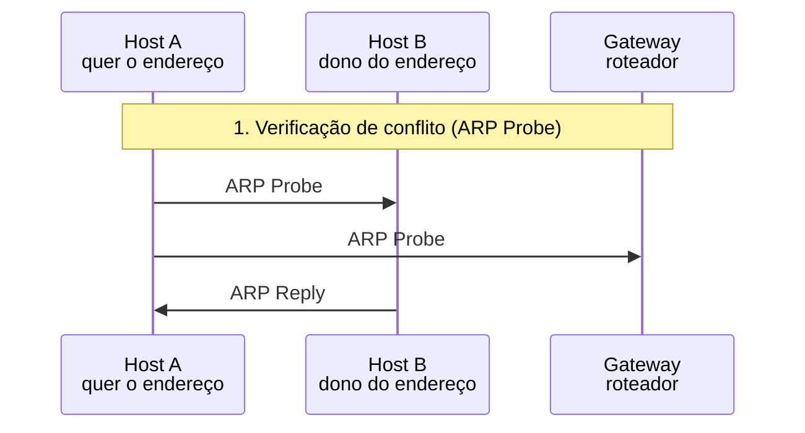

*Figura 6.2.3 (Tipo B, sequência).* Mensagens do cenário "Endereço já em uso (Probe)", na ordem do tempo, entre Host A, Host B, Gateway: 3 mensagens (em 1 fase). Corresponde ao diagrama de sequência e à aba Captura, no modo "ARP gratuito e conflito", com a configuração aplicada acima.

**Mensagens**

| Mensagem | Significado | Origem |
| --- | --- | --- |
| ARP Probe | quem tem o endereço? | A para todos |
| ARP Reply | o endereço já é meu | B para A |

**Por que importa.** Sem a verificação, o endereço duplicado derrubaria as conexões do host original.

#### 6.2.4 Disputa: o recém-chegado cede

*O dono defende o endereço e o outro cede.*

**Configuração aplicada:** O que acontece = dispute; Os vizinhos guardam um MAC antigo do endereço = sim; O host recém-chegado cede ao conflito = sim; Enviar ARP gratuito ao assumir o IP = sim

B é configurado à mão com o endereço de A, sem verificar conflito. A **defende o endereço** com um Announce e B cede.

**Conceito.** Um host configurado à mão sem verificar conflito anuncia um endereço que já pertence a outro. O dono percebe o conflito e o defende com um Announce, no máximo uma vez por intervalo de 10 s ([RFC 5227](https://www.rfc-editor.org/rfc/rfc5227)). O outro host reconhece o conflito e abandona o endereço.

**O que observar**

- O gateway troca a entrada para o MAC de B e depois a devolve para o MAC de A.
- Entre as duas mensagens, o tráfego do gateway iria para o host errado.

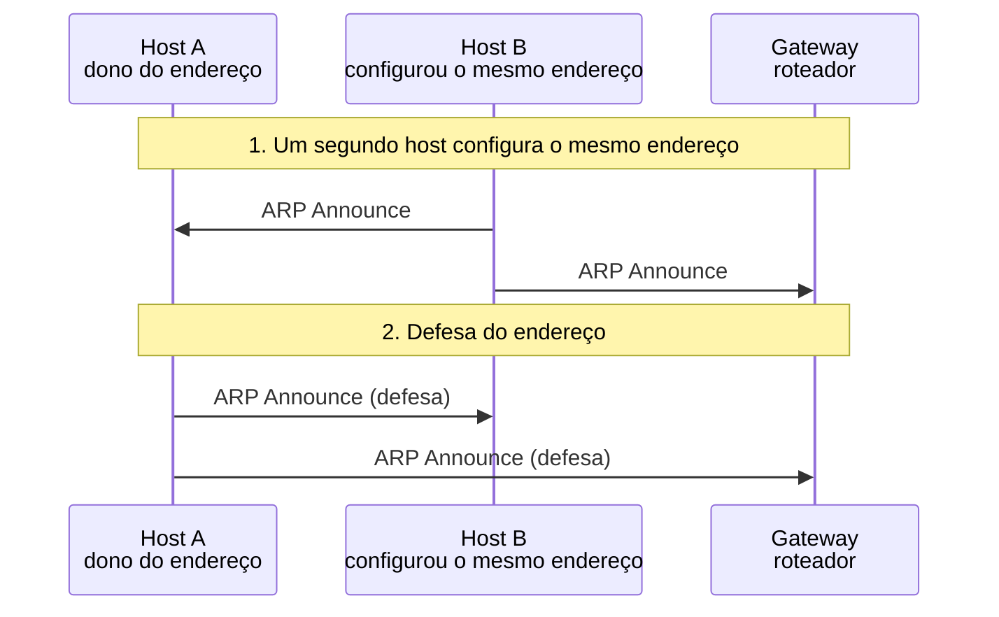

*Figura 6.2.4 (Tipo B, sequência).* Mensagens do cenário "Disputa: o recém-chegado cede", na ordem do tempo, entre Host A, Host B, Gateway: 4 mensagens (em 2 fases). Corresponde ao diagrama de sequência e à aba Captura, no modo "ARP gratuito e conflito", com a configuração aplicada acima.

**Mensagens**

| Mensagem | Significado | Origem |
| --- | --- | --- |
| ARP Announce | B afirma ter o endereço | B para todos |
| ARP Announce (defesa) | A reafirma o endereço | A para todos |

**Por que importa.** Endereços duplicados por configuração manual são comuns, e a tabela do gateway oscila enquanto a disputa dura.

#### 6.2.5 Disputa: os dois defendem

*Se os dois defendem, o dono desiste no segundo conflito.*

**Configuração aplicada:** O que acontece = dispute; Os vizinhos guardam um MAC antigo do endereço = sim; O host recém-chegado cede ao conflito = não; Enviar ARP gratuito ao assumir o IP = sim

B também defende o endereço. A recebe um **segundo conflito em menos de 10 s** e abandona o endereço.

**Conceito.** Pela [RFC 5227](https://www.rfc-editor.org/rfc/rfc5227), o host defende o endereço uma vez. Se B também defende, A recebe um segundo conflito em menos de 10 s e abandona o endereço. O resultado é o oposto do esperado: o dono perde para quem não cedeu.

**O que observar**

- O gateway termina apontando para o MAC de B.
- O estado final é "B ficou com o endereço".

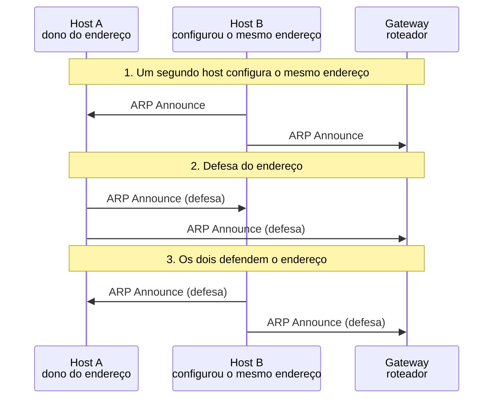

*Figura 6.2.5 (Tipo B, sequência).* Mensagens do cenário "Disputa: os dois defendem", na ordem do tempo, entre Host A, Host B, Gateway: 6 mensagens (em 3 fases). Corresponde ao diagrama de sequência e à aba Captura, no modo "ARP gratuito e conflito", com a configuração aplicada acima.

**Mensagens**

| Mensagem | Significado | Origem |
| --- | --- | --- |
| ARP Announce | B afirma ter o endereço | B para todos |
| ARP Announce (defesa) | A defende | A para todos |
| ARP Announce (defesa) | B defende de volta | B para todos |

**Por que importa.** A regra de desistir no segundo conflito evita uma disputa sem fim, mas pode tirar o endereço de quem o tinha primeiro.

> **Grupo:** Failover de IP

Quando um host reserva assume o IP do principal, os vizinhos ainda guardam o MAC do host antigo. O ARP gratuito corrige as tabelas na hora.

#### 6.2.6 Failover com ARP gratuito

*O ARP gratuito atualiza o gateway na hora.*

**Configuração aplicada:** O que acontece = failover; Os vizinhos guardam um MAC antigo do endereço = sim; O host recém-chegado cede ao conflito = sim; Enviar ARP gratuito ao assumir o IP = sim

O principal cai e o reserva assume o IP. O reserva envia um **ARP gratuito**, o gateway atualiza a tabela e o serviço volta em cerca de um RTT.

**Conceito.** O reserva assume o IP e envia uma resposta ARP que ninguém pediu, em broadcast: remetente e alvo têm o mesmo IP. O gateway, que tinha o MAC do host que caiu, passa a apontar para o novo dono, e o ping já é respondido.

**O que observar**

- O ARP gratuito chega ao gateway, mas não a B, que está fora do ar.
- A tabela do gateway muda para o MAC de A.

```mermaid
sequenceDiagram
  participant n_a as Host A<br/>reserva
  participant n_b as Host B<br/>principal (caiu)
  participant n_g as Gateway<br/>roteador
  Note over n_a,n_g: 1. O principal cai e o reserva assume o IP
  Note over n_a,n_g: 2. ARP gratuito
  n_a -x n_b: Gratuitous ARP (Reply)
  n_a ->> n_g: Gratuitous ARP (Reply)
  Note over n_a,n_g: 3. O tráfego volta
  n_g ->> n_a: Echo Request
  n_a ->> n_g: Echo Reply
```

*Figura 6.2.6 (Tipo B, sequência).* Mensagens do cenário "Failover com ARP gratuito", na ordem do tempo, entre Host A, Host B, Gateway: 4 mensagens (em 3 fases; 1 perdida). Corresponde ao diagrama de sequência e à aba Captura, no modo "ARP gratuito e conflito", com a configuração aplicada acima.

**Mensagens**

| Mensagem | Significado | Origem |
| --- | --- | --- |
| Gratuitous ARP (Reply) | o IP agora está em A | A para todos |
| Echo Request e Reply | o serviço volta | gateway e A |

**Por que importa.** É o que protocolos de redundância como VRRP e clusters fazem ao trocar o responsável por um IP.

#### 6.2.7 Failover sem ARP gratuito

*Sem aviso, o gateway só corrige quando a entrada expira.*

**Configuração aplicada:** O que acontece = failover; Os vizinhos guardam um MAC antigo do endereço = sim; O host recém-chegado cede ao conflito = sim; Enviar ARP gratuito ao assumir o IP = não

O reserva assume o IP e **não avisa ninguém**. O gateway continua mandando ao MAC do host que caiu, até a entrada expirar e ser revalidada.

**Conceito.** Sem ARP gratuito, o gateway continua enviando ao MAC de B. Só quando a entrada expira e a revalidação falha ele pergunta em broadcast e descobre o novo dono. O tempo de espera depende do equipamento.

**O que observar**

- O primeiro ping fica sem resposta.
- As sondas unicast para B também ficam sem resposta e a entrada vira FAILED.

```mermaid
sequenceDiagram
  participant n_a as Host A<br/>reserva
  participant n_b as Host B<br/>principal (caiu)
  participant n_g as Gateway<br/>roteador
  Note over n_a,n_g: 1. O principal cai e o reserva assume o IP
  Note over n_a,n_g: 2. Sem ARP gratuito
  n_g -x n_b: Echo Request
  Note over n_a,n_g: 3. A entrada expira e é revalidada
  n_g -x n_b: ARP Request (unicast)
  n_g -x n_b: ARP Request (unicast)
  n_g -x n_b: ARP Request (unicast)
  n_g ->> n_a: ARP Request
  n_g -x n_b: ARP Request
  n_a ->> n_g: ARP Reply
  n_g ->> n_a: Echo Request
  n_a ->> n_g: Echo Reply
```

*Figura 6.2.7 (Tipo B, sequência).* Mensagens do cenário "Failover sem ARP gratuito", na ordem do tempo, entre Host A, Host B, Gateway: 9 mensagens (em 3 fases; 5 perdidas). Corresponde ao diagrama de sequência e à aba Captura, no modo "ARP gratuito e conflito", com a configuração aplicada acima.

**Mensagens**

| Mensagem | Significado | Origem |
| --- | --- | --- |
| Echo Request | sem resposta | gateway |
| ARP Request (unicast) | revalidação, 3 vezes | gateway |
| ARP Request e Reply | o novo dono responde | gateway e A |

**Por que importa.** Sem o ARP gratuito, o failover pode levar de dezenas de segundos a horas para chegar a todos os vizinhos.

### 6.3 Modo: Envenenamento de cache

> **Grupo:** Referência

Antes de olhar o ataque, convém ver o fluxo normal, com as duas tabelas ARP corretas.

#### 6.3.1 Sem ataque (referência)

*As duas tabelas estão corretas e o tráfego vai direto.*

**Configuração aplicada:** Há um host malicioso na rede local = não; Os dois lados são enganados (vítima e gateway) = sim; Tráfego da vítima = http; Defesa na rede local = none

A situação normal: as tabelas de A e do gateway estão corretas e o tráfego vai direto, sem passar pelo host M.

**Conceito.** Em condições normais, cada host associa o IP do outro ao MAC correto, e o tráfego entre A e o gateway não passa por mais ninguém.

**O que observar**

- O MAC de destino dos quadros é sempre o do gateway ou o de A.
- O host M não aparece no caminho.

```mermaid
sequenceDiagram
  participant n_a as Host A<br/>vítima
  participant n_m as Host M<br/>host malicioso
  participant n_g as Gateway<br/>roteador
  Note over n_a,n_g: 1. Situação normal
  Note over n_a,n_g: 3. Tráfego da vítima para o servidor
  n_a ->> n_g: HTTP GET
  n_g ->> n_a: HTTP 200
```

*Figura 6.3.1 (Tipo B, sequência).* Mensagens do cenário "Sem ataque (referência)", na ordem do tempo, entre Host A, Host M, Gateway: 2 mensagens (em 2 fases). Corresponde ao diagrama de sequência e à aba Captura, no modo "Envenenamento de cache", com a configuração aplicada acima.

**Mensagens**

| Mensagem | Significado | Origem |
| --- | --- | --- |
| HTTP GET e HTTP 200 | requisição e resposta | A e gateway |

**Por que importa.** É a referência para comparar com os cenários de ataque e de defesa.

> **Grupo:** O ataque e seu efeito

O ARP aceita respostas sem verificar quem as enviou. Dentro da rede local, isso permite que um host se coloque no caminho do tráfego de outros. O que ele consegue ler depende do protocolo usado.

#### 6.3.2 Cache envenenado (HTTP)

*Respostas forjadas colocam M no caminho do tráfego.*

**Configuração aplicada:** Há um host malicioso na rede local = sim; Os dois lados são enganados (vítima e gateway) = sim; Tráfego da vítima = http; Defesa na rede local = none

O host M envia respostas ARP que ninguém pediu. A e o gateway as aceitam, e o tráfego **HTTP** passa a atravessar M, que lê o conteúdo.

**Conceito.** O ARP não autentica quem responde. O host M envia a A uma resposta que ninguém pediu, dizendo que o IP do gateway está no MAC dele, e envia ao gateway uma resposta equivalente sobre A. Quem aceita passa a enviar a M o tráfego do outro, e M o repassa ao destino verdadeiro, de modo que nada parece errado.

**O que observar**

- A resposta forjada traz o MAC de M como remetente e o IP do gateway como endereço declarado.
- A tabela de A passa a associar o IP do gateway ao MAC de M.
- M repassa os quadros, e por isso a comunicação continua funcionando.

```mermaid
sequenceDiagram
  participant n_a as Host A<br/>vítima
  participant n_m as Host M<br/>host malicioso
  participant n_g as Gateway<br/>roteador
  Note over n_a,n_g: 1. Situação normal
  Note over n_a,n_g: 2. Respostas ARP forjadas
  n_m ->> n_a: ARP Reply (forjada)
  n_m ->> n_g: ARP Reply (forjada)
  Note over n_a,n_g: 3. Tráfego da vítima para o servidor
  n_a ->> n_m: HTTP GET
  n_m ->> n_g: HTTP GET (repassado)
  n_g ->> n_m: HTTP 200
  n_m ->> n_a: HTTP 200 (repassado)
```

*Figura 6.3.2 (Tipo B, sequência).* Mensagens do cenário "Cache envenenado (HTTP)", na ordem do tempo, entre Host A, Host M, Gateway: 6 mensagens (em 3 fases). Corresponde ao diagrama de sequência e à aba Captura, no modo "Envenenamento de cache", com a configuração aplicada acima.

**Mensagens**

| Mensagem | Significado | Origem |
| --- | --- | --- |
| ARP Reply (forjada) | o IP do gateway estaria no MAC de M | M para A e gateway |
| HTTP GET e HTTP 200 | o tráfego passa por M, que o lê | A, M e gateway |

**Por que importa.** Em HTTP, quem fica no meio do caminho lê tudo, inclusive cookies de sessão. É um risco de redes locais compartilhadas, como Wi-Fi público.

#### 6.3.3 Só a vítima é enganada

*Com só a vítima enganada, M vê só um sentido.*

**Configuração aplicada:** Há um host malicioso na rede local = sim; Os dois lados são enganados (vítima e gateway) = não; Tráfego da vítima = http; Defesa na rede local = none

Só A recebe a resposta forjada. M vê **só a requisição**; a resposta do servidor volta direto para A.

**Conceito.** Se só A é enganado, os quadros de A passam por M, mas a resposta do gateway volta direto para A, que continua com o MAC correto na tabela do gateway.

**O que observar**

- A resposta do servidor não passa por M.
- O estado diz "ida por M, volta direta".

```mermaid
sequenceDiagram
  participant n_a as Host A<br/>vítima
  participant n_m as Host M<br/>host malicioso
  participant n_g as Gateway<br/>roteador
  Note over n_a,n_g: 1. Situação normal
  Note over n_a,n_g: 2. Respostas ARP forjadas
  n_m ->> n_a: ARP Reply (forjada)
  Note over n_a,n_g: 3. Tráfego da vítima para o servidor
  n_a ->> n_m: HTTP GET
  n_m ->> n_g: HTTP GET (repassado)
  n_g ->> n_a: HTTP 200
```

*Figura 6.3.3 (Tipo B, sequência).* Mensagens do cenário "Só a vítima é enganada", na ordem do tempo, entre Host A, Host M, Gateway: 4 mensagens (em 3 fases). Corresponde ao diagrama de sequência e à aba Captura, no modo "Envenenamento de cache", com a configuração aplicada acima.

**Mensagens**

| Mensagem | Significado | Origem |
| --- | --- | --- |
| ARP Reply (forjada) | só para A | M para A |
| HTTP GET | passa por M | A, M e gateway |
| HTTP 200 | volta direto | gateway para A |

**Por que importa.** Mostra que o desvio pode ser parcial: nem sempre o intermediário vê a conversa inteira.

#### 6.3.4 Mesmo desvio, tráfego HTTPS

*O desvio ocorre, mas o conteúdo cifrado continua protegido.*

**Configuração aplicada:** Há um host malicioso na rede local = sim; Os dois lados são enganados (vítima e gateway) = sim; Tráfego da vítima = https; Defesa na rede local = none

O desvio acontece do mesmo jeito, mas o tráfego é **HTTPS**: M recebe os quadros e não consegue ler o conteúdo.

**Conceito.** O envenenamento atua na camada 2 e não depende do protocolo de cima. Com HTTPS, o conteúdo é cifrado entre A e o servidor: M recebe os quadros, mas só enxerga tamanhos e momentos dos registros. Ele ainda poderia atrasar ou descartar o tráfego.

**O que observar**

- A tabela de A continua envenenada.
- M vê só dados cifrados (TLS).

```mermaid
sequenceDiagram
  participant n_a as Host A<br/>vítima
  participant n_m as Host M<br/>host malicioso
  participant n_g as Gateway<br/>roteador
  Note over n_a,n_g: 1. Situação normal
  Note over n_a,n_g: 2. Respostas ARP forjadas
  n_m ->> n_a: ARP Reply (forjada)
  n_m ->> n_g: ARP Reply (forjada)
  Note over n_a,n_g: 3. Tráfego da vítima para o servidor
  n_a ->> n_m: [cifrado] TLS dados
  n_m ->> n_g: [cifrado] TLS dados (repassado)
  n_g ->> n_m: [cifrado] TLS dados
  n_m ->> n_a: [cifrado] TLS dados (repassado)
```

*Figura 6.3.4 (Tipo B, sequência).* Mensagens do cenário "Mesmo desvio, tráfego HTTPS", na ordem do tempo, entre Host A, Host M, Gateway: 6 mensagens (em 3 fases; 4 cifradas). Corresponde ao diagrama de sequência e à aba Captura, no modo "Envenenamento de cache", com a configuração aplicada acima.

**Mensagens**

| Mensagem | Significado | Origem |
| --- | --- | --- |
| ARP Reply (forjada) | mesmo ataque | M para A e gateway |
| TLS dados | cifrado de ponta a ponta | A, M e gateway |

**Por que importa.** A cifra de ponta a ponta (HTTPS, SSH) limita o dano de um desvio na camada 2, o que liga este simulador ao de HTTPS e ao de SSH.

> **Grupo:** Defesas

As defesas atuam em pontos diferentes: no host (entrada estática), no switch (DAI) e na observação da rede (monitoramento). Nenhuma substitui a cifra de ponta a ponta.

#### 6.3.5 Defesa: entradas estáticas

*A entrada estática não aceita a resposta forjada.*

**Configuração aplicada:** Há um host malicioso na rede local = sim; Os dois lados são enganados (vítima e gateway) = sim; Tráfego da vítima = http; Defesa na rede local = static

Com **entradas ARP estáticas** no host e no gateway, as respostas forjadas são ignoradas e as tabelas não mudam.

**Conceito.** Uma entrada estática (PERMANENT no Linux) não é alterada por respostas ARP. É uma defesa simples e eficaz, mas trabalhosa de manter em muitos hosts.

**O que observar**

- Os dois hosts ignoram a resposta forjada.
- As tabelas ficam como estavam.

```mermaid
sequenceDiagram
  participant n_a as Host A<br/>vítima
  participant n_m as Host M<br/>host malicioso
  participant n_g as Gateway<br/>roteador
  Note over n_a,n_g: 1. Situação normal
  Note over n_a,n_g: 2. Respostas ARP forjadas
  n_m ->> n_a: ARP Reply (forjada)
  n_m ->> n_g: ARP Reply (forjada)
  Note over n_a,n_g: 3. Tráfego da vítima para o servidor
  n_a ->> n_g: HTTP GET
  n_g ->> n_a: HTTP 200
```

*Figura 6.3.5 (Tipo B, sequência).* Mensagens do cenário "Defesa: entradas estáticas", na ordem do tempo, entre Host A, Host M, Gateway: 4 mensagens (em 3 fases). Corresponde ao diagrama de sequência e à aba Captura, no modo "Envenenamento de cache", com a configuração aplicada acima.

**Mensagens**

| Mensagem | Significado | Origem |
| --- | --- | --- |
| ARP Reply (forjada) | ignorada | M para A e gateway |
| HTTP GET e HTTP 200 | tráfego direto | A e gateway |

**Por que importa.** Faz sentido em poucos hosts críticos, como servidores e gateways, em que o endereço físico quase não muda.

#### 6.3.6 Defesa: DAI no switch

*O switch descarta a resposta antes de chegar aos hosts.*

**Configuração aplicada:** Há um host malicioso na rede local = sim; Os dois lados são enganados (vítima e gateway) = sim; Tráfego da vítima = http; Defesa na rede local = dai

O **switch com DAI** confere cada resposta ARP com a tabela do DHCP snooping e descarta as forjadas antes que cheguem aos hosts.

**Conceito.** Com a Dynamic ARP Inspection, o switch compara o par IP e MAC de cada resposta ARP com a tabela de DHCP snooping, que registra quem recebeu qual endereço por qual porta. Respostas que não conferem são descartadas.

**O que observar**

- A resposta forjada para no switch (✕ no caminho).
- As tabelas dos hosts continuam corretas.

```mermaid
sequenceDiagram
  participant n_a as Host A<br/>vítima
  participant n_m as Host M<br/>host malicioso
  participant n_g as Gateway<br/>roteador
  Note over n_a,n_g: 1. Situação normal
  Note over n_a,n_g: 2. Respostas ARP forjadas
  n_m -x n_a: ARP Reply (forjada)
  n_m -x n_g: ARP Reply (forjada)
  Note over n_a,n_g: 3. Tráfego da vítima para o servidor
  n_a ->> n_g: HTTP GET
  n_g ->> n_a: HTTP 200
```

*Figura 6.3.6 (Tipo B, sequência).* Mensagens do cenário "Defesa: DAI no switch", na ordem do tempo, entre Host A, Host M, Gateway: 4 mensagens (em 3 fases; 2 perdidas). Corresponde ao diagrama de sequência e à aba Captura, no modo "Envenenamento de cache", com a configuração aplicada acima.

**Mensagens**

| Mensagem | Significado | Origem |
| --- | --- | --- |
| ARP Reply (forjada) | descartada pelo switch | M para A e gateway |
| HTTP GET e HTTP 200 | tráfego direto | A e gateway |

**Por que importa.** Protege toda a rede sem configurar cada host, desde que o DHCP snooping esteja ativo e as portas de uplink estejam marcadas como confiáveis.

#### 6.3.7 Detecção: MAC do gateway mudou

*O monitoramento detecta a mudança de MAC, mas não bloqueia.*

**Configuração aplicada:** Há um host malicioso na rede local = sim; Os dois lados são enganados (vítima e gateway) = sim; Tráfego da vítima = http; Defesa na rede local = monitor

O **monitoramento** percebe que o MAC do gateway mudou e gera um alerta. Detecta, mas não impede o desvio.

**Conceito.** Ferramentas de monitoramento registram o par IP e MAC de cada host e alertam quando um deles muda sem motivo. Servem para detectar o problema e agir, mas o desvio acontece até alguém reagir.

**O que observar**

- O alerta aparece no estado e no Log.
- O tráfego já foi desviado.

```mermaid
sequenceDiagram
  participant n_a as Host A<br/>vítima
  participant n_m as Host M<br/>host malicioso
  participant n_g as Gateway<br/>roteador
  Note over n_a,n_g: 1. Situação normal
  Note over n_a,n_g: 2. Respostas ARP forjadas
  n_m ->> n_a: ARP Reply (forjada)
  n_m ->> n_g: ARP Reply (forjada)
  Note over n_a,n_g: 3. Tráfego da vítima para o servidor
  n_a ->> n_m: HTTP GET
  n_m ->> n_g: HTTP GET (repassado)
  n_g ->> n_m: HTTP 200
  n_m ->> n_a: HTTP 200 (repassado)
```

*Figura 6.3.7 (Tipo B, sequência).* Mensagens do cenário "Detecção: MAC do gateway mudou", na ordem do tempo, entre Host A, Host M, Gateway: 6 mensagens (em 3 fases). Corresponde ao diagrama de sequência e à aba Captura, no modo "Envenenamento de cache", com a configuração aplicada acima.

**Mensagens**

| Mensagem | Significado | Origem |
| --- | --- | --- |
| ARP Reply (forjada) | aceita | M para A e gateway |
| HTTP GET e HTTP 200 | passa por M | A, M e gateway |

**Por que importa.** Detecção sem bloqueio é complementar: avisa a equipe, que pode isolar a porta do host suspeito.

## 7. Referência

### 7.1 O que o ARP resolve

O **ARP** (*Address Resolution Protocol*, [RFC 826](https://www.rfc-editor.org/rfc/rfc826)) descobre o endereço físico (MAC) de um host a partir do endereço IPv4 dele, **dentro da mesma rede local**. A Ethernet entrega quadros por MAC, e o IP só sabe de endereços IP: o ARP liga as duas coisas. No IPv6 essa função é do NDP, tratado em outro protocolo.

### 7.2 Formato do pacote ([RFC 826](https://www.rfc-editor.org/rfc/rfc826), para IPv4 sobre Ethernet)

| Campo | Tamanho | Valor |
| --- | --- | --- |
| Tipo de hardware | 2 bytes | 1 (Ethernet) |
| Tipo de protocolo | 2 bytes | 0x0800 (IPv4) |
| Tamanho do endereço físico | 1 byte | 6 |
| Tamanho do endereço de protocolo | 1 byte | 4 |
| Operação | 2 bytes | 1 requisição, 2 resposta |
| Endereço físico do remetente (SHA) | 6 bytes | MAC de quem envia |
| IP do remetente (SPA) | 4 bytes | IP de quem envia |
| Endereço físico do alvo (THA) | 6 bytes | zerado na requisição |
| IP do alvo (TPA) | 4 bytes | o IP perguntado |

O quadro Ethernet que carrega o pacote usa o tipo 0x0806. São 28 bytes de ARP e 14 do cabeçalho Ethernet: 42 bytes, que a placa completa até o mínimo de 60 bytes no meio físico.

### 7.3 Requisição, resposta e aprendizado

- A **requisição** vai para o broadcast (ff:ff:ff:ff:ff:ff): todos os hosts da rede a recebem e só o dono do IP perguntado responde.
- A **resposta** vai em unicast para quem perguntou.
- Quem é o alvo da requisição guarda o par IP e MAC do remetente ([RFC 826](https://www.rfc-editor.org/rfc/rfc826)), e por isso a resposta de volta (o *Echo Reply* do ping) não exige outra consulta.

### 7.4 Tabela ARP e estados das entradas

O resultado fica numa tabela, que no Linux se vê com `ip neigh`. Os estados mostrados pelo simulador são os do kernel Linux:

| Estado | Significado |
| --- | --- |
| INCOMPLETE | requisição enviada, resposta ainda não chegou |
| REACHABLE | o vizinho respondeu há pouco; a entrada é confiável |
| STALE | passou o tempo de validade; ainda é usada, mas será confirmada |
| FAILED | sem resposta depois das tentativas |

Os tempos variam entre sistemas: no Linux, a retransmissão padrão é de 1 s com 3 tentativas, e a validade (REACHABLE) é de algumas dezenas de segundos, sorteada. Em roteadores, o padrão costuma ser de horas. O simulador usa os valores do Linux.

### 7.5 Fora da sub-rede e proxy ARP

- O broadcast **não atravessa roteadores**. Para um destino em outra rede, o host faz o ARP do **gateway**, e o quadro leva o MAC do gateway com o IP de destino remoto.
- No **proxy ARP** ([RFC 1027](https://www.rfc-editor.org/rfc/rfc1027), sem classificação de status no índice do RFC Editor), o roteador responde a requisições por endereços de outras redes usando o próprio MAC. Serve para hosts sem gateway, mas esconde erros de máscara e de rota.

### 7.6 ARP gratuito, Probe e Announce ([RFC 5227](https://www.rfc-editor.org/rfc/rfc5227))

- O **ARP Probe** é uma requisição com o IP do remetente **zerado** (0.0.0.0): pergunta se alguém usa o endereço sem contaminar as tabelas dos vizinhos. A RFC prevê 3 Probes, com 1 a 2 s entre eles, depois de uma espera inicial de até 1 s.
- O **ARP Announce** é uma requisição em que o IP do remetente e o do alvo são o mesmo endereço. A RFC prevê 2 Announces, a cada 2 s, depois de uma espera de 2 s. Os vizinhos que já tinham uma entrada para o IP a atualizam; ninguém cria entrada por causa de um Announce.
- O **ARP gratuito** clássico também pode ser uma resposta (operação 2) que ninguém pediu, em broadcast. É o que muitas implementações enviam ao assumir um IP em um failover. O valor do endereço físico do alvo varia entre sistemas.
- Se o dono de um endereço vê um conflito, ele o **defende** com um Announce, no máximo uma vez a cada 10 s. Um segundo conflito dentro desse intervalo faz o host abandonar o endereço.
- Com DHCP, quem detecta o endereço em uso recusa a oferta com `DHCPDECLINE` ([RFC 2131](https://www.rfc-editor.org/rfc/rfc2131)).

### 7.7 Envenenamento do cache ARP (nível defensivo)

- **Por que é possível:** o ARP não autentica quem responde e muitos sistemas aceitam respostas que ninguém pediu. Um host da mesma rede local pode declarar o IP de outro no próprio MAC.
- **Efeito:** quem aceita a resposta passa a enviar o tráfego daquele IP ao host malicioso, que o repassa ao destino verdadeiro. A comunicação continua funcionando, o que torna o desvio difícil de notar.
- **Alcance:** só vale dentro do mesmo domínio de broadcast (a mesma sub-rede ou VLAN), pois o ARP não atravessa roteadores.
- **Impacto:** em HTTP, o conteúdo é lido. Com HTTPS ou SSH, o conteúdo continua cifrado de ponta a ponta, mas o tráfego ainda pode ser atrasado ou descartado.
- **Aviso:** este modo explica o mecanismo para fins de defesa. Interceptar o tráfego de uma rede que não é sua pode configurar crime; pratique apenas em laboratório isolado, com autorização.

### 7.8 Defesas

| Defesa | Onde atua | Observação |
| --- | --- | --- |
| Entrada ARP estática | no host ou no gateway | a tabela não aceita alteração; vale para poucos hosts críticos |
| DAI (Dynamic ARP Inspection) | no switch | compara IP e MAC com a tabela do DHCP snooping e descarta o que não confere |
| DHCP snooping e port security | no switch | limitam quem pode ofertar endereços e quantos MACs cada porta aceita |
| Monitoramento da tabela ARP | na rede | detecta a mudança de MAC e alerta, sem bloquear |
| Cifra de ponta a ponta (HTTPS, SSH, VPN) | nas aplicações | protege o conteúdo mesmo com a rede local comprometida |
| Segmentação (VLANs) e redes confiáveis | na arquitetura | reduz quem consegue enviar ARP à vítima |

### 7.9 Segurança

O ARP **não tem autenticação**: o host aceita qualquer resposta que pareça válida e a guarda na tabela. É o que torna a camada 2 uma superfície de ataque dentro da rede local, e é a razão de existirem entradas estáticas, inspeção de ARP em switches (DAI) e monitoramento da tabela. O ARP gratuito e a defesa de endereço tratam conflitos acidentais: um host malicioso pode enviar os mesmos pacotes para enganar a tabela dos vizinhos.

### 7.10 Limitações do simulador

O simulador mostra um único segmento Ethernet com três hosts (o switch não aparece, mas é ele que entrega o broadcast a todos). Os endereços são de documentação ([RFC 5737](https://www.rfc-editor.org/rfc/rfc5737) e [RFC 9542](https://www.rfc-editor.org/rfc/rfc9542)), os tempos são didáticos e, no destino remoto, a resposta do ping é gerada pelo gateway, sem simular a rede além dele. No modo de conflito, os tempos da [RFC 5227](https://www.rfc-editor.org/rfc/rfc5227) são valores fixos (a RFC sorteia intervalos). O estado STALE revalida por unicast antes do ping (o Linux usa o estado DELAY, de 5 s, e envia o pacote antes de revalidar). O failover usa Gratuitous ARP Reply; a [RFC 5227](https://www.rfc-editor.org/rfc/rfc5227) (seção 3) descreve o Request. Fora do escopo: o NDP do IPv6.


---

*Simul-Net é um projeto mantido pelo Prof. Dr. Laerte Peotta de Melo, com apoio de IA generativa no processo de desenvolvimento, com sua estrita supervisão, revisão técnica e responsabilidade. Uso exclusivo para fins de ensino e pesquisa. Universidade de Brasília (UnB) - Departamento de Engenharia Elétrica. Código aberto (licença MIT).*
