# Ataques e defesas TCP/UDP

Laboratório defensivo com 12 ataques (SYN flood, Slowloris, RST injection, varreduras, DDoS por botnet, amplificação, DNS water torture e outros), mitigação upstream, falsos positivos e ciclo de resposta a incidente.

- **Categoria:** Camada de transporte e segurança
- **Motor:** nativo (TypeScript puro, apresentado pela bancada genérica)
- **Código-fonte:** `src/sims/ataques-tcp-udp/`
- **RFCs e padrões:** [RFC 4987](https://www.rfc-editor.org/rfc/rfc4987) (SYN flood), [RFC 5961](https://www.rfc-editor.org/rfc/rfc5961) (RST e sequência), [RFC 2827](https://www.rfc-editor.org/rfc/rfc2827) ([BCP 38](https://www.rfc-editor.org/info/bcp38)), [RFC 5925](https://www.rfc-editor.org/rfc/rfc5925) (TCP-AO), [RFC 8955](https://www.rfc-editor.org/rfc/rfc8955) (FlowSpec), [RFC 7999](https://www.rfc-editor.org/rfc/rfc7999) (RTBH), [RFC 8198](https://www.rfc-editor.org/rfc/rfc8198) (Aggressive NSEC)
- **Tópicos:** SYN flood e Slowloris; Varreduras e amplificação; Mitigação e falsos positivos; Resposta a incidente

## 1. Modos

| Modo | Cenário inicial | Cenários |
| --- | --- | --- |
| Ataques TCP | TCP SYN flood | 7.1.1 a 7.1.6 |
| Ataques UDP | UDP flood | 7.2.1 a 7.2.6 |

## 2. Fundamentação

### 2.1 O propósito deste simulador

Os protocolos de transporte foram desenhados em uma internet de **confiança**: o TCP mantém **estado** em cada ponta, e o UDP aceita datagramas sem verificar a origem. Essas propriedades, úteis para o desempenho, são o que os ataques de **negação de serviço** e de **abuso de estado** exploram. O simulador mostra, em um **ambiente didático isolado** (sem tráfego real), o **efeito** de cada ataque, **por que** ele funciona e **qual defesa** o neutraliza. Os cenários ficam no nível defensivo: aviso, efeito e defesa.

### 2.2 O diagrama de um ataque e das camadas de defesa

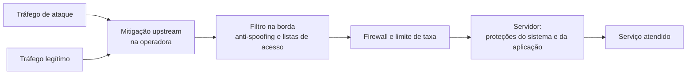

*Esquema 1 (defesa em profundidade).* Cada pacote atravessa os controles ativos **em camadas**, e é barrado se **algum** o neutraliza. A **eficácia** de um controle é a chance de ele neutralizar um pacote sozinho. Como as camadas são tratadas como independentes, a chance total de neutralização é **1 menos o produto de (1 menos a eficácia de cada controle)**, e **não** a soma das porcentagens. O **serviço legítimo** mede quantas requisições do cliente foram atendidas: ele cai quando o servidor satura, e também quando um controle gera **falsos positivos**.

### 2.3 Ataques ao TCP: abuso de estado

O TCP mantém **estado** para cada conexão ([RFC 9293](https://www.rfc-editor.org/rfc/rfc9293)), e isso tem um custo que o atacante pode explorar.

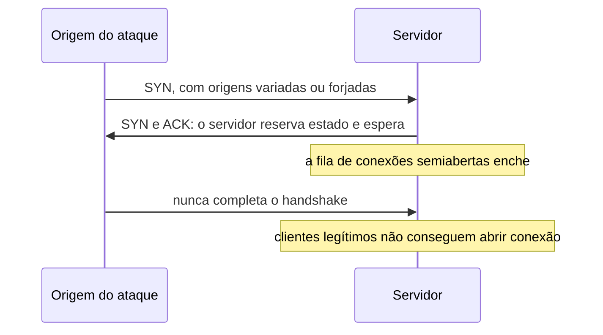

*Esquema 2 (esgotamento da fila de conexões semiabertas, o "SYN flood").* O servidor reserva memória a cada SYN recebido, esperando o último ACK que nunca vem. Quando a fila **enche**, os clientes legítimos são recusados ([RFC 4987](https://www.rfc-editor.org/rfc/rfc4987), seção 2). As defesas estão na seção 3 da mesma RFC: **SYN cookies** (seção 3.6, que codificam o estado na própria resposta e não reservam memória até o ACK voltar), filtros (3.1), aumento da fila (3.2), redução do tempo de espera (3.3) e firewalls e *proxies* (3.8).

| Ataque | Por que funciona | Defesa |
| --- | --- | --- |
| Esgotamento de conexões semiabertas | o estado é reservado antes de o cliente provar que existe | SYN cookies, limite de taxa, mitigação upstream |
| Injeção de RST | um segmento forjado com número de sequência aceitável encerra a conexão ([RFC 5961](https://www.rfc-editor.org/rfc/rfc5961)) | números de sequência validados com rigor, autenticação (TCP-AO, [RFC 5925](https://www.rfc-editor.org/rfc/rfc5925)) ou cifragem acima do TCP (TLS, SSH) |
| Conexões lentas (esgotamento de conexões por inatividade) | cada conexão aberta e quase parada ocupa um processo ou um espaço no servidor | limites de conexão por origem, tempos máximos e servidores baseados em eventos |

### 2.4 Ataques ao UDP: sem conexão, sem prova de origem

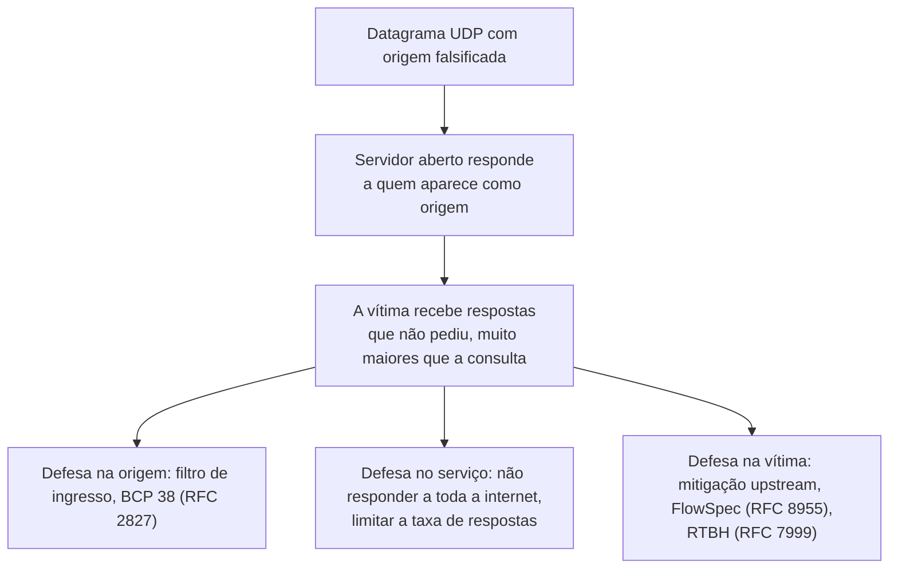

*Esquema 3 (reflexão e amplificação).* Como o UDP **não tem handshake**, nada prova que a origem é real. Um serviço que responde com uma mensagem **muito maior** que a consulta (amplificação) pode ser usado para voltar o tráfego contra uma terceira vítima. A defesa **mais eficaz** está na **origem**: impedir que pacotes com endereço de origem falso saiam da rede ([BCP 38](https://www.rfc-editor.org/info/bcp38)). Para quem opera o serviço, a defesa é não deixá-lo aberto à internet inteira e limitar a taxa. Para a vítima, a mitigação **upstream** na operadora (por exemplo, FlowSpec e RTBH) descarta o tráfego antes do enlace saturar. Veja também o simulador de DNS, no cenário de amplificação.

| Ataque | Por que funciona | Defesa |
| --- | --- | --- |
| Inundação de UDP | o servidor gasta recursos com cada datagrama, sem conexão para limitar | limite de taxa, filtros, mitigação upstream |
| Reflexão e amplificação | origem falsificada e resposta maior que a consulta | [BCP 38](https://www.rfc-editor.org/info/bcp38), serviços não abertos, limite de taxa |
| Botnet distribuído (DDoS) | muitas origens reais, sem um endereço que se possa bloquear | mitigação upstream e capacidade (e não bloqueio de endereços) |

### 2.5 Como ler o diagrama do simulador

- **Topologia:** onde cada controle atua e por onde passa cada pacote. A legenda distingue ataque, neutralizado, resposta, legítimo e legítimo descartado.
- **Aba Efeito dos controles:** quanto cada controle neutralizou, no instante atual.
- **Aba Configuração de referência:** trechos **ilustrativos** de configuração dos controles.
- **Aba Avaliação:** o balanço do cenário: carga, serviço legítimo, falsos positivos e os custos das defesas.
- **Telemetria:** vale sempre **ataque rumo à vítima = neutralizados + chegaram à vítima**. Na reflexão, as requisições enviadas aos refletores aparecem **à parte**, porque não vão para a vítima, e cada uma não barrada vira várias respostas que contam como ataque rumo à vítima. A **carga** é a fração da capacidade do servidor e para em 100%: quando a demanda passa disso, o excedente aparece como requisições legítimas descartadas.
- **Modos:** *Ataques TCP* e *Ataques UDP*.

### 2.6 Limites do modelo e do diagrama

- As **eficácias** dos controles, os **limiares** (60% de carga para o primeiro alerta, 85% de proteção, 30% de carga para a recuperação) e as taxas de falso positivo são valores **didáticos e subjetivos**, escolhidos para comparar cenários. Não são medições nem constam de RFC: em ambiente real dependem do equipamento, da configuração e do tráfego.
- O sorteio usa uma **semente fixa**: o mesmo cenário com as mesmas defesas produz sempre o mesmo resultado, o que permite comparar exercícios.
- Os trechos de configuração (nftables, Suricata, BIND, nginx, sysctl, IOS) são **exemplos ilustrativos**: confira a sintaxe e os parâmetros na documentação oficial do produto e da versão em uso antes de aplicá-los.
- Os endereços usam as faixas de documentação da [RFC 5737](https://www.rfc-editor.org/rfc/rfc5737), e **não há tráfego de rede real**. Os cenários ficam no **nível defensivo**.

## 3. Como ler os diagramas

Este documento usa até dois tipos de diagrama. Cada figura traz uma legenda com o tipo, o que mostra e a que modo ou cenário se refere.

| Tipo | O que é | Vale para | Equivale, no simulador, a |
| --- | --- | --- | --- |
| A, topologia | Os elementos da rede e os enlaces que os ligam. É estático. | Um modo inteiro | A visão "Topologia" do painel principal |
| B, sequência | As mensagens na ordem do tempo, entre os participantes. É dinâmico. | Um único cenário, com a configuração indicada | Ao diagrama de sequência e à aba Captura |

### 3.1 Legenda dos diagramas

**Tipo A (topologia)**

- Retângulo: host (computador ou servidor final).
- Hexágono: switch.
- Retângulo arredondado: roteador, ou dispositivo que encaminha ou traduz.
- Estádio (cantos bem arredondados): servidor ou rede externa.
- Retângulo vermelho: atacante (quando existe no modo).
- Linha contínua: enlace. Linha tracejada: enlace alternativo, forjado ou caído, ou ainda relação de peering (no BGP), conforme o rótulo e o cenário.
- O Mermaid posiciona os elementos automaticamente: o layout difere do simulador, as ligações não.

**Tipo B (sequência)**

- Cada coluna é um participante (cliente, servidor, roteador ou outro). O tempo corre de cima para baixo.
- Seta cheia: mensagem enviada. Seta com X: mensagem perdida.
- `[cifrado]` no início do rótulo: a mensagem viaja cifrada.
- Faixa horizontal com texto: início de uma fase do cenário.
- A ordem é a da aba Captura; os intervalos de tempo não são desenhados em escala.

### 3.2 Lista de figuras

**Tipo A (topologia)**

- [Figura 4.1](#41-ataques-tcp): topologia do modo "Ataques TCP"
- [Figura 4.2a](#42-ataques-udp): topologia do modo "Ataques UDP", variante a
- [Figura 4.2b](#42-ataques-udp): topologia do modo "Ataques UDP", variante b
- [Figura 4.2c](#42-ataques-udp): topologia do modo "Ataques UDP", variante c

**Tipo B (sequência)**

- [Figura 7.1.1](#711-tcp-syn-flood): sequência de "TCP SYN flood"
- [Figura 7.1.2](#712-tcp-rst-injection): sequência de "TCP RST injection"
- [Figura 7.1.3](#713-tcp-session-hijacking): sequência de "TCP session hijacking"
- [Figura 7.1.4](#714-tcp-ack--port-scan): sequência de "TCP ACK / port scan"
- [Figura 7.1.5](#715-tcp-slowloris-conexões-lentas): sequência de "TCP Slowloris (conexões lentas)"
- [Figura 7.1.6](#716-tcp-varredura-lenta-low-and-slow): sequência de "TCP varredura lenta (low and slow)"
- [Figura 7.2.1](#721-udp-flood): sequência de "UDP flood"
- [Figura 7.2.2](#722-udp-ddos-distribuído-botnet): sequência de "UDP DDoS distribuído (botnet)"
- [Figura 7.2.3](#723-udp-amplification): sequência de "UDP amplification"
- [Figura 7.2.4](#724-udp-spoofing--reflection): sequência de "UDP spoofing / reflection"
- [Figura 7.2.5](#725-udp-port-scan): sequência de "UDP port scan"
- [Figura 7.2.6](#726-udp-dns-water-torture): sequência de "UDP DNS water torture"

## 4. Topologia

Figuras do Tipo A, uma por modo (e uma por variante do desenho, quando a rede muda entre cenários). Foram geradas a partir da mesma definição de topologia que a bancada usa.

### 4.1 Ataques TCP

*Figura 4.1 (Tipo A, topologia).* Elementos do modo "Ataques TCP": Atacante (198.51.100.x); Cliente (198.51.100.77); Operadora (upstream (scrubbing, FlowSpec)); FW / IDS (borda da vítima); Vítima (203.0.113.10). Vale para todos os cenários do modo (7.1.1 a 7.1.6).

### 4.2 Ataques UDP

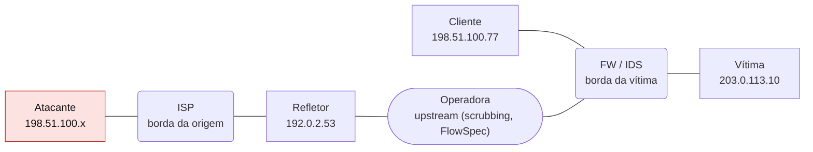

*Figura 4.2a (Tipo A, topologia).* Elementos do modo "Ataques UDP": Atacante (198.51.100.x); Cliente (198.51.100.77); Operadora (upstream (scrubbing, FlowSpec)); FW / IDS (borda da vítima); Vítima (203.0.113.10); ISP (borda da origem); Refletor (192.0.2.53). Vale para os cenários (7.2.3 e 7.2.4).

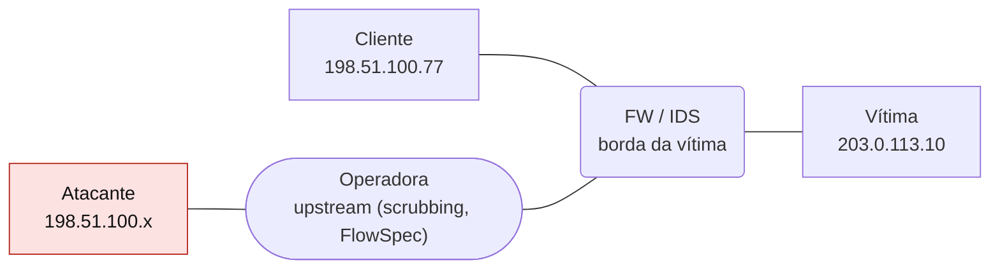

*Figura 4.2b (Tipo A, topologia).* Elementos do modo "Ataques UDP": Atacante (198.51.100.x); Cliente (198.51.100.77); Operadora (upstream (scrubbing, FlowSpec)); FW / IDS (borda da vítima); Vítima (203.0.113.10). Vale para os cenários (7.2.1; 7.2.5 e 7.2.6).

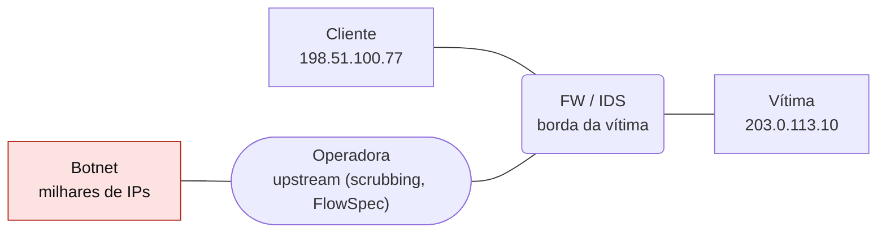

*Figura 4.2c (Tipo A, topologia).* Elementos do modo "Ataques UDP": Botnet (milhares de IPs); Cliente (198.51.100.77); Operadora (upstream (scrubbing, FlowSpec)); FW / IDS (borda da vítima); Vítima (203.0.113.10). Vale para os cenários (7.2.2).

## 5. Abas da bancada

Cenário, Captura, Mensagem, Efeito dos controles, Configuração de referência, Avaliação, Experimento, Referência e Log.

## 6. Configurações (campos do painel)

### 6.1 Ataque

- **Ataque TCP**. Valores: TCP SYN flood; TCP RST injection; TCP session hijacking; TCP ACK / port scan; TCP Slowloris (conexões lentas); TCP varredura lenta (low and slow). Padrão: TCP SYN flood. Modos: Ataques TCP.
- **Ataque UDP**. Valores: UDP flood; UDP DDoS distribuído (botnet); UDP amplification; UDP spoofing / reflection; UDP port scan; UDP DNS water torture. Padrão: UDP flood. Modos: Ataques UDP.
- **Intensidade do ataque**. Valores: 1 - muito baixa; 2 - baixa; 3 - moderada; 4 - alta; 5 - muito alta. Padrão: 3 - moderada. Modos: todos.
  - Quantidade de pacotes de ataque por ciclo, de 1 a 5.
  - Define quantos pacotes de ataque saem por ciclo e o ritmo da simulação.
  - Ataques de baixo volume (Slowloris, varredura lenta) usam poucos pacotes de propósito; ataques volumétricos crescem com a intensidade.
  - Suba a intensidade para testar se a mesma defesa continua segurando o ataque.
- **Ciclos simulados**. Valores: 10; 20; 30; 40. Padrão: 20. Modos: todos.

### 6.2 Controles defensivos

- **Rate limiting**. Valores: caixa de seleção. Padrão: não. Modos: todos.
  - Limita pacotes ou conexões por origem.
  - Descarta o que passa de um limite por endereço de origem, por exemplo 20 SYN por segundo (meter do nftables, hashlimit do iptables ou limites do próprio serviço).
  - Funciona contra poucas origens; perde força contra ataques distribuídos e origens falsificadas.
  - **Custo:** clientes atrás de NAT ou CGNAT compartilham o mesmo IP e podem ser bloqueados (falso positivo).
- **Firewall stateful**. Valores: caixa de seleção. Padrão: não. Modos: todos.
  - Valida estado, flags e janela de sequência.
  - Acompanha cada conexão em uma tabela de estados e só aceita pacotes coerentes com ela: SYN para abrir, ACK de conexão existente, sequência dentro da janela.
  - Descarta ACK órfão, RST fora da sequência e respostas que ninguém pediu.
  - **Limite:** um SYN é sempre um início válido, e a própria tabela de estados pode esgotar em floods.
- **Anti-spoofing ([BCP 38](https://www.rfc-editor.org/info/bcp38) / uRPF)**. Valores: caixa de seleção. Padrão: não. Modos: todos.
  - Descarta pacotes com origem falsificada.
  - Descarta pacotes cuja origem não poderia chegar por aquela interface: uRPF no roteador, rp_filter no Linux, [BCP 38](https://www.rfc-editor.org/info/bcp38) na borda do provedor.
  - Contra reflexão e amplificação, só funciona na rede de **origem** do atacante: na vítima, as respostas vêm de IPs legítimos, os dos refletores.
  - Não ajuda contra botnets, que usam os próprios IPs.
- **SYN cookies**. Valores: caixa de seleção. Padrão: não. Modos: todos.
  - Protege a fila de conexões TCP no host.
  - O servidor responde ao SYN sem reservar memória: o estado vai codificado no número de sequência do SYN-ACK e só é reconstruído quando o ACK final chega ([RFC 4987](https://www.rfc-editor.org/rfc/rfc4987)).
  - Neutraliza o SYN flood contra a fila de conexões semiabertas.
  - Atua só no handshake TCP: não ajuda depois da conexão aberta nem contra UDP.
- **IDS/IPS**. Valores: caixa de seleção. Padrão: não. Modos: todos.
  - Detecta padrões anômalos e bloqueia origens.
  - O IDS reconhece padrões (assinaturas e limiares) e gera alertas; no modo IPS, também bloqueia. Exemplos: Suricata, Snort, Zeek.
  - É o principal meio de **detecção**: sem ele, ataques de baixo volume passam despercebidos (veja a linha do tempo de resposta a incidente).
  - **Custo:** limiares mal calibrados geram falsos positivos contra usuários reais.
- **TLS / SSH**. Valores: caixa de seleção. Padrão: não. Modos: todos.
  - Autentica e cifra o conteúdo da sessão.
  - Cifra e autentica cada registro da sessão (TLS 1.3, SSH): dados injetados falham na verificação de integridade.
  - Resolve o sequestro de sessão, mas não protege o TCP abaixo dele: um RST forjado derruba a conexão mesmo com TLS.
  - Não ajuda contra ataques de volume nem contra varreduras.
- **Hardening de serviços**. Valores: caixa de seleção. Padrão: não. Modos: todos.
  - Fecha portas, restringe serviços e ajusta timeouts.
  - Reduz a superfície de ataque: fecha portas e serviços desnecessários, desativa recursão DNS aberta, NTP monlist e UDP no memcached, ajusta timeouts da aplicação.
  - É o controle essencial contra Slowloris, varreduras e o uso dos seus serviços como refletores.
  - Depende de inventário: só se endurece o que se sabe que existe.
- **Mitigação upstream**. Valores: desligada; ativa desde o início (always-on); acionada depois do ciclo 3; acionada depois do ciclo 6; acionada depois do ciclo 10. Padrão: desligada. Modos: todos.
  - Scrubbing ou FlowSpec na operadora.
  - A operadora ou um serviço anti-DDoS filtra o tráfego antes de ele chegar ao seu enlace: FlowSpec ([RFC 8955](https://www.rfc-editor.org/rfc/rfc8955)), scrubbing center ou RTBH ([RFC 7999](https://www.rfc-editor.org/rfc/rfc7999)).
  - É o único controle que escala com ataques maiores que o seu enlace.
  - Escolha "ativa desde o início" para o contrato always-on, ou "acionada depois do ciclo N" para chamar a operadora com o ataque em andamento: a regra só entra em vigor 6 ciclos depois do chamado. O RTBH descarta todo o tráfego para a vítima, inclusive o legítimo.

## 7. Cenários

### 7.1 Modo: Ataques TCP

> **Grupo:** TCP

Ataques que abusam do estado da conexão TCP (fila de conexões, números de sequência, sessões abertas) ou das respostas do TCP para mapear a rede.

#### 7.1.1 TCP SYN flood

*Milhares de SYN sem o ACK final esgotam a fila de conexões do servidor.*

**Configuração aplicada:** Ataque TCP = syn-flood

O atacante envia o tráfego direto à vítima (203.0.113.10), passando pela operadora e pelo firewall da borda.

Controle essencial: **SYN cookies**. A eficácia, o ponto de atuação e o motivo de cada controle estão na aba Efeito dos controles.

**Conceito.** Muitas solicitações SYN deixam conexões semiabertas e consomem a fila de backlog do servidor.

**O que observar**

- Grande volume de SYN sem ACK final
- Crescimento de conexões em SYN-RECEIVED
- Timeouts e recusa de clientes legítimos

*Figura 7.1.1 (Tipo B, sequência).* Mensagens do cenário "TCP SYN flood", na ordem do tempo, entre Atacante, Operadora, FW / IDS, Vítima, Cliente: 26 mensagens, numeradas de 1 a 26 na ordem da comunicação. Corresponde ao diagrama de sequência e à aba Captura, no modo "Ataques TCP", com a configuração aplicada acima.

**Evidências típicas no log**

| Mensagem | Significado | Origem |
| --- | --- | --- |
| tcpdump | `IP 198.51.100.23.40211 > 203.0.113.10.443: Flags [S], seq 381927113, win 64240, length 0` |
| ss -s | `conexões em SYN-RECV crescendo, backlog próximo do limite` |
| cliente | `connect() timeout após retransmissões de SYN` |

**Por que importa.** Contramedidas recomendadas: SYN cookies e ajuste do backlog; Rate limiting por origem e por destino; Filtragem upstream para ataques volumétricos. Risco residual: Floods acima da capacidade do enlace exigem mitigação upstream (operadora, RTBH ou scrubbing center).

#### 7.1.2 TCP RST injection

*Um RST forjado tenta derrubar uma sessão TCP ativa.*

**Configuração aplicada:** Ataque TCP = rst-injection

O atacante envia o tráfego direto à vítima (203.0.113.10), passando pela operadora e pelo firewall da borda.

Controle essencial: **Firewall stateful**. A eficácia, o ponto de atuação e o motivo de cada controle estão na aba Efeito dos controles.

**Conceito.** Um segmento RST forjado tenta coincidir com uma conexão ativa para provocar seu encerramento (ex.: sessão BGP de longa duração).

**O que observar**

- RST inesperado durante sessão ativa
- Reinícios frequentes de conexões
- Sequência ou janela incompatível com o fluxo

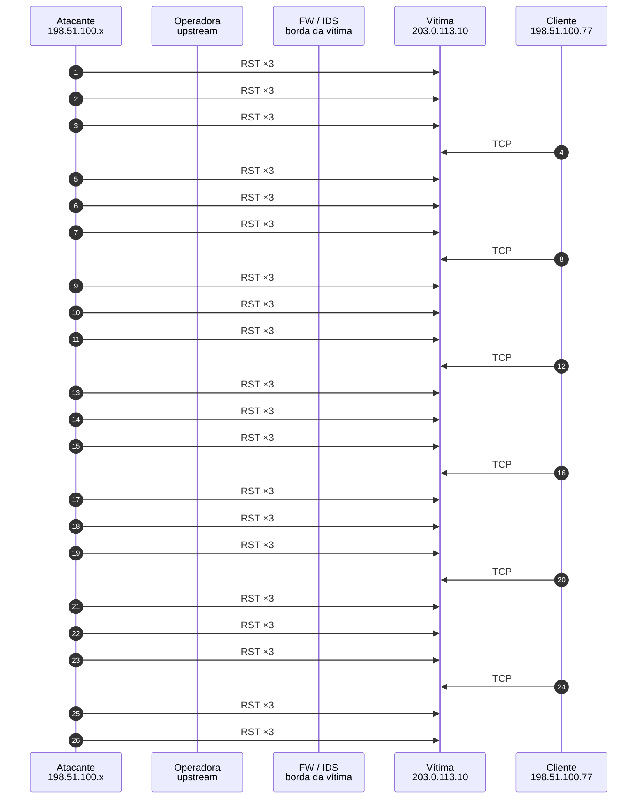

*Figura 7.1.2 (Tipo B, sequência).* Mensagens do cenário "TCP RST injection", na ordem do tempo, entre Atacante, Operadora, FW / IDS, Vítima, Cliente: 26 mensagens, numeradas de 1 a 26 na ordem da comunicação. Corresponde ao diagrama de sequência e à aba Captura, no modo "Ataques TCP", com a configuração aplicada acima.

**Evidências típicas no log**

| Mensagem | Significado | Origem |
| --- | --- | --- |
| tcpdump | `IP 198.51.100.23.40211 > 203.0.113.10.179: Flags [R], seq 381927113, win 0, length 0` |
| bgp | `sessão com 192.0.2.1 encerrada por RST inesperado` |
| aplicação | `connection reset by peer em sessão ativa` |

**Por que importa.** Contramedidas recomendadas: Validação rigorosa de sequência ([RFC 5961](https://www.rfc-editor.org/rfc/rfc5961), challenge ACK); TCP-AO ou IPsec em sessões críticas; Monitoramento de RST anômalos. Risco residual: Sessões longas e de portas previsíveis (BGP, VPN) continuam alvos; prefira TCP-AO ([RFC 5925](https://www.rfc-editor.org/rfc/rfc5925)) ou IPsec.

#### 7.1.3 TCP session hijacking

*Segmentos forjados tentam entrar em uma sessão já estabelecida.*

**Configuração aplicada:** Ataque TCP = session-hijack

O atacante envia o tráfego direto à vítima (203.0.113.10), passando pela operadora e pelo firewall da borda.

Controle essencial: **TLS / SSH**. A eficácia, o ponto de atuação e o motivo de cada controle estão na aba Efeito dos controles.

**Conceito.** Pacotes forjados tentam entrar em uma sessão usando metadados de fluxo e números de sequência plausíveis.

**O que observar**

- Dados fora da janela esperada
- ACKs duplicados ou sequência conflitante
- Mudança repentina do padrão da sessão

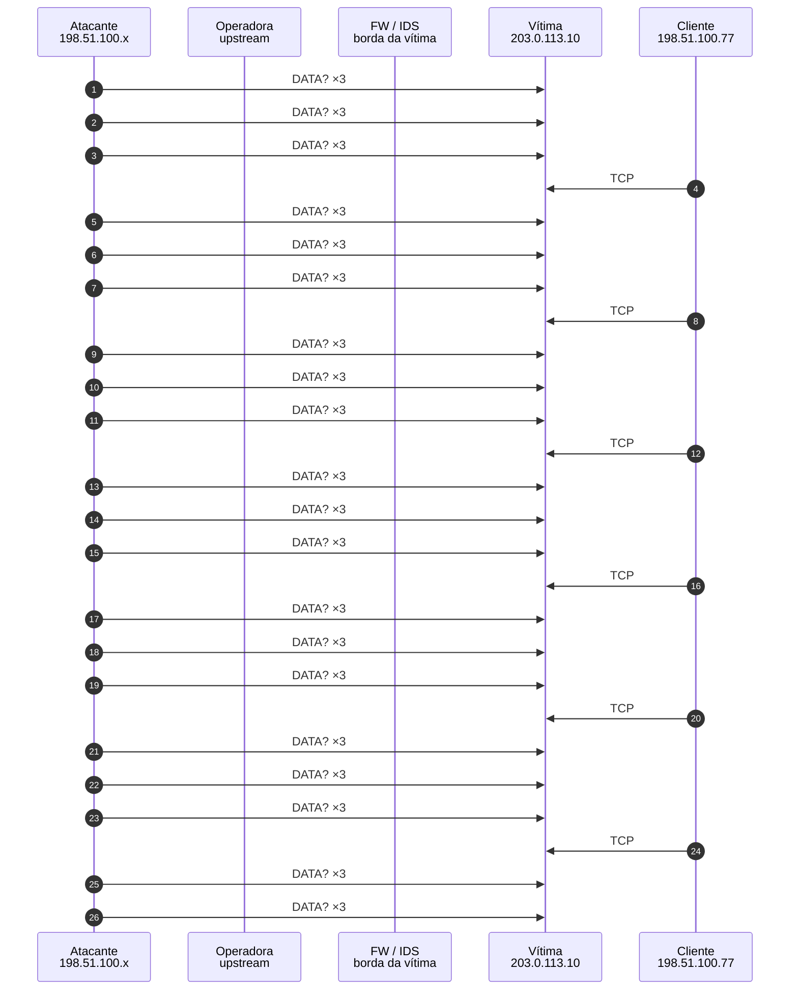

*Figura 7.1.3 (Tipo B, sequência).* Mensagens do cenário "TCP session hijacking", na ordem do tempo, entre Atacante, Operadora, FW / IDS, Vítima, Cliente: 26 mensagens, numeradas de 1 a 26 na ordem da comunicação. Corresponde ao diagrama de sequência e à aba Captura, no modo "Ataques TCP", com a configuração aplicada acima.

**Evidências típicas no log**

| Mensagem | Significado | Origem |
| --- | --- | --- |
| tcpdump | `IP 192.0.2.50.40211 > 203.0.113.10.23: Flags [P.], seq 381927113, length 32` |
| sessão | `ACK storm entre cliente e servidor após injeção` |
| servidor | `comando executado fora do padrão do usuário` |

**Por que importa.** Contramedidas recomendadas: TLS ou SSH para autenticação e integridade; Números de sequência imprevisíveis; Firewall stateful e segmentação. Risco residual: Um atacante no caminho (MITM) vê a sequência correta e vence controles de estado; só criptografia autenticada protege a integridade.

#### 7.1.4 TCP ACK / port scan

*Sondas ACK mapeiam as regras do firewall pelas respostas RST.*

**Configuração aplicada:** Ataque TCP = ack-scan

O atacante envia sondas à vítima (203.0.113.10) e deduz portas e regras de filtragem pelas respostas.

Controle essencial: **Firewall stateful**. A eficácia, o ponto de atuação e o motivo de cada controle estão na aba Efeito dos controles.

**Conceito.** Sondas com flags TCP procuram inferir regras de filtragem e hosts acessíveis pelas respostas recebidas.

**O que observar**

- ACKs sem sessão correspondente
- Sondas sequenciais para muitas portas
- Respostas RST concentradas em uma origem

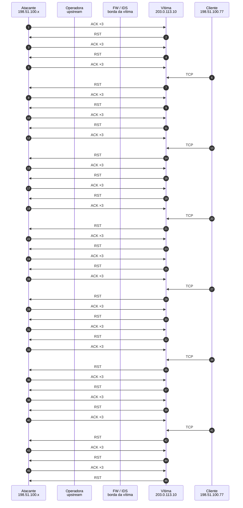

*Figura 7.1.4 (Tipo B, sequência).* Mensagens do cenário "TCP ACK / port scan", na ordem do tempo, entre Atacante, Operadora, FW / IDS, Vítima, Cliente: 46 mensagens, numeradas de 1 a 46 na ordem da comunicação. Corresponde ao diagrama de sequência e à aba Captura, no modo "Ataques TCP", com a configuração aplicada acima.

**Evidências típicas no log**

| Mensagem | Significado | Origem |
| --- | --- | --- |
| tcpdump | `IP 198.51.100.23.40211 > 203.0.113.10.161: Flags [.], ack 381927113, win 1024, length 0` |
| tcpdump | `IP 203.0.113.10.161 > 198.51.100.23.40211: Flags [R], seq 381927113, length 0` |
| observação | scanner infere "unfiltered" a partir de cada RST recebido |

**Por que importa.** Contramedidas recomendadas: Política padrão de bloqueio; Firewall stateful para descartar ACK órfão; Correlação de varredura no IDS/IPS. Risco residual: Varreduras lentas e distribuídas passam abaixo dos limiares; mantenha inventário e exponha o mínimo.

#### 7.1.5 TCP Slowloris (conexões lentas)

*Conexões HTTP lentas ocupam todos os workers com pouquíssimo tráfego.*

**Configuração aplicada:** Ataque TCP = slowloris

O atacante envia o tráfego direto à vítima (203.0.113.10), passando pela operadora e pelo firewall da borda.

Controle essencial: **Hardening de serviços**. A eficácia, o ponto de atuação e o motivo de cada controle estão na aba Efeito dos controles.

**Conceito.** O atacante abre muitas conexões HTTP completas e envia os cabeçalhos bem devagar, um a cada poucos segundos. Com pouquíssimo tráfego, ocupa todos os workers do servidor.

**O que observar**

- Muitas conexões ESTABLISHED de poucas origens
- Requisições que nunca terminam os cabeçalhos
- Workers esgotados com o enlace quase ocioso

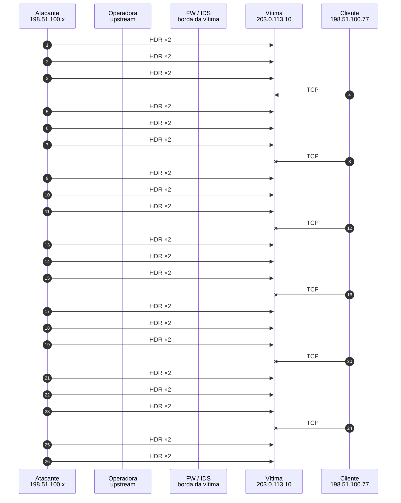

*Figura 7.1.5 (Tipo B, sequência).* Mensagens do cenário "TCP Slowloris (conexões lentas)", na ordem do tempo, entre Atacante, Operadora, FW / IDS, Vítima, Cliente: 26 mensagens, numeradas de 1 a 26 na ordem da comunicação (5 perdidas). Corresponde ao diagrama de sequência e à aba Captura, no modo "Ataques TCP", com a configuração aplicada acima.

**Evidências típicas no log**

| Mensagem | Significado | Origem |
| --- | --- | --- |
| tcpdump | `IP 198.51.100.23.40211 > 203.0.113.10.443: Flags [P.], length 14 (um cabeçalho X-a a cada 10 s)` |
| observação | ss -tn state established "( sport = :443 )": centenas de conexões abertas de poucas origens |
| apache | `server reached MaxRequestWorkers setting, consider raising the MaxRequestWorkers setting` |

**Por que importa.** Contramedidas recomendadas: Timeouts curtos de cabeçalho e corpo; Limite de conexões simultâneas por IP; Proxy reverso orientado a eventos na frente do servidor. Risco residual: Variações (R.U.D.Y., slow read) atacam o corpo da requisição e a leitura da resposta; revise todos os timeouts da aplicação.

#### 7.1.6 TCP varredura lenta (low and slow)

*Sondas espaçadas por horas passam abaixo dos limiares do IDS.*

**Configuração aplicada:** Ataque TCP = slow-scan

O atacante envia sondas à vítima (203.0.113.10) e deduz portas e regras de filtragem pelas respostas; aqui, uma sonda a cada 3 ciclos, de propósito abaixo dos limiares de detecção.

Controle essencial: **Hardening de serviços**. A eficácia, o ponto de atuação e o motivo de cada controle estão na aba Efeito dos controles.

**Conceito.** Sondas SYN espaçadas, de origens alternadas, mapeiam portas abertas ao longo de horas sem ultrapassar os limiares de detecção.

**O que observar**

- Poucas conexões incompletas espalhadas ao longo de horas
- Mesma origem ou ASN tocando portas diferentes em dias distintos
- Só aparece em correlação de longo prazo (SIEM)

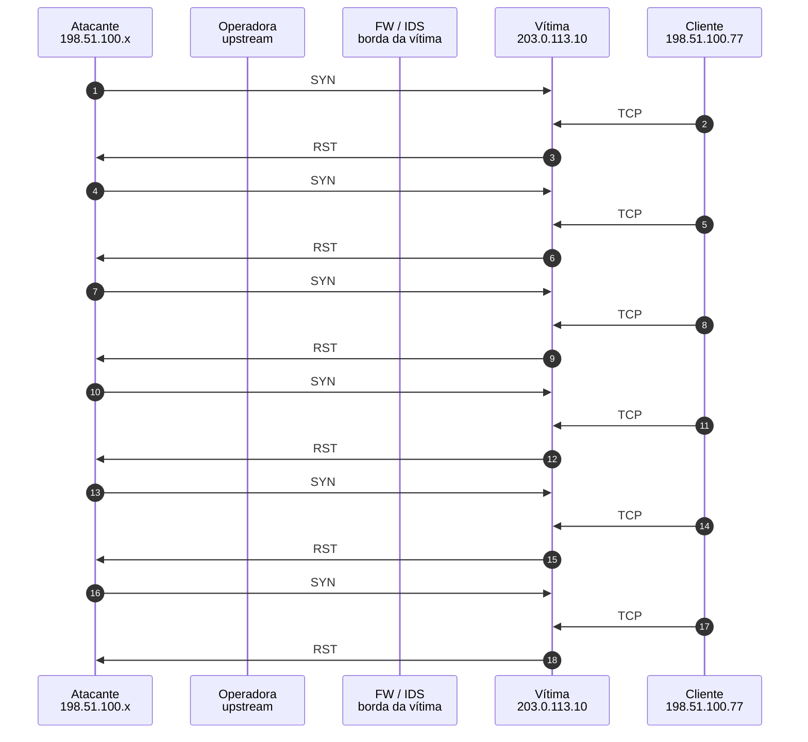

*Figura 7.1.6 (Tipo B, sequência).* Mensagens do cenário "TCP varredura lenta (low and slow)", na ordem do tempo, entre Atacante, Operadora, FW / IDS, Vítima, Cliente: 18 mensagens, numeradas de 1 a 18 na ordem da comunicação. Corresponde ao diagrama de sequência e à aba Captura, no modo "Ataques TCP", com a configuração aplicada acima.

**Evidências típicas no log**

| Mensagem | Significado | Origem |
| --- | --- | --- |
| tcpdump | `IP 198.51.100.23.40211 > 203.0.113.10.161: Flags [S], seq 381927113, win 1024, length 0` |
| tcpdump | `IP 203.0.113.10.161 > 198.51.100.23.40211: Flags [R.], seq 0, ack 381927114, length 0` |
| IDS | `nenhuma origem ultrapassou o limiar de 30 portas em 10 s` |

**Por que importa.** Contramedidas recomendadas: Expor somente as portas necessárias; Correlação de longo prazo no SIEM (horas ou dias); Portas-armadilha (honeypots) que alertam no primeiro toque. Risco residual: Com paciência, o atacante sempre descobre as portas realmente abertas; o objetivo é reduzir a exposição e detectar cedo.

### 7.2 Modo: Ataques UDP

> **Grupo:** UDP

Ataques que exploram a falta de conexão do UDP: volume, origem falsificada, reflexão, amplificação e varredura.

#### 7.2.1 UDP flood

*Datagramas em alta taxa saturam a banda e a CPU da vítima.*

**Configuração aplicada:** Ataque UDP = udp-flood

O atacante envia o tráfego direto à vítima (203.0.113.10), passando pela operadora e pelo firewall da borda.

Controle essencial: **Rate limiting**. A eficácia, o ponto de atuação e o motivo de cada controle estão na aba Efeito dos controles.

**Conceito.** Datagramas em alta taxa consomem banda, CPU e filas de processamento do destino.

**O que observar**

- Pico sustentado de pacotes UDP
- Muitas portas ou destinos aleatórios
- Perda, latência e CPU elevadas

*Figura 7.2.1 (Tipo B, sequência).* Mensagens do cenário "UDP flood", na ordem do tempo, entre Atacante, Operadora, FW / IDS, Vítima, Cliente: 26 mensagens, numeradas de 1 a 26 na ordem da comunicação. Corresponde ao diagrama de sequência e à aba Captura, no modo "Ataques UDP", com a configuração aplicada acima.

**Evidências típicas no log**

| Mensagem | Significado | Origem |
| --- | --- | --- |
| tcpdump -q | `IP 198.51.100.23.40211 > 203.0.113.10.161: UDP, length 1400` |
| tcpdump | `IP 203.0.113.10 > 198.51.100.23: ICMP 203.0.113.10 udp port 161 unreachable, length 36` |
| ifstat | `enlace de entrada acima de 90% da capacidade` |

**Por que importa.** Contramedidas recomendadas: Rate limiting e QoS; ACLs para serviços desnecessários; Mitigação upstream e scrubbing. Risco residual: Se o volume excede o enlace, nenhum controle local resolve: é preciso mitigação upstream (RTBH, FlowSpec, scrubbing).

#### 7.2.2 UDP DDoS distribuído (botnet)

*Milhares de origens reais somam um volume maior que o enlace da vítima.*

**Configuração aplicada:** Ataque UDP = botnet

Milhares de bots enviam tráfego ao mesmo tempo, cada um com o seu IP real, contra a vítima (203.0.113.10). O volume chega pela operadora antes de alcançar o firewall.

Controle essencial: **Mitigação upstream**. A eficácia, o ponto de atuação e o motivo de cada controle estão na aba Efeito dos controles.

**Conceito.** Milhares de dispositivos comprometidos (IoT, servidores) enviam tráfego com seus IPs reais. Cada origem envia pouco, mas o volume somado excede o enlace da vítima antes mesmo do firewall.

**O que observar**

- Milhares de origens distintas, cada uma com taxa baixa
- Enlace de entrada saturado antes do firewall
- Distribuição ampla de países e ASNs

*Figura 7.2.2 (Tipo B, sequência).* Mensagens do cenário "UDP DDoS distribuído (botnet)", na ordem do tempo, entre Botnet, Operadora, FW / IDS, Vítima, Cliente: 26 mensagens, numeradas de 1 a 26 na ordem da comunicação (5 perdidas). Corresponde ao diagrama de sequência e à aba Captura, no modo "Ataques UDP", com a configuração aplicada acima.

**Evidências típicas no log**

| Mensagem | Significado | Origem |
| --- | --- | --- |
| NetFlow | `4812 origens distintas para 203.0.113.10 no último minuto` |
| tcpdump -q | `IP 198.51.100.23.40211 > 203.0.113.10.161: UDP, length 1200` |
| roteador de borda | `enlace de entrada em 100%, descartes na fila de saída da operadora` |

**Por que importa.** Contramedidas recomendadas: Mitigação upstream: scrubbing ou FlowSpec; Plano de resposta com a operadora definido antes do incidente; CDN e anycast para diluir o volume. Risco residual: Botnets muito grandes podem exceder até a capacidade de scrubbing contratada; anycast e CDN diluem o impacto.

#### 7.2.3 UDP amplification

*Uma requisição pequena com origem falsa vira uma resposta enorme contra a vítima.*

**Configuração aplicada:** Ataque UDP = amplification

O atacante envia requisições com a origem falsificada (o IP da vítima, 203.0.113.10) a um serviço refletor, que responde à vítima com fator de amplificação 4x. A vítima recebe tráfego de IPs legítimos, os dos refletores.

Controle essencial: **Anti-spoofing** e **Hardening de serviços**. A eficácia, o ponto de atuação e o motivo de cada controle estão na aba Efeito dos controles.

**Conceito.** Uma requisição pequena com origem falsificada provoca uma resposta muito maior de serviços expostos contra a vítima.

**O que observar**

- Respostas UDP sem solicitação local
- Assimetria entre bytes de entrada e saída
- Tráfego concentrado de vários refletores

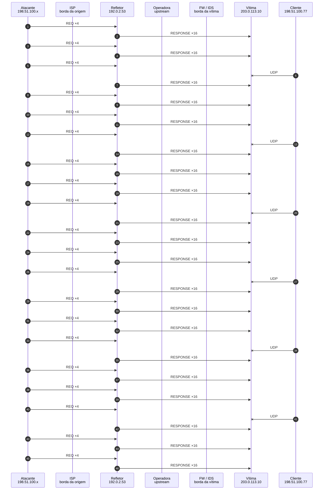

*Figura 7.2.3 (Tipo B, sequência).* Mensagens do cenário "UDP amplification", na ordem do tempo, entre Atacante, ISP, Refletor, Operadora, FW / IDS, Vítima, Cliente: 46 mensagens, numeradas de 1 a 46 na ordem da comunicação (6 perdidas). Corresponde ao diagrama de sequência e à aba Captura, no modo "Ataques UDP", com a configuração aplicada acima.

**Evidências típicas no log**

| Mensagem | Significado | Origem |
| --- | --- | --- |
| tcpdump -q | `IP 203.0.113.10.40211 > 192.0.2.53.53: UDP, length 40 (origem falsificada)` |
| tcpdump -q | `IP 192.0.2.53.53 > 203.0.113.10.40211: UDP, length 3120` |
| NetFlow | `bytes de entrada da porta 53 muito maiores que os de saída` |

**Por que importa.** Contramedidas recomendadas: [BCP 38](https://www.rfc-editor.org/info/bcp38) / 84 na rede de origem; Desativar amplificadores abertos; Response Rate Limiting e filtragem upstream. Risco residual: O tráfego amplificado pode exceder o enlace da vítima; filtragem por porta de origem e scrubbing na operadora continuam necessários.

#### 7.2.4 UDP spoofing / reflection

*Terceiros são induzidos a responder à vítima, que nunca pediu nada.*

**Configuração aplicada:** Ataque UDP = reflection

O atacante envia requisições com a origem falsificada (o IP da vítima, 203.0.113.10) a um serviço refletor, que responde à vítima com fator de amplificação 2x. A vítima recebe tráfego de IPs legítimos, os dos refletores.

Controle essencial: **Anti-spoofing**. A eficácia, o ponto de atuação e o motivo de cada controle estão na aba Efeito dos controles.

**Conceito.** O atacante falsifica o endereço da vítima e faz terceiros enviarem respostas não solicitadas a ela.

**O que observar**

- Respostas originadas por muitos servidores
- Ausência das solicitações correspondentes
- Endereços de origem impossíveis na borda

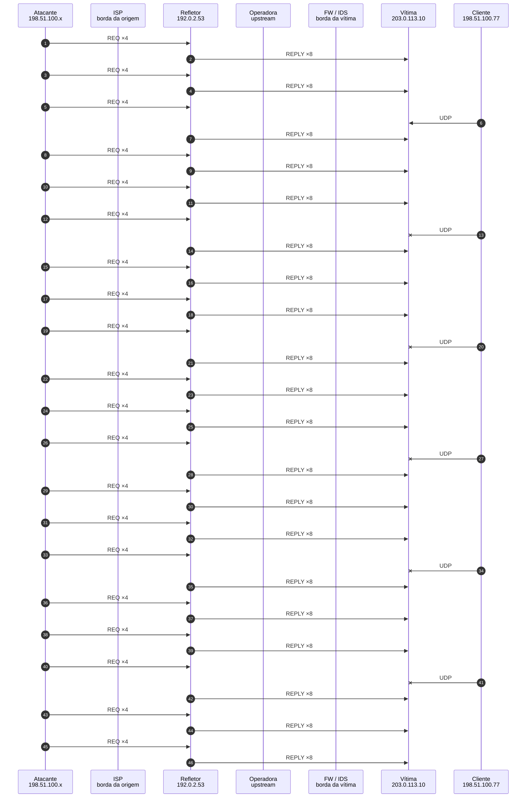

*Figura 7.2.4 (Tipo B, sequência).* Mensagens do cenário "UDP spoofing / reflection", na ordem do tempo, entre Atacante, ISP, Refletor, Operadora, FW / IDS, Vítima, Cliente: 46 mensagens, numeradas de 1 a 46 na ordem da comunicação (5 perdidas). Corresponde ao diagrama de sequência e à aba Captura, no modo "Ataques UDP", com a configuração aplicada acima.

**Evidências típicas no log**

| Mensagem | Significado | Origem |
| --- | --- | --- |
| tcpdump -q | `IP 203.0.113.10.40211 > 192.0.2.53.123: UDP, length 48 (origem falsificada)` |
| tcpdump -q | `IP 192.0.2.53.123 > 203.0.113.10.40211: UDP, length 468` |
| firewall | `respostas NTP sem requisição de saída correspondente` |

**Por que importa.** Contramedidas recomendadas: Filtragem de ingresso e egresso ([BCP 38](https://www.rfc-editor.org/info/bcp38) / 84); Validação de origem na operadora; Rate limiting nos serviços UDP. Risco residual: Enquanto houver redes sem [BCP 38](https://www.rfc-editor.org/info/bcp38), a falsificação continua possível; a vítima depende de filtragem e mitigação upstream.

#### 7.2.5 UDP port scan

*Sondas UDP descobrem portas abertas pelo ICMP Port Unreachable.*

**Configuração aplicada:** Ataque UDP = udp-scan

O atacante envia sondas à vítima (203.0.113.10) e deduz portas e regras de filtragem pelas respostas.

Controle essencial: **Hardening de serviços**. A eficácia, o ponto de atuação e o motivo de cada controle estão na aba Efeito dos controles.

**Conceito.** Sondas UDP procuram serviços expostos e interpretam respostas da aplicação ou mensagens ICMP.

**O que observar**

- Datagramas para muitas portas
- ICMP Port Unreachable em sequência
- Sondas de baixa taxa e longa duração

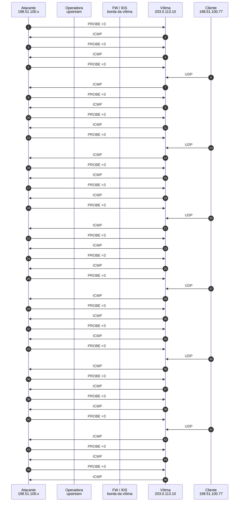

*Figura 7.2.5 (Tipo B, sequência).* Mensagens do cenário "UDP port scan", na ordem do tempo, entre Atacante, Operadora, FW / IDS, Vítima, Cliente: 46 mensagens, numeradas de 1 a 46 na ordem da comunicação. Corresponde ao diagrama de sequência e à aba Captura, no modo "Ataques UDP", com a configuração aplicada acima.

**Evidências típicas no log**

| Mensagem | Significado | Origem |
| --- | --- | --- |
| tcpdump -q | `IP 198.51.100.23.40211 > 203.0.113.10.161: UDP, length 0` |
| tcpdump | `IP 203.0.113.10 > 198.51.100.23: ICMP 203.0.113.10 udp port 161 unreachable, length 36` |
| firewall | `uma origem tocou dezenas de portas UDP em poucos segundos` |

**Por que importa.** Contramedidas recomendadas: Expor somente serviços necessários; ACLs e firewall com registro; Detecção por limiar e correlação temporal. Risco residual: Serviços realmente expostos continuarão respondendo; mantenha-os atualizados e monitorados.

#### 7.2.6 UDP DNS water torture

*Nomes aleatórios, via resolvedores legítimos, sobrecarregam o DNS autoritativo.*

**Configuração aplicada:** Ataque UDP = dns-water-torture

Os bots não falam direto com a vítima: enviam as consultas a resolvedores recursivos legítimos (de provedores e DNS públicos), que as repassam ao servidor autoritativo da vítima (203.0.113.10). Por isso as origens que chegam são resolvedores reais.

Controle essencial: **IDS/IPS**. A eficácia, o ponto de atuação e o motivo de cada controle estão na aba Efeito dos controles.

**Conceito.** Bots consultam subdomínios aleatórios e inexistentes (a8f3k.example.com) por meio de resolvedores recursivos legítimos. Nenhuma resposta fica em cache e o servidor autoritativo da vítima é sobrecarregado.

**O que observar**

- Explosão de respostas NXDOMAIN
- Rótulos aleatórios sob o mesmo domínio
- Consultas vindas de resolvedores conhecidos (provedores, DNS públicos)

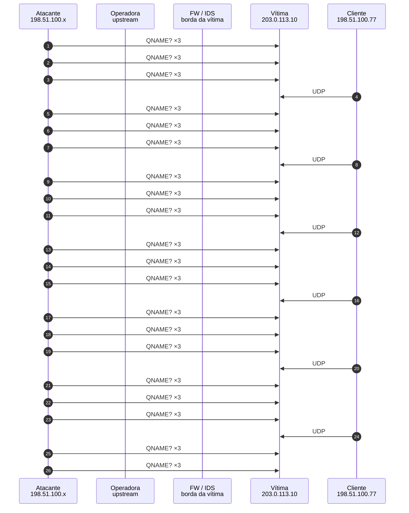

*Figura 7.2.6 (Tipo B, sequência).* Mensagens do cenário "UDP DNS water torture", na ordem do tempo, entre Atacante, Operadora, FW / IDS, Vítima, Cliente: 26 mensagens, numeradas de 1 a 26 na ordem da comunicação. Corresponde ao diagrama de sequência e à aba Captura, no modo "Ataques UDP", com a configuração aplicada acima.

**Evidências típicas no log**

| Mensagem | Significado | Origem |
| --- | --- | --- |
| tcpdump | `IP 192.0.2.53.40211 > 203.0.113.10.53: 4123+ A? x7f3k2.example.com. (41)` |
| named | `92% das respostas do último minuto foram NXDOMAIN` |
| resolvedor | `SERVFAIL para clientes legítimos de example.com` |

**Por que importa.** Contramedidas recomendadas: Detecção pela proporção de NXDOMAIN e filtragem pelo padrão do nome; RRL com limite de NXDOMAIN no autoritativo; Aggressive NSEC ([RFC 8198](https://www.rfc-editor.org/rfc/rfc8198)) nos resolvedores e capacidade anycast. Risco residual: Bloquear por IP derruba os resolvedores que também atendem os usuários; a defesa precisa olhar o nome consultado, não a origem.

## 8. Referência

Ambiente didático isolado: todos os hosts, pacotes e resultados existem apenas neste simulador e não há tráfego de rede real. Os endereços usam as faixas de documentação da [RFC 5737](https://www.rfc-editor.org/rfc/rfc5737).

### 8.1 Como ler a simulação

Cada pacote de ataque atravessa os controles ativos em camadas. A **eficácia** de um controle é a chance de ele neutralizar um pacote sozinho; controles combinados formam a **defesa em profundidade**: o pacote passa por cada camada ativa e é barrado se alguma o neutralizar, o que equivale a tratar as camadas como independentes, com chance total de neutralização 1 − Π(1 − w), onde w é a eficácia de cada controle (sem somar percentuais). O **serviço legítimo** mede quantas requisições do cliente foram atendidas: ele cai quando o servidor satura e também quando um controle gera falsos positivos.

Na telemetria, vale sempre: **ataque rumo à vítima = neutralizados + chegaram à vítima**. Na reflexão, as requisições enviadas aos refletores aparecem à parte, porque não vão para a vítima; cada uma que não é barrada vira várias respostas, e são essas que contam como ataque rumo à vítima. A **carga** é a fração da capacidade do servidor e por isso para em 100%; quando a demanda passa disso, o quadro mostra também a **demanda**, e o excedente aparece como requisições legítimas descartadas.

### 8.2 TCP e abuso de estado

O TCP mantém estado e usa flags, números de sequência e confirmações. Ataques exploram filas de conexão (SYN flood, [RFC 4987](https://www.rfc-editor.org/rfc/rfc4987)), validação insuficiente de sequência (RST injection, mitigado pela [RFC 5961](https://www.rfc-editor.org/rfc/rfc5961)) ou sessões sem autenticação (sequestro). SYN cookies, firewall stateful e criptografia autenticada (TLS, SSH, TCP-AO da [RFC 5925](https://www.rfc-editor.org/rfc/rfc5925)) reduzem a superfície de ataque.

### 8.3 UDP e abuso sem conexão

O UDP não estabelece sessão e não confirma a origem. Isso favorece falsificação, reflexão e amplificação quando serviços respondem com muito mais dados do que recebem. Anti-spoofing na rede de origem ([BCP 38](https://www.rfc-editor.org/info/bcp38), [RFC 2827](https://www.rfc-editor.org/rfc/rfc2827)), hardening dos serviços, rate limiting e mitigação upstream são os controles essenciais.

### 8.4 Onde cada controle atua

- **Borda da rede de origem:** [BCP 38](https://www.rfc-editor.org/info/bcp38) / [BCP 84](https://www.rfc-editor.org/info/bcp84) impede que pacotes com origem falsificada saiam da rede do atacante.
- **Firewall da vítima:** firewall stateful, ACLs, rate limiting e IPS.
- **Host:** SYN cookies e validação de sequência na pilha TCP.
- **Aplicação e serviço:** TLS, SSH e configuração segura (sem recursão aberta, RRL, UDP desabilitado quando desnecessário).
- **Operadora:** RTBH, FlowSpec e scrubbing para volumes acima do enlace.

### 8.5 Ataques de baixo volume e de aplicação

**Slowloris** abre conexões completas e envia cabeçalhos HTTP devagar, esgotando os workers com quase nenhum tráfego. SYN cookies, TLS e filtros da operadora não ajudam: a defesa está nos **timeouts da aplicação**, no limite de conexões simultâneas por IP e em um proxy reverso orientado a eventos. A **varredura lenta** espaça as sondas por horas e fica abaixo de qualquer limiar de IDS; só a redução da exposição, a correlação de longo prazo (SIEM) e portas-armadilha a revelam.

### 8.6 Ataques volumétricos e mitigação upstream

Em um **DDoS distribuído**, cada bot usa seu IP real e envia pouco, então rate limiting por origem e anti-spoofing quase não atuam, e o enlace satura antes do firewall: descartar no firewall não devolve a banda. A resposta é **upstream**: FlowSpec ([RFC 8955](https://www.rfc-editor.org/rfc/rfc8955)) descarta só o padrão do ataque na operadora, scrubbing centers limpam o tráfego e devolvem o legítimo por túnel, e **RTBH** ([RFC 7999](https://www.rfc-editor.org/rfc/rfc7999)) descarta todo o tráfego para o /32 da vítima, o que protege o resto da rede mas completa o DoS contra aquele host. Sem contrato always-on, o acionamento leva tempo; no simulador, a mitigação ativada durante o ataque só age após alguns ciclos.

No **DNS water torture**, os bots consultam nomes aleatórios por meio de resolvedores legítimos. Bloquear por IP derruba os resolvedores que também atendem os usuários (falso positivo em massa); a defesa deve olhar o nome consultado: proporção de NXDOMAIN, RRL com `nxdomains-per-second` e Aggressive NSEC ([RFC 8198](https://www.rfc-editor.org/rfc/rfc8198)) nos resolvedores.

### 8.7 Ciclo de resposta a incidente

A barra de fases acompanha as fases do NIST SP 800-61r2 (substituída pela Rev. 3 em abril de 2025, alinhada ao CSF 2.0; as fases abaixo seguem a r2 por serem didáticas): **preparação** (controles ativos antes do ataque), **detecção e análise** (primeiro alerta do IDS ou carga acima de 60%), **contenção** (controles essenciais ativos e proteção de pelo menos 85%), **erradicação e recuperação** (carga de volta abaixo de 30%) e **atividade pós-incidente** (lições aprendidas na avaliação). Os indicadores **MTTD** e **MTTC** medem, em ciclos, o tempo até detectar e até conter. Observe que, sem IDS, ataques de baixo volume podem nunca ser detectados.

### 8.8 Limitações e valores didáticos

- As **eficácias** dos controles, os **limiares** (60% de carga para o primeiro alerta, 85% de proteção, 30% de carga para a recuperação) e as taxas de falso positivo são valores **didáticos e subjetivos**, escolhidos para comparar cenários. Não são medições nem constam de RFC: em ambiente real dependem do equipamento, da configuração e do tráfego.
- O sorteio usa uma **semente fixa**: o mesmo cenário com as mesmas defesas produz sempre o mesmo resultado, o que permite comparar exercícios.
- Os trechos de configuração (nftables, Suricata, BIND, nginx, sysctl, IOS) são **exemplos ilustrativos**. Confira a sintaxe e os parâmetros na documentação oficial do produto e da versão em uso antes de aplicá-los.
- Os cenários ficam no nível defensivo: aviso, efeito e defesa, sem passo a passo ofensivo.

### 8.9 Roteiro de exercícios

1. SYN flood na intensidade 4 sem defesas: anote carga e serviço legítimo. Ative só rate limiting e depois só SYN cookies. Qual protege a fila e por quê?
2. RST injection: ative TLS / SSH e observe que a proteção não muda. Explique o motivo e qual controle resolve.
3. Amplificação: ative anti-spoofing e identifique no diagrama onde ele precisa estar para funcionar.
4. Ative todos os controles e compare o serviço legítimo. Que custos apareceram no log?
5. Slowloris: verifique que SYN cookies, TLS e mitigação upstream não mudam nada. Qual controle resolve e em que camada ele atua?
6. DDoS botnet: execute sem defesas, escolha a mitigação upstream "acionada depois do ciclo 3" e anote o MTTC. Repita com a mitigação "ativa desde o início" (always-on) e compare.
7. DNS water torture: ative rate limiting e observe os falsos positivos. Por que limitar por IP prejudica usuários reais neste cenário?
8. Varredura lenta: ative apenas o IDS/IPS e veja se o incidente chega a ser detectado. O que precisaria mudar na regra?
9. Para cada cenário, encontre o menor conjunto de controles que obtém "Postura adequada".

## 9. Glossário

Significado e finalidade das siglas usadas neste documento.

| Sigla | Significado | Para que serve |
| --- | --- | --- |
| **ACK** | Acknowledgment, confirmação | flag que confirma o recebimento de dados anteriores |
| **ASN** | Autonomous System Number, número de sistema autônomo | identifica uma rede administrada de forma independente no roteamento da Internet |
| **BCP** | Best Current Practice, melhor prática atual | série de RFCs com práticas recomendadas de operação, como a [BCP 38](https://www.rfc-editor.org/info/bcp38) (filtragem de endereços de origem forjados) |
| **BGP** | Border Gateway Protocol, protocolo de roteador de borda | troca rotas entre sistemas autônomos e sustenta o roteamento entre operadoras na Internet |
| **CDN** | Content Delivery Network, rede de distribuição de conteúdo | serviço com servidores espalhados que entregam o conteúdo perto do usuário e absorvem volume de tráfego |
| **CGNAT** | Carrier-Grade NAT | NAT em grande escala feito pela operadora, que compartilha um endereço público entre muitos clientes |
| **CPU** | Central Processing Unit, unidade central de processamento | processador do equipamento; nos exemplos, o recurso que um ataque ou uma consulta pesada esgota |
| **CSF** | Cybersecurity Framework | guia do NIST para organizar a gestão do risco de segurança cibernética |
| **DNS** | Domain Name System, sistema de nomes de domínio | traduz nomes (www.exemplo.org) em endereços IP e guarda outros registros do domínio |
| **HTTP** | Hypertext Transfer Protocol, protocolo de transferência de hipertexto | transporta páginas e dados entre navegador e servidor web |
| **ICMP** | Internet Control Message Protocol | leva mensagens de controle e de erro da camada IP, como o eco do ping e o aviso de destino inalcançável |
| **IDS** | Intrusion Detection System, sistema de detecção de intrusão | inspeciona o tráfego e gera alertas sobre padrões de ataque, sem bloquear |
| **IOS** | Internetwork Operating System | sistema operacional dos equipamentos Cisco; os valores padrão citados nos exemplos vêm dele |
| **IP** | Internet Protocol, protocolo de internet | endereça e encaminha pacotes entre redes, de origem a destino |
| **IPS** | Intrusion Prevention System, sistema de prevenção de intrusão | inspeciona o tráfego e bloqueia o que casa com ataques conhecidos; o IDS apenas alerta |
| **ISP** | Internet Service Provider, provedor de acesso à Internet | operadora que liga o cliente à Internet e anuncia os prefixos dele a outras redes |
| **MITM** | Man-in-the-Middle, homem no meio | ataque em que alguém se interpõe entre duas partes para ler ou alterar a comunicação; a autenticação e a cifra o defendem |
| **MTTC** | Mean Time To Contain, tempo médio até conter | indicador do tempo, em ciclos no simulador, entre o início do ataque e a sua contenção |
| **MTTD** | Mean Time To Detect, tempo médio até detectar | indicador do tempo, em ciclos no simulador, entre o início do ataque e a sua detecção |
| **NAT** | Network Address Translation, tradução de endereços de rede | troca endereços e portas dos pacotes, para que uma rede privada compartilhe poucos endereços públicos |
| **NIST** | National Institute of Standards and Technology | instituto dos Estados Unidos que publica padrões e guias de segurança, como a série SP 800 |
| **NSEC** | Next Secure | registro DNSSEC que prova que um nome não existe, apontando o próximo nome da zona |
| **NTP** | Network Time Protocol | sincroniza o relógio dos equipamentos com uma fonte de tempo confiável |
| **NXDOMAIN** | Non-Existent Domain, domínio inexistente | código de resposta do DNS que informa que o nome consultado não existe |
| **RFC** | Request for Comments, pedido de comentários | documento numerado do IETF que define ou descreve um protocolo da Internet; cada documento do projeto cita as RFCs com link para o RFC Editor |
| **RRL** | Response Rate Limiting, limitação da taxa de respostas | limita respostas DNS idênticas para o servidor não servir de amplificador de ataques |
| **RST** | Reset | flag do TCP que derruba a conexão de imediato, por exemplo ao receber segmento de uma conexão que não existe |
| **RTBH** | Remotely Triggered Black Hole, buraco negro acionado remotamente | descarta, perto da origem, todo o tráfego para um alvo atacado, pelo anúncio de uma rota ([RFC 7999](https://www.rfc-editor.org/rfc/rfc7999)) |
| **SIEM** | Security Information and Event Management | reúne e correlaciona os logs de vários equipamentos para detectar e investigar incidentes |
| **SP** | Special Publication, publicação especial | série de guias técnicos do NIST, como a SP 800-41, sobre firewalls |
| **SSH** | Secure Shell | acesso remoto e transferência de arquivos por um canal cifrado, com autenticação do servidor e do usuário |
| **SYN** | Synchronize | flag do TCP que inicia uma conexão e sincroniza os números de sequência |
| **SYN-ACK** | Synchronize-Acknowledge | resposta do servidor ao SYN no handshake de três vias: aceita a conexão e envia o próprio número de sequência |
| **TCP** | Transmission Control Protocol, protocolo de controle de transmissão | entrega dados de forma ordenada e confiável, com conexão, confirmação e controle de congestionamento |
| **TCP-AO** | TCP Authentication Option, opção de autenticação do TCP | autentica cada segmento TCP por chave compartilhada; sucede a opção TCP MD5 e protege sessões como as do BGP |
| **TCP/UDP** | Transmission Control Protocol e User Datagram Protocol | refere-se aos dois protocolos de transporte da pilha da Internet |
| **TLS** | Transport Layer Security, segurança da camada de transporte | estabelece um canal cifrado e autenticado entre dois pontos, a base do HTTPS |
| **UDP** | User Datagram Protocol | entrega datagramas sem conexão nem confirmação, com baixo custo; usado em consultas curtas e em tempo real |
| **VPN** | Virtual Private Network, rede privada virtual | cria um canal protegido, em geral cifrado, sobre uma rede pública |

---

*Simul-Net é um projeto mantido pelo Prof. Dr. Laerte Peotta de Melo, com apoio de IA generativa no processo de desenvolvimento, com sua estrita supervisão, revisão técnica e responsabilidade. Uso exclusivo para fins de ensino e pesquisa. Universidade de Brasília (UnB) - Departamento de Engenharia Elétrica. Código aberto (licença MIT).*
