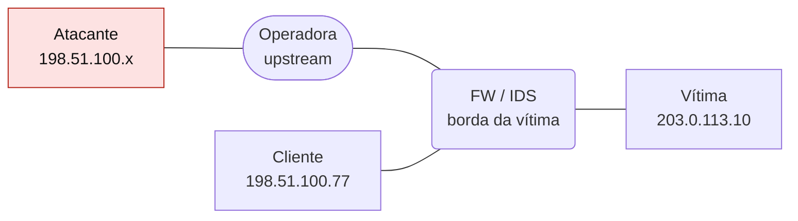
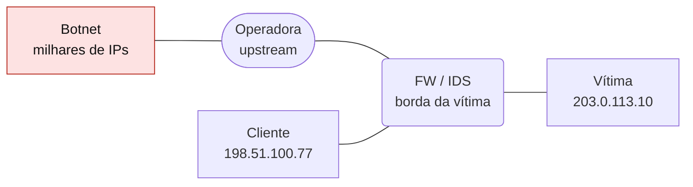
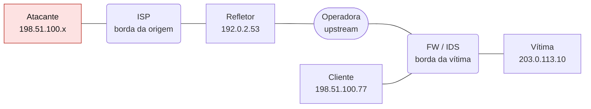

# Ataques e defesas TCP/UDP

Laboratório defensivo com 12 ataques (SYN flood, Slowloris, RST injection, varreduras, DDoS por botnet, amplificação, DNS water torture e outros), mitigação upstream, falsos positivos e ciclo de resposta a incidente.

- **Categoria:** Camada de transporte e segurança
- **Motor:** legado (página autônoma em `public/sims/tcp-udp-security-simulator.html`, incorporada por `iframe`)
- **RFCs e padrões:** [RFC 4987](https://www.rfc-editor.org/rfc/rfc4987), [BCP 38](https://www.rfc-editor.org/info/bcp38)
- **Tópicos:** SYN flood e Slowloris; Varreduras e amplificação; Mitigação e falsos positivos; Resposta a incidente

## 1. Como ler os diagramas

Este documento usa até dois tipos de diagrama. Cada figura traz uma legenda com o tipo, o que mostra e a que modo ou cenário se refere.

| Tipo | O que é | Vale para | Equivale, no simulador, a |
| --- | --- | --- | --- |
| A, topologia | Os elementos da rede e os enlaces que os ligam. É estático. | Um modo inteiro | A visão "Topologia" do quadro principal |

### 1.1 Legenda dos diagramas

**Tipo A (topologia)**

- Retângulo: host (computador ou servidor final).
- Hexágono: switch.
- Retângulo arredondado: roteador, ou dispositivo que encaminha ou traduz.
- Estádio (cantos bem arredondados): servidor ou rede externa.
- Retângulo vermelho: atacante (quando existe no modo).
- Linha contínua: enlace. Linha tracejada: enlace alternativo, forjado ou caído, conforme o rótulo e o cenário.
- O Mermaid posiciona os elementos automaticamente: o layout difere do simulador, as ligações não.

### 1.2 Lista de figuras

**Tipo A (topologia)**

- [Figura 2.1](#21-ataque-direto-de-uma-origem): ataque direto de uma origem
- [Figura 2.2](#22-ataque-distribuído-botnet): ataque distribuído por uma botnet
- [Figura 2.3](#23-reflexão-e-amplificação): reflexão e amplificação

## 2. Topologia

Figuras do Tipo A, geradas a partir da mesma definição que a página usa para desenhar a rede.

### 2.1 Ataque direto de uma origem

*Figura 2.1 (Tipo A, topologia).* O atacante envia o tráfego à vítima pela operadora e pelo firewall e IDS da borda; o cliente legítimo usa o mesmo firewall. Vale para os cenários 5.1 a 5.7; 5.11 e 5.12, inclusive as varreduras, que usam o mesmo desenho.

### 2.2 Ataque distribuído (botnet)

*Figura 2.2 (Tipo A, topologia).* O mesmo caminho, mas a origem é uma botnet, com milhares de endereços, o que impede o bloqueio por origem. Vale para o cenário 5.8.

### 2.3 Reflexão e amplificação

*Figura 2.3 (Tipo A, topologia).* O atacante envia requisições com a origem falsificada (o IP da vítima) ao serviço refletor, passando pela rede de origem (ISP). O refletor responde à vítima, por um caminho que passa pela operadora e pelo firewall, com tráfego maior que o das requisições. Vale para os cenários 5.9 e 5.10.

## 3. Abas

Cenário, Efeito dos controles, Configuração de referência, Experimento, Referência, Log de eventos.

## 4. Configurações (campos do painel)

- **Intensidade do ataque3 - moderada**. Valores: caixa de seleção. Padrão: não.
  - Define quantos pacotes de ataque saem por ciclo e o ritmo da simulação.
  - Ataques de baixo volume (Slowloris, varredura lenta) usam poucos pacotes de propósito; ataques volumétricos crescem com a intensidade.
  - Suba a intensidade para testar se a mesma defesa continua segurando o ataque.
- **Rate limitingLimita pacotes ou conexões por origem.**. Valores: caixa de seleção. Padrão: não.
  - Descarta o que passa de um limite por endereço de origem, por exemplo 20 SYN por segundo (meter do nftables, hashlimit do iptables ou limites do próprio serviço).
  - Funciona contra poucas origens; perde força contra ataques distribuídos e origens falsificadas.
  - **Custo:** clientes atrás de NAT ou CGNAT compartilham o mesmo IP e podem ser bloqueados (falso positivo).
- **Firewall statefulValida estado, flags e janela de sequência.**. Valores: caixa de seleção. Padrão: não.
  - Acompanha cada conexão em uma tabela de estados e só aceita pacotes coerentes com ela: SYN para abrir, ACK de conexão existente, sequência dentro da janela.
  - Descarta ACK órfão, RST fora da sequência e respostas que ninguém pediu.
  - **Limite:** um SYN é sempre um início válido, e a própria tabela de estados pode esgotar em floods.
- **Anti-spoofingBCP 38 / uRPF: descarta origens falsificadas.**. Valores: caixa de seleção. Padrão: não.
  - Descarta pacotes cuja origem não poderia chegar por aquela interface: uRPF no roteador, rp_filter no Linux, [BCP 38](https://www.rfc-editor.org/info/bcp38) na borda do provedor.
  - Contra reflexão e amplificação, só funciona na rede de **origem** do atacante: na vítima, as respostas vêm de IPs legítimos, os dos refletores.
  - Não ajuda contra botnets, que usam os próprios IPs.
- **SYN cookiesProtege a fila de conexões TCP no host.**. Valores: caixa de seleção. Padrão: não.
  - O servidor responde ao SYN sem reservar memória: o estado vai codificado no número de sequência do SYN-ACK e só é reconstruído quando o ACK final chega ([RFC 4987](https://www.rfc-editor.org/rfc/rfc4987)).
  - Neutraliza o SYN flood contra a fila de conexões semiabertas.
  - Atua só no handshake TCP: não ajuda depois da conexão aberta nem contra UDP.
- **IDS/IPSDetecta padrões anômalos e bloqueia origens.**. Valores: caixa de seleção. Padrão: não.
  - O IDS reconhece padrões (assinaturas e limiares) e gera alertas; no modo IPS, também bloqueia. Exemplos: Suricata, Snort, Zeek.
  - É o principal meio de **detecção**: sem ele, ataques de baixo volume passam despercebidos (veja a linha do tempo de resposta a incidente).
  - **Custo:** limiares mal calibrados geram falsos positivos contra usuários reais.
- **TLS / SSHAutentica e cifra o conteúdo da sessão.**. Valores: caixa de seleção. Padrão: não.
  - Cifra e autentica cada registro da sessão (TLS 1.3, SSH): dados injetados falham na verificação de integridade.
  - Resolve o sequestro de sessão, mas não protege o TCP abaixo dele: um RST forjado derruba a conexão mesmo com TLS.
  - Não ajuda contra ataques de volume nem contra varreduras.
- **Hardening de serviçosFecha portas, restringe serviços e ajusta timeouts.**. Valores: caixa de seleção. Padrão: não.
  - Reduz a superfície de ataque: fecha portas e serviços desnecessários, desativa recursão DNS aberta, NTP monlist e UDP no memcached, ajusta timeouts da aplicação.
  - É o controle essencial contra Slowloris, varreduras e o uso dos seus serviços como refletores.
  - Depende de inventário: só se endurece o que se sabe que existe.
- **Mitigação upstreamScrubbing / FlowSpec na operadora. Ativado durante o ataque, leva alguns ciclos para agir.**. Valores: caixa de seleção. Padrão: não.
  - A operadora ou um serviço anti-DDoS filtra o tráfego antes de ele chegar ao seu enlace: FlowSpec ([RFC 8955](https://www.rfc-editor.org/rfc/rfc8955)), scrubbing center ou RTBH ([RFC 7999](https://www.rfc-editor.org/rfc/rfc7999)).
  - É o único controle que escala com ataques maiores que o seu enlace.
  - Ativada durante o ataque, leva alguns ciclos para agir (chamado à operadora); marcada antes de iniciar, vale como contrato always-on. O RTBH descarta todo o tráfego para a vítima, inclusive o legítimo.
- **Velocidade da animação**. Valores: Lenta; Normal; Rápida. Padrão: Normal.
  - Muda só a velocidade de exibição; métricas, eficácia e resultados são os mesmos.
  - Use Executar passo para avançar um ciclo de cada vez.

## 5. Cenários

> **Grupo:** TCP

Ataques que abusam do estado da conexão TCP (fila de conexões, números de sequência, sessões abertas) ou das respostas do TCP para mapear a rede.

### 5.1 TCP SYN flood

Tipo: ataque direto | vítima 203.0.113.10 | ative os controles no painel lateral e clique em Iniciar.

**O que é.**

Muitas solicitações SYN deixam conexões semiabertas e consomem a fila de backlog do servidor.

**Neste cenário.**

O atacante envia o tráfego direto à vítima (203.0.113.10), passando pela operadora e pelo firewall da borda.

Controle essencial: **SYN cookies**. A eficácia, o ponto de atuação e o motivo de cada controle estão na aba Efeito dos controles.

**O que observar.**

- Grande volume de SYN sem ACK final
- Crescimento de conexões em SYN-RECEIVED
- Timeouts e recusa de clientes legítimos

**Evidências típicas no log.**

| Fonte | Registro |
| --- | --- |
| tcpdump | `IP 198.51.100.23.40211 > 203.0.113.10.443: Flags [S], seq 381927113, win 64240, length 0` |
| ss -s | `conexões em SYN-RECV crescendo, backlog próximo do limite` |
| cliente | `connect() timeout após retransmissões de SYN` |

**Por que importa.**

Contramedidas recomendadas: SYN cookies e ajuste do backlog; Rate limiting por origem e por destino; Filtragem upstream para ataques volumétricos. Risco residual: Floods acima da capacidade do enlace exigem mitigação upstream (operadora, RTBH ou scrubbing center).

### 5.2 TCP RST injection

Tipo: ataque direto | vítima 203.0.113.10 | ative os controles no painel lateral e clique em Iniciar.

**O que é.**

Um segmento RST forjado tenta coincidir com uma conexão ativa para provocar seu encerramento (ex.: sessão BGP de longa duração).

**Neste cenário.**

O atacante envia o tráfego direto à vítima (203.0.113.10), passando pela operadora e pelo firewall da borda.

Controle essencial: **Firewall stateful**. A eficácia, o ponto de atuação e o motivo de cada controle estão na aba Efeito dos controles.

**O que observar.**

- RST inesperado durante sessão ativa
- Reinícios frequentes de conexões
- Sequência ou janela incompatível com o fluxo

**Evidências típicas no log.**

| Fonte | Registro |
| --- | --- |
| tcpdump | `IP 198.51.100.23.40211 > 203.0.113.10.179: Flags [R], seq 381927113, win 0, length 0` |
| bgp | `sessão com 192.0.2.1 encerrada por RST inesperado` |
| aplicação | `connection reset by peer em sessão ativa` |

**Por que importa.**

Contramedidas recomendadas: Validação rigorosa de sequência ([RFC 5961](https://www.rfc-editor.org/rfc/rfc5961), challenge ACK); TCP-AO ou IPsec em sessões críticas; Monitoramento de RST anômalos. Risco residual: Sessões longas e de portas previsíveis (BGP, VPN) continuam alvos; prefira TCP-AO ([RFC 5925](https://www.rfc-editor.org/rfc/rfc5925)) ou IPsec.

### 5.3 TCP session hijacking

Tipo: ataque direto | vítima 203.0.113.10 | ative os controles no painel lateral e clique em Iniciar.

**O que é.**

Pacotes forjados tentam entrar em uma sessão usando metadados de fluxo e números de sequência plausíveis.

**Neste cenário.**

O atacante envia o tráfego direto à vítima (203.0.113.10), passando pela operadora e pelo firewall da borda.

Controle essencial: **TLS / SSH**. A eficácia, o ponto de atuação e o motivo de cada controle estão na aba Efeito dos controles.

**O que observar.**

- Dados fora da janela esperada
- ACKs duplicados ou sequência conflitante
- Mudança repentina do padrão da sessão

**Evidências típicas no log.**

| Fonte | Registro |
| --- | --- |
| tcpdump | `IP 192.0.2.50.40211 > 203.0.113.10.23: Flags [P.], seq 381927113, length 32` |
| sessão | `ACK storm entre cliente e servidor após injeção` |
| servidor | `comando executado fora do padrão do usuário` |

**Por que importa.**

Contramedidas recomendadas: TLS ou SSH para autenticação e integridade; Números de sequência imprevisíveis; Firewall stateful e segmentação. Risco residual: Um atacante no caminho (MITM) vê a sequência correta e vence controles de estado; só criptografia autenticada protege a integridade.

### 5.4 TCP ACK / port scan

Tipo: varredura | vítima 203.0.113.10 | ative os controles no painel lateral e clique em Iniciar.

**O que é.**

Sondas com flags TCP procuram inferir regras de filtragem e hosts acessíveis pelas respostas recebidas.

**Neste cenário.**

O atacante envia sondas à vítima (203.0.113.10) e deduz portas e regras de filtragem pelas respostas.

Controle essencial: **Firewall stateful**. A eficácia, o ponto de atuação e o motivo de cada controle estão na aba Efeito dos controles.

**O que observar.**

- ACKs sem sessão correspondente
- Sondas sequenciais para muitas portas
- Respostas RST concentradas em uma origem

**Evidências típicas no log.**

| Fonte | Registro |
| --- | --- |
| tcpdump | `IP 198.51.100.23.40211 > 203.0.113.10.161: Flags [.], ack 381927113, win 1024, length 0` |
| tcpdump | `IP 203.0.113.10.161 > 198.51.100.23.40211: Flags [R], seq 381927113, length 0` |
| observação | scanner infere "unfiltered" a partir de cada RST recebido |

**Por que importa.**

Contramedidas recomendadas: Política padrão de bloqueio; Firewall stateful para descartar ACK órfão; Correlação de varredura no IDS/IPS. Risco residual: Varreduras lentas e distribuídas passam abaixo dos limiares; mantenha inventário e exponha o mínimo.

### 5.5 TCP Slowloris (conexões lentas)

Tipo: ataque direto | vítima 203.0.113.10 | ative os controles no painel lateral e clique em Iniciar.

**O que é.**

O atacante abre muitas conexões HTTP completas e envia os cabeçalhos bem devagar, um a cada poucos segundos. Com pouquíssimo tráfego, ocupa todos os workers do servidor.

**Neste cenário.**

O atacante envia o tráfego direto à vítima (203.0.113.10), passando pela operadora e pelo firewall da borda.

Controle essencial: **Hardening de serviços**. A eficácia, o ponto de atuação e o motivo de cada controle estão na aba Efeito dos controles.

**O que observar.**

- Muitas conexões ESTABLISHED de poucas origens
- Requisições que nunca terminam os cabeçalhos
- Workers esgotados com o enlace quase ocioso

**Evidências típicas no log.**

| Fonte | Registro |
| --- | --- |
| tcpdump | `IP 198.51.100.23.40211 > 203.0.113.10.443: Flags [P.], length 14 (um cabeçalho X-a a cada 10 s)` |
| observação | ss -tn state established "( sport = :443 )": centenas de conexões abertas de poucas origens |
| apache | `server reached MaxRequestWorkers setting, consider raising the MaxRequestWorkers setting` |

**Por que importa.**

Contramedidas recomendadas: Timeouts curtos de cabeçalho e corpo; Limite de conexões simultâneas por IP; Proxy reverso orientado a eventos na frente do servidor. Risco residual: Variações (R.U.D.Y., slow read) atacam o corpo da requisição e a leitura da resposta; revise todos os timeouts da aplicação.

### 5.6 TCP varredura lenta (low and slow)

Tipo: varredura | vítima 203.0.113.10 | ative os controles no painel lateral e clique em Iniciar.

**O que é.**

Sondas SYN espaçadas, de origens alternadas, mapeiam portas abertas ao longo de horas sem ultrapassar os limiares de detecção.

**Neste cenário.**

O atacante envia sondas à vítima (203.0.113.10) e deduz portas e regras de filtragem pelas respostas; aqui, uma sonda a cada 3 ciclos, de propósito abaixo dos limiares de detecção.

Controle essencial: **Hardening de serviços**. A eficácia, o ponto de atuação e o motivo de cada controle estão na aba Efeito dos controles.

**O que observar.**

- Poucas conexões incompletas espalhadas ao longo de horas
- Mesma origem ou ASN tocando portas diferentes em dias distintos
- Só aparece em correlação de longo prazo (SIEM)

**Evidências típicas no log.**

| Fonte | Registro |
| --- | --- |
| tcpdump | `IP 198.51.100.23.40211 > 203.0.113.10.161: Flags [S], seq 381927113, win 1024, length 0` |
| tcpdump | `IP 203.0.113.10.161 > 198.51.100.23.40211: Flags [R.], seq 0, ack 381927114, length 0` |
| IDS | `nenhuma origem ultrapassou o limiar de 30 portas em 10 s` |

**Por que importa.**

Contramedidas recomendadas: Expor somente as portas necessárias; Correlação de longo prazo no SIEM (horas ou dias); Portas-armadilha (honeypots) que alertam no primeiro toque. Risco residual: Com paciência, o atacante sempre descobre as portas realmente abertas; o objetivo é reduzir a exposição e detectar cedo.

> **Grupo:** UDP

Ataques que exploram a falta de conexão do UDP: volume, origem falsificada, reflexão, amplificação e varredura.

### 5.7 UDP flood

Tipo: ataque direto | vítima 203.0.113.10 | ative os controles no painel lateral e clique em Iniciar.

**O que é.**

Datagramas em alta taxa consomem banda, CPU e filas de processamento do destino.

**Neste cenário.**

O atacante envia o tráfego direto à vítima (203.0.113.10), passando pela operadora e pelo firewall da borda.

Controle essencial: **Rate limiting**. A eficácia, o ponto de atuação e o motivo de cada controle estão na aba Efeito dos controles.

**O que observar.**

- Pico sustentado de pacotes UDP
- Muitas portas ou destinos aleatórios
- Perda, latência e CPU elevadas

**Evidências típicas no log.**

| Fonte | Registro |
| --- | --- |
| tcpdump -q | `IP 198.51.100.23.40211 > 203.0.113.10.161: UDP, length 1400` |
| tcpdump | `IP 203.0.113.10 > 198.51.100.23: ICMP 203.0.113.10 udp port 161 unreachable, length 36` |
| ifstat | `enlace de entrada acima de 90% da capacidade` |

**Por que importa.**

Contramedidas recomendadas: Rate limiting e QoS; ACLs para serviços desnecessários; Mitigação upstream e scrubbing. Risco residual: Se o volume excede o enlace, nenhum controle local resolve: é preciso mitigação upstream (RTBH, FlowSpec, scrubbing).

### 5.8 UDP DDoS distribuído (botnet)

Tipo: ataque distribuído | vítima 203.0.113.10 | ative os controles no painel lateral e clique em Iniciar.

**O que é.**

Milhares de dispositivos comprometidos (IoT, servidores) enviam tráfego com seus IPs reais. Cada origem envia pouco, mas o volume somado excede o enlace da vítima antes mesmo do firewall.

**Neste cenário.**

Milhares de bots enviam tráfego ao mesmo tempo, cada um com o seu IP real, contra a vítima (203.0.113.10). O volume chega pela operadora antes de alcançar o firewall.

Controle essencial: **Mitigação upstream**. A eficácia, o ponto de atuação e o motivo de cada controle estão na aba Efeito dos controles.

**O que observar.**

- Milhares de origens distintas, cada uma com taxa baixa
- Enlace de entrada saturado antes do firewall
- Distribuição ampla de países e ASNs

**Evidências típicas no log.**

| Fonte | Registro |
| --- | --- |
| NetFlow | `4812 origens distintas para 203.0.113.10 no último minuto` |
| tcpdump -q | `IP 198.51.100.23.40211 > 203.0.113.10.161: UDP, length 1200` |
| roteador de borda | `enlace de entrada em 100%, descartes na fila de saída da operadora` |

**Por que importa.**

Contramedidas recomendadas: Mitigação upstream: scrubbing ou FlowSpec; Plano de resposta com a operadora definido antes do incidente; CDN e anycast para diluir o volume. Risco residual: Botnets muito grandes podem exceder até a capacidade de scrubbing contratada; anycast e CDN diluem o impacto.

### 5.9 UDP amplification

Tipo: reflexão, fator 4x | vítima 203.0.113.10 | ative os controles no painel lateral e clique em Iniciar.

**O que é.**

Uma requisição pequena com origem falsificada provoca uma resposta muito maior de serviços expostos contra a vítima.

**Neste cenário.**

O atacante envia requisições com a origem falsificada (o IP da vítima, 203.0.113.10) a um serviço refletor, que responde à vítima com fator de amplificação 4x. A vítima recebe tráfego de IPs legítimos, os dos refletores.

Controle essencial: **Anti-spoofing** e **Hardening de serviços**. A eficácia, o ponto de atuação e o motivo de cada controle estão na aba Efeito dos controles.

**O que observar.**

- Respostas UDP sem solicitação local
- Assimetria entre bytes de entrada e saída
- Tráfego concentrado de vários refletores

**Evidências típicas no log.**

| Fonte | Registro |
| --- | --- |
| tcpdump -q | `IP 203.0.113.10.40211 > 192.0.2.53.53: UDP, length 40 (origem falsificada)` |
| tcpdump -q | `IP 192.0.2.53.53 > 203.0.113.10.40211: UDP, length 3120` |
| NetFlow | `bytes de entrada da porta 53 muito maiores que os de saída` |

**Por que importa.**

Contramedidas recomendadas: [BCP 38](https://www.rfc-editor.org/info/bcp38) / 84 na rede de origem; Desativar amplificadores abertos; Response Rate Limiting e filtragem upstream. Risco residual: O tráfego amplificado pode exceder o enlace da vítima; filtragem por porta de origem e scrubbing na operadora continuam necessários.

### 5.10 UDP spoofing / reflection

Tipo: reflexão, fator 2x | vítima 203.0.113.10 | ative os controles no painel lateral e clique em Iniciar.

**O que é.**

O atacante falsifica o endereço da vítima e faz terceiros enviarem respostas não solicitadas a ela.

**Neste cenário.**

O atacante envia requisições com a origem falsificada (o IP da vítima, 203.0.113.10) a um serviço refletor, que responde à vítima com fator de amplificação 2x. A vítima recebe tráfego de IPs legítimos, os dos refletores.

Controle essencial: **Anti-spoofing**. A eficácia, o ponto de atuação e o motivo de cada controle estão na aba Efeito dos controles.

**O que observar.**

- Respostas originadas por muitos servidores
- Ausência das solicitações correspondentes
- Endereços de origem impossíveis na borda

**Evidências típicas no log.**

| Fonte | Registro |
| --- | --- |
| tcpdump -q | `IP 203.0.113.10.40211 > 192.0.2.53.123: UDP, length 48 (origem falsificada)` |
| tcpdump -q | `IP 192.0.2.53.123 > 203.0.113.10.40211: UDP, length 468` |
| firewall | `respostas NTP sem requisição de saída correspondente` |

**Por que importa.**

Contramedidas recomendadas: Filtragem de ingresso e egresso ([BCP 38](https://www.rfc-editor.org/info/bcp38) / 84); Validação de origem na operadora; Rate limiting nos serviços UDP. Risco residual: Enquanto houver redes sem [BCP 38](https://www.rfc-editor.org/info/bcp38), a falsificação continua possível; a vítima depende de filtragem e mitigação upstream.

### 5.11 UDP port scan

Tipo: varredura | vítima 203.0.113.10 | ative os controles no painel lateral e clique em Iniciar.

**O que é.**

Sondas UDP procuram serviços expostos e interpretam respostas da aplicação ou mensagens ICMP.

**Neste cenário.**

O atacante envia sondas à vítima (203.0.113.10) e deduz portas e regras de filtragem pelas respostas.

Controle essencial: **Hardening de serviços**. A eficácia, o ponto de atuação e o motivo de cada controle estão na aba Efeito dos controles.

**O que observar.**

- Datagramas para muitas portas
- ICMP Port Unreachable em sequência
- Sondas de baixa taxa e longa duração

**Evidências típicas no log.**

| Fonte | Registro |
| --- | --- |
| tcpdump -q | `IP 198.51.100.23.40211 > 203.0.113.10.161: UDP, length 0` |
| tcpdump | `IP 203.0.113.10 > 198.51.100.23: ICMP 203.0.113.10 udp port 161 unreachable, length 36` |
| firewall | `uma origem tocou dezenas de portas UDP em poucos segundos` |

**Por que importa.**

Contramedidas recomendadas: Expor somente serviços necessários; ACLs e firewall com registro; Detecção por limiar e correlação temporal. Risco residual: Serviços realmente expostos continuarão respondendo; mantenha-os atualizados e monitorados.

### 5.12 UDP DNS water torture

Tipo: via resolvedores legítimos | vítima 203.0.113.10 | ative os controles no painel lateral e clique em Iniciar.

**O que é.**

Bots consultam subdomínios aleatórios e inexistentes (a8f3k.example.com) por meio de resolvedores recursivos legítimos. Nenhuma resposta fica em cache e o servidor autoritativo da vítima é sobrecarregado.

**Neste cenário.**

Os bots não falam direto com a vítima: enviam as consultas a resolvedores recursivos legítimos (de provedores e DNS públicos), que as repassam ao servidor autoritativo da vítima (203.0.113.10). Por isso as origens que chegam são resolvedores reais.

Controle essencial: **IDS/IPS**. A eficácia, o ponto de atuação e o motivo de cada controle estão na aba Efeito dos controles.

**O que observar.**

- Explosão de respostas NXDOMAIN
- Rótulos aleatórios sob o mesmo domínio
- Consultas vindas de resolvedores conhecidos (provedores, DNS públicos)

**Evidências típicas no log.**

| Fonte | Registro |
| --- | --- |
| tcpdump | `IP 192.0.2.53.40211 > 203.0.113.10.53: 4123+ A? x7f3k2.example.com. (41)` |
| named | `92% das respostas do último minuto foram NXDOMAIN` |
| resolvedor | `SERVFAIL para clientes legítimos de example.com` |

**Por que importa.**

Contramedidas recomendadas: Detecção pela proporção de NXDOMAIN e filtragem pelo padrão do nome; RRL com limite de NXDOMAIN no autoritativo; Aggressive NSEC ([RFC 8198](https://www.rfc-editor.org/rfc/rfc8198)) nos resolvedores e capacidade anycast. Risco residual: Bloquear por IP derruba os resolvedores que também atendem os usuários; a defesa precisa olhar o nome consultado, não a origem.

## 6. Referência

Ambiente didático isolado: todos os hosts, pacotes e resultados existem apenas nesta página e não há tráfego de rede real. Os endereços usam as faixas de documentação da [RFC 5737](https://www.rfc-editor.org/rfc/rfc5737).

          

### 6.1 Como ler a simulação

          

Cada pacote de ataque atravessa os controles ativos em camadas. A **eficácia** de um controle é a chance de ele neutralizar um pacote sozinho; controles combinados se somam como **defesa em profundidade**. O **serviço legítimo** mede quantas requisições do cliente foram atendidas: ele cai quando o servidor satura e também quando um controle gera falsos positivos.

          

Na telemetria, vale sempre: **ataque rumo à vítima = neutralizados + chegaram à vítima**. Na reflexão, as requisições enviadas aos refletores aparecem à parte, porque não vão para a vítima; cada uma que não é barrada vira várias respostas, e são essas que contam como ataque rumo à vítima. A **carga** é a fração da capacidade do servidor e por isso para em 100%; quando a demanda passa disso, o quadro mostra também a **demanda**, e o excedente aparece como requisições legítimas descartadas.

          

### 6.2 TCP e abuso de estado

          

O TCP mantém estado e usa flags, números de sequência e confirmações. Ataques exploram filas de conexão (SYN flood, [RFC 4987](https://www.rfc-editor.org/rfc/rfc4987)), validação insuficiente de sequência (RST injection, mitigado pela [RFC 5961](https://www.rfc-editor.org/rfc/rfc5961)) ou sessões sem autenticação (sequestro). SYN cookies, firewall stateful e criptografia autenticada (TLS, SSH, TCP-AO da [RFC 5925](https://www.rfc-editor.org/rfc/rfc5925)) reduzem a superfície de ataque.

          

### 6.3 UDP e abuso sem conexão

          

O UDP não estabelece sessão e não confirma a origem. Isso favorece falsificação, reflexão e amplificação quando serviços respondem com muito mais dados do que recebem. Anti-spoofing na rede de origem ([BCP 38](https://www.rfc-editor.org/info/bcp38), [RFC 2827](https://www.rfc-editor.org/rfc/rfc2827)), hardening dos serviços, rate limiting e mitigação upstream são os controles essenciais.

          

### 6.4 Onde cada controle atua

          

- **Borda da rede de origem:** [BCP 38](https://www.rfc-editor.org/info/bcp38) / [BCP 84](https://www.rfc-editor.org/info/bcp84) impede que pacotes com origem falsificada saiam da rede do atacante.
- **Firewall da vítima:** firewall stateful, ACLs, rate limiting e IPS.
- **Host:** SYN cookies e validação de sequência na pilha TCP.
- **Aplicação e serviço:** TLS, SSH e configuração segura (sem recursão aberta, RRL, UDP desabilitado quando desnecessário).
- **Operadora:** RTBH, FlowSpec e scrubbing para volumes acima do enlace.

          

### 6.5 Ataques de baixo volume e de aplicação

          

**Slowloris** abre conexões completas e envia cabeçalhos HTTP devagar, esgotando os workers com quase nenhum tráfego. SYN cookies, TLS e filtros da operadora não ajudam: a defesa está nos **timeouts da aplicação**, no limite de conexões simultâneas por IP e em um proxy reverso orientado a eventos. A **varredura lenta** espaça as sondas por horas e fica abaixo de qualquer limiar de IDS; só a redução da exposição, a correlação de longo prazo (SIEM) e portas-armadilha a revelam.

          

### 6.6 Ataques volumétricos e mitigação upstream

          

Em um **DDoS distribuído**, cada bot usa seu IP real e envia pouco, então rate limiting por origem e anti-spoofing quase não atuam, e o enlace satura antes do firewall: descartar no firewall não devolve a banda. A resposta é **upstream**: FlowSpec ([RFC 8955](https://www.rfc-editor.org/rfc/rfc8955)) descarta só o padrão do ataque na operadora, scrubbing centers limpam o tráfego e devolvem o legítimo por túnel, e **RTBH** ([RFC 7999](https://www.rfc-editor.org/rfc/rfc7999)) descarta todo o tráfego para o /32 da vítima, o que protege o resto da rede mas completa o DoS contra aquele host. Sem contrato always-on, o acionamento leva tempo; no simulador, a mitigação ativada durante o ataque só age após alguns ciclos.

          

No **DNS water torture**, os bots consultam nomes aleatórios por meio de resolvedores legítimos. Bloquear por IP derruba os resolvedores que também atendem os usuários (falso positivo em massa); a defesa deve olhar o nome consultado: proporção de NXDOMAIN, RRL com `nxdomains-per-second` e Aggressive NSEC ([RFC 8198](https://www.rfc-editor.org/rfc/rfc8198)) nos resolvedores.

          

### 6.7 Ciclo de resposta a incidente

          

O painel lateral acompanha as fases do NIST SP 800-61r2 (substituída pela Rev. 3 em abril de 2025, alinhada ao CSF 2.0; as fases abaixo seguem a r2 por serem didáticas): **preparação** (controles ativos antes do ataque), **detecção e análise** (primeiro alerta do IDS ou carga acima de 60%), **contenção** (controles essenciais ativos e proteção de pelo menos 85%), **erradicação e recuperação** (carga de volta abaixo de 30%) e **atividade pós-incidente** (lições aprendidas na avaliação). Os indicadores **MTTD** e **MTTC** medem, em ciclos, o tempo até detectar e até conter. Observe que, sem IDS, ataques de baixo volume podem nunca ser detectados.

          

### 6.8 Roteiro de exercícios

          

1. SYN flood na intensidade 4 sem defesas: anote carga e serviço legítimo. Ative só rate limiting e depois só SYN cookies. Qual protege a fila e por quê?
2. RST injection: ative TLS / SSH e observe que a proteção não muda. Explique o motivo e qual controle resolve.
3. Amplificação: ative anti-spoofing e identifique no diagrama onde ele precisa estar para funcionar.
4. Ative todos os controles e compare o serviço legítimo. Que custos apareceram no log?
5. Slowloris: verifique que SYN cookies, TLS e mitigação upstream não mudam nada. Qual controle resolve e em que camada ele atua?
6. DDoS botnet: inicie sem defesas, ative a mitigação upstream com o ataque em andamento e anote o MTTC. Repita com a mitigação ativa antes de iniciar (always-on) e compare.
7. DNS water torture: ative rate limiting e observe os falsos positivos. Por que limitar por IP prejudica usuários reais neste cenário?
8. Varredura lenta: ative apenas o IDS/IPS e veja se o incidente chega a ser detectado. O que precisaria mudar na regra?
9. Para cada cenário, encontre o menor conjunto de controles que obtém "Postura adequada".

---

*Simul-Net é um projeto mantido pelo Prof. Dr. Laerte Peotta de Melo, com apoio de IA generativa no processo de desenvolvimento, com sua estrita supervisão, revisão técnica e responsabilidade. Uso exclusivo para fins de ensino e pesquisa. Universidade de Brasília (UnB) - Departamento de Engenharia Elétrica. Código aberto (licença MIT).*
