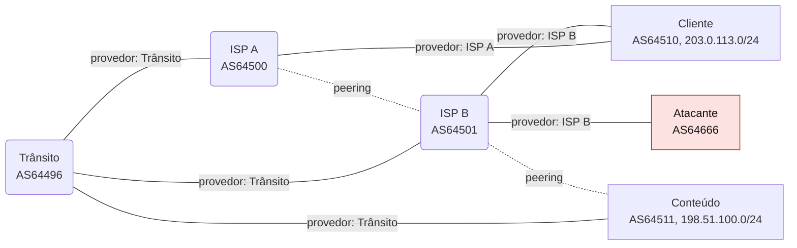
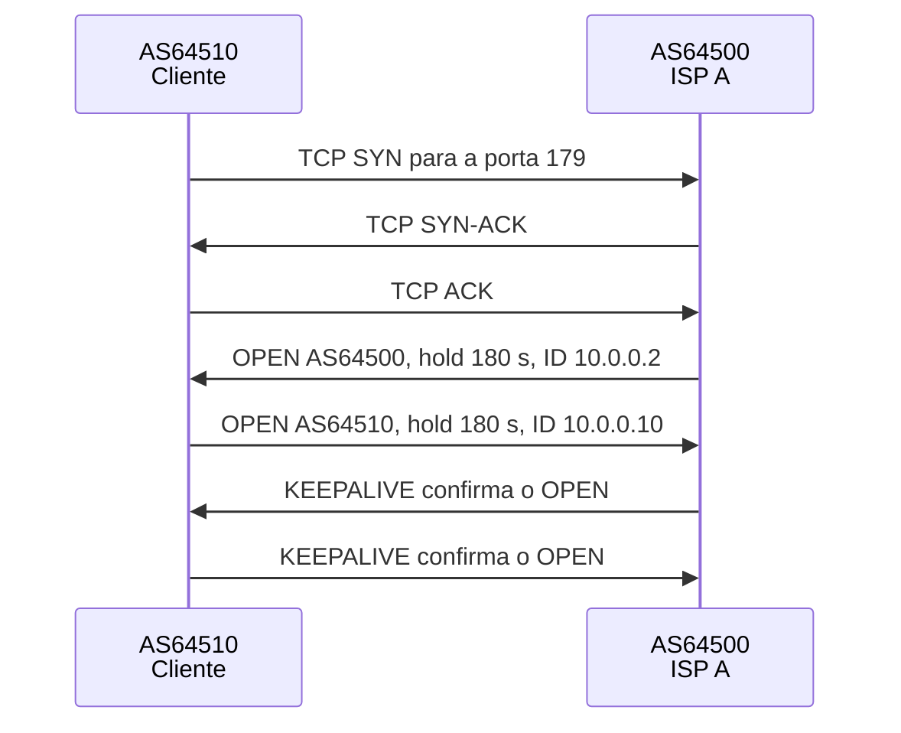
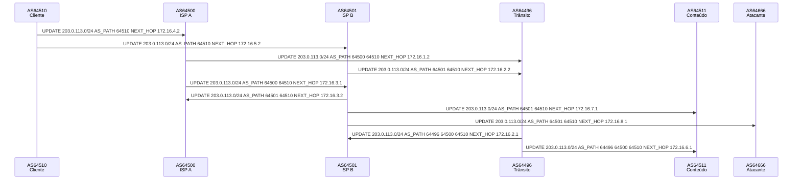
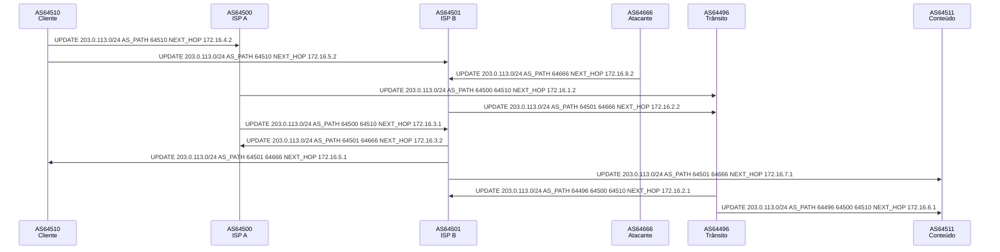
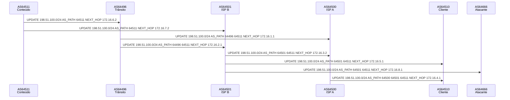

# BGP (sessões e seleção de caminho)

BGP-4 entre seis sistemas autônomos: sessões, OPEN, UPDATE e KEEPALIVE, relações comerciais, LOCAL_PREF, AS-path prepend, falhas e reconvergência, mais sequestro de prefixo, vazamento de rota e flapping com as defesas (filtros, RPKI/ROV, flap damping).

- **Categoria:** Roteamento e serviços de rede
- **Motor:** legado (página autônoma em `public/sims/bgp-simulator.html`, incorporada por `iframe`)
- **RFCs e padrões:** [RFC 4271](https://www.rfc-editor.org/rfc/rfc4271), [RFC 6811](https://www.rfc-editor.org/rfc/rfc6811)
- **Tópicos:** Sessões e mensagens; Seleção de caminho; Sequestro, vazamento e flapping; Defesas (RPKI/ROV, filtros)

## 1. Como ler os diagramas

Este documento usa até dois tipos de diagrama. Cada figura traz uma legenda com o tipo, o que mostra e a que modo ou cenário se refere.

| Tipo | O que é | Vale para | Equivale, no simulador, a |
| --- | --- | --- | --- |
| A, topologia | Os elementos da rede e os enlaces que os ligam. É estático. | Um modo inteiro | A visão "Topologia" do quadro principal |
| B, sequência | As mensagens na ordem do tempo, entre os participantes. É dinâmico. | Um único cenário, com a configuração indicada | Ao diagrama de sequência e à aba Captura |

### 1.1 Legenda dos diagramas

**Tipo A (topologia)**

- Retângulo: host (computador ou servidor final).
- Hexágono: switch.
- Retângulo arredondado: roteador, ou dispositivo que encaminha ou traduz.
- Estádio (cantos bem arredondados): servidor ou rede externa.
- Retângulo vermelho: atacante (quando existe no modo).
- Linha contínua: enlace. Linha tracejada: enlace alternativo, forjado ou caído, conforme o rótulo e o cenário.
- O Mermaid posiciona os elementos automaticamente: o layout difere do simulador, as ligações não.

**Tipo B (sequência)**

- Cada coluna é um participante (cliente, servidor, roteador ou outro). O tempo corre de cima para baixo.
- Seta cheia: mensagem enviada. Seta com X: mensagem perdida.
- `[cifrado]` no início do rótulo: a mensagem viaja cifrada.
- Faixa horizontal com texto: início de uma fase do cenário.
- A ordem é a da aba Captura; os intervalos de tempo não são desenhados em escala.

### 1.2 Lista de figuras

**Tipo A (topologia)**

- [Figura 2.1](#21-topologia-de-6-sistemas-autônomos): topologia dos seis sistemas autônomos

**Tipo B (sequência)**

- [Figura 5.1](#51-estabelecimento-da-sessão): sequência de "Estabelecimento da sessão"
- [Figura 5.3](#53-propagação-do-anúncio): sequência de "Propagação do anúncio"
- [Figura 5.11](#511-sequestro-de-prefixo): sequência de "Sequestro de prefixo"
- [Figura 5.14](#514-vazamento-de-rota): sequência de "Vazamento de rota"

## 2. Topologia

Figuras do Tipo A, geradas a partir da mesma definição que a página usa para desenhar a rede.

### 2.1 Topologia de 6 sistemas autônomos

*Figura 2.1 (Tipo A, topologia).* 6 sistemas autônomos e 8 enlaces BGP: Trânsito (AS64496); ISP A (AS64500); ISP B (AS64501); Cliente (AS64510, 203.0.113.0/24); Conteúdo (AS64511, 198.51.100.0/24); Atacante (AS64666). Linhas contínuas: relação de provedor e cliente, com o provedor indicado no rótulo. Linhas tracejadas: peering. Vale para todos os cenários; o Atacante só age nos cenários de segurança.

## 3. Abas

Cenário, Terminal, Captura, Mensagem BGP, Sessões, Tabela BGP, Experimento, Referência, Log de eventos.

## 4. Configurações (campos do painel)

- **Sentido do tráfego**. Valores: Conteúdo → Cliente; Cliente → Conteúdo; ISP A → Conteúdo. Padrão: Conteúdo → Cliente.
  - **ISP A → Conteúdo:** mostra o caminho de um provedor, útil no cenário de vazamento de rota.
  - **Conteúdo → Cliente:** o tráfego entra no AS do Cliente. O caminho depende do que o Cliente anuncia (AS-path prepend, anúncio do prefixo).
  - **Cliente → Conteúdo:** o tráfego sai do AS do Cliente. O caminho depende da política de saída (LOCAL_PREF).
  - Cada AS decide sozinho o próximo salto, consultando o melhor caminho da própria tabela BGP.
- **AS em foco (tabela e terminal)**. Valores: Trânsito (AS64496); ISP A (AS64500); ISP B (AS64501); Cliente (AS64510); Conteúdo (AS64511); Atacante (AS64666). Padrão: Conteúdo (AS64511).
  - Define de qual roteador vêm a aba Tabela BGP e os comandos do terminal (`show ip bgp`, `traceroute`).
  - Clicar em um AS no desenho tem o mesmo efeito. O prompt do terminal mostra o AS escolhido.
- **LOCAL_PREF das rotas do ISP A**. Valores: 100 (padrão); 200 (preferir o ISP A). Padrão: 100 (padrão).
  - **100 (padrão):** as rotas do ISP A e do ISP B empatam nesse critério, e a decisão passa para o AS_PATH.
  - **200:** o Cliente prefere o ISP A mesmo que o AS_PATH seja mais longo, porque o LOCAL_PREF é avaliado primeiro.
  - O LOCAL_PREF vale só dentro do AS: não é enviado aos vizinhos, e por isso nenhum UPDATE sai do Cliente. Controla o tráfego que **sai**.
- **AS-path prepend para o ISP B**. Valores: nenhum; 1 vez; 3 vezes. Padrão: nenhum.
  - O Cliente acrescenta o próprio número de AS várias vezes ao AS_PATH do anúncio dirigido ao ISP B, deixando aquele caminho mais longo.
  - Quem compara o AS_PATH passa a preferir o caminho pelo ISP A. Controla o tráfego que **entra**.
  - Funciona como sugestão: AS que decidem por LOCAL_PREF ignoram o prepend. Cada valor gera novos UPDATEs.
- **Anunciar 203.0.113.0/24**. Valores: caixa de seleção. Padrão: sim.
  - Desmarcado, o Cliente envia um UPDATE com o prefixo em Withdrawn Routes, e a retirada se espalha pela rede.
  - Sem rota, o tráfego destinado ao Cliente é descartado no AS que não tem mais caminho.
- **LOCAL_PREF por relação comercial**. Valores: caixa de seleção. Padrão: não.
  - Ligado, todo AS atribui LOCAL_PREF 200 às rotas de clientes, 150 às de peers e 100 às de provedores: prefere a rota que lhe rende dinheiro ou custa menos. É a prática comum das operadoras.
  - Desligado, todas as rotas têm LOCAL_PREF 100 e a decisão passa para o AS_PATH. Isso simplifica os cenários de seleção de caminho, mas esconde o efeito de um vazamento de rota.
- **RPKI / ROV**. Valores: desligado; só no ISP B; só no ISP A; ISP A, ISP B e Trânsito; todos os AS. Padrão: desligado.
  - O dono do prefixo publica um ROA com o AS autorizado a originá-lo ([RFC 6811](https://www.rfc-editor.org/rfc/rfc6811)). Um AS com **validação de origem** rejeita rotas cujo último AS do AS_PATH é outro.
  - Escolha onde a validação está ativa. Ela protege quem a aplica: um AS sem ROV continua aceitando rotas inválidas.
  - Valida só a origem; não detecta um AS_PATH forjado nem uma rota vazada.
- **Filtro de prefixos de clientes**. Valores: desligado; no ISP B; no Trânsito; ISP A, ISP B e Trânsito. Padrão: desligado.
  - O provedor aceita de um cliente apenas prefixos pertencentes ao **cone de clientes** dele (o próprio cliente e quem está abaixo), como as listas feitas com registros IRR.
  - Precisa estar no provedor **direto** do AS que anuncia. Um filtro mais acima não distingue os clientes de um mesmo cone.
- **Filtro de rotas de peers**. Valores: desligado; no ISP A; ISP A, ISP B e Conteúdo. Padrão: desligado.
  - Um peer só deveria anunciar rotas próprias e de seus clientes. O filtro rejeita o resto, o que barra **vazamentos de rota**.
  - Não barra um sequestro que parta de dentro do cone do peer: o prefixo do Cliente pertence ao cone do ISP B, mesmo quando é o Atacante que o anuncia.
- **Flap damping nos provedores**. Valores: caixa de seleção. Padrão: não.
  - Depois de duas retiradas do mesmo prefixo pelo mesmo vizinho, o AS passa a rejeitar o prefixo desse vizinho ([RFC 2439](https://www.rfc-editor.org/rfc/rfc2439)).
  - Reduz a instabilidade que se espalha, mas também tira do ar um prefixo legítimo até a penalidade decair. Vale para as próximas oscilações.
- **Velocidade da animação**. Valores: Lenta; Normal; Rápida. Padrão: Normal.
  - Muda só a velocidade de exibição; rotas, UPDATEs e decisões são os mesmos.
  - Use Avançar fase para acompanhar as sessões e a convergência passo a passo.

## 5. Cenários

> **Grupo:** Sessões

Como dois roteadores de AS diferentes abrem e mantêm uma sessão BGP, e como uma sessão morta é detectada.

### 5.1 Estabelecimento da sessão

Configuração: LOCAL_PREF 100 para o ISP A; prepend nenhum; 203.0.113.0/24 anunciado; defesas: nenhuma

**O que é.**

Uma sessão BGP é uma conexão **TCP na porta 179** entre dois roteadores configurados um como vizinho do outro. A sessão parte de **Idle**, passa por **Connect** (TCP subindo; se falhar, vai a **Active** e tenta de novo), **OpenSent** (OPEN enviado), **OpenConfirm** (OPEN recebido) e **Established** (OPEN confirmado por KEEPALIVE). Só então as rotas são trocadas.

**Neste cenário.**

Clique em **Avançar fase** três vezes: TCP na porta 179, troca de OPEN e confirmação por KEEPALIVE.

Acompanhe os estados na aba Sessões e abra um OPEN na aba Mensagem BGP.

**O que observar.**

- Na aba Sessões: o estado de cada vizinho mudando a cada fase.
- Na aba Mensagem BGP de um OPEN: AS, hold time de 180 s (padrão Cisco IOS), router ID e capacidades.
- Na Captura: o handshake TCP antes de qualquer mensagem BGP.

**Mensagens envolvidas.**

| Mensagem | Função | Quem envia |
| --- | --- | --- |
| TCP SYN / SYN-ACK / ACK | abre a conexão na porta 179 | um dos vizinhos |
| OPEN | AS, hold time, router ID, capacidades | os dois lados |
| KEEPALIVE | confirma o OPEN | os dois lados |

**Por que importa.**

O BGP não descobre vizinhos sozinho: toda sessão é configurada à mão, dos dois lados. Se os parâmetros do OPEN não batem (por exemplo, o AS esperado), a sessão termina com NOTIFICATION.

*Figura 5.1 (Tipo B, sequência).* Mensagens do cenário "Estabelecimento da sessão", na ordem do tempo, entre AS64510 Cliente, AS64500 ISP A: 7 mensagens. Só as mensagens do enlace L4 (ISP A e Cliente), do tipo TCP, OPEN, KEEPALIVE, depois de avançar as quatro fases. Corresponde à aba Captura, na ordem em que os pacotes aparecem; os intervalos de tempo não estão em escala.

### 5.2 Hold timer

Configuração: LOCAL_PREF 100 para o ISP A; prepend nenhum; 203.0.113.0/24 anunciado; defesas: nenhuma

**O que é.**

Cada lado envia um **KEEPALIVE** a cada 60 s e espera receber alguma mensagem dentro do **hold time** (180 s), valores padrão do Cisco IOS; a [RFC 4271](https://www.rfc-editor.org/rfc/rfc4271) sugere 30 s e 90 s. Quando o vizinho trava sem derrubar o enlace, só o **hold timer** percebe: ao expirar, o roteador envia **NOTIFICATION** (código 4, Hold Timer Expired), encerra a sessão e retira as rotas aprendidas por ela.

**Neste cenário.**

Avance as quatro fases. Depois clique no enlace **ISP B / Cliente** e use **Silenciar ISP B**: o enlace continua ativo, mas os KEEPALIVEs param.

Compare com **Derrubar enlace** no mesmo enlace: quanto tempo cada falha leva para ser percebida?

**O que observar.**

- No log: os 180 s sem KEEPALIVE e a NOTIFICATION.
- Na aba Mensagem BGP da NOTIFICATION: código 4.
- Compare com Derrubar enlace: a queda da interface derruba a sessão na hora (fast-external-fallover).

**Mensagens envolvidas.**

| Mensagem | Função | Quem envia |
| --- | --- | --- |
| KEEPALIVE | param de chegar | ISP B |
| NOTIFICATION | Hold Timer Expired (código 4) | Cliente |
| UPDATE (withdraw) | retira as rotas que dependiam da sessão | AS afetados |

**Por que importa.**

O hold time define quanto tempo o tráfego pode ir para um vizinho morto. Valores menores detectam falhas mais rápido; em produção, o BFD faz isso em milissegundos.

> **Grupo:** Propagação

Como um prefixo se espalha de AS em AS e quem repassa o quê, conforme as relações comerciais.

### 5.3 Propagação do anúncio

Configuração: LOCAL_PREF 100 para o ISP A; prepend nenhum; 203.0.113.0/24 anunciado; defesas: nenhuma

**O que é.**

O Cliente anuncia o próprio prefixo aos provedores. Cada AS que repassa a rota acrescenta o **próprio número** no início do **AS_PATH** e troca o **NEXT_HOP** pelo próprio endereço no enlace. Um AS que recebe uma rota com o próprio número no AS_PATH a descarta: é assim que o BGP evita laços.

**Neste cenário.**

Avance até a fase UPDATE e acompanhe o prefixo 203.0.113.0/24 saindo do Cliente. Na Captura, abra os UPDATEs em sequência.

A cada AS, o AS_PATH ganha mais um número e o NEXT_HOP passa a ser o endereço de quem anunciou.

**O que observar.**

- Na Captura: o mesmo prefixo com AS_PATH 64510, depois 64500 64510, depois 64496 64500 64510.
- Na aba Mensagem BGP: o NEXT_HOP de cada UPDATE é o endereço de quem anunciou.
- No log: anúncios descartados por conter o próprio AS.

**Mensagens envolvidas.**

| Mensagem | Função | Quem envia |
| --- | --- | --- |
| UPDATE | AS_PATH 64510 | Cliente para os ISPs |
| UPDATE | AS_PATH 64500 64510 | ISP A para Trânsito e ISP B |
| UPDATE | AS_PATH 64496 64500 64510 | Trânsito para o Conteúdo |

**Por que importa.**

O AS_PATH é a memória do caminho: evita laços e serve de critério de escolha. Por isso o BGP é chamado de protocolo de vetor de caminho.

*Figura 5.3 (Tipo B, sequência).* Mensagens do cenário "Propagação do anúncio", na ordem do tempo, entre AS64510 Cliente, AS64500 ISP A, AS64501 ISP B, AS64496 Trânsito, AS64511 Conteúdo, AS64666 Atacante: 10 mensagens. Só as mensagens do prefixo 203.0.113.0/24, do tipo UPDATE, depois de avançar as quatro fases. Corresponde à aba Captura, na ordem em que os pacotes aparecem; os intervalos de tempo não estão em escala.

### 5.4 Exportação entre provedores e peers

Configuração: LOCAL_PREF 100 para o ISP A; prepend nenhum; 203.0.113.0/24 anunciado; defesas: nenhuma

**O que é.**

Cada AS repassa rotas conforme quem paga quem. Rotas de **clientes** vão para todos; rotas aprendidas de **peers** ou de **provedores** vão só para **clientes**. Assim nenhum AS oferece trânsito gratuito entre dois provedores ou dois peers (modelo valley-free, de Gao-Rexford).

**Neste cenário.**

Avance até a fase UPDATE. Ponha o **ISP A** em foco e veja na aba Tabela BGP quantos caminhos ele tem para 198.51.100.0/24. Depois ponha o **ISP B** em foco e compare.

O ISP B conhece um caminho mais curto, mas não o repassa ao ISP A.

**O que observar.**

- Na Tabela BGP do ISP A: só um caminho para 198.51.100.0/24, pelo Trânsito.
- Na Tabela BGP do ISP B: dois caminhos, direto pelo Conteúdo (peer) e pelo Trânsito.
- O ISP B não repassa ao ISP A a rota do Conteúdo, porque ela veio de um peer e o ISP A também é peer.

**Mensagens envolvidas.**

| Rota aprendida de | Repassada para | Por quê |
| --- | --- | --- |
| cliente | clientes, peers e provedores | o cliente paga pelo trânsito |
| peer | só clientes | peering não inclui trânsito para terceiros |
| provedor | só clientes | ninguém transporta de graça o tráfego de um provedor |

**Por que importa.**

É a política, e não a distância, que define boa parte dos caminhos da Internet. Repassar rotas fora dessa regra provoca vazamentos de rota e desvia tráfego por redes que não deveriam carregá-lo.

> **Grupo:** Seleção de caminho

Como cada AS escolhe um único caminho entre vários, e como a política influencia o tráfego que sai e o que entra.

### 5.5 AS_PATH mais curto

Configuração: LOCAL_PREF 100 para o ISP A; prepend nenhum; 203.0.113.0/24 anunciado; defesas: nenhuma

**O que é.**

Quando o LOCAL_PREF é igual e nenhuma rota é local, o BGP escolhe o **AS_PATH mais curto**, isto é, o caminho que atravessa menos sistemas autônomos. O número de roteadores dentro de cada AS e a banda dos enlaces não entram nessa conta.

**Neste cenário.**

Avance até a fase UPDATE, ponha o **Conteúdo** em foco e rode `show ip bgp 203.0.113.0` no terminal.

Há dois caminhos: pelo ISP B (peering) e pelo Trânsito. Envie tráfego Conteúdo → Cliente e veja qual é usado.

**O que observar.**

- No terminal do Conteúdo: `show ip bgp 203.0.113.0` mostra dois caminhos e o melhor.
- O caminho pelo ISP B tem 2 AS (64501 64510); o pelo Trânsito tem 3 (64496 64500 64510).
- Envie tráfego Conteúdo → Cliente: ele vai pelo ISP B.

**Mensagens envolvidas.**

| Caminho | AS_PATH | Resultado |
| --- | --- | --- |
| pelo ISP B (peering) | 64501 64510 | melhor: mais curto |
| pelo Trânsito | 64496 64500 64510 | perde: mais longo |

**Por que importa.**

O AS_PATH é uma aproximação grosseira de distância: um caminho com menos AS pode ser mais lento. Por isso os operadores combinam o AS_PATH com políticas de LOCAL_PREF.

### 5.6 Desempate por router ID

Configuração: LOCAL_PREF 100 para o ISP A; prepend nenhum; 203.0.113.0/24 anunciado; defesas: nenhuma

**O que é.**

Quando LOCAL_PREF, AS_PATH, ORIGIN e MED empatam, o BGP ainda precisa escolher um único caminho. O último critério é o **menor router ID** (BGP Identifier) do vizinho que enviou a rota.

**Neste cenário.**

Avance até a fase UPDATE e ponha o **Trânsito** em foco. Para 203.0.113.0/24, ele recebe dois caminhos do mesmo tamanho: pelo ISP A e pelo ISP B.

Na aba Tabela BGP, veja qual critério desempatou.

**O que observar.**

- Na Tabela BGP do Trânsito: dois caminhos para 203.0.113.0/24, ambos com 2 AS no AS_PATH.
- O ISP A (router ID 10.0.0.2) vence o ISP B (10.0.0.3).
- A coluna Decisão mostra o critério que desempatou.

**Mensagens envolvidas.**

| Caminho | Router ID do vizinho | Resultado |
| --- | --- | --- |
| pelo ISP A | 10.0.0.2 | melhor: menor router ID |
| pelo ISP B | 10.0.0.3 | perde no desempate |

**Por que importa.**

Desempates arbitrários tornam o caminho imprevisível para quem está fora. Operadores costumam definir políticas explícitas para não depender deles.

### 5.7 LOCAL_PREF (saída)

Configuração: LOCAL_PREF 200 para o ISP A; prepend nenhum; 203.0.113.0/24 anunciado; defesas: nenhuma

**O que é.**

O **LOCAL_PREF** é o primeiro critério da decisão e vale só dentro do AS: ele não é enviado aos vizinhos eBGP. Ao dar LOCAL_PREF 200 às rotas do ISP A, o Cliente passa a enviar seu tráfego por ele, mesmo com um AS_PATH mais longo.

**Neste cenário.**

O Cliente atribui LOCAL_PREF 200 às rotas do ISP A. Avance até a fase UPDATE e envie tráfego **Cliente → Conteúdo**.

Depois volte o LOCAL_PREF para 100 e envie de novo: o caminho muda, e nenhum UPDATE sai do Cliente.

**O que observar.**

- Na Tabela BGP do Cliente: a rota para 198.51.100.0/24 pelo ISP A vence por LOCAL_PREF, apesar de ter 3 AS contra 2.
- Envie tráfego Cliente → Conteúdo: ele sai pelo ISP A.
- Ao mudar o LOCAL_PREF, nenhum UPDATE é enviado: a decisão é só do Cliente.

**Mensagens envolvidas.**

| Caminho | LOCAL_PREF / AS_PATH | Resultado |
| --- | --- | --- |
| pelo ISP A | 200 / 64500 64496 64511 | melhor: LOCAL_PREF maior |
| pelo ISP B | 100 / 64501 64511 | perde, mesmo mais curto |

**Por que importa.**

É a principal ferramenta de engenharia de tráfego de saída: preferir o provedor mais barato, o de melhor desempenho ou um enlace de backup.

### 5.8 AS-path prepend (entrada)

Configuração: LOCAL_PREF 100 para o ISP A; prepend 3x para o ISP B; 203.0.113.0/24 anunciado; defesas: nenhuma

**O que é.**

No **AS-path prepend**, o AS repete o próprio número no anúncio para um vizinho, tornando aquele caminho mais longo para o resto da Internet. Como cada AS remoto decide sozinho, o prepend é uma **sugestão**: funciona nos AS que comparam o AS_PATH, não nos que decidem por LOCAL_PREF.

**Neste cenário.**

O Cliente repete o próprio AS três vezes no anúncio para o ISP B. Avance até a fase UPDATE e envie tráfego **Conteúdo → Cliente**.

Depois tire o prepend e envie de novo: o tráfego volta a entrar pelo ISP B.

**O que observar.**

- Na Captura: o UPDATE do Cliente para o ISP B com AS_PATH 64510 64510 64510 64510.
- Na Tabela BGP do ISP B: o caminho direto pelo Cliente passa a perder para o caminho pelo ISP A, mais curto.
- Envie tráfego Conteúdo → Cliente: ele passa a entrar pelo ISP A.

**Mensagens envolvidas.**

| Anúncio | AS_PATH | Efeito |
| --- | --- | --- |
| Cliente para ISP A | 64510 | normal |
| Cliente para ISP B | 64510 64510 64510 64510 | menos atraente para quem compara AS_PATH |

**Por que importa.**

É a ferramenta clássica para controlar o tráfego que entra. Muitos provedores dão LOCAL_PREF maior às rotas de clientes, e nesse caso o prepend não muda a escolha deles; aqui, todos usam LOCAL_PREF 100.

> **Grupo:** Falhas

O que acontece quando um caminho deixa de existir: retiradas, reconvergência e caminhos alternativos.

### 5.9 Falha de enlace

Configuração: LOCAL_PREF 100 para o ISP A; prepend nenhum; 203.0.113.0/24 anunciado; defesas: nenhuma

**O que é.**

Quando um enlace cai, a sessão BGP termina e cada lado descarta as rotas aprendidas por ela. Quem perdeu o melhor caminho escolhe outro e avisa os vizinhos com UPDATEs ou **withdraws**, até a rede convergir de novo. Um cliente com dois provedores (**dual-homing**) continua alcançável pelo outro.

**Neste cenário.**

Avance até a fase UPDATE e envie tráfego Conteúdo → Cliente. Depois clique no enlace **ISP B / Cliente**, use **Derrubar enlace** e envie de novo.

Restaure o enlace e veja as rotas voltarem.

**O que observar.**

- No log: a queda, as retiradas e os novos anúncios.
- Envie tráfego Conteúdo → Cliente antes e depois: o caminho passa a ser pelo Trânsito e pelo ISP A.
- Na Tabela BGP do ISP B: a rota direta para o Cliente some.

**Mensagens envolvidas.**

| Mensagem | Função | Quem envia |
| --- | --- | --- |
| UPDATE (withdraw) | retira o caminho perdido | ISP B |
| UPDATE | anuncia o novo melhor caminho | AS que mudaram de escolha |

**Por que importa.**

O dual-homing só protege se o outro caminho também for anunciado e aceito. A convergência do BGP leva de segundos a minutos, e durante esse tempo parte do tráfego pode se perder.

### 5.10 Retirada do prefixo

Configuração: LOCAL_PREF 100 para o ISP A; prepend nenhum; 203.0.113.0/24 anunciado; defesas: nenhuma

**O que é.**

Quando o AS de origem deixa de anunciar um prefixo, ele envia um UPDATE com o prefixo em **Withdrawn Routes**. Cada vizinho descarta a rota e, se não tiver alternativa, repassa a retirada. O prefixo desaparece da Internet.

**Neste cenário.**

Avance até a fase UPDATE. Depois desmarque **Anunciar 203.0.113.0/24** e acompanhe as retiradas na Captura.

Envie tráfego Conteúdo → Cliente: ele não tem mais para onde ir.

**O que observar.**

- Na Captura: UPDATEs de retirada saindo do Cliente e se espalhando.
- Na Tabela BGP de qualquer AS: 203.0.113.0/24 sem rota.
- Envie tráfego Conteúdo → Cliente: ele é descartado no próprio Conteúdo, por falta de rota.

**Mensagens envolvidas.**

| Mensagem | Função | Quem envia |
| --- | --- | --- |
| UPDATE (withdraw) | 203.0.113.0/24 em Withdrawn Routes | Cliente e depois os demais AS |

**Por que importa.**

É assim que uma rede sai do ar para o resto da Internet, de propósito (manutenção, migração) ou por erro de configuração.

> **Grupo:** Segurança e defesa

Como anúncios indevidos, violações de política e instabilidade desviam ou interrompem o tráfego, e como as defesas de importação (filtros, RPKI, damping) barram cada problema.

### 5.11 Sequestro de prefixo

Configuração: LOCAL_PREF 100 para o ISP A; prepend nenhum; 203.0.113.0/24 anunciado; o Atacante origina 203.0.113.0/24; defesas: nenhuma

**O que é.**

No **sequestro de prefixo**, um AS anuncia um prefixo que não lhe pertence. O BGP clássico não verifica se quem originou a rota tem autorização, e cada AS escolhe pelos critérios normais (LOCAL_PREF, AS_PATH, router ID). Onde a rota falsa vence, o tráfego para o prefixo vai ao originador falso. Aqui, o Atacante o descarta (blackhole), o que torna a indisponibilidade visível.

**Neste cenário.**

Avance até a fase UPDATE. O Atacante (AS64666), cliente do ISP B, anuncia 203.0.113.0/24, prefixo que pertence ao Cliente (AS64510). Na Tabela BGP do ISP B, compare as duas rotas.

Envie tráfego **Conteúdo → Cliente** e veja onde ele para. Depois ligue uma defesa no painel lateral: as tabelas se atualizam na hora.

**O que observar.**

- Na Captura: o AS64666 envia ao ISP B um UPDATE de 203.0.113.0/24 com AS_PATH 64666.
- Na Tabela BGP do ISP B: duas rotas de clientes com AS_PATH de mesmo tamanho; vence a do Atacante no desempate por router ID.
- No desenho: os AS que passaram a usar a rota falsa ficam em vermelho. O ISP A e o Trânsito mantêm o caminho legítimo.
- Envie tráfego Conteúdo → Cliente: ele segue Conteúdo, ISP B, Atacante e é descartado.

**Mensagens envolvidas.**

| Mensagem | AS_PATH | Quem envia |
| --- | --- | --- |
| UPDATE legítimo | 64510 | Cliente, para o ISP A e o ISP B |
| UPDATE falso | 64666 | Atacante, para o ISP B |
| Tráfego IP | desviado e descartado | Conteúdo, pelo caminho que o ISP B escolheu |

**Por que importa.**

O alcance do sequestro depende de quem aceita a rota falsa, e não de quem a originou. As defesas atuam na importação: filtro de prefixos no provedor do atacante e validação de origem (RPKI) em qualquer AS. Incidentes reais costumam ser erros de configuração, não ataques, e causam indisponibilidade em larga escala.

*Figura 5.11 (Tipo B, sequência).* Mensagens do cenário "Sequestro de prefixo", na ordem do tempo, entre AS64510 Cliente, AS64500 ISP A, AS64501 ISP B, AS64666 Atacante, AS64496 Trânsito, AS64511 Conteúdo: 11 mensagens. Só as mensagens do prefixo 203.0.113.0/24, do tipo UPDATE, depois de avançar as quatro fases. Corresponde à aba Captura, na ordem em que os pacotes aparecem; os intervalos de tempo não estão em escala.

### 5.12 Defesa: filtro de prefixos

Configuração: LOCAL_PREF 100 para o ISP A; prepend nenhum; 203.0.113.0/24 anunciado; o Atacante origina 203.0.113.0/24; defesas: filtro de prefixos de clientes no ISP B

**O que é.**

O provedor monta, a partir dos registros de roteamento (IRR) e do contrato, a lista de prefixos que cada cliente pode anunciar, e rejeita o resto. O ISP B só aceita do Atacante prefixos do **cone de clientes** dele (nenhum), então a rota falsa é barrada na entrada, no primeiro salto, antes de se espalhar.

**Neste cenário.**

O mesmo anúncio falso, mas o ISP B filtra os prefixos que aceita de cada cliente. Avance até a fase UPDATE e veja, na Tabela BGP do ISP B, a rota do Atacante marcada como rejeitada.

Troque o filtro para **no Trânsito** e observe: o desvio volta. Por que o filtro do Trânsito não protege?

**O que observar.**

- Na Tabela BGP do ISP B: a rota do Atacante aparece como rejeitada pelo filtro de prefixos de clientes.
- Nenhum AS usa a rota falsa e o tráfego Conteúdo → Cliente é entregue.
- Troque o filtro para o Trânsito: o ISP B volta a aceitar a rota, e o Trânsito não consegue distinguir o Atacante do Cliente, porque os dois estão no cone do ISP B.

**Mensagens envolvidas.**

| Onde o filtro está | Efeito | Por quê |
| --- | --- | --- |
| ISP B (provedor do Atacante) | barra o anúncio falso | o Atacante não tem direito sobre o prefixo |
| Trânsito (provedor do ISP B) | não barra | o prefixo do Cliente pertence ao cone do ISP B |
| Nenhum | o desvio acontece | nada confere a origem |

**Por que importa.**

O filtro só funciona na borda: precisa estar no provedor direto de quem anuncia. Depende de listas atualizadas e não escala para a Internet inteira, por isso é complementado pelo RPKI.

### 5.13 Defesa: RPKI / ROV

Configuração: LOCAL_PREF 100 para o ISP A; prepend nenhum; 203.0.113.0/24 anunciado; o Atacante origina 203.0.113.0/24; defesas: RPKI / ROV só no ISP B

**O que é.**

No **RPKI** ([RFC 6811](https://www.rfc-editor.org/rfc/rfc6811)), o dono do prefixo publica um **ROA** com o AS autorizado a originá-lo. Um roteador com **validação de origem (ROV)** compara o AS de origem de cada rota (o último do AS_PATH) com o ROA e rejeita as inválidas. O ROA de 203.0.113.0/24 autoriza só o AS64510, então a rota do AS64666 é inválida.

**Neste cenário.**

O ISP B valida a origem de cada rota com os ROAs: 203.0.113.0/24 só pode ser originado pelo AS64510. Avance até a fase UPDATE e veja a rota do Atacante rejeitada como inválida.

Troque o ROV para **só no ISP A** e envie tráfego Conteúdo → Cliente: o Conteúdo continua desviado. Por que a validação do ISP A não o protege?

**O que observar.**

- Na Tabela BGP do ISP B: a rota do Atacante rejeitada como RPKI inválido, com a origem recebida e a autorizada.
- No terminal do ISP B, `show ip bgp 203.0.113.0` mostra a rota rejeitada.
- Com o ROV só no ISP A, o ISP A se protege, mas o Conteúdo, que aprende a rota pelo ISP B, continua desviado.

**Mensagens envolvidas.**

| Prefixo | ROA: AS autorizado | Resultado para o AS64666 |
| --- | --- | --- |
| 203.0.113.0/24 | AS64510 | inválida: origem diferente |
| 198.51.100.0/24 | AS64511 | sem anúncio de outra origem |

**Por que importa.**

O ROV só protege quem o aplica, e o benefício cresce com a adoção. Ele valida a origem, não o caminho: não detecta uma rota vazada nem um AS_PATH forjado (para isso existem ASPA e BGPsec).

### 5.14 Vazamento de rota

Configuração: LOCAL_PREF 100 para o ISP A; prepend nenhum; 203.0.113.0/24 anunciado; o ISP B vaza a rota do Conteúdo ao ISP A; defesas: LOCAL_PREF por relação comercial

**O que é.**

Um **vazamento de rota** acontece quando um AS repassa uma rota além do que sua relação comercial permite. O ISP B aprendeu 198.51.100.0/24 do peer Conteúdo e a repassa ao ISP A, também peer, quando por valley-free ela só poderia ir para clientes. O ISP A passa a ter um caminho que não deveria existir.

**Neste cenário.**

Avance até a fase UPDATE. O ISP B repassa ao ISP A a rota de 198.51.100.0/24, que aprendeu do peer Conteúdo, embora a política valley-free proíba. Com LOCAL_PREF por relação comercial (peer 150, provedor 100), o ISP A passa a preferir essa rota.

Envie tráfego **ISP A → Conteúdo**, depois ligue o **filtro de rotas de peers** no ISP A e envie de novo.

**O que observar.**

- Na Captura: o ISP B anuncia 198.51.100.0/24 ao ISP A, com AS_PATH 64501 64511.
- Na Tabela BGP do ISP A: duas rotas, a do Trânsito (provedor, LOCAL_PREF 100) e a vazada pelo ISP B (peer, LOCAL_PREF 150). A vazada vence.
- Envie tráfego ISP A → Conteúdo: ele passa a ir pelo ISP B, em vez do Trânsito.
- Desligue o LOCAL_PREF por relação comercial: a rota vazada perde no desempate, e o vazamento passa despercebido no tráfego.

**Mensagens envolvidas.**

| Caminho no ISP A | LOCAL_PREF | Resultado |
| --- | --- | --- |
| pelo Trânsito (provedor) | 100 | perde |
| pelo ISP B (peer, vazada) | 150 | melhor: LOCAL_PREF maior |

**Por que importa.**

O ISP B passa a carregar tráfego de que não foi contratado, e o ISP A usa um caminho que não pagou nem negociou. Defesa: o ISP A filtra o que aceita do peer ao cone de clientes dele (barra a rota vazada); no protocolo, os papéis BGP com atributo OTC ([RFC 9234](https://www.rfc-editor.org/rfc/rfc9234)) detectam o vazamento, mas dependem de os dois lados implementarem.

*Figura 5.14 (Tipo B, sequência).* Mensagens do cenário "Vazamento de rota", na ordem do tempo, entre AS64511 Conteúdo, AS64496 Trânsito, AS64501 ISP B, AS64500 ISP A, AS64510 Cliente, AS64666 Atacante: 8 mensagens. Só as mensagens do prefixo 198.51.100.0/24, do tipo UPDATE, depois de avançar as quatro fases. Corresponde à aba Captura, na ordem em que os pacotes aparecem; os intervalos de tempo não estão em escala.

### 5.15 Flapping de rota

Configuração: LOCAL_PREF 100 para o ISP A; prepend nenhum; 203.0.113.0/24 anunciado; o Cliente oscila o anúncio; defesas: nenhuma

**O que é.**

No **route flapping**, uma rota alterna entre disponível e indisponível. Cada mudança gera UPDATEs ou withdraws que recalculam caminhos em vários AS e podem causar perda intermitente. O **flap damping** ([RFC 2439](https://www.rfc-editor.org/rfc/rfc2439)) suprime um prefixo que oscila demais: depois de algumas retiradas, o vizinho deixa de aceitá-lo por um tempo.

**Neste cenário.**

Avance até a fase UPDATE. Depois da primeira convergência, o Cliente retira e anuncia de novo 203.0.113.0/24, em dois ciclos. Observe os UPDATEs e withdraws na Captura e o total no Experimento.

Reinicie com o **flap damping nos provedores** ligado: compare o número de mensagens e o estado do prefixo no final.

**O que observar.**

- Na Captura: duas sequências de retirada seguidas de novo anúncio.
- No log: cada ciclo e a convergência acumulada.
- Com o damping ligado: o número de mensagens cai, mas o prefixo do Cliente fica suprimido nos provedores. Compare o tráfego Conteúdo → Cliente.

**Mensagens envolvidas.**

| Mensagem | Efeito | Quem envia |
| --- | --- | --- |
| UPDATE (withdraw) | retira 203.0.113.0/24 | Cliente e AS que perderam o caminho |
| UPDATE | anuncia de novo | Cliente e AS que recuperaram o caminho |

**Por que importa.**

O damping contém a instabilidade, mas pune também o prefixo legítimo: ele fica fora do ar até a penalidade decair. Por isso o RIPE-580 e a [RFC 7196](https://www.rfc-editor.org/rfc/rfc7196) recomendam usá-lo, se for o caso, só com parâmetros conservadores.

## 6. Referência

### 6.1 O que é o BGP

          

O **BGP-4** (Border Gateway Protocol, [RFC 4271](https://www.rfc-editor.org/rfc/rfc4271)) é o protocolo que interliga os **sistemas autônomos** (AS) da Internet: redes administradas de forma independente, como provedores, empresas e serviços de conteúdo, cada uma identificada por um número de AS. Dentro de um AS, um IGP como o OSPF encontra o caminho mais curto; entre AS, o BGP troca **alcançabilidade** e deixa cada AS escolher, por política, por onde entrar e sair.

          

O BGP é um protocolo de **vetor de caminho**: cada rota carrega a lista dos AS que atravessou (o atributo **AS_PATH**). Isso evita laços (um AS descarta qualquer rota que já contenha o próprio número) e dá a cada roteador informação para decidir.

          

### 6.2 Sessões e mensagens ([RFC 4271](https://www.rfc-editor.org/rfc/rfc4271))

          

Vizinhos BGP conversam por uma conexão **TCP na porta 179**, configurada manualmente dos dois lados. A sessão passa pelos estados **Idle**, **Connect**, **OpenSent**, **OpenConfirm** e **Established**. São quatro tipos de mensagem:

          

- **OPEN (tipo 1):** versão, número do AS, hold time proposto e BGP Identifier (router ID), mais as capacidades negociadas.
- **UPDATE (tipo 2):** anuncia prefixos (NLRI) com seus atributos ou retira prefixos (withdrawn routes).
- **NOTIFICATION (tipo 3):** informa um erro e encerra a sessão, por exemplo Hold Timer Expired (código 4).
- **KEEPALIVE (tipo 4):** só o cabeçalho de 19 bytes; mostra que o vizinho continua vivo. O Cisco IOS usa por padrão um KEEPALIVE a cada 60 s e hold time de 180 s; a [RFC 4271](https://www.rfc-editor.org/rfc/rfc4271) (seção 10) sugere hold time de 90 s e KEEPALIVE a cada 30 s (um terço do hold time).

          

Depois que a sessão sobe, os vizinhos trocam a tabela completa uma vez; dali em diante, só enviam **mudanças** (UPDATE incremental).

          

### 6.3 Atributos e processo de decisão

          

Cada AS pode receber vários caminhos para o mesmo prefixo, mas instala e repassa só o **melhor**. A ordem simplificada, como no Cisco IOS, é:

          

1. Maior **LOCAL_PREF** (política local, válida só dentro do AS; padrão 100).
2. Rota **originada localmente**.
3. **AS_PATH** mais curto.
4. Menor **ORIGIN** (IGP antes de EGP antes de incompleto).
5. Menor **MED** (MULTI_EXIT_DISC), comparado só entre rotas do mesmo AS vizinho.
6. Rota eBGP antes de iBGP.
7. Menor **router ID** do vizinho, como desempate final.

          

O **NEXT_HOP** indica para onde mandar o tráfego; em eBGP, cada AS troca o NEXT_HOP pelo próprio endereço no enlace. O **AS-path prepend** repete o próprio número do AS no anúncio para tornar um caminho menos atraente: é a principal ferramenta para influenciar o tráfego que **entra** no AS, enquanto o LOCAL_PREF controla o tráfego que **sai**.

          

### 6.4 Relações comerciais e exportação

          

Entre AS há relações de **provedor e cliente** (o cliente paga pelo trânsito) e de **peering** (troca de tráfego entre as próprias redes e seus clientes, normalmente sem pagamento). A regra de exportação, conhecida como valley-free (modelo de Gao-Rexford), é:

          

- Rotas de **clientes** e rotas próprias são anunciadas a todos: clientes, peers e provedores.
- Rotas aprendidas de **peers** ou de **provedores** são anunciadas só aos **clientes**.

          

Assim, nenhum AS oferece trânsito gratuito entre dois provedores ou dois peers. No simulador, todos os AS seguem essa regra e usam LOCAL_PREF 100, a menos que a política do Cliente seja alterada.

          

### 6.5 Convergência e falhas

          

Quando um enlace cai, a sessão termina e cada lado descarta as rotas aprendidas por ela. Com **fast-external-fallover** (padrão no Cisco IOS), isso acontece no instante em que a interface cai; quando o vizinho trava sem derrubar o enlace, só o **hold timer** detecta a falha, depois de 180 s sem KEEPALIVE. Os AS afetados recalculam o melhor caminho e enviam UPDATEs com as novas rotas ou com **withdraws**, até a rede inteira convergir de novo.

          

*Simplificações do simulador: um roteador por AS (sem iBGP), um UPDATE por prefixo, ORIGIN IGP e MED 0 em todas as rotas, e tempos acelerados. Os números de AS e os prefixos são de documentação ([RFC 5398](https://www.rfc-editor.org/rfc/rfc5398) e [RFC 5737](https://www.rfc-editor.org/rfc/rfc5737)).*

          

### 6.6 BGP e segurança

          

O BGP clássico não comprova que um AS está autorizado a originar um prefixo, nem que o AS_PATH é verdadeiro: cada AS confia no que o vizinho anuncia. Dois problemas decorrem disso. O **sequestro de prefixo** ocorre quando um AS origina um prefixo que não é seu, e o **vazamento de rota** quando um AS repassa rotas além do que sua relação comercial permite. Oscilações repetidas (**flapping**) também sobrecarregam o plano de controle.

          

As defesas simuladas aqui atuam na **importação** de rotas:

          

- **Filtro de prefixos de clientes:** o provedor aceita de cada cliente só os prefixos do cone de clientes dele (listas feitas com registros IRR e contrato). Precisa estar no provedor direto de quem anuncia.
- **RPKI / ROV ([RFC 6811](https://www.rfc-editor.org/rfc/rfc6811)):** o dono do prefixo publica um ROA com o AS autorizado, e o roteador rejeita rotas cuja origem não confere. Protege quem valida, e o efeito cresce com a adoção. Valida só a origem, não o caminho.
- **Filtro de rotas de peers:** de um peer, aceita-se só o cone de clientes dele. Barra vazamentos, mas não sequestros que partem do próprio cone.
- **Flap damping ([RFC 2439](https://www.rfc-editor.org/rfc/rfc2439)):** suprime prefixos instáveis. Com os padrões antigos (limiar de supressão em torno de 2.000 a 3.000), também tirava do ar prefixos legítimos, e o RIPE (ripe-378, 2006) deixou de recomendá-lo. Desde o RIPE-580 (2013) e a [RFC 7196](https://www.rfc-editor.org/rfc/rfc7196) (2014), a recomendação é usá-lo com limiar de supressão de pelo menos 6.000. O simulador suprime na segunda oscilação, para fins didáticos.

          

*Não simulados: limite de prefixos por sessão (max-prefix), papéis BGP com atributo OTC ([RFC 9234](https://www.rfc-editor.org/rfc/rfc9234)), ASPA, BGPsec, proteção da sessão com TCP-AO e GTSM, e blackhole por community (RTBH, [RFC 7999](https://www.rfc-editor.org/rfc/rfc7999)). Nos cenários de segurança, o AS64666 (Atacante) é cliente do ISP B; os ROAs e as listas de prefixos são fixos.*

          

### 6.7 Roteiro de exercícios

          

1. **Estabelecimento da sessão:** avance as três primeiras fases e descreva o que muda em cada estado da aba Sessões. Abra um OPEN na aba Mensagem BGP e identifique o AS, o hold time e o router ID.
2. **Propagação do anúncio:** siga o prefixo 203.0.113.0/24 do Cliente até o Conteúdo e anote como o AS_PATH e o NEXT_HOP mudam em cada salto.
3. **Exportação:** por que o ISP A só conhece um caminho para 198.51.100.0/24, se o ISP B, seu peer, conhece um mais curto?
4. **Seleção de caminho:** no Conteúdo e no Trânsito, use `show ip bgp 203.0.113.0` e identifique o critério que decidiu o melhor caminho em cada um.
5. **Política:** compare o efeito do LOCAL_PREF (tráfego que sai do Cliente) com o do AS-path prepend (tráfego que entra no Cliente). Por que cada um controla um sentido diferente?
6. **Falhas:** derrube o enlace ISP B / Cliente e compare com silenciar o vizinho: quanto tempo cada caso leva para ser percebido, e que mensagens aparecem na Captura?
7. **Sequestro:** no cenário Sequestro de prefixo, descubra quais AS usam a rota falsa e explique, pela Tabela BGP, por que cada um decidiu assim.
8. **Filtro de prefixos:** ligue o filtro no Trânsito e depois no ISP B. Por que só o segundo protege?
9. **RPKI / ROV:** ligue o ROV só no ISP A e depois só no ISP B. Quem fica protegido em cada caso, e por quê?
10. **Vazamento:** no cenário Vazamento de rota, desligue o LOCAL_PREF por relação comercial e compare o tráfego ISP A → Conteúdo. Depois ligue o filtro de rotas de peers no ISP A.

---

*Simul-Net é um projeto mantido pelo Prof. Dr. Laerte Peotta de Melo, com apoio de IA generativa no processo de desenvolvimento, com sua estrita supervisão, revisão técnica e responsabilidade. Uso exclusivo para fins de ensino e pesquisa. Universidade de Brasília (UnB) - Departamento de Engenharia Elétrica. Código aberto (licença MIT).*
