# BGP (sessões e seleção de caminho)

BGP-4 entre seis sistemas autônomos: sessões, OPEN, UPDATE e KEEPALIVE, relações comerciais, LOCAL_PREF, AS-path prepend, falhas e reconvergência, mais sequestro de prefixo, vazamento de rota e flapping com as defesas (filtros, RPKI/ROV, flap damping).

- **Categoria:** Roteamento e serviços de rede
- **Motor:** nativo (TypeScript puro, apresentado pela bancada genérica)
- **Código-fonte:** `src/sims/bgp/`
- **RFCs e padrões:** [RFC 4271](https://www.rfc-editor.org/rfc/rfc4271) (BGP-4), [RFC 6793](https://www.rfc-editor.org/rfc/rfc6793) (ASN de 4 bytes), [RFC 5398](https://www.rfc-editor.org/rfc/rfc5398) (ASN de documentação), [RFC 6811](https://www.rfc-editor.org/rfc/rfc6811) (Validação de origem (ROV)), [RFC 7908](https://www.rfc-editor.org/rfc/rfc7908) (Vazamento de rota), [RFC 9319](https://www.rfc-editor.org/rfc/rfc9319) (maxLength dos ROAs), [RFC 9582](https://www.rfc-editor.org/rfc/rfc9582) (ROA), [RFC 8212](https://www.rfc-editor.org/rfc/rfc8212) (eBGP sem política)
- **Tópicos:** Sessões e mensagens; Seleção de caminho; Sequestro, vazamento e flapping; Defesas (RPKI/ROV, filtros)

## 1. Modos

| Modo | Cenário inicial | Cenários |
| --- | --- | --- |
| Sessões | Estabelecimento da sessão | 6.1.1 e 6.1.2 |
| Rotas e política | Propagação do anúncio | 6.2.1 a 6.2.8 |
| Segurança e defesa | Sequestro de prefixo | 6.3.1 a 6.3.5 |

## 2. Como ler os diagramas

Este documento usa até dois tipos de diagrama. Cada figura traz uma legenda com o tipo, o que mostra e a que modo ou cenário se refere.

| Tipo | O que é | Vale para | Equivale, no simulador, a |
| --- | --- | --- | --- |
| A, topologia | Os elementos da rede e os enlaces que os ligam. É estático. | Um modo inteiro | A visão "Topologia" do painel principal |
| B, sequência | As mensagens na ordem do tempo, entre os participantes. É dinâmico. | Um único cenário, com a configuração indicada | Ao diagrama de sequência e à aba Captura |

### 2.1 Legenda dos diagramas

**Tipo A (topologia)**

- Retângulo: host (computador ou servidor final).
- Hexágono: switch.
- Retângulo arredondado: roteador, ou dispositivo que encaminha ou traduz.
- Estádio (cantos bem arredondados): servidor ou rede externa.
- Retângulo vermelho: atacante (quando existe no modo).
- Linha contínua: enlace. Linha tracejada: enlace alternativo, forjado ou caído, ou ainda relação de peering (no BGP), conforme o rótulo e o cenário.
- O Mermaid posiciona os elementos automaticamente: o layout difere do simulador, as ligações não.

**Tipo B (sequência)**

- Cada coluna é um participante (cliente, servidor, roteador ou outro). O tempo corre de cima para baixo.
- Seta cheia: mensagem enviada. Seta com X: mensagem perdida.
- `[cifrado]` no início do rótulo: a mensagem viaja cifrada.
- Faixa horizontal com texto: início de uma fase do cenário.
- A ordem é a da aba Captura; os intervalos de tempo não são desenhados em escala.

### 2.2 Lista de figuras

**Tipo A (topologia)**

- [Figura 3.1a](#31-sessões): topologia do modo "Sessões", variante a
- [Figura 3.1b](#31-sessões): topologia do modo "Sessões", variante b
- [Figura 3.2a](#32-rotas-e-política): topologia do modo "Rotas e política", variante a
- [Figura 3.2b](#32-rotas-e-política): topologia do modo "Rotas e política", variante b
- [Figura 3.3](#33-segurança-e-defesa): topologia do modo "Segurança e defesa"

**Tipo B (sequência)**

- [Figura 6.1.1](#611-estabelecimento-da-sessão): sequência de "Estabelecimento da sessão"
- [Figura 6.1.2](#612-hold-timer): sequência de "Hold timer"
- [Figura 6.2.1](#621-propagação-do-anúncio): sequência de "Propagação do anúncio"
- [Figura 6.2.2](#622-exportação-entre-provedores-e-peers): sequência de "Exportação entre provedores e peers"
- [Figura 6.2.3](#623-as_path-mais-curto): sequência de "AS_PATH mais curto"
- [Figura 6.2.4](#624-desempate-por-router-id): sequência de "Desempate por router ID"
- [Figura 6.2.5](#625-local_pref-saída): sequência de "LOCAL_PREF (saída)"
- [Figura 6.2.6](#626-as-path-prepend-entrada): sequência de "AS-path prepend (entrada)"
- [Figura 6.2.7](#627-falha-de-enlace): sequência de "Falha de enlace"
- [Figura 6.2.8](#628-retirada-do-prefixo): sequência de "Retirada do prefixo"
- [Figura 6.3.1](#631-sequestro-de-prefixo): sequência de "Sequestro de prefixo"
- [Figura 6.3.2](#632-defesa-filtro-de-prefixos): sequência de "Defesa: filtro de prefixos"
- [Figura 6.3.3](#633-defesa-rpki--rov): sequência de "Defesa: RPKI / ROV"
- [Figura 6.3.4](#634-vazamento-de-rota): sequência de "Vazamento de rota"
- [Figura 6.3.5](#635-flapping-de-rota): sequência de "Flapping de rota"

## 3. Topologia

Figuras do Tipo A, uma por modo (e uma por variante do desenho, quando a rede muda entre cenários). Foram geradas a partir da mesma definição de topologia que a bancada usa.

### 3.1 Sessões

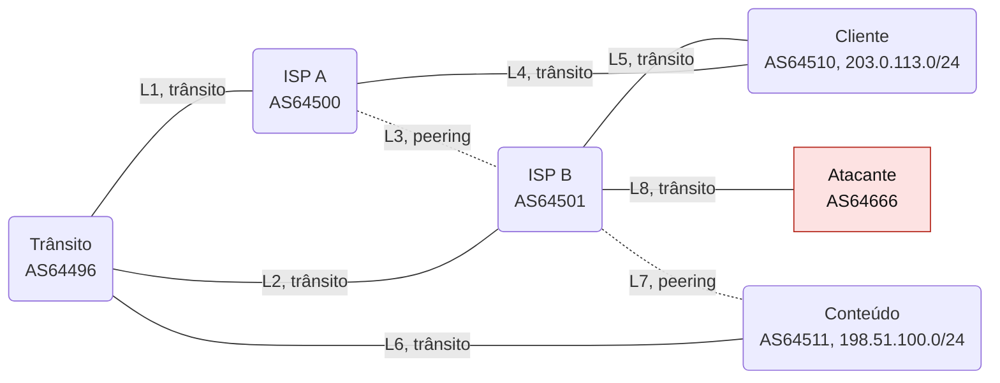

*Figura 3.1a (Tipo A, topologia).* Elementos do modo "Sessões": Trânsito (AS64496); ISP A (AS64500); ISP B (AS64501); Cliente (AS64510, 203.0.113.0/24); Conteúdo (AS64511, 198.51.100.0/24); Atacante (AS64666). Linhas tracejadas: enlaces alternativos, forjados ou caídos. Vale para os cenários (6.1.1).

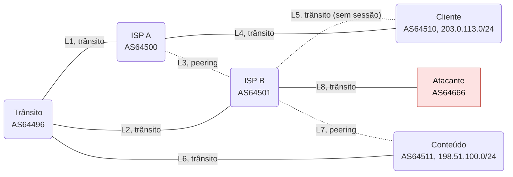

*Figura 3.1b (Tipo A, topologia).* Elementos do modo "Sessões": Trânsito (AS64496); ISP A (AS64500); ISP B (AS64501); Cliente (AS64510, 203.0.113.0/24); Conteúdo (AS64511, 198.51.100.0/24); Atacante (AS64666). Linhas tracejadas: enlaces alternativos, forjados ou caídos. Vale para os cenários (6.1.2).

### 3.2 Rotas e política

*Figura 3.2a (Tipo A, topologia).* Elementos do modo "Rotas e política": Trânsito (AS64496); ISP A (AS64500); ISP B (AS64501); Cliente (AS64510, 203.0.113.0/24); Conteúdo (AS64511, 198.51.100.0/24); Atacante (AS64666). Linhas tracejadas: enlaces alternativos, forjados ou caídos. Vale para os cenários (6.2.1 a 6.2.6; 6.2.8).

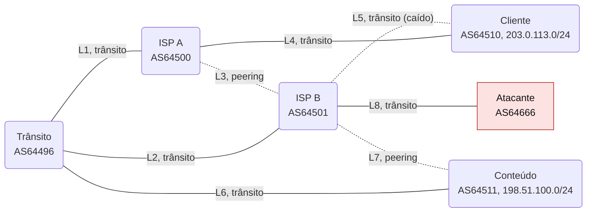

*Figura 3.2b (Tipo A, topologia).* Elementos do modo "Rotas e política": Trânsito (AS64496); ISP A (AS64500); ISP B (AS64501); Cliente (AS64510, 203.0.113.0/24); Conteúdo (AS64511, 198.51.100.0/24); Atacante (AS64666). Linhas tracejadas: enlaces alternativos, forjados ou caídos. Vale para os cenários (6.2.7).

### 3.3 Segurança e defesa

*Figura 3.3 (Tipo A, topologia).* Elementos do modo "Segurança e defesa": Trânsito (AS64496); ISP A (AS64500); ISP B (AS64501); Cliente (AS64510, 203.0.113.0/24); Conteúdo (AS64511, 198.51.100.0/24); Atacante (AS64666). Linhas tracejadas: enlaces alternativos, forjados ou caídos. Vale para todos os cenários do modo (6.3.1 a 6.3.5).

## 4. Abas da bancada

Cenário, Captura, Mensagem, Sessões, Tabela BGP, Comandos, Experimento, Referência e Log.

## 5. Configurações (campos do painel)

### 5.1 Teste

- **Sentido do tráfego**. Valores: Conteúdo → Cliente; Cliente → Conteúdo; ISP A → Conteúdo. Padrão: Conteúdo → Cliente. Modos: todos.
  - Quem envia o tráfego de teste no fim da simulação.
  - **ISP A → Conteúdo:** mostra o caminho de um provedor, útil no cenário de vazamento de rota.
  - **Conteúdo → Cliente:** o tráfego entra no AS do Cliente. O caminho depende do que o Cliente anuncia (AS-path prepend, anúncio do prefixo).
  - **Cliente → Conteúdo:** o tráfego sai do AS do Cliente. O caminho depende da política de saída (LOCAL_PREF).
  - Cada AS decide sozinho o próximo salto, consultando o melhor caminho da própria tabela BGP.

### 5.2 Foco

- **AS em foco**. Valores: Trânsito (AS64496); ISP A (AS64500); ISP B (AS64501); Cliente (AS64510); Conteúdo (AS64511); Atacante (AS64666). Padrão: Conteúdo (AS64511). Modos: todos.
  - AS cuja tabela aparece nas abas Tabela BGP e Comandos.
  - Define de qual roteador vêm a aba Tabela BGP e a saída dos comandos (`show ip bgp`, `summary` e `neighbors`).
  - As abas acompanham o relógio: mostram a tabela do AS escolhido no instante em que o diagrama está.

### 5.3 Política do Cliente

- **LOCAL_PREF das rotas do ISP A**. Valores: 100 (padrão); 200 (preferir o ISP A). Padrão: 100 (padrão). Modos: Rotas e política.
  - Preferência do Cliente pelas rotas vindas do ISP A.
  - **100 (padrão):** as rotas do ISP A e do ISP B empatam nesse critério, e a decisão passa para o AS_PATH.
  - **200:** o Cliente prefere o ISP A mesmo que o AS_PATH seja mais longo, porque o LOCAL_PREF é avaliado primeiro.
  - O LOCAL_PREF vale só dentro do AS: não é enviado aos vizinhos, e por isso nenhum UPDATE sai do Cliente. Controla o tráfego que **sai**.
- **AS-path prepend para o ISP B**. Valores: nenhum; 1 vez; 3 vezes. Padrão: nenhum. Modos: Rotas e política.
  - Repete o AS do Cliente no anúncio enviado ao ISP B.
  - O Cliente acrescenta o próprio número de AS várias vezes ao AS_PATH do anúncio dirigido ao ISP B, deixando aquele caminho mais longo.
  - Quem compara o AS_PATH passa a preferir o caminho pelo ISP A. Controla o tráfego que **entra**.
  - Funciona como sugestão: AS que decidem por LOCAL_PREF ignoram o prepend.

### 5.4 Evento

- **Evento depois da convergência**. Valores: Nenhum; Queda de enlace; Vizinho silencioso (hold timer); Cliente retira o prefixo. Padrão: Nenhum. Modos: Sessões; Rotas e política.
  - O que acontece depois que a rede converge.
  - **Queda de enlace:** a interface cai, a sessão termina na hora (fast-external-fallover) e cada lado descarta as rotas aprendidas pelo outro.
  - **Vizinho silencioso:** um lado trava e para de enviar KEEPALIVE, mas o enlace continua ativo. Só o hold timer de 180 s percebe, e ele envia NOTIFICATION.
  - **Retirada do prefixo:** o Cliente deixa de anunciar 203.0.113.0/24, e a retirada (withdraw) se espalha pela rede.
- **Enlace do evento**. Valores: L1: Trânsito / ISP A; L2: Trânsito / ISP B; L3: ISP A / ISP B (peering); L4: ISP A / Cliente; L5: ISP B / Cliente; L6: Trânsito / Conteúdo; L7: ISP B / Conteúdo (peering); L8: ISP B / Atacante. Padrão: L5: ISP B / Cliente. Modos: Sessões; Rotas e política.
  - O enlace que cai ou cujo vizinho silencia.
  - No vizinho silencioso, o lado que trava é o primeiro AS do nome do enlace e quem detecta é o segundo. Em L5, o ISP B trava e o Cliente detecta.
  - Não vale para a retirada do prefixo, que não usa enlace.

### 5.5 Ataque

- **Problema de segurança**. Valores: Nenhum (só as defesas ligadas); Sequestro de prefixo; Vazamento de rota; Flapping de rota. Padrão: Sequestro de prefixo. Modos: Segurança e defesa.
  - O anúncio indevido ou a instabilidade que a simulação injeta.
  - **Sequestro:** o Atacante (AS64666), cliente do ISP B, origina 203.0.113.0/24, prefixo do Cliente.
  - **Vazamento:** o ISP B repassa ao ISP A uma rota de 198.51.100.0/24 aprendida de um peer, o que a política valley-free proíbe.
  - **Flapping:** o Cliente retira e anuncia de novo o prefixo, em dois ciclos.

### 5.6 Defesas

- **LOCAL_PREF por relação comercial**. Valores: caixa de seleção. Padrão: não. Modos: Segurança e defesa.
  - Prefere rotas de clientes, depois de peers, depois de provedores.
  - Ligado, todo AS atribui LOCAL_PREF 200 às rotas de clientes, 150 às de peers e 100 às de provedores: prefere a rota que lhe rende dinheiro ou custa menos. É a prática comum das operadoras.
  - Desligado, todas as rotas têm LOCAL_PREF 100 e a decisão passa para o AS_PATH. Isso simplifica os cenários de seleção de caminho, mas esconde o efeito de um vazamento de rota.
- **RPKI / ROV**. Valores: desligado; só no ISP B; só no ISP A; ISP A, ISP B e Trânsito; todos os AS. Padrão: desligado. Modos: Segurança e defesa.
  - Rejeita rotas cuja origem não bate com o ROA.
  - O dono do prefixo publica um ROA com o AS autorizado a originá-lo ([RFC 6811](https://www.rfc-editor.org/rfc/rfc6811)). Um AS com **validação de origem** rejeita rotas cujo último AS do AS_PATH é outro.
  - Escolha onde a validação está ativa. Ela protege quem a aplica: um AS sem ROV continua aceitando rotas inválidas.
  - Valida só a origem; não detecta um AS_PATH forjado nem uma rota vazada.
- **Filtro de prefixos de clientes**. Valores: desligado; no ISP B; no Trânsito; ISP A, ISP B e Trânsito. Padrão: desligado. Modos: Segurança e defesa.
  - O provedor aceita de cada cliente só os prefixos dele.
  - O provedor aceita de um cliente apenas prefixos pertencentes ao **cone de clientes** dele (o próprio cliente e quem está abaixo), como as listas feitas com registros IRR.
  - Precisa estar no provedor **direto** do AS que anuncia. Um filtro mais acima não distingue os clientes de um mesmo cone.
- **Filtro de rotas de peers**. Valores: desligado; no ISP A; ISP A, ISP B e Conteúdo. Padrão: desligado. Modos: Segurança e defesa.
  - De um peer, aceita só o cone de clientes dele.
  - Um peer só deveria anunciar rotas próprias e de seus clientes. O filtro rejeita o resto, o que barra **vazamentos de rota**.
  - Não barra um sequestro que parta de dentro do cone do peer: o prefixo do Cliente pertence ao cone do ISP B, mesmo quando é o Atacante que o anuncia.
- **Flap damping nos provedores**. Valores: caixa de seleção. Padrão: não. Modos: Segurança e defesa.
  - Suprime prefixos que oscilam demais.
  - Depois de duas retiradas do mesmo prefixo pelo mesmo vizinho, o AS passa a rejeitar o prefixo desse vizinho ([RFC 2439](https://www.rfc-editor.org/rfc/rfc2439)).
  - Reduz a instabilidade que se espalha, mas também tira do ar um prefixo legítimo até a penalidade decair. Só afeta o cenário de flapping.

## 6. Cenários

### 6.1 Modo: Sessões

> **Grupo:** Sessões

Como dois roteadores de AS diferentes abrem e mantêm uma sessão BGP, e como uma sessão morta é detectada.

#### 6.1.1 Estabelecimento da sessão

*TCP 179, OPEN e KEEPALIVE até Established.*

**Configuração aplicada:** Sentido do tráfego = DC; Evento depois da convergência = none; Enlace do evento = L5; AS em foco = C

A simulação percorre as fases da sessão: **TCP** na porta 179, troca de **OPEN**, confirmação por **KEEPALIVE** e, por fim, os **UPDATE**. Use o relógio para parar em cada fase.

Acompanhe os estados na aba Sessões e abra um OPEN na aba Mensagem.

**Conceito.** Uma sessão BGP é uma conexão **TCP na porta 179** entre dois roteadores configurados um como vizinho do outro. A sessão parte de **Idle**, passa por **Connect** (TCP subindo; se falhar, vai a **Active** e tenta de novo), **OpenSent** (OPEN enviado), **OpenConfirm** (OPEN recebido) e **Established** (OPEN confirmado por KEEPALIVE). Só então as rotas são trocadas.

**O que observar**

- Na aba Sessões: o estado de cada vizinho mudando a cada fase.
- Na aba Mensagem BGP de um OPEN: AS, hold time de 180 s (padrão Cisco IOS), router ID e capacidades.
- Na Captura: o handshake TCP antes de qualquer mensagem BGP.

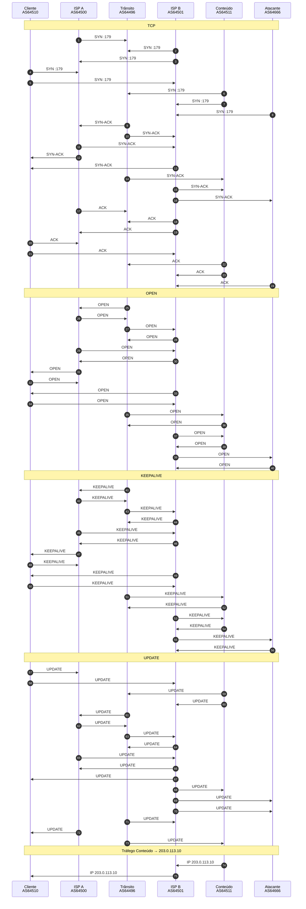

*Figura 6.1.1 (Tipo B, sequência).* Mensagens do cenário "Estabelecimento da sessão", na ordem do tempo, entre Cliente, ISP A, Trânsito, ISP B, Conteúdo, Atacante: 75 mensagens, numeradas de 1 a 75 na ordem da comunicação (em 5 fases). Corresponde ao diagrama de sequência e à aba Captura, no modo "Sessões", com a configuração aplicada acima.

**Mensagens**

| Mensagem | Significado | Origem |
| --- | --- | --- |
| TCP SYN / SYN-ACK / ACK | abre a conexão na porta 179 | um dos vizinhos |
| OPEN | AS, hold time, router ID, capacidades | os dois lados |
| KEEPALIVE | confirma o OPEN | os dois lados |

**Por que importa.** O BGP não descobre vizinhos sozinho: toda sessão é configurada à mão, dos dois lados. Se os parâmetros do OPEN não batem (por exemplo, o AS esperado), a sessão termina com NOTIFICATION.

#### 6.1.2 Hold timer

*Sem KEEPALIVE por 180 s, a sessão cai com NOTIFICATION.*

**Configuração aplicada:** Sentido do tráfego = DC; Evento depois da convergência = hold; Enlace do evento = L5; AS em foco = C

Depois da convergência, o **ISP B** trava e deixa de enviar KEEPALIVE ao Cliente (enlace **L5**), mas o enlace continua ativo: nada avisa a falha.

Só o hold timer de 180 s percebe. Troque o **Evento** para **Queda de enlace** e compare quanto tempo cada falha leva para ser percebida.

**Conceito.** Cada lado envia um **KEEPALIVE** a cada 60 s e espera receber alguma mensagem dentro do **hold time** (180 s), valores padrão do Cisco IOS; a [RFC 4271](https://www.rfc-editor.org/rfc/rfc4271) sugere 30 s e 90 s. Quando o vizinho trava sem derrubar o enlace, só o **hold timer** percebe: ao expirar, o roteador envia **NOTIFICATION** (código 4, Hold Timer Expired), encerra a sessão e retira as rotas aprendidas por ela.

**O que observar**

- No log: os 180 s sem KEEPALIVE e a NOTIFICATION.
- Na aba Mensagem BGP da NOTIFICATION: código 4.
- Compare com a queda do enlace (cenário Falha de enlace): a queda da interface derruba a sessão na hora (fast-external-fallover).

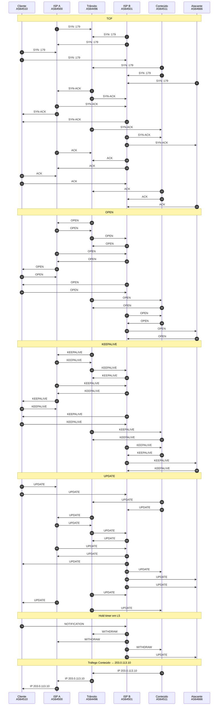

*Figura 6.1.2 (Tipo B, sequência).* Mensagens do cenário "Hold timer", na ordem do tempo, entre Cliente, ISP A, Trânsito, ISP B, Conteúdo, Atacante: 81 mensagens, numeradas de 1 a 81 na ordem da comunicação (em 6 fases). Corresponde ao diagrama de sequência e à aba Captura, no modo "Sessões", com a configuração aplicada acima.

**Mensagens**

| Mensagem | Significado | Origem |
| --- | --- | --- |
| KEEPALIVE | param de chegar | ISP B |
| NOTIFICATION | Hold Timer Expired (código 4) | Cliente |
| UPDATE (withdraw) | retira as rotas que dependiam da sessão | AS afetados |

**Por que importa.** O hold time define quanto tempo o tráfego pode ir para um vizinho morto. Valores menores detectam falhas mais rápido; em produção, o BFD faz isso em milissegundos.

### 6.2 Modo: Rotas e política

> **Grupo:** Propagação

Como um prefixo se espalha de AS em AS e quem repassa o quê, conforme as relações comerciais.

#### 6.2.1 Propagação do anúncio

*A cada AS, o AS_PATH cresce e o NEXT_HOP muda.*

**Configuração aplicada:** Sentido do tráfego = DC; LOCAL_PREF das rotas do ISP A = 100; AS-path prepend para o ISP B = 0; Evento depois da convergência = none; Enlace do evento = L5; AS em foco = D

Acompanhe o prefixo 203.0.113.0/24 saindo do Cliente. Na Captura, abra os UPDATEs em sequência.

A cada AS, o AS_PATH ganha mais um número e o NEXT_HOP passa a ser o endereço de quem anunciou.

**Conceito.** O Cliente anuncia o próprio prefixo aos provedores. Cada AS que repassa a rota acrescenta o **próprio número** no início do **AS_PATH** e troca o **NEXT_HOP** pelo próprio endereço no enlace. Um AS que recebe uma rota com o próprio número no AS_PATH a descarta: é assim que o BGP evita laços.

**O que observar**

- Na Captura: o mesmo prefixo com AS_PATH 64510, depois 64500 64510, depois 64496 64500 64510.
- Na aba Mensagem BGP: o NEXT_HOP de cada UPDATE é o endereço de quem anunciou.
- No log: anúncios descartados por conter o próprio AS.

*Figura 6.2.1 (Tipo B, sequência).* Mensagens do cenário "Propagação do anúncio", na ordem do tempo, entre Cliente, ISP A, Trânsito, ISP B, Conteúdo, Atacante: 75 mensagens, numeradas de 1 a 75 na ordem da comunicação (em 5 fases). Corresponde ao diagrama de sequência e à aba Captura, no modo "Rotas e política", com a configuração aplicada acima.

**Mensagens**

| Mensagem | Significado | Origem |
| --- | --- | --- |
| UPDATE | AS_PATH 64510 | Cliente para os ISPs |
| UPDATE | AS_PATH 64500 64510 | ISP A para Trânsito e ISP B |
| UPDATE | AS_PATH 64496 64500 64510 | Trânsito para o Conteúdo |

**Por que importa.** O AS_PATH é a memória do caminho: evita laços e serve de critério de escolha. Por isso o BGP é chamado de protocolo de vetor de caminho.

#### 6.2.2 Exportação entre provedores e peers

*Rota de peer ou de provedor só vai para clientes.*

**Configuração aplicada:** Sentido do tráfego = DC; LOCAL_PREF das rotas do ISP A = 100; AS-path prepend para o ISP B = 0; Evento depois da convergência = none; Enlace do evento = L5; AS em foco = A

Com o **ISP A** em foco, veja na aba Tabela BGP quantos caminhos ele tem para 198.51.100.0/24. Depois ponha o **ISP B** em foco e compare.

O ISP B conhece um caminho mais curto, mas não o repassa ao ISP A.

**Conceito.** Cada AS repassa rotas conforme quem paga quem. Rotas de **clientes** vão para todos; rotas aprendidas de **peers** ou de **provedores** vão só para **clientes**. Assim nenhum AS oferece trânsito gratuito entre dois provedores ou dois peers (modelo valley-free, de Gao-Rexford).

**O que observar**

- Na Tabela BGP do ISP A: só um caminho para 198.51.100.0/24, pelo Trânsito.
- Na Tabela BGP do ISP B: dois caminhos, direto pelo Conteúdo (peer) e pelo Trânsito.
- O ISP B não repassa ao ISP A a rota do Conteúdo, porque ela veio de um peer e o ISP A também é peer.

*Figura 6.2.2 (Tipo B, sequência).* Mensagens do cenário "Exportação entre provedores e peers", na ordem do tempo, entre Cliente, ISP A, Trânsito, ISP B, Conteúdo, Atacante: 75 mensagens, numeradas de 1 a 75 na ordem da comunicação (em 5 fases). Corresponde ao diagrama de sequência e à aba Captura, no modo "Rotas e política", com a configuração aplicada acima.

**Mensagens**

| Mensagem | Significado | Origem |
| --- | --- | --- |
| cliente | clientes, peers e provedores | o cliente paga pelo trânsito |
| peer | só clientes | peering não inclui trânsito para terceiros |
| provedor | só clientes | ninguém transporta de graça o tráfego de um provedor |

**Por que importa.** É a política, e não a distância, que define boa parte dos caminhos da Internet. Repassar rotas fora dessa regra provoca vazamentos de rota e desvia tráfego por redes que não deveriam carregá-lo.

> **Grupo:** Seleção de caminho

Como cada AS escolhe um único caminho entre vários, e como a política influencia o tráfego que sai e o que entra.

#### 6.2.3 AS_PATH mais curto

*Com LOCAL_PREF igual, vence o caminho com menos AS.*

**Configuração aplicada:** Sentido do tráfego = DC; LOCAL_PREF das rotas do ISP A = 100; AS-path prepend para o ISP B = 0; Evento depois da convergência = none; Enlace do evento = L5; AS em foco = D

Com o **Conteúdo** em foco, rode `show ip bgp 203.0.113.0` na aba Comandos.

Há dois caminhos: pelo ISP B (peering) e pelo Trânsito. O tráfego de teste Conteúdo → Cliente mostra qual é usado.

**Conceito.** Quando o LOCAL_PREF é igual e nenhuma rota é local, o BGP escolhe o **AS_PATH mais curto**, isto é, o caminho que atravessa menos sistemas autônomos. O número de roteadores dentro de cada AS e a banda dos enlaces não entram nessa conta.

**O que observar**

- Na aba Comandos, com o Conteúdo em foco: `show ip bgp 203.0.113.0` mostra dois caminhos e o melhor.
- O caminho pelo ISP B tem 2 AS (64501 64510); o pelo Trânsito tem 3 (64496 64500 64510).
- No tráfego de teste Conteúdo → Cliente, ele vai pelo ISP B.

*Figura 6.2.3 (Tipo B, sequência).* Mensagens do cenário "AS_PATH mais curto", na ordem do tempo, entre Cliente, ISP A, Trânsito, ISP B, Conteúdo, Atacante: 75 mensagens, numeradas de 1 a 75 na ordem da comunicação (em 5 fases). Corresponde ao diagrama de sequência e à aba Captura, no modo "Rotas e política", com a configuração aplicada acima.

**Mensagens**

| Mensagem | Significado | Origem |
| --- | --- | --- |
| pelo ISP B (peering) | 64501 64510 | melhor: mais curto |
| pelo Trânsito | 64496 64500 64510 | perde: mais longo |

**Por que importa.** O AS_PATH é uma aproximação grosseira de distância: um caminho com menos AS pode ser mais lento. Por isso os operadores combinam o AS_PATH com políticas de LOCAL_PREF.

#### 6.2.4 Desempate por router ID

*Empate em tudo: vence o vizinho de menor router ID.*

**Configuração aplicada:** Sentido do tráfego = DC; LOCAL_PREF das rotas do ISP A = 100; AS-path prepend para o ISP B = 0; Evento depois da convergência = none; Enlace do evento = L5; AS em foco = T

Com o **Trânsito** em foco: para 203.0.113.0/24, ele recebe dois caminhos do mesmo tamanho, pelo ISP A e pelo ISP B.

Na aba Tabela BGP, veja qual critério desempatou.

**Conceito.** Quando LOCAL_PREF, AS_PATH, ORIGIN e MED empatam, o BGP ainda precisa escolher um único caminho. O último critério é o **menor router ID** (BGP Identifier) do vizinho que enviou a rota.

**O que observar**

- Na Tabela BGP do Trânsito: dois caminhos para 203.0.113.0/24, ambos com 2 AS no AS_PATH.
- O ISP A (router ID 10.0.0.2) vence o ISP B (10.0.0.3).
- A coluna Decisão mostra o critério que desempatou.

*Figura 6.2.4 (Tipo B, sequência).* Mensagens do cenário "Desempate por router ID", na ordem do tempo, entre Cliente, ISP A, Trânsito, ISP B, Conteúdo, Atacante: 75 mensagens, numeradas de 1 a 75 na ordem da comunicação (em 5 fases). Corresponde ao diagrama de sequência e à aba Captura, no modo "Rotas e política", com a configuração aplicada acima.

**Mensagens**

| Mensagem | Significado | Origem |
| --- | --- | --- |
| pelo ISP A | 10.0.0.2 | melhor: menor router ID |
| pelo ISP B | 10.0.0.3 | perde no desempate |

**Por que importa.** Desempates arbitrários tornam o caminho imprevisível para quem está fora. Operadores costumam definir políticas explícitas para não depender deles.

#### 6.2.5 LOCAL_PREF (saída)

*O LOCAL_PREF controla por onde o tráfego sai do AS.*

**Configuração aplicada:** Sentido do tráfego = CD; LOCAL_PREF das rotas do ISP A = 200; AS-path prepend para o ISP B = 0; Evento depois da convergência = none; Enlace do evento = L5; AS em foco = C

O Cliente atribui LOCAL_PREF 200 às rotas do ISP A, e o tráfego de teste vai de **Cliente → Conteúdo**.

Volte o **LOCAL_PREF** para 100 e compare: o caminho muda, e nenhum UPDATE sai do Cliente por causa disso.

**Conceito.** O **LOCAL_PREF** é o primeiro critério da decisão e vale só dentro do AS: ele não é enviado aos vizinhos eBGP. Ao dar LOCAL_PREF 200 às rotas do ISP A, o Cliente passa a enviar seu tráfego por ele, mesmo com um AS_PATH mais longo.

**O que observar**

- Na Tabela BGP do Cliente: a rota para 198.51.100.0/24 pelo ISP A vence por LOCAL_PREF, apesar de ter 3 AS contra 2.
- No tráfego de teste Cliente → Conteúdo, ele sai pelo ISP A.
- Ao mudar o LOCAL_PREF, nenhum UPDATE é enviado: a decisão é só do Cliente.

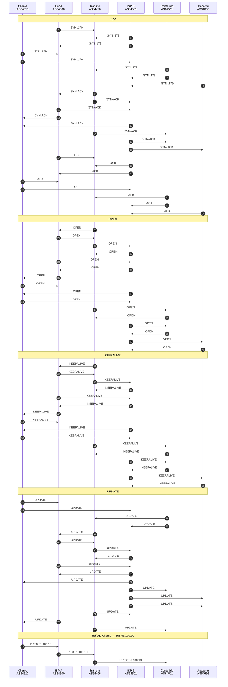

*Figura 6.2.5 (Tipo B, sequência).* Mensagens do cenário "LOCAL_PREF (saída)", na ordem do tempo, entre Cliente, ISP A, Trânsito, ISP B, Conteúdo, Atacante: 76 mensagens, numeradas de 1 a 76 na ordem da comunicação (em 5 fases). Corresponde ao diagrama de sequência e à aba Captura, no modo "Rotas e política", com a configuração aplicada acima.

**Mensagens**

| Mensagem | Significado | Origem |
| --- | --- | --- |
| pelo ISP A | 200 / 64500 64496 64511 | melhor: LOCAL_PREF maior |
| pelo ISP B | 100 / 64501 64511 | perde, mesmo mais curto |

**Por que importa.** É a principal ferramenta de engenharia de tráfego de saída: preferir o provedor mais barato, o de melhor desempenho ou um enlace de backup.

#### 6.2.6 AS-path prepend (entrada)

*Repetir o próprio AS desvia o tráfego que entra.*

**Configuração aplicada:** Sentido do tráfego = DC; LOCAL_PREF das rotas do ISP A = 100; AS-path prepend para o ISP B = 3; Evento depois da convergência = none; Enlace do evento = L5; AS em foco = B

O Cliente repete o próprio AS três vezes no anúncio para o ISP B, e o tráfego de teste vai de **Conteúdo → Cliente**.

Tire o **prepend** e compare: o tráfego volta a entrar pelo ISP B.

**Conceito.** No **AS-path prepend**, o AS repete o próprio número no anúncio para um vizinho, tornando aquele caminho mais longo para o resto da Internet. Como cada AS remoto decide sozinho, o prepend é uma **sugestão**: funciona nos AS que comparam o AS_PATH, não nos que decidem por LOCAL_PREF.

**O que observar**

- Na Captura: o UPDATE do Cliente para o ISP B com AS_PATH 64510 64510 64510 64510.
- Na Tabela BGP do ISP B: o caminho direto pelo Cliente passa a perder para o caminho pelo ISP A, mais curto.
- No tráfego de teste Conteúdo → Cliente, ele passa a entrar pelo ISP A.

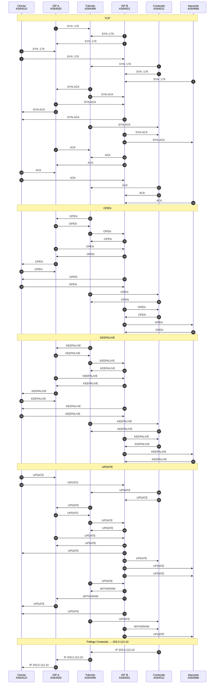

*Figura 6.2.6 (Tipo B, sequência).* Mensagens do cenário "AS-path prepend (entrada)", na ordem do tempo, entre Cliente, ISP A, Trânsito, ISP B, Conteúdo, Atacante: 81 mensagens, numeradas de 1 a 81 na ordem da comunicação (em 5 fases). Corresponde ao diagrama de sequência e à aba Captura, no modo "Rotas e política", com a configuração aplicada acima.

**Mensagens**

| Mensagem | Significado | Origem |
| --- | --- | --- |
| Cliente para ISP A | 64510 | normal |
| Cliente para ISP B | 64510 64510 64510 64510 | menos atraente para quem compara AS_PATH |

**Por que importa.** É a ferramenta clássica para controlar o tráfego que entra. Muitos provedores dão LOCAL_PREF maior às rotas de clientes, e nesse caso o prepend não muda a escolha deles; aqui, todos usam LOCAL_PREF 100.

> **Grupo:** Falhas

O que acontece quando um caminho deixa de existir: retiradas, reconvergência e caminhos alternativos.

#### 6.2.7 Falha de enlace

*O enlace cai, as rotas são retiradas e o tráfego muda de caminho.*

**Configuração aplicada:** Sentido do tráfego = DC; LOCAL_PREF das rotas do ISP A = 100; AS-path prepend para o ISP B = 0; Evento depois da convergência = down; Enlace do evento = L5; AS em foco = B

Depois de convergir, o enlace **L5 (ISP B / Cliente)** cai. A sessão termina na hora, as rotas aprendidas por ela são descartadas e a rede reconverge.

Escolha **Nenhum** em **Evento** e compare o caminho do tráfego de teste.

**Conceito.** Quando um enlace cai, a sessão BGP termina e cada lado descarta as rotas aprendidas por ela. Quem perdeu o melhor caminho escolhe outro e avisa os vizinhos com UPDATEs ou **withdraws**, até a rede convergir de novo. Um cliente com dois provedores (**dual-homing**) continua alcançável pelo outro.

**O que observar**

- No log: a queda, as retiradas e os novos anúncios.
- No tráfego de teste Conteúdo → Cliente: o caminho passa a ser pelo Trânsito e pelo ISP A. Sem a queda, ele passa pelo ISP B.
- Na Tabela BGP do ISP B: a rota direta para o Cliente some.

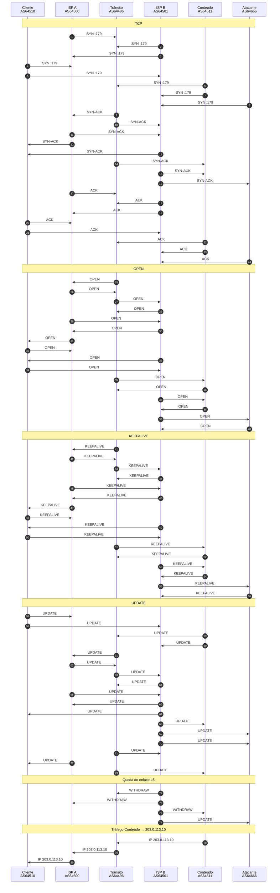

*Figura 6.2.7 (Tipo B, sequência).* Mensagens do cenário "Falha de enlace", na ordem do tempo, entre Cliente, ISP A, Trânsito, ISP B, Conteúdo, Atacante: 80 mensagens, numeradas de 1 a 80 na ordem da comunicação (em 6 fases). Corresponde ao diagrama de sequência e à aba Captura, no modo "Rotas e política", com a configuração aplicada acima.

**Mensagens**

| Mensagem | Significado | Origem |
| --- | --- | --- |
| UPDATE (withdraw) | retira o caminho perdido | ISP B |
| UPDATE | anuncia o novo melhor caminho | AS que mudaram de escolha |

**Por que importa.** O dual-homing só protege se o outro caminho também for anunciado e aceito. A convergência do BGP leva de segundos a minutos, e durante esse tempo parte do tráfego pode se perder.

#### 6.2.8 Retirada do prefixo

*O prefixo deixa de existir: retiradas por toda a rede.*

**Configuração aplicada:** Sentido do tráfego = DC; LOCAL_PREF das rotas do ISP A = 100; AS-path prepend para o ISP B = 0; Evento depois da convergência = retirar; Enlace do evento = L5; AS em foco = D

Depois de convergir, o Cliente deixa de anunciar 203.0.113.0/24. Acompanhe as retiradas na Captura.

O tráfego de teste Conteúdo → Cliente não tem mais para onde ir.

**Conceito.** Quando o AS de origem deixa de anunciar um prefixo, ele envia um UPDATE com o prefixo em **Withdrawn Routes**. Cada vizinho descarta a rota e, se não tiver alternativa, repassa a retirada. O prefixo desaparece da Internet.

**O que observar**

- Na Captura: UPDATEs de retirada saindo do Cliente e se espalhando.
- Na Tabela BGP de qualquer AS: 203.0.113.0/24 sem rota.
- No tráfego de teste Conteúdo → Cliente, ele é descartado no próprio Conteúdo, por falta de rota.

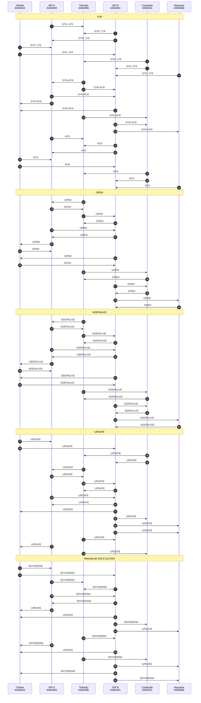

*Figura 6.2.8 (Tipo B, sequência).* Mensagens do cenário "Retirada do prefixo", na ordem do tempo, entre Cliente, ISP A, Trânsito, ISP B, Conteúdo, Atacante: 90 mensagens, numeradas de 1 a 90 na ordem da comunicação (em 6 fases). Corresponde ao diagrama de sequência e à aba Captura, no modo "Rotas e política", com a configuração aplicada acima.

**Mensagens**

| Mensagem | Significado | Origem |
| --- | --- | --- |
| UPDATE (withdraw) | 203.0.113.0/24 em Withdrawn Routes | Cliente e depois os demais AS |

**Por que importa.** É assim que uma rede sai do ar para o resto da Internet, de propósito (manutenção, migração) ou por erro de configuração.

### 6.3 Modo: Segurança e defesa

> **Grupo:** Segurança e defesa

Como anúncios indevidos, violações de política e instabilidade desviam ou interrompem o tráfego, e como as defesas de importação (filtros, RPKI, damping) barram cada problema.

#### 6.3.1 Sequestro de prefixo

*Um cliente anuncia um prefixo que não é dele e desvia o tráfego.*

**Configuração aplicada:** Sentido do tráfego = DC; Problema de segurança = hijack; LOCAL_PREF por relação comercial = não; RPKI / ROV = off; Filtro de prefixos de clientes = off; Filtro de rotas de peers = off; Flap damping nos provedores = não; AS em foco = B

O Atacante (AS64666), cliente do ISP B, anuncia 203.0.113.0/24, prefixo que pertence ao Cliente (AS64510). Na Tabela BGP do ISP B, compare as duas rotas.

O tráfego de teste **Conteúdo → Cliente** mostra onde ele para. Depois ligue uma defesa no painel: a simulação é refeita.

**Conceito.** No **sequestro de prefixo**, um AS anuncia um prefixo que não lhe pertence. O BGP clássico não verifica se quem originou a rota tem autorização, e cada AS escolhe pelos critérios normais (LOCAL_PREF, AS_PATH, router ID). Onde a rota falsa vence, o tráfego para o prefixo vai ao originador falso. Aqui, o Atacante o descarta (blackhole), o que torna a indisponibilidade visível.

**O que observar**

- Na Captura: o AS64666 envia ao ISP B um UPDATE de 203.0.113.0/24 com AS_PATH 64666.
- Na Tabela BGP do ISP B: duas rotas de clientes com AS_PATH de mesmo tamanho; vence a do Atacante no desempate por router ID.
- No desenho: os AS que passaram a usar a rota falsa ficam em vermelho. O ISP A e o Trânsito mantêm o caminho legítimo.
- No tráfego de teste Conteúdo → Cliente, ele segue Conteúdo, ISP B, Atacante e é descartado.

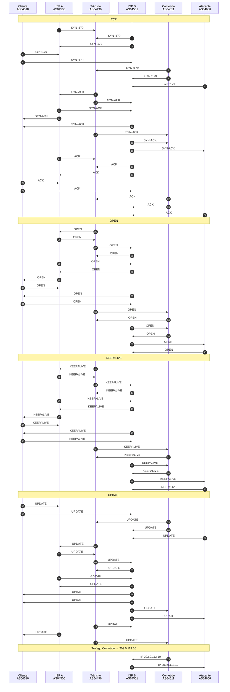

*Figura 6.3.1 (Tipo B, sequência).* Mensagens do cenário "Sequestro de prefixo", na ordem do tempo, entre Cliente, ISP A, Trânsito, ISP B, Conteúdo, Atacante: 76 mensagens, numeradas de 1 a 76 na ordem da comunicação (em 5 fases). Corresponde ao diagrama de sequência e à aba Captura, no modo "Segurança e defesa", com a configuração aplicada acima.

**Mensagens**

| Mensagem | Significado | Origem |
| --- | --- | --- |
| UPDATE legítimo | 64510 | Cliente, para o ISP A e o ISP B |
| UPDATE falso | 64666 | Atacante, para o ISP B |
| Tráfego IP | desviado e descartado | Conteúdo, pelo caminho que o ISP B escolheu |

**Por que importa.** O alcance do sequestro depende de quem aceita a rota falsa, e não de quem a originou. As defesas atuam na importação: filtro de prefixos no provedor do atacante e validação de origem (RPKI) em qualquer AS. Incidentes reais costumam ser erros de configuração, não ataques, e causam indisponibilidade em larga escala.

#### 6.3.2 Defesa: filtro de prefixos

*O provedor aceita de cada cliente só os prefixos dele.*

**Configuração aplicada:** Sentido do tráfego = DC; Problema de segurança = hijack; LOCAL_PREF por relação comercial = não; RPKI / ROV = off; Filtro de prefixos de clientes = B; Filtro de rotas de peers = off; Flap damping nos provedores = não; AS em foco = B

O mesmo anúncio falso, mas o ISP B filtra os prefixos que aceita de cada cliente. Veja, na Tabela BGP do ISP B, a rota do Atacante marcada como rejeitada.

Troque o filtro para **no Trânsito** e observe: o desvio volta. Por que o filtro do Trânsito não protege?

**Conceito.** O provedor monta, a partir dos registros de roteamento (IRR) e do contrato, a lista de prefixos que cada cliente pode anunciar, e rejeita o resto. O ISP B só aceita do Atacante prefixos do **cone de clientes** dele (nenhum), então a rota falsa é barrada na entrada, no primeiro salto, antes de se espalhar.

**O que observar**

- Na Tabela BGP do ISP B: a rota do Atacante aparece como rejeitada pelo filtro de prefixos de clientes.
- Nenhum AS usa a rota falsa e o tráfego Conteúdo → Cliente é entregue.
- Com o filtro no Trânsito (troque o controle), o ISP B volta a aceitar a rota, e o Trânsito não consegue distinguir o Atacante do Cliente, porque os dois estão no cone do ISP B.

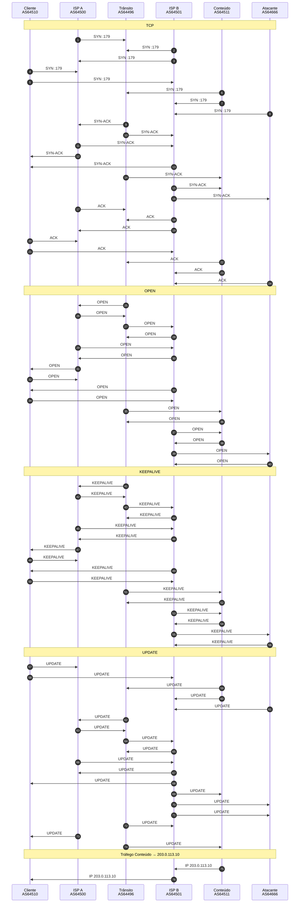

*Figura 6.3.2 (Tipo B, sequência).* Mensagens do cenário "Defesa: filtro de prefixos", na ordem do tempo, entre Cliente, ISP A, Trânsito, ISP B, Conteúdo, Atacante: 76 mensagens, numeradas de 1 a 76 na ordem da comunicação (em 5 fases). Corresponde ao diagrama de sequência e à aba Captura, no modo "Segurança e defesa", com a configuração aplicada acima.

**Mensagens**

| Mensagem | Significado | Origem |
| --- | --- | --- |
| ISP B (provedor do Atacante) | barra o anúncio falso | o Atacante não tem direito sobre o prefixo |
| Trânsito (provedor do ISP B) | não barra | o prefixo do Cliente pertence ao cone do ISP B |
| Nenhum | o desvio acontece | nada confere a origem |

**Por que importa.** O filtro só funciona na borda: precisa estar no provedor direto de quem anuncia. Depende de listas atualizadas e não escala para a Internet inteira, por isso é complementado pelo RPKI.

#### 6.3.3 Defesa: RPKI / ROV

*O ROA diz quem pode originar o prefixo; o roteador confere.*

**Configuração aplicada:** Sentido do tráfego = DC; Problema de segurança = hijack; LOCAL_PREF por relação comercial = não; RPKI / ROV = B; Filtro de prefixos de clientes = off; Filtro de rotas de peers = off; Flap damping nos provedores = não; AS em foco = B

O ISP B valida a origem de cada rota com os ROAs: 203.0.113.0/24 só pode ser originado pelo AS64510. Veja a rota do Atacante rejeitada como inválida.

Troque o ROV para **só no ISP A** e veja o tráfego Conteúdo → Cliente: o Conteúdo continua desviado. Por que a validação do ISP A não o protege?

**Conceito.** No **RPKI** ([RFC 6811](https://www.rfc-editor.org/rfc/rfc6811)), o dono do prefixo publica um **ROA** com o AS autorizado a originá-lo. Um roteador com **validação de origem (ROV)** compara o AS de origem de cada rota (o último do AS_PATH) com o ROA e rejeita as inválidas. O ROA de 203.0.113.0/24 autoriza só o AS64510, então a rota do AS64666 é inválida.

**O que observar**

- Na Tabela BGP do ISP B: a rota do Atacante rejeitada como RPKI inválido, com a origem recebida e a autorizada.
- Na aba Comandos, com o ISP B em foco, `show ip bgp 203.0.113.0` mostra a rota rejeitada.
- Com o ROV só no ISP A, o ISP A se protege, mas o Conteúdo, que aprende a rota pelo ISP B, continua desviado.

*Figura 6.3.3 (Tipo B, sequência).* Mensagens do cenário "Defesa: RPKI / ROV", na ordem do tempo, entre Cliente, ISP A, Trânsito, ISP B, Conteúdo, Atacante: 76 mensagens, numeradas de 1 a 76 na ordem da comunicação (em 5 fases). Corresponde ao diagrama de sequência e à aba Captura, no modo "Segurança e defesa", com a configuração aplicada acima.

**Mensagens**

| Mensagem | Significado | Origem |
| --- | --- | --- |
| 203.0.113.0/24 | AS64510 | inválida: origem diferente |
| 198.51.100.0/24 | AS64511 | sem anúncio de outra origem |

**Por que importa.** O ROV só protege quem o aplica, e o benefício cresce com a adoção. Ele valida a origem, não o caminho: não detecta uma rota vazada nem um AS_PATH forjado (para isso existem ASPA e BGPsec).

#### 6.3.4 Vazamento de rota

*O ISP B repassa a um peer uma rota que aprendeu de outro peer.*

**Configuração aplicada:** Sentido do tráfego = AD; Problema de segurança = route-leak; LOCAL_PREF por relação comercial = sim; RPKI / ROV = off; Filtro de prefixos de clientes = off; Filtro de rotas de peers = off; Flap damping nos provedores = não; AS em foco = A

O ISP B repassa ao ISP A a rota de 198.51.100.0/24, que aprendeu do peer Conteúdo, embora a política valley-free proíba. Com LOCAL_PREF por relação comercial (peer 150, provedor 100), o ISP A passa a preferir essa rota.

O tráfego de teste é **ISP A → Conteúdo**. Ligue o **filtro de rotas de peers** no ISP A e compare.

**Conceito.** Um **vazamento de rota** acontece quando um AS repassa uma rota além do que sua relação comercial permite. O ISP B aprendeu 198.51.100.0/24 do peer Conteúdo e a repassa ao ISP A, também peer, quando por valley-free ela só poderia ir para clientes. O ISP A passa a ter um caminho que não deveria existir.

**O que observar**

- Na Captura: o ISP B anuncia 198.51.100.0/24 ao ISP A, com AS_PATH 64501 64511.
- Na Tabela BGP do ISP A: duas rotas, a do Trânsito (provedor, LOCAL_PREF 100) e a vazada pelo ISP B (peer, LOCAL_PREF 150). A vazada vence.
- No tráfego de teste ISP A → Conteúdo, ele passa a ir pelo ISP B, em vez do Trânsito.
- Com o LOCAL_PREF por relação comercial desligado, a rota vazada perde no desempate, e o vazamento passa despercebido no tráfego.

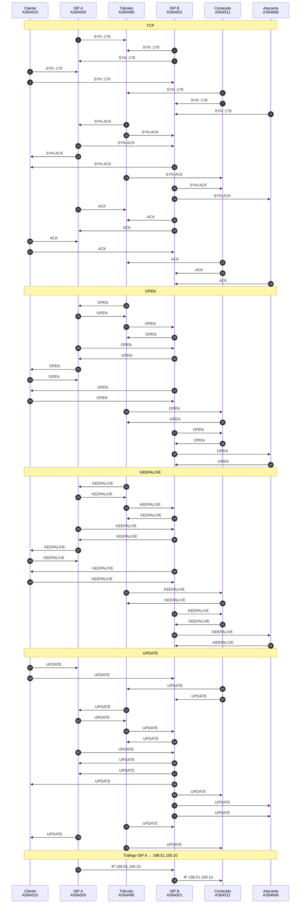

*Figura 6.3.4 (Tipo B, sequência).* Mensagens do cenário "Vazamento de rota", na ordem do tempo, entre Cliente, ISP A, Trânsito, ISP B, Conteúdo, Atacante: 76 mensagens, numeradas de 1 a 76 na ordem da comunicação (em 5 fases). Corresponde ao diagrama de sequência e à aba Captura, no modo "Segurança e defesa", com a configuração aplicada acima.

**Mensagens**

| Mensagem | Significado | Origem |
| --- | --- | --- |
| pelo Trânsito (provedor) | 100 | perde |
| pelo ISP B (peer, vazada) | 150 | melhor: LOCAL_PREF maior |

**Por que importa.** O ISP B passa a carregar tráfego de que não foi contratado, e o ISP A usa um caminho que não pagou nem negociou. Defesa: o ISP A filtra o que aceita do peer ao cone de clientes dele (barra a rota vazada); no protocolo, os papéis BGP com atributo OTC ([RFC 9234](https://www.rfc-editor.org/rfc/rfc9234)) detectam o vazamento, mas dependem de os dois lados implementarem.

#### 6.3.5 Flapping de rota

*O prefixo oscila e força reconvergências repetidas.*

**Configuração aplicada:** Sentido do tráfego = DC; Problema de segurança = route-flap; LOCAL_PREF por relação comercial = não; RPKI / ROV = off; Filtro de prefixos de clientes = off; Filtro de rotas de peers = off; Flap damping nos provedores = não; AS em foco = B

Depois da primeira convergência, o Cliente retira e anuncia de novo 203.0.113.0/24, em dois ciclos. Observe os UPDATEs e as retiradas na Captura e o total no Experimento.

Ligue o **flap damping nos provedores** e compare o número de mensagens e o estado do prefixo no final.

**Conceito.** No **route flapping**, uma rota alterna entre disponível e indisponível. Cada mudança gera UPDATEs ou withdraws que recalculam caminhos em vários AS e podem causar perda intermitente. O **flap damping** ([RFC 2439](https://www.rfc-editor.org/rfc/rfc2439)) suprime um prefixo que oscila demais: depois de algumas retiradas, o vizinho deixa de aceitá-lo por um tempo.

**O que observar**

- Na Captura: duas sequências de retirada seguidas de novo anúncio.
- No log: cada ciclo e a convergência acumulada.
- Com o damping ligado: o número de mensagens cai, mas o prefixo do Cliente fica suprimido nos provedores. Compare o tráfego Conteúdo → Cliente.

```mermaid
sequenceDiagram
  autonumber
  participant n_C as Cliente<br/>AS64510
  participant n_A as ISP A<br/>AS64500
  participant n_T as Trânsito<br/>AS64496
  participant n_B as ISP B<br/>AS64501
  participant n_D as Conteúdo<br/>AS64511
  participant n_M as Atacante<br/>AS64666
  Note over n_C,n_M: TCP
  n_A ->> n_T: SYN :179
  n_B ->> n_T: SYN :179
  n_B ->> n_A: SYN :179
  n_C ->> n_A: SYN :179
  n_C ->> n_B: SYN :179
  n_D ->> n_T: SYN :179
  n_D ->> n_B: SYN :179
  n_M ->> n_B: SYN :179
  n_T ->> n_A: SYN-ACK
  n_T ->> n_B: SYN-ACK
  n_A ->> n_B: SYN-ACK
  n_A ->> n_C: SYN-ACK
  n_B ->> n_C: SYN-ACK
  n_T ->> n_D: SYN-ACK
  n_B ->> n_D: SYN-ACK
  n_B ->> n_M: SYN-ACK
  n_A ->> n_T: ACK
  n_B ->> n_T: ACK
  n_B ->> n_A: ACK
  n_C ->> n_A: ACK
  n_C ->> n_B: ACK
  n_D ->> n_T: ACK
  n_D ->> n_B: ACK
  n_M ->> n_B: ACK
  Note over n_C,n_M: OPEN
  n_T ->> n_A: OPEN
  n_A ->> n_T: OPEN
  n_T ->> n_B: OPEN
  n_B ->> n_T: OPEN
  n_A ->> n_B: OPEN
  n_B ->> n_A: OPEN
  n_A ->> n_C: OPEN
  n_C ->> n_A: OPEN
  n_B ->> n_C: OPEN
  n_C ->> n_B: OPEN
  n_T ->> n_D: OPEN
  n_D ->> n_T: OPEN
  n_B ->> n_D: OPEN
  n_D ->> n_B: OPEN
  n_B ->> n_M: OPEN
  n_M ->> n_B: OPEN
  Note over n_C,n_M: KEEPALIVE
  n_T ->> n_A: KEEPALIVE
  n_A ->> n_T: KEEPALIVE
  n_T ->> n_B: KEEPALIVE
  n_B ->> n_T: KEEPALIVE
  n_A ->> n_B: KEEPALIVE
  n_B ->> n_A: KEEPALIVE
  n_A ->> n_C: KEEPALIVE
  n_C ->> n_A: KEEPALIVE
  n_B ->> n_C: KEEPALIVE
  n_C ->> n_B: KEEPALIVE
  n_T ->> n_D: KEEPALIVE
  n_D ->> n_T: KEEPALIVE
  n_B ->> n_D: KEEPALIVE
  n_D ->> n_B: KEEPALIVE
  n_B ->> n_M: KEEPALIVE
  n_M ->> n_B: KEEPALIVE
  Note over n_C,n_M: UPDATE
  n_C ->> n_A: UPDATE
  n_C ->> n_B: UPDATE
  n_D ->> n_T: UPDATE
  n_D ->> n_B: UPDATE
  n_T ->> n_A: UPDATE
  n_A ->> n_T: UPDATE
  n_T ->> n_B: UPDATE
  n_B ->> n_T: UPDATE
  n_A ->> n_B: UPDATE
  n_B ->> n_A: UPDATE
  n_B ->> n_C: UPDATE
  n_B ->> n_D: UPDATE
  n_B ->> n_M: UPDATE
  n_B ->> n_M: UPDATE
  n_T ->> n_B: UPDATE
  n_A ->> n_C: UPDATE
  n_T ->> n_D: UPDATE
  Note over n_C,n_M: Flap 1
  n_C ->> n_A: WITHDRAW
  n_C ->> n_B: WITHDRAW
  n_A ->> n_T: WITHDRAW
  n_B ->> n_T: WITHDRAW
  n_A ->> n_B: WITHDRAW
  n_B ->> n_A: WITHDRAW
  n_A ->> n_C: UPDATE
  n_B ->> n_C: UPDATE
  n_B ->> n_D: WITHDRAW
  n_B ->> n_M: UPDATE
  n_T ->> n_B: WITHDRAW
  n_A ->> n_C: WITHDRAW
  n_B ->> n_C: UPDATE
  n_T ->> n_D: WITHDRAW
  n_B ->> n_M: UPDATE
  n_B ->> n_C: WITHDRAW
  n_B ->> n_M: WITHDRAW
  n_C ->> n_A: UPDATE
  n_C ->> n_B: UPDATE
  n_A ->> n_T: UPDATE
  n_B ->> n_T: UPDATE
  n_A ->> n_B: UPDATE
  n_B ->> n_A: UPDATE
  n_B ->> n_D: UPDATE
  n_B ->> n_M: UPDATE
  n_T ->> n_B: UPDATE
  n_T ->> n_D: UPDATE
  Note over n_C,n_M: Flap 2
  n_C ->> n_A: WITHDRAW
  n_C ->> n_B: WITHDRAW
  n_A ->> n_T: WITHDRAW
  n_B ->> n_T: WITHDRAW
  n_A ->> n_B: WITHDRAW
  n_B ->> n_A: WITHDRAW
  n_A ->> n_C: UPDATE
  n_B ->> n_C: UPDATE
  n_B ->> n_D: WITHDRAW
  n_B ->> n_M: UPDATE
  n_T ->> n_B: WITHDRAW
  n_A ->> n_C: WITHDRAW
  n_B ->> n_C: UPDATE
  n_T ->> n_D: WITHDRAW
  n_B ->> n_M: UPDATE
  n_B ->> n_C: WITHDRAW
  n_B ->> n_M: WITHDRAW
  n_C ->> n_A: UPDATE
  n_C ->> n_B: UPDATE
  n_A ->> n_T: UPDATE
  n_B ->> n_T: UPDATE
  n_A ->> n_B: UPDATE
  n_B ->> n_A: UPDATE
  n_B ->> n_D: UPDATE
  n_B ->> n_M: UPDATE
  n_T ->> n_B: UPDATE
  n_T ->> n_D: UPDATE
  Note over n_C,n_M: Tráfego Conteúdo → 203.0.113.10
  n_D ->> n_B: IP 203.0.113.10
  n_B ->> n_C: IP 203.0.113.10
```

*Figura 6.3.5 (Tipo B, sequência).* Mensagens do cenário "Flapping de rota", na ordem do tempo, entre Cliente, ISP A, Trânsito, ISP B, Conteúdo, Atacante: 129 mensagens, numeradas de 1 a 129 na ordem da comunicação (em 7 fases). Corresponde ao diagrama de sequência e à aba Captura, no modo "Segurança e defesa", com a configuração aplicada acima.

**Mensagens**

| Mensagem | Significado | Origem |
| --- | --- | --- |
| UPDATE (withdraw) | retira 203.0.113.0/24 | Cliente e AS que perderam o caminho |
| UPDATE | anuncia de novo | Cliente e AS que recuperaram o caminho |

**Por que importa.** O damping contém a instabilidade, mas pune também o prefixo legítimo: ele fica fora do ar até a penalidade decair. Por isso o RIPE-580 e a [RFC 7196](https://www.rfc-editor.org/rfc/rfc7196) recomendam usá-lo, se for o caso, só com parâmetros conservadores.

## 7. Referência

### 7.1 O que é o BGP

O **BGP-4** (Border Gateway Protocol, [RFC 4271](https://www.rfc-editor.org/rfc/rfc4271)) é o protocolo que interliga os **sistemas autônomos** (AS) da Internet: redes administradas de forma independente, como provedores, empresas e serviços de conteúdo, cada uma identificada por um número de AS. Dentro de um AS, um IGP como o OSPF encontra o caminho mais curto; entre AS, o BGP troca **alcançabilidade** e deixa cada AS escolher, por política, por onde entrar e sair.

O BGP é um protocolo de **vetor de caminho**: cada rota carrega a lista dos AS que atravessou (o atributo **AS_PATH**). Isso evita laços (um AS descarta qualquer rota que já contenha o próprio número) e dá a cada roteador informação para decidir.

### 7.2 Sessões e mensagens ([RFC 4271](https://www.rfc-editor.org/rfc/rfc4271))

Vizinhos BGP conversam por uma conexão **TCP na porta 179**, configurada manualmente dos dois lados. A sessão passa pelos estados **Idle**, **Connect**, **OpenSent**, **OpenConfirm** e **Established**. São quatro tipos de mensagem:

- **OPEN (tipo 1):** versão, número do AS, hold time proposto e BGP Identifier (router ID), mais as capacidades negociadas.
- **UPDATE (tipo 2):** anuncia prefixos (NLRI) com seus atributos ou retira prefixos (withdrawn routes).
- **NOTIFICATION (tipo 3):** informa um erro e encerra a sessão, por exemplo Hold Timer Expired (código 4).
- **KEEPALIVE (tipo 4):** só o cabeçalho de 19 bytes; mostra que o vizinho continua vivo. O Cisco IOS usa por padrão um KEEPALIVE a cada 60 s e hold time de 180 s; a [RFC 4271](https://www.rfc-editor.org/rfc/rfc4271) (seção 10) sugere hold time de 90 s e KEEPALIVE a cada 30 s (um terço do hold time).

Depois que a sessão sobe, os vizinhos trocam a tabela completa uma vez; dali em diante, só enviam **mudanças** (UPDATE incremental).

### 7.3 Atributos e processo de decisão

Cada AS pode receber vários caminhos para o mesmo prefixo, mas instala e repassa só o **melhor**. A ordem simplificada, como no Cisco IOS, é:

1. Maior **LOCAL_PREF** (política local, válida só dentro do AS; padrão 100).
2. Rota **originada localmente**.
3. **AS_PATH** mais curto.
4. Menor **ORIGIN** (IGP antes de EGP antes de incompleto).
5. Menor **MED** (MULTI_EXIT_DISC), comparado só entre rotas do mesmo AS vizinho.
6. Rota eBGP antes de iBGP.
7. Menor **router ID** do vizinho, como desempate final.

*Diferença em relação à norma:* o processo de decisão da [RFC 4271](https://www.rfc-editor.org/rfc/rfc4271) (seção 9.1.2.2) não tem o passo "originada localmente". Ele escolhe o maior grau de preferência (LOCAL_PREF), depois o AS_PATH mais curto, o menor ORIGIN, o menor MED (entre rotas do mesmo AS vizinho), eBGP sobre iBGP, o menor custo IGP até o NEXT_HOP, o menor BGP Identifier e, por fim, o menor endereço do peer. O passo de rota local é uma preferência de implementação, e o simulador não modela o custo IGP (há um roteador por AS).

O **NEXT_HOP** indica para onde mandar o tráfego; em eBGP, cada AS troca o NEXT_HOP pelo próprio endereço no enlace. O **AS-path prepend** repete o próprio número do AS no anúncio para tornar um caminho menos atraente: é a principal ferramenta para influenciar o tráfego que **entra** no AS, enquanto o LOCAL_PREF controla o tráfego que **sai**.

### 7.4 Relações comerciais e exportação

Entre AS há relações de **provedor e cliente** (o cliente paga pelo trânsito) e de **peering** (troca de tráfego entre as próprias redes e seus clientes, normalmente sem pagamento). A regra de exportação, conhecida como valley-free (modelo de Gao-Rexford), é:

- Rotas de **clientes** e rotas próprias são anunciadas a todos: clientes, peers e provedores.
- Rotas aprendidas de **peers** ou de **provedores** são anunciadas só aos **clientes**.

Assim, nenhum AS oferece trânsito gratuito entre dois provedores ou dois peers. No simulador, todos os AS seguem essa regra e usam LOCAL_PREF 100, a menos que a política do Cliente seja alterada.

### 7.5 Convergência e falhas

Quando um enlace cai, a sessão termina e cada lado descarta as rotas aprendidas por ela. Com **fast-external-fallover** (padrão no Cisco IOS), isso acontece no instante em que a interface cai; quando o vizinho trava sem derrubar o enlace, só o **hold timer** detecta a falha, depois de 180 s sem KEEPALIVE. Os AS afetados recalculam o melhor caminho e enviam UPDATEs com as novas rotas ou com **withdraws**, até a rede inteira convergir de novo.

*Simplificações do simulador: um roteador por AS (sem iBGP), um UPDATE por prefixo, ORIGIN IGP e MED 0 em todas as rotas, e tempos acelerados. Os números de AS e os prefixos são de documentação ([RFC 5398](https://www.rfc-editor.org/rfc/rfc5398) e [RFC 5737](https://www.rfc-editor.org/rfc/rfc5737)).*

### 7.6 BGP e segurança

O BGP clássico não comprova que um AS está autorizado a originar um prefixo, nem que o AS_PATH é verdadeiro: cada AS confia no que o vizinho anuncia. Dois problemas decorrem disso. O **sequestro de prefixo** ocorre quando um AS origina um prefixo que não é seu, e o **vazamento de rota** quando um AS repassa rotas além do que sua relação comercial permite. Oscilações repetidas (**flapping**) também sobrecarregam o plano de controle.

No cenário de sequestro, o atacante origina o **mesmo prefixo** (203.0.113.0/24), e o desempate acaba no router ID. Na prática, o sequestro mais comum e determinístico é o de **sub-prefixo** (por exemplo, dois /25 dentro do /24): o roteamento usa o prefixo mais específico (longest-prefix match) antes de qualquer critério de desempate, então a rota falsa vence em toda a Internet que a aceitar. Esse caso não é simulado. Sobre vazamentos, a [RFC 7908](https://www.rfc-editor.org/rfc/rfc7908) define o problema e a [RFC 8212](https://www.rfc-editor.org/rfc/rfc8212) trata o comportamento padrão de eBGP sem política explícita.

As defesas simuladas aqui atuam na **importação** de rotas:

- **Filtro de prefixos de clientes (boas práticas da [RFC 7454](https://www.rfc-editor.org/rfc/rfc7454)):** o provedor aceita de cada cliente só os prefixos do cone de clientes dele (listas feitas com registros IRR e contrato). Precisa estar no provedor direto de quem anuncia.
- **RPKI / ROV ([RFC 6811](https://www.rfc-editor.org/rfc/rfc6811)):** o dono do prefixo publica um ROA ([RFC 9582](https://www.rfc-editor.org/rfc/rfc9582), que substitui a [RFC 6482](https://www.rfc-editor.org/rfc/rfc6482)) com o AS autorizado, e o comprimento máximo do prefixo deve ser definido com cuidado ([RFC 9319](https://www.rfc-editor.org/rfc/rfc9319)), e o roteador rejeita rotas cuja origem não confere. Protege quem valida, e o efeito cresce com a adoção. Valida só a origem, não o caminho.
- **Filtro de rotas de peers:** de um peer, aceita-se só o cone de clientes dele. Barra vazamentos, mas não sequestros que partem do próprio cone.
- **Flap damping ([RFC 2439](https://www.rfc-editor.org/rfc/rfc2439)):** suprime prefixos instáveis. Com os padrões antigos (limiar de supressão em torno de 2.000 a 3.000), também tirava do ar prefixos legítimos, e o RIPE (ripe-378, 2006) deixou de recomendá-lo. Desde o RIPE-580 (2013) e a [RFC 7196](https://www.rfc-editor.org/rfc/rfc7196) (2014), a recomendação é usá-lo com limiar de supressão de pelo menos 6.000. O simulador suprime na segunda oscilação, para fins didáticos.

*Não simulados: limite de prefixos por sessão (max-prefix), papéis BGP com atributo OTC ([RFC 9234](https://www.rfc-editor.org/rfc/rfc9234)), ASPA, BGPsec, proteção da sessão com TCP-AO e GTSM, e blackhole por community (RTBH, [RFC 7999](https://www.rfc-editor.org/rfc/rfc7999)). Nos cenários de segurança, o AS64666 (Atacante) é cliente do ISP B; os ROAs e as listas de prefixos são fixos.*

### 7.7 Roteiro de exercícios

1. **Estabelecimento da sessão:** use o relógio para parar nas três primeiras fases e descreva o que muda em cada estado da aba Sessões. Abra um OPEN na aba Mensagem e identifique o AS, o hold time e o router ID.
2. **Propagação do anúncio:** siga o prefixo 203.0.113.0/24 do Cliente até o Conteúdo e anote como o AS_PATH e o NEXT_HOP mudam em cada salto.
3. **Exportação:** por que o ISP A só conhece um caminho para 198.51.100.0/24, se o ISP B, seu peer, conhece um mais curto?
4. **Seleção de caminho:** no Conteúdo e no Trânsito, use `show ip bgp 203.0.113.0` (aba Comandos) e identifique o critério que decidiu o melhor caminho em cada um.
5. **Política:** compare o efeito do LOCAL_PREF (tráfego que sai do Cliente) com o do AS-path prepend (tráfego que entra no Cliente). Por que cada um controla um sentido diferente?
6. **Falhas:** escolha como evento a queda do enlace L5 (ISP B / Cliente) e compare com o vizinho silencioso (hold timer): quanto tempo cada caso leva para ser percebido, e que mensagens aparecem na Captura?
7. **Sequestro:** no cenário Sequestro de prefixo, descubra quais AS usam a rota falsa e explique, pela Tabela BGP, por que cada um decidiu assim.
8. **Filtro de prefixos:** ligue o filtro no Trânsito e depois no ISP B. Por que só o segundo protege?
9. **RPKI / ROV:** ligue o ROV só no ISP A e depois só no ISP B. Quem fica protegido em cada caso, e por quê?
10. **Vazamento:** no cenário Vazamento de rota, desligue o LOCAL_PREF por relação comercial e compare o tráfego ISP A → Conteúdo. Depois ligue o filtro de rotas de peers no ISP A.

## 8. Glossário

Significado e finalidade das siglas usadas neste documento.

| Sigla | Significado | Para que serve |
| --- | --- | --- |
| **ACK** | Acknowledgment, confirmação | flag que confirma o recebimento de dados anteriores |
| **AS** | Autonomous System, sistema autônomo | conjunto de redes sob uma política de roteamento única, identificado por um número (ASN) |
| **ASN** | Autonomous System Number, número de sistema autônomo | identifica uma rede administrada de forma independente no roteamento da Internet |
| **ASPA** | Autonomous System Provider Authorization, autorização de provedor de sistema autônomo | objeto da RPKI com que um AS lista seus provedores autorizados, para detectar vazamentos de rota |
| **BFD** | Bidirectional Forwarding Detection | detecta em milissegundos a falha de um enlace ou vizinho, para o roteamento reagir depressa |
| **BGP** | Border Gateway Protocol, protocolo de roteador de borda | troca rotas entre sistemas autônomos e sustenta o roteamento entre operadoras na Internet |
| **EGP** | Exterior Gateway Protocol, protocolo de roteamento externo | roteamento entre sistemas autônomos, como o BGP; contrasta com o IGP |
| **GTSM** | Generalized TTL Security Mechanism, mecanismo generalizado de segurança por TTL | faz o roteador aceitar pacotes BGP só com TTL 255, o que protege sessões entre vizinhos diretamente ligados ([RFC 5082](https://www.rfc-editor.org/rfc/rfc5082)) |
| **ID** | Identifier, identificador | valor que distingue uma entidade ou uma consulta, como o router ID do BGP e o ID da consulta DNS |
| **IGP** | Interior Gateway Protocol, protocolo de roteamento interno | roteamento dentro de um sistema autônomo, como o OSPF; contrasta com o BGP, que liga sistemas autônomos |
| **IOS** | Internetwork Operating System | sistema operacional dos equipamentos Cisco; os valores padrão citados nos exemplos vêm dele |
| **IP** | Internet Protocol, protocolo de internet | endereça e encaminha pacotes entre redes, de origem a destino |
| **IRR** | Internet Routing Registry, registro de roteamento da Internet | base pública, sem garantia criptográfica, em que as redes declaram suas rotas e políticas; serve para gerar filtros |
| **ISP** | Internet Service Provider, provedor de acesso à Internet | operadora que liga o cliente à Internet e anuncia os prefixos dele a outras redes |
| **L2** | Layer 2, camada 2 (enlace) | indica que o equipamento encaminha por endereço MAC, como um switch |
| **MED** | Multi-Exit Discriminator, discriminador de saídas múltiplas | atributo com que um AS sugere a um vizinho qual das várias ligações usar para chegar até ele; o menor valor é preferido |
| **NLRI** | Network Layer Reachability Information, informação de alcançabilidade da camada de rede | lista de prefixos que uma mensagem UPDATE anuncia |
| **OSPF** | Open Shortest Path First | protocolo de roteamento interno que calcula o menor caminho a partir do mapa completo da rede |
| **OTC** | Only to Customer | atributo BGP ([RFC 9234](https://www.rfc-editor.org/rfc/rfc9234)) que marca rotas recebidas de um provedor ou par para não serem repassadas a outros, evitando vazamentos |
| **RIPE** | Réseaux IP Européens Network Coordination Centre | registro regional de endereços da Europa, do Oriente Médio e de parte da Ásia Central, que publica boas práticas de roteamento |
| **ROA** | Route Origin Authorization, autorização de origem de rota | objeto assinado na RPKI que autoriza um AS a originar um prefixo, com o tamanho máximo permitido |
| **ROV** | Route Origin Validation, validação da origem da rota | confere se o AS que originou um prefixo está autorizado por um ROA e descarta os anúncios inválidos |
| **RPKI** | Resource Public Key Infrastructure, infraestrutura de chaves públicas de recursos | infraestrutura de certificados que prova quem é o dono de um bloco de endereços e de um número de AS |
| **RTBH** | Remotely Triggered Black Hole, buraco negro acionado remotamente | descarta, perto da origem, todo o tráfego para um alvo atacado, pelo anúncio de uma rota ([RFC 7999](https://www.rfc-editor.org/rfc/rfc7999)) |
| **SYN** | Synchronize | flag do TCP que inicia uma conexão e sincroniza os números de sequência |
| **SYN-ACK** | Synchronize-Acknowledge | resposta do servidor ao SYN no handshake de três vias: aceita a conexão e envia o próprio número de sequência |
| **TCP** | Transmission Control Protocol, protocolo de controle de transmissão | entrega dados de forma ordenada e confiável, com conexão, confirmação e controle de congestionamento |
| **TCP-AO** | TCP Authentication Option, opção de autenticação do TCP | autentica cada segmento TCP por chave compartilhada; sucede a opção TCP MD5 e protege sessões como as do BGP |

---

*Simul-Net é um projeto mantido pelo Prof. Dr. Laerte Peotta de Melo, com apoio de IA generativa no processo de desenvolvimento, com sua estrita supervisão, revisão técnica e responsabilidade. Uso exclusivo para fins de ensino e pesquisa. Universidade de Brasília (UnB) - Departamento de Engenharia Elétrica. Código aberto (licença MIT).*
