# Controle de congestionamento (Reno, CUBIC e BBR)

Como cada algoritmo ajusta a janela de congestionamento diante da fila, da perda e da mudança de capacidade: slow start e AIMD no Reno e NewReno, a função cúbica do CUBIC e as fases do BBR, com a comparação dos três no mesmo caminho.

- **Categoria:** Camada de transporte e segurança
- **Motor:** nativo (TypeScript puro, apresentado pela bancada genérica)
- **Código-fonte:** `src/sims/congestionamento/`
- **RFCs e padrões:** [RFC 5681](https://www.rfc-editor.org/rfc/rfc5681) (Reno), [RFC 6582](https://www.rfc-editor.org/rfc/rfc6582) (NewReno), [RFC 9438](https://www.rfc-editor.org/rfc/rfc9438) (CUBIC), [RFC 6928](https://www.rfc-editor.org/rfc/rfc6928) (Janela inicial), [RFC 2018](https://www.rfc-editor.org/rfc/rfc2018) (SACK), [RFC 6298](https://www.rfc-editor.org/rfc/rfc6298) (RTO)
- **Tópicos:** Reno e NewReno: slow start, AIMD e recuperação; CUBIC: função cúbica e região Reno-friendly; BBR: banda, RTT mínimo e fases; Fila, bufferbloat e perda aleatória; Mudança de capacidade do enlace

## 1. Modos

| Modo | Cenário inicial | Cenários |
| --- | --- | --- |
| Reno/NewReno | Dente de serra | 6.1.1 a 6.1.7 |
| CUBIC | A curva cúbica | 6.2.1 a 6.2.6 |
| BBR | Startup, Drain, ProbeBW e ProbeRTT | 6.3.1 a 6.3.7 |
| Comparação | Mesmo caminho, três algoritmos | 6.4.1 a 6.4.6 |

## 2. Fundamentação

### 2.1 O problema que o controle de congestionamento resolve

O emissor TCP não sabe qual é a capacidade do caminho nem quantos outros fluxos o dividem. Se enviar de menos, desperdiça banda. Se enviar de mais, enche a **fila do roteador do gargalo**, aumenta o atraso e, quando a fila estoura, perde segmentos. O **controle de congestionamento** é o conjunto de regras com que o emissor ajusta, a cada RTT, **quantos dados mantém em voo** (a janela de congestionamento, *cwnd*), usando só o que observa: ACKs, perdas e atrasos. Ele é independente do controle de fluxo (a janela do receptor, *rwnd*): o emissor respeita o **menor** dos dois limites.

**O que você aprende com este simulador.**

- Explicar o **BDP** (produto banda x atraso) e por que a janela ideal é o BDP.
- Descrever o ciclo do **Reno e do NewReno**: slow start, congestion avoidance, fast retransmit e fast recovery ([RFC 5681](https://www.rfc-editor.org/rfc/rfc5681) e [RFC 6582](https://www.rfc-editor.org/rfc/rfc6582)).
- Calcular a janela do **CUBIC** com a função cúbica e as regiões côncava, convexa e Reno-friendly ([RFC 9438](https://www.rfc-editor.org/rfc/rfc9438)).
- Descrever o **BBR** como um controle por modelo (banda e RTT mínimo) e as suas fases, sabendo que ainda é um Internet-Draft.
- Relacionar o tamanho da fila (**bufferbloat**), a perda aleatória e a mudança de capacidade ao comportamento de cada algoritmo.

### 2.2 O caminho modelado

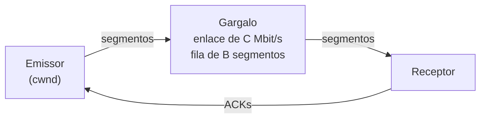

*Esquema 1 (o caminho).* O emissor envia uma janela de segmentos por RTT. O **gargalo** serve C Mbit/s; o que passa disso espera na **fila**, e o que passa da fila é **descartado** (descarte no fim da fila, *tail drop*). O RTT medido é o RTT de base mais o atraso de fila.

| Grandeza | Definição | Exemplo (20 Mbit/s e 50 ms) |
| --- | --- | --- |
| Segmento | unidade do simulador: 1500 bytes (MSS de 1460 mais 40 de cabeçalhos) | 1500 bytes |
| BDP | capacidade x RTT de base: quanto cabe em voo sem formar fila | cerca de 83 segmentos |
| Fila | segmentos que o gargalo guarda antes de descartar (em múltiplos do BDP) | 1 BDP: cerca de 83 segmentos |
| Janela ideal | o BDP: enlace cheio e fila vazia | cerca de 83 segmentos |
| Janela máxima sem perda | BDP mais fila | cerca de 166 segmentos |

Se a janela é menor que o BDP, o enlace fica ocioso. Entre o BDP e BDP mais fila, a vazão é a máxima, mas o excesso vira fila (atraso). Acima disso, há perda.

### 2.3 Reno e NewReno: soma aditiva e redução multiplicativa

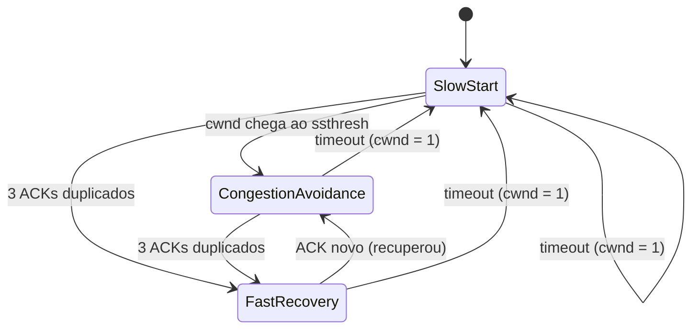

*Esquema 2 (estados do Reno).* No **slow start**, a cwnd dobra a cada RTT (+1 segmento por ACK). Na **congestion avoidance**, cresce 1 segmento por RTT. Três ACKs duplicados disparam o **fast retransmit**: o emissor repõe o segmento e divide ssthresh e cwnd por 2 (**fast recovery**). Sem ACKs suficientes, o **timeout** (RTO) leva a cwnd a 1 segmento e repete o slow start. É o ciclo **AIMD** (*additive increase, multiplicative decrease*).

- **ssthresh:** limite entre slow start e congestion avoidance; vira metade dos dados em voo na perda ([RFC 5681](https://www.rfc-editor.org/rfc/rfc5681), seção 3.1).
- **NewReno ([RFC 6582](https://www.rfc-editor.org/rfc/rfc6582)):** continua a recuperação com ACKs parciais, repondo um segmento por RTT quando não há SACK.
- **SACK ([RFC 2018](https://www.rfc-editor.org/rfc/rfc2018)):** o receptor informa os blocos recebidos; o emissor repõe só o que falta, em um RTT.
- **Janela inicial ([RFC 6928](https://www.rfc-editor.org/rfc/rfc6928)):** até 10 segmentos.

### 2.4 CUBIC: crescimento em função do tempo

O CUBIC ([RFC 9438](https://www.rfc-editor.org/rfc/rfc9438)), padrão do Linux, não conta RTTs: a janela depende do **tempo t desde a última redução**.

| Fórmula | Significado |
| --- | --- |
| W(t) = C (t - K)^3 + Wmax | janela alvo; C = 0,4 |
| K = raiz cúbica de ((Wmax - cwnd_epoch) / C) | tempo para voltar ao Wmax depois da redução |
| na perda: ssthresh = cwnd = 0,7 x dados em voo | β = 0,7 (redução de 30%) |
| W_est cresce α por RTT, com α = 3 (1 - β) / (1 + β) | estimativa do que um Reno faria (cerca de 0,53 segmento por RTT) |
| alvo = W(t + RTT), limitado a 1,5 x cwnd | por RTT, a cwnd vai até o alvo |

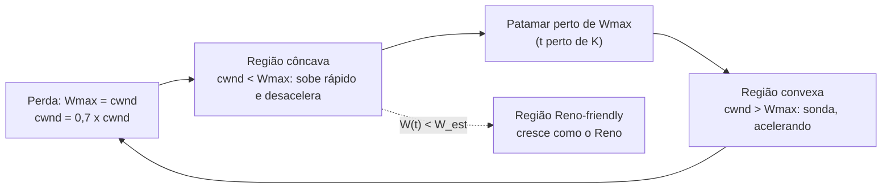

*Esquema 3 (regiões do CUBIC).* Depois da perda, a janela volta depressa ao Wmax (região côncava), achata (o CUBIC "desconfia" de que a capacidade está ali) e só então acelera (região convexa) para descobrir banda nova. Em caminhos curtos e de baixa capacidade, a função cúbica pode ser mais lenta que o Reno: aí vale a estimativa W_est (região **Reno-friendly**).

### 2.5 BBR: controle por modelo

O BBR deixa de usar a perda como sinal principal. Ele mantém duas estimativas: **BtlBw** (banda do gargalo: o máximo da vazão entregue recente) e **RTprop** (RTT mínimo recente). Envia a ritmo de *ganho x BtlBw* e limita os dados em voo a cerca de **2 x BDP estimado**. O texto de referência é o Internet-Draft **draft-ietf-ccwg-bbr** (ainda não é RFC); o simulador usa os valores da versão -07 do draft (BBRv3).

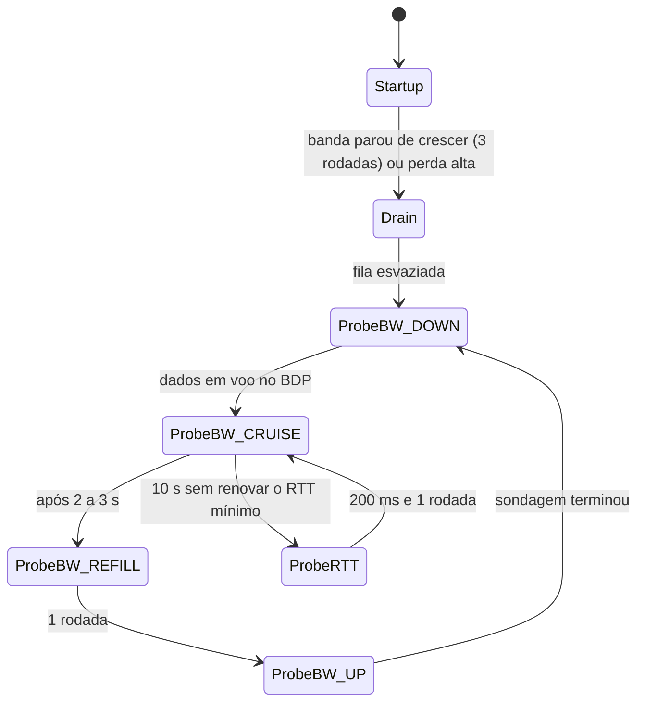

*Esquema 4 (fases do BBR).*

| Fase | Ganho de ritmo (pacing) | Ganho de janela | O que faz |
| --- | --- | --- | --- |
| Startup | 2,77 (4 ln 2) | 2 | dobra a taxa a cada rodada até a banda parar de crescer |
| Drain | 0,5 | 2 | esvazia a fila criada no Startup |
| ProbeBW_DOWN | 0,9 | 2 | reduz o ritmo para esvaziar a fila da sondagem |
| ProbeBW_CRUISE | 1,0 | 2 | mantém a banda estimada por 2 a 3 s |
| ProbeBW_REFILL | 1,0 | 2 | uma rodada para encher o tubo antes de sondar |
| ProbeBW_UP | 1,25 | 2,25 | sonda por mais banda; perda acima de 2% a interrompe |
| ProbeRTT | 1,0 | 0,5 | a cada 10 s, janela de 0,5 BDP por 200 ms, para renovar o RTT mínimo |

### 2.6 Comparação dos algoritmos

| | Reno/NewReno | CUBIC | BBR |
| --- | --- | --- | --- |
| Sinal principal | perda | perda | modelo (banda e RTT mínimo) |
| Crescimento | +1 segmento por RTT | cúbico no tempo | ganho de ritmo, com sondagem periódica |
| Redução | 50% | 30% (β = 0,7) | limite de dados em voo só se perda acima de 2% |
| Fila no gargalo | enche até estourar | enche até estourar | curta, perto do BDP |
| Perda aleatória | derruba a vazão | derruba a vazão | pouco afetado até 2% |
| Padrão em | referência didática | Linux, Windows e macOS | uso em serviços e no QUIC |

### 2.7 O que cada modo e aba do simulador mostram

- **Modos:** Reno/NewReno, CUBIC, BBR e Comparação (os três, cada um em uma cópia do mesmo caminho).
- **Aba Cenário:** parâmetros do caminho e do teste. **Captura:** uma amostra das rodadas (segmentos e ACKs). **Mensagem:** os valores da rodada (janela, fila, RTT, vazão, estado do algoritmo).
- **Aba Janela e fila:** a cwnd (ou o limite de dados em voo do BBR) contra o BDP e o limite da fila. **Vazão e atraso:** a vazão e o RTT de cada algoritmo. **Resultados:** vazão média, utilização, RTT, perdas e tempo até 90% da capacidade, para os três algoritmos com os mesmos parâmetros.

### 2.8 Cenários recomendados

1. **Reno, dente de serra**, e depois **fila rasa** e **fila funda**: a relação entre tamanho de buffer, utilização e atraso.
2. **Reno, perda aleatória de 1%**, e depois **BBR, perda aleatória de 1%**: o sinal "perda" falha.
3. **CUBIC, caminho longo e largo**, contra o **Reno** no mesmo caminho.
4. **BBR, fases**: Startup, Drain, ProbeBW e ProbeRTT.
5. **Comparação, capacidade dobra**: três maneiras de descobrir banda nova.

### 2.9 Limites do modelo e do diagrama

- O modelo é **por rodadas**: uma por RTT, com dados em voo e fila calculados em conjunto (fluido). Não há ACK individual, relógio de ACKs, estouro de fila dentro da rodada nem variação do RTT.
- Há **um fluxo por vez** no gargalo. A competição e a justiça entre fluxos (por exemplo, BBR contra CUBIC) **não** são modeladas.
- O diagrama mostra uma **amostra** das rodadas: as primeiras, as que têm evento e algumas intermediárias. Os gráficos usam todas.
- O simulador não representa HyStart++ ([RFC 9406](https://www.rfc-editor.org/rfc/rfc9406)), RACK-TLP ([RFC 8985](https://www.rfc-editor.org/rfc/rfc8985)), ECN ([RFC 3168](https://www.rfc-editor.org/rfc/rfc3168)) nem AQM; a estimativa de RTO é simplificada. O BBR omite o limite de curto prazo (*inflight_shortterm*) e o tratamento de tráfego limitado pela aplicação.

## 3. Como ler os diagramas

Este documento usa até dois tipos de diagrama. Cada figura traz uma legenda com o tipo, o que mostra e a que modo ou cenário se refere.

| Tipo | O que é | Vale para | Equivale, no simulador, a |
| --- | --- | --- | --- |
| B, sequência | As mensagens na ordem do tempo, entre os participantes. É dinâmico. | Um único cenário, com a configuração indicada | Ao diagrama de sequência e à aba Captura |

### 3.1 Legenda dos diagramas

**Tipo B (sequência)**

- Cada coluna é um participante (cliente, servidor, roteador ou outro). O tempo corre de cima para baixo.
- Seta cheia: mensagem enviada. Seta com X: mensagem perdida.
- `[cifrado]` no início do rótulo: a mensagem viaja cifrada.
- Faixa horizontal com texto: início de uma fase do cenário.
- A ordem é a da aba Captura; os intervalos de tempo não são desenhados em escala.

### 3.2 Lista de figuras

**Tipo B (sequência)**

- [Figura 6.1.1](#611-dente-de-serra): sequência de "Dente de serra"
- [Figura 6.1.2](#612-janela-inicial-de-1-segmento): sequência de "Janela inicial de 1 segmento"
- [Figura 6.1.3](#613-fila-rasa-enlace-subutilizado): sequência de "Fila rasa: enlace subutilizado"
- [Figura 6.1.4](#614-fila-funda-bufferbloat): sequência de "Fila funda: bufferbloat"
- [Figura 6.1.5](#615-perda-aleatória-de-1): sequência de "Perda aleatória de 1%"
- [Figura 6.1.6](#616-sem-sack-perdas-em-rajada-viram-timeout): sequência de "Sem SACK: perdas em rajada viram timeout"
- [Figura 6.1.7](#617-caminho-longo-e-largo-50-mbits-200-ms): sequência de "Caminho longo e largo (50 Mbit/s, 200 ms)"
- [Figura 6.2.1](#621-a-curva-cúbica): sequência de "A curva cúbica"
- [Figura 6.2.2](#622-caminho-longo-e-largo-50-mbits-200-ms): sequência de "Caminho longo e largo (50 Mbit/s, 200 ms)"
- [Figura 6.2.3](#623-caminho-curto-região-reno-friendly): sequência de "Caminho curto: região Reno-friendly"
- [Figura 6.2.4](#624-fila-funda-bufferbloat): sequência de "Fila funda: bufferbloat"
- [Figura 6.2.5](#625-perda-aleatória-de-1): sequência de "Perda aleatória de 1%"
- [Figura 6.2.6](#626-capacidade-dobra-no-meio-do-teste): sequência de "Capacidade dobra no meio do teste"
- [Figura 6.3.1](#631-startup-drain-probebw-e-probertt): sequência de "Startup, Drain, ProbeBW e ProbeRTT"
- [Figura 6.3.2](#632-fila-funda-sem-bufferbloat): sequência de "Fila funda: sem bufferbloat"
- [Figura 6.3.3](#633-fila-rasa): sequência de "Fila rasa"
- [Figura 6.3.4](#634-perda-aleatória-de-1): sequência de "Perda aleatória de 1%"
- [Figura 6.3.5](#635-perda-aleatória-de-5): sequência de "Perda aleatória de 5%"
- [Figura 6.3.6](#636-capacidade-dobra-no-meio-do-teste): sequência de "Capacidade dobra no meio do teste"
- [Figura 6.3.7](#637-capacidade-cai-à-metade): sequência de "Capacidade cai à metade"
- [Figura 6.4.1](#641-mesmo-caminho-três-algoritmos): sequência de "Mesmo caminho, três algoritmos"
- [Figura 6.4.2](#642-perda-aleatória-de-1): sequência de "Perda aleatória de 1%"
- [Figura 6.4.3](#643-fila-funda-4-bdp): sequência de "Fila funda (4 BDP)"
- [Figura 6.4.4](#644-fila-rasa-14-do-bdp): sequência de "Fila rasa (1/4 do BDP)"
- [Figura 6.4.5](#645-caminho-longo-e-largo-50-mbits-200-ms): sequência de "Caminho longo e largo (50 Mbit/s, 200 ms)"
- [Figura 6.4.6](#646-capacidade-dobra-no-meio-do-teste): sequência de "Capacidade dobra no meio do teste"

## 4. Abas da bancada

Cenário, Captura, Mensagem, Janela e fila, Vazão e atraso, Resultados, Experimento, Referência e Log.

## 5. Configurações (campos do painel)

### 5.1 Caminho

- **Capacidade do enlace gargalo**. Valores: 10 Mbit/s; 20 Mbit/s; 50 Mbit/s. Padrão: 20 Mbit/s. Modos: todos.
  - Taxa do enlace mais lento do caminho, que é o único ponto de fila do simulador.
  - O emissor não conhece essa taxa. Descobri-la, sem desperdiçar banda e sem encher a fila, é justamente o trabalho do controle de congestionamento.
  - Capacidade e RTT juntos definem o BDP (produto banda x atraso): quantos segmentos cabem "em voo" no caminho sem formar fila. Com 20 Mbit/s e 50 ms, o BDP é de cerca de 83 segmentos de 1500 bytes.
- **RTT de base (sem fila)**. Valores: 20 ms (rede metropolitana); 50 ms (nacional); 100 ms (intercontinental); 200 ms (satélite ou rede ruim). Padrão: 50 ms (nacional). Modos: todos.
  - Tempo de ida e volta quando a fila do gargalo está vazia.
  - Cada rodada do simulador dura um RTT. Quanto maior o RTT, mais lento é o crescimento da janela no tempo, e maior é o BDP.
  - O RTT medido pelo emissor é o RTT de base mais o atraso de fila: com a fila cheia, ele pode dobrar ou mais.
- **Fila do gargalo (em BDP)**. Valores: Rasa: 1/4 do BDP; Média: 1 BDP (regra clássica); Funda: 4 BDP (bufferbloat). Padrão: Média: 1 BDP (regra clássica). Modos: todos.
  - Quantos segmentos o roteador do gargalo guarda antes de descartar (descarte no fim da fila, tail drop).
  - Fila rasa: o Reno e o CUBIC perdem utilização depois de cada redução da janela, porque a fila esvazia. Fila funda: a janela cresce muito antes da primeira perda, e o atraso (RTT) explode. Esse excesso de fila é o bufferbloat.
  - Um BDP de fila é a regra clássica para o Reno manter o enlace cheio depois de dividir a janela por dois. O BBR depende pouco do tamanho da fila, porque não usa a perda como sinal principal.
- **Perda aleatória (não é congestionamento)**. Valores: Nenhuma; 0,1%; 1%; 5%. Padrão: Nenhuma. Modos: todos.
  - Parcela dos segmentos perdida por motivos que não são a fila cheia, como ruído em enlace sem fio.
  - Os algoritmos baseados em perda (Reno e CUBIC) tratam toda perda como sinal de congestionamento e reduzem a janela. Com perda aleatória, isso derruba a vazão muito abaixo da capacidade.
  - O BBR não reduz a janela por perdas isoladas. O BBR descrito no draft reage só quando a perda passa de 2% em uma sondagem de banda (BBR.LossThresh).

### 5.2 Teste

- **Duração da transferência**. Valores: 10 s; 20 s; 40 s. Padrão: 20 s. Modos: todos.
  - Tempo da transferência longa simulada, sempre limitada pela rede e nunca pela aplicação.
  - O CUBIC e o BBR têm escalas de tempo de segundos (o CUBIC depende do tempo desde a última perda; o BBR sonda a banda a cada 2 a 3 s e o RTT mínimo a cada 10 s). Use 20 ou 40 s para ver mais de um ciclo.
- **Mudança de capacidade no meio do teste**. Valores: Nenhuma; Capacidade dobra; Capacidade cai à metade. Padrão: Nenhuma. Modos: todos.
  - A metade do tempo, o enlace dobra de capacidade ou cai à metade.
  - Simula uma rota que muda, ou um enlace sem fio cuja taxa varia. Mostra como cada algoritmo descobre a nova capacidade: o Reno e o CUBIC por crescimento da janela, o BBR pela sondagem de banda (ProbeBW_UP).
  - Quando a capacidade cai, o BBR continua enviando com base no máximo recente de vazão e forma fila até a estimativa envelhecer.

### 5.3 Algoritmo

- **Janela inicial (IW)** (ajuste avançado). Valores: 1 segmento; 4 segmentos; 10 segmentos ([RFC 6928](https://www.rfc-editor.org/rfc/rfc6928)). Padrão: 10 segmentos ([RFC 6928](https://www.rfc-editor.org/rfc/rfc6928)). Modos: todos.
  - Quantos segmentos o emissor envia na primeira rodada, sem ter recebido nenhum ACK.
  - A [RFC 5681](https://www.rfc-editor.org/rfc/rfc5681) permitia até 4 segmentos; a [RFC 6928](https://www.rfc-editor.org/rfc/rfc6928) elevou o limite experimental para 10, valor usado hoje nos sistemas operacionais comuns. Uma janela inicial maior encurta o slow start.
- **Confirmação seletiva (SACK)**. Valores: caixa de seleção. Padrão: sim. Modos: Reno/NewReno; CUBIC; Comparação.
  - O receptor informa quais blocos já recebeu além da lacuna ([RFC 2018](https://www.rfc-editor.org/rfc/rfc2018)).
  - Com SACK, o emissor repõe todos os segmentos perdidos de uma rodada em uma só recuperação. Sem SACK (NewReno, [RFC 6582](https://www.rfc-editor.org/rfc/rfc6582)), cada ACK parcial repõe um segmento por RTT.
  - No simulador, sem SACK uma rajada de 4 ou mais perdas na mesma janela termina em timeout (RTO), e 2 ou 3 perdas esticam a recuperação por uma rodada para cada perda.
- **Fast convergence do CUBIC** (ajuste avançado). Valores: caixa de seleção. Padrão: não. Modos: CUBIC; Comparação.
  - Reduz o Wmax quando uma perda chega antes de a janela recuperar o valor anterior ([RFC 9438](https://www.rfc-editor.org/rfc/rfc9438), seção 4.7).
  - Serve para ceder banda a fluxos novos quando há vários CUBIC no mesmo gargalo. A RFC recomenda desativar quando há um só fluxo, como neste simulador, e por isso o padrão é desligado. O efeito aqui é pequeno.
- **Semente da perda aleatória** (ajuste avançado). Valores: Semente 7; Semente 13; Semente 42. Padrão: Semente 7. Modos: todos.
  - Escolhe a sequência de perdas aleatórias.
  - A mesma semente produz sempre as mesmas perdas, o que permite comparar algoritmos nas mesmas condições. Sem perda aleatória, a semente só afeta o intervalo entre as sondagens do BBR.

## 6. Cenários

### 6.1 Modo: Reno/NewReno

> **Grupo:** Reno: o ciclo básico

Slow start, congestion avoidance e fast retransmit: o ciclo AIMD (soma aditiva, redução multiplicativa) do Reno e do NewReno.

#### 6.1.1 Dente de serra

*Slow start, estouro da fila e crescimento de 1 segmento por RTT.*

Uma transferência longa em 20 Mbit/s e 50 ms, com fila de 1 BDP. O Reno faz slow start, estoura a fila, divide a janela por dois e passa a crescer 1 segmento por RTT.

Repita o ciclo na aba Janela e fila: é o dente de serra clássico, com o enlace quase sempre cheio.

**Conceito.** O **Reno** ([RFC 5681](https://www.rfc-editor.org/rfc/rfc5681)) controla a **janela de congestionamento (cwnd)**, o limite de segmentos em voo. No **slow start** a janela dobra a cada RTT até o ssthresh ou a primeira perda. Depois vem a **congestion avoidance**: +1 segmento por RTT. Ao detectar uma perda por 3 ACKs duplicados (**fast retransmit**), o emissor reduz o ssthresh e a cwnd à metade (**fast recovery**). É o ciclo **AIMD**: aumento aditivo, redução multiplicativa.

**O que observar**

- Na aba Janela e fila: o dente de serra da cwnd entre 1/2 e 1 vez o BDP mais a fila.
- Na aba Vazão e atraso: a vazão quase colada na capacidade e o RTT subindo e descendo com a fila.
- No Log: as mensagens de perda com o novo ssthresh.

```mermaid
sequenceDiagram
  autonumber
  participant n_snd as Emissor (Reno/NewReno)<br/>servidor
  participant n_rcv as Receptor<br/>cliente
  Note over n_snd,n_rcv: Slow start
  n_snd ->> n_rcv: 10 segm.
  n_rcv ->> n_snd: ACKs de 10 segm.
  n_snd ->> n_rcv: 20 segm.
  n_rcv ->> n_snd: ACKs de 20 segm.
  n_snd ->> n_rcv: 40 segm.
  n_rcv ->> n_snd: ACKs de 40 segm.
  n_snd ->> n_rcv: 80 segm.
  n_rcv ->> n_snd: ACKs de 80 segm.
  n_snd ->> n_rcv: 160 segm.
  n_rcv ->> n_snd: ACKs de 160 segm.
  Note over n_snd,n_rcv: Fast retransmit
  n_snd ->> n_rcv: 320 segm. (154 perdidos)
  n_rcv ->> n_snd: ACKs de 166 segm.
  Note over n_snd,n_rcv: Recuperação rápida
  n_snd ->> n_rcv: 160 segm.
  n_rcv ->> n_snd: ACKs de 160 segm.
  Note over n_snd,n_rcv: Congestion avoidance
  n_snd ->> n_rcv: 160 segm.
  n_rcv ->> n_snd: ACKs de 160 segm.
  n_snd ->> n_rcv: 165 segm.
  n_rcv ->> n_snd: ACKs de 165 segm.
  Note over n_snd,n_rcv: Fast retransmit
  n_snd ->> n_rcv: 167 segm. (1 perdidos)
  n_rcv ->> n_snd: ACKs de 166 segm.
  Note over n_snd,n_rcv: Congestion avoidance
  n_snd ->> n_rcv: 85 segm.
  n_rcv ->> n_snd: ACKs de 85 segm.
  n_snd ->> n_rcv: 91 segm.
  n_rcv ->> n_snd: ACKs de 91 segm.
  n_snd ->> n_rcv: 97 segm.
  n_rcv ->> n_snd: ACKs de 97 segm.
  n_snd ->> n_rcv: 103 segm.
  n_rcv ->> n_snd: ACKs de 103 segm.
  n_snd ->> n_rcv: 109 segm.
  n_rcv ->> n_snd: ACKs de 109 segm.
  n_snd ->> n_rcv: 115 segm.
  n_rcv ->> n_snd: ACKs de 115 segm.
  n_snd ->> n_rcv: 121 segm.
  n_rcv ->> n_snd: ACKs de 121 segm.
  n_snd ->> n_rcv: 127 segm.
  n_rcv ->> n_snd: ACKs de 127 segm.
  n_snd ->> n_rcv: 133 segm.
  n_rcv ->> n_snd: ACKs de 133 segm.
  n_snd ->> n_rcv: 139 segm.
  n_rcv ->> n_snd: ACKs de 139 segm.
  n_snd ->> n_rcv: 145 segm.
  n_rcv ->> n_snd: ACKs de 145 segm.
  n_snd ->> n_rcv: 151 segm.
  n_rcv ->> n_snd: ACKs de 151 segm.
  n_snd ->> n_rcv: 157 segm.
  n_rcv ->> n_snd: ACKs de 157 segm.
  n_snd ->> n_rcv: 163 segm.
  n_rcv ->> n_snd: ACKs de 163 segm.
  Note over n_snd,n_rcv: Fast retransmit
  n_snd ->> n_rcv: 167 segm. (1 perdidos)
  n_rcv ->> n_snd: ACKs de 166 segm.
  Note over n_snd,n_rcv: Congestion avoidance
  n_snd ->> n_rcv: 83 segm.
  n_rcv ->> n_snd: ACKs de 83 segm.
  n_snd ->> n_rcv: 89 segm.
  n_rcv ->> n_snd: ACKs de 89 segm.
  n_snd ->> n_rcv: 95 segm.
  n_rcv ->> n_snd: ACKs de 95 segm.
  n_snd ->> n_rcv: 101 segm.
  n_rcv ->> n_snd: ACKs de 101 segm.
  n_snd ->> n_rcv: 107 segm.
  n_rcv ->> n_snd: ACKs de 107 segm.
  n_snd ->> n_rcv: 113 segm.
  n_rcv ->> n_snd: ACKs de 113 segm.
  n_snd ->> n_rcv: 119 segm.
  n_rcv ->> n_snd: ACKs de 119 segm.
  n_snd ->> n_rcv: 125 segm.
  n_rcv ->> n_snd: ACKs de 125 segm.
  n_snd ->> n_rcv: 131 segm.
  n_rcv ->> n_snd: ACKs de 131 segm.
  n_snd ->> n_rcv: 137 segm.
  n_rcv ->> n_snd: ACKs de 137 segm.
  n_snd ->> n_rcv: 143 segm.
  n_rcv ->> n_snd: ACKs de 143 segm.
  n_snd ->> n_rcv: 149 segm.
  n_rcv ->> n_snd: ACKs de 149 segm.
  n_snd ->> n_rcv: 155 segm.
  n_rcv ->> n_snd: ACKs de 155 segm.
  n_snd ->> n_rcv: 161 segm.
  n_rcv ->> n_snd: ACKs de 161 segm.
  Note over n_snd,n_rcv: Fast retransmit
  n_snd ->> n_rcv: 167 segm. (1 perdidos)
  n_rcv ->> n_snd: ACKs de 166 segm.
  Note over n_snd,n_rcv: Congestion avoidance
  n_snd ->> n_rcv: 87 segm.
  n_rcv ->> n_snd: ACKs de 87 segm.
  n_snd ->> n_rcv: 93 segm.
  n_rcv ->> n_snd: ACKs de 93 segm.
  n_snd ->> n_rcv: 99 segm.
  n_rcv ->> n_snd: ACKs de 99 segm.
  n_snd ->> n_rcv: 105 segm.
  n_rcv ->> n_snd: ACKs de 105 segm.
  n_snd ->> n_rcv: 111 segm.
  n_rcv ->> n_snd: ACKs de 111 segm.
  n_snd ->> n_rcv: 117 segm.
  n_rcv ->> n_snd: ACKs de 117 segm.
  n_snd ->> n_rcv: 123 segm.
  n_rcv ->> n_snd: ACKs de 123 segm.
  n_snd ->> n_rcv: 129 segm.
  n_rcv ->> n_snd: ACKs de 129 segm.
  n_snd ->> n_rcv: 135 segm.
  n_rcv ->> n_snd: ACKs de 135 segm.
  n_snd ->> n_rcv: 141 segm.
  n_rcv ->> n_snd: ACKs de 141 segm.
  n_snd ->> n_rcv: 147 segm.
  n_rcv ->> n_snd: ACKs de 147 segm.
  n_snd ->> n_rcv: 153 segm.
  n_rcv ->> n_snd: ACKs de 153 segm.
  n_snd ->> n_rcv: 159 segm.
  n_rcv ->> n_snd: ACKs de 159 segm.
  n_snd ->> n_rcv: 162 segm.
  n_rcv ->> n_snd: ACKs de 162 segm.
```

*Figura 6.1.1 (Tipo B, sequência).* Mensagens do cenário "Dente de serra", na ordem do tempo, entre Emissor (Reno/NewReno), Receptor: 108 mensagens, numeradas de 1 a 108 na ordem da comunicação (em 10 fases). Corresponde ao diagrama de sequência e à aba Captura, no modo "Reno/NewReno", com a configuração padrão.

**Mensagens**

| Mensagem | Significado | Origem |
| --- | --- | --- |
| Rodada: N segm. | segmentos enviados em um RTT | emissor |
| ACKs de N segm. | confirmações que liberam novas rodadas | receptor |

**Por que importa.** É a base de todo o controle de congestionamento do TCP desde 1988 (Jacobson). Entender o dente de serra explica por que a vazão média do Reno é próxima de 75% do pico quando a fila é de 1 BDP.

#### 6.1.2 Janela inicial de 1 segmento

*A janela inicial define quantas rodadas o slow start gasta.*

**Configuração aplicada:** Janela inicial (IW) = 1; Duração da transferência = 10

Com IW = 1, o slow start precisa de mais rodadas para chegar ao BDP. Compare com o cenário anterior: a janela dobra a cada RTT, mas começa menor.

**Conceito.** A janela inicial (**IW**) é o tamanho da primeira rodada. Com IW = 1, o slow start leva mais RTTs para chegar ao BDP; com IW = 10 (**[RFC 6928](https://www.rfc-editor.org/rfc/rfc6928)**), chega antes. Em transferências curtas, o slow start pode ser o ciclo inteiro da conexão.

**O que observar**

- Quantas rodadas até a janela chegar a 80 segmentos, com IW = 1 e com IW = 10.
- O mesmo ssthresh inicial (sem limite): o slow start só acaba na primeira perda.

```mermaid
sequenceDiagram
  autonumber
  participant n_snd as Emissor (Reno/NewReno)<br/>servidor
  participant n_rcv as Receptor<br/>cliente
  Note over n_snd,n_rcv: Slow start
  n_snd ->> n_rcv: 1 segm.
  n_rcv ->> n_snd: ACKs de 1 segm.
  n_snd ->> n_rcv: 2 segm.
  n_rcv ->> n_snd: ACKs de 2 segm.
  n_snd ->> n_rcv: 4 segm.
  n_rcv ->> n_snd: ACKs de 4 segm.
  n_snd ->> n_rcv: 8 segm.
  n_rcv ->> n_snd: ACKs de 8 segm.
  n_snd ->> n_rcv: 16 segm.
  n_rcv ->> n_snd: ACKs de 16 segm.
  n_snd ->> n_rcv: 32 segm.
  n_rcv ->> n_snd: ACKs de 32 segm.
  n_snd ->> n_rcv: 64 segm.
  n_rcv ->> n_snd: ACKs de 64 segm.
  n_snd ->> n_rcv: 128 segm.
  n_rcv ->> n_snd: ACKs de 128 segm.
  Note over n_snd,n_rcv: Fast retransmit
  n_snd ->> n_rcv: 256 segm. (90 perdidos)
  n_rcv ->> n_snd: ACKs de 166 segm.
  Note over n_snd,n_rcv: Recuperação rápida
  n_snd ->> n_rcv: 128 segm.
  n_rcv ->> n_snd: ACKs de 128 segm.
  Note over n_snd,n_rcv: Congestion avoidance
  n_snd ->> n_rcv: 130 segm.
  n_rcv ->> n_snd: ACKs de 130 segm.
  n_snd ->> n_rcv: 133 segm.
  n_rcv ->> n_snd: ACKs de 133 segm.
  n_snd ->> n_rcv: 136 segm.
  n_rcv ->> n_snd: ACKs de 136 segm.
  n_snd ->> n_rcv: 139 segm.
  n_rcv ->> n_snd: ACKs de 139 segm.
  n_snd ->> n_rcv: 142 segm.
  n_rcv ->> n_snd: ACKs de 142 segm.
  n_snd ->> n_rcv: 145 segm.
  n_rcv ->> n_snd: ACKs de 145 segm.
  n_snd ->> n_rcv: 148 segm.
  n_rcv ->> n_snd: ACKs de 148 segm.
  n_snd ->> n_rcv: 151 segm.
  n_rcv ->> n_snd: ACKs de 151 segm.
  n_snd ->> n_rcv: 154 segm.
  n_rcv ->> n_snd: ACKs de 154 segm.
  n_snd ->> n_rcv: 157 segm.
  n_rcv ->> n_snd: ACKs de 157 segm.
  n_snd ->> n_rcv: 160 segm.
  n_rcv ->> n_snd: ACKs de 160 segm.
  n_snd ->> n_rcv: 163 segm.
  n_rcv ->> n_snd: ACKs de 163 segm.
  n_snd ->> n_rcv: 166 segm.
  n_rcv ->> n_snd: ACKs de 166 segm.
  Note over n_snd,n_rcv: Fast retransmit
  n_snd ->> n_rcv: 167 segm. (1 perdidos)
  n_rcv ->> n_snd: ACKs de 166 segm.
  Note over n_snd,n_rcv: Congestion avoidance
  n_snd ->> n_rcv: 83 segm.
  n_rcv ->> n_snd: ACKs de 83 segm.
  n_snd ->> n_rcv: 86 segm.
  n_rcv ->> n_snd: ACKs de 86 segm.
  n_snd ->> n_rcv: 89 segm.
  n_rcv ->> n_snd: ACKs de 89 segm.
  n_snd ->> n_rcv: 92 segm.
  n_rcv ->> n_snd: ACKs de 92 segm.
  n_snd ->> n_rcv: 95 segm.
  n_rcv ->> n_snd: ACKs de 95 segm.
  n_snd ->> n_rcv: 98 segm.
  n_rcv ->> n_snd: ACKs de 98 segm.
  n_snd ->> n_rcv: 101 segm.
  n_rcv ->> n_snd: ACKs de 101 segm.
  n_snd ->> n_rcv: 104 segm.
  n_rcv ->> n_snd: ACKs de 104 segm.
  n_snd ->> n_rcv: 107 segm.
  n_rcv ->> n_snd: ACKs de 107 segm.
  n_snd ->> n_rcv: 110 segm.
  n_rcv ->> n_snd: ACKs de 110 segm.
  n_snd ->> n_rcv: 113 segm.
  n_rcv ->> n_snd: ACKs de 113 segm.
  n_snd ->> n_rcv: 116 segm.
  n_rcv ->> n_snd: ACKs de 116 segm.
  n_snd ->> n_rcv: 119 segm.
  n_rcv ->> n_snd: ACKs de 119 segm.
  n_snd ->> n_rcv: 122 segm.
  n_rcv ->> n_snd: ACKs de 122 segm.
  n_snd ->> n_rcv: 125 segm.
  n_rcv ->> n_snd: ACKs de 125 segm.
  n_snd ->> n_rcv: 128 segm.
  n_rcv ->> n_snd: ACKs de 128 segm.
  n_snd ->> n_rcv: 131 segm.
  n_rcv ->> n_snd: ACKs de 131 segm.
  n_snd ->> n_rcv: 134 segm.
  n_rcv ->> n_snd: ACKs de 134 segm.
  n_snd ->> n_rcv: 137 segm.
  n_rcv ->> n_snd: ACKs de 137 segm.
  n_snd ->> n_rcv: 140 segm.
  n_rcv ->> n_snd: ACKs de 140 segm.
  n_snd ->> n_rcv: 143 segm.
  n_rcv ->> n_snd: ACKs de 143 segm.
  n_snd ->> n_rcv: 146 segm.
  n_rcv ->> n_snd: ACKs de 146 segm.
  n_snd ->> n_rcv: 149 segm.
  n_rcv ->> n_snd: ACKs de 149 segm.
  n_snd ->> n_rcv: 152 segm.
  n_rcv ->> n_snd: ACKs de 152 segm.
  n_snd ->> n_rcv: 155 segm.
  n_rcv ->> n_snd: ACKs de 155 segm.
  n_snd ->> n_rcv: 158 segm.
  n_rcv ->> n_snd: ACKs de 158 segm.
  n_snd ->> n_rcv: 161 segm.
  n_rcv ->> n_snd: ACKs de 161 segm.
  n_snd ->> n_rcv: 162 segm.
  n_rcv ->> n_snd: ACKs de 162 segm.
```

*Figura 6.1.2 (Tipo B, sequência).* Mensagens do cenário "Janela inicial de 1 segmento", na ordem do tempo, entre Emissor (Reno/NewReno), Receptor: 104 mensagens, numeradas de 1 a 104 na ordem da comunicação (em 6 fases). Corresponde ao diagrama de sequência e à aba Captura, no modo "Reno/NewReno", com a configuração aplicada acima.

**Mensagens**

| Mensagem | Significado | Origem |
| --- | --- | --- |
| Rodada: 1 seg | primeira rodada com IW = 1 | emissor |
| ACKs | cada ACK libera 2 novos segmentos no slow start | receptor |

**Por que importa.** Páginas e APIs transferem poucos KB; para elas, a janela inicial decide o tempo total, muito mais que o algoritmo de congestion avoidance.

> **Grupo:** Efeito da fila

Como o tamanho da fila do gargalo muda a utilização do enlace e o atraso para os algoritmos que reagem à perda.

#### 6.1.3 Fila rasa: enlace subutilizado

*Com pouca fila, o enlace esvazia depois de cada redução.*

**Configuração aplicada:** Fila do gargalo (em BDP) = 0.25

Com fila de 1/4 do BDP, a perda chega cedo e a janela cai a metade de um valor pequeno: a fila esvazia e o enlace fica ocioso por parte de cada ciclo.

**Conceito.** Depois de uma perda, o Reno divide a janela por dois. Para o enlace continuar cheio, a janela reduzida ainda precisa cobrir o BDP, o que exige uma fila de cerca de **1 BDP**. Com fila rasa (1/4 do BDP), a janela cai abaixo do BDP, a fila esvazia e o enlace fica ocioso.

**O que observar**

- Na aba Vazão e atraso: a vazão cai abaixo da capacidade depois de cada perda.
- Na aba Resultados: a utilização abaixo de 100%.
- Mais perdas por segundo que no cenário de fila média.

```mermaid
sequenceDiagram
  autonumber
  participant n_snd as Emissor (Reno/NewReno)<br/>servidor
  participant n_rcv as Receptor<br/>cliente
  Note over n_snd,n_rcv: Slow start
  n_snd ->> n_rcv: 10 segm.
  n_rcv ->> n_snd: ACKs de 10 segm.
  n_snd ->> n_rcv: 20 segm.
  n_rcv ->> n_snd: ACKs de 20 segm.
  n_snd ->> n_rcv: 40 segm.
  n_rcv ->> n_snd: ACKs de 40 segm.
  n_snd ->> n_rcv: 80 segm.
  n_rcv ->> n_snd: ACKs de 80 segm.
  Note over n_snd,n_rcv: Fast retransmit
  n_snd ->> n_rcv: 160 segm. (56 perdidos)
  n_rcv ->> n_snd: ACKs de 104 segm.
  Note over n_snd,n_rcv: Recuperação rápida
  n_snd ->> n_rcv: 80 segm.
  n_rcv ->> n_snd: ACKs de 80 segm.
  Note over n_snd,n_rcv: Congestion avoidance
  n_snd ->> n_rcv: 80 segm.
  n_rcv ->> n_snd: ACKs de 80 segm.
  n_snd ->> n_rcv: 81 segm.
  n_rcv ->> n_snd: ACKs de 81 segm.
  n_snd ->> n_rcv: 83 segm.
  n_rcv ->> n_snd: ACKs de 83 segm.
  n_snd ->> n_rcv: 92 segm.
  n_rcv ->> n_snd: ACKs de 92 segm.
  n_snd ->> n_rcv: 101 segm.
  n_rcv ->> n_snd: ACKs de 101 segm.
  Note over n_snd,n_rcv: Fast retransmit
  n_snd ->> n_rcv: 105 segm. (1 perdidos)
  n_rcv ->> n_snd: ACKs de 104 segm.
  Note over n_snd,n_rcv: Congestion avoidance
  n_snd ->> n_rcv: 55 segm.
  n_rcv ->> n_snd: ACKs de 55 segm.
  n_snd ->> n_rcv: 64 segm.
  n_rcv ->> n_snd: ACKs de 64 segm.
  n_snd ->> n_rcv: 73 segm.
  n_rcv ->> n_snd: ACKs de 73 segm.
  n_snd ->> n_rcv: 82 segm.
  n_rcv ->> n_snd: ACKs de 82 segm.
  n_snd ->> n_rcv: 91 segm.
  n_rcv ->> n_snd: ACKs de 91 segm.
  n_snd ->> n_rcv: 100 segm.
  n_rcv ->> n_snd: ACKs de 100 segm.
  Note over n_snd,n_rcv: Fast retransmit
  n_snd ->> n_rcv: 105 segm. (1 perdidos)
  n_rcv ->> n_snd: ACKs de 104 segm.
  Note over n_snd,n_rcv: Congestion avoidance
  n_snd ->> n_rcv: 54 segm.
  n_rcv ->> n_snd: ACKs de 54 segm.
  n_snd ->> n_rcv: 63 segm.
  n_rcv ->> n_snd: ACKs de 63 segm.
  n_snd ->> n_rcv: 72 segm.
  n_rcv ->> n_snd: ACKs de 72 segm.
  n_snd ->> n_rcv: 81 segm.
  n_rcv ->> n_snd: ACKs de 81 segm.
  n_snd ->> n_rcv: 90 segm.
  n_rcv ->> n_snd: ACKs de 90 segm.
  n_snd ->> n_rcv: 99 segm.
  n_rcv ->> n_snd: ACKs de 99 segm.
  Note over n_snd,n_rcv: Fast retransmit
  n_snd ->> n_rcv: 105 segm. (1 perdidos)
  n_rcv ->> n_snd: ACKs de 104 segm.
  Note over n_snd,n_rcv: Congestion avoidance
  n_snd ->> n_rcv: 53 segm.
  n_rcv ->> n_snd: ACKs de 53 segm.
  n_snd ->> n_rcv: 62 segm.
  n_rcv ->> n_snd: ACKs de 62 segm.
  n_snd ->> n_rcv: 71 segm.
  n_rcv ->> n_snd: ACKs de 71 segm.
  n_snd ->> n_rcv: 80 segm.
  n_rcv ->> n_snd: ACKs de 80 segm.
  n_snd ->> n_rcv: 89 segm.
  n_rcv ->> n_snd: ACKs de 89 segm.
  n_snd ->> n_rcv: 98 segm.
  n_rcv ->> n_snd: ACKs de 98 segm.
  Note over n_snd,n_rcv: Fast retransmit
  n_snd ->> n_rcv: 105 segm. (1 perdidos)
  n_rcv ->> n_snd: ACKs de 104 segm.
  Note over n_snd,n_rcv: Congestion avoidance
  n_snd ->> n_rcv: 52 segm.
  n_rcv ->> n_snd: ACKs de 52 segm.
  n_snd ->> n_rcv: 61 segm.
  n_rcv ->> n_snd: ACKs de 61 segm.
  n_snd ->> n_rcv: 70 segm.
  n_rcv ->> n_snd: ACKs de 70 segm.
  n_snd ->> n_rcv: 79 segm.
  n_rcv ->> n_snd: ACKs de 79 segm.
  n_snd ->> n_rcv: 88 segm.
  n_rcv ->> n_snd: ACKs de 88 segm.
  n_snd ->> n_rcv: 97 segm.
  n_rcv ->> n_snd: ACKs de 97 segm.
  Note over n_snd,n_rcv: Fast retransmit
  n_snd ->> n_rcv: 105 segm. (1 perdidos)
  n_rcv ->> n_snd: ACKs de 104 segm.
  Note over n_snd,n_rcv: Recuperação rápida
  n_snd ->> n_rcv: 52 segm.
  n_rcv ->> n_snd: ACKs de 52 segm.
  Note over n_snd,n_rcv: Congestion avoidance
  n_snd ->> n_rcv: 60 segm.
  n_rcv ->> n_snd: ACKs de 60 segm.
  n_snd ->> n_rcv: 69 segm.
  n_rcv ->> n_snd: ACKs de 69 segm.
  n_snd ->> n_rcv: 78 segm.
  n_rcv ->> n_snd: ACKs de 78 segm.
  n_snd ->> n_rcv: 87 segm.
  n_rcv ->> n_snd: ACKs de 87 segm.
  n_snd ->> n_rcv: 96 segm.
  n_rcv ->> n_snd: ACKs de 96 segm.
  Note over n_snd,n_rcv: Fast retransmit
  n_snd ->> n_rcv: 105 segm. (1 perdidos)
  n_rcv ->> n_snd: ACKs de 104 segm.
  Note over n_snd,n_rcv: Congestion avoidance
  n_snd ->> n_rcv: 59 segm.
  n_rcv ->> n_snd: ACKs de 59 segm.
  n_snd ->> n_rcv: 68 segm.
  n_rcv ->> n_snd: ACKs de 68 segm.
  n_snd ->> n_rcv: 77 segm.
  n_rcv ->> n_snd: ACKs de 77 segm.
  n_snd ->> n_rcv: 86 segm.
  n_rcv ->> n_snd: ACKs de 86 segm.
  n_snd ->> n_rcv: 95 segm.
  n_rcv ->> n_snd: ACKs de 95 segm.
  n_snd ->> n_rcv: 104 segm.
  n_rcv ->> n_snd: ACKs de 104 segm.
  Note over n_snd,n_rcv: Fast retransmit
  n_snd ->> n_rcv: 105 segm. (1 perdidos)
  n_rcv ->> n_snd: ACKs de 104 segm.
  Note over n_snd,n_rcv: Congestion avoidance
  n_snd ->> n_rcv: 58 segm.
  n_rcv ->> n_snd: ACKs de 58 segm.
  n_snd ->> n_rcv: 67 segm.
  n_rcv ->> n_snd: ACKs de 67 segm.
  n_snd ->> n_rcv: 68 segm.
  n_rcv ->> n_snd: ACKs de 68 segm.
```

*Figura 6.1.3 (Tipo B, sequência).* Mensagens do cenário "Fila rasa: enlace subutilizado", na ordem do tempo, entre Emissor (Reno/NewReno), Receptor: 114 mensagens, numeradas de 1 a 114 na ordem da comunicação (em 19 fases). Corresponde ao diagrama de sequência e à aba Captura, no modo "Reno/NewReno", com a configuração aplicada acima.

**Mensagens**

| Mensagem | Significado | Origem |
| --- | --- | --- |
| Rodada: N segm. (M perdidos) | a fila rasa descarta cedo | emissor |

**Por que importa.** Mostra por que a regra "buffer = BDP" aparece nos guias de dimensionamento e por que roteadores com buffers pequenos exigem outros algoritmos.

#### 6.1.4 Fila funda: bufferbloat

*A fila enche antes da perda, e o atraso explode.*

**Configuração aplicada:** Fila do gargalo (em BDP) = 4

Com fila de 4 BDP, o Reno enche a fila antes da primeira perda. A vazão é a máxima, mas o RTT medido passa de 200 ms para um caminho de 50 ms.

Veja a aba Vazão e atraso: o atraso de fila é a consequência de um algoritmo que só reage à perda.

**Conceito.** O Reno só reduz a janela quando perde um segmento. Se a fila do gargalo é funda, a perda demora a aparecer, e a janela continua crescendo enquanto o RTT aumenta com a fila. É o **bufferbloat**: a vazão é a máxima, mas toda aplicação sensível a atraso (voz, jogos, DNS) sofre. Mitigações: AQM (CoDel, [RFC 8289](https://www.rfc-editor.org/rfc/rfc8289); FQ-CoDel, [RFC 8290](https://www.rfc-editor.org/rfc/rfc8290); PIE, [RFC 8033](https://www.rfc-editor.org/rfc/rfc8033)) e ECN ([RFC 3168](https://www.rfc-editor.org/rfc/rfc3168)).

**O que observar**

- Na aba Vazão e atraso: o RTT chega a mais de 200 ms em um caminho de 50 ms.
- Poucas perdas, mas cada uma com muitos segmentos.
- A fila (estado Fila no gargalo) perto do limite durante quase todo o ciclo.

```mermaid
sequenceDiagram
  autonumber
  participant n_snd as Emissor (Reno/NewReno)<br/>servidor
  participant n_rcv as Receptor<br/>cliente
  Note over n_snd,n_rcv: Slow start
  n_snd ->> n_rcv: 10 segm.
  n_rcv ->> n_snd: ACKs de 10 segm.
  n_snd ->> n_rcv: 20 segm.
  n_rcv ->> n_snd: ACKs de 20 segm.
  n_snd ->> n_rcv: 40 segm.
  n_rcv ->> n_snd: ACKs de 40 segm.
  n_snd ->> n_rcv: 80 segm.
  n_rcv ->> n_snd: ACKs de 80 segm.
  n_snd ->> n_rcv: 160 segm.
  n_rcv ->> n_snd: ACKs de 160 segm.
  n_snd ->> n_rcv: 320 segm.
  n_rcv ->> n_snd: ACKs de 320 segm.
  Note over n_snd,n_rcv: Fast retransmit
  n_snd ->> n_rcv: 640 segm. (224 perdidos)
  n_rcv ->> n_snd: ACKs de 416 segm.
  Note over n_snd,n_rcv: Recuperação rápida
  n_snd ->> n_rcv: 320 segm.
  n_rcv ->> n_snd: ACKs de 320 segm.
  Note over n_snd,n_rcv: Congestion avoidance
  n_snd ->> n_rcv: 321 segm.
  n_rcv ->> n_snd: ACKs de 321 segm.
  n_snd ->> n_rcv: 324 segm.
  n_rcv ->> n_snd: ACKs de 324 segm.
  n_snd ->> n_rcv: 327 segm.
  n_rcv ->> n_snd: ACKs de 327 segm.
  n_snd ->> n_rcv: 330 segm.
  n_rcv ->> n_snd: ACKs de 330 segm.
  n_snd ->> n_rcv: 333 segm.
  n_rcv ->> n_snd: ACKs de 333 segm.
  n_snd ->> n_rcv: 336 segm.
  n_rcv ->> n_snd: ACKs de 336 segm.
  n_snd ->> n_rcv: 339 segm.
  n_rcv ->> n_snd: ACKs de 339 segm.
  n_snd ->> n_rcv: 342 segm.
  n_rcv ->> n_snd: ACKs de 342 segm.
  n_snd ->> n_rcv: 345 segm.
  n_rcv ->> n_snd: ACKs de 345 segm.
  n_snd ->> n_rcv: 348 segm.
  n_rcv ->> n_snd: ACKs de 348 segm.
  n_snd ->> n_rcv: 351 segm.
  n_rcv ->> n_snd: ACKs de 351 segm.
  n_snd ->> n_rcv: 354 segm.
  n_rcv ->> n_snd: ACKs de 354 segm.
  n_snd ->> n_rcv: 357 segm.
  n_rcv ->> n_snd: ACKs de 357 segm.
  n_snd ->> n_rcv: 360 segm.
  n_rcv ->> n_snd: ACKs de 360 segm.
  n_snd ->> n_rcv: 363 segm.
  n_rcv ->> n_snd: ACKs de 363 segm.
  n_snd ->> n_rcv: 366 segm.
  n_rcv ->> n_snd: ACKs de 366 segm.
  n_snd ->> n_rcv: 369 segm.
  n_rcv ->> n_snd: ACKs de 369 segm.
  n_snd ->> n_rcv: 372 segm.
  n_rcv ->> n_snd: ACKs de 372 segm.
  n_snd ->> n_rcv: 375 segm.
  n_rcv ->> n_snd: ACKs de 375 segm.
  n_snd ->> n_rcv: 378 segm.
  n_rcv ->> n_snd: ACKs de 378 segm.
  n_snd ->> n_rcv: 381 segm.
  n_rcv ->> n_snd: ACKs de 381 segm.
  n_snd ->> n_rcv: 384 segm.
  n_rcv ->> n_snd: ACKs de 384 segm.
  n_snd ->> n_rcv: 387 segm.
  n_rcv ->> n_snd: ACKs de 387 segm.
  n_snd ->> n_rcv: 390 segm.
  n_rcv ->> n_snd: ACKs de 390 segm.
  n_snd ->> n_rcv: 393 segm.
  n_rcv ->> n_snd: ACKs de 393 segm.
  n_snd ->> n_rcv: 396 segm.
  n_rcv ->> n_snd: ACKs de 396 segm.
  n_snd ->> n_rcv: 399 segm.
  n_rcv ->> n_snd: ACKs de 399 segm.
  n_snd ->> n_rcv: 402 segm.
  n_rcv ->> n_snd: ACKs de 402 segm.
  n_snd ->> n_rcv: 405 segm.
  n_rcv ->> n_snd: ACKs de 405 segm.
  n_snd ->> n_rcv: 407 segm.
  n_rcv ->> n_snd: ACKs de 407 segm.
```

*Figura 6.1.4 (Tipo B, sequência).* Mensagens do cenário "Fila funda: bufferbloat", na ordem do tempo, entre Emissor (Reno/NewReno), Receptor: 76 mensagens, numeradas de 1 a 76 na ordem da comunicação (em 4 fases). Corresponde ao diagrama de sequência e à aba Captura, no modo "Reno/NewReno", com a configuração aplicada acima.

**Mensagens**

| Mensagem | Significado | Origem |
| --- | --- | --- |
| Rodada: N segm. | dados em voo muito acima do BDP | emissor |
| ACKs | chegam tarde, com o RTT inflado pela fila | receptor |

**Por que importa.** É um problema real de modems, roteadores domésticos e redes móveis. O Reno e o CUBIC não o resolvem sozinhos: precisam de gerência ativa de fila ou de outro algoritmo.

> **Grupo:** Perdas

Perda aleatória e perdas em rajada: onde o sinal "perda = congestionamento" falha.

#### 6.1.5 Perda aleatória de 1%

*Perda sem congestionamento mantém a janela minúscula.*

**Configuração aplicada:** Perda aleatória (não é congestionamento) = 1

Sem nenhuma fila cheia, 1% dos segmentos se perde no caminho. O Reno entende cada perda como congestionamento e mantém a janela minúscula.

A vazão cai a poucos Mbit/s num enlace de 20 Mbit/s: é o comportamento descrito por Mathis et al. (1997), com vazão proporcional a 1/RTT e a 1/raiz(p).

**Conceito.** O Reno trata **toda** perda como sinal de congestionamento. Com perda aleatória (ruído em enlace sem fio, por exemplo), a janela é reduzida repetidamente sem que a fila tenha enchido. A vazão aproximada é MSS/RTT x 1,22/raiz(p) (Mathis et al., 1997): com 1% de perda e 50 ms, cerca de 3 Mbit/s, qualquer que seja a capacidade.

**O que observar**

- A cwnd nunca passa de poucas dezenas de segmentos.
- Fila vazia (RTT igual ao RTT de base) e o enlace ocioso.
- Compare com o BBR no cenário equivalente.

```mermaid
sequenceDiagram
  autonumber
  participant n_snd as Emissor (Reno/NewReno)<br/>servidor
  participant n_rcv as Receptor<br/>cliente
  Note over n_snd,n_rcv: Slow start
  n_snd ->> n_rcv: 10 segm.
  n_rcv ->> n_snd: ACKs de 10 segm.
  n_snd ->> n_rcv: 20 segm.
  n_rcv ->> n_snd: ACKs de 20 segm.
  n_snd ->> n_rcv: 40 segm.
  n_rcv ->> n_snd: ACKs de 40 segm.
  Note over n_snd,n_rcv: Fast retransmit
  n_snd ->> n_rcv: 80 segm. (1 perdidos)
  n_rcv ->> n_snd: ACKs de 79 segm.
  Note over n_snd,n_rcv: Recuperação rápida
  n_snd ->> n_rcv: 40 segm.
  n_rcv ->> n_snd: ACKs de 40 segm.
  Note over n_snd,n_rcv: Congestion avoidance
  n_snd ->> n_rcv: 40 segm.
  n_rcv ->> n_snd: ACKs de 40 segm.
  Note over n_snd,n_rcv: Fast retransmit
  n_snd ->> n_rcv: 41 segm. (1 perdidos)
  n_rcv ->> n_snd: ACKs de 40 segm.
  Note over n_snd,n_rcv: Recuperação rápida
  n_snd ->> n_rcv: 20 segm. (1 perdidos)
  n_rcv ->> n_snd: ACKs de 19 segm.
  Note over n_snd,n_rcv: Congestion avoidance
  n_snd ->> n_rcv: 21 segm.
  n_rcv ->> n_snd: ACKs de 21 segm.
  Note over n_snd,n_rcv: Fast retransmit
  n_snd ->> n_rcv: 22 segm. (1 perdidos)
  n_rcv ->> n_snd: ACKs de 21 segm.
  n_snd ->> n_rcv: 16 segm. (1 perdidos)
  n_rcv ->> n_snd: ACKs de 15 segm.
  Note over n_snd,n_rcv: Recuperação rápida
  n_snd ->> n_rcv: 8 segm. (1 perdidos)
  n_rcv ->> n_snd: ACKs de 7 segm.
  Note over n_snd,n_rcv: Fast retransmit
  n_snd ->> n_rcv: 14 segm. (1 perdidos)
  n_rcv ->> n_snd: ACKs de 13 segm.
  Note over n_snd,n_rcv: Congestion avoidance
  n_snd ->> n_rcv: 7 segm.
  n_rcv ->> n_snd: ACKs de 7 segm.
  Note over n_snd,n_rcv: Fast retransmit
  n_snd ->> n_rcv: 15 segm. (1 perdidos)
  n_rcv ->> n_snd: ACKs de 14 segm.
  Note over n_snd,n_rcv: Recuperação rápida
  n_snd ->> n_rcv: 7 segm.
  n_rcv ->> n_snd: ACKs de 7 segm.
  Note over n_snd,n_rcv: Fast retransmit
  n_snd ->> n_rcv: 8 segm. (1 perdidos)
  n_rcv ->> n_snd: ACKs de 7 segm.
  n_snd ->> n_rcv: 4 segm. (1 perdidos)
  n_rcv ->> n_snd: ACKs de 3 segm.
  Note over n_snd,n_rcv: Congestion avoidance
  n_snd ->> n_rcv: 5 segm.
  n_rcv ->> n_snd: ACKs de 5 segm.
  n_snd ->> n_rcv: 14 segm.
  n_rcv ->> n_snd: ACKs de 14 segm.
  Note over n_snd,n_rcv: Fast retransmit
  n_snd ->> n_rcv: 18 segm. (1 perdidos)
  n_rcv ->> n_snd: ACKs de 17 segm.
  n_snd ->> n_rcv: 11 segm. (1 perdidos)
  n_rcv ->> n_snd: ACKs de 10 segm.
  Note over n_snd,n_rcv: Recuperação rápida
  n_snd ->> n_rcv: 5 segm.
  n_rcv ->> n_snd: ACKs de 5 segm.
  Note over n_snd,n_rcv: Fast retransmit
  n_snd ->> n_rcv: 9 segm. (1 perdidos)
  n_rcv ->> n_snd: ACKs de 8 segm.
  n_snd ->> n_rcv: 6 segm. (1 perdidos)
  n_rcv ->> n_snd: ACKs de 5 segm.
  Note over n_snd,n_rcv: Congestion avoidance
  n_snd ->> n_rcv: 10 segm.
  n_rcv ->> n_snd: ACKs de 10 segm.
  Note over n_snd,n_rcv: Fast retransmit
  n_snd ->> n_rcv: 16 segm. (1 perdidos)
  n_rcv ->> n_snd: ACKs de 15 segm.
  Note over n_snd,n_rcv: Congestion avoidance
  n_snd ->> n_rcv: 9 segm.
  n_rcv ->> n_snd: ACKs de 9 segm.
  n_snd ->> n_rcv: 18 segm.
  n_rcv ->> n_snd: ACKs de 18 segm.
  Note over n_snd,n_rcv: Fast retransmit
  n_snd ->> n_rcv: 21 segm. (1 perdidos)
  n_rcv ->> n_snd: ACKs de 20 segm.
  Note over n_snd,n_rcv: Congestion avoidance
  n_snd ->> n_rcv: 14 segm.
  n_rcv ->> n_snd: ACKs de 14 segm.
  Note over n_snd,n_rcv: Fast retransmit
  n_snd ->> n_rcv: 16 segm. (1 perdidos)
  n_rcv ->> n_snd: ACKs de 15 segm.
  Note over n_snd,n_rcv: Congestion avoidance
  n_snd ->> n_rcv: 13 segm.
  n_rcv ->> n_snd: ACKs de 13 segm.
  Note over n_snd,n_rcv: Fast retransmit
  n_snd ->> n_rcv: 20 segm. (1 perdidos)
  n_rcv ->> n_snd: ACKs de 19 segm.
  Note over n_snd,n_rcv: Congestion avoidance
  n_snd ->> n_rcv: 10 segm.
  n_rcv ->> n_snd: ACKs de 10 segm.
  Note over n_snd,n_rcv: Fast retransmit
  n_snd ->> n_rcv: 15 segm. (1 perdidos)
  n_rcv ->> n_snd: ACKs de 14 segm.
  Note over n_snd,n_rcv: Congestion avoidance
  n_snd ->> n_rcv: 9 segm.
  n_rcv ->> n_snd: ACKs de 9 segm.
  Note over n_snd,n_rcv: Fast retransmit
  n_snd ->> n_rcv: 17 segm. (1 perdidos)
  n_rcv ->> n_snd: ACKs de 16 segm.
  Note over n_snd,n_rcv: Recuperação rápida
  n_snd ->> n_rcv: 8 segm.
  n_rcv ->> n_snd: ACKs de 8 segm.
  Note over n_snd,n_rcv: Fast retransmit
  n_snd ->> n_rcv: 16 segm. (1 perdidos)
  n_rcv ->> n_snd: ACKs de 15 segm.
  n_snd ->> n_rcv: 8 segm. (1 perdidos)
  n_rcv ->> n_snd: ACKs de 7 segm.
  Note over n_snd,n_rcv: Congestion avoidance
  n_snd ->> n_rcv: 9 segm.
  n_rcv ->> n_snd: ACKs de 9 segm.
  Note over n_snd,n_rcv: Fast retransmit
  n_snd ->> n_rcv: 17 segm. (1 perdidos)
  n_rcv ->> n_snd: ACKs de 16 segm.
  Note over n_snd,n_rcv: Recuperação rápida
  n_snd ->> n_rcv: 8 segm.
  n_rcv ->> n_snd: ACKs de 8 segm.
  Note over n_snd,n_rcv: Fast retransmit
  n_snd ->> n_rcv: 11 segm. (1 perdidos)
  n_rcv ->> n_snd: ACKs de 10 segm.
  n_snd ->> n_rcv: 8 segm. (1 perdidos)
  n_rcv ->> n_snd: ACKs de 7 segm.
  n_snd ->> n_rcv: 7 segm. (1 perdidos)
  n_rcv ->> n_snd: ACKs de 6 segm.
  Note over n_snd,n_rcv: Congestion avoidance
  n_snd ->> n_rcv: 5 segm.
  n_rcv ->> n_snd: ACKs de 5 segm.
  n_snd ->> n_rcv: 14 segm.
  n_rcv ->> n_snd: ACKs de 14 segm.
  Note over n_snd,n_rcv: Fast retransmit
  n_snd ->> n_rcv: 17 segm. (1 perdidos)
  n_rcv ->> n_snd: ACKs de 16 segm.
  Note over n_snd,n_rcv: Congestion avoidance
  n_snd ->> n_rcv: 12 segm.
  n_rcv ->> n_snd: ACKs de 12 segm.
  Note over n_snd,n_rcv: Fast retransmit
  n_snd ->> n_rcv: 15 segm. (1 perdidos)
  n_rcv ->> n_snd: ACKs de 14 segm.
  n_snd ->> n_rcv: 8 segm. (1 perdidos)
  n_rcv ->> n_snd: ACKs de 7 segm.
  Note over n_snd,n_rcv: Congestion avoidance
  n_snd ->> n_rcv: 5 segm.
  n_rcv ->> n_snd: ACKs de 5 segm.
  Note over n_snd,n_rcv: Fast retransmit
  n_snd ->> n_rcv: 9 segm. (1 perdidos)
  n_rcv ->> n_snd: ACKs de 8 segm.
  Note over n_snd,n_rcv: Congestion avoidance
  n_snd ->> n_rcv: 7 segm.
  n_rcv ->> n_snd: ACKs de 7 segm.
  Note over n_snd,n_rcv: Fast retransmit
  n_snd ->> n_rcv: 16 segm. (1 perdidos)
  n_rcv ->> n_snd: ACKs de 15 segm.
  Note over n_snd,n_rcv: Congestion avoidance
  n_snd ->> n_rcv: 15 segm.
  n_rcv ->> n_snd: ACKs de 15 segm.
  Note over n_snd,n_rcv: Fast retransmit
  n_snd ->> n_rcv: 19 segm. (1 perdidos)
  n_rcv ->> n_snd: ACKs de 18 segm.
  Note over n_snd,n_rcv: Congestion avoidance
  n_snd ->> n_rcv: 12 segm.
  n_rcv ->> n_snd: ACKs de 12 segm.
  Note over n_snd,n_rcv: Fast retransmit
  n_snd ->> n_rcv: 16 segm. (1 perdidos)
  n_rcv ->> n_snd: ACKs de 15 segm.
  Note over n_snd,n_rcv: Congestion avoidance
  n_snd ->> n_rcv: 11 segm.
  n_rcv ->> n_snd: ACKs de 11 segm.
  Note over n_snd,n_rcv: Fast retransmit
  n_snd ->> n_rcv: 12 segm. (1 perdidos)
  n_rcv ->> n_snd: ACKs de 11 segm.
  Note over n_snd,n_rcv: Congestion avoidance
  n_snd ->> n_rcv: 12 segm.
  n_rcv ->> n_snd: ACKs de 12 segm.
  Note over n_snd,n_rcv: Fast retransmit
  n_snd ->> n_rcv: 16 segm. (1 perdidos)
  n_rcv ->> n_snd: ACKs de 15 segm.
  Note over n_snd,n_rcv: Congestion avoidance
  n_snd ->> n_rcv: 11 segm.
  n_rcv ->> n_snd: ACKs de 11 segm.
  n_snd ->> n_rcv: 20 segm.
  n_rcv ->> n_snd: ACKs de 20 segm.
  Note over n_snd,n_rcv: Fast retransmit
  n_snd ->> n_rcv: 25 segm. (1 perdidos)
  n_rcv ->> n_snd: ACKs de 24 segm.
  n_snd ->> n_rcv: 13 segm. (1 perdidos)
  n_rcv ->> n_snd: ACKs de 12 segm.
  Note over n_snd,n_rcv: Recuperação rápida
  n_snd ->> n_rcv: 6 segm.
  n_rcv ->> n_snd: ACKs de 6 segm.
  Note over n_snd,n_rcv: Fast retransmit
  n_snd ->> n_rcv: 6 segm. (1 perdidos)
  n_rcv ->> n_snd: ACKs de 5 segm.
  n_snd ->> n_rcv: 6 segm. (1 perdidos)
  n_rcv ->> n_snd: ACKs de 5 segm.
  Note over n_snd,n_rcv: Congestion avoidance
  n_snd ->> n_rcv: 4 segm.
  n_rcv ->> n_snd: ACKs de 4 segm.
  Note over n_snd,n_rcv: Fast retransmit
  n_snd ->> n_rcv: 7 segm. (1 perdidos)
  n_rcv ->> n_snd: ACKs de 6 segm.
  Note over n_snd,n_rcv: Congestion avoidance
  n_snd ->> n_rcv: 7 segm.
  n_rcv ->> n_snd: ACKs de 7 segm.
  Note over n_snd,n_rcv: Fast retransmit
  n_snd ->> n_rcv: 15 segm. (1 perdidos)
  n_rcv ->> n_snd: ACKs de 14 segm.
  Note over n_snd,n_rcv: Recuperação rápida
  n_snd ->> n_rcv: 7 segm.
  n_rcv ->> n_snd: ACKs de 7 segm.
  Note over n_snd,n_rcv: Fast retransmit
  n_snd ->> n_rcv: 14 segm. (1 perdidos)
  n_rcv ->> n_snd: ACKs de 13 segm.
  Note over n_snd,n_rcv: Recuperação rápida
  n_snd ->> n_rcv: 7 segm.
  n_rcv ->> n_snd: ACKs de 7 segm.
  Note over n_snd,n_rcv: Congestion avoidance
  n_snd ->> n_rcv: 15 segm.
  n_rcv ->> n_snd: ACKs de 15 segm.
  n_snd ->> n_rcv: 13 segm.
  n_rcv ->> n_snd: ACKs de 13 segm.
  n_snd ->> n_rcv: 7 segm.
  n_rcv ->> n_snd: ACKs de 7 segm.
  n_snd ->> n_rcv: 16 segm.
  n_rcv ->> n_snd: ACKs de 16 segm.
  n_snd ->> n_rcv: 11 segm.
  n_rcv ->> n_snd: ACKs de 11 segm.
  Note over n_snd,n_rcv: Recuperação rápida
  n_snd ->> n_rcv: 9 segm.
  n_rcv ->> n_snd: ACKs de 9 segm.
  n_snd ->> n_rcv: 8 segm.
  n_rcv ->> n_snd: ACKs de 8 segm.
  Note over n_snd,n_rcv: Congestion avoidance
  n_snd ->> n_rcv: 10 segm.
  n_rcv ->> n_snd: ACKs de 10 segm.
```

*Figura 6.1.5 (Tipo B, sequência).* Mensagens do cenário "Perda aleatória de 1%", na ordem do tempo, entre Emissor (Reno/NewReno), Receptor: 174 mensagens, numeradas de 1 a 174 na ordem da comunicação (em 66 fases). Corresponde ao diagrama de sequência e à aba Captura, no modo "Reno/NewReno", com a configuração aplicada acima.

**Mensagens**

| Mensagem | Significado | Origem |
| --- | --- | --- |
| Rodada: N segm. (1 perdido) | perda aleatória, não de fila | emissor |

**Por que importa.** Explica por que o TCP clássico vai mal em redes sem fio e em caminhos longos com perda, e é a motivação para algoritmos baseados em modelo, como o BBR.

#### 6.1.6 Sem SACK: perdas em rajada viram timeout

*Várias perdas na mesma janela e sem SACK: timeout.*

**Configuração aplicada:** Confirmação seletiva (SACK) = não

No primeiro estouro da fila, várias perdas ocorrem na mesma janela. Sem SACK, o NewReno repõe um segmento por RTT, e uma rajada grande acaba em timeout, com a janela voltando a 1.

**Conceito.** O **NewReno** ([RFC 6582](https://www.rfc-editor.org/rfc/rfc6582)) trata perdas múltiplas na mesma janela com ACKs parciais: repõe um segmento por RTT. Sem a **confirmação seletiva (SACK, [RFC 2018](https://www.rfc-editor.org/rfc/rfc2018))**, o emissor não sabe quais segmentos o receptor já tem, e uma rajada de perdas pode acabar em **timeout (RTO)**: a janela volta a 1 e o emissor espera ao menos 200 ms.

**O que observar**

- No Log: "Timeout" no primeiro estouro, com cwnd = 1.
- Na aba Janela e fila: a janela despenca a 1 e refaz o slow start.
- Ative o SACK e compare.

```mermaid
sequenceDiagram
  autonumber
  participant n_snd as Emissor (Reno/NewReno)<br/>servidor
  participant n_rcv as Receptor<br/>cliente
  Note over n_snd,n_rcv: Slow start
  n_snd ->> n_rcv: 10 segm.
  n_rcv ->> n_snd: ACKs de 10 segm.
  n_snd ->> n_rcv: 20 segm.
  n_rcv ->> n_snd: ACKs de 20 segm.
  n_snd ->> n_rcv: 40 segm.
  n_rcv ->> n_snd: ACKs de 40 segm.
  n_snd ->> n_rcv: 80 segm.
  n_rcv ->> n_snd: ACKs de 80 segm.
  n_snd ->> n_rcv: 160 segm.
  n_rcv ->> n_snd: ACKs de 160 segm.
  Note over n_snd,n_rcv: Timeout (RTO)
  n_snd ->> n_rcv: 320 segm. (154 perdidos)
  n_rcv ->> n_snd: ACKs de 166 segm.
  Note over n_snd,n_rcv: Slow start
  n_snd ->> n_rcv: 1 segm.
  n_rcv ->> n_snd: ACKs de 1 segm.
  n_snd ->> n_rcv: 2 segm.
  n_rcv ->> n_snd: ACKs de 2 segm.
  n_snd ->> n_rcv: 64 segm.
  n_rcv ->> n_snd: ACKs de 64 segm.
  n_snd ->> n_rcv: 128 segm.
  n_rcv ->> n_snd: ACKs de 128 segm.
  Note over n_snd,n_rcv: Congestion avoidance
  n_snd ->> n_rcv: 164 segm.
  n_rcv ->> n_snd: ACKs de 164 segm.
  Note over n_snd,n_rcv: Fast retransmit
  n_snd ->> n_rcv: 167 segm. (1 perdidos)
  n_rcv ->> n_snd: ACKs de 166 segm.
  Note over n_snd,n_rcv: Congestion avoidance
  n_snd ->> n_rcv: 84 segm.
  n_rcv ->> n_snd: ACKs de 84 segm.
  n_snd ->> n_rcv: 90 segm.
  n_rcv ->> n_snd: ACKs de 90 segm.
  n_snd ->> n_rcv: 96 segm.
  n_rcv ->> n_snd: ACKs de 96 segm.
  n_snd ->> n_rcv: 102 segm.
  n_rcv ->> n_snd: ACKs de 102 segm.
  n_snd ->> n_rcv: 108 segm.
  n_rcv ->> n_snd: ACKs de 108 segm.
  n_snd ->> n_rcv: 114 segm.
  n_rcv ->> n_snd: ACKs de 114 segm.
  n_snd ->> n_rcv: 120 segm.
  n_rcv ->> n_snd: ACKs de 120 segm.
  n_snd ->> n_rcv: 126 segm.
  n_rcv ->> n_snd: ACKs de 126 segm.
  n_snd ->> n_rcv: 132 segm.
  n_rcv ->> n_snd: ACKs de 132 segm.
  n_snd ->> n_rcv: 138 segm.
  n_rcv ->> n_snd: ACKs de 138 segm.
  n_snd ->> n_rcv: 144 segm.
  n_rcv ->> n_snd: ACKs de 144 segm.
  n_snd ->> n_rcv: 150 segm.
  n_rcv ->> n_snd: ACKs de 150 segm.
  n_snd ->> n_rcv: 156 segm.
  n_rcv ->> n_snd: ACKs de 156 segm.
  n_snd ->> n_rcv: 162 segm.
  n_rcv ->> n_snd: ACKs de 162 segm.
  Note over n_snd,n_rcv: Fast retransmit
  n_snd ->> n_rcv: 167 segm. (1 perdidos)
  n_rcv ->> n_snd: ACKs de 166 segm.
  Note over n_snd,n_rcv: Recuperação rápida
  n_snd ->> n_rcv: 83 segm.
  n_rcv ->> n_snd: ACKs de 83 segm.
  Note over n_snd,n_rcv: Congestion avoidance
  n_snd ->> n_rcv: 88 segm.
  n_rcv ->> n_snd: ACKs de 88 segm.
  n_snd ->> n_rcv: 94 segm.
  n_rcv ->> n_snd: ACKs de 94 segm.
  n_snd ->> n_rcv: 100 segm.
  n_rcv ->> n_snd: ACKs de 100 segm.
  n_snd ->> n_rcv: 106 segm.
  n_rcv ->> n_snd: ACKs de 106 segm.
  n_snd ->> n_rcv: 112 segm.
  n_rcv ->> n_snd: ACKs de 112 segm.
  n_snd ->> n_rcv: 118 segm.
  n_rcv ->> n_snd: ACKs de 118 segm.
  n_snd ->> n_rcv: 124 segm.
  n_rcv ->> n_snd: ACKs de 124 segm.
  n_snd ->> n_rcv: 130 segm.
  n_rcv ->> n_snd: ACKs de 130 segm.
  n_snd ->> n_rcv: 136 segm.
  n_rcv ->> n_snd: ACKs de 136 segm.
  n_snd ->> n_rcv: 142 segm.
  n_rcv ->> n_snd: ACKs de 142 segm.
  n_snd ->> n_rcv: 148 segm.
  n_rcv ->> n_snd: ACKs de 148 segm.
  n_snd ->> n_rcv: 154 segm.
  n_rcv ->> n_snd: ACKs de 154 segm.
  n_snd ->> n_rcv: 160 segm.
  n_rcv ->> n_snd: ACKs de 160 segm.
  n_snd ->> n_rcv: 166 segm.
  n_rcv ->> n_snd: ACKs de 166 segm.
  Note over n_snd,n_rcv: Fast retransmit
  n_snd ->> n_rcv: 167 segm. (1 perdidos)
  n_rcv ->> n_snd: ACKs de 166 segm.
  Note over n_snd,n_rcv: Congestion avoidance
  n_snd ->> n_rcv: 86 segm.
  n_rcv ->> n_snd: ACKs de 86 segm.
  n_snd ->> n_rcv: 92 segm.
  n_rcv ->> n_snd: ACKs de 92 segm.
  n_snd ->> n_rcv: 98 segm.
  n_rcv ->> n_snd: ACKs de 98 segm.
  n_snd ->> n_rcv: 104 segm.
  n_rcv ->> n_snd: ACKs de 104 segm.
  n_snd ->> n_rcv: 110 segm.
  n_rcv ->> n_snd: ACKs de 110 segm.
  n_snd ->> n_rcv: 116 segm.
  n_rcv ->> n_snd: ACKs de 116 segm.
  n_snd ->> n_rcv: 122 segm.
  n_rcv ->> n_snd: ACKs de 122 segm.
  n_snd ->> n_rcv: 128 segm.
  n_rcv ->> n_snd: ACKs de 128 segm.
  n_snd ->> n_rcv: 134 segm.
  n_rcv ->> n_snd: ACKs de 134 segm.
  n_snd ->> n_rcv: 140 segm.
  n_rcv ->> n_snd: ACKs de 140 segm.
  n_snd ->> n_rcv: 146 segm.
  n_rcv ->> n_snd: ACKs de 146 segm.
  n_snd ->> n_rcv: 152 segm.
  n_rcv ->> n_snd: ACKs de 152 segm.
  n_snd ->> n_rcv: 156 segm.
  n_rcv ->> n_snd: ACKs de 156 segm.
```

*Figura 6.1.6 (Tipo B, sequência).* Mensagens do cenário "Sem SACK: perdas em rajada viram timeout", na ordem do tempo, entre Emissor (Reno/NewReno), Receptor: 112 mensagens, numeradas de 1 a 112 na ordem da comunicação (em 11 fases). Corresponde ao diagrama de sequência e à aba Captura, no modo "Reno/NewReno", com a configuração aplicada acima.

**Mensagens**

| Mensagem | Significado | Origem |
| --- | --- | --- |
| Rodada: N segm. (M perdidos) | a rajada de perdas | emissor |

**Por que importa.** O SACK é obrigatório na prática. Esse cenário mostra o que ele evita.

> **Grupo:** Caminhos longos

Caminhos com BDP grande, em que o crescimento de 1 segmento por RTT é lento.

#### 6.1.7 Caminho longo e largo (50 Mbit/s, 200 ms)

*Com BDP grande, +1 segmento por RTT é muito lento.*

**Configuração aplicada:** Capacidade do enlace gargalo = 50; RTT de base (sem fila) = 200; Duração da transferência = 40; Fila do gargalo (em BDP) = 0.25

O BDP é de mais de 800 segmentos e a fila é de 1/4 do BDP. Depois da perda, a janela cai a metade, abaixo do BDP, e o Reno precisa de cerca de 300 RTTs para voltar, e cada RTT dura 200 ms: o enlace fica subutilizado por cerca de 60 s.

**Conceito.** Em um caminho de 50 Mbit/s e 200 ms, o BDP passa de 800 segmentos. Com fila de 1/4 do BDP, a janela reduzida à metade fica cerca de 300 segmentos abaixo do BDP. O Reno cresce 1 segmento por RTT, e cada RTT leva 200 ms: recuperar leva cerca de 60 s. O **caminho longo e largo** (*long fat network*) é onde o AIMD do Reno mais perde. Com fila de 1 BDP, a janela reduzida ainda cobre o BDP e o problema desaparece: experimente.

**O que observar**

- Na aba Janela e fila: a subida quase reta e lenta da cwnd.
- A utilização na aba Resultados, abaixo da do CUBIC.
- Mude a fila para 1 BDP: a utilização sobe, porque a janela reduzida ainda cobre o BDP.

```mermaid
sequenceDiagram
  autonumber
  participant n_snd as Emissor (Reno/NewReno)<br/>servidor
  participant n_rcv as Receptor<br/>cliente
  Note over n_snd,n_rcv: Slow start
  n_snd ->> n_rcv: 10 segm.
  n_rcv ->> n_snd: ACKs de 10 segm.
  n_snd ->> n_rcv: 20 segm.
  n_rcv ->> n_snd: ACKs de 20 segm.
  n_snd ->> n_rcv: 40 segm.
  n_rcv ->> n_snd: ACKs de 40 segm.
  n_snd ->> n_rcv: 80 segm.
  n_rcv ->> n_snd: ACKs de 80 segm.
  n_snd ->> n_rcv: 160 segm.
  n_rcv ->> n_snd: ACKs de 160 segm.
  n_snd ->> n_rcv: 320 segm.
  n_rcv ->> n_snd: ACKs de 320 segm.
  n_snd ->> n_rcv: 640 segm.
  n_rcv ->> n_snd: ACKs de 640 segm.
  Note over n_snd,n_rcv: Fast retransmit
  n_snd ->> n_rcv: 1280 segm. (239 perdidos)
  n_rcv ->> n_snd: ACKs de 1041 segm.
  Note over n_snd,n_rcv: Congestion avoidance
  n_snd ->> n_rcv: 641 segm.
  n_rcv ->> n_snd: ACKs de 641 segm.
  n_snd ->> n_rcv: 646 segm.
  n_rcv ->> n_snd: ACKs de 646 segm.
  n_snd ->> n_rcv: 651 segm.
  n_rcv ->> n_snd: ACKs de 651 segm.
  n_snd ->> n_rcv: 656 segm.
  n_rcv ->> n_snd: ACKs de 656 segm.
  n_snd ->> n_rcv: 661 segm.
  n_rcv ->> n_snd: ACKs de 661 segm.
  n_snd ->> n_rcv: 666 segm.
  n_rcv ->> n_snd: ACKs de 666 segm.
  n_snd ->> n_rcv: 671 segm.
  n_rcv ->> n_snd: ACKs de 671 segm.
  n_snd ->> n_rcv: 676 segm.
  n_rcv ->> n_snd: ACKs de 676 segm.
  n_snd ->> n_rcv: 681 segm.
  n_rcv ->> n_snd: ACKs de 681 segm.
  n_snd ->> n_rcv: 686 segm.
  n_rcv ->> n_snd: ACKs de 686 segm.
  n_snd ->> n_rcv: 691 segm.
  n_rcv ->> n_snd: ACKs de 691 segm.
  n_snd ->> n_rcv: 696 segm.
  n_rcv ->> n_snd: ACKs de 696 segm.
  n_snd ->> n_rcv: 701 segm.
  n_rcv ->> n_snd: ACKs de 701 segm.
  n_snd ->> n_rcv: 706 segm.
  n_rcv ->> n_snd: ACKs de 706 segm.
  n_snd ->> n_rcv: 711 segm.
  n_rcv ->> n_snd: ACKs de 711 segm.
  n_snd ->> n_rcv: 716 segm.
  n_rcv ->> n_snd: ACKs de 716 segm.
  n_snd ->> n_rcv: 721 segm.
  n_rcv ->> n_snd: ACKs de 721 segm.
  n_snd ->> n_rcv: 726 segm.
  n_rcv ->> n_snd: ACKs de 726 segm.
  n_snd ->> n_rcv: 731 segm.
  n_rcv ->> n_snd: ACKs de 731 segm.
  n_snd ->> n_rcv: 736 segm.
  n_rcv ->> n_snd: ACKs de 736 segm.
  n_snd ->> n_rcv: 741 segm.
  n_rcv ->> n_snd: ACKs de 741 segm.
  n_snd ->> n_rcv: 746 segm.
  n_rcv ->> n_snd: ACKs de 746 segm.
  n_snd ->> n_rcv: 751 segm.
  n_rcv ->> n_snd: ACKs de 751 segm.
  n_snd ->> n_rcv: 756 segm.
  n_rcv ->> n_snd: ACKs de 756 segm.
  n_snd ->> n_rcv: 761 segm.
  n_rcv ->> n_snd: ACKs de 761 segm.
  n_snd ->> n_rcv: 766 segm.
  n_rcv ->> n_snd: ACKs de 766 segm.
  n_snd ->> n_rcv: 771 segm.
  n_rcv ->> n_snd: ACKs de 771 segm.
  n_snd ->> n_rcv: 776 segm.
  n_rcv ->> n_snd: ACKs de 776 segm.
  n_snd ->> n_rcv: 781 segm.
  n_rcv ->> n_snd: ACKs de 781 segm.
  n_snd ->> n_rcv: 786 segm.
  n_rcv ->> n_snd: ACKs de 786 segm.
  n_snd ->> n_rcv: 791 segm.
  n_rcv ->> n_snd: ACKs de 791 segm.
  n_snd ->> n_rcv: 796 segm.
  n_rcv ->> n_snd: ACKs de 796 segm.
  n_snd ->> n_rcv: 801 segm.
  n_rcv ->> n_snd: ACKs de 801 segm.
  n_snd ->> n_rcv: 806 segm.
  n_rcv ->> n_snd: ACKs de 806 segm.
  n_snd ->> n_rcv: 811 segm.
  n_rcv ->> n_snd: ACKs de 811 segm.
  n_snd ->> n_rcv: 816 segm.
  n_rcv ->> n_snd: ACKs de 816 segm.
  n_snd ->> n_rcv: 821 segm.
  n_rcv ->> n_snd: ACKs de 821 segm.
  n_snd ->> n_rcv: 826 segm.
  n_rcv ->> n_snd: ACKs de 826 segm.
  n_snd ->> n_rcv: 830 segm.
  n_rcv ->> n_snd: ACKs de 830 segm.
```

*Figura 6.1.7 (Tipo B, sequência).* Mensagens do cenário "Caminho longo e largo (50 Mbit/s, 200 ms)", na ordem do tempo, entre Emissor (Reno/NewReno), Receptor: 94 mensagens, numeradas de 1 a 94 na ordem da comunicação (em 3 fases). Corresponde ao diagrama de sequência e à aba Captura, no modo "Reno/NewReno", com a configuração aplicada acima.

**Mensagens**

| Mensagem | Significado | Origem |
| --- | --- | --- |
| Rodada: N segm. | RTTs de 200 ms: poucas rodadas em 40 s | emissor |

**Por que importa.** Motivou o CUBIC, o Compound TCP e o BBR. Enlaces de satélite e transferências entre continentes têm esse perfil.

### 6.2 Modo: CUBIC

> **Grupo:** CUBIC: a função cúbica

O crescimento em função do tempo desde a última perda, com as regiões côncava, convexa e Reno-friendly ([RFC 9438](https://www.rfc-editor.org/rfc/rfc9438)).

#### 6.2.1 A curva cúbica

*Crescimento em função do tempo, com um patamar perto do Wmax.*

O mesmo caminho do cenário do Reno. Depois da perda, a janela do CUBIC volta rápido, achata perto do valor anterior (Wmax) e só então volta a acelerar.

Observe na coluna Fase da painel de estado as regiões: côncava (abaixo do Wmax), plana e convexa (acima do Wmax).

**Conceito.** O **CUBIC** ([RFC 9438](https://www.rfc-editor.org/rfc/rfc9438)) calcula a janela como **W(t) = C (t - K)^3 + Wmax**, com C = 0,4 e t o tempo desde a última redução. **Wmax** é a janela antes da perda e **K** é o tempo para voltar a ela. A curva é **côncava** (rápida e desacelerando) abaixo de Wmax, achata perto dele e fica **convexa** (acelerando) acima. A redução na perda é de β = 0,7 (30%).

**O que observar**

- Na aba Janela e fila: a janela volta rápido ao Wmax, achata e acelera.
- No estado Fase: "região côncava" e "região convexa".
- Menos tempo gasto longe do Wmax que no Reno.

```mermaid
sequenceDiagram
  autonumber
  participant n_snd as Emissor (CUBIC)<br/>servidor
  participant n_rcv as Receptor<br/>cliente
  Note over n_snd,n_rcv: Slow start
  n_snd ->> n_rcv: 10 segm.
  n_rcv ->> n_snd: ACKs de 10 segm.
  n_snd ->> n_rcv: 20 segm.
  n_rcv ->> n_snd: ACKs de 20 segm.
  n_snd ->> n_rcv: 40 segm.
  n_rcv ->> n_snd: ACKs de 40 segm.
  n_snd ->> n_rcv: 80 segm.
  n_rcv ->> n_snd: ACKs de 80 segm.
  n_snd ->> n_rcv: 160 segm.
  n_rcv ->> n_snd: ACKs de 160 segm.
  Note over n_snd,n_rcv: Fast retransmit
  n_snd ->> n_rcv: 320 segm. (154 perdidos)
  n_rcv ->> n_snd: ACKs de 166 segm.
  Note over n_snd,n_rcv: Recuperação rápida
  n_snd ->> n_rcv: 224 segm. (58 perdidos)
  n_rcv ->> n_snd: ACKs de 166 segm.
  Note over n_snd,n_rcv: Fast retransmit
  n_snd ->> n_rcv: 224 segm. (58 perdidos)
  n_rcv ->> n_snd: ACKs de 166 segm.
  Note over n_snd,n_rcv: CUBIC: região côncava
  n_snd ->> n_rcv: 166 segm.
  n_rcv ->> n_snd: ACKs de 166 segm.
  Note over n_snd,n_rcv: Fast retransmit
  n_snd ->> n_rcv: 169 segm. (3 perdidos)
  n_rcv ->> n_snd: ACKs de 166 segm.
  Note over n_snd,n_rcv: CUBIC: região côncava
  n_snd ->> n_rcv: 124 segm.
  n_rcv ->> n_snd: ACKs de 124 segm.
  n_snd ->> n_rcv: 136 segm.
  n_rcv ->> n_snd: ACKs de 136 segm.
  n_snd ->> n_rcv: 146 segm.
  n_rcv ->> n_snd: ACKs de 146 segm.
  n_snd ->> n_rcv: 155 segm.
  n_rcv ->> n_snd: ACKs de 155 segm.
  n_snd ->> n_rcv: 161 segm.
  n_rcv ->> n_snd: ACKs de 161 segm.
  n_snd ->> n_rcv: 165 segm.
  n_rcv ->> n_snd: ACKs de 165 segm.
  Note over n_snd,n_rcv: Fast retransmit
  n_snd ->> n_rcv: 167 segm. (1 perdidos)
  n_rcv ->> n_snd: ACKs de 166 segm.
  Note over n_snd,n_rcv: CUBIC: região côncava
  n_snd ->> n_rcv: 117 segm.
  n_rcv ->> n_snd: ACKs de 117 segm.
  n_snd ->> n_rcv: 130 segm.
  n_rcv ->> n_snd: ACKs de 130 segm.
  n_snd ->> n_rcv: 141 segm.
  n_rcv ->> n_snd: ACKs de 141 segm.
  n_snd ->> n_rcv: 150 segm.
  n_rcv ->> n_snd: ACKs de 150 segm.
  n_snd ->> n_rcv: 157 segm.
  n_rcv ->> n_snd: ACKs de 157 segm.
  n_snd ->> n_rcv: 161 segm.
  n_rcv ->> n_snd: ACKs de 161 segm.
  n_snd ->> n_rcv: 164 segm.
  n_rcv ->> n_snd: ACKs de 164 segm.
  n_snd ->> n_rcv: 166 segm.
  n_rcv ->> n_snd: ACKs de 166 segm.
  Note over n_snd,n_rcv: Fast retransmit
  n_snd ->> n_rcv: 167 segm. (1 perdidos)
  n_rcv ->> n_snd: ACKs de 166 segm.
  Note over n_snd,n_rcv: CUBIC: região Reno-friendly
  n_snd ->> n_rcv: 116 segm.
  n_rcv ->> n_snd: ACKs de 116 segm.
  Note over n_snd,n_rcv: CUBIC: região côncava
  n_snd ->> n_rcv: 128 segm.
  n_rcv ->> n_snd: ACKs de 128 segm.
  n_snd ->> n_rcv: 139 segm.
  n_rcv ->> n_snd: ACKs de 139 segm.
  n_snd ->> n_rcv: 148 segm.
  n_rcv ->> n_snd: ACKs de 148 segm.
  n_snd ->> n_rcv: 155 segm.
  n_rcv ->> n_snd: ACKs de 155 segm.
  n_snd ->> n_rcv: 161 segm.
  n_rcv ->> n_snd: ACKs de 161 segm.
  n_snd ->> n_rcv: 164 segm.
  n_rcv ->> n_snd: ACKs de 164 segm.
  n_snd ->> n_rcv: 166 segm.
  n_rcv ->> n_snd: ACKs de 166 segm.
  n_snd ->> n_rcv: 166 segm.
  n_rcv ->> n_snd: ACKs de 166 segm.
  Note over n_snd,n_rcv: Fast retransmit
  n_snd ->> n_rcv: 167 segm. (1 perdidos)
  n_rcv ->> n_snd: ACKs de 166 segm.
  Note over n_snd,n_rcv: CUBIC: região côncava
  n_snd ->> n_rcv: 120 segm.
  n_rcv ->> n_snd: ACKs de 120 segm.
  n_snd ->> n_rcv: 132 segm.
  n_rcv ->> n_snd: ACKs de 132 segm.
  n_snd ->> n_rcv: 142 segm.
  n_rcv ->> n_snd: ACKs de 142 segm.
  n_snd ->> n_rcv: 151 segm.
  n_rcv ->> n_snd: ACKs de 151 segm.
  n_snd ->> n_rcv: 157 segm.
  n_rcv ->> n_snd: ACKs de 157 segm.
  n_snd ->> n_rcv: 162 segm.
  n_rcv ->> n_snd: ACKs de 162 segm.
  n_snd ->> n_rcv: 165 segm.
  n_rcv ->> n_snd: ACKs de 165 segm.
  n_snd ->> n_rcv: 166 segm.
  n_rcv ->> n_snd: ACKs de 166 segm.
  n_snd ->> n_rcv: 166 segm.
  n_rcv ->> n_snd: ACKs de 166 segm.
  Note over n_snd,n_rcv: Fast retransmit
  n_snd ->> n_rcv: 167 segm. (1 perdidos)
  n_rcv ->> n_snd: ACKs de 166 segm.
  Note over n_snd,n_rcv: CUBIC: região côncava
  n_snd ->> n_rcv: 122 segm.
  n_rcv ->> n_snd: ACKs de 122 segm.
  n_snd ->> n_rcv: 134 segm.
  n_rcv ->> n_snd: ACKs de 134 segm.
  n_snd ->> n_rcv: 144 segm.
  n_rcv ->> n_snd: ACKs de 144 segm.
  n_snd ->> n_rcv: 150 segm.
  n_rcv ->> n_snd: ACKs de 150 segm.
```

*Figura 6.2.1 (Tipo B, sequência).* Mensagens do cenário "A curva cúbica", na ordem do tempo, entre Emissor (CUBIC), Receptor: 100 mensagens, numeradas de 1 a 100 na ordem da comunicação (em 16 fases). Corresponde ao diagrama de sequência e à aba Captura, no modo "CUBIC", com a configuração padrão.

**Mensagens**

| Mensagem | Significado | Origem |
| --- | --- | --- |
| Rodada: N segm. | cada rodada usa W(t + RTT) como alvo | emissor |

**Por que importa.** É o algoritmo padrão do Linux, do Windows e do macOS. Como o crescimento depende do tempo, e não do RTT, ele trata melhor caminhos longos e é mais justo entre fluxos com RTTs diferentes.

#### 6.2.2 Caminho longo e largo (50 Mbit/s, 200 ms)

*Em caminhos longos, a curva cúbica recupera a janela bem antes do Reno.*

**Configuração aplicada:** Capacidade do enlace gargalo = 50; RTT de base (sem fila) = 200; Duração da transferência = 40; Fila do gargalo (em BDP) = 0.25

É o cenário em que o CUBIC foi pensado, com fila de 1/4 do BDP. Como o crescimento depende do tempo, e não do número de RTTs, a janela se recupera bem mais rápido que a do Reno no mesmo caminho.

Compare com o cenário equivalente do Reno ou use o modo Comparação.

**Conceito.** No Reno, a recuperação leva um número de RTTs proporcional à janela perdida; no CUBIC leva um tempo K proporcional à **raiz cúbica** de (Wmax x (1 - β) / C), independente do RTT. Neste caminho, K é de cerca de 9 s, contra cerca de 60 s do Reno.

**O que observar**

- O tempo entre a perda e o retorno ao Wmax (K), na aba Janela e fila.
- A utilização na aba Resultados, acima da do Reno no cenário equivalente.

```mermaid
sequenceDiagram
  autonumber
  participant n_snd as Emissor (CUBIC)<br/>servidor
  participant n_rcv as Receptor<br/>cliente
  Note over n_snd,n_rcv: Slow start
  n_snd ->> n_rcv: 10 segm.
  n_rcv ->> n_snd: ACKs de 10 segm.
  n_snd ->> n_rcv: 20 segm.
  n_rcv ->> n_snd: ACKs de 20 segm.
  n_snd ->> n_rcv: 40 segm.
  n_rcv ->> n_snd: ACKs de 40 segm.
  n_snd ->> n_rcv: 80 segm.
  n_rcv ->> n_snd: ACKs de 80 segm.
  n_snd ->> n_rcv: 160 segm.
  n_rcv ->> n_snd: ACKs de 160 segm.
  n_snd ->> n_rcv: 320 segm.
  n_rcv ->> n_snd: ACKs de 320 segm.
  n_snd ->> n_rcv: 640 segm.
  n_rcv ->> n_snd: ACKs de 640 segm.
  Note over n_snd,n_rcv: Fast retransmit
  n_snd ->> n_rcv: 1280 segm. (239 perdidos)
  n_rcv ->> n_snd: ACKs de 1041 segm.
  Note over n_snd,n_rcv: Recuperação rápida
  n_snd ->> n_rcv: 896 segm.
  n_rcv ->> n_snd: ACKs de 896 segm.
  Note over n_snd,n_rcv: CUBIC: região côncava
  n_snd ->> n_rcv: 967 segm.
  n_rcv ->> n_snd: ACKs de 967 segm.
  Note over n_snd,n_rcv: Fast retransmit
  n_snd ->> n_rcv: 1055 segm. (14 perdidos)
  n_rcv ->> n_snd: ACKs de 1041 segm.
  Note over n_snd,n_rcv: CUBIC: região côncava
  n_snd ->> n_rcv: 777 segm.
  n_rcv ->> n_snd: ACKs de 777 segm.
  n_snd ->> n_rcv: 846 segm.
  n_rcv ->> n_snd: ACKs de 846 segm.
  n_snd ->> n_rcv: 904 segm.
  n_rcv ->> n_snd: ACKs de 904 segm.
  n_snd ->> n_rcv: 953 segm.
  n_rcv ->> n_snd: ACKs de 953 segm.
  n_snd ->> n_rcv: 992 segm.
  n_rcv ->> n_snd: ACKs de 992 segm.
  n_snd ->> n_rcv: 1020 segm.
  n_rcv ->> n_snd: ACKs de 1020 segm.
  n_snd ->> n_rcv: 1039 segm.
  n_rcv ->> n_snd: ACKs de 1039 segm.
  Note over n_snd,n_rcv: Fast retransmit
  n_snd ->> n_rcv: 1042 segm. (1 perdidos)
  n_rcv ->> n_snd: ACKs de 1041 segm.
  Note over n_snd,n_rcv: CUBIC: região côncava
  n_snd ->> n_rcv: 729 segm.
  n_rcv ->> n_snd: ACKs de 729 segm.
  n_snd ->> n_rcv: 820 segm.
  n_rcv ->> n_snd: ACKs de 820 segm.
  n_snd ->> n_rcv: 880 segm.
  n_rcv ->> n_snd: ACKs de 880 segm.
  n_snd ->> n_rcv: 930 segm.
  n_rcv ->> n_snd: ACKs de 930 segm.
  n_snd ->> n_rcv: 971 segm.
  n_rcv ->> n_snd: ACKs de 971 segm.
  n_snd ->> n_rcv: 1001 segm.
  n_rcv ->> n_snd: ACKs de 1001 segm.
  n_snd ->> n_rcv: 1021 segm.
  n_rcv ->> n_snd: ACKs de 1021 segm.
  n_snd ->> n_rcv: 1034 segm.
  n_rcv ->> n_snd: ACKs de 1034 segm.
  n_snd ->> n_rcv: 1040 segm.
  n_rcv ->> n_snd: ACKs de 1040 segm.
  Note over n_snd,n_rcv: Fast retransmit
  n_snd ->> n_rcv: 1042 segm. (1 perdidos)
  n_rcv ->> n_snd: ACKs de 1041 segm.
  Note over n_snd,n_rcv: Recuperação rápida
  n_snd ->> n_rcv: 729 segm.
  n_rcv ->> n_snd: ACKs de 729 segm.
  Note over n_snd,n_rcv: CUBIC: região côncava
  n_snd ->> n_rcv: 786 segm.
  n_rcv ->> n_snd: ACKs de 786 segm.
  n_snd ->> n_rcv: 851 segm.
  n_rcv ->> n_snd: ACKs de 851 segm.
  n_snd ->> n_rcv: 906 segm.
  n_rcv ->> n_snd: ACKs de 906 segm.
  n_snd ->> n_rcv: 951 segm.
  n_rcv ->> n_snd: ACKs de 951 segm.
  n_snd ->> n_rcv: 987 segm.
  n_rcv ->> n_snd: ACKs de 987 segm.
  n_snd ->> n_rcv: 1012 segm.
  n_rcv ->> n_snd: ACKs de 1012 segm.
  n_snd ->> n_rcv: 1028 segm.
  n_rcv ->> n_snd: ACKs de 1028 segm.
  n_snd ->> n_rcv: 1037 segm.
  n_rcv ->> n_snd: ACKs de 1037 segm.
  n_snd ->> n_rcv: 1041 segm.
  n_rcv ->> n_snd: ACKs de 1041 segm.
  Note over n_snd,n_rcv: Fast retransmit
  n_snd ->> n_rcv: 1042 segm. (1 perdidos)
  n_rcv ->> n_snd: ACKs de 1041 segm.
  Note over n_snd,n_rcv: Recuperação rápida
  n_snd ->> n_rcv: 729 segm.
  n_rcv ->> n_snd: ACKs de 729 segm.
  Note over n_snd,n_rcv: CUBIC: região côncava
  n_snd ->> n_rcv: 786 segm.
  n_rcv ->> n_snd: ACKs de 786 segm.
  n_snd ->> n_rcv: 851 segm.
  n_rcv ->> n_snd: ACKs de 851 segm.
  n_snd ->> n_rcv: 906 segm.
  n_rcv ->> n_snd: ACKs de 906 segm.
  n_snd ->> n_rcv: 951 segm.
  n_rcv ->> n_snd: ACKs de 951 segm.
  n_snd ->> n_rcv: 987 segm.
  n_rcv ->> n_snd: ACKs de 987 segm.
  n_snd ->> n_rcv: 1012 segm.
  n_rcv ->> n_snd: ACKs de 1012 segm.
  n_snd ->> n_rcv: 1028 segm.
  n_rcv ->> n_snd: ACKs de 1028 segm.
  n_snd ->> n_rcv: 1037 segm.
  n_rcv ->> n_snd: ACKs de 1037 segm.
  n_snd ->> n_rcv: 1041 segm.
  n_rcv ->> n_snd: ACKs de 1041 segm.
  n_snd ->> n_rcv: 1041 segm.
  n_rcv ->> n_snd: ACKs de 1041 segm.
  Note over n_snd,n_rcv: Fast retransmit
  n_snd ->> n_rcv: 1042 segm. (1 perdidos)
  n_rcv ->> n_snd: ACKs de 1041 segm.
  Note over n_snd,n_rcv: CUBIC: região côncava
  n_snd ->> n_rcv: 729 segm.
  n_rcv ->> n_snd: ACKs de 729 segm.
  n_snd ->> n_rcv: 820 segm.
  n_rcv ->> n_snd: ACKs de 820 segm.
  n_snd ->> n_rcv: 880 segm.
  n_rcv ->> n_snd: ACKs de 880 segm.
  n_snd ->> n_rcv: 893 segm.
  n_rcv ->> n_snd: ACKs de 893 segm.
```

*Figura 6.2.2 (Tipo B, sequência).* Mensagens do cenário "Caminho longo e largo (50 Mbit/s, 200 ms)", na ordem do tempo, entre Emissor (CUBIC), Receptor: 112 mensagens, numeradas de 1 a 112 na ordem da comunicação (em 16 fases). Corresponde ao diagrama de sequência e à aba Captura, no modo "CUBIC", com a configuração aplicada acima.

**Mensagens**

| Mensagem | Significado | Origem |
| --- | --- | --- |
| Rodada: N segm. | poucas rodadas em 40 s, mas janelas grandes | emissor |

**Por que importa.** Explica a adoção do CUBIC como padrão: o crescimento é independente do RTT, e as redes têm cada vez mais banda e distância.

#### 6.2.3 Caminho curto: região Reno-friendly

*Com BDP pequeno, o CUBIC imita o Reno para não ser mais lento.*

**Configuração aplicada:** Capacidade do enlace gargalo = 10; RTT de base (sem fila) = 20

Com BDP pequeno (17 segmentos), a função cúbica cresce mais devagar que o Reno. A [RFC 9438](https://www.rfc-editor.org/rfc/rfc9438) manda usar a estimativa W_est, que imita o Reno, para o CUBIC nunca ser mais lento.

Procure a fase "região Reno-friendly".

**Conceito.** Em caminhos curtos e de baixa capacidade, a função cúbica pode crescer menos que o Reno. A [RFC 9438](https://www.rfc-editor.org/rfc/rfc9438) define a estimativa **W_est**, que cresce como um Reno com o fator α = 3 (1 - β) / (1 + β) (cerca de 0,53 segmento por RTT, com β = 0,7). Quando W(t) < W_est, a janela segue W_est (**região Reno-friendly**).

**O que observar**

- No estado Fase: "região Reno-friendly" logo depois de cada perda.
- A janela sobe quase linearmente nessa região.

```mermaid
sequenceDiagram
  autonumber
  participant n_snd as Emissor (CUBIC)<br/>servidor
  participant n_rcv as Receptor<br/>cliente
  Note over n_snd,n_rcv: Slow start
  n_snd ->> n_rcv: 10 segm.
  n_rcv ->> n_snd: ACKs de 10 segm.
  n_snd ->> n_rcv: 20 segm.
  n_rcv ->> n_snd: ACKs de 20 segm.
  Note over n_snd,n_rcv: Fast retransmit
  n_snd ->> n_rcv: 40 segm. (6 perdidos)
  n_rcv ->> n_snd: ACKs de 34 segm.
  Note over n_snd,n_rcv: Recuperação rápida
  n_snd ->> n_rcv: 28 segm.
  n_rcv ->> n_snd: ACKs de 28 segm.
  Note over n_snd,n_rcv: CUBIC: região Reno-friendly
  n_snd ->> n_rcv: 28 segm.
  n_rcv ->> n_snd: ACKs de 28 segm.
  n_snd ->> n_rcv: 28 segm.
  n_rcv ->> n_snd: ACKs de 28 segm.
  n_snd ->> n_rcv: 29 segm.
  n_rcv ->> n_snd: ACKs de 29 segm.
  n_snd ->> n_rcv: 29 segm.
  n_rcv ->> n_snd: ACKs de 29 segm.
  n_snd ->> n_rcv: 32 segm.
  n_rcv ->> n_snd: ACKs de 32 segm.
  Note over n_snd,n_rcv: Fast retransmit
  n_snd ->> n_rcv: 35 segm. (1 perdidos)
  n_rcv ->> n_snd: ACKs de 34 segm.
  Note over n_snd,n_rcv: CUBIC: região Reno-friendly
  n_snd ->> n_rcv: 27 segm.
  n_rcv ->> n_snd: ACKs de 27 segm.
  n_snd ->> n_rcv: 34 segm.
  n_rcv ->> n_snd: ACKs de 34 segm.
  Note over n_snd,n_rcv: Fast retransmit
  n_snd ->> n_rcv: 35 segm. (1 perdidos)
  n_rcv ->> n_snd: ACKs de 34 segm.
  Note over n_snd,n_rcv: CUBIC: região Reno-friendly
  n_snd ->> n_rcv: 29 segm.
  n_rcv ->> n_snd: ACKs de 29 segm.
  Note over n_snd,n_rcv: Fast retransmit
  n_snd ->> n_rcv: 35 segm. (1 perdidos)
  n_rcv ->> n_snd: ACKs de 34 segm.
  Note over n_snd,n_rcv: Recuperação rápida
  n_snd ->> n_rcv: 24 segm.
  n_rcv ->> n_snd: ACKs de 24 segm.
  Note over n_snd,n_rcv: CUBIC: região Reno-friendly
  n_snd ->> n_rcv: 30 segm.
  n_rcv ->> n_snd: ACKs de 30 segm.
  Note over n_snd,n_rcv: Fast retransmit
  n_snd ->> n_rcv: 35 segm. (1 perdidos)
  n_rcv ->> n_snd: ACKs de 34 segm.
  Note over n_snd,n_rcv: CUBIC: região Reno-friendly
  n_snd ->> n_rcv: 25 segm.
  n_rcv ->> n_snd: ACKs de 25 segm.
  n_snd ->> n_rcv: 32 segm.
  n_rcv ->> n_snd: ACKs de 32 segm.
  Note over n_snd,n_rcv: Fast retransmit
  n_snd ->> n_rcv: 35 segm. (1 perdidos)
  n_rcv ->> n_snd: ACKs de 34 segm.
  Note over n_snd,n_rcv: CUBIC: região Reno-friendly
  n_snd ->> n_rcv: 27 segm.
  n_rcv ->> n_snd: ACKs de 27 segm.
  n_snd ->> n_rcv: 33 segm.
  n_rcv ->> n_snd: ACKs de 33 segm.
  Note over n_snd,n_rcv: Fast retransmit
  n_snd ->> n_rcv: 35 segm. (1 perdidos)
  n_rcv ->> n_snd: ACKs de 34 segm.
  Note over n_snd,n_rcv: CUBIC: região Reno-friendly
  n_snd ->> n_rcv: 28 segm.
  n_rcv ->> n_snd: ACKs de 28 segm.
  Note over n_snd,n_rcv: Fast retransmit
  n_snd ->> n_rcv: 35 segm. (1 perdidos)
  n_rcv ->> n_snd: ACKs de 34 segm.
  Note over n_snd,n_rcv: CUBIC: região Reno-friendly
  n_snd ->> n_rcv: 30 segm.
  n_rcv ->> n_snd: ACKs de 30 segm.
  Note over n_snd,n_rcv: Fast retransmit
  n_snd ->> n_rcv: 35 segm. (1 perdidos)
  n_rcv ->> n_snd: ACKs de 34 segm.
  Note over n_snd,n_rcv: CUBIC: região Reno-friendly
  n_snd ->> n_rcv: 25 segm.
  n_rcv ->> n_snd: ACKs de 25 segm.
  n_snd ->> n_rcv: 31 segm.
  n_rcv ->> n_snd: ACKs de 31 segm.
  Note over n_snd,n_rcv: Fast retransmit
  n_snd ->> n_rcv: 35 segm. (1 perdidos)
  n_rcv ->> n_snd: ACKs de 34 segm.
  Note over n_snd,n_rcv: CUBIC: região Reno-friendly
  n_snd ->> n_rcv: 26 segm.
  n_rcv ->> n_snd: ACKs de 26 segm.
  n_snd ->> n_rcv: 33 segm.
  n_rcv ->> n_snd: ACKs de 33 segm.
  Note over n_snd,n_rcv: Fast retransmit
  n_snd ->> n_rcv: 35 segm. (1 perdidos)
  n_rcv ->> n_snd: ACKs de 34 segm.
  Note over n_snd,n_rcv: CUBIC: região Reno-friendly
  n_snd ->> n_rcv: 28 segm.
  n_rcv ->> n_snd: ACKs de 28 segm.
  n_snd ->> n_rcv: 34 segm.
  n_rcv ->> n_snd: ACKs de 34 segm.
  Note over n_snd,n_rcv: Fast retransmit
  n_snd ->> n_rcv: 35 segm. (1 perdidos)
  n_rcv ->> n_snd: ACKs de 34 segm.
  Note over n_snd,n_rcv: CUBIC: região Reno-friendly
  n_snd ->> n_rcv: 29 segm.
  n_rcv ->> n_snd: ACKs de 29 segm.
  Note over n_snd,n_rcv: Fast retransmit
  n_snd ->> n_rcv: 35 segm. (1 perdidos)
  n_rcv ->> n_snd: ACKs de 34 segm.
  Note over n_snd,n_rcv: CUBIC: região Reno-friendly
  n_snd ->> n_rcv: 24 segm.
  n_rcv ->> n_snd: ACKs de 24 segm.
  n_snd ->> n_rcv: 31 segm.
  n_rcv ->> n_snd: ACKs de 31 segm.
  Note over n_snd,n_rcv: Fast retransmit
  n_snd ->> n_rcv: 35 segm. (1 perdidos)
  n_rcv ->> n_snd: ACKs de 34 segm.
  Note over n_snd,n_rcv: CUBIC: região Reno-friendly
  n_snd ->> n_rcv: 26 segm.
  n_rcv ->> n_snd: ACKs de 26 segm.
  n_snd ->> n_rcv: 32 segm.
  n_rcv ->> n_snd: ACKs de 32 segm.
  Note over n_snd,n_rcv: Fast retransmit
  n_snd ->> n_rcv: 35 segm. (1 perdidos)
  n_rcv ->> n_snd: ACKs de 34 segm.
  Note over n_snd,n_rcv: CUBIC: região Reno-friendly
  n_snd ->> n_rcv: 27 segm.
  n_rcv ->> n_snd: ACKs de 27 segm.
  n_snd ->> n_rcv: 34 segm.
  n_rcv ->> n_snd: ACKs de 34 segm.
  Note over n_snd,n_rcv: Fast retransmit
  n_snd ->> n_rcv: 35 segm. (1 perdidos)
  n_rcv ->> n_snd: ACKs de 34 segm.
  Note over n_snd,n_rcv: CUBIC: região Reno-friendly
  n_snd ->> n_rcv: 29 segm.
  n_rcv ->> n_snd: ACKs de 29 segm.
  Note over n_snd,n_rcv: Fast retransmit
  n_snd ->> n_rcv: 35 segm. (1 perdidos)
  n_rcv ->> n_snd: ACKs de 34 segm.
  Note over n_snd,n_rcv: Recuperação rápida
  n_snd ->> n_rcv: 24 segm.
  n_rcv ->> n_snd: ACKs de 24 segm.
  Note over n_snd,n_rcv: CUBIC: região Reno-friendly
  n_snd ->> n_rcv: 30 segm.
  n_rcv ->> n_snd: ACKs de 30 segm.
  Note over n_snd,n_rcv: Fast retransmit
  n_snd ->> n_rcv: 35 segm. (1 perdidos)
  n_rcv ->> n_snd: ACKs de 34 segm.
  Note over n_snd,n_rcv: CUBIC: região Reno-friendly
  n_snd ->> n_rcv: 25 segm.
  n_rcv ->> n_snd: ACKs de 25 segm.
  n_snd ->> n_rcv: 32 segm.
  n_rcv ->> n_snd: ACKs de 32 segm.
  Note over n_snd,n_rcv: Fast retransmit
  n_snd ->> n_rcv: 35 segm. (1 perdidos)
  n_rcv ->> n_snd: ACKs de 34 segm.
  Note over n_snd,n_rcv: CUBIC: região Reno-friendly
  n_snd ->> n_rcv: 27 segm.
  n_rcv ->> n_snd: ACKs de 27 segm.
  n_snd ->> n_rcv: 33 segm.
  n_rcv ->> n_snd: ACKs de 33 segm.
  Note over n_snd,n_rcv: Fast retransmit
  n_snd ->> n_rcv: 35 segm. (1 perdidos)
  n_rcv ->> n_snd: ACKs de 34 segm.
  Note over n_snd,n_rcv: CUBIC: região Reno-friendly
  n_snd ->> n_rcv: 28 segm.
  n_rcv ->> n_snd: ACKs de 28 segm.
  Note over n_snd,n_rcv: Fast retransmit
  n_snd ->> n_rcv: 35 segm. (1 perdidos)
  n_rcv ->> n_snd: ACKs de 34 segm.
  Note over n_snd,n_rcv: CUBIC: região Reno-friendly
  n_snd ->> n_rcv: 30 segm.
  n_rcv ->> n_snd: ACKs de 30 segm.
  Note over n_snd,n_rcv: Fast retransmit
  n_snd ->> n_rcv: 35 segm. (1 perdidos)
  n_rcv ->> n_snd: ACKs de 34 segm.
  Note over n_snd,n_rcv: CUBIC: região Reno-friendly
  n_snd ->> n_rcv: 25 segm.
  n_rcv ->> n_snd: ACKs de 25 segm.
  n_snd ->> n_rcv: 31 segm.
  n_rcv ->> n_snd: ACKs de 31 segm.
  Note over n_snd,n_rcv: Fast retransmit
  n_snd ->> n_rcv: 35 segm. (1 perdidos)
  n_rcv ->> n_snd: ACKs de 34 segm.
  Note over n_snd,n_rcv: CUBIC: região Reno-friendly
  n_snd ->> n_rcv: 26 segm.
  n_rcv ->> n_snd: ACKs de 26 segm.
  n_snd ->> n_rcv: 33 segm.
  n_rcv ->> n_snd: ACKs de 33 segm.
  Note over n_snd,n_rcv: Fast retransmit
  n_snd ->> n_rcv: 35 segm. (1 perdidos)
  n_rcv ->> n_snd: ACKs de 34 segm.
  Note over n_snd,n_rcv: CUBIC: região Reno-friendly
  n_snd ->> n_rcv: 28 segm.
  n_rcv ->> n_snd: ACKs de 28 segm.
  n_snd ->> n_rcv: 34 segm.
  n_rcv ->> n_snd: ACKs de 34 segm.
  Note over n_snd,n_rcv: Fast retransmit
  n_snd ->> n_rcv: 35 segm. (1 perdidos)
  n_rcv ->> n_snd: ACKs de 34 segm.
  Note over n_snd,n_rcv: CUBIC: região Reno-friendly
  n_snd ->> n_rcv: 29 segm.
  n_rcv ->> n_snd: ACKs de 29 segm.
  Note over n_snd,n_rcv: Fast retransmit
  n_snd ->> n_rcv: 35 segm. (1 perdidos)
  n_rcv ->> n_snd: ACKs de 34 segm.
```

*Figura 6.2.3 (Tipo B, sequência).* Mensagens do cenário "Caminho curto: região Reno-friendly", na ordem do tempo, entre Emissor (CUBIC), Receptor: 148 mensagens, numeradas de 1 a 148 na ordem da comunicação (em 55 fases). Corresponde ao diagrama de sequência e à aba Captura, no modo "CUBIC", com a configuração aplicada acima.

**Mensagens**

| Mensagem | Significado | Origem |
| --- | --- | --- |
| Rodada: N segm. | o alvo é o maior entre W(t) e W_est | emissor |

**Por que importa.** Garante que o CUBIC nunca seja menos agressivo que o Reno em redes pequenas, o que permitiria ao Reno tomar a banda de um CUBIC no mesmo gargalo.

> **Grupo:** Efeito da fila e da perda

O CUBIC diante de fila funda, perda aleatória e mudança de capacidade.

#### 6.2.4 Fila funda: bufferbloat

*O CUBIC também enche a fila funda.*

**Configuração aplicada:** Fila do gargalo (em BDP) = 4

Como o Reno, o CUBIC só reage à perda. Com 4 BDP de fila, ele enche o buffer e o RTT chega a 5 vezes o RTT de base.

**Conceito.** O CUBIC continua sendo um algoritmo **baseado em perda**: só reduz a janela quando perde. Com fila de 4 BDP, o buffer é preenchido até estourar, e o RTT chega a vários múltiplos do RTT de base. O CUBIC é mais agressivo que o Reno, e por isso o efeito costuma ser pior.

**O que observar**

- RTT médio na aba Resultados, várias vezes o RTT de base.
- Fila próxima do limite no estado Fila no gargalo.

```mermaid
sequenceDiagram
  autonumber
  participant n_snd as Emissor (CUBIC)<br/>servidor
  participant n_rcv as Receptor<br/>cliente
  Note over n_snd,n_rcv: Slow start
  n_snd ->> n_rcv: 10 segm.
  n_rcv ->> n_snd: ACKs de 10 segm.
  n_snd ->> n_rcv: 20 segm.
  n_rcv ->> n_snd: ACKs de 20 segm.
  n_snd ->> n_rcv: 40 segm.
  n_rcv ->> n_snd: ACKs de 40 segm.
  n_snd ->> n_rcv: 80 segm.
  n_rcv ->> n_snd: ACKs de 80 segm.
  n_snd ->> n_rcv: 160 segm.
  n_rcv ->> n_snd: ACKs de 160 segm.
  n_snd ->> n_rcv: 320 segm.
  n_rcv ->> n_snd: ACKs de 320 segm.
  Note over n_snd,n_rcv: Fast retransmit
  n_snd ->> n_rcv: 640 segm. (224 perdidos)
  n_rcv ->> n_snd: ACKs de 416 segm.
  Note over n_snd,n_rcv: Recuperação rápida
  n_snd ->> n_rcv: 448 segm. (32 perdidos)
  n_rcv ->> n_snd: ACKs de 416 segm.
  Note over n_snd,n_rcv: Fast retransmit
  n_snd ->> n_rcv: 448 segm. (32 perdidos)
  n_rcv ->> n_snd: ACKs de 416 segm.
  Note over n_snd,n_rcv: Recuperação rápida
  n_snd ->> n_rcv: 313 segm.
  n_rcv ->> n_snd: ACKs de 313 segm.
  Note over n_snd,n_rcv: CUBIC: região côncava
  n_snd ->> n_rcv: 334 segm.
  n_rcv ->> n_snd: ACKs de 334 segm.
  n_snd ->> n_rcv: 363 segm.
  n_rcv ->> n_snd: ACKs de 363 segm.
  n_snd ->> n_rcv: 388 segm.
  n_rcv ->> n_snd: ACKs de 388 segm.
  n_snd ->> n_rcv: 409 segm.
  n_rcv ->> n_snd: ACKs de 409 segm.
  Note over n_snd,n_rcv: Fast retransmit
  n_snd ->> n_rcv: 420 segm. (4 perdidos)
  n_rcv ->> n_snd: ACKs de 416 segm.
  Note over n_snd,n_rcv: Recuperação rápida
  n_snd ->> n_rcv: 294 segm.
  n_rcv ->> n_snd: ACKs de 294 segm.
  Note over n_snd,n_rcv: CUBIC: região côncava
  n_snd ->> n_rcv: 312 segm.
  n_rcv ->> n_snd: ACKs de 312 segm.
  n_snd ->> n_rcv: 339 segm.
  n_rcv ->> n_snd: ACKs de 339 segm.
  n_snd ->> n_rcv: 362 segm.
  n_rcv ->> n_snd: ACKs de 362 segm.
  n_snd ->> n_rcv: 381 segm.
  n_rcv ->> n_snd: ACKs de 381 segm.
  n_snd ->> n_rcv: 397 segm.
  n_rcv ->> n_snd: ACKs de 397 segm.
  n_snd ->> n_rcv: 407 segm.
  n_rcv ->> n_snd: ACKs de 407 segm.
  n_snd ->> n_rcv: 414 segm.
  n_rcv ->> n_snd: ACKs de 414 segm.
  Note over n_snd,n_rcv: Fast retransmit
  n_snd ->> n_rcv: 417 segm. (1 perdidos)
  n_rcv ->> n_snd: ACKs de 416 segm.
  Note over n_snd,n_rcv: Recuperação rápida
  n_snd ->> n_rcv: 291 segm.
  n_rcv ->> n_snd: ACKs de 291 segm.
  Note over n_snd,n_rcv: CUBIC: região côncava
  n_snd ->> n_rcv: 310 segm.
  n_rcv ->> n_snd: ACKs de 310 segm.
  n_snd ->> n_rcv: 336 segm.
  n_rcv ->> n_snd: ACKs de 336 segm.
  n_snd ->> n_rcv: 359 segm.
  n_rcv ->> n_snd: ACKs de 359 segm.
  n_snd ->> n_rcv: 378 segm.
  n_rcv ->> n_snd: ACKs de 378 segm.
  n_snd ->> n_rcv: 393 segm.
  n_rcv ->> n_snd: ACKs de 393 segm.
  n_snd ->> n_rcv: 404 segm.
  n_rcv ->> n_snd: ACKs de 404 segm.
  n_snd ->> n_rcv: 411 segm.
  n_rcv ->> n_snd: ACKs de 411 segm.
  n_snd ->> n_rcv: 415 segm.
  n_rcv ->> n_snd: ACKs de 415 segm.
  Note over n_snd,n_rcv: Fast retransmit
  n_snd ->> n_rcv: 417 segm. (1 perdidos)
  n_rcv ->> n_snd: ACKs de 416 segm.
  Note over n_snd,n_rcv: Recuperação rápida
  n_snd ->> n_rcv: 291 segm.
  n_rcv ->> n_snd: ACKs de 291 segm.
  Note over n_snd,n_rcv: CUBIC: região côncava
  n_snd ->> n_rcv: 310 segm.
  n_rcv ->> n_snd: ACKs de 310 segm.
  n_snd ->> n_rcv: 336 segm.
  n_rcv ->> n_snd: ACKs de 336 segm.
  n_snd ->> n_rcv: 359 segm.
  n_rcv ->> n_snd: ACKs de 359 segm.
  n_snd ->> n_rcv: 378 segm.
  n_rcv ->> n_snd: ACKs de 378 segm.
  n_snd ->> n_rcv: 393 segm.
  n_rcv ->> n_snd: ACKs de 393 segm.
  n_snd ->> n_rcv: 404 segm.
  n_rcv ->> n_snd: ACKs de 404 segm.
  n_snd ->> n_rcv: 406 segm.
  n_rcv ->> n_snd: ACKs de 406 segm.
```

*Figura 6.2.4 (Tipo B, sequência).* Mensagens do cenário "Fila funda: bufferbloat", na ordem do tempo, entre Emissor (CUBIC), Receptor: 84 mensagens, numeradas de 1 a 84 na ordem da comunicação (em 15 fases). Corresponde ao diagrama de sequência e à aba Captura, no modo "CUBIC", com a configuração aplicada acima.

**Mensagens**

| Mensagem | Significado | Origem |
| --- | --- | --- |
| Rodada: N segm. | dados em voo muito acima do BDP | emissor |

**Por que importa.** O bufferbloat afeta qualquer algoritmo baseado em perda. A solução está na gerência ativa de fila (AQM), ou em algoritmos que medem o atraso.

#### 6.2.5 Perda aleatória de 1%

*A redução de 30% ajuda pouco com perda aleatória.*

**Configuração aplicada:** Perda aleatória (não é congestionamento) = 1

O CUBIC reduz a janela em 30% (β = 0,7) a cada perda, menos que os 50% do Reno, mas com perda aleatória frequente a diferença é pequena: a vazão continua muito abaixo da capacidade.

**Conceito.** A cada perda o CUBIC multiplica a janela por β = 0,7. Com perda aleatória de 1% e BDP de 83 segmentos, as perdas chegam antes de a janela recuperar o Wmax, e a janela fica na região Reno-friendly, onde o CUBIC e o Reno se comportam de modo parecido.

**O que observar**

- A cwnd em dezenas de segmentos, sem tocar a capacidade.
- Vazão próxima à do Reno, só um pouco maior.

```mermaid
sequenceDiagram
  autonumber
  participant n_snd as Emissor (CUBIC)<br/>servidor
  participant n_rcv as Receptor<br/>cliente
  Note over n_snd,n_rcv: Slow start
  n_snd ->> n_rcv: 10 segm.
  n_rcv ->> n_snd: ACKs de 10 segm.
  n_snd ->> n_rcv: 20 segm.
  n_rcv ->> n_snd: ACKs de 20 segm.
  n_snd ->> n_rcv: 40 segm.
  n_rcv ->> n_snd: ACKs de 40 segm.
  Note over n_snd,n_rcv: Fast retransmit
  n_snd ->> n_rcv: 80 segm. (1 perdidos)
  n_rcv ->> n_snd: ACKs de 79 segm.
  Note over n_snd,n_rcv: Recuperação rápida
  n_snd ->> n_rcv: 56 segm.
  n_rcv ->> n_snd: ACKs de 56 segm.
  Note over n_snd,n_rcv: CUBIC: região Reno-friendly
  n_snd ->> n_rcv: 56 segm.
  n_rcv ->> n_snd: ACKs de 56 segm.
  Note over n_snd,n_rcv: Fast retransmit
  n_snd ->> n_rcv: 56 segm. (1 perdidos)
  n_rcv ->> n_snd: ACKs de 55 segm.
  Note over n_snd,n_rcv: Recuperação rápida
  n_snd ->> n_rcv: 39 segm. (1 perdidos)
  n_rcv ->> n_snd: ACKs de 38 segm.
  Note over n_snd,n_rcv: Fast retransmit
  n_snd ->> n_rcv: 39 segm. (1 perdidos)
  n_rcv ->> n_snd: ACKs de 38 segm.
  n_snd ->> n_rcv: 27 segm. (1 perdidos)
  n_rcv ->> n_snd: ACKs de 26 segm.
  n_snd ->> n_rcv: 20 segm. (1 perdidos)
  n_rcv ->> n_snd: ACKs de 19 segm.
  Note over n_snd,n_rcv: Recuperação rápida
  n_snd ->> n_rcv: 14 segm. (1 perdidos)
  n_rcv ->> n_snd: ACKs de 13 segm.
  Note over n_snd,n_rcv: Fast retransmit
  n_snd ->> n_rcv: 17 segm. (1 perdidos)
  n_rcv ->> n_snd: ACKs de 16 segm.
  Note over n_snd,n_rcv: CUBIC: região Reno-friendly
  n_snd ->> n_rcv: 11 segm.
  n_rcv ->> n_snd: ACKs de 11 segm.
  Note over n_snd,n_rcv: Fast retransmit
  n_snd ->> n_rcv: 12 segm. (1 perdidos)
  n_rcv ->> n_snd: ACKs de 11 segm.
  n_snd ->> n_rcv: 10 segm. (1 perdidos)
  n_rcv ->> n_snd: ACKs de 9 segm.
  Note over n_snd,n_rcv: Recuperação rápida
  n_snd ->> n_rcv: 7 segm.
  n_rcv ->> n_snd: ACKs de 7 segm.
  Note over n_snd,n_rcv: Fast retransmit
  n_snd ->> n_rcv: 7 segm. (1 perdidos)
  n_rcv ->> n_snd: ACKs de 6 segm.
  n_snd ->> n_rcv: 4 segm. (1 perdidos)
  n_rcv ->> n_snd: ACKs de 3 segm.
  Note over n_snd,n_rcv: CUBIC: região Reno-friendly
  n_snd ->> n_rcv: 4 segm.
  n_rcv ->> n_snd: ACKs de 4 segm.
  n_snd ->> n_rcv: 12 segm.
  n_rcv ->> n_snd: ACKs de 12 segm.
  Note over n_snd,n_rcv: Fast retransmit
  n_snd ->> n_rcv: 16 segm. (1 perdidos)
  n_rcv ->> n_snd: ACKs de 15 segm.
  n_snd ->> n_rcv: 12 segm. (1 perdidos)
  n_rcv ->> n_snd: ACKs de 11 segm.
  Note over n_snd,n_rcv: Recuperação rápida
  n_snd ->> n_rcv: 8 segm.
  n_rcv ->> n_snd: ACKs de 8 segm.
  Note over n_snd,n_rcv: Fast retransmit
  n_snd ->> n_rcv: 10 segm. (1 perdidos)
  n_rcv ->> n_snd: ACKs de 9 segm.
  n_snd ->> n_rcv: 8 segm. (1 perdidos)
  n_rcv ->> n_snd: ACKs de 7 segm.
  Note over n_snd,n_rcv: CUBIC: região Reno-friendly
  n_snd ->> n_rcv: 10 segm.
  n_rcv ->> n_snd: ACKs de 10 segm.
  Note over n_snd,n_rcv: Fast retransmit
  n_snd ->> n_rcv: 16 segm. (1 perdidos)
  n_rcv ->> n_snd: ACKs de 15 segm.
  Note over n_snd,n_rcv: CUBIC: região Reno-friendly
  n_snd ->> n_rcv: 11 segm.
  n_rcv ->> n_snd: ACKs de 11 segm.
  n_snd ->> n_rcv: 16 segm.
  n_rcv ->> n_snd: ACKs de 16 segm.
  Note over n_snd,n_rcv: Fast retransmit
  n_snd ->> n_rcv: 19 segm. (1 perdidos)
  n_rcv ->> n_snd: ACKs de 18 segm.
  n_snd ->> n_rcv: 13 segm. (1 perdidos)
  n_rcv ->> n_snd: ACKs de 12 segm.
  Note over n_snd,n_rcv: CUBIC: região Reno-friendly
  n_snd ->> n_rcv: 9 segm.
  n_rcv ->> n_snd: ACKs de 9 segm.
  n_snd ->> n_rcv: 14 segm.
  n_rcv ->> n_snd: ACKs de 14 segm.
  Note over n_snd,n_rcv: Fast retransmit
  n_snd ->> n_rcv: 21 segm. (1 perdidos)
  n_rcv ->> n_snd: ACKs de 20 segm.
  Note over n_snd,n_rcv: CUBIC: região Reno-friendly
  n_snd ->> n_rcv: 14 segm.
  n_rcv ->> n_snd: ACKs de 14 segm.
  Note over n_snd,n_rcv: Fast retransmit
  n_snd ->> n_rcv: 17 segm. (1 perdidos)
  n_rcv ->> n_snd: ACKs de 16 segm.
  Note over n_snd,n_rcv: CUBIC: região Reno-friendly
  n_snd ->> n_rcv: 12 segm.
  n_rcv ->> n_snd: ACKs de 12 segm.
  Note over n_snd,n_rcv: Fast retransmit
  n_snd ->> n_rcv: 16 segm. (1 perdidos)
  n_rcv ->> n_snd: ACKs de 15 segm.
  Note over n_snd,n_rcv: Recuperação rápida
  n_snd ->> n_rcv: 11 segm.
  n_rcv ->> n_snd: ACKs de 11 segm.
  Note over n_snd,n_rcv: Fast retransmit
  n_snd ->> n_rcv: 15 segm. (1 perdidos)
  n_rcv ->> n_snd: ACKs de 14 segm.
  n_snd ->> n_rcv: 10 segm. (1 perdidos)
  n_rcv ->> n_snd: ACKs de 9 segm.
  Note over n_snd,n_rcv: CUBIC: região Reno-friendly
  n_snd ->> n_rcv: 9 segm.
  n_rcv ->> n_snd: ACKs de 9 segm.
  Note over n_snd,n_rcv: Fast retransmit
  n_snd ->> n_rcv: 16 segm. (1 perdidos)
  n_rcv ->> n_snd: ACKs de 15 segm.
  Note over n_snd,n_rcv: Recuperação rápida
  n_snd ->> n_rcv: 11 segm.
  n_rcv ->> n_snd: ACKs de 11 segm.
  Note over n_snd,n_rcv: Fast retransmit
  n_snd ->> n_rcv: 12 segm. (1 perdidos)
  n_rcv ->> n_snd: ACKs de 11 segm.
  n_snd ->> n_rcv: 9 segm. (1 perdidos)
  n_rcv ->> n_snd: ACKs de 8 segm.
  n_snd ->> n_rcv: 7 segm. (1 perdidos)
  n_rcv ->> n_snd: ACKs de 6 segm.
  n_snd ->> n_rcv: 5 segm. (1 perdidos)
  n_rcv ->> n_snd: ACKs de 4 segm.
  Note over n_snd,n_rcv: Recuperação rápida
  n_snd ->> n_rcv: 3 segm.
  n_rcv ->> n_snd: ACKs de 3 segm.
  Note over n_snd,n_rcv: CUBIC: região Reno-friendly
  n_snd ->> n_rcv: 8 segm.
  n_rcv ->> n_snd: ACKs de 8 segm.
  Note over n_snd,n_rcv: Fast retransmit
  n_snd ->> n_rcv: 11 segm. (1 perdidos)
  n_rcv ->> n_snd: ACKs de 10 segm.
  Note over n_snd,n_rcv: CUBIC: região Reno-friendly
  n_snd ->> n_rcv: 9 segm.
  n_rcv ->> n_snd: ACKs de 9 segm.
  Note over n_snd,n_rcv: Fast retransmit
  n_snd ->> n_rcv: 13 segm. (1 perdidos)
  n_rcv ->> n_snd: ACKs de 12 segm.
  Note over n_snd,n_rcv: CUBIC: região Reno-friendly
  n_snd ->> n_rcv: 9 segm.
  n_rcv ->> n_snd: ACKs de 9 segm.
  Note over n_snd,n_rcv: Fast retransmit
  n_snd ->> n_rcv: 11 segm. (1 perdidos)
  n_rcv ->> n_snd: ACKs de 10 segm.
  Note over n_snd,n_rcv: CUBIC: região Reno-friendly
  n_snd ->> n_rcv: 9 segm.
  n_rcv ->> n_snd: ACKs de 9 segm.
  Note over n_snd,n_rcv: Fast retransmit
  n_snd ->> n_rcv: 15 segm. (1 perdidos)
  n_rcv ->> n_snd: ACKs de 14 segm.
  Note over n_snd,n_rcv: CUBIC: região Reno-friendly
  n_snd ->> n_rcv: 14 segm.
  n_rcv ->> n_snd: ACKs de 14 segm.
  Note over n_snd,n_rcv: Fast retransmit
  n_snd ->> n_rcv: 16 segm. (1 perdidos)
  n_rcv ->> n_snd: ACKs de 15 segm.
  Note over n_snd,n_rcv: CUBIC: região Reno-friendly
  n_snd ->> n_rcv: 12 segm.
  n_rcv ->> n_snd: ACKs de 12 segm.
  Note over n_snd,n_rcv: Fast retransmit
  n_snd ->> n_rcv: 14 segm. (1 perdidos)
  n_rcv ->> n_snd: ACKs de 13 segm.
  Note over n_snd,n_rcv: CUBIC: região Reno-friendly
  n_snd ->> n_rcv: 11 segm.
  n_rcv ->> n_snd: ACKs de 11 segm.
  Note over n_snd,n_rcv: Fast retransmit
  n_snd ->> n_rcv: 11 segm. (1 perdidos)
  n_rcv ->> n_snd: ACKs de 10 segm.
  Note over n_snd,n_rcv: CUBIC: região Reno-friendly
  n_snd ->> n_rcv: 10 segm.
  n_rcv ->> n_snd: ACKs de 10 segm.
  Note over n_snd,n_rcv: Fast retransmit
  n_snd ->> n_rcv: 15 segm. (1 perdidos)
  n_rcv ->> n_snd: ACKs de 14 segm.
  Note over n_snd,n_rcv: CUBIC: região Reno-friendly
  n_snd ->> n_rcv: 11 segm.
  n_rcv ->> n_snd: ACKs de 11 segm.
  n_snd ->> n_rcv: 15 segm.
  n_rcv ->> n_snd: ACKs de 15 segm.
  Note over n_snd,n_rcv: Fast retransmit
  n_snd ->> n_rcv: 20 segm. (1 perdidos)
  n_rcv ->> n_snd: ACKs de 19 segm.
  n_snd ->> n_rcv: 14 segm. (1 perdidos)
  n_rcv ->> n_snd: ACKs de 13 segm.
  Note over n_snd,n_rcv: Recuperação rápida
  n_snd ->> n_rcv: 9 segm.
  n_rcv ->> n_snd: ACKs de 9 segm.
  Note over n_snd,n_rcv: Fast retransmit
  n_snd ->> n_rcv: 9 segm. (1 perdidos)
  n_rcv ->> n_snd: ACKs de 8 segm.
  n_snd ->> n_rcv: 7 segm. (1 perdidos)
  n_rcv ->> n_snd: ACKs de 6 segm.
  Note over n_snd,n_rcv: CUBIC: região Reno-friendly
  n_snd ->> n_rcv: 5 segm.
  n_rcv ->> n_snd: ACKs de 5 segm.
  Note over n_snd,n_rcv: Fast retransmit
  n_snd ->> n_rcv: 6 segm. (1 perdidos)
  n_rcv ->> n_snd: ACKs de 5 segm.
  Note over n_snd,n_rcv: CUBIC: região Reno-friendly
  n_snd ->> n_rcv: 6 segm.
  n_rcv ->> n_snd: ACKs de 6 segm.
  n_snd ->> n_rcv: 14 segm.
  n_rcv ->> n_snd: ACKs de 14 segm.
  Note over n_snd,n_rcv: Recuperação rápida
  n_snd ->> n_rcv: 15 segm.
  n_rcv ->> n_snd: ACKs de 15 segm.
  Note over n_snd,n_rcv: CUBIC: região Reno-friendly
  n_snd ->> n_rcv: 19 segm.
  n_rcv ->> n_snd: ACKs de 19 segm.
  n_snd ->> n_rcv: 16 segm.
  n_rcv ->> n_snd: ACKs de 16 segm.
  n_snd ->> n_rcv: 9 segm.
  n_rcv ->> n_snd: ACKs de 9 segm.
  n_snd ->> n_rcv: 9 segm.
  n_rcv ->> n_snd: ACKs de 9 segm.
  n_snd ->> n_rcv: 10 segm.
  n_rcv ->> n_snd: ACKs de 10 segm.
  Note over n_snd,n_rcv: Recuperação rápida
  n_snd ->> n_rcv: 9 segm.
  n_rcv ->> n_snd: ACKs de 9 segm.
  Note over n_snd,n_rcv: CUBIC: região Reno-friendly
  n_snd ->> n_rcv: 13 segm.
  n_rcv ->> n_snd: ACKs de 13 segm.
  n_snd ->> n_rcv: 15 segm.
  n_rcv ->> n_snd: ACKs de 15 segm.
```

*Figura 6.2.5 (Tipo B, sequência).* Mensagens do cenário "Perda aleatória de 1%", na ordem do tempo, entre Emissor (CUBIC), Receptor: 172 mensagens, numeradas de 1 a 172 na ordem da comunicação (em 61 fases). Corresponde ao diagrama de sequência e à aba Captura, no modo "CUBIC", com a configuração aplicada acima.

**Mensagens**

| Mensagem | Significado | Origem |
| --- | --- | --- |
| Rodada: N segm. (1 perdido) | perda aleatória | emissor |

**Por que importa.** Mostra que o CUBIC não resolve a ambiguidade entre perda por congestionamento e perda por ruído.

#### 6.2.6 Capacidade dobra no meio do teste

*Com capacidade nova, a janela entra na região convexa.*

**Configuração aplicada:** Mudança de capacidade no meio do teste = up

Aos 10 s o enlace passa a 40 Mbit/s. A janela, que estava na região côncava, ultrapassa o Wmax e entra na região convexa: o CUBIC sonda por mais banda com crescimento acelerado.

**Conceito.** Se o enlace dobra de capacidade, a janela ultrapassa o Wmax anterior sem perda e entra na **região convexa** (sondagem): o crescimento acelera, limitado a 1,5 vez a janela por RTT ([RFC 9438](https://www.rfc-editor.org/rfc/rfc9438), seção 4.2), até a próxima perda.

**O que observar**

- A mudança de fase de "côncava" para "convexa" aos 10 s.
- A vazão passando de 20 para cerca de 40 Mbit/s.

```mermaid
sequenceDiagram
  autonumber
  participant n_snd as Emissor (CUBIC)<br/>servidor
  participant n_rcv as Receptor<br/>cliente
  Note over n_snd,n_rcv: Slow start
  n_snd ->> n_rcv: 10 segm.
  n_rcv ->> n_snd: ACKs de 10 segm.
  n_snd ->> n_rcv: 20 segm.
  n_rcv ->> n_snd: ACKs de 20 segm.
  n_snd ->> n_rcv: 40 segm.
  n_rcv ->> n_snd: ACKs de 40 segm.
  n_snd ->> n_rcv: 80 segm.
  n_rcv ->> n_snd: ACKs de 80 segm.
  n_snd ->> n_rcv: 160 segm.
  n_rcv ->> n_snd: ACKs de 160 segm.
  Note over n_snd,n_rcv: Fast retransmit
  n_snd ->> n_rcv: 320 segm. (154 perdidos)
  n_rcv ->> n_snd: ACKs de 166 segm.
  Note over n_snd,n_rcv: Recuperação rápida
  n_snd ->> n_rcv: 224 segm. (58 perdidos)
  n_rcv ->> n_snd: ACKs de 166 segm.
  Note over n_snd,n_rcv: Fast retransmit
  n_snd ->> n_rcv: 224 segm. (58 perdidos)
  n_rcv ->> n_snd: ACKs de 166 segm.
  n_snd ->> n_rcv: 169 segm. (3 perdidos)
  n_rcv ->> n_snd: ACKs de 166 segm.
  Note over n_snd,n_rcv: Recuperação rápida
  n_snd ->> n_rcv: 118 segm.
  n_rcv ->> n_snd: ACKs de 118 segm.
  Note over n_snd,n_rcv: CUBIC: região côncava
  n_snd ->> n_rcv: 130 segm.
  n_rcv ->> n_snd: ACKs de 130 segm.
  n_snd ->> n_rcv: 143 segm.
  n_rcv ->> n_snd: ACKs de 143 segm.
  n_snd ->> n_rcv: 153 segm.
  n_rcv ->> n_snd: ACKs de 153 segm.
  n_snd ->> n_rcv: 161 segm.
  n_rcv ->> n_snd: ACKs de 161 segm.
  n_snd ->> n_rcv: 166 segm.
  n_rcv ->> n_snd: ACKs de 166 segm.
  Note over n_snd,n_rcv: Fast retransmit
  n_snd ->> n_rcv: 167 segm. (1 perdidos)
  n_rcv ->> n_snd: ACKs de 166 segm.
  Note over n_snd,n_rcv: CUBIC: região côncava
  n_snd ->> n_rcv: 123 segm.
  n_rcv ->> n_snd: ACKs de 123 segm.
  n_snd ->> n_rcv: 136 segm.
  n_rcv ->> n_snd: ACKs de 136 segm.
  n_snd ->> n_rcv: 147 segm.
  n_rcv ->> n_snd: ACKs de 147 segm.
  n_snd ->> n_rcv: 156 segm.
  n_rcv ->> n_snd: ACKs de 156 segm.
  n_snd ->> n_rcv: 161 segm.
  n_rcv ->> n_snd: ACKs de 161 segm.
  n_snd ->> n_rcv: 165 segm.
  n_rcv ->> n_snd: ACKs de 165 segm.
  n_snd ->> n_rcv: 166 segm.
  n_rcv ->> n_snd: ACKs de 166 segm.
  Note over n_snd,n_rcv: Fast retransmit
  n_snd ->> n_rcv: 167 segm. (1 perdidos)
  n_rcv ->> n_snd: ACKs de 166 segm.
  Note over n_snd,n_rcv: CUBIC: região côncava
  n_snd ->> n_rcv: 123 segm.
  n_rcv ->> n_snd: ACKs de 123 segm.
  n_snd ->> n_rcv: 136 segm.
  n_rcv ->> n_snd: ACKs de 136 segm.
  n_snd ->> n_rcv: 145 segm.
  n_rcv ->> n_snd: ACKs de 145 segm.
  n_snd ->> n_rcv: 151 segm.
  n_rcv ->> n_snd: ACKs de 151 segm.
  n_snd ->> n_rcv: 155 segm.
  n_rcv ->> n_snd: ACKs de 155 segm.
  n_snd ->> n_rcv: 158 segm.
  n_rcv ->> n_snd: ACKs de 158 segm.
  n_snd ->> n_rcv: 161 segm.
  n_rcv ->> n_snd: ACKs de 161 segm.
  n_snd ->> n_rcv: 163 segm.
  n_rcv ->> n_snd: ACKs de 163 segm.
  n_snd ->> n_rcv: 165 segm.
  n_rcv ->> n_snd: ACKs de 165 segm.
  n_snd ->> n_rcv: 166 segm.
  n_rcv ->> n_snd: ACKs de 166 segm.
  n_snd ->> n_rcv: 166 segm.
  n_rcv ->> n_snd: ACKs de 166 segm.
  n_snd ->> n_rcv: 166 segm.
  n_rcv ->> n_snd: ACKs de 166 segm.
  n_snd ->> n_rcv: 167 segm.
  n_rcv ->> n_snd: ACKs de 167 segm.
  Note over n_snd,n_rcv: CUBIC: região convexa
  n_snd ->> n_rcv: 167 segm.
  n_rcv ->> n_snd: ACKs de 167 segm.
  Note over n_snd,n_rcv: CUBIC: região Reno-friendly
  n_snd ->> n_rcv: 172 segm.
  n_rcv ->> n_snd: ACKs de 172 segm.
  n_snd ->> n_rcv: 179 segm.
  n_rcv ->> n_snd: ACKs de 179 segm.
  n_snd ->> n_rcv: 186 segm.
  n_rcv ->> n_snd: ACKs de 186 segm.
  n_snd ->> n_rcv: 193 segm.
  n_rcv ->> n_snd: ACKs de 193 segm.
  n_snd ->> n_rcv: 200 segm.
  n_rcv ->> n_snd: ACKs de 200 segm.
  n_snd ->> n_rcv: 207 segm.
  n_rcv ->> n_snd: ACKs de 207 segm.
  n_snd ->> n_rcv: 214 segm.
  n_rcv ->> n_snd: ACKs de 214 segm.
  n_snd ->> n_rcv: 221 segm.
  n_rcv ->> n_snd: ACKs de 221 segm.
  n_snd ->> n_rcv: 228 segm.
  n_rcv ->> n_snd: ACKs de 228 segm.
  n_snd ->> n_rcv: 235 segm.
  n_rcv ->> n_snd: ACKs de 235 segm.
  n_snd ->> n_rcv: 242 segm.
  n_rcv ->> n_snd: ACKs de 242 segm.
  n_snd ->> n_rcv: 249 segm.
  n_rcv ->> n_snd: ACKs de 249 segm.
  Note over n_snd,n_rcv: Fast retransmit
  n_snd ->> n_rcv: 251 segm. (1 perdidos)
  n_rcv ->> n_snd: ACKs de 250 segm.
  Note over n_snd,n_rcv: CUBIC: região côncava
  n_snd ->> n_rcv: 181 segm.
  n_rcv ->> n_snd: ACKs de 181 segm.
  n_snd ->> n_rcv: 191 segm.
  n_rcv ->> n_snd: ACKs de 191 segm.
```

*Figura 6.2.6 (Tipo B, sequência).* Mensagens do cenário "Capacidade dobra no meio do teste", na ordem do tempo, entre Emissor (CUBIC), Receptor: 106 mensagens, numeradas de 1 a 106 na ordem da comunicação (em 14 fases). Corresponde ao diagrama de sequência e à aba Captura, no modo "CUBIC", com a configuração aplicada acima.

**Mensagens**

| Mensagem | Significado | Origem |
| --- | --- | --- |
| Rodada: N segm. | alvo limitado a 1,5 x cwnd | emissor |

**Por que importa.** É o mecanismo pelo qual o CUBIC descobre banda nova sem esperar muitos RTTs.

### 6.3 Modo: BBR

> **Grupo:** BBR: o modelo do caminho

O BBR estima banda e RTT mínimo e passa pelas fases Startup, Drain, ProbeBW e ProbeRTT.

#### 6.3.1 Startup, Drain, ProbeBW e ProbeRTT

*Estimar banda e RTT mínimo, em vez de reagir à perda.*

**Configuração aplicada:** Duração da transferência = 20

O BBR mede a banda máxima (BtlBw) e o RTT mínimo (RTprop) e envia com base neles, sem esperar uma perda. Passa por Startup, Drain e ProbeBW (DOWN, CRUISE, REFILL, UP), e a cada 10 s entra em ProbeRTT.

Observe que a fila quase não existe: a vazão fica na capacidade com o RTT perto do RTT de base.

**Conceito.** O **BBR** mantém um modelo do caminho: **BtlBw** (banda do gargalo, o máximo da vazão medida) e **RTprop** (RTT mínimo recente). Envia a ritmo de ganho x BtlBw e limita os dados em voo a cerca de 2 x BDP. Fases: **Startup** (dobra a cada rodada), **Drain** (esvazia a fila criada), **ProbeBW** (DOWN, CRUISE, REFILL e UP: sonda 1,25 x a banda a cada 2 a 3 s) e **ProbeRTT** (a cada 10 s, janela de 0,5 BDP por 200 ms, para renovar o RTT mínimo).

**O que observar**

- Na painel de estado: as fases se sucedendo, com BtlBw e RTprop estimados.
- Fila quase sempre vazia e RTT perto do RTT de base.
- A queda curta de vazão no ProbeRTT, a cada 10 s.

```mermaid
sequenceDiagram
  autonumber
  participant n_snd as Emissor (BBR)<br/>servidor
  participant n_rcv as Receptor<br/>cliente
  Note over n_snd,n_rcv: Startup
  n_snd ->> n_rcv: 10 segm.
  n_rcv ->> n_snd: ACKs de 10 segm.
  n_snd ->> n_rcv: 20 segm.
  n_rcv ->> n_snd: ACKs de 20 segm.
  n_snd ->> n_rcv: 40 segm.
  n_rcv ->> n_snd: ACKs de 40 segm.
  n_snd ->> n_rcv: 80 segm.
  n_rcv ->> n_snd: ACKs de 80 segm.
  n_snd ->> n_rcv: 160 segm.
  n_rcv ->> n_snd: ACKs de 83,3 segm.
  n_snd ->> n_rcv: 167 segm.
  n_rcv ->> n_snd: ACKs de 160 segm.
  n_snd ->> n_rcv: 167 segm.
  n_rcv ->> n_snd: ACKs de 166,3 segm.
  Note over n_snd,n_rcv: Drain
  n_snd ->> n_rcv: 83 segm.
  n_rcv ->> n_snd: ACKs de 166,2 segm.
  Note over n_snd,n_rcv: ProbeBW_DOWN
  n_snd ->> n_rcv: 75 segm.
  n_rcv ->> n_snd: ACKs de 75 segm.
  Note over n_snd,n_rcv: ProbeBW_CRUISE
  n_snd ->> n_rcv: 83 segm.
  n_rcv ->> n_snd: ACKs de 83,3 segm.
  n_snd ->> n_rcv: 83 segm.
  n_rcv ->> n_snd: ACKs de 83,3 segm.
  n_snd ->> n_rcv: 83 segm.
  n_rcv ->> n_snd: ACKs de 83,3 segm.
  n_snd ->> n_rcv: 83 segm.
  n_rcv ->> n_snd: ACKs de 83,3 segm.
  n_snd ->> n_rcv: 83 segm.
  n_rcv ->> n_snd: ACKs de 83,3 segm.
  n_snd ->> n_rcv: 83 segm.
  n_rcv ->> n_snd: ACKs de 83,3 segm.
  n_snd ->> n_rcv: 83 segm.
  n_rcv ->> n_snd: ACKs de 83,3 segm.
  n_snd ->> n_rcv: 83 segm.
  n_rcv ->> n_snd: ACKs de 83,3 segm.
  Note over n_snd,n_rcv: ProbeBW_REFILL
  n_snd ->> n_rcv: 83 segm.
  n_rcv ->> n_snd: ACKs de 83,3 segm.
  Note over n_snd,n_rcv: ProbeBW_UP
  n_snd ->> n_rcv: 104 segm.
  n_rcv ->> n_snd: ACKs de 83,3 segm.
  Note over n_snd,n_rcv: ProbeBW_DOWN
  n_snd ->> n_rcv: 76 segm.
  n_rcv ->> n_snd: ACKs de 77 segm.
  Note over n_snd,n_rcv: ProbeBW_CRUISE
  n_snd ->> n_rcv: 83 segm.
  n_rcv ->> n_snd: ACKs de 83,3 segm.
  n_snd ->> n_rcv: 83 segm.
  n_rcv ->> n_snd: ACKs de 83,3 segm.
  n_snd ->> n_rcv: 83 segm.
  n_rcv ->> n_snd: ACKs de 83,3 segm.
  n_snd ->> n_rcv: 83 segm.
  n_rcv ->> n_snd: ACKs de 83,3 segm.
  n_snd ->> n_rcv: 83 segm.
  n_rcv ->> n_snd: ACKs de 83,3 segm.
  n_snd ->> n_rcv: 83 segm.
  n_rcv ->> n_snd: ACKs de 83,3 segm.
  n_snd ->> n_rcv: 83 segm.
  n_rcv ->> n_snd: ACKs de 83,3 segm.
  Note over n_snd,n_rcv: ProbeBW_REFILL
  n_snd ->> n_rcv: 83 segm.
  n_rcv ->> n_snd: ACKs de 83,3 segm.
  Note over n_snd,n_rcv: ProbeBW_UP
  n_snd ->> n_rcv: 104 segm.
  n_rcv ->> n_snd: ACKs de 83,3 segm.
  Note over n_snd,n_rcv: ProbeBW_DOWN
  n_snd ->> n_rcv: 76 segm.
  n_rcv ->> n_snd: ACKs de 77 segm.
  Note over n_snd,n_rcv: ProbeBW_CRUISE
  n_snd ->> n_rcv: 83 segm.
  n_rcv ->> n_snd: ACKs de 83,3 segm.
  n_snd ->> n_rcv: 83 segm.
  n_rcv ->> n_snd: ACKs de 83,3 segm.
  n_snd ->> n_rcv: 83 segm.
  n_rcv ->> n_snd: ACKs de 83,3 segm.
  n_snd ->> n_rcv: 83 segm.
  n_rcv ->> n_snd: ACKs de 83,3 segm.
  n_snd ->> n_rcv: 83 segm.
  n_rcv ->> n_snd: ACKs de 83,3 segm.
  n_snd ->> n_rcv: 83 segm.
  n_rcv ->> n_snd: ACKs de 83,3 segm.
  Note over n_snd,n_rcv: ProbeBW_REFILL
  n_snd ->> n_rcv: 83 segm.
  n_rcv ->> n_snd: ACKs de 83,3 segm.
  Note over n_snd,n_rcv: ProbeBW_UP
  n_snd ->> n_rcv: 104 segm.
  n_rcv ->> n_snd: ACKs de 83,3 segm.
  Note over n_snd,n_rcv: ProbeBW_DOWN
  n_snd ->> n_rcv: 76 segm.
  n_rcv ->> n_snd: ACKs de 77 segm.
  Note over n_snd,n_rcv: ProbeBW_CRUISE
  n_snd ->> n_rcv: 83 segm.
  n_rcv ->> n_snd: ACKs de 83,3 segm.
  n_snd ->> n_rcv: 83 segm.
  n_rcv ->> n_snd: ACKs de 83,3 segm.
  Note over n_snd,n_rcv: ProbeRTT
  n_snd ->> n_rcv: 42 segm.
  n_rcv ->> n_snd: ACKs de 41,7 segm.
  n_snd ->> n_rcv: 42 segm.
  n_rcv ->> n_snd: ACKs de 41,7 segm.
  Note over n_snd,n_rcv: ProbeBW_CRUISE
  n_snd ->> n_rcv: 83 segm.
  n_rcv ->> n_snd: ACKs de 83,3 segm.
  n_snd ->> n_rcv: 83 segm.
  n_rcv ->> n_snd: ACKs de 83,3 segm.
  n_snd ->> n_rcv: 83 segm.
  n_rcv ->> n_snd: ACKs de 83,3 segm.
  n_snd ->> n_rcv: 83 segm.
  n_rcv ->> n_snd: ACKs de 83,3 segm.
  n_snd ->> n_rcv: 83 segm.
  n_rcv ->> n_snd: ACKs de 83,3 segm.
  n_snd ->> n_rcv: 83 segm.
  n_rcv ->> n_snd: ACKs de 83,3 segm.
  Note over n_snd,n_rcv: ProbeBW_REFILL
  n_snd ->> n_rcv: 83 segm.
  n_rcv ->> n_snd: ACKs de 83,3 segm.
  Note over n_snd,n_rcv: ProbeBW_UP
  n_snd ->> n_rcv: 104 segm.
  n_rcv ->> n_snd: ACKs de 83,3 segm.
  Note over n_snd,n_rcv: ProbeBW_DOWN
  n_snd ->> n_rcv: 76 segm.
  n_rcv ->> n_snd: ACKs de 77 segm.
  Note over n_snd,n_rcv: ProbeBW_CRUISE
  n_snd ->> n_rcv: 83 segm.
  n_rcv ->> n_snd: ACKs de 83,3 segm.
  n_snd ->> n_rcv: 83 segm.
  n_rcv ->> n_snd: ACKs de 83,3 segm.
  n_snd ->> n_rcv: 83 segm.
  n_rcv ->> n_snd: ACKs de 83,3 segm.
  n_snd ->> n_rcv: 83 segm.
  n_rcv ->> n_snd: ACKs de 83,3 segm.
  n_snd ->> n_rcv: 83 segm.
  n_rcv ->> n_snd: ACKs de 83,3 segm.
  n_snd ->> n_rcv: 83 segm.
  n_rcv ->> n_snd: ACKs de 83,3 segm.
  n_snd ->> n_rcv: 83 segm.
  n_rcv ->> n_snd: ACKs de 83,3 segm.
  n_snd ->> n_rcv: 83 segm.
  n_rcv ->> n_snd: ACKs de 83,3 segm.
  Note over n_snd,n_rcv: ProbeBW_REFILL
  n_snd ->> n_rcv: 83 segm.
  n_rcv ->> n_snd: ACKs de 83,3 segm.
  Note over n_snd,n_rcv: ProbeBW_UP
  n_snd ->> n_rcv: 104 segm.
  n_rcv ->> n_snd: ACKs de 83,3 segm.
  Note over n_snd,n_rcv: ProbeBW_DOWN
  n_snd ->> n_rcv: 76 segm.
  n_rcv ->> n_snd: ACKs de 77 segm.
  Note over n_snd,n_rcv: ProbeBW_CRUISE
  n_snd ->> n_rcv: 83 segm.
  n_rcv ->> n_snd: ACKs de 83,3 segm.
  n_snd ->> n_rcv: 83 segm.
  n_rcv ->> n_snd: ACKs de 83,3 segm.
  n_snd ->> n_rcv: 83 segm.
  n_rcv ->> n_snd: ACKs de 83,3 segm.
  n_snd ->> n_rcv: 83 segm.
  n_rcv ->> n_snd: ACKs de 83,3 segm.
  n_snd ->> n_rcv: 83 segm.
  n_rcv ->> n_snd: ACKs de 83,3 segm.
  n_snd ->> n_rcv: 83 segm.
  n_rcv ->> n_snd: ACKs de 83,3 segm.
  Note over n_snd,n_rcv: ProbeBW_REFILL
  n_snd ->> n_rcv: 83 segm.
  n_rcv ->> n_snd: ACKs de 83,3 segm.
  Note over n_snd,n_rcv: ProbeBW_UP
  n_snd ->> n_rcv: 104 segm.
  n_rcv ->> n_snd: ACKs de 83,3 segm.
  Note over n_snd,n_rcv: ProbeBW_DOWN
  n_snd ->> n_rcv: 76 segm.
  n_rcv ->> n_snd: ACKs de 77 segm.
  Note over n_snd,n_rcv: ProbeBW_CRUISE
  n_snd ->> n_rcv: 83 segm.
  n_rcv ->> n_snd: ACKs de 83,3 segm.
  n_snd ->> n_rcv: 83 segm.
  n_rcv ->> n_snd: ACKs de 83,3 segm.
  n_snd ->> n_rcv: 83 segm.
  n_rcv ->> n_snd: ACKs de 83,3 segm.
  n_snd ->> n_rcv: 83 segm.
  n_rcv ->> n_snd: ACKs de 83,3 segm.
```

*Figura 6.3.1 (Tipo B, sequência).* Mensagens do cenário "Startup, Drain, ProbeBW e ProbeRTT", na ordem do tempo, entre Emissor (BBR), Receptor: 152 mensagens, numeradas de 1 a 152 na ordem da comunicação (em 30 fases). Corresponde ao diagrama de sequência e à aba Captura, no modo "BBR", com a configuração aplicada acima.

**Mensagens**

| Mensagem | Significado | Origem |
| --- | --- | --- |
| Rodada: N segm. | enviados a ritmo (pacing), não em rajada | emissor |
| ACKs | medem a vazão entregue e o RTT | receptor |

**Por que importa.** O BBR opera no ponto em que a vazão é máxima e a fila, mínima (Kleinrock). Foi projetado para não depender da perda como sinal. O BBR ainda é um Internet-Draft (draft-ietf-ccwg-bbr), não uma RFC.

#### 6.3.2 Fila funda: sem bufferbloat

*O BBR não enche a fila, mesmo funda.*

**Configuração aplicada:** Fila do gargalo (em BDP) = 4

O mesmo caminho em que o Reno e o CUBIC enchem 4 BDP de fila. O BBR limita os dados em voo a cerca de 2 x BDP e esvazia a fila na fase Drain, mantendo o RTT próximo do mínimo.

**Conceito.** A janela do BBR é limitada a cerca de 2 x BDP estimado, e a fase Drain esvazia a fila criada no Startup. Por isso uma fila funda não vira atraso: o RTT fica perto do mínimo, ao contrário do Reno e do CUBIC no mesmo caminho.

**O que observar**

- O RTT médio na aba Resultados, perto do RTT de base.
- A fila (estado) quase sempre perto de zero.


*Figura 6.3.2 (Tipo B, sequência).* Mensagens do cenário "Fila funda: sem bufferbloat", na ordem do tempo, entre Emissor (BBR), Receptor: 152 mensagens, numeradas de 1 a 152 na ordem da comunicação (em 30 fases). Corresponde ao diagrama de sequência e à aba Captura, no modo "BBR", com a configuração aplicada acima.

**Mensagens**

| Mensagem | Significado | Origem |
| --- | --- | --- |
| Rodada: N segm. | limitado a ganho x BDP estimado | emissor |

**Por que importa.** Mostra a vantagem do controle por modelo para aplicações sensíveis a atraso em enlaces com buffers grandes.

#### 6.3.3 Fila rasa

*Sem depender da fila, mas o Startup e a sondagem causam perdas.*

**Configuração aplicada:** Fila do gargalo (em BDP) = 0.25

Com fila de 1/4 do BDP, o Reno perde utilização. O BBR mantém o enlace cheio, mas o Startup pode estourar a fila e a sondagem (ProbeBW_UP) provoca perdas curtas.

**Conceito.** Com fila de 1/4 do BDP, o BBR continua enchendo o enlace, mas o Startup (que dobra a cada rodada) e o ProbeBW_UP (1,25 x a banda) passam do limite da fila e causam perdas curtas. Na versão do draft, perdas acima de 2% em sondagem reduzem o limite de dados em voo (inflight_longterm).

**O que observar**

- Perdas concentradas no Startup e nas sondagens.
- Vazão próxima da capacidade, ao contrário do Reno.

```mermaid
sequenceDiagram
  autonumber
  participant n_snd as Emissor (BBR)<br/>servidor
  participant n_rcv as Receptor<br/>cliente
  Note over n_snd,n_rcv: Startup
  n_snd ->> n_rcv: 10 segm.
  n_rcv ->> n_snd: ACKs de 10 segm.
  n_snd ->> n_rcv: 20 segm.
  n_rcv ->> n_snd: ACKs de 20 segm.
  n_snd ->> n_rcv: 40 segm.
  n_rcv ->> n_snd: ACKs de 40 segm.
  n_snd ->> n_rcv: 80 segm.
  n_rcv ->> n_snd: ACKs de 80 segm.
  n_snd ->> n_rcv: 160 segm. (56 perdidos)
  n_rcv ->> n_snd: ACKs de 83,3 segm.
  Note over n_snd,n_rcv: Drain
  n_snd ->> n_rcv: 52 segm.
  n_rcv ->> n_snd: ACKs de 73,2 segm.
  Note over n_snd,n_rcv: ProbeBW_DOWN
  n_snd ->> n_rcv: 75 segm.
  n_rcv ->> n_snd: ACKs de 75 segm.
  Note over n_snd,n_rcv: ProbeBW_CRUISE
  n_snd ->> n_rcv: 83 segm.
  n_rcv ->> n_snd: ACKs de 83,3 segm.
  n_snd ->> n_rcv: 83 segm.
  n_rcv ->> n_snd: ACKs de 83,3 segm.
  n_snd ->> n_rcv: 83 segm.
  n_rcv ->> n_snd: ACKs de 83,3 segm.
  n_snd ->> n_rcv: 83 segm.
  n_rcv ->> n_snd: ACKs de 83,3 segm.
  n_snd ->> n_rcv: 83 segm.
  n_rcv ->> n_snd: ACKs de 83,3 segm.
  n_snd ->> n_rcv: 83 segm.
  n_rcv ->> n_snd: ACKs de 83,3 segm.
  n_snd ->> n_rcv: 83 segm.
  n_rcv ->> n_snd: ACKs de 83,3 segm.
  n_snd ->> n_rcv: 83 segm.
  n_rcv ->> n_snd: ACKs de 83,3 segm.
  Note over n_snd,n_rcv: ProbeBW_REFILL
  n_snd ->> n_rcv: 83 segm.
  n_rcv ->> n_snd: ACKs de 83,3 segm.
  Note over n_snd,n_rcv: ProbeBW_UP
  n_snd ->> n_rcv: 104 segm.
  n_rcv ->> n_snd: ACKs de 83,3 segm.
  Note over n_snd,n_rcv: ProbeBW_DOWN
  n_snd ->> n_rcv: 76 segm.
  n_rcv ->> n_snd: ACKs de 77 segm.
  Note over n_snd,n_rcv: ProbeBW_CRUISE
  n_snd ->> n_rcv: 83 segm.
  n_rcv ->> n_snd: ACKs de 83,3 segm.
  n_snd ->> n_rcv: 83 segm.
  n_rcv ->> n_snd: ACKs de 83,3 segm.
  n_snd ->> n_rcv: 83 segm.
  n_rcv ->> n_snd: ACKs de 83,3 segm.
  n_snd ->> n_rcv: 83 segm.
  n_rcv ->> n_snd: ACKs de 83,3 segm.
  n_snd ->> n_rcv: 83 segm.
  n_rcv ->> n_snd: ACKs de 83,3 segm.
  n_snd ->> n_rcv: 83 segm.
  n_rcv ->> n_snd: ACKs de 83,3 segm.
  n_snd ->> n_rcv: 83 segm.
  n_rcv ->> n_snd: ACKs de 83,3 segm.
  Note over n_snd,n_rcv: ProbeBW_REFILL
  n_snd ->> n_rcv: 83 segm.
  n_rcv ->> n_snd: ACKs de 83,3 segm.
  Note over n_snd,n_rcv: ProbeBW_UP
  n_snd ->> n_rcv: 104 segm.
  n_rcv ->> n_snd: ACKs de 83,3 segm.
  Note over n_snd,n_rcv: ProbeBW_DOWN
  n_snd ->> n_rcv: 76 segm.
  n_rcv ->> n_snd: ACKs de 77 segm.
  Note over n_snd,n_rcv: ProbeBW_CRUISE
  n_snd ->> n_rcv: 83 segm.
  n_rcv ->> n_snd: ACKs de 83,3 segm.
  n_snd ->> n_rcv: 83 segm.
  n_rcv ->> n_snd: ACKs de 83,3 segm.
  n_snd ->> n_rcv: 83 segm.
  n_rcv ->> n_snd: ACKs de 83,3 segm.
  n_snd ->> n_rcv: 83 segm.
  n_rcv ->> n_snd: ACKs de 83,3 segm.
  n_snd ->> n_rcv: 83 segm.
  n_rcv ->> n_snd: ACKs de 83,3 segm.
  n_snd ->> n_rcv: 83 segm.
  n_rcv ->> n_snd: ACKs de 83,3 segm.
  Note over n_snd,n_rcv: ProbeBW_REFILL
  n_snd ->> n_rcv: 83 segm.
  n_rcv ->> n_snd: ACKs de 83,3 segm.
  Note over n_snd,n_rcv: ProbeBW_UP
  n_snd ->> n_rcv: 104 segm.
  n_rcv ->> n_snd: ACKs de 83,3 segm.
  Note over n_snd,n_rcv: ProbeBW_DOWN
  n_snd ->> n_rcv: 76 segm.
  n_rcv ->> n_snd: ACKs de 77 segm.
  Note over n_snd,n_rcv: ProbeBW_CRUISE
  n_snd ->> n_rcv: 83 segm.
  n_rcv ->> n_snd: ACKs de 83,3 segm.
  n_snd ->> n_rcv: 83 segm.
  n_rcv ->> n_snd: ACKs de 83,3 segm.
  Note over n_snd,n_rcv: ProbeRTT
  n_snd ->> n_rcv: 42 segm.
  n_rcv ->> n_snd: ACKs de 41,7 segm.
  Note over n_snd,n_rcv: ProbeBW_CRUISE
  n_snd ->> n_rcv: 83 segm.
  n_rcv ->> n_snd: ACKs de 83,3 segm.
  n_snd ->> n_rcv: 83 segm.
  n_rcv ->> n_snd: ACKs de 83,3 segm.
  n_snd ->> n_rcv: 83 segm.
  n_rcv ->> n_snd: ACKs de 83,3 segm.
  n_snd ->> n_rcv: 83 segm.
  n_rcv ->> n_snd: ACKs de 83,3 segm.
  n_snd ->> n_rcv: 83 segm.
  n_rcv ->> n_snd: ACKs de 83,3 segm.
  n_snd ->> n_rcv: 83 segm.
  n_rcv ->> n_snd: ACKs de 83,3 segm.
  Note over n_snd,n_rcv: ProbeBW_REFILL
  n_snd ->> n_rcv: 83 segm.
  n_rcv ->> n_snd: ACKs de 83,3 segm.
  Note over n_snd,n_rcv: ProbeBW_UP
  n_snd ->> n_rcv: 104 segm.
  n_rcv ->> n_snd: ACKs de 83,3 segm.
  Note over n_snd,n_rcv: ProbeBW_DOWN
  n_snd ->> n_rcv: 94 segm.
  n_rcv ->> n_snd: ACKs de 104,2 segm.
  n_snd ->> n_rcv: 76 segm.
  n_rcv ->> n_snd: ACKs de 77 segm.
  Note over n_snd,n_rcv: ProbeBW_CRUISE
  n_snd ->> n_rcv: 83 segm.
  n_rcv ->> n_snd: ACKs de 83,3 segm.
  n_snd ->> n_rcv: 83 segm.
  n_rcv ->> n_snd: ACKs de 83,3 segm.
  n_snd ->> n_rcv: 83 segm.
  n_rcv ->> n_snd: ACKs de 83,3 segm.
  n_snd ->> n_rcv: 83 segm.
  n_rcv ->> n_snd: ACKs de 83,3 segm.
  n_snd ->> n_rcv: 83 segm.
  n_rcv ->> n_snd: ACKs de 83,3 segm.
  n_snd ->> n_rcv: 83 segm.
  n_rcv ->> n_snd: ACKs de 83,3 segm.
  n_snd ->> n_rcv: 83 segm.
  n_rcv ->> n_snd: ACKs de 83,3 segm.
  Note over n_snd,n_rcv: ProbeBW_REFILL
  n_snd ->> n_rcv: 83 segm.
  n_rcv ->> n_snd: ACKs de 83,3 segm.
  Note over n_snd,n_rcv: ProbeBW_UP
  n_snd ->> n_rcv: 104 segm.
  n_rcv ->> n_snd: ACKs de 83,3 segm.
  Note over n_snd,n_rcv: ProbeBW_DOWN
  n_snd ->> n_rcv: 76 segm.
  n_rcv ->> n_snd: ACKs de 77 segm.
  Note over n_snd,n_rcv: ProbeBW_CRUISE
  n_snd ->> n_rcv: 83 segm.
  n_rcv ->> n_snd: ACKs de 83,3 segm.
  n_snd ->> n_rcv: 83 segm.
  n_rcv ->> n_snd: ACKs de 83,3 segm.
  n_snd ->> n_rcv: 83 segm.
  n_rcv ->> n_snd: ACKs de 83,3 segm.
  n_snd ->> n_rcv: 83 segm.
  n_rcv ->> n_snd: ACKs de 83,3 segm.
  n_snd ->> n_rcv: 83 segm.
  n_rcv ->> n_snd: ACKs de 83,3 segm.
  n_snd ->> n_rcv: 83 segm.
  n_rcv ->> n_snd: ACKs de 83,3 segm.
  n_snd ->> n_rcv: 83 segm.
  n_rcv ->> n_snd: ACKs de 83,3 segm.
  n_snd ->> n_rcv: 83 segm.
  n_rcv ->> n_snd: ACKs de 83,3 segm.
  Note over n_snd,n_rcv: ProbeBW_REFILL
  n_snd ->> n_rcv: 83 segm.
  n_rcv ->> n_snd: ACKs de 83,3 segm.
  Note over n_snd,n_rcv: ProbeBW_UP
  n_snd ->> n_rcv: 104 segm.
  n_rcv ->> n_snd: ACKs de 83,3 segm.
  Note over n_snd,n_rcv: ProbeBW_DOWN
  n_snd ->> n_rcv: 76 segm.
  n_rcv ->> n_snd: ACKs de 77 segm.
  Note over n_snd,n_rcv: ProbeBW_CRUISE
  n_snd ->> n_rcv: 83 segm.
  n_rcv ->> n_snd: ACKs de 83,3 segm.
  n_snd ->> n_rcv: 83 segm.
  n_rcv ->> n_snd: ACKs de 83,3 segm.
  n_snd ->> n_rcv: 83 segm.
  n_rcv ->> n_snd: ACKs de 83,3 segm.
```

*Figura 6.3.3 (Tipo B, sequência).* Mensagens do cenário "Fila rasa", na ordem do tempo, entre Emissor (BBR), Receptor: 148 mensagens, numeradas de 1 a 148 na ordem da comunicação (em 30 fases). Corresponde ao diagrama de sequência e à aba Captura, no modo "BBR", com a configuração aplicada acima.

**Mensagens**

| Mensagem | Significado | Origem |
| --- | --- | --- |
| Rodada: N segm. (M perdidos) | a sondagem estoura a fila rasa | emissor |

**Por que importa.** O BBR pode ser agressivo com filas pequenas: as versões iniciais ignoravam a perda, o que levou ao redesenho (BBRv3) com a reação de 2%.

> **Grupo:** Perda e mudança de capacidade

O que o BBR faz com perdas aleatórias e com mudanças de capacidade.

#### 6.3.4 Perda aleatória de 1%

*Perda aleatória abaixo de 2% não reduz a vazão.*

**Configuração aplicada:** Perda aleatória (não é congestionamento) = 1

Com 1% de perda aleatória, o BBR continua perto da capacidade, porque perdas abaixo de 2% não reduzem seu modelo. É a grande diferença em relação ao Reno e ao CUBIC nesse cenário.

**Conceito.** O BBR estima a banda pela vazão entregue, e não reage a perdas isoladas. O draft só reduz o limite de dados em voo quando a perda passa de 2% (**BBR.LossThresh**) em uma sondagem de banda. Com 1% de perda, a vazão fica perto da capacidade.

**O que observar**

- A vazão na aba Resultados, perto da capacidade (contra poucos Mbit/s no Reno e no CUBIC).
- Nenhum evento de redução de janela por perda.

```mermaid
sequenceDiagram
  autonumber
  participant n_snd as Emissor (BBR)<br/>servidor
  participant n_rcv as Receptor<br/>cliente
  Note over n_snd,n_rcv: Startup
  n_snd ->> n_rcv: 10 segm.
  n_rcv ->> n_snd: ACKs de 10 segm.
  n_snd ->> n_rcv: 20 segm.
  n_rcv ->> n_snd: ACKs de 20 segm.
  n_snd ->> n_rcv: 40 segm. (1 perdidos)
  n_rcv ->> n_snd: ACKs de 39 segm.
  n_snd ->> n_rcv: 78 segm. (1 perdidos)
  n_rcv ->> n_snd: ACKs de 77 segm.
  n_snd ->> n_rcv: 154 segm. (2 perdidos)
  n_rcv ->> n_snd: ACKs de 81,3 segm.
  n_snd ->> n_rcv: 163 segm. (2 perdidos)
  n_rcv ->> n_snd: ACKs de 152 segm.
  n_snd ->> n_rcv: 165 segm. (2 perdidos)
  n_rcv ->> n_snd: ACKs de 160,7 segm.
  Note over n_snd,n_rcv: Drain
  n_snd ->> n_rcv: 81 segm.
  n_rcv ->> n_snd: ACKs de 162,4 segm.
  Note over n_snd,n_rcv: ProbeBW_DOWN
  n_snd ->> n_rcv: 74 segm.
  n_rcv ->> n_snd: ACKs de 74,1 segm.
  Note over n_snd,n_rcv: ProbeBW_CRUISE
  n_snd ->> n_rcv: 82 segm. (1 perdidos)
  n_rcv ->> n_snd: ACKs de 81,3 segm.
  n_snd ->> n_rcv: 82 segm.
  n_rcv ->> n_snd: ACKs de 82,3 segm.
  n_snd ->> n_rcv: 82 segm. (1 perdidos)
  n_rcv ->> n_snd: ACKs de 81,3 segm.
  n_snd ->> n_rcv: 82 segm.
  n_rcv ->> n_snd: ACKs de 82,3 segm.
  n_snd ->> n_rcv: 82 segm.
  n_rcv ->> n_snd: ACKs de 82,3 segm.
  n_snd ->> n_rcv: 82 segm. (1 perdidos)
  n_rcv ->> n_snd: ACKs de 81,3 segm.
  n_snd ->> n_rcv: 82 segm. (1 perdidos)
  n_rcv ->> n_snd: ACKs de 81,3 segm.
  n_snd ->> n_rcv: 82 segm. (1 perdidos)
  n_rcv ->> n_snd: ACKs de 81,3 segm.
  Note over n_snd,n_rcv: ProbeBW_REFILL
  n_snd ->> n_rcv: 82 segm. (1 perdidos)
  n_rcv ->> n_snd: ACKs de 81,3 segm.
  Note over n_snd,n_rcv: ProbeBW_UP
  n_snd ->> n_rcv: 103 segm. (1 perdidos)
  n_rcv ->> n_snd: ACKs de 82,3 segm.
  Note over n_snd,n_rcv: ProbeBW_DOWN
  n_snd ->> n_rcv: 82 segm. (1 perdidos)
  n_rcv ->> n_snd: ACKs de 88,7 segm.
  Note over n_snd,n_rcv: ProbeBW_CRUISE
  n_snd ->> n_rcv: 83 segm. (1 perdidos)
  n_rcv ->> n_snd: ACKs de 81,5 segm.
  n_snd ->> n_rcv: 83 segm. (1 perdidos)
  n_rcv ->> n_snd: ACKs de 81,5 segm.
  n_snd ->> n_rcv: 83 segm. (1 perdidos)
  n_rcv ->> n_snd: ACKs de 81,5 segm.
  n_snd ->> n_rcv: 83 segm. (1 perdidos)
  n_rcv ->> n_snd: ACKs de 81,5 segm.
  n_snd ->> n_rcv: 83 segm. (1 perdidos)
  n_rcv ->> n_snd: ACKs de 81,5 segm.
  n_snd ->> n_rcv: 83 segm.
  n_rcv ->> n_snd: ACKs de 82,5 segm.
  Note over n_snd,n_rcv: ProbeBW_REFILL
  n_snd ->> n_rcv: 83 segm. (1 perdidos)
  n_rcv ->> n_snd: ACKs de 81,5 segm.
  Note over n_snd,n_rcv: ProbeBW_UP
  n_snd ->> n_rcv: 103 segm. (1 perdidos)
  n_rcv ->> n_snd: ACKs de 82,3 segm.
  Note over n_snd,n_rcv: ProbeBW_DOWN
  n_snd ->> n_rcv: 82 segm. (1 perdidos)
  n_rcv ->> n_snd: ACKs de 89,5 segm.
  Note over n_snd,n_rcv: ProbeBW_CRUISE
  n_snd ->> n_rcv: 83 segm.
  n_rcv ->> n_snd: ACKs de 82,5 segm.
  n_snd ->> n_rcv: 83 segm. (1 perdidos)
  n_rcv ->> n_snd: ACKs de 81,5 segm.
  n_snd ->> n_rcv: 83 segm. (1 perdidos)
  n_rcv ->> n_snd: ACKs de 81,5 segm.
  n_snd ->> n_rcv: 83 segm. (1 perdidos)
  n_rcv ->> n_snd: ACKs de 81,5 segm.
  n_snd ->> n_rcv: 83 segm. (1 perdidos)
  n_rcv ->> n_snd: ACKs de 81,5 segm.
  n_snd ->> n_rcv: 83 segm.
  n_rcv ->> n_snd: ACKs de 82,5 segm.
  n_snd ->> n_rcv: 83 segm. (1 perdidos)
  n_rcv ->> n_snd: ACKs de 81,5 segm.
  n_snd ->> n_rcv: 83 segm. (1 perdidos)
  n_rcv ->> n_snd: ACKs de 81,5 segm.
  Note over n_snd,n_rcv: ProbeBW_REFILL
  n_snd ->> n_rcv: 83 segm. (1 perdidos)
  n_rcv ->> n_snd: ACKs de 81,5 segm.
  Note over n_snd,n_rcv: ProbeBW_UP
  n_snd ->> n_rcv: 103 segm. (1 perdidos)
  n_rcv ->> n_snd: ACKs de 82,3 segm.
  Note over n_snd,n_rcv: ProbeBW_DOWN
  n_snd ->> n_rcv: 82 segm. (1 perdidos)
  n_rcv ->> n_snd: ACKs de 89,6 segm.
  Note over n_snd,n_rcv: ProbeBW_CRUISE
  n_snd ->> n_rcv: 83 segm. (1 perdidos)
  n_rcv ->> n_snd: ACKs de 81,5 segm.
  n_snd ->> n_rcv: 83 segm. (1 perdidos)
  n_rcv ->> n_snd: ACKs de 81,5 segm.
  n_snd ->> n_rcv: 83 segm.
  n_rcv ->> n_snd: ACKs de 82,5 segm.
  Note over n_snd,n_rcv: ProbeRTT
  n_snd ->> n_rcv: 41 segm.
  n_rcv ->> n_snd: ACKs de 41,3 segm.
  n_snd ->> n_rcv: 41 segm.
  n_rcv ->> n_snd: ACKs de 41,3 segm.
  Note over n_snd,n_rcv: ProbeBW_CRUISE
  n_snd ->> n_rcv: 83 segm. (1 perdidos)
  n_rcv ->> n_snd: ACKs de 81,5 segm.
  n_snd ->> n_rcv: 83 segm. (1 perdidos)
  n_rcv ->> n_snd: ACKs de 81,5 segm.
  n_snd ->> n_rcv: 83 segm.
  n_rcv ->> n_snd: ACKs de 82,5 segm.
  n_snd ->> n_rcv: 83 segm. (1 perdidos)
  n_rcv ->> n_snd: ACKs de 81,5 segm.
  n_snd ->> n_rcv: 83 segm. (1 perdidos)
  n_rcv ->> n_snd: ACKs de 81,5 segm.
  n_snd ->> n_rcv: 83 segm.
  n_rcv ->> n_snd: ACKs de 82,5 segm.
  n_snd ->> n_rcv: 83 segm.
  n_rcv ->> n_snd: ACKs de 82,5 segm.
  Note over n_snd,n_rcv: ProbeBW_REFILL
  n_snd ->> n_rcv: 83 segm. (1 perdidos)
  n_rcv ->> n_snd: ACKs de 81,5 segm.
  Note over n_snd,n_rcv: ProbeBW_UP
  n_snd ->> n_rcv: 103 segm. (1 perdidos)
  n_rcv ->> n_snd: ACKs de 82,3 segm.
  Note over n_snd,n_rcv: ProbeBW_DOWN
  n_snd ->> n_rcv: 82 segm. (1 perdidos)
  n_rcv ->> n_snd: ACKs de 89,6 segm.
  Note over n_snd,n_rcv: ProbeBW_CRUISE
  n_snd ->> n_rcv: 83 segm.
  n_rcv ->> n_snd: ACKs de 82,5 segm.
  n_snd ->> n_rcv: 83 segm. (1 perdidos)
  n_rcv ->> n_snd: ACKs de 81,5 segm.
  n_snd ->> n_rcv: 83 segm. (1 perdidos)
  n_rcv ->> n_snd: ACKs de 81,5 segm.
  n_snd ->> n_rcv: 83 segm. (1 perdidos)
  n_rcv ->> n_snd: ACKs de 81,5 segm.
  n_snd ->> n_rcv: 83 segm. (1 perdidos)
  n_rcv ->> n_snd: ACKs de 81,5 segm.
  n_snd ->> n_rcv: 83 segm. (1 perdidos)
  n_rcv ->> n_snd: ACKs de 81,5 segm.
  n_snd ->> n_rcv: 83 segm.
  n_rcv ->> n_snd: ACKs de 82,5 segm.
  Note over n_snd,n_rcv: ProbeBW_REFILL
  n_snd ->> n_rcv: 83 segm. (1 perdidos)
  n_rcv ->> n_snd: ACKs de 81,5 segm.
  Note over n_snd,n_rcv: ProbeBW_UP
  n_snd ->> n_rcv: 103 segm. (1 perdidos)
  n_rcv ->> n_snd: ACKs de 82,3 segm.
  Note over n_snd,n_rcv: ProbeBW_DOWN
  n_snd ->> n_rcv: 82 segm. (1 perdidos)
  n_rcv ->> n_snd: ACKs de 89,6 segm.
  Note over n_snd,n_rcv: ProbeBW_CRUISE
  n_snd ->> n_rcv: 83 segm. (1 perdidos)
  n_rcv ->> n_snd: ACKs de 81,5 segm.
  n_snd ->> n_rcv: 83 segm.
  n_rcv ->> n_snd: ACKs de 82,5 segm.
  n_snd ->> n_rcv: 83 segm. (1 perdidos)
  n_rcv ->> n_snd: ACKs de 81,5 segm.
  n_snd ->> n_rcv: 83 segm. (1 perdidos)
  n_rcv ->> n_snd: ACKs de 81,5 segm.
  n_snd ->> n_rcv: 83 segm. (1 perdidos)
  n_rcv ->> n_snd: ACKs de 81,5 segm.
  Note over n_snd,n_rcv: ProbeBW_REFILL
  n_snd ->> n_rcv: 83 segm. (1 perdidos)
  n_rcv ->> n_snd: ACKs de 81,5 segm.
  Note over n_snd,n_rcv: ProbeBW_UP
  n_snd ->> n_rcv: 103 segm. (1 perdidos)
  n_rcv ->> n_snd: ACKs de 82,3 segm.
  Note over n_snd,n_rcv: ProbeBW_DOWN
  n_snd ->> n_rcv: 82 segm. (1 perdidos)
  n_rcv ->> n_snd: ACKs de 89,6 segm.
  Note over n_snd,n_rcv: ProbeBW_CRUISE
  n_snd ->> n_rcv: 83 segm. (1 perdidos)
  n_rcv ->> n_snd: ACKs de 81,5 segm.
  n_snd ->> n_rcv: 83 segm. (1 perdidos)
  n_rcv ->> n_snd: ACKs de 81,5 segm.
  n_snd ->> n_rcv: 83 segm. (1 perdidos)
  n_rcv ->> n_snd: ACKs de 81,5 segm.
  n_snd ->> n_rcv: 83 segm. (1 perdidos)
  n_rcv ->> n_snd: ACKs de 81,5 segm.
```

*Figura 6.3.4 (Tipo B, sequência).* Mensagens do cenário "Perda aleatória de 1%", na ordem do tempo, entre Emissor (BBR), Receptor: 154 mensagens, numeradas de 1 a 154 na ordem da comunicação (em 30 fases). Corresponde ao diagrama de sequência e à aba Captura, no modo "BBR", com a configuração aplicada acima.

**Mensagens**

| Mensagem | Significado | Origem |
| --- | --- | --- |
| Rodada: N segm. (1 perdido) | a perda é retransmitida, mas o ritmo não muda | emissor |

**Por que importa.** É o argumento principal do BBR para redes com perda não relacionada a congestionamento, como Wi-Fi e enlaces móveis.

#### 6.3.5 Perda aleatória de 5%

*Acima de 2% por rodada, a perda limita a sondagem.*

**Configuração aplicada:** Perda aleatória (não é congestionamento) = 5

Acima de 2% por rodada, a perda passa a limitar os dados em voo durante as sondagens (inflight_longterm, com β = 0,7). A vazão cai, mas bem menos que no Reno e no CUBIC.

O modelo do simulador é simplificado: o BBR real também aplica um limite de curto prazo, que não é representado.

**Conceito.** Com 5% de perda, cada sondagem (ProbeBW_UP) passa do limiar de 2%. O BBR então define o limite de longo prazo **inflight_longterm** como o maior entre o que estava em voo e 0,7 x o alvo (BBR.Beta), e volta ao ProbeBW_DOWN. É uma reação mais suave que a redução de 50% do Reno.

**O que observar**

- No Log: "Perda acima de 2%: inflight_longterm" durante as sondagens.
- Vazão menor que a do cenário sem perda, mas bem acima da do Reno.

```mermaid
sequenceDiagram
  autonumber
  participant n_snd as Emissor (BBR)<br/>servidor
  participant n_rcv as Receptor<br/>cliente
  Note over n_snd,n_rcv: Startup
  n_snd ->> n_rcv: 10 segm.
  n_rcv ->> n_snd: ACKs de 10 segm.
  n_snd ->> n_rcv: 20 segm. (1 perdidos)
  n_rcv ->> n_snd: ACKs de 19 segm.
  n_snd ->> n_rcv: 38 segm. (2 perdidos)
  n_rcv ->> n_snd: ACKs de 36 segm.
  n_snd ->> n_rcv: 72 segm. (4 perdidos)
  n_rcv ->> n_snd: ACKs de 68 segm.
  n_snd ->> n_rcv: 136 segm. (7 perdidos)
  n_rcv ->> n_snd: ACKs de 76,3 segm.
  Note over n_snd,n_rcv: Drain
  n_snd ->> n_rcv: 62 segm. (3 perdidos)
  n_rcv ->> n_snd: ACKs de 112 segm.
  Note over n_snd,n_rcv: ProbeBW_DOWN
  n_snd ->> n_rcv: 69 segm. (4 perdidos)
  n_rcv ->> n_snd: ACKs de 64,7 segm.
  Note over n_snd,n_rcv: ProbeBW_CRUISE
  n_snd ->> n_rcv: 76 segm. (3 perdidos)
  n_rcv ->> n_snd: ACKs de 73,3 segm.
  n_snd ->> n_rcv: 76 segm. (4 perdidos)
  n_rcv ->> n_snd: ACKs de 72,3 segm.
  n_snd ->> n_rcv: 76 segm. (3 perdidos)
  n_rcv ->> n_snd: ACKs de 73,3 segm.
  n_snd ->> n_rcv: 76 segm. (4 perdidos)
  n_rcv ->> n_snd: ACKs de 72,3 segm.
  n_snd ->> n_rcv: 76 segm. (3 perdidos)
  n_rcv ->> n_snd: ACKs de 73,3 segm.
  n_snd ->> n_rcv: 76 segm. (3 perdidos)
  n_rcv ->> n_snd: ACKs de 73,3 segm.
  n_snd ->> n_rcv: 76 segm. (4 perdidos)
  n_rcv ->> n_snd: ACKs de 72,3 segm.
  n_snd ->> n_rcv: 76 segm. (4 perdidos)
  n_rcv ->> n_snd: ACKs de 72,3 segm.
  Note over n_snd,n_rcv: ProbeBW_REFILL
  n_snd ->> n_rcv: 76 segm. (4 perdidos)
  n_rcv ->> n_snd: ACKs de 72,3 segm.
  Note over n_snd,n_rcv: ProbeBW_UP
  n_snd ->> n_rcv: 76 segm. (4 perdidos)
  n_rcv ->> n_snd: ACKs de 72,3 segm.
  Note over n_snd,n_rcv: ProbeBW_DOWN
  n_snd ->> n_rcv: 65 segm. (4 perdidos)
  n_rcv ->> n_snd: ACKs de 60,9 segm.
  Note over n_snd,n_rcv: ProbeBW_CRUISE
  n_snd ->> n_rcv: 65 segm. (3 perdidos)
  n_rcv ->> n_snd: ACKs de 61,9 segm.
  n_snd ->> n_rcv: 65 segm. (3 perdidos)
  n_rcv ->> n_snd: ACKs de 61,9 segm.
  n_snd ->> n_rcv: 65 segm. (3 perdidos)
  n_rcv ->> n_snd: ACKs de 61,9 segm.
  n_snd ->> n_rcv: 65 segm. (4 perdidos)
  n_rcv ->> n_snd: ACKs de 60,9 segm.
  n_snd ->> n_rcv: 65 segm. (3 perdidos)
  n_rcv ->> n_snd: ACKs de 61,9 segm.
  n_snd ->> n_rcv: 65 segm. (3 perdidos)
  n_rcv ->> n_snd: ACKs de 61,9 segm.
  Note over n_snd,n_rcv: ProbeBW_REFILL
  n_snd ->> n_rcv: 73 segm. (4 perdidos)
  n_rcv ->> n_snd: ACKs de 69,3 segm.
  Note over n_snd,n_rcv: ProbeBW_UP
  n_snd ->> n_rcv: 73 segm. (4 perdidos)
  n_rcv ->> n_snd: ACKs de 69,3 segm.
  Note over n_snd,n_rcv: ProbeBW_DOWN
  n_snd ->> n_rcv: 62 segm. (3 perdidos)
  n_rcv ->> n_snd: ACKs de 59,3 segm.
  Note over n_snd,n_rcv: ProbeBW_CRUISE
  n_snd ->> n_rcv: 62 segm. (4 perdidos)
  n_rcv ->> n_snd: ACKs de 58,3 segm.
  n_snd ->> n_rcv: 62 segm. (3 perdidos)
  n_rcv ->> n_snd: ACKs de 59,3 segm.
  n_snd ->> n_rcv: 62 segm. (3 perdidos)
  n_rcv ->> n_snd: ACKs de 59,3 segm.
  n_snd ->> n_rcv: 62 segm. (3 perdidos)
  n_rcv ->> n_snd: ACKs de 59,3 segm.
  n_snd ->> n_rcv: 62 segm. (3 perdidos)
  n_rcv ->> n_snd: ACKs de 59,3 segm.
  n_snd ->> n_rcv: 62 segm. (3 perdidos)
  n_rcv ->> n_snd: ACKs de 59,3 segm.
  Note over n_snd,n_rcv: ProbeBW_REFILL
  n_snd ->> n_rcv: 69 segm. (4 perdidos)
  n_rcv ->> n_snd: ACKs de 65,3 segm.
  Note over n_snd,n_rcv: ProbeBW_UP
  n_snd ->> n_rcv: 69 segm. (3 perdidos)
  n_rcv ->> n_snd: ACKs de 66,3 segm.
  Note over n_snd,n_rcv: ProbeBW_DOWN
  n_snd ->> n_rcv: 59 segm. (3 perdidos)
  n_rcv ->> n_snd: ACKs de 55,9 segm.
  Note over n_snd,n_rcv: ProbeBW_CRUISE
  n_snd ->> n_rcv: 59 segm. (3 perdidos)
  n_rcv ->> n_snd: ACKs de 55,9 segm.
  n_snd ->> n_rcv: 59 segm. (3 perdidos)
  n_rcv ->> n_snd: ACKs de 55,9 segm.
  n_snd ->> n_rcv: 59 segm. (3 perdidos)
  n_rcv ->> n_snd: ACKs de 55,9 segm.
  n_snd ->> n_rcv: 59 segm. (3 perdidos)
  n_rcv ->> n_snd: ACKs de 55,9 segm.
  Note over n_snd,n_rcv: ProbeRTT
  n_snd ->> n_rcv: 33 segm. (2 perdidos)
  n_rcv ->> n_snd: ACKs de 31,2 segm.
  Note over n_snd,n_rcv: ProbeBW_CRUISE
  n_snd ->> n_rcv: 59 segm. (3 perdidos)
  n_rcv ->> n_snd: ACKs de 55,9 segm.
  n_snd ->> n_rcv: 59 segm. (3 perdidos)
  n_rcv ->> n_snd: ACKs de 55,9 segm.
  n_snd ->> n_rcv: 59 segm. (2 perdidos)
  n_rcv ->> n_snd: ACKs de 56,9 segm.
  n_snd ->> n_rcv: 59 segm. (3 perdidos)
  n_rcv ->> n_snd: ACKs de 55,9 segm.
  n_snd ->> n_rcv: 59 segm. (3 perdidos)
  n_rcv ->> n_snd: ACKs de 55,9 segm.
  n_snd ->> n_rcv: 59 segm. (3 perdidos)
  n_rcv ->> n_snd: ACKs de 55,9 segm.
  Note over n_snd,n_rcv: ProbeBW_REFILL
  n_snd ->> n_rcv: 66 segm. (3 perdidos)
  n_rcv ->> n_snd: ACKs de 63,3 segm.
  Note over n_snd,n_rcv: ProbeBW_UP
  n_snd ->> n_rcv: 66 segm. (3 perdidos)
  n_rcv ->> n_snd: ACKs de 63,3 segm.
  Note over n_snd,n_rcv: ProbeBW_DOWN
  n_snd ->> n_rcv: 56 segm. (3 perdidos)
  n_rcv ->> n_snd: ACKs de 53,4 segm.
  Note over n_snd,n_rcv: ProbeBW_CRUISE
  n_snd ->> n_rcv: 56 segm. (2 perdidos)
  n_rcv ->> n_snd: ACKs de 54,4 segm.
  n_snd ->> n_rcv: 56 segm. (2 perdidos)
  n_rcv ->> n_snd: ACKs de 54,4 segm.
  n_snd ->> n_rcv: 56 segm. (3 perdidos)
  n_rcv ->> n_snd: ACKs de 53,4 segm.
  n_snd ->> n_rcv: 56 segm. (3 perdidos)
  n_rcv ->> n_snd: ACKs de 53,4 segm.
  n_snd ->> n_rcv: 56 segm. (3 perdidos)
  n_rcv ->> n_snd: ACKs de 53,4 segm.
  n_snd ->> n_rcv: 56 segm. (3 perdidos)
  n_rcv ->> n_snd: ACKs de 53,4 segm.
  n_snd ->> n_rcv: 56 segm. (3 perdidos)
  n_rcv ->> n_snd: ACKs de 53,4 segm.
  Note over n_snd,n_rcv: ProbeBW_REFILL
  n_snd ->> n_rcv: 63 segm. (3 perdidos)
  n_rcv ->> n_snd: ACKs de 60,3 segm.
  Note over n_snd,n_rcv: ProbeBW_UP
  n_snd ->> n_rcv: 63 segm. (4 perdidos)
  n_rcv ->> n_snd: ACKs de 59,3 segm.
  Note over n_snd,n_rcv: ProbeBW_DOWN
  n_snd ->> n_rcv: 54 segm. (3 perdidos)
  n_rcv ->> n_snd: ACKs de 50,8 segm.
  Note over n_snd,n_rcv: ProbeBW_CRUISE
  n_snd ->> n_rcv: 54 segm. (3 perdidos)
  n_rcv ->> n_snd: ACKs de 50,8 segm.
  n_snd ->> n_rcv: 54 segm. (3 perdidos)
  n_rcv ->> n_snd: ACKs de 50,8 segm.
  n_snd ->> n_rcv: 54 segm. (2 perdidos)
  n_rcv ->> n_snd: ACKs de 51,8 segm.
  n_snd ->> n_rcv: 54 segm. (3 perdidos)
  n_rcv ->> n_snd: ACKs de 50,8 segm.
  n_snd ->> n_rcv: 54 segm. (3 perdidos)
  n_rcv ->> n_snd: ACKs de 50,8 segm.
  n_snd ->> n_rcv: 54 segm. (3 perdidos)
  n_rcv ->> n_snd: ACKs de 50,8 segm.
  Note over n_snd,n_rcv: ProbeBW_REFILL
  n_snd ->> n_rcv: 60 segm. (3 perdidos)
  n_rcv ->> n_snd: ACKs de 57,3 segm.
  Note over n_snd,n_rcv: ProbeBW_UP
  n_snd ->> n_rcv: 60 segm. (3 perdidos)
  n_rcv ->> n_snd: ACKs de 57,3 segm.
  Note over n_snd,n_rcv: ProbeBW_DOWN
  n_snd ->> n_rcv: 51 segm. (2 perdidos)
  n_rcv ->> n_snd: ACKs de 49,3 segm.
  Note over n_snd,n_rcv: ProbeBW_CRUISE
  n_snd ->> n_rcv: 51 segm. (2 perdidos)
  n_rcv ->> n_snd: ACKs de 49,3 segm.
  n_snd ->> n_rcv: 51 segm. (2 perdidos)
  n_rcv ->> n_snd: ACKs de 49,3 segm.
  n_snd ->> n_rcv: 51 segm. (3 perdidos)
  n_rcv ->> n_snd: ACKs de 48,3 segm.
  n_snd ->> n_rcv: 51 segm. (3 perdidos)
  n_rcv ->> n_snd: ACKs de 48,3 segm.
  n_snd ->> n_rcv: 51 segm. (3 perdidos)
  n_rcv ->> n_snd: ACKs de 48,3 segm.
  n_snd ->> n_rcv: 51 segm. (3 perdidos)
  n_rcv ->> n_snd: ACKs de 48,3 segm.
```

*Figura 6.3.5 (Tipo B, sequência).* Mensagens do cenário "Perda aleatória de 5%", na ordem do tempo, entre Emissor (BBR), Receptor: 150 mensagens, numeradas de 1 a 150 na ordem da comunicação (em 30 fases). Corresponde ao diagrama de sequência e à aba Captura, no modo "BBR", com a configuração aplicada acima.

**Mensagens**

| Mensagem | Significado | Origem |
| --- | --- | --- |
| Rodada: N segm. (M perdidos) | perda acima do limiar na sondagem | emissor |

**Por que importa.** O BBRv3 foi desenhado para coexistir com fluxos baseados em perda: reage à perda alta, mas só quando ela é frequente.

#### 6.3.6 Capacidade dobra no meio do teste

*A banda nova só é descoberta na próxima sondagem.*

**Configuração aplicada:** Mudança de capacidade no meio do teste = up

Aos 10 s o enlace dobra de capacidade. O BBR só descobre isso na próxima sondagem de banda (ProbeBW_UP), por isso a vazão sobe alguns segundos depois da mudança.

**Conceito.** Enquanto o enlace tem 20 Mbit/s, o BBR envia a 1 x BtlBw na maior parte do tempo. Quando a capacidade dobra, a vazão só aumenta no **ProbeBW_UP** seguinte (a cada 2 a 3 s), quando o envio a 1,25 x a banda mede mais vazão e a estimativa cresce a cada rodada até o novo limite.

**O que observar**

- O intervalo entre a mudança (10 s) e a vazão de 40 Mbit/s.
- As rodadas seguidas de ProbeBW_UP.

```mermaid
sequenceDiagram
  autonumber
  participant n_snd as Emissor (BBR)<br/>servidor
  participant n_rcv as Receptor<br/>cliente
  Note over n_snd,n_rcv: Startup
  n_snd ->> n_rcv: 10 segm.
  n_rcv ->> n_snd: ACKs de 10 segm.
  n_snd ->> n_rcv: 20 segm.
  n_rcv ->> n_snd: ACKs de 20 segm.
  n_snd ->> n_rcv: 40 segm.
  n_rcv ->> n_snd: ACKs de 40 segm.
  n_snd ->> n_rcv: 80 segm.
  n_rcv ->> n_snd: ACKs de 80 segm.
  n_snd ->> n_rcv: 160 segm.
  n_rcv ->> n_snd: ACKs de 83,3 segm.
  n_snd ->> n_rcv: 167 segm.
  n_rcv ->> n_snd: ACKs de 160 segm.
  n_snd ->> n_rcv: 167 segm.
  n_rcv ->> n_snd: ACKs de 166,3 segm.
  Note over n_snd,n_rcv: Drain
  n_snd ->> n_rcv: 83 segm.
  n_rcv ->> n_snd: ACKs de 166,2 segm.
  Note over n_snd,n_rcv: ProbeBW_DOWN
  n_snd ->> n_rcv: 75 segm.
  n_rcv ->> n_snd: ACKs de 75 segm.
  Note over n_snd,n_rcv: ProbeBW_CRUISE
  n_snd ->> n_rcv: 83 segm.
  n_rcv ->> n_snd: ACKs de 83,3 segm.
  n_snd ->> n_rcv: 83 segm.
  n_rcv ->> n_snd: ACKs de 83,3 segm.
  n_snd ->> n_rcv: 83 segm.
  n_rcv ->> n_snd: ACKs de 83,3 segm.
  n_snd ->> n_rcv: 83 segm.
  n_rcv ->> n_snd: ACKs de 83,3 segm.
  n_snd ->> n_rcv: 83 segm.
  n_rcv ->> n_snd: ACKs de 83,3 segm.
  n_snd ->> n_rcv: 83 segm.
  n_rcv ->> n_snd: ACKs de 83,3 segm.
  n_snd ->> n_rcv: 83 segm.
  n_rcv ->> n_snd: ACKs de 83,3 segm.
  n_snd ->> n_rcv: 83 segm.
  n_rcv ->> n_snd: ACKs de 83,3 segm.
  Note over n_snd,n_rcv: ProbeBW_REFILL
  n_snd ->> n_rcv: 83 segm.
  n_rcv ->> n_snd: ACKs de 83,3 segm.
  Note over n_snd,n_rcv: ProbeBW_UP
  n_snd ->> n_rcv: 104 segm.
  n_rcv ->> n_snd: ACKs de 83,3 segm.
  Note over n_snd,n_rcv: ProbeBW_DOWN
  n_snd ->> n_rcv: 76 segm.
  n_rcv ->> n_snd: ACKs de 77 segm.
  Note over n_snd,n_rcv: ProbeBW_CRUISE
  n_snd ->> n_rcv: 83 segm.
  n_rcv ->> n_snd: ACKs de 83,3 segm.
  n_snd ->> n_rcv: 83 segm.
  n_rcv ->> n_snd: ACKs de 83,3 segm.
  n_snd ->> n_rcv: 83 segm.
  n_rcv ->> n_snd: ACKs de 83,3 segm.
  n_snd ->> n_rcv: 83 segm.
  n_rcv ->> n_snd: ACKs de 83,3 segm.
  n_snd ->> n_rcv: 83 segm.
  n_rcv ->> n_snd: ACKs de 83,3 segm.
  n_snd ->> n_rcv: 83 segm.
  n_rcv ->> n_snd: ACKs de 83,3 segm.
  n_snd ->> n_rcv: 83 segm.
  n_rcv ->> n_snd: ACKs de 83,3 segm.
  Note over n_snd,n_rcv: ProbeBW_REFILL
  n_snd ->> n_rcv: 83 segm.
  n_rcv ->> n_snd: ACKs de 83,3 segm.
  Note over n_snd,n_rcv: ProbeBW_UP
  n_snd ->> n_rcv: 104 segm.
  n_rcv ->> n_snd: ACKs de 83,3 segm.
  Note over n_snd,n_rcv: ProbeBW_DOWN
  n_snd ->> n_rcv: 76 segm.
  n_rcv ->> n_snd: ACKs de 77 segm.
  Note over n_snd,n_rcv: ProbeBW_CRUISE
  n_snd ->> n_rcv: 83 segm.
  n_rcv ->> n_snd: ACKs de 83,3 segm.
  n_snd ->> n_rcv: 83 segm.
  n_rcv ->> n_snd: ACKs de 83,3 segm.
  n_snd ->> n_rcv: 83 segm.
  n_rcv ->> n_snd: ACKs de 83,3 segm.
  n_snd ->> n_rcv: 83 segm.
  n_rcv ->> n_snd: ACKs de 83,3 segm.
  n_snd ->> n_rcv: 83 segm.
  n_rcv ->> n_snd: ACKs de 83,3 segm.
  n_snd ->> n_rcv: 83 segm.
  n_rcv ->> n_snd: ACKs de 83,3 segm.
  Note over n_snd,n_rcv: ProbeBW_REFILL
  n_snd ->> n_rcv: 83 segm.
  n_rcv ->> n_snd: ACKs de 83,3 segm.
  Note over n_snd,n_rcv: ProbeBW_UP
  n_snd ->> n_rcv: 104 segm.
  n_rcv ->> n_snd: ACKs de 83,3 segm.
  Note over n_snd,n_rcv: ProbeBW_DOWN
  n_snd ->> n_rcv: 76 segm.
  n_rcv ->> n_snd: ACKs de 77 segm.
  Note over n_snd,n_rcv: ProbeBW_CRUISE
  n_snd ->> n_rcv: 83 segm.
  n_rcv ->> n_snd: ACKs de 83,3 segm.
  n_snd ->> n_rcv: 83 segm.
  n_rcv ->> n_snd: ACKs de 83,3 segm.
  Note over n_snd,n_rcv: ProbeRTT
  n_snd ->> n_rcv: 42 segm.
  n_rcv ->> n_snd: ACKs de 41,7 segm.
  n_snd ->> n_rcv: 42 segm.
  n_rcv ->> n_snd: ACKs de 41,7 segm.
  Note over n_snd,n_rcv: ProbeBW_CRUISE
  n_snd ->> n_rcv: 83 segm.
  n_rcv ->> n_snd: ACKs de 83,3 segm.
  n_snd ->> n_rcv: 83 segm.
  n_rcv ->> n_snd: ACKs de 83,3 segm.
  n_snd ->> n_rcv: 83 segm.
  n_rcv ->> n_snd: ACKs de 83,3 segm.
  n_snd ->> n_rcv: 83 segm.
  n_rcv ->> n_snd: ACKs de 83,3 segm.
  n_snd ->> n_rcv: 83 segm.
  n_rcv ->> n_snd: ACKs de 83,3 segm.
  n_snd ->> n_rcv: 83 segm.
  n_rcv ->> n_snd: ACKs de 83,3 segm.
  Note over n_snd,n_rcv: ProbeBW_REFILL
  n_snd ->> n_rcv: 83 segm.
  n_rcv ->> n_snd: ACKs de 83,3 segm.
  Note over n_snd,n_rcv: ProbeBW_UP
  n_snd ->> n_rcv: 254 segm. (5 perdidos)
  n_rcv ->> n_snd: ACKs de 203,5 segm.
  Note over n_snd,n_rcv: ProbeBW_DOWN
  n_snd ->> n_rcv: 225 segm.
  n_rcv ->> n_snd: ACKs de 249,7 segm.
  n_snd ->> n_rcv: 164 segm.
  n_rcv ->> n_snd: ACKs de 179,1 segm.
  Note over n_snd,n_rcv: ProbeBW_CRUISE
  n_snd ->> n_rcv: 167 segm.
  n_rcv ->> n_snd: ACKs de 166,7 segm.
  n_snd ->> n_rcv: 167 segm.
  n_rcv ->> n_snd: ACKs de 166,7 segm.
  n_snd ->> n_rcv: 167 segm.
  n_rcv ->> n_snd: ACKs de 166,7 segm.
  n_snd ->> n_rcv: 167 segm.
  n_rcv ->> n_snd: ACKs de 166,7 segm.
  n_snd ->> n_rcv: 167 segm.
  n_rcv ->> n_snd: ACKs de 166,7 segm.
  n_snd ->> n_rcv: 167 segm.
  n_rcv ->> n_snd: ACKs de 166,7 segm.
  n_snd ->> n_rcv: 167 segm.
  n_rcv ->> n_snd: ACKs de 166,7 segm.
  Note over n_snd,n_rcv: ProbeBW_REFILL
  n_snd ->> n_rcv: 167 segm.
  n_rcv ->> n_snd: ACKs de 166,7 segm.
  Note over n_snd,n_rcv: ProbeBW_UP
  n_snd ->> n_rcv: 208 segm.
  n_rcv ->> n_snd: ACKs de 166,7 segm.
  Note over n_snd,n_rcv: ProbeBW_DOWN
  n_snd ->> n_rcv: 152 segm.
  n_rcv ->> n_snd: ACKs de 154 segm.
  Note over n_snd,n_rcv: ProbeBW_CRUISE
  n_snd ->> n_rcv: 167 segm.
  n_rcv ->> n_snd: ACKs de 166,7 segm.
  n_snd ->> n_rcv: 167 segm.
  n_rcv ->> n_snd: ACKs de 166,7 segm.
  n_snd ->> n_rcv: 167 segm.
  n_rcv ->> n_snd: ACKs de 166,7 segm.
  n_snd ->> n_rcv: 167 segm.
  n_rcv ->> n_snd: ACKs de 166,7 segm.
  n_snd ->> n_rcv: 167 segm.
  n_rcv ->> n_snd: ACKs de 166,7 segm.
  n_snd ->> n_rcv: 167 segm.
  n_rcv ->> n_snd: ACKs de 166,7 segm.
  Note over n_snd,n_rcv: ProbeBW_REFILL
  n_snd ->> n_rcv: 167 segm.
  n_rcv ->> n_snd: ACKs de 166,7 segm.
  Note over n_snd,n_rcv: ProbeBW_UP
  n_snd ->> n_rcv: 208 segm.
  n_rcv ->> n_snd: ACKs de 166,7 segm.
  Note over n_snd,n_rcv: ProbeBW_DOWN
  n_snd ->> n_rcv: 152 segm.
  n_rcv ->> n_snd: ACKs de 154 segm.
  Note over n_snd,n_rcv: ProbeBW_CRUISE
  n_snd ->> n_rcv: 167 segm.
  n_rcv ->> n_snd: ACKs de 166,7 segm.
  n_snd ->> n_rcv: 167 segm.
  n_rcv ->> n_snd: ACKs de 166,7 segm.
  n_snd ->> n_rcv: 167 segm.
  n_rcv ->> n_snd: ACKs de 166,7 segm.
  n_snd ->> n_rcv: 167 segm.
  n_rcv ->> n_snd: ACKs de 166,7 segm.
```

*Figura 6.3.6 (Tipo B, sequência).* Mensagens do cenário "Capacidade dobra no meio do teste", na ordem do tempo, entre Emissor (BBR), Receptor: 152 mensagens, numeradas de 1 a 152 na ordem da comunicação (em 30 fases). Corresponde ao diagrama de sequência e à aba Captura, no modo "BBR", com a configuração aplicada acima.

**Mensagens**

| Mensagem | Significado | Origem |
| --- | --- | --- |
| Rodada: N segm. | o ganho de 1,25 expõe a banda extra | emissor |

**Por que importa.** Mostra que o BBR precisa sondar ativamente para descobrir mais banda, em troca de um custo pequeno em fila.

#### 6.3.7 Capacidade cai à metade

*Estimativa antiga de banda forma fila até envelhecer.*

**Configuração aplicada:** Mudança de capacidade no meio do teste = down

Aos 10 s o enlace cai à metade. O BBR ainda lembra a banda antiga (a estimativa é o máximo das duas últimas voltas do ProbeBW), envia demais e forma fila até a estimativa envelhecer.

**Conceito.** A estimativa BtlBw é o máximo das amostras das duas últimas voltas do ProbeBW. Quando a capacidade cai, o BBR continua enviando perto da banda antiga, forma fila (e pode perder) e só reduz a estimativa quando as amostras antigas saem da janela.

**O que observar**

- A fila subindo logo depois dos 10 s e o RTT inflando.
- A estimativa de BtlBw (painel de estado) caindo alguns segundos depois.

```mermaid
sequenceDiagram
  autonumber
  participant n_snd as Emissor (BBR)<br/>servidor
  participant n_rcv as Receptor<br/>cliente
  Note over n_snd,n_rcv: Startup
  n_snd ->> n_rcv: 10 segm.
  n_rcv ->> n_snd: ACKs de 10 segm.
  n_snd ->> n_rcv: 20 segm.
  n_rcv ->> n_snd: ACKs de 20 segm.
  n_snd ->> n_rcv: 40 segm.
  n_rcv ->> n_snd: ACKs de 40 segm.
  n_snd ->> n_rcv: 80 segm.
  n_rcv ->> n_snd: ACKs de 80 segm.
  n_snd ->> n_rcv: 160 segm.
  n_rcv ->> n_snd: ACKs de 83,3 segm.
  n_snd ->> n_rcv: 167 segm.
  n_rcv ->> n_snd: ACKs de 160 segm.
  n_snd ->> n_rcv: 167 segm.
  n_rcv ->> n_snd: ACKs de 166,3 segm.
  Note over n_snd,n_rcv: Drain
  n_snd ->> n_rcv: 83 segm.
  n_rcv ->> n_snd: ACKs de 166,2 segm.
  Note over n_snd,n_rcv: ProbeBW_DOWN
  n_snd ->> n_rcv: 75 segm.
  n_rcv ->> n_snd: ACKs de 75 segm.
  Note over n_snd,n_rcv: ProbeBW_CRUISE
  n_snd ->> n_rcv: 83 segm.
  n_rcv ->> n_snd: ACKs de 83,3 segm.
  n_snd ->> n_rcv: 83 segm.
  n_rcv ->> n_snd: ACKs de 83,3 segm.
  n_snd ->> n_rcv: 83 segm.
  n_rcv ->> n_snd: ACKs de 83,3 segm.
  n_snd ->> n_rcv: 83 segm.
  n_rcv ->> n_snd: ACKs de 83,3 segm.
  n_snd ->> n_rcv: 83 segm.
  n_rcv ->> n_snd: ACKs de 83,3 segm.
  n_snd ->> n_rcv: 83 segm.
  n_rcv ->> n_snd: ACKs de 83,3 segm.
  n_snd ->> n_rcv: 83 segm.
  n_rcv ->> n_snd: ACKs de 83,3 segm.
  n_snd ->> n_rcv: 83 segm.
  n_rcv ->> n_snd: ACKs de 83,3 segm.
  n_snd ->> n_rcv: 83 segm.
  n_rcv ->> n_snd: ACKs de 83,3 segm.
  Note over n_snd,n_rcv: ProbeBW_REFILL
  n_snd ->> n_rcv: 83 segm.
  n_rcv ->> n_snd: ACKs de 83,3 segm.
  Note over n_snd,n_rcv: ProbeBW_UP
  n_snd ->> n_rcv: 104 segm.
  n_rcv ->> n_snd: ACKs de 83,3 segm.
  Note over n_snd,n_rcv: ProbeBW_DOWN
  n_snd ->> n_rcv: 76 segm.
  n_rcv ->> n_snd: ACKs de 77 segm.
  Note over n_snd,n_rcv: ProbeBW_CRUISE
  n_snd ->> n_rcv: 83 segm.
  n_rcv ->> n_snd: ACKs de 83,3 segm.
  n_snd ->> n_rcv: 83 segm.
  n_rcv ->> n_snd: ACKs de 83,3 segm.
  n_snd ->> n_rcv: 83 segm.
  n_rcv ->> n_snd: ACKs de 83,3 segm.
  n_snd ->> n_rcv: 83 segm.
  n_rcv ->> n_snd: ACKs de 83,3 segm.
  n_snd ->> n_rcv: 83 segm.
  n_rcv ->> n_snd: ACKs de 83,3 segm.
  n_snd ->> n_rcv: 83 segm.
  n_rcv ->> n_snd: ACKs de 83,3 segm.
  n_snd ->> n_rcv: 83 segm.
  n_rcv ->> n_snd: ACKs de 83,3 segm.
  n_snd ->> n_rcv: 83 segm.
  n_rcv ->> n_snd: ACKs de 83,3 segm.
  Note over n_snd,n_rcv: ProbeBW_REFILL
  n_snd ->> n_rcv: 83 segm.
  n_rcv ->> n_snd: ACKs de 83,3 segm.
  Note over n_snd,n_rcv: ProbeBW_UP
  n_snd ->> n_rcv: 104 segm.
  n_rcv ->> n_snd: ACKs de 83,3 segm.
  Note over n_snd,n_rcv: ProbeBW_DOWN
  n_snd ->> n_rcv: 76 segm.
  n_rcv ->> n_snd: ACKs de 77 segm.
  Note over n_snd,n_rcv: ProbeBW_CRUISE
  n_snd ->> n_rcv: 83 segm.
  n_rcv ->> n_snd: ACKs de 83,3 segm.
  n_snd ->> n_rcv: 83 segm.
  n_rcv ->> n_snd: ACKs de 83,3 segm.
  n_snd ->> n_rcv: 83 segm.
  n_rcv ->> n_snd: ACKs de 83,3 segm.
  n_snd ->> n_rcv: 83 segm.
  n_rcv ->> n_snd: ACKs de 83,3 segm.
  n_snd ->> n_rcv: 83 segm.
  n_rcv ->> n_snd: ACKs de 83,3 segm.
  n_snd ->> n_rcv: 83 segm.
  n_rcv ->> n_snd: ACKs de 83,3 segm.
  n_snd ->> n_rcv: 83 segm.
  n_rcv ->> n_snd: ACKs de 83,3 segm.
  n_snd ->> n_rcv: 83 segm.
  n_rcv ->> n_snd: ACKs de 83,3 segm.
  Note over n_snd,n_rcv: ProbeBW_REFILL
  n_snd ->> n_rcv: 83 segm.
  n_rcv ->> n_snd: ACKs de 83,3 segm.
  Note over n_snd,n_rcv: ProbeBW_UP
  n_snd ->> n_rcv: 104 segm.
  n_rcv ->> n_snd: ACKs de 83,3 segm.
  Note over n_snd,n_rcv: ProbeBW_DOWN
  n_snd ->> n_rcv: 76 segm.
  n_rcv ->> n_snd: ACKs de 77 segm.
  Note over n_snd,n_rcv: ProbeBW_CRUISE
  n_snd ->> n_rcv: 83 segm.
  n_rcv ->> n_snd: ACKs de 83,3 segm.
  n_snd ->> n_rcv: 83 segm.
  n_rcv ->> n_snd: ACKs de 83,3 segm.
  Note over n_snd,n_rcv: ProbeRTT
  n_snd ->> n_rcv: 42 segm.
  n_rcv ->> n_snd: ACKs de 41,7 segm.
  n_snd ->> n_rcv: 42 segm.
  n_rcv ->> n_snd: ACKs de 41,7 segm.
  Note over n_snd,n_rcv: ProbeBW_CRUISE
  n_snd ->> n_rcv: 167 segm. (42 perdidos)
  n_rcv ->> n_snd: ACKs de 124,7 segm.
  n_snd ->> n_rcv: 167 segm. (42 perdidos)
  n_rcv ->> n_snd: ACKs de 124,7 segm.
  n_snd ->> n_rcv: 167 segm. (42 perdidos)
  n_rcv ->> n_snd: ACKs de 124,7 segm.
  Note over n_snd,n_rcv: ProbeBW_REFILL
  n_snd ->> n_rcv: 167 segm. (42 perdidos)
  n_rcv ->> n_snd: ACKs de 124,7 segm.
  Note over n_snd,n_rcv: ProbeBW_UP
  n_snd ->> n_rcv: 117 segm.
  n_rcv ->> n_snd: ACKs de 124,7 segm.
  Note over n_snd,n_rcv: ProbeBW_DOWN
  n_snd ->> n_rcv: 101 segm.
  n_rcv ->> n_snd: ACKs de 100,9 segm.
  n_snd ->> n_rcv: 101 segm.
  n_rcv ->> n_snd: ACKs de 100,9 segm.
  n_snd ->> n_rcv: 101 segm.
  n_rcv ->> n_snd: ACKs de 100,9 segm.
  n_snd ->> n_rcv: 101 segm.
  n_rcv ->> n_snd: ACKs de 100,9 segm.
  n_snd ->> n_rcv: 101 segm.
  n_rcv ->> n_snd: ACKs de 100,9 segm.
  n_snd ->> n_rcv: 101 segm.
  n_rcv ->> n_snd: ACKs de 100,9 segm.
  n_snd ->> n_rcv: 101 segm.
  n_rcv ->> n_snd: ACKs de 100,9 segm.
  n_snd ->> n_rcv: 101 segm.
  n_rcv ->> n_snd: ACKs de 100,9 segm.
  n_snd ->> n_rcv: 101 segm.
  n_rcv ->> n_snd: ACKs de 100,9 segm.
```

*Figura 6.3.7 (Tipo B, sequência).* Mensagens do cenário "Capacidade cai à metade", na ordem do tempo, entre Emissor (BBR), Receptor: 122 mensagens, numeradas de 1 a 122 na ordem da comunicação (em 21 fases). Corresponde ao diagrama de sequência e à aba Captura, no modo "BBR", com a configuração aplicada acima.

**Mensagens**

| Mensagem | Significado | Origem |
| --- | --- | --- |
| Rodada: N segm. | ritmo acima da nova capacidade | emissor |

**Por que importa.** É uma limitação conhecida dos filtros de máximo: a descida é mais lenta que a subida. Compare com o Reno e o CUBIC, que reagem na primeira perda.

### 6.4 Modo: Comparação

> **Grupo:** Comparação

Os três algoritmos no mesmo caminho, um de cada vez, para comparar vazão, atraso e reação.

#### 6.4.1 Mesmo caminho, três algoritmos

*Três algoritmos, o mesmo caminho, um de cada vez.*

Reno, CUBIC e BBR rodam, cada um sozinho, no mesmo caminho (20 Mbit/s, 50 ms, fila de 1 BDP). Os três enchem o enlace; muda o jeito de reagir e o atraso de fila.

Os fluxos não competem entre si: cada um enxerga o gargalo para si.

**Conceito.** Cada algoritmo roda sozinho em uma cópia do mesmo caminho (mesma capacidade, RTT, fila e perdas). Isso isola o comportamento de cada um; **não** mostra a competição entre eles no mesmo gargalo, que é um tema à parte (justiça entre fluxos).

**O que observar**

- Na aba Janela e fila: o dente de serra do Reno, a curva cúbica e a janela quase constante do BBR.
- Na aba Resultados: vazão, RTT médio e perdas de cada um.

```mermaid
sequenceDiagram
  autonumber
  participant n_reno as Reno/NewReno<br/>emissor
  participant n_cubic as CUBIC<br/>emissor
  participant n_bbr as BBR<br/>emissor
  participant n_rcv as Receptor<br/>cliente
  n_reno ->> n_rcv: 10 segm.
  n_cubic ->> n_rcv: 10 segm.
  n_bbr ->> n_rcv: 10 segm.
  n_rcv ->> n_reno: ACKs de 10 segm.
  n_rcv ->> n_cubic: ACKs de 10 segm.
  n_rcv ->> n_bbr: ACKs de 10 segm.
  n_reno ->> n_rcv: 20 segm.
  n_cubic ->> n_rcv: 20 segm.
  n_bbr ->> n_rcv: 20 segm.
  n_rcv ->> n_reno: ACKs de 20 segm.
  n_rcv ->> n_cubic: ACKs de 20 segm.
  n_rcv ->> n_bbr: ACKs de 20 segm.
  n_reno ->> n_rcv: 40 segm.
  n_cubic ->> n_rcv: 40 segm.
  n_bbr ->> n_rcv: 40 segm.
  n_rcv ->> n_reno: ACKs de 40 segm.
  n_rcv ->> n_cubic: ACKs de 40 segm.
  n_rcv ->> n_bbr: ACKs de 40 segm.
  n_reno ->> n_rcv: 80 segm.
  n_cubic ->> n_rcv: 80 segm.
  n_bbr ->> n_rcv: 80 segm.
  n_rcv ->> n_reno: ACKs de 80 segm.
  n_rcv ->> n_cubic: ACKs de 80 segm.
  n_rcv ->> n_bbr: ACKs de 80 segm.
  n_reno ->> n_rcv: 160 segm.
  n_cubic ->> n_rcv: 160 segm.
  n_bbr ->> n_rcv: 160 segm.
  n_rcv ->> n_bbr: ACKs de 83,3 segm.
  n_rcv ->> n_reno: ACKs de 160 segm.
  n_rcv ->> n_cubic: ACKs de 160 segm.
  n_bbr ->> n_rcv: 167 segm.
  n_reno ->> n_rcv: 320 segm. (154 perdidos)
  n_cubic ->> n_rcv: 320 segm. (154 perdidos)
  n_rcv ->> n_bbr: ACKs de 160 segm.
  n_rcv ->> n_reno: ACKs de 166 segm.
  n_rcv ->> n_cubic: ACKs de 166 segm.
  n_bbr ->> n_rcv: 167 segm.
  n_reno ->> n_rcv: 160 segm.
  n_cubic ->> n_rcv: 224 segm. (58 perdidos)
  n_rcv ->> n_bbr: ACKs de 166,3 segm.
  n_rcv ->> n_reno: ACKs de 160 segm.
  n_rcv ->> n_cubic: ACKs de 166 segm.
  n_bbr ->> n_rcv: 83 segm.
  n_reno ->> n_rcv: 160 segm.
  n_cubic ->> n_rcv: 224 segm. (58 perdidos)
  n_rcv ->> n_bbr: ACKs de 166,2 segm.
  n_rcv ->> n_reno: ACKs de 160 segm.
  n_rcv ->> n_cubic: ACKs de 166 segm.
  n_bbr ->> n_rcv: 75 segm.
  n_rcv ->> n_bbr: ACKs de 75 segm.
  n_cubic ->> n_rcv: 169 segm. (3 perdidos)
  n_rcv ->> n_cubic: ACKs de 166 segm.
  n_reno ->> n_rcv: 167 segm. (1 perdidos)
  n_rcv ->> n_reno: ACKs de 166 segm.
  n_bbr ->> n_rcv: 83 segm.
  n_rcv ->> n_bbr: ACKs de 83,3 segm.
  n_reno ->> n_rcv: 83 segm.
  n_rcv ->> n_reno: ACKs de 83 segm.
  n_reno ->> n_rcv: 97 segm.
  n_cubic ->> n_rcv: 140 segm.
  n_rcv ->> n_reno: ACKs de 97 segm.
  n_rcv ->> n_cubic: ACKs de 140 segm.
  n_bbr ->> n_rcv: 83 segm.
  n_rcv ->> n_bbr: ACKs de 83,3 segm.
  n_reno ->> n_rcv: 112 segm.
  n_rcv ->> n_reno: ACKs de 112 segm.
  n_cubic ->> n_rcv: 158 segm.
  n_rcv ->> n_cubic: ACKs de 158 segm.
  n_bbr ->> n_rcv: 83 segm.
  n_rcv ->> n_bbr: ACKs de 83,3 segm.
  n_bbr ->> n_rcv: 83 segm.
  n_rcv ->> n_bbr: ACKs de 83,3 segm.
  n_bbr ->> n_rcv: 104 segm.
  n_rcv ->> n_bbr: ACKs de 83,3 segm.
  n_bbr ->> n_rcv: 76 segm.
  n_rcv ->> n_bbr: ACKs de 77 segm.
  n_reno ->> n_rcv: 127 segm.
  n_rcv ->> n_reno: ACKs de 127 segm.
  n_cubic ->> n_rcv: 167 segm. (1 perdidos)
  n_rcv ->> n_cubic: ACKs de 166 segm.
  n_cubic ->> n_rcv: 116 segm.
  n_rcv ->> n_cubic: ACKs de 116 segm.
  n_bbr ->> n_rcv: 83 segm.
  n_rcv ->> n_bbr: ACKs de 83,3 segm.
  n_reno ->> n_rcv: 142 segm.
  n_rcv ->> n_reno: ACKs de 142 segm.
  n_cubic ->> n_rcv: 139 segm.
  n_rcv ->> n_cubic: ACKs de 139 segm.
  n_bbr ->> n_rcv: 83 segm.
  n_rcv ->> n_bbr: ACKs de 83,3 segm.
  n_bbr ->> n_rcv: 83 segm.
  n_rcv ->> n_bbr: ACKs de 83,3 segm.
  n_bbr ->> n_rcv: 83 segm.
  n_rcv ->> n_bbr: ACKs de 83,3 segm.
  n_bbr ->> n_rcv: 104 segm.
  n_rcv ->> n_bbr: ACKs de 83,3 segm.
  n_reno ->> n_rcv: 157 segm.
  n_cubic ->> n_rcv: 157 segm.
  n_rcv ->> n_reno: ACKs de 157 segm.
  n_rcv ->> n_cubic: ACKs de 157 segm.
  n_bbr ->> n_rcv: 83 segm.
  n_rcv ->> n_bbr: ACKs de 83,3 segm.
  n_reno ->> n_rcv: 167 segm. (1 perdidos)
  n_rcv ->> n_reno: ACKs de 166 segm.
  n_bbr ->> n_rcv: 83 segm.
  n_reno ->> n_rcv: 86 segm.
  n_rcv ->> n_bbr: ACKs de 83,3 segm.
  n_cubic ->> n_rcv: 165 segm.
  n_rcv ->> n_reno: ACKs de 86 segm.
  n_rcv ->> n_cubic: ACKs de 165 segm.
  n_reno ->> n_rcv: 101 segm.
  n_rcv ->> n_reno: ACKs de 101 segm.
  n_cubic ->> n_rcv: 167 segm. (1 perdidos)
  n_rcv ->> n_cubic: ACKs de 166 segm.
  n_bbr ->> n_rcv: 83 segm.
  n_rcv ->> n_bbr: ACKs de 83,3 segm.
  n_cubic ->> n_rcv: 120 segm.
  n_rcv ->> n_cubic: ACKs de 120 segm.
  n_reno ->> n_rcv: 116 segm.
  n_rcv ->> n_reno: ACKs de 116 segm.
  n_bbr ->> n_rcv: 42 segm.
  n_rcv ->> n_bbr: ACKs de 41,7 segm.
  n_cubic ->> n_rcv: 144 segm.
  n_rcv ->> n_cubic: ACKs de 144 segm.
  n_reno ->> n_rcv: 131 segm.
  n_rcv ->> n_reno: ACKs de 131 segm.
  n_bbr ->> n_rcv: 83 segm.
  n_rcv ->> n_bbr: ACKs de 83,3 segm.
  n_cubic ->> n_rcv: 159 segm.
  n_rcv ->> n_cubic: ACKs de 159 segm.
  n_reno ->> n_rcv: 146 segm.
  n_rcv ->> n_reno: ACKs de 146 segm.
  n_bbr ->> n_rcv: 83 segm.
  n_rcv ->> n_bbr: ACKs de 83,3 segm.
  n_cubic ->> n_rcv: 166 segm.
  n_rcv ->> n_cubic: ACKs de 166 segm.
  n_bbr ->> n_rcv: 83 segm.
  n_reno ->> n_rcv: 161 segm.
  n_rcv ->> n_bbr: ACKs de 83,3 segm.
  n_rcv ->> n_reno: ACKs de 161 segm.
  n_cubic ->> n_rcv: 167 segm. (1 perdidos)
  n_rcv ->> n_cubic: ACKs de 166 segm.
  n_cubic ->> n_rcv: 120 segm.
  n_rcv ->> n_cubic: ACKs de 120 segm.
  n_reno ->> n_rcv: 167 segm. (1 perdidos)
  n_rcv ->> n_reno: ACKs de 166 segm.
  n_bbr ->> n_rcv: 83 segm.
  n_reno ->> n_rcv: 90 segm.
  n_rcv ->> n_bbr: ACKs de 83,3 segm.
  n_rcv ->> n_reno: ACKs de 90 segm.
  n_cubic ->> n_rcv: 144 segm.
  n_rcv ->> n_cubic: ACKs de 144 segm.
  n_reno ->> n_rcv: 105 segm.
  n_rcv ->> n_reno: ACKs de 105 segm.
  n_bbr ->> n_rcv: 83 segm.
  n_rcv ->> n_bbr: ACKs de 83,3 segm.
  n_cubic ->> n_rcv: 159 segm.
  n_rcv ->> n_cubic: ACKs de 159 segm.
  n_reno ->> n_rcv: 120 segm.
  n_rcv ->> n_reno: ACKs de 120 segm.
  n_bbr ->> n_rcv: 83 segm.
  n_rcv ->> n_bbr: ACKs de 83,3 segm.
  n_cubic ->> n_rcv: 165 segm.
  n_rcv ->> n_cubic: ACKs de 165 segm.
  n_reno ->> n_rcv: 135 segm.
  n_rcv ->> n_reno: ACKs de 135 segm.
  n_bbr ->> n_rcv: 83 segm.
  n_rcv ->> n_bbr: ACKs de 83,3 segm.
  n_cubic ->> n_rcv: 167 segm. (1 perdidos)
  n_rcv ->> n_cubic: ACKs de 166 segm.
  n_cubic ->> n_rcv: 117 segm.
  n_rcv ->> n_cubic: ACKs de 117 segm.
  n_reno ->> n_rcv: 150 segm.
  n_rcv ->> n_reno: ACKs de 150 segm.
  n_bbr ->> n_rcv: 83 segm.
  n_rcv ->> n_bbr: ACKs de 83,3 segm.
  n_cubic ->> n_rcv: 142 segm.
  n_rcv ->> n_cubic: ACKs de 142 segm.
  n_reno ->> n_rcv: 162 segm.
  n_bbr ->> n_rcv: 83 segm.
  n_cubic ->> n_rcv: 150 segm.
  n_rcv ->> n_bbr: ACKs de 83,3 segm.
  n_rcv ->> n_reno: ACKs de 162 segm.
  n_rcv ->> n_cubic: ACKs de 150 segm.
```

*Figura 6.4.1 (Tipo B, sequência).* Mensagens do cenário "Mesmo caminho, três algoritmos", na ordem do tempo, entre Reno/NewReno, CUBIC, BBR, Receptor: 184 mensagens, numeradas de 1 a 184 na ordem da comunicação. Corresponde ao diagrama de sequência e à aba Captura, no modo "Comparação", com a configuração padrão.

**Mensagens**

| Mensagem | Significado | Origem |
| --- | --- | --- |
| Rodada: N segm. | uma amostra das rodadas de cada emissor | emissores |
| ACKs | retorno de cada fluxo | receptor |

**Por que importa.** Compara no mesmo cenário o que cada família de algoritmo usa como sinal: perda (Reno e CUBIC) ou modelo do caminho (BBR).

#### 6.4.2 Perda aleatória de 1%

*Perda aleatória: o sinal "perda" engana o Reno e o CUBIC.*

**Configuração aplicada:** Perda aleatória (não é congestionamento) = 1

O Reno e o CUBIC tratam toda perda como congestionamento e ficam com uma fração da capacidade. O BBR ignora perdas abaixo de 2%.

**Conceito.** Com 1% de perda aleatória, o Reno e o CUBIC reduzem a janela a cada perda e usam uma fração da capacidade. O BBR, que mede a vazão entregue, quase não é afetado.

**O que observar**

- A coluna Vazão na aba Resultados.
- A janela do BBR, estável, contra a dos outros, pequena e instável.

```mermaid
sequenceDiagram
  autonumber
  participant n_reno as Reno/NewReno<br/>emissor
  participant n_cubic as CUBIC<br/>emissor
  participant n_bbr as BBR<br/>emissor
  participant n_rcv as Receptor<br/>cliente
  n_reno ->> n_rcv: 10 segm.
  n_cubic ->> n_rcv: 10 segm.
  n_bbr ->> n_rcv: 10 segm.
  n_rcv ->> n_reno: ACKs de 10 segm.
  n_rcv ->> n_cubic: ACKs de 10 segm.
  n_rcv ->> n_bbr: ACKs de 10 segm.
  n_reno ->> n_rcv: 20 segm.
  n_cubic ->> n_rcv: 20 segm.
  n_bbr ->> n_rcv: 20 segm.
  n_rcv ->> n_reno: ACKs de 20 segm.
  n_rcv ->> n_cubic: ACKs de 20 segm.
  n_rcv ->> n_bbr: ACKs de 20 segm.
  n_reno ->> n_rcv: 40 segm.
  n_cubic ->> n_rcv: 40 segm.
  n_bbr ->> n_rcv: 40 segm. (1 perdidos)
  n_rcv ->> n_reno: ACKs de 40 segm.
  n_rcv ->> n_cubic: ACKs de 40 segm.
  n_rcv ->> n_bbr: ACKs de 39 segm.
  n_reno ->> n_rcv: 80 segm. (1 perdidos)
  n_cubic ->> n_rcv: 80 segm. (1 perdidos)
  n_bbr ->> n_rcv: 78 segm. (1 perdidos)
  n_rcv ->> n_reno: ACKs de 79 segm.
  n_rcv ->> n_cubic: ACKs de 79 segm.
  n_rcv ->> n_bbr: ACKs de 77 segm.
  n_reno ->> n_rcv: 40 segm.
  n_cubic ->> n_rcv: 56 segm.
  n_bbr ->> n_rcv: 154 segm. (2 perdidos)
  n_rcv ->> n_reno: ACKs de 40 segm.
  n_rcv ->> n_cubic: ACKs de 56 segm.
  n_rcv ->> n_bbr: ACKs de 81,3 segm.
  n_reno ->> n_rcv: 40 segm.
  n_cubic ->> n_rcv: 56 segm.
  n_bbr ->> n_rcv: 163 segm. (2 perdidos)
  n_rcv ->> n_reno: ACKs de 40 segm.
  n_rcv ->> n_cubic: ACKs de 56 segm.
  n_rcv ->> n_bbr: ACKs de 152 segm.
  n_reno ->> n_rcv: 41 segm. (1 perdidos)
  n_cubic ->> n_rcv: 56 segm. (1 perdidos)
  n_rcv ->> n_reno: ACKs de 40 segm.
  n_rcv ->> n_cubic: ACKs de 55 segm.
  n_bbr ->> n_rcv: 165 segm. (2 perdidos)
  n_reno ->> n_rcv: 20 segm. (1 perdidos)
  n_cubic ->> n_rcv: 39 segm. (1 perdidos)
  n_rcv ->> n_reno: ACKs de 19 segm.
  n_rcv ->> n_cubic: ACKs de 38 segm.
  n_rcv ->> n_bbr: ACKs de 160,7 segm.
  n_bbr ->> n_rcv: 81 segm.
  n_cubic ->> n_rcv: 39 segm. (1 perdidos)
  n_rcv ->> n_cubic: ACKs de 38 segm.
  n_rcv ->> n_bbr: ACKs de 162,4 segm.
  n_reno ->> n_rcv: 22 segm. (1 perdidos)
  n_rcv ->> n_reno: ACKs de 21 segm.
  n_bbr ->> n_rcv: 74 segm.
  n_cubic ->> n_rcv: 27 segm. (1 perdidos)
  n_rcv ->> n_bbr: ACKs de 74,1 segm.
  n_rcv ->> n_cubic: ACKs de 26 segm.
  n_reno ->> n_rcv: 16 segm. (1 perdidos)
  n_cubic ->> n_rcv: 20 segm. (1 perdidos)
  n_rcv ->> n_reno: ACKs de 15 segm.
  n_rcv ->> n_cubic: ACKs de 19 segm.
  n_reno ->> n_rcv: 12 segm.
  n_cubic ->> n_rcv: 16 segm.
  n_rcv ->> n_reno: ACKs de 12 segm.
  n_rcv ->> n_cubic: ACKs de 16 segm.
  n_bbr ->> n_rcv: 82 segm. (1 perdidos)
  n_reno ->> n_rcv: 14 segm. (1 perdidos)
  n_cubic ->> n_rcv: 17 segm. (1 perdidos)
  n_rcv ->> n_bbr: ACKs de 81,3 segm.
  n_rcv ->> n_reno: ACKs de 13 segm.
  n_rcv ->> n_cubic: ACKs de 16 segm.
  n_cubic ->> n_rcv: 12 segm. (1 perdidos)
  n_rcv ->> n_cubic: ACKs de 11 segm.
  n_reno ->> n_rcv: 15 segm. (1 perdidos)
  n_cubic ->> n_rcv: 10 segm. (1 perdidos)
  n_rcv ->> n_reno: ACKs de 14 segm.
  n_rcv ->> n_cubic: ACKs de 9 segm.
  n_reno ->> n_rcv: 8 segm. (1 perdidos)
  n_cubic ->> n_rcv: 7 segm. (1 perdidos)
  n_rcv ->> n_reno: ACKs de 7 segm.
  n_rcv ->> n_cubic: ACKs de 6 segm.
  n_reno ->> n_rcv: 4 segm. (1 perdidos)
  n_cubic ->> n_rcv: 4 segm. (1 perdidos)
  n_rcv ->> n_reno: ACKs de 3 segm.
  n_rcv ->> n_cubic: ACKs de 3 segm.
  n_reno ->> n_rcv: 6 segm.
  n_cubic ->> n_rcv: 4 segm.
  n_rcv ->> n_reno: ACKs de 6 segm.
  n_rcv ->> n_cubic: ACKs de 4 segm.
  n_bbr ->> n_rcv: 82 segm. (1 perdidos)
  n_rcv ->> n_bbr: ACKs de 81,3 segm.
  n_reno ->> n_rcv: 18 segm. (1 perdidos)
  n_rcv ->> n_reno: ACKs de 17 segm.
  n_reno ->> n_rcv: 11 segm. (1 perdidos)
  n_rcv ->> n_reno: ACKs de 10 segm.
  n_bbr ->> n_rcv: 82 segm. (1 perdidos)
  n_rcv ->> n_bbr: ACKs de 81,3 segm.
  n_bbr ->> n_rcv: 82 segm. (1 perdidos)
  n_reno ->> n_rcv: 4 segm.
  n_cubic ->> n_rcv: 7 segm.
  n_rcv ->> n_bbr: ACKs de 81,3 segm.
  n_rcv ->> n_reno: ACKs de 4 segm.
  n_rcv ->> n_cubic: ACKs de 7 segm.
  n_bbr ->> n_rcv: 103 segm. (1 perdidos)
  n_rcv ->> n_bbr: ACKs de 82,3 segm.
  n_bbr ->> n_rcv: 82 segm. (1 perdidos)
  n_rcv ->> n_bbr: ACKs de 88,7 segm.
  n_bbr ->> n_rcv: 83 segm. (1 perdidos)
  n_rcv ->> n_bbr: ACKs de 81,5 segm.
  n_reno ->> n_rcv: 11 segm.
  n_cubic ->> n_rcv: 12 segm.
  n_rcv ->> n_reno: ACKs de 11 segm.
  n_rcv ->> n_cubic: ACKs de 12 segm.
  n_bbr ->> n_rcv: 83 segm.
  n_rcv ->> n_bbr: ACKs de 82,5 segm.
  n_reno ->> n_rcv: 11 segm.
  n_cubic ->> n_rcv: 13 segm.
  n_bbr ->> n_rcv: 83 segm.
  n_rcv ->> n_reno: ACKs de 11 segm.
  n_rcv ->> n_cubic: ACKs de 13 segm.
  n_rcv ->> n_bbr: ACKs de 82,5 segm.
  n_bbr ->> n_rcv: 83 segm. (1 perdidos)
  n_rcv ->> n_bbr: ACKs de 81,5 segm.
  n_bbr ->> n_rcv: 103 segm. (1 perdidos)
  n_rcv ->> n_bbr: ACKs de 82,3 segm.
  n_bbr ->> n_rcv: 83 segm.
  n_rcv ->> n_bbr: ACKs de 82,5 segm.
  n_reno ->> n_rcv: 12 segm.
  n_cubic ->> n_rcv: 14 segm.
  n_rcv ->> n_reno: ACKs de 12 segm.
  n_rcv ->> n_cubic: ACKs de 14 segm.
  n_bbr ->> n_rcv: 83 segm. (1 perdidos)
  n_rcv ->> n_bbr: ACKs de 81,5 segm.
  n_reno ->> n_rcv: 8 segm.
  n_cubic ->> n_rcv: 9 segm.
  n_rcv ->> n_reno: ACKs de 8 segm.
  n_rcv ->> n_cubic: ACKs de 9 segm.
  n_bbr ->> n_rcv: 103 segm. (1 perdidos)
  n_rcv ->> n_bbr: ACKs de 82,3 segm.
  n_reno ->> n_rcv: 6 segm.
  n_cubic ->> n_rcv: 7 segm.
  n_rcv ->> n_reno: ACKs de 6 segm.
  n_rcv ->> n_cubic: ACKs de 7 segm.
  n_bbr ->> n_rcv: 41 segm.
  n_rcv ->> n_bbr: ACKs de 41,3 segm.
  n_reno ->> n_rcv: 12 segm.
  n_cubic ->> n_rcv: 9 segm.
  n_rcv ->> n_reno: ACKs de 12 segm.
  n_rcv ->> n_cubic: ACKs de 9 segm.
  n_bbr ->> n_rcv: 83 segm. (1 perdidos)
  n_rcv ->> n_bbr: ACKs de 81,5 segm.
  n_reno ->> n_rcv: 12 segm.
  n_cubic ->> n_rcv: 11 segm.
  n_rcv ->> n_reno: ACKs de 12 segm.
  n_rcv ->> n_cubic: ACKs de 11 segm.
  n_bbr ->> n_rcv: 83 segm. (1 perdidos)
  n_rcv ->> n_bbr: ACKs de 81,5 segm.
  n_reno ->> n_rcv: 13 segm.
  n_cubic ->> n_rcv: 13 segm.
  n_rcv ->> n_reno: ACKs de 13 segm.
  n_rcv ->> n_cubic: ACKs de 13 segm.
  n_bbr ->> n_rcv: 83 segm. (1 perdidos)
  n_rcv ->> n_bbr: ACKs de 81,5 segm.
  n_reno ->> n_rcv: 8 segm.
  n_cubic ->> n_rcv: 15 segm. (1 perdidos)
  n_rcv ->> n_reno: ACKs de 8 segm.
  n_rcv ->> n_cubic: ACKs de 14 segm.
  n_bbr ->> n_rcv: 83 segm. (1 perdidos)
  n_rcv ->> n_bbr: ACKs de 81,5 segm.
  n_reno ->> n_rcv: 3 segm.
  n_cubic ->> n_rcv: 6 segm.
  n_rcv ->> n_reno: ACKs de 3 segm.
  n_rcv ->> n_cubic: ACKs de 6 segm.
  n_bbr ->> n_rcv: 83 segm. (1 perdidos)
  n_rcv ->> n_bbr: ACKs de 81,5 segm.
  n_reno ->> n_rcv: 14 segm.
  n_cubic ->> n_rcv: 12 segm.
  n_rcv ->> n_reno: ACKs de 14 segm.
  n_rcv ->> n_cubic: ACKs de 12 segm.
  n_bbr ->> n_rcv: 83 segm.
  n_rcv ->> n_bbr: ACKs de 82,5 segm.
  n_reno ->> n_rcv: 8 segm.
  n_cubic ->> n_rcv: 14 segm.
  n_rcv ->> n_reno: ACKs de 8 segm.
  n_rcv ->> n_cubic: ACKs de 14 segm.
  n_bbr ->> n_rcv: 83 segm. (1 perdidos)
  n_rcv ->> n_bbr: ACKs de 81,5 segm.
  n_reno ->> n_rcv: 15 segm.
  n_cubic ->> n_rcv: 9 segm.
  n_rcv ->> n_reno: ACKs de 15 segm.
  n_rcv ->> n_cubic: ACKs de 9 segm.
  n_bbr ->> n_rcv: 83 segm. (1 perdidos)
  n_rcv ->> n_bbr: ACKs de 81,5 segm.
  n_reno ->> n_rcv: 12 segm.
  n_cubic ->> n_rcv: 11 segm.
  n_rcv ->> n_reno: ACKs de 12 segm.
  n_rcv ->> n_cubic: ACKs de 11 segm.
  n_reno ->> n_rcv: 10 segm.
  n_cubic ->> n_rcv: 15 segm.
  n_rcv ->> n_reno: ACKs de 10 segm.
  n_rcv ->> n_cubic: ACKs de 15 segm.
  n_bbr ->> n_rcv: 83 segm. (1 perdidos)
  n_rcv ->> n_bbr: ACKs de 81,5 segm.
```

*Figura 6.4.2 (Tipo B, sequência).* Mensagens do cenário "Perda aleatória de 1%", na ordem do tempo, entre Reno/NewReno, CUBIC, BBR, Receptor: 202 mensagens, numeradas de 1 a 202 na ordem da comunicação. Corresponde ao diagrama de sequência e à aba Captura, no modo "Comparação", com a configuração aplicada acima.

**Mensagens**

| Mensagem | Significado | Origem |
| --- | --- | --- |
| Rodada: N segm. (M perdidos) | mesmas perdas nos três (mesma semente) | emissores |

**Por que importa.** Ilustra por que redes sem fio e enlaces com ruído motivaram novos algoritmos.

#### 6.4.3 Fila funda (4 BDP)

*Mesma vazão, atraso muito diferente.*

**Configuração aplicada:** Fila do gargalo (em BDP) = 4

Mesma vazão para os três, mas o RTT médio do Reno e do CUBIC é muito maior que o do BBR. Compare a aba Vazão e atraso.

**Conceito.** Com fila de 4 BDP, o Reno e o CUBIC enchem o buffer, e o RTT médio fica várias vezes acima do RTT de base. O BBR entrega a mesma vazão com o RTT próximo do mínimo.

**O que observar**

- Na aba Vazão e atraso: as curvas de RTT.
- Na aba Resultados: o RTT médio de cada um.

```mermaid
sequenceDiagram
  autonumber
  participant n_reno as Reno/NewReno<br/>emissor
  participant n_cubic as CUBIC<br/>emissor
  participant n_bbr as BBR<br/>emissor
  participant n_rcv as Receptor<br/>cliente
  n_reno ->> n_rcv: 10 segm.
  n_cubic ->> n_rcv: 10 segm.
  n_bbr ->> n_rcv: 10 segm.
  n_rcv ->> n_reno: ACKs de 10 segm.
  n_rcv ->> n_cubic: ACKs de 10 segm.
  n_rcv ->> n_bbr: ACKs de 10 segm.
  n_reno ->> n_rcv: 20 segm.
  n_cubic ->> n_rcv: 20 segm.
  n_bbr ->> n_rcv: 20 segm.
  n_rcv ->> n_reno: ACKs de 20 segm.
  n_rcv ->> n_cubic: ACKs de 20 segm.
  n_rcv ->> n_bbr: ACKs de 20 segm.
  n_reno ->> n_rcv: 40 segm.
  n_cubic ->> n_rcv: 40 segm.
  n_bbr ->> n_rcv: 40 segm.
  n_rcv ->> n_reno: ACKs de 40 segm.
  n_rcv ->> n_cubic: ACKs de 40 segm.
  n_rcv ->> n_bbr: ACKs de 40 segm.
  n_reno ->> n_rcv: 80 segm.
  n_cubic ->> n_rcv: 80 segm.
  n_bbr ->> n_rcv: 80 segm.
  n_rcv ->> n_reno: ACKs de 80 segm.
  n_rcv ->> n_cubic: ACKs de 80 segm.
  n_rcv ->> n_bbr: ACKs de 80 segm.
  n_reno ->> n_rcv: 160 segm.
  n_cubic ->> n_rcv: 160 segm.
  n_bbr ->> n_rcv: 160 segm.
  n_rcv ->> n_bbr: ACKs de 83,3 segm.
  n_rcv ->> n_reno: ACKs de 160 segm.
  n_rcv ->> n_cubic: ACKs de 160 segm.
  n_bbr ->> n_rcv: 167 segm.
  n_reno ->> n_rcv: 320 segm.
  n_cubic ->> n_rcv: 320 segm.
  n_rcv ->> n_bbr: ACKs de 160 segm.
  n_bbr ->> n_rcv: 167 segm.
  n_rcv ->> n_reno: ACKs de 320 segm.
  n_rcv ->> n_cubic: ACKs de 320 segm.
  n_rcv ->> n_bbr: ACKs de 166,7 segm.
  n_bbr ->> n_rcv: 83 segm.
  n_reno ->> n_rcv: 640 segm. (224 perdidos)
  n_cubic ->> n_rcv: 640 segm. (224 perdidos)
  n_rcv ->> n_bbr: ACKs de 166,7 segm.
  n_bbr ->> n_rcv: 75 segm.
  n_rcv ->> n_bbr: ACKs de 75 segm.
  n_rcv ->> n_reno: ACKs de 416 segm.
  n_rcv ->> n_cubic: ACKs de 416 segm.
  n_reno ->> n_rcv: 320 segm.
  n_cubic ->> n_rcv: 448 segm. (32 perdidos)
  n_rcv ->> n_reno: ACKs de 320 segm.
  n_rcv ->> n_cubic: ACKs de 416 segm.
  n_cubic ->> n_rcv: 448 segm. (32 perdidos)
  n_rcv ->> n_cubic: ACKs de 416 segm.
  n_bbr ->> n_rcv: 83 segm.
  n_rcv ->> n_bbr: ACKs de 83,3 segm.
  n_reno ->> n_rcv: 324 segm.
  n_rcv ->> n_reno: ACKs de 324 segm.
  n_cubic ->> n_rcv: 334 segm.
  n_rcv ->> n_cubic: ACKs de 334 segm.
  n_bbr ->> n_rcv: 83 segm.
  n_rcv ->> n_bbr: ACKs de 83,3 segm.
  n_reno ->> n_rcv: 330 segm.
  n_rcv ->> n_reno: ACKs de 330 segm.
  n_cubic ->> n_rcv: 388 segm.
  n_rcv ->> n_cubic: ACKs de 388 segm.
  n_bbr ->> n_rcv: 83 segm.
  n_rcv ->> n_bbr: ACKs de 83,3 segm.
  n_bbr ->> n_rcv: 83 segm.
  n_rcv ->> n_bbr: ACKs de 83,3 segm.
  n_bbr ->> n_rcv: 104 segm.
  n_rcv ->> n_bbr: ACKs de 83,3 segm.
  n_bbr ->> n_rcv: 76 segm.
  n_rcv ->> n_bbr: ACKs de 77 segm.
  n_reno ->> n_rcv: 336 segm.
  n_rcv ->> n_reno: ACKs de 336 segm.
  n_cubic ->> n_rcv: 420 segm. (4 perdidos)
  n_rcv ->> n_cubic: ACKs de 416 segm.
  n_cubic ->> n_rcv: 294 segm.
  n_bbr ->> n_rcv: 83 segm.
  n_rcv ->> n_bbr: ACKs de 83,3 segm.
  n_rcv ->> n_cubic: ACKs de 294 segm.
  n_reno ->> n_rcv: 342 segm.
  n_rcv ->> n_reno: ACKs de 342 segm.
  n_cubic ->> n_rcv: 339 segm.
  n_bbr ->> n_rcv: 83 segm.
  n_rcv ->> n_bbr: ACKs de 83,3 segm.
  n_rcv ->> n_cubic: ACKs de 339 segm.
  n_bbr ->> n_rcv: 83 segm.
  n_rcv ->> n_bbr: ACKs de 83,3 segm.
  n_bbr ->> n_rcv: 83 segm.
  n_rcv ->> n_bbr: ACKs de 83,3 segm.
  n_bbr ->> n_rcv: 104 segm.
  n_rcv ->> n_bbr: ACKs de 83,3 segm.
  n_reno ->> n_rcv: 348 segm.
  n_rcv ->> n_reno: ACKs de 348 segm.
  n_bbr ->> n_rcv: 83 segm.
  n_rcv ->> n_bbr: ACKs de 83,3 segm.
  n_cubic ->> n_rcv: 381 segm.
  n_rcv ->> n_cubic: ACKs de 381 segm.
  n_reno ->> n_rcv: 354 segm.
  n_bbr ->> n_rcv: 83 segm.
  n_rcv ->> n_reno: ACKs de 354 segm.
  n_rcv ->> n_bbr: ACKs de 83,3 segm.
  n_cubic ->> n_rcv: 407 segm.
  n_rcv ->> n_cubic: ACKs de 407 segm.
  n_bbr ->> n_rcv: 83 segm.
  n_rcv ->> n_bbr: ACKs de 83,3 segm.
  n_reno ->> n_rcv: 360 segm.
  n_rcv ->> n_reno: ACKs de 360 segm.
  n_cubic ->> n_rcv: 417 segm. (1 perdidos)
  n_rcv ->> n_cubic: ACKs de 416 segm.
  n_cubic ->> n_rcv: 291 segm.
  n_rcv ->> n_cubic: ACKs de 291 segm.
  n_bbr ->> n_rcv: 42 segm.
  n_rcv ->> n_bbr: ACKs de 41,7 segm.
  n_reno ->> n_rcv: 366 segm.
  n_rcv ->> n_reno: ACKs de 366 segm.
  n_cubic ->> n_rcv: 336 segm.
  n_rcv ->> n_cubic: ACKs de 336 segm.
  n_bbr ->> n_rcv: 83 segm.
  n_rcv ->> n_bbr: ACKs de 83,3 segm.
  n_reno ->> n_rcv: 372 segm.
  n_rcv ->> n_reno: ACKs de 372 segm.
  n_cubic ->> n_rcv: 378 segm.
  n_bbr ->> n_rcv: 83 segm.
  n_rcv ->> n_bbr: ACKs de 83,3 segm.
  n_rcv ->> n_cubic: ACKs de 378 segm.
  n_reno ->> n_rcv: 378 segm.
  n_rcv ->> n_reno: ACKs de 378 segm.
  n_bbr ->> n_rcv: 83 segm.
  n_rcv ->> n_bbr: ACKs de 83,3 segm.
  n_cubic ->> n_rcv: 404 segm.
  n_rcv ->> n_cubic: ACKs de 404 segm.
  n_reno ->> n_rcv: 384 segm.
  n_bbr ->> n_rcv: 83 segm.
  n_rcv ->> n_reno: ACKs de 384 segm.
  n_rcv ->> n_bbr: ACKs de 83,3 segm.
  n_cubic ->> n_rcv: 415 segm.
  n_rcv ->> n_cubic: ACKs de 415 segm.
  n_cubic ->> n_rcv: 417 segm. (1 perdidos)
  n_bbr ->> n_rcv: 83 segm.
  n_rcv ->> n_bbr: ACKs de 83,3 segm.
  n_rcv ->> n_cubic: ACKs de 416 segm.
  n_reno ->> n_rcv: 390 segm.
  n_rcv ->> n_reno: ACKs de 390 segm.
  n_cubic ->> n_rcv: 310 segm.
  n_rcv ->> n_cubic: ACKs de 310 segm.
  n_bbr ->> n_rcv: 83 segm.
  n_rcv ->> n_bbr: ACKs de 83,3 segm.
  n_reno ->> n_rcv: 396 segm.
  n_rcv ->> n_reno: ACKs de 396 segm.
  n_cubic ->> n_rcv: 359 segm.
  n_rcv ->> n_cubic: ACKs de 359 segm.
  n_bbr ->> n_rcv: 83 segm.
  n_rcv ->> n_bbr: ACKs de 83,3 segm.
  n_reno ->> n_rcv: 402 segm.
  n_rcv ->> n_reno: ACKs de 402 segm.
  n_cubic ->> n_rcv: 393 segm.
  n_bbr ->> n_rcv: 83 segm.
  n_rcv ->> n_bbr: ACKs de 83,3 segm.
  n_rcv ->> n_cubic: ACKs de 393 segm.
  n_cubic ->> n_rcv: 406 segm.
  n_reno ->> n_rcv: 407 segm.
  n_bbr ->> n_rcv: 83 segm.
  n_rcv ->> n_bbr: ACKs de 83,3 segm.
  n_rcv ->> n_cubic: ACKs de 406 segm.
  n_rcv ->> n_reno: ACKs de 407 segm.
```

*Figura 6.4.3 (Tipo B, sequência).* Mensagens do cenário "Fila funda (4 BDP)", na ordem do tempo, entre Reno/NewReno, CUBIC, BBR, Receptor: 166 mensagens, numeradas de 1 a 166 na ordem da comunicação. Corresponde ao diagrama de sequência e à aba Captura, no modo "Comparação", com a configuração aplicada acima.

**Mensagens**

| Mensagem | Significado | Origem |
| --- | --- | --- |
| Rodada: N segm. | o RTT medido depende do algoritmo | emissores |

**Por que importa.** Para uso interativo, o atraso importa tanto quanto a vazão. É o argumento do BBR e da gerência ativa de fila.

#### 6.4.4 Fila rasa (1/4 do BDP)

*Com fila rasa, o Reno perde utilização.*

**Configuração aplicada:** Fila do gargalo (em BDP) = 0.25

Com pouca fila, o Reno perde utilização; o CUBIC e o BBR perdem pouco. Veja a coluna Utilização na aba Resultados.

**Conceito.** Com fila de 1/4 do BDP, o Reno, que reduz a janela à metade, deixa o enlace ocioso; o CUBIC, com redução de 30%, perde menos; o BBR, que não depende da fila, mantém o enlace cheio.

**O que observar**

- A coluna Utilização na aba Resultados.
- A quantidade de perdas em cada algoritmo.

```mermaid
sequenceDiagram
  autonumber
  participant n_reno as Reno/NewReno<br/>emissor
  participant n_cubic as CUBIC<br/>emissor
  participant n_bbr as BBR<br/>emissor
  participant n_rcv as Receptor<br/>cliente
  n_reno ->> n_rcv: 10 segm.
  n_cubic ->> n_rcv: 10 segm.
  n_bbr ->> n_rcv: 10 segm.
  n_rcv ->> n_reno: ACKs de 10 segm.
  n_rcv ->> n_cubic: ACKs de 10 segm.
  n_rcv ->> n_bbr: ACKs de 10 segm.
  n_reno ->> n_rcv: 20 segm.
  n_cubic ->> n_rcv: 20 segm.
  n_bbr ->> n_rcv: 20 segm.
  n_rcv ->> n_reno: ACKs de 20 segm.
  n_rcv ->> n_cubic: ACKs de 20 segm.
  n_rcv ->> n_bbr: ACKs de 20 segm.
  n_reno ->> n_rcv: 40 segm.
  n_cubic ->> n_rcv: 40 segm.
  n_bbr ->> n_rcv: 40 segm.
  n_rcv ->> n_reno: ACKs de 40 segm.
  n_rcv ->> n_cubic: ACKs de 40 segm.
  n_rcv ->> n_bbr: ACKs de 40 segm.
  n_reno ->> n_rcv: 80 segm.
  n_cubic ->> n_rcv: 80 segm.
  n_bbr ->> n_rcv: 80 segm.
  n_rcv ->> n_reno: ACKs de 80 segm.
  n_rcv ->> n_cubic: ACKs de 80 segm.
  n_rcv ->> n_bbr: ACKs de 80 segm.
  n_reno ->> n_rcv: 160 segm. (56 perdidos)
  n_cubic ->> n_rcv: 160 segm. (56 perdidos)
  n_bbr ->> n_rcv: 160 segm. (56 perdidos)
  n_rcv ->> n_bbr: ACKs de 83,3 segm.
  n_rcv ->> n_reno: ACKs de 104 segm.
  n_rcv ->> n_cubic: ACKs de 104 segm.
  n_bbr ->> n_rcv: 52 segm.
  n_reno ->> n_rcv: 80 segm.
  n_cubic ->> n_rcv: 112 segm. (8 perdidos)
  n_rcv ->> n_bbr: ACKs de 73,2 segm.
  n_rcv ->> n_reno: ACKs de 80 segm.
  n_rcv ->> n_cubic: ACKs de 104 segm.
  n_reno ->> n_rcv: 80 segm.
  n_bbr ->> n_rcv: 75 segm.
  n_cubic ->> n_rcv: 112 segm. (8 perdidos)
  n_rcv ->> n_reno: ACKs de 80 segm.
  n_rcv ->> n_bbr: ACKs de 75 segm.
  n_rcv ->> n_cubic: ACKs de 104 segm.
  n_reno ->> n_rcv: 81 segm.
  n_bbr ->> n_rcv: 83 segm.
  n_rcv ->> n_reno: ACKs de 81 segm.
  n_rcv ->> n_bbr: ACKs de 83,3 segm.
  n_cubic ->> n_rcv: 78 segm.
  n_rcv ->> n_cubic: ACKs de 78 segm.
  n_cubic ->> n_rcv: 90 segm.
  n_rcv ->> n_cubic: ACKs de 90 segm.
  n_reno ->> n_rcv: 96 segm.
  n_bbr ->> n_rcv: 83 segm.
  n_rcv ->> n_reno: ACKs de 96 segm.
  n_rcv ->> n_bbr: ACKs de 83,3 segm.
  n_reno ->> n_rcv: 105 segm. (1 perdidos)
  n_rcv ->> n_reno: ACKs de 104 segm.
  n_cubic ->> n_rcv: 104 segm.
  n_rcv ->> n_cubic: ACKs de 104 segm.
  n_cubic ->> n_rcv: 105 segm. (1 perdidos)
  n_bbr ->> n_rcv: 83 segm.
  n_rcv ->> n_cubic: ACKs de 104 segm.
  n_rcv ->> n_bbr: ACKs de 83,3 segm.
  n_reno ->> n_rcv: 63 segm.
  n_rcv ->> n_reno: ACKs de 63 segm.
  n_bbr ->> n_rcv: 83 segm.
  n_rcv ->> n_bbr: ACKs de 83,3 segm.
  n_bbr ->> n_rcv: 83 segm.
  n_rcv ->> n_bbr: ACKs de 83,3 segm.
  n_bbr ->> n_rcv: 104 segm.
  n_rcv ->> n_bbr: ACKs de 83,3 segm.
  n_cubic ->> n_rcv: 89 segm.
  n_rcv ->> n_cubic: ACKs de 89 segm.
  n_bbr ->> n_rcv: 76 segm.
  n_rcv ->> n_bbr: ACKs de 77 segm.
  n_reno ->> n_rcv: 85 segm.
  n_bbr ->> n_rcv: 83 segm.
  n_rcv ->> n_reno: ACKs de 85 segm.
  n_rcv ->> n_bbr: ACKs de 83,3 segm.
  n_cubic ->> n_rcv: 100 segm.
  n_rcv ->> n_cubic: ACKs de 100 segm.
  n_reno ->> n_rcv: 105 segm. (1 perdidos)
  n_rcv ->> n_reno: ACKs de 104 segm.
  n_bbr ->> n_rcv: 83 segm.
  n_rcv ->> n_bbr: ACKs de 83,3 segm.
  n_reno ->> n_rcv: 52 segm.
  n_rcv ->> n_reno: ACKs de 52 segm.
  n_cubic ->> n_rcv: 104 segm.
  n_rcv ->> n_cubic: ACKs de 104 segm.
  n_cubic ->> n_rcv: 105 segm. (1 perdidos)
  n_rcv ->> n_cubic: ACKs de 104 segm.
  n_bbr ->> n_rcv: 83 segm.
  n_reno ->> n_rcv: 74 segm.
  n_rcv ->> n_bbr: ACKs de 83,3 segm.
  n_rcv ->> n_reno: ACKs de 74 segm.
  n_bbr ->> n_rcv: 83 segm.
  n_rcv ->> n_bbr: ACKs de 83,3 segm.
  n_bbr ->> n_rcv: 83 segm.
  n_rcv ->> n_bbr: ACKs de 83,3 segm.
  n_bbr ->> n_rcv: 104 segm.
  n_rcv ->> n_bbr: ACKs de 83,3 segm.
  n_cubic ->> n_rcv: 88 segm.
  n_rcv ->> n_cubic: ACKs de 88 segm.
  n_reno ->> n_rcv: 96 segm.
  n_bbr ->> n_rcv: 83 segm.
  n_rcv ->> n_bbr: ACKs de 83,3 segm.
  n_rcv ->> n_reno: ACKs de 96 segm.
  n_reno ->> n_rcv: 105 segm. (1 perdidos)
  n_rcv ->> n_reno: ACKs de 104 segm.
  n_cubic ->> n_rcv: 100 segm.
  n_rcv ->> n_cubic: ACKs de 100 segm.
  n_bbr ->> n_rcv: 83 segm.
  n_rcv ->> n_bbr: ACKs de 83,3 segm.
  n_reno ->> n_rcv: 63 segm.
  n_rcv ->> n_reno: ACKs de 63 segm.
  n_cubic ->> n_rcv: 104 segm.
  n_rcv ->> n_cubic: ACKs de 104 segm.
  n_cubic ->> n_rcv: 105 segm. (1 perdidos)
  n_rcv ->> n_cubic: ACKs de 104 segm.
  n_reno ->> n_rcv: 85 segm.
  n_bbr ->> n_rcv: 84 segm.
  n_rcv ->> n_reno: ACKs de 85 segm.
  n_rcv ->> n_bbr: ACKs de 93,8 segm.
  n_cubic ->> n_rcv: 87 segm.
  n_rcv ->> n_cubic: ACKs de 87 segm.
  n_reno ->> n_rcv: 105 segm. (1 perdidos)
  n_rcv ->> n_reno: ACKs de 104 segm.
  n_bbr ->> n_rcv: 83 segm.
  n_rcv ->> n_bbr: ACKs de 83,3 segm.
  n_reno ->> n_rcv: 52 segm.
  n_rcv ->> n_reno: ACKs de 52 segm.
  n_cubic ->> n_rcv: 99 segm.
  n_rcv ->> n_cubic: ACKs de 99 segm.
  n_bbr ->> n_rcv: 83 segm.
  n_rcv ->> n_bbr: ACKs de 83,3 segm.
  n_reno ->> n_rcv: 74 segm.
  n_rcv ->> n_reno: ACKs de 74 segm.
  n_cubic ->> n_rcv: 104 segm.
  n_rcv ->> n_cubic: ACKs de 104 segm.
  n_cubic ->> n_rcv: 105 segm. (1 perdidos)
  n_bbr ->> n_rcv: 84 segm.
  n_reno ->> n_rcv: 96 segm.
  n_rcv ->> n_cubic: ACKs de 104 segm.
  n_rcv ->> n_bbr: ACKs de 93,8 segm.
  n_rcv ->> n_reno: ACKs de 96 segm.
  n_reno ->> n_rcv: 105 segm. (1 perdidos)
  n_rcv ->> n_reno: ACKs de 104 segm.
  n_cubic ->> n_rcv: 85 segm.
  n_rcv ->> n_cubic: ACKs de 85 segm.
  n_bbr ->> n_rcv: 83 segm.
  n_rcv ->> n_bbr: ACKs de 83,3 segm.
  n_reno ->> n_rcv: 63 segm.
  n_rcv ->> n_reno: ACKs de 63 segm.
  n_cubic ->> n_rcv: 98 segm.
  n_rcv ->> n_cubic: ACKs de 98 segm.
  n_bbr ->> n_rcv: 83 segm.
  n_reno ->> n_rcv: 85 segm.
  n_rcv ->> n_bbr: ACKs de 83,3 segm.
  n_rcv ->> n_reno: ACKs de 85 segm.
  n_cubic ->> n_rcv: 104 segm.
  n_rcv ->> n_cubic: ACKs de 104 segm.
  n_reno ->> n_rcv: 105 segm. (1 perdidos)
  n_bbr ->> n_rcv: 83 segm.
  n_rcv ->> n_reno: ACKs de 104 segm.
  n_rcv ->> n_bbr: ACKs de 83,3 segm.
  n_cubic ->> n_rcv: 105 segm. (1 perdidos)
  n_rcv ->> n_cubic: ACKs de 104 segm.
  n_reno ->> n_rcv: 52 segm.
  n_rcv ->> n_reno: ACKs de 52 segm.
  n_cubic ->> n_rcv: 84 segm.
  n_rcv ->> n_cubic: ACKs de 84 segm.
  n_bbr ->> n_rcv: 83 segm.
  n_rcv ->> n_bbr: ACKs de 83,3 segm.
  n_reno ->> n_rcv: 74 segm.
  n_rcv ->> n_reno: ACKs de 74 segm.
  n_cubic ->> n_rcv: 97 segm.
  n_rcv ->> n_cubic: ACKs de 97 segm.
  n_bbr ->> n_rcv: 83 segm.
  n_rcv ->> n_bbr: ACKs de 83,3 segm.
  n_reno ->> n_rcv: 96 segm.
  n_rcv ->> n_reno: ACKs de 96 segm.
  n_reno ->> n_rcv: 105 segm. (1 perdidos)
  n_rcv ->> n_reno: ACKs de 104 segm.
  n_cubic ->> n_rcv: 103 segm.
  n_rcv ->> n_cubic: ACKs de 103 segm.
  n_bbr ->> n_rcv: 83 segm.
  n_rcv ->> n_bbr: ACKs de 83,3 segm.
  n_reno ->> n_rcv: 63 segm.
  n_cubic ->> n_rcv: 105 segm. (1 perdidos)
  n_rcv ->> n_reno: ACKs de 63 segm.
  n_rcv ->> n_cubic: ACKs de 104 segm.
  n_cubic ->> n_rcv: 75 segm.
  n_bbr ->> n_rcv: 83 segm.
  n_reno ->> n_rcv: 68 segm.
  n_rcv ->> n_cubic: ACKs de 75 segm.
  n_rcv ->> n_bbr: ACKs de 83,3 segm.
  n_rcv ->> n_reno: ACKs de 68 segm.
```

*Figura 6.4.4 (Tipo B, sequência).* Mensagens do cenário "Fila rasa (1/4 do BDP)", na ordem do tempo, entre Reno/NewReno, CUBIC, BBR, Receptor: 196 mensagens, numeradas de 1 a 196 na ordem da comunicação. Corresponde ao diagrama de sequência e à aba Captura, no modo "Comparação", com a configuração aplicada acima.

**Mensagens**

| Mensagem | Significado | Origem |
| --- | --- | --- |
| Rodada: N segm. (M perdidos) | a fila rasa descarta cedo | emissores |

**Por que importa.** Relaciona o fator de redução (β) do algoritmo ao tamanho de buffer necessário.

#### 6.4.5 Caminho longo e largo (50 Mbit/s, 200 ms)

*Em caminhos longos e largos, a recuperação do Reno é lenta.*

**Configuração aplicada:** Capacidade do enlace gargalo = 50; RTT de base (sem fila) = 200; Duração da transferência = 40; Fila do gargalo (em BDP) = 0.25

Fila de 1/4 do BDP em um caminho de BDP grande: onde o Reno se recupera mais devagar depois da perda. O CUBIC recupera em poucos segundos e o BBR não depende da fila.

**Conceito.** Com 50 Mbit/s e 200 ms, o BDP passa de 800 segmentos, e a fila é de 1/4 do BDP. O Reno recupera 1 segmento por RTT, e leva cerca de 60 s para voltar ao BDP; o CUBIC recupera em função do tempo; o BBR estima a banda em poucas rodadas e a mantém.

**O que observar**

- A utilização de cada um na aba Resultados.
- A janela do Reno subindo devagar depois da perda, na aba Janela e fila.

```mermaid
sequenceDiagram
  autonumber
  participant n_reno as Reno/NewReno<br/>emissor
  participant n_cubic as CUBIC<br/>emissor
  participant n_bbr as BBR<br/>emissor
  participant n_rcv as Receptor<br/>cliente
  n_reno ->> n_rcv: 10 segm.
  n_cubic ->> n_rcv: 10 segm.
  n_bbr ->> n_rcv: 10 segm.
  n_rcv ->> n_reno: ACKs de 10 segm.
  n_rcv ->> n_cubic: ACKs de 10 segm.
  n_rcv ->> n_bbr: ACKs de 10 segm.
  n_reno ->> n_rcv: 20 segm.
  n_cubic ->> n_rcv: 20 segm.
  n_bbr ->> n_rcv: 20 segm.
  n_rcv ->> n_reno: ACKs de 20 segm.
  n_rcv ->> n_cubic: ACKs de 20 segm.
  n_rcv ->> n_bbr: ACKs de 20 segm.
  n_reno ->> n_rcv: 40 segm.
  n_cubic ->> n_rcv: 40 segm.
  n_bbr ->> n_rcv: 40 segm.
  n_rcv ->> n_reno: ACKs de 40 segm.
  n_rcv ->> n_cubic: ACKs de 40 segm.
  n_rcv ->> n_bbr: ACKs de 40 segm.
  n_reno ->> n_rcv: 80 segm.
  n_cubic ->> n_rcv: 80 segm.
  n_bbr ->> n_rcv: 80 segm.
  n_rcv ->> n_reno: ACKs de 80 segm.
  n_rcv ->> n_cubic: ACKs de 80 segm.
  n_rcv ->> n_bbr: ACKs de 80 segm.
  n_reno ->> n_rcv: 160 segm.
  n_cubic ->> n_rcv: 160 segm.
  n_bbr ->> n_rcv: 160 segm.
  n_rcv ->> n_reno: ACKs de 160 segm.
  n_rcv ->> n_cubic: ACKs de 160 segm.
  n_rcv ->> n_bbr: ACKs de 160 segm.
  n_reno ->> n_rcv: 320 segm.
  n_cubic ->> n_rcv: 320 segm.
  n_bbr ->> n_rcv: 320 segm.
  n_rcv ->> n_reno: ACKs de 320 segm.
  n_rcv ->> n_cubic: ACKs de 320 segm.
  n_rcv ->> n_bbr: ACKs de 320 segm.
  n_reno ->> n_rcv: 640 segm.
  n_cubic ->> n_rcv: 640 segm.
  n_bbr ->> n_rcv: 640 segm.
  n_rcv ->> n_reno: ACKs de 640 segm.
  n_rcv ->> n_cubic: ACKs de 640 segm.
  n_rcv ->> n_bbr: ACKs de 640 segm.
  n_reno ->> n_rcv: 1280 segm. (239 perdidos)
  n_cubic ->> n_rcv: 1280 segm. (239 perdidos)
  n_bbr ->> n_rcv: 1280 segm. (239 perdidos)
  n_rcv ->> n_bbr: ACKs de 833,3 segm.
  n_rcv ->> n_reno: ACKs de 1041 segm.
  n_rcv ->> n_cubic: ACKs de 1041 segm.
  n_bbr ->> n_rcv: 521 segm.
  n_rcv ->> n_bbr: ACKs de 728,7 segm.
  n_bbr ->> n_rcv: 750 segm.
  n_rcv ->> n_bbr: ACKs de 750 segm.
  n_cubic ->> n_rcv: 896 segm.
  n_rcv ->> n_cubic: ACKs de 896 segm.
  n_reno ->> n_rcv: 643 segm.
  n_bbr ->> n_rcv: 762 segm.
  n_rcv ->> n_reno: ACKs de 643 segm.
  n_rcv ->> n_bbr: ACKs de 761,6 segm.
  n_cubic ->> n_rcv: 1055 segm. (14 perdidos)
  n_rcv ->> n_cubic: ACKs de 1041 segm.
  n_cubic ->> n_rcv: 777 segm.
  n_rcv ->> n_cubic: ACKs de 777 segm.
  n_bbr ->> n_rcv: 762 segm.
  n_rcv ->> n_bbr: ACKs de 761,6 segm.
  n_reno ->> n_rcv: 655 segm.
  n_bbr ->> n_rcv: 833 segm.
  n_rcv ->> n_reno: ACKs de 655 segm.
  n_rcv ->> n_bbr: ACKs de 833,3 segm.
  n_bbr ->> n_rcv: 896 segm.
  n_rcv ->> n_bbr: ACKs de 833,3 segm.
  n_bbr ->> n_rcv: 763 segm.
  n_rcv ->> n_bbr: ACKs de 826 segm.
  n_cubic ->> n_rcv: 930 segm.
  n_rcv ->> n_cubic: ACKs de 930 segm.
  n_reno ->> n_rcv: 667 segm.
  n_bbr ->> n_rcv: 763 segm.
  n_rcv ->> n_reno: ACKs de 667 segm.
  n_rcv ->> n_bbr: ACKs de 763,3 segm.
  n_bbr ->> n_rcv: 763 segm.
  n_rcv ->> n_bbr: ACKs de 763,3 segm.
  n_bbr ->> n_rcv: 833 segm.
  n_rcv ->> n_bbr: ACKs de 833,3 segm.
  n_bbr ->> n_rcv: 898 segm.
  n_rcv ->> n_bbr: ACKs de 833,3 segm.
  n_cubic ->> n_rcv: 1020 segm.
  n_rcv ->> n_cubic: ACKs de 1020 segm.
  n_reno ->> n_rcv: 679 segm.
  n_bbr ->> n_rcv: 765 segm.
  n_rcv ->> n_reno: ACKs de 679 segm.
  n_rcv ->> n_bbr: ACKs de 765 segm.
  n_cubic ->> n_rcv: 1042 segm. (1 perdidos)
  n_rcv ->> n_cubic: ACKs de 1041 segm.
  n_cubic ->> n_rcv: 786 segm.
  n_rcv ->> n_cubic: ACKs de 786 segm.
  n_reno ->> n_rcv: 691 segm.
  n_bbr ->> n_rcv: 765 segm.
  n_rcv ->> n_reno: ACKs de 691 segm.
  n_rcv ->> n_bbr: ACKs de 765 segm.
  n_cubic ->> n_rcv: 930 segm.
  n_rcv ->> n_cubic: ACKs de 930 segm.
  n_reno ->> n_rcv: 703 segm.
  n_bbr ->> n_rcv: 767 segm.
  n_rcv ->> n_reno: ACKs de 703 segm.
  n_rcv ->> n_bbr: ACKs de 766,7 segm.
  n_cubic ->> n_rcv: 1012 segm.
  n_rcv ->> n_cubic: ACKs de 1012 segm.
  n_reno ->> n_rcv: 715 segm.
  n_bbr ->> n_rcv: 768 segm.
  n_rcv ->> n_reno: ACKs de 715 segm.
  n_rcv ->> n_bbr: ACKs de 768,4 segm.
  n_cubic ->> n_rcv: 1040 segm.
  n_rcv ->> n_cubic: ACKs de 1040 segm.
  n_cubic ->> n_rcv: 1042 segm. (1 perdidos)
  n_rcv ->> n_cubic: ACKs de 1041 segm.
  n_reno ->> n_rcv: 727 segm.
  n_bbr ->> n_rcv: 770 segm.
  n_rcv ->> n_reno: ACKs de 727 segm.
  n_rcv ->> n_bbr: ACKs de 770,1 segm.
  n_cubic ->> n_rcv: 820 segm.
  n_rcv ->> n_cubic: ACKs de 820 segm.
  n_reno ->> n_rcv: 739 segm.
  n_bbr ->> n_rcv: 770 segm.
  n_rcv ->> n_reno: ACKs de 739 segm.
  n_rcv ->> n_bbr: ACKs de 770,1 segm.
  n_cubic ->> n_rcv: 951 segm.
  n_rcv ->> n_cubic: ACKs de 951 segm.
  n_reno ->> n_rcv: 751 segm.
  n_bbr ->> n_rcv: 772 segm.
  n_rcv ->> n_reno: ACKs de 751 segm.
  n_rcv ->> n_bbr: ACKs de 771,8 segm.
  n_cubic ->> n_rcv: 1021 segm.
  n_rcv ->> n_cubic: ACKs de 1021 segm.
  n_reno ->> n_rcv: 763 segm.
  n_bbr ->> n_rcv: 833 segm.
  n_rcv ->> n_reno: ACKs de 763 segm.
  n_rcv ->> n_bbr: ACKs de 833,3 segm.
  n_cubic ->> n_rcv: 1041 segm.
  n_rcv ->> n_cubic: ACKs de 1041 segm.
  n_cubic ->> n_rcv: 1042 segm. (1 perdidos)
  n_rcv ->> n_cubic: ACKs de 1041 segm.
  n_reno ->> n_rcv: 775 segm.
  n_rcv ->> n_reno: ACKs de 775 segm.
  n_bbr ->> n_rcv: 774 segm.
  n_rcv ->> n_bbr: ACKs de 773,5 segm.
  n_cubic ->> n_rcv: 820 segm.
  n_rcv ->> n_cubic: ACKs de 820 segm.
  n_reno ->> n_rcv: 787 segm.
  n_rcv ->> n_reno: ACKs de 787 segm.
  n_bbr ->> n_rcv: 775 segm.
  n_cubic ->> n_rcv: 951 segm.
  n_rcv ->> n_bbr: ACKs de 775,2 segm.
  n_rcv ->> n_cubic: ACKs de 951 segm.
  n_reno ->> n_rcv: 799 segm.
  n_rcv ->> n_reno: ACKs de 799 segm.
  n_cubic ->> n_rcv: 1021 segm.
  n_bbr ->> n_rcv: 777 segm.
  n_rcv ->> n_bbr: ACKs de 855,6 segm.
  n_rcv ->> n_cubic: ACKs de 1021 segm.
  n_reno ->> n_rcv: 811 segm.
  n_rcv ->> n_reno: ACKs de 811 segm.
  n_bbr ->> n_rcv: 777 segm.
  n_cubic ->> n_rcv: 1041 segm.
  n_rcv ->> n_bbr: ACKs de 776,9 segm.
  n_rcv ->> n_cubic: ACKs de 1041 segm.
  n_cubic ->> n_rcv: 1042 segm. (1 perdidos)
  n_rcv ->> n_cubic: ACKs de 1041 segm.
  n_reno ->> n_rcv: 823 segm.
  n_rcv ->> n_reno: ACKs de 823 segm.
  n_cubic ->> n_rcv: 786 segm.
  n_bbr ->> n_rcv: 779 segm.
  n_rcv ->> n_cubic: ACKs de 786 segm.
  n_rcv ->> n_bbr: ACKs de 778,6 segm.
  n_bbr ->> n_rcv: 833 segm.
  n_reno ->> n_rcv: 830 segm.
  n_rcv ->> n_bbr: ACKs de 833,3 segm.
  n_rcv ->> n_reno: ACKs de 830 segm.
  n_cubic ->> n_rcv: 893 segm.
  n_rcv ->> n_cubic: ACKs de 893 segm.
```

*Figura 6.4.5 (Tipo B, sequência).* Mensagens do cenário "Caminho longo e largo (50 Mbit/s, 200 ms)", na ordem do tempo, entre Reno/NewReno, CUBIC, BBR, Receptor: 178 mensagens, numeradas de 1 a 178 na ordem da comunicação. Corresponde ao diagrama de sequência e à aba Captura, no modo "Comparação", com a configuração aplicada acima.

**Mensagens**

| Mensagem | Significado | Origem |
| --- | --- | --- |
| Rodada: N segm. | poucas rodadas em 40 s | emissores |

**Por que importa.** É o cenário típico de transferências entre continentes e de enlaces de satélite.

#### 6.4.6 Capacidade dobra no meio do teste

*Cada algoritmo descobre a banda nova do seu jeito.*

**Configuração aplicada:** Mudança de capacidade no meio do teste = up

Cada algoritmo descobre a banda nova do seu jeito: o Reno por +1 segmento por RTT, o CUBIC pela função cúbica e o BBR pela sondagem. Compare a vazão depois dos 10 s.

**Conceito.** Aos 10 s a capacidade dobra. O Reno sobe 1 segmento por RTT; o CUBIC entra na região convexa e acelera; o BBR descobre a banda na próxima sondagem (ProbeBW_UP).

**O que observar**

- A vazão depois dos 10 s, na aba Vazão e atraso.
- O tempo que cada um leva para chegar a 40 Mbit/s.

```mermaid
sequenceDiagram
  autonumber
  participant n_reno as Reno/NewReno<br/>emissor
  participant n_cubic as CUBIC<br/>emissor
  participant n_bbr as BBR<br/>emissor
  participant n_rcv as Receptor<br/>cliente
  n_reno ->> n_rcv: 10 segm.
  n_cubic ->> n_rcv: 10 segm.
  n_bbr ->> n_rcv: 10 segm.
  n_rcv ->> n_reno: ACKs de 10 segm.
  n_rcv ->> n_cubic: ACKs de 10 segm.
  n_rcv ->> n_bbr: ACKs de 10 segm.
  n_reno ->> n_rcv: 20 segm.
  n_cubic ->> n_rcv: 20 segm.
  n_bbr ->> n_rcv: 20 segm.
  n_rcv ->> n_reno: ACKs de 20 segm.
  n_rcv ->> n_cubic: ACKs de 20 segm.
  n_rcv ->> n_bbr: ACKs de 20 segm.
  n_reno ->> n_rcv: 40 segm.
  n_cubic ->> n_rcv: 40 segm.
  n_bbr ->> n_rcv: 40 segm.
  n_rcv ->> n_reno: ACKs de 40 segm.
  n_rcv ->> n_cubic: ACKs de 40 segm.
  n_rcv ->> n_bbr: ACKs de 40 segm.
  n_reno ->> n_rcv: 80 segm.
  n_cubic ->> n_rcv: 80 segm.
  n_bbr ->> n_rcv: 80 segm.
  n_rcv ->> n_reno: ACKs de 80 segm.
  n_rcv ->> n_cubic: ACKs de 80 segm.
  n_rcv ->> n_bbr: ACKs de 80 segm.
  n_reno ->> n_rcv: 160 segm.
  n_cubic ->> n_rcv: 160 segm.
  n_bbr ->> n_rcv: 160 segm.
  n_rcv ->> n_bbr: ACKs de 83,3 segm.
  n_rcv ->> n_reno: ACKs de 160 segm.
  n_rcv ->> n_cubic: ACKs de 160 segm.
  n_bbr ->> n_rcv: 167 segm.
  n_reno ->> n_rcv: 320 segm. (154 perdidos)
  n_cubic ->> n_rcv: 320 segm. (154 perdidos)
  n_rcv ->> n_bbr: ACKs de 160 segm.
  n_rcv ->> n_reno: ACKs de 166 segm.
  n_rcv ->> n_cubic: ACKs de 166 segm.
  n_bbr ->> n_rcv: 167 segm.
  n_reno ->> n_rcv: 160 segm.
  n_cubic ->> n_rcv: 224 segm. (58 perdidos)
  n_rcv ->> n_bbr: ACKs de 166,3 segm.
  n_rcv ->> n_reno: ACKs de 160 segm.
  n_rcv ->> n_cubic: ACKs de 166 segm.
  n_bbr ->> n_rcv: 83 segm.
  n_reno ->> n_rcv: 160 segm.
  n_cubic ->> n_rcv: 224 segm. (58 perdidos)
  n_rcv ->> n_bbr: ACKs de 166,2 segm.
  n_rcv ->> n_reno: ACKs de 160 segm.
  n_rcv ->> n_cubic: ACKs de 166 segm.
  n_bbr ->> n_rcv: 75 segm.
  n_rcv ->> n_bbr: ACKs de 75 segm.
  n_cubic ->> n_rcv: 169 segm. (3 perdidos)
  n_rcv ->> n_cubic: ACKs de 166 segm.
  n_reno ->> n_rcv: 167 segm. (1 perdidos)
  n_rcv ->> n_reno: ACKs de 166 segm.
  n_bbr ->> n_rcv: 83 segm.
  n_rcv ->> n_bbr: ACKs de 83,3 segm.
  n_cubic ->> n_rcv: 122 segm.
  n_rcv ->> n_cubic: ACKs de 122 segm.
  n_reno ->> n_rcv: 85 segm.
  n_rcv ->> n_reno: ACKs de 85 segm.
  n_bbr ->> n_rcv: 83 segm.
  n_rcv ->> n_bbr: ACKs de 83,3 segm.
  n_reno ->> n_rcv: 103 segm.
  n_rcv ->> n_reno: ACKs de 103 segm.
  n_cubic ->> n_rcv: 152 segm.
  n_rcv ->> n_cubic: ACKs de 152 segm.
  n_bbr ->> n_rcv: 83 segm.
  n_rcv ->> n_bbr: ACKs de 83,3 segm.
  n_bbr ->> n_rcv: 83 segm.
  n_rcv ->> n_bbr: ACKs de 83,3 segm.
  n_bbr ->> n_rcv: 104 segm.
  n_rcv ->> n_bbr: ACKs de 83,3 segm.
  n_reno ->> n_rcv: 121 segm.
  n_bbr ->> n_rcv: 76 segm.
  n_rcv ->> n_reno: ACKs de 121 segm.
  n_rcv ->> n_bbr: ACKs de 77 segm.
  n_cubic ->> n_rcv: 167 segm. (1 perdidos)
  n_rcv ->> n_cubic: ACKs de 166 segm.
  n_bbr ->> n_rcv: 83 segm.
  n_rcv ->> n_bbr: ACKs de 83,3 segm.
  n_reno ->> n_rcv: 139 segm.
  n_rcv ->> n_reno: ACKs de 139 segm.
  n_bbr ->> n_rcv: 83 segm.
  n_rcv ->> n_bbr: ACKs de 83,3 segm.
  n_cubic ->> n_rcv: 144 segm.
  n_rcv ->> n_cubic: ACKs de 144 segm.
  n_bbr ->> n_rcv: 83 segm.
  n_rcv ->> n_bbr: ACKs de 83,3 segm.
  n_bbr ->> n_rcv: 83 segm.
  n_rcv ->> n_bbr: ACKs de 83,3 segm.
  n_bbr ->> n_rcv: 104 segm.
  n_rcv ->> n_bbr: ACKs de 83,3 segm.
  n_reno ->> n_rcv: 157 segm.
  n_rcv ->> n_reno: ACKs de 157 segm.
  n_bbr ->> n_rcv: 83 segm.
  n_rcv ->> n_bbr: ACKs de 83,3 segm.
  n_cubic ->> n_rcv: 162 segm.
  n_rcv ->> n_cubic: ACKs de 162 segm.
  n_reno ->> n_rcv: 167 segm. (1 perdidos)
  n_rcv ->> n_reno: ACKs de 166 segm.
  n_bbr ->> n_rcv: 83 segm.
  n_rcv ->> n_bbr: ACKs de 83,3 segm.
  n_reno ->> n_rcv: 89 segm.
  n_rcv ->> n_reno: ACKs de 89 segm.
  n_cubic ->> n_rcv: 167 segm. (1 perdidos)
  n_rcv ->> n_cubic: ACKs de 166 segm.
  n_cubic ->> n_rcv: 116 segm.
  n_bbr ->> n_rcv: 83 segm.
  n_rcv ->> n_bbr: ACKs de 83,3 segm.
  n_rcv ->> n_cubic: ACKs de 116 segm.
  n_reno ->> n_rcv: 107 segm.
  n_rcv ->> n_reno: ACKs de 107 segm.
  n_bbr ->> n_rcv: 42 segm.
  n_rcv ->> n_bbr: ACKs de 41,7 segm.
  n_cubic ->> n_rcv: 145 segm.
  n_rcv ->> n_cubic: ACKs de 145 segm.
  n_reno ->> n_rcv: 125 segm.
  n_rcv ->> n_reno: ACKs de 125 segm.
  n_cubic ->> n_rcv: 157 segm.
  n_rcv ->> n_cubic: ACKs de 157 segm.
  n_reno ->> n_rcv: 143 segm.
  n_rcv ->> n_reno: ACKs de 143 segm.
  n_bbr ->> n_rcv: 83 segm.
  n_rcv ->> n_bbr: ACKs de 83,3 segm.
  n_cubic ->> n_rcv: 163 segm.
  n_rcv ->> n_cubic: ACKs de 163 segm.
  n_reno ->> n_rcv: 161 segm.
  n_rcv ->> n_reno: ACKs de 161 segm.
  n_bbr ->> n_rcv: 83 segm.
  n_rcv ->> n_bbr: ACKs de 83,3 segm.
  n_cubic ->> n_rcv: 166 segm.
  n_rcv ->> n_cubic: ACKs de 166 segm.
  n_reno ->> n_rcv: 179 segm.
  n_rcv ->> n_reno: ACKs de 179 segm.
  n_bbr ->> n_rcv: 167 segm.
  n_rcv ->> n_bbr: ACKs de 166,7 segm.
  n_cubic ->> n_rcv: 167 segm.
  n_rcv ->> n_cubic: ACKs de 167 segm.
  n_reno ->> n_rcv: 197 segm.
  n_rcv ->> n_reno: ACKs de 197 segm.
  n_cubic ->> n_rcv: 173 segm.
  n_rcv ->> n_cubic: ACKs de 173 segm.
  n_bbr ->> n_rcv: 167 segm.
  n_rcv ->> n_bbr: ACKs de 166,7 segm.
  n_reno ->> n_rcv: 215 segm.
  n_rcv ->> n_reno: ACKs de 215 segm.
  n_cubic ->> n_rcv: 190 segm.
  n_rcv ->> n_cubic: ACKs de 190 segm.
  n_bbr ->> n_rcv: 167 segm.
  n_rcv ->> n_bbr: ACKs de 166,7 segm.
  n_reno ->> n_rcv: 233 segm.
  n_rcv ->> n_reno: ACKs de 233 segm.
  n_cubic ->> n_rcv: 207 segm.
  n_rcv ->> n_cubic: ACKs de 207 segm.
  n_bbr ->> n_rcv: 167 segm.
  n_rcv ->> n_bbr: ACKs de 166,7 segm.
  n_cubic ->> n_rcv: 224 segm.
  n_rcv ->> n_cubic: ACKs de 224 segm.
  n_reno ->> n_rcv: 251 segm. (1 perdidos)
  n_rcv ->> n_reno: ACKs de 250 segm.
  n_bbr ->> n_rcv: 167 segm.
  n_rcv ->> n_bbr: ACKs de 166,7 segm.
  n_reno ->> n_rcv: 141 segm.
  n_rcv ->> n_reno: ACKs de 141 segm.
  n_cubic ->> n_rcv: 241 segm.
  n_rcv ->> n_cubic: ACKs de 241 segm.
  n_bbr ->> n_rcv: 167 segm.
  n_rcv ->> n_bbr: ACKs de 166,7 segm.
  n_cubic ->> n_rcv: 251 segm. (1 perdidos)
  n_reno ->> n_rcv: 159 segm.
  n_rcv ->> n_cubic: ACKs de 250 segm.
  n_rcv ->> n_reno: ACKs de 159 segm.
  n_cubic ->> n_rcv: 185 segm.
  n_rcv ->> n_cubic: ACKs de 185 segm.
  n_bbr ->> n_rcv: 167 segm.
  n_cubic ->> n_rcv: 191 segm.
  n_rcv ->> n_bbr: ACKs de 166,7 segm.
  n_reno ->> n_rcv: 170 segm.
  n_rcv ->> n_cubic: ACKs de 191 segm.
  n_rcv ->> n_reno: ACKs de 170 segm.
```

*Figura 6.4.6 (Tipo B, sequência).* Mensagens do cenário "Capacidade dobra no meio do teste", na ordem do tempo, entre Reno/NewReno, CUBIC, BBR, Receptor: 180 mensagens, numeradas de 1 a 180 na ordem da comunicação. Corresponde ao diagrama de sequência e à aba Captura, no modo "Comparação", com a configuração aplicada acima.

**Mensagens**

| Mensagem | Significado | Origem |
| --- | --- | --- |
| Rodada: N segm. | três estratégias de sondagem | emissores |

**Por que importa.** Mostra os três modos de sondar banda: aditivo (Reno), cúbico (CUBIC) e por ganho (BBR).

## 7. Referência

### 7.1 O que o simulador representa

Uma transferência longa de um emissor TCP por um caminho com um único gargalo: enlace de capacidade fixa, fila finita com descarte no fim da fila e, opcionalmente, perda aleatória. O emissor ajusta, a cada RTT, quantos dados mantém em voo. A janela de congestionamento (cwnd) é independente do controle de fluxo: o TCP real envia o menor valor entre a cwnd e a janela anunciada pelo receptor ([RFC 9293](https://www.rfc-editor.org/rfc/rfc9293)). O simulador supõe a janela do receptor sempre grande.

### 7.2 Reno e NewReno ([RFC 5681](https://www.rfc-editor.org/rfc/rfc5681) e [RFC 6582](https://www.rfc-editor.org/rfc/rfc6582))

- **Slow start ([RFC 5681](https://www.rfc-editor.org/rfc/rfc5681), seção 3.1):** a cwnd cresce até 1 SMSS por ACK, ou seja, dobra a cada RTT, até o ssthresh ou a primeira perda. A janela inicial segue a [RFC 6928](https://www.rfc-editor.org/rfc/rfc6928) (até 10 segmentos).
- **Congestion avoidance ([RFC 5681](https://www.rfc-editor.org/rfc/rfc5681), seção 3.1):** cresce cerca de 1 SMSS por RTT.
- **Fast retransmit e fast recovery ([RFC 5681](https://www.rfc-editor.org/rfc/rfc5681), seção 3.2):** três ACKs duplicados indicam perda. O emissor repõe o segmento, faz ssthresh = max(dados em voo / 2, 2 x SMSS) e continua com a cwnd reduzida.
- **NewReno ([RFC 6582](https://www.rfc-editor.org/rfc/rfc6582)):** permanece em recuperação até confirmar tudo o que estava em voo, repondo um segmento por ACK parcial. Com SACK ([RFC 2018](https://www.rfc-editor.org/rfc/rfc2018)), as lacunas são repostas em uma só recuperação.
- **Timeout:** sem ACKs duplicados suficientes, o RTO expira, a cwnd volta a 1 segmento e o slow start recomeça ([RFC 5681](https://www.rfc-editor.org/rfc/rfc5681), seção 3.1; RTO pela [RFC 6298](https://www.rfc-editor.org/rfc/rfc6298)).

### 7.3 CUBIC ([RFC 9438](https://www.rfc-editor.org/rfc/rfc9438))

- **Função de janela (seção 4.2):** W(t) = C (t - K)^3 + Wmax, com C = 0,4, t o tempo desde o início da congestion avoidance e K = raiz cúbica de ((Wmax - cwnd_epoch) / C). O alvo da rodada é W(t + RTT), limitado entre cwnd e 1,5 x cwnd.
- **Região Reno-friendly (seção 4.3):** W_est cresce por α = 3 (1 - β) / (1 + β) por RTT (α passa a 1 quando W_est alcança a cwnd anterior à redução). Se W(t) < W_est, a cwnd segue W_est.
- **Redução multiplicativa (seção 4.6):** β = 0,7. ssthresh = 0,7 x dados em voo; cwnd = max(ssthresh, 2).
- **Fast convergence (seção 4.7):** se a perda ocorre com cwnd < Wmax, o Wmax é reduzido a cwnd x (1 + β) / 2. A RFC recomenda ativá-la só em ambientes com vários fluxos CUBIC; por isso o padrão do simulador é desligada.
- **Timeout (seção 4.8):** a cwnd vai a 1 segmento, o ssthresh usa β e, na primeira congestion avoidance depois do timeout, K = 0 e Wmax é a cwnd daquele instante.
- A [RFC 9438](https://www.rfc-editor.org/rfc/rfc9438) substitui a [RFC 8312](https://www.rfc-editor.org/rfc/rfc8312) e atualiza a [RFC 5681](https://www.rfc-editor.org/rfc/rfc5681).

### 7.4 BBR (draft-ietf-ccwg-bbr, não é uma RFC)

- **Estado do texto:** o BBR é descrito no Internet-Draft draft-ietf-ccwg-bbr (versão -07, de novembro de 2026), na categoria experimental. Os valores e nomes podem mudar até a publicação como RFC. Verifique o texto vigente no datatracker. Referência de origem: Cardwell et al., "BBR: Congestion-Based Congestion Control", ACM Queue, 2016.
- **Modelo:** BtlBw (máximo da vazão entregue, em um filtro de duas voltas do ProbeBW) e RTprop (RTT mínimo na janela de 10 s). BDP estimado = BtlBw x RTprop.
- **Fases e ganhos:** Startup (ritmo 2,77 e janela 2), Drain (0,5), ProbeBW_DOWN (0,9), CRUISE (1,0 por 2 a 3 s), REFILL (1,0 por uma rodada) e UP (1,25, janela 2,25), e ProbeRTT (janela de 0,5 x BDP por pelo menos 200 ms, a cada 10 s sem renovar o RTT mínimo). O piso da janela é de 4 segmentos.
- **Reação à perda:** BBR.LossThresh = 2% por rodada, BBR.Beta = 0,7 e BBR.Headroom = 0,15. Em uma sondagem com perda acima do limiar, inflight_longterm = max(dados em voo, alvo x 0,7); em CRUISE, os dados em voo ficam 15% abaixo desse limite.
- **O que o simulador simplifica:** o filtro de banda avança uma volta a cada início de ProbeBW_CRUISE (o draft avança uma rodada depois de sair do ProbeBW_UP); só a sondagem e o Startup reagem à perda (o limite de curto prazo, inflight_shortterm, não é modelado); o ritmo (pacing) é tratado como fluido.

### 7.5 Fila, atraso e bufferbloat

- O atraso de fila é a fila dividida pela capacidade. Filas profundas com algoritmos baseados em perda causam o bufferbloat.
- Mitigações no gargalo: AQM ([RFC 7567](https://www.rfc-editor.org/rfc/rfc7567), [BCP 197](https://www.rfc-editor.org/info/bcp197)), CoDel ([RFC 8289](https://www.rfc-editor.org/rfc/rfc8289)), FQ-CoDel ([RFC 8290](https://www.rfc-editor.org/rfc/rfc8290)), PIE ([RFC 8033](https://www.rfc-editor.org/rfc/rfc8033)) e marcação ECN ([RFC 3168](https://www.rfc-editor.org/rfc/rfc3168)). O simulador não representa AQM nem ECN: a fila é de descarte no fim.

### 7.6 Perda aleatória

A perda aleatória é determinística (semente fixa) e independente da fila. Para o Reno, a vazão aproximada é (MSS / RTT) x 1,22 / raiz(p), segundo Mathis et al. (1997): com p = 1% e RTT de 50 ms, cerca de 3 Mbit/s, qualquer que seja a capacidade do enlace.

### 7.7 Considerações de segurança e de rede (nível defensivo)

- Algoritmos agressivos com filas pequenas podem prejudicar outros fluxos no mesmo gargalo; por isso as versões do BBR passaram a reagir à perda e à marcação ECN. A convivência entre algoritmos exige teste em rede real.
- Receptores mal-comportados podem tentar acelerar o emissor com ACKs falsos ou divididos, o que o TCP mitiga com a contagem de bytes confirmados ([RFC 5681](https://www.rfc-editor.org/rfc/rfc5681) e [RFC 3465](https://www.rfc-editor.org/rfc/rfc3465)). O simulador não modela esses ataques.
- Para o operador: dimensione filas pelo BDP, use AQM e ECN quando houver suporte, e meça o atraso sob carga, não só a vazão.

### 7.8 Limitações do simulador

- Modelo por rodadas (uma por RTT), com dados em voo e fila em conjunto; não há ACK individual, relógio de ACKs nem variação do RTT. Um segmento tem 1500 bytes.
- Um único fluxo por simulação, sem competição nem justiça entre fluxos. No modo Comparação, cada algoritmo roda sozinho em uma cópia do caminho.
- O RTO é estimado como o maior valor entre 200 ms e 2 x RTT, simplificando a [RFC 6298](https://www.rfc-editor.org/rfc/rfc6298) (que recomenda o mínimo de 1 s; o Linux usa 200 ms).
- Sem HyStart++ ([RFC 9406](https://www.rfc-editor.org/rfc/rfc9406)), RACK-TLP ([RFC 8985](https://www.rfc-editor.org/rfc/rfc8985)), ECN, AQM, handshake, cabeçalhos individuais nem reordenação.
- Sem SACK, uma rajada de 4 ou mais perdas leva a timeout, e 2 ou 3 perdas esticam a recuperação por uma rodada para cada perda: simplificação do NewReno.
- Os valores são ilustrativos: compare os algoritmos entre si, não com uma rede real.


## 8. Glossário

Significado e finalidade das siglas usadas neste documento.

| Sigla | Significado | Para que serve |
| --- | --- | --- |
| **ACK** | Acknowledgment, confirmação | flag que confirma o recebimento de dados anteriores |
| **BCP** | Best Current Practice, melhor prática atual | série de RFCs com práticas recomendadas de operação, como a [BCP 38](https://www.rfc-editor.org/info/bcp38) (filtragem de endereços de origem forjados) |
| **DNS** | Domain Name System, sistema de nomes de domínio | traduz nomes (www.exemplo.org) em endereços IP e guarda outros registros do domínio |
| **ECN** | Explicit Congestion Notification, notificação explícita de congestionamento | os roteadores marcam os pacotes quando há congestionamento, e o TCP reduz a taxa sem precisar de perda |
| **MSS** | Maximum Segment Size, tamanho máximo de segmento | maior quantidade de dados que o TCP aceita por segmento; negociada no SYN |
| **QUIC** | nome do protocolo, que não é uma sigla oficial | transporte sobre UDP com criptografia embutida e múltiplos fluxos independentes; base do HTTP/3 |
| **RFC** | Request for Comments, pedido de comentários | documento numerado do IETF que define ou descreve um protocolo da Internet; cada documento do projeto cita as RFCs com link para o RFC Editor |
| **RTT** | Round-Trip Time, tempo de ida e volta | mede o tempo entre enviar um pacote e receber a resposta; base dos temporizadores e da latência |
| **SACK** | Selective Acknowledgment, confirmação seletiva | o receptor informa quais blocos chegaram fora de ordem, e o emissor reenvia só o que faltou |
| **TCP** | Transmission Control Protocol, protocolo de controle de transmissão | entrega dados de forma ordenada e confiável, com conexão, confirmação e controle de congestionamento |


---

*Simul-Net é um projeto mantido pelo Prof. Dr. Laerte Peotta de Melo, com apoio de IA generativa no processo de desenvolvimento, com sua estrita supervisão, revisão técnica e responsabilidade. Uso exclusivo para fins de ensino e pesquisa. Universidade de Brasília (UnB) - Departamento de Engenharia Elétrica. Código aberto (licença MIT).*
