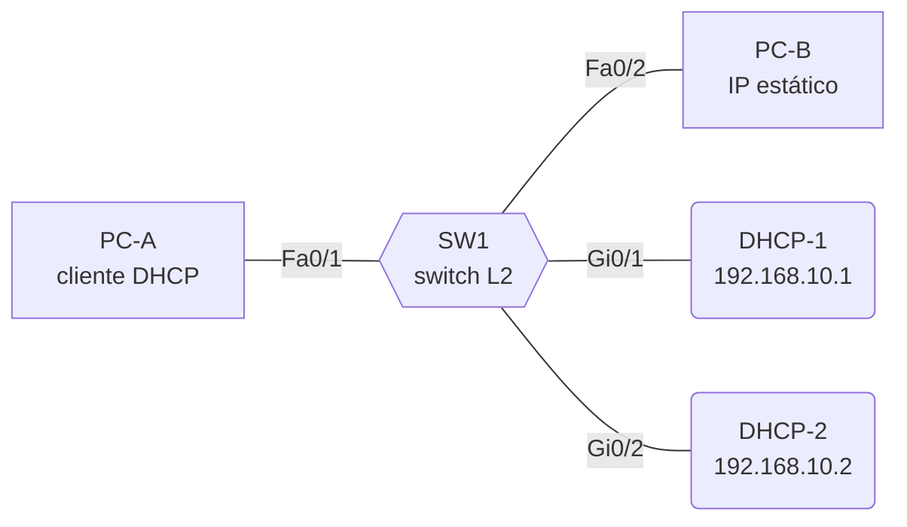
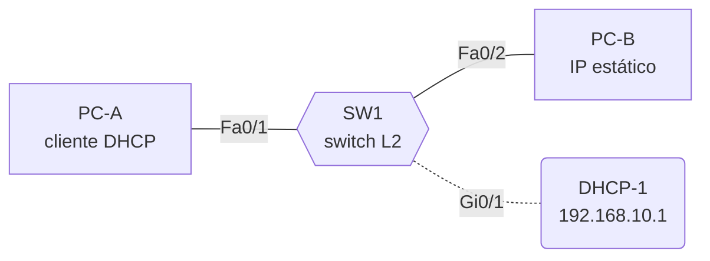
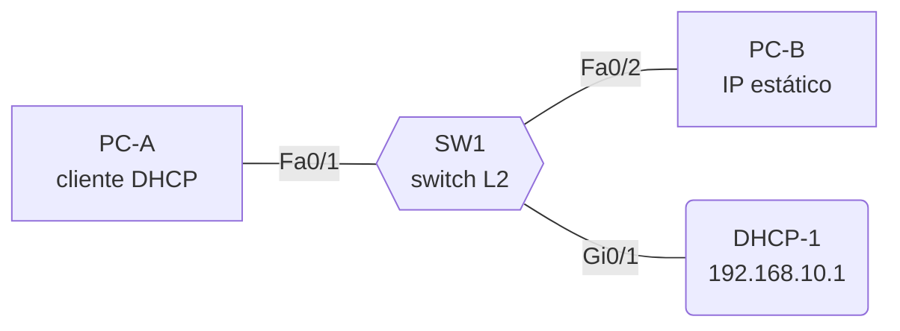
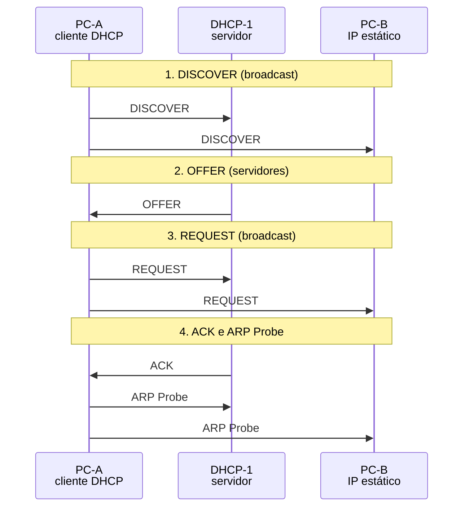
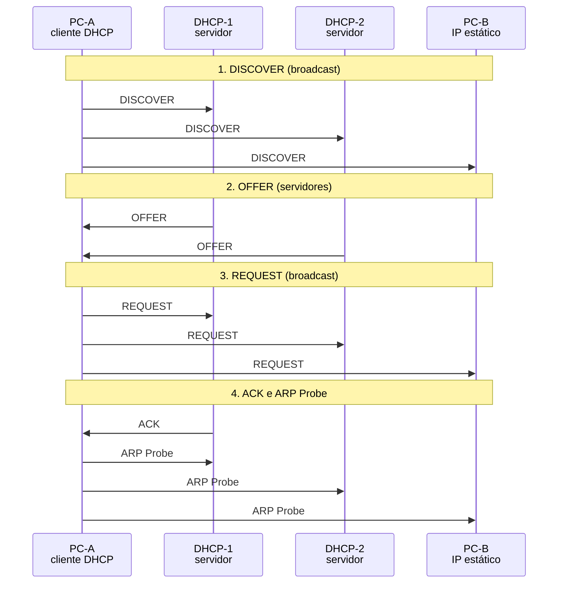
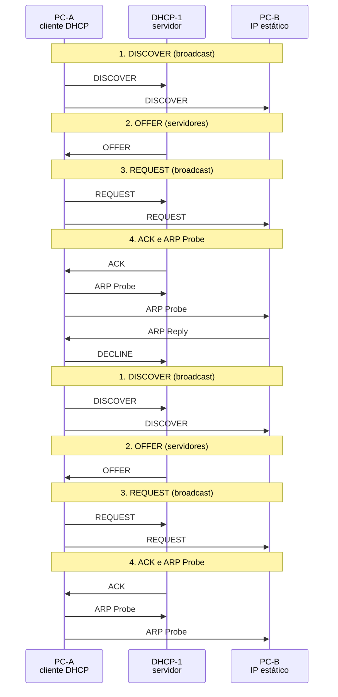
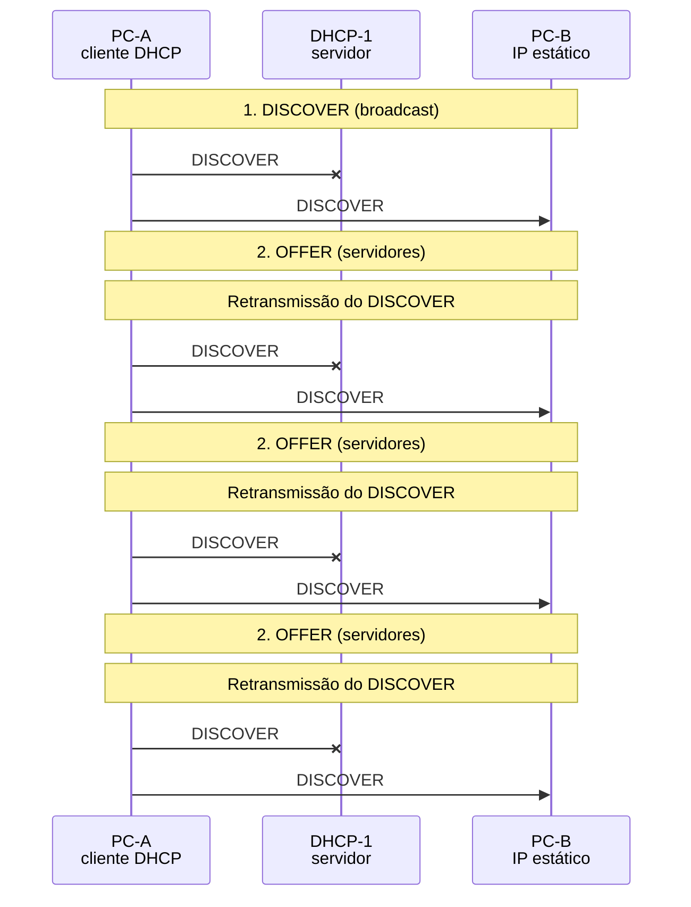
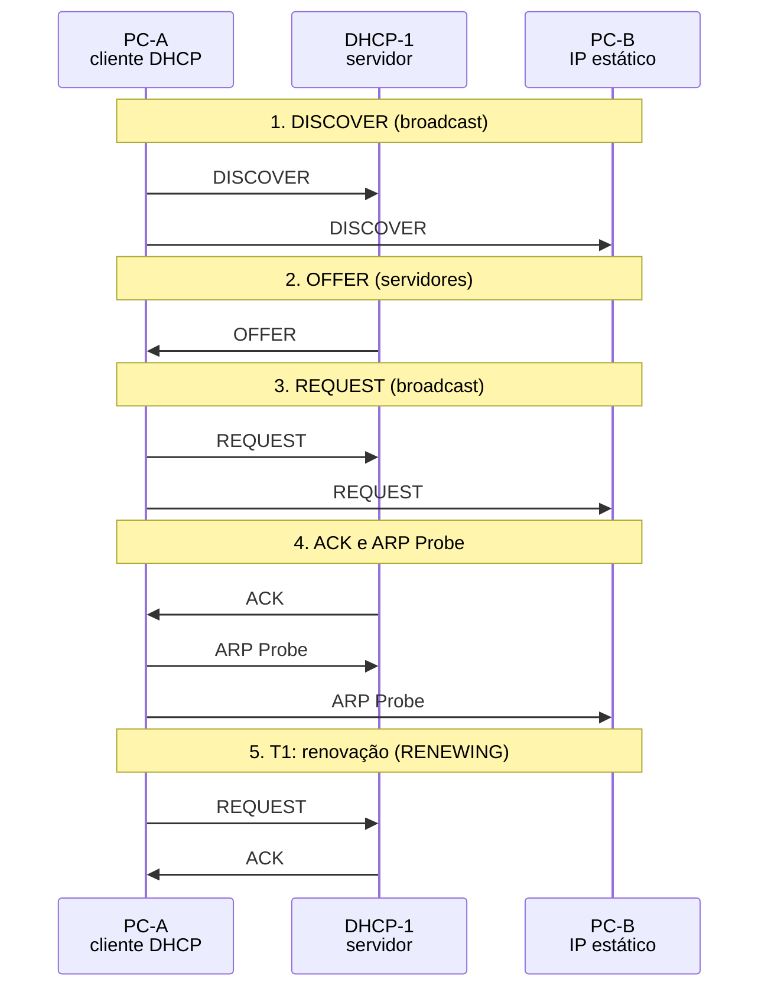
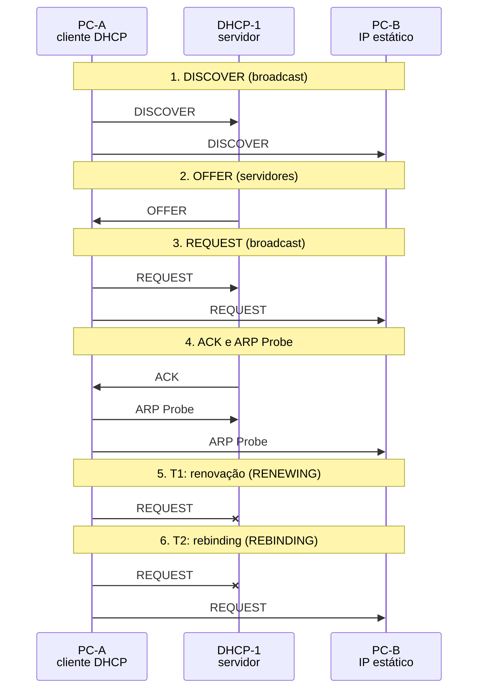
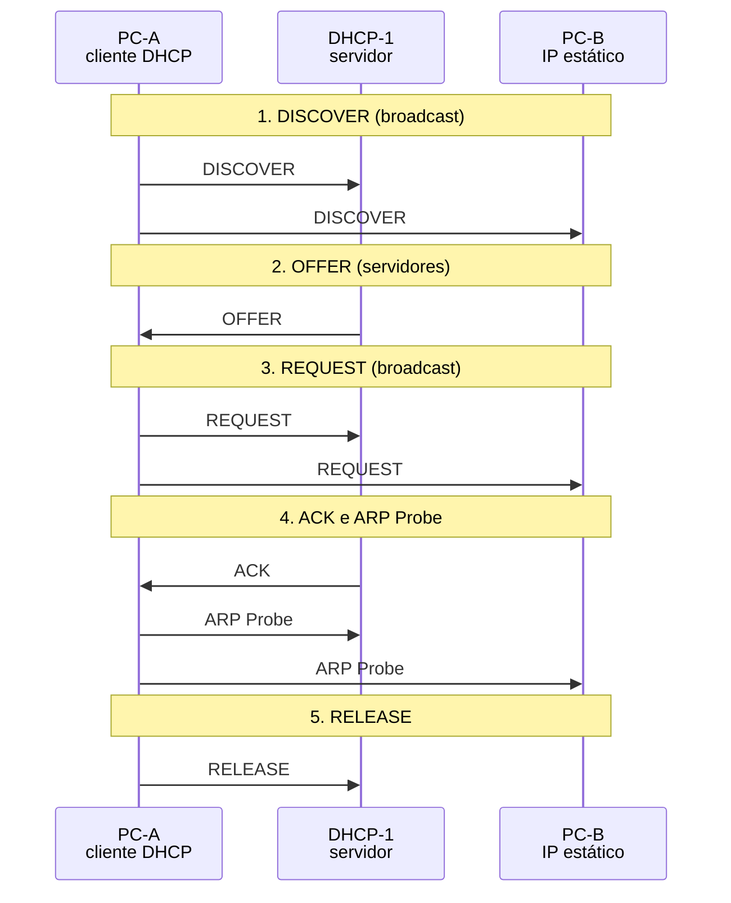

# DHCP (DORA)

Simulação interativa do DHCP: Discover, Offer, Request e Acknowledge, com gestão de leases e prevenção de conflitos por ARP.

- **Categoria:** Roteamento e serviços de rede
- **Motor:** nativo (TypeScript puro, apresentado pela bancada genérica)
- **Código-fonte:** `src/sims/dhcp/`
- **RFCs e padrões:** [RFC 2131](https://www.rfc-editor.org/rfc/rfc2131) (DHCP), [RFC 2132](https://www.rfc-editor.org/rfc/rfc2132) (Opções DHCP), [RFC 5227](https://www.rfc-editor.org/rfc/rfc5227) (ARP Probe)
- **Tópicos:** DORA; Leases e renovação; Conflitos de endereço (ARP)

## 1. Modos

| Modo | Cenário inicial | Cenários |
| --- | --- | --- |
| Concessão (DORA) | DORA básico | 6.1.1 a 6.1.5 |
| Ciclo do lease | Renovação (T1) | 6.2.1 a 6.2.3 |

## 2. Como ler os diagramas

Este documento usa até dois tipos de diagrama. Cada figura traz uma legenda com o tipo, o que mostra e a que modo ou cenário se refere.

| Tipo | O que é | Vale para | Equivale, no simulador, a |
| --- | --- | --- | --- |
| A, topologia | Os elementos da rede e os enlaces que os ligam. É estático. | Um modo inteiro | A visão "Topologia" do quadro principal |
| B, sequência | As mensagens na ordem do tempo, entre os participantes. É dinâmico. | Um único cenário, com a configuração indicada | Ao diagrama de sequência e à aba Captura |

### 2.1 Legenda dos diagramas

**Tipo A (topologia)**

- Retângulo: host (computador ou servidor final).
- Hexágono: switch.
- Retângulo arredondado: roteador, ou dispositivo que encaminha ou traduz.
- Estádio (cantos bem arredondados): servidor ou rede externa.
- Retângulo vermelho: atacante (quando existe no modo).
- Linha contínua: enlace. Linha tracejada: enlace alternativo, forjado ou caído, ou ainda relação de peering (no BGP), conforme o rótulo e o cenário.
- O Mermaid posiciona os elementos automaticamente: o layout difere do simulador, as ligações não.

**Tipo B (sequência)**

- Cada coluna é um participante (cliente, servidor, roteador ou outro). O tempo corre de cima para baixo.
- Seta cheia: mensagem enviada. Seta com X: mensagem perdida.
- `[cifrado]` no início do rótulo: a mensagem viaja cifrada.
- Faixa horizontal com texto: início de uma fase do cenário.
- A ordem é a da aba Captura; os intervalos de tempo não são desenhados em escala.

### 2.2 Lista de figuras

**Tipo A (topologia)**

- [Figura 3.1a](#31-concessão-dora): topologia do modo "Concessão (DORA)", variante a
- [Figura 3.1b](#31-concessão-dora): topologia do modo "Concessão (DORA)", variante b
- [Figura 3.2](#32-ciclo-do-lease): topologia do modo "Ciclo do lease"

**Tipo B (sequência)**

- [Figura 6.1.1](#611-dora-básico): sequência de "DORA básico"
- [Figura 6.1.2](#612-dois-servidores): sequência de "Dois servidores"
- [Figura 6.1.3](#613-lease-curto): sequência de "Lease curto"
- [Figura 6.1.4](#614-conflito-de-ip): sequência de "Conflito de IP"
- [Figura 6.1.5](#615-servidor-indisponível): sequência de "Servidor indisponível"
- [Figura 6.2.1](#621-renovação-t1): sequência de "Renovação (T1)"
- [Figura 6.2.2](#622-falha-na-renovação): sequência de "Falha na renovação"
- [Figura 6.2.3](#623-release): sequência de "RELEASE"

## 3. Topologia

Figuras do Tipo A, uma por modo (e uma por variante do desenho, quando a rede muda entre cenários). Foram geradas a partir da mesma definição de topologia que a bancada usa.

### 3.1 Concessão (DORA)

*Figura 3.1a (Tipo A, topologia).* Elementos do modo "Concessão (DORA)": PC-A (cliente DHCP); SW1 (switch L2); PC-B (IP estático); DHCP-1 (192.168.10.1); DHCP-2 (192.168.10.2). Vale para os cenários (6.1.1 a 6.1.4).

*Figura 3.1b (Tipo A, topologia).* Elementos do modo "Concessão (DORA)": PC-A (cliente DHCP); SW1 (switch L2); PC-B (IP estático); DHCP-1 (192.168.10.1). Linhas tracejadas: enlaces alternativos, forjados ou caídos. Vale para os cenários (6.1.5).

### 3.2 Ciclo do lease

*Figura 3.2 (Tipo A, topologia).* Elementos do modo "Ciclo do lease": PC-A (cliente DHCP); SW1 (switch L2); PC-B (IP estático); DHCP-1 (192.168.10.1). Vale para todos os cenários do modo (6.2.1 a 6.2.3).

## 4. Abas da bancada

Cenário, Captura, Mensagem, Leases, Experimento, Referência e Log.

## 5. Configurações (campos do painel)

### 5.1 Servidores

- **Servidores DHCP**. Valores: 1 servidor; 2 servidores. Padrão: 1 servidor. Modos: todos.
  - Quantos servidores respondem na rede.
  - **1 servidor:** só o DHCP-1 (192.168.10.1), com o pool 192.168.10.100 a .150.
  - **2 servidores:** o DHCP-2 (192.168.10.2, pool .200 a .250) também responde ao DISCOVER, e o cliente escolhe uma das ofertas.
  - Mudar este valor reinicia a simulação.
- **Tempo de lease**. Valores: 1 hora; 8 horas; 24 horas. Padrão: 8 horas. Modos: todos.
  - Duração do empréstimo do endereço (opção 51).
  - O servidor empresta o endereço por este prazo. Na metade (**T1**, opção 58), o cliente tenta renovar com o mesmo servidor; a 87,5% (**T2**, opção 59), com qualquer servidor.
  - Vale para as próximas concessões.
  - Leases curtos devolvem endereços ao pool mais rápido, ao custo de mais renovações.

### 5.2 Falhas

- **Simular conflito de IP**. Valores: caixa de seleção. Padrão: não. Modos: Concessão (DORA).
  - O PC-B passa a usar o primeiro endereço concedido.
  - O PC-B, com IP estático, responde ao ARP Probe do cliente como se já usasse o endereço recebido.
  - O cliente detecta o conflito, envia DHCPDECLINE ao servidor e recomeça a negociação.
  - Vale para a próxima concessão.
- **DHCP-1 ativo**. Valores: caixa de seleção. Padrão: sim. Modos: todos.
  - Se o servidor responde.
  - Desmarcado, o DHCP-1 não responde a nenhuma mensagem. Com um só servidor, o cliente fica sem OFFER e retransmite o DISCOVER com espera crescente (4, 8, 16 s).
- **DHCP-2 ativo (com 2 servidores)** (ajuste avançado). Valores: caixa de seleção. Padrão: sim. Modos: todos.
  - Se o segundo servidor responde.
  - Só vale com 2 servidores. Desmarcado, apenas o DHCP-1 oferece endereço.
- **Enlace PC-A / SW1 ativo** (ajuste avançado). Valores: caixa de seleção. Padrão: sim. Modos: todos.
  - A porta Fa0/1 do switch.
  - Derrubado, o cliente não consegue transmitir nada e o DISCOVER nem sai da placa de rede.
- **Enlace SW1 / DHCP-1 ativo** (ajuste avançado). Valores: caixa de seleção. Padrão: sim. Modos: todos.
  - A porta Gi0/1 do switch.
  - Derrubado, o DHCP-1 não recebe o DISCOVER nem responde, mesmo estando ligado.
- **Enlace SW1 / DHCP-2 ativo** (ajuste avançado). Valores: caixa de seleção. Padrão: sim. Modos: todos.
  - A porta Gi0/2 do switch.
  - Só vale com 2 servidores.

### 5.3 Ciclo do lease

- **O que o cliente faz depois do BOUND**. Valores: Renovar o lease (T1); Liberar o endereço (RELEASE). Padrão: Renovar o lease (T1). Modos: Ciclo do lease.
  - Como o ciclo do lease continua.
  - **Renovar:** na metade do lease (T1), o cliente pede a renovação em unicast ao servidor que concedeu o endereço.
  - **Liberar:** o cliente devolve o endereço com DHCPRELEASE, por exemplo ao desligar. O servidor não responde.
- **O servidor cai depois da concessão**. Valores: caixa de seleção. Padrão: não. Modos: Ciclo do lease.
  - Falha do servidor que concedeu o lease, antes do T1.
  - Na renovação: sem resposta no T1, o cliente segue usando o endereço, tenta qualquer servidor no T2 (REBINDING) e, ao fim do lease, perde o endereço.
  - Na liberação: o RELEASE se perde e o lease continua registrado no servidor até expirar.

## 6. Cenários

### 6.1 Modo: Concessão (DORA)

> **Grupo:** Concessão

Como um cliente sem endereço obtém a configuração IP: a troca DORA (Discover, Offer, Request, Ack), com um ou mais servidores.

#### 6.1.1 DORA básico

*A troca completa de quatro mensagens que configura o cliente.*

Um servidor, lease de 8 horas e nenhuma falha: DISCOVER, OFFER, REQUEST e ACK, seguidos do ARP Probe.

Acompanhe o estado do cliente (INIT, SELECTING, REQUESTING, BOUND) no quadro de estados.

**Conceito.** O **DHCP** ([RFC 2131](https://www.rfc-editor.org/rfc/rfc2131)) entrega a um host o endereço IP, a máscara, o gateway e o DNS. Como o cliente ainda não tem endereço, a negociação começa em **broadcast**: **Discover** (procura servidores), **Offer** (o servidor reserva e oferece um endereço), **Request** (o cliente pede formalmente) e **Ack** (o servidor confirma e o empréstimo começa).

**O que observar**

- Na Captura: o DISCOVER sai de 0.0.0.0:68 para 255.255.255.255:67.
- Na aba Mensagem: o xid igual em todas as mensagens e as opções do ACK (máscara, gateway, DNS, lease, T1 e T2).
- Depois do ACK, o ARP Probe: o cliente confere se o endereço está livre antes de usá-lo.

*Figura 6.1.1 (Tipo B, sequência).* Mensagens do cenário "DORA básico", na ordem do tempo, entre PC-A, DHCP-1, PC-B: 8 mensagens (em 4 fases). Corresponde ao diagrama de sequência e à aba Captura, no modo "Concessão (DORA)", com a configuração padrão.

**Mensagens**

| Mensagem | Significado | Origem |
| --- | --- | --- |
| DHCPDISCOVER | procura servidores (broadcast) | cliente |
| DHCPOFFER | reserva e oferece um endereço | servidor |
| DHCPREQUEST | pede o endereço oferecido (broadcast) | cliente |
| DHCPACK | confirma o empréstimo | servidor |

**Por que importa.** Sem o DHCP, cada host precisaria de configuração manual. A contrapartida é que o protocolo não autentica ninguém: qualquer host pode se passar por servidor (rogue DHCP).

#### 6.1.2 Dois servidores

*Duas ofertas: o cliente escolhe uma e o outro servidor desiste.*

**Configuração aplicada:** Servidores DHCP = 2

DHCP-1 e DHCP-2 respondem ao mesmo DISCOVER. O cliente escolhe a primeira oferta e anuncia a escolha no REQUEST em broadcast.

Repare que o servidor não escolhido devolve o endereço ao pool.

**Conceito.** Com dois servidores, os dois respondem ao DISCOVER e reservam um endereço cada. O cliente aceita uma oferta e envia o REQUEST em **broadcast** com a opção 54 (**Server Identifier**): assim o escolhido confirma e o outro sabe que deve devolver a reserva ao pool.

**O que observar**

- Na Captura: dois DHCPOFFER, um de cada servidor, com endereços de pools diferentes.
- Na aba Mensagem do REQUEST: a opção 54 com o IP do servidor escolhido.
- Na aba Leases: a oferta do servidor não escolhido some do pool.

*Figura 6.1.2 (Tipo B, sequência).* Mensagens do cenário "Dois servidores", na ordem do tempo, entre PC-A, DHCP-1, DHCP-2, PC-B: 12 mensagens (em 4 fases). Corresponde ao diagrama de sequência e à aba Captura, no modo "Concessão (DORA)", com a configuração aplicada acima.

**Mensagens**

| Mensagem | Significado | Origem |
| --- | --- | --- |
| DHCPOFFER | um de cada servidor | DHCP-1 e DHCP-2 |
| DHCPREQUEST | opção 54 indica o escolhido | cliente |
| DHCPACK | só o escolhido confirma | servidor escolhido |

**Por que importa.** Redes reais usam dois servidores para disponibilidade. Os pools precisam ser separados (ou sincronizados por failover), senão dois clientes podem receber o mesmo endereço.

#### 6.1.3 Lease curto

*Lease de 1 hora: T1 e T2 chegam bem antes.*

**Configuração aplicada:** Tempo de lease = 1

Lease de 1 hora: T1 em 1800 s (50%) e T2 em 3150 s (87,5%). Compare as opções 51, 58 e 59 na aba Mensagem do ACK.

Leases curtos devolvem endereços ao pool mais rápido, ao custo de mais renovações.

**Conceito.** O endereço é um **empréstimo** com prazo (opção 51). Na metade do prazo (**T1**, opção 58) o cliente tenta renovar com o servidor que concedeu; a 87,5% (**T2**, opção 59) tenta qualquer servidor. Se ninguém confirmar até o fim, o cliente perde o endereço.

**O que observar**

- Na aba Mensagem do ACK: opção 51 com 3600 s, opção 58 com 1800 s e opção 59 com 3150 s.
- Compare com o cenário DORA básico (8 horas).
- No modo Ciclo do lease, o tempo simulado avança até o T1, aos 30 minutos.

*Figura 6.1.3 (Tipo B, sequência).* Mensagens do cenário "Lease curto", na ordem do tempo, entre PC-A, DHCP-1, PC-B: 8 mensagens (em 4 fases). Corresponde ao diagrama de sequência e à aba Captura, no modo "Concessão (DORA)", com a configuração aplicada acima.

**Mensagens**

| Mensagem | Significado | Origem |
| --- | --- | --- |
| 51 | duração do lease | 3600 s (1 h) |
| 58 | T1, início da renovação | 1800 s (50%) |
| 59 | T2, início do rebinding | 3150 s (87,5%) |

**Por que importa.** Leases curtos convêm a redes com muita rotatividade (Wi-Fi de visitantes); leases longos reduzem o tráfego de renovação em redes estáveis.

> **Grupo:** Falhas

O que acontece quando algo dá errado: endereço já em uso na rede ou servidor que não responde.

#### 6.1.4 Conflito de IP

*O ARP Probe descobre que o endereço já está em uso.*

**Configuração aplicada:** Simular conflito de IP = sim

O PC-B, com IP estático, já usa o primeiro endereço do pool. O ARP Probe recebe resposta, o cliente envia DHCPDECLINE e recomeça.

Na segunda negociação, o servidor oferece o endereço seguinte.

**Conceito.** Antes de usar o endereço recebido, o cliente faz um **ARP Probe** ([RFC 2131](https://www.rfc-editor.org/rfc/rfc2131), seção 3.1, e [RFC 5227](https://www.rfc-editor.org/rfc/rfc5227)): pergunta quem tem aquele IP, usando 0.0.0.0 como origem. Se alguém responder, há **conflito**: o cliente envia **DHCPDECLINE**, o servidor marca o endereço como indisponível e o cliente recomeça do zero.

**O que observar**

- Na Captura: o ARP Probe e a resposta do PC-B.
- A mensagem DHCPDECLINE enviada ao servidor.
- Na aba Leases: o endereço marcado como indisponível; na segunda tentativa, o servidor oferece o seguinte.

*Figura 6.1.4 (Tipo B, sequência).* Mensagens do cenário "Conflito de IP", na ordem do tempo, entre PC-A, DHCP-1, PC-B: 18 mensagens (em 8 fases). Corresponde ao diagrama de sequência e à aba Captura, no modo "Concessão (DORA)", com a configuração aplicada acima.

**Mensagens**

| Mensagem | Significado | Origem |
| --- | --- | --- |
| ARP Probe | "quem tem este IP?" | cliente |
| ARP Reply | "eu tenho" | PC-B |
| DHCPDECLINE | recusa o endereço em conflito | cliente |

**Por que importa.** Conflitos surgem quando alguém configura um IP estático dentro do pool. Sem o ARP Probe, dois hosts usariam o mesmo endereço e as conexões dos dois falhariam de forma intermitente.

#### 6.1.5 Servidor indisponível

*Sem resposta, o cliente retransmite com espera crescente.*

**Configuração aplicada:** DHCP-1 ativo = não

DHCP-1 está fora do ar. O DISCOVER fica sem resposta e o cliente espera 4 s, 8 s, 16 s... antes de cada nova tentativa.

Marque **DHCP-1 ativo** e execute de novo para ver a negociação funcionar.

**Conceito.** Se nenhum OFFER chega, o cliente retransmite o DISCOVER com **backoff exponencial** (4 s, 8 s, 16 s... até 64 s, [RFC 2131](https://www.rfc-editor.org/rfc/rfc2131) seção 4.1). Espaçar as tentativas evita que muitos clientes juntos inundem a rede quando o servidor volta.

**O que observar**

- No log: as tentativas sem resposta e o tempo de espera de cada uma.
- Na Captura: vários DISCOVER com o campo secs aumentando.
- Marque DHCP-1 ativo e execute de novo: a negociação segue normalmente.

*Figura 6.1.5 (Tipo B, sequência).* Mensagens do cenário "Servidor indisponível", na ordem do tempo, entre PC-A, DHCP-1, PC-B: 8 mensagens (em 8 fases; 4 perdidas). Corresponde ao diagrama de sequência e à aba Captura, no modo "Concessão (DORA)", com a configuração aplicada acima.

**Mensagens**

| Mensagem | Significado | Origem |
| --- | --- | --- |
| DHCPDISCOVER | repetido, sem resposta | cliente |
| DHCPOFFER | só depois de restaurar o servidor | DHCP-1 |

**Por que importa.** Sem servidor, o host fica sem endereço (ou cai num endereço automático 169.254.x.x, APIPA, no Windows). Por isso o DHCP é um serviço crítico que merece redundância.

### 6.2 Modo: Ciclo do lease

> **Grupo:** Ciclo do lease

O endereço é emprestado por tempo limitado: renovação no T1, rebinding no T2, expiração e devolução voluntária.

#### 6.2.1 Renovação (T1)

*No T1, renovação em unicast, sem perder o endereço.*

**Configuração aplicada:** O que o cliente faz depois do BOUND = renew

Depois do BOUND, na metade do lease, o cliente pede a renovação em unicast, direto ao servidor que concedeu o endereço.

O endereço continua o mesmo durante todo o processo.

**Conceito.** Ao atingir o **T1** (metade do lease), o cliente entra em **RENEWING** e envia um DHCPREQUEST em **unicast**, direto ao servidor que concedeu o endereço, já usando o próprio IP (campo ciaddr). Se o servidor responder com ACK, o prazo recomeça.

**O que observar**

- No estado do protocolo: o estado BOUND, depois RENEWING e de volta a BOUND.
- Na Captura: o REQUEST da renovação vai em unicast, com origem no próprio IP do cliente.
- O endereço não muda e o cliente nunca fica sem rede.

*Figura 6.2.1 (Tipo B, sequência).* Mensagens do cenário "Renovação (T1)", na ordem do tempo, entre PC-A, DHCP-1, PC-B: 10 mensagens (em 5 fases). Corresponde ao diagrama de sequência e à aba Captura, no modo "Ciclo do lease", com a configuração aplicada acima.

**Mensagens**

| Mensagem | Significado | Origem |
| --- | --- | --- |
| DHCPREQUEST | renovação em unicast (ciaddr preenchido) | cliente |
| DHCPACK | estende o lease | servidor |

**Por que importa.** É o caso normal do dia a dia: hosts ligados por muito tempo renovam o endereço de forma transparente.

#### 6.2.2 Falha na renovação

*Servidor fora: RENEWING, REBINDING e perda do endereço.*

**Configuração aplicada:** O que o cliente faz depois do BOUND = renew; O servidor cai depois da concessão = sim

O servidor cai depois da concessão. Sem resposta no T1, o cliente tenta qualquer servidor em broadcast no T2 (REBINDING) e, ao fim do lease, perde o endereço.

**Conceito.** Se o servidor não responde no T1, o cliente continua usando o endereço e tenta de novo. No **T2** (87,5%), entra em **REBINDING** e envia o REQUEST em broadcast, para qualquer servidor. Se ninguém confirmar até o fim do lease, o cliente **perde o endereço** e volta a INIT.

**O que observar**

- No estado do protocolo: BOUND, RENEWING, REBINDING e INIT.
- Na Captura: o REQUEST do T1 em unicast e o do T2 em broadcast.
- Na aba Experimento: a linha do tempo com o tempo simulado de cada etapa.

*Figura 6.2.2 (Tipo B, sequência).* Mensagens do cenário "Falha na renovação", na ordem do tempo, entre PC-A, DHCP-1, PC-B: 11 mensagens (em 7 fases; 2 perdidas). Corresponde ao diagrama de sequência e à aba Captura, no modo "Ciclo do lease", com a configuração aplicada acima.

**Mensagens**

| Mensagem | Significado | Origem |
| --- | --- | --- |
| DHCPREQUEST | T1, unicast ao servidor original | cliente |
| DHCPREQUEST | T2, broadcast para qualquer servidor | cliente |

**Por que importa.** Mostra por que dois servidores precisam conhecer os mesmos leases (failover): no REBINDING, outro servidor só confirma um endereço que ele conhece.

#### 6.2.3 RELEASE

*O cliente devolve o endereço; o servidor não responde.*

**Configuração aplicada:** O que o cliente faz depois do BOUND = release

O cliente devolve o endereço e volta a INIT.

O servidor não responde ao RELEASE; veja na aba Leases o endereço voltar ao pool.

**Conceito.** Com **DHCPRELEASE**, o cliente devolve o endereço antes do fim do lease, por exemplo ao desligar ou trocar de rede. O servidor não responde: apenas libera o endereço no pool.

**O que observar**

- Na Captura: o DHCPRELEASE em unicast e nenhuma resposta.
- Na aba Leases: o endereço volta a ficar livre.
- No estado do protocolo: o cliente volta a INIT, sem endereço.

*Figura 6.2.3 (Tipo B, sequência).* Mensagens do cenário "RELEASE", na ordem do tempo, entre PC-A, DHCP-1, PC-B: 9 mensagens (em 5 fases). Corresponde ao diagrama de sequência e à aba Captura, no modo "Ciclo do lease", com a configuração aplicada acima.

**Mensagens**

| Mensagem | Significado | Origem |
| --- | --- | --- |
| DHCPRELEASE | devolve o endereço (unicast) | cliente |

**Por que importa.** Se o RELEASE se perde, o endereço fica reservado até o lease expirar. Por isso pools pequenos com leases longos podem se esgotar.

## 7. Referência

### 7.1 O que é o DHCP

          

O **Dynamic Host Configuration Protocol** ([RFC 2131](https://www.rfc-editor.org/rfc/rfc2131)) entrega automaticamente a um host o endereço IP, a máscara, o gateway e os servidores DNS. As opções que carregam cada parâmetro estão na [RFC 2132](https://www.rfc-editor.org/rfc/rfc2132). O DHCP usa **UDP**: o servidor escuta na porta **67** e o cliente, na porta **68**. O endereço é **emprestado** por um tempo (lease) e precisa ser renovado.

### 7.2 Troca DORA

          

- **Discover:** o cliente, ainda sem IP, envia em broadcast de 0.0.0.0 para 255.255.255.255 procurando servidores.
- **Offer:** cada servidor que recebeu o pedido reserva um endereço do pool e o oferece no campo yiaddr.
- **Request:** o cliente escolhe uma oferta e a pede em broadcast. A opção 54 (Server Identifier) avisa os servidores não escolhidos para liberarem suas reservas.
- **Acknowledge:** o servidor escolhido confirma e grava o lease. Antes de usar o endereço, o cliente pode testá-lo com um ARP Probe ([RFC 5227](https://www.rfc-editor.org/rfc/rfc5227)).

### 7.3 Ciclo de vida do lease

          

- **T1 (50% do lease):** o cliente entra em RENEWING e pede a renovação em unicast ao servidor original.
- **T2 (87,5%):** sem resposta, o cliente entra em REBINDING e pede a renovação em broadcast a qualquer servidor.
- **Expiração:** sem renovação, o cliente abandona o endereço e volta ao estado INIT.
- **DHCPDECLINE:** enviado quando o ARP Probe revela que o endereço já está em uso. O servidor marca o endereço como indisponível.
- **DHCPRELEASE:** o cliente devolve o endereço antes do fim do lease. O servidor não responde a essa mensagem.

### 7.4 Mensagens DHCP (opção 53)

          

| Valor | Mensagem | Sentido | Função |
| --- | --- | --- | --- |
| 1 | DHCPDISCOVER | Cliente → servidor | Procurar servidores (broadcast) |
| 2 | DHCPOFFER | Servidor → cliente | Oferecer um endereço |
| 3 | DHCPREQUEST | Cliente → servidor | Aceitar uma oferta ou renovar o lease |
| 4 | DHCPDECLINE | Cliente → servidor | Recusar um endereço em conflito |
| 5 | DHCPACK | Servidor → cliente | Confirmar a concessão |
| 6 | DHCPNAK | Servidor → cliente | Negar o pedido (por exemplo, endereço de outra rede) |
| 7 | DHCPRELEASE | Cliente → servidor | Devolver o endereço |
| 8 | DHCPINFORM | Cliente → servidor | Pedir só parâmetros (o IP já foi configurado manualmente) |

### 7.5 Relay agent

          

Broadcast não atravessa roteadores. Quando o servidor fica em outra rede, o roteador atua como **relay agent** (comando **ip helper-address** no Cisco IOS): ele recebe o broadcast, preenche o campo **giaddr** com o IP da interface e repassa o pedido em unicast ao servidor, que usa o giaddr para escolher o pool certo.

### 7.6 DHCP e segurança

          

- **Servidor falso (rogue DHCP):** um atacante responde mais rápido que o servidor legítimo e entrega o próprio IP como gateway ou DNS, o que abre caminho para um man-in-the-middle.
- **Esgotamento (starvation):** o atacante envia Discovers com MACs forjados até esvaziar o pool, negando serviço aos clientes legítimos.
- **DHCP snooping:** o switch só aceita Offer e Ack vindos de portas confiáveis e monta uma tabela de vínculos (MAC, IP e porta). Essa tabela também é a base do Dynamic ARP Inspection e do IP Source Guard.
- **Port security:** limitar o número de MACs por porta reduz o efeito do starvation.

### 7.7 Roteiro de exercícios

          

1. Com **1 servidor** (cenário DORA básico), percorra a troca com o botão Passo e anote origem e destino (IP e MAC) de cada mensagem na aba Captura. Por que o DISCOVER e o REQUEST vão em broadcast?
2. No cenário **Dois servidores**: que opção do REQUEST faz o servidor não escolhido devolver a oferta ao pool?
3. No cenário **Conflito de IP**: descreva o papel do ARP Probe e do DHCPDECLINE. O que aconteceria sem o ARP Probe?
4. No modo **Ciclo do lease**, marque **O servidor cai depois da concessão**. Explique RENEWING, REBINDING e a expiração usando T1 e T2.
5. Desmarque **DHCP-1 ativo** e observe as retransmissões do DISCOVER: como cresce o intervalo entre as retransmissões, e por quê?
6. **Segurança:** um colega liga um roteador doméstico com DHCP ativo na rede do laboratório. O que acontece com os clientes e que configuração no switch evita o problema?

### 7.8 Limitações do simulador

- Na renovação, não há retransmissão em RENEWING e REBINDING (a [RFC 2131](https://www.rfc-editor.org/rfc/rfc2131), seção 4.4.5, manda repetir a cada metade do tempo restante, com mínimo de 60 s).
- DHCPv6 ([RFC 8415](https://www.rfc-editor.org/rfc/rfc8415), substituída pela [RFC 9915](https://www.rfc-editor.org/rfc/rfc9915)) está fora de escopo, assim como o BOOTP puro. O relay do DHCPv4 segue a [RFC 1542](https://www.rfc-editor.org/rfc/rfc1542) e as informações de agente (opção 82) estão na [RFC 3046](https://www.rfc-editor.org/rfc/rfc3046), também não modeladas. Não são simulados o INIT-REBOOT (cliente que reinicia com lease válido), o DHCPNAK, o agente de retransmissão (relay) nem o atraso aleatório de 1 a 10 s antes do primeiro DISCOVER.
- Os tempos de lease são curtos e didáticos; os temporizadores T1 (50%) e T2 (87,5%) seguem os valores padrão da [RFC 2131](https://www.rfc-editor.org/rfc/rfc2131).

---

*Simul-Net é um projeto mantido pelo Prof. Dr. Laerte Peotta de Melo, com apoio de IA generativa no processo de desenvolvimento, com sua estrita supervisão, revisão técnica e responsabilidade. Uso exclusivo para fins de ensino e pesquisa. Universidade de Brasília (UnB) - Departamento de Engenharia Elétrica. Código aberto (licença MIT).*
