# DNS e DNSSEC

Resolução de nomes por dentro: raiz, TLD e autoritativo, cache e TTL, tipos de registro e falhas; DNSSEC com a cadeia de confiança (DS, DNSKEY, RRSIG, NSEC) e a validação; envenenamento de cache, amplificação por resolvedor aberto, DoT e DoH.

- **Categoria:** Protocolos de rede seguros
- **Motor:** nativo (TypeScript puro, apresentado pela bancada genérica)
- **Código-fonte:** `src/sims/dns/`
- **RFCs e padrões:** [RFC 1034](https://www.rfc-editor.org/rfc/rfc1034) (Conceitos), [RFC 1035](https://www.rfc-editor.org/rfc/rfc1035) (Implementação), [RFC 2308](https://www.rfc-editor.org/rfc/rfc2308) (Cache negativo), [RFC 4033](https://www.rfc-editor.org/rfc/rfc4033) (DNSSEC), [RFC 4035](https://www.rfc-editor.org/rfc/rfc4035) (Protocolo DNSSEC), [RFC 5452](https://www.rfc-editor.org/rfc/rfc5452) (Resistência a forja), [RFC 7858](https://www.rfc-editor.org/rfc/rfc7858) (DoT), [RFC 8310](https://www.rfc-editor.org/rfc/rfc8310) (Perfis de uso do DoT), [RFC 8484](https://www.rfc-editor.org/rfc/rfc8484) (DoH)
- **Tópicos:** Resolução recursiva e cache; DNSSEC e cadeia de confiança; Envenenamento e amplificação; DoT e DoH

## 1. Modos

| Modo | Cenário inicial | Cenários |
| --- | --- | --- |
| Resolução | Resolução completa (cache frio) | 6.1.1 a 6.1.12 |
| DNSSEC | Cadeia de confiança válida | 6.2.1 a 6.2.6 |
| Envenenamento de cache | Sem defesa (porta fixa) | 6.3.1 a 6.3.5 |
| Amplificação | Resolvedor aberto (ANY) | 6.4.1 a 6.4.5 |
| DoT e DoH | DNS puro (UDP 53) | 6.5.1 a 6.5.5 |

## 2. Como ler os diagramas

Este documento usa até dois tipos de diagrama. Cada figura traz uma legenda com o tipo, o que mostra e a que modo ou cenário se refere.

| Tipo | O que é | Vale para | Equivale, no simulador, a |
| --- | --- | --- | --- |
| A, topologia | Os elementos da rede e os enlaces que os ligam. É estático. | Um modo inteiro | A visão "Topologia" do quadro principal |
| B, sequência | As mensagens na ordem do tempo, entre os participantes. É dinâmico. | Um único cenário, com a configuração indicada | Ao diagrama de sequência e à aba Captura |

### 2.1 Legenda dos diagramas

**Tipo A (topologia)**

- Retângulo: host (computador ou servidor final).
- Hexágono: switch.
- Retângulo arredondado: roteador, ou dispositivo que encaminha ou traduz.
- Estádio (cantos bem arredondados): servidor ou rede externa.
- Retângulo vermelho: atacante (quando existe no modo).
- Linha contínua: enlace. Linha tracejada: enlace alternativo, forjado ou caído, ou ainda relação de peering (no BGP), conforme o rótulo e o cenário.
- O Mermaid posiciona os elementos automaticamente: o layout difere do simulador, as ligações não.

**Tipo B (sequência)**

- Cada coluna é um participante (cliente, servidor, roteador ou outro). O tempo corre de cima para baixo.
- Seta cheia: mensagem enviada. Seta com X: mensagem perdida.
- `[cifrado]` no início do rótulo: a mensagem viaja cifrada.
- Faixa horizontal com texto: início de uma fase do cenário.
- A ordem é a da aba Captura; os intervalos de tempo não são desenhados em escala.

### 2.2 Lista de figuras

**Tipo A (topologia)**

- [Figura 3.1](#31-resolução): topologia do modo "Resolução"
- [Figura 3.2](#32-dnssec): topologia do modo "DNSSEC"
- [Figura 3.3](#33-envenenamento-de-cache): topologia do modo "Envenenamento de cache"
- [Figura 3.4](#34-amplificação): topologia do modo "Amplificação"
- [Figura 3.5](#35-dot-e-doh): topologia do modo "DoT e DoH"

**Tipo B (sequência)**

- [Figura 6.1.1](#611-resolução-completa-cache-frio): sequência de "Resolução completa (cache frio)"
- [Figura 6.1.2](#612-delegação-do-com-em-cache): sequência de "Delegação do .com em cache"
- [Figura 6.1.3](#613-delegação-do-domínio-em-cache): sequência de "Delegação do domínio em cache"
- [Figura 6.1.4](#614-resposta-em-cache): sequência de "Resposta em cache"
- [Figura 6.1.5](#615-aaaa-ipv6): sequência de "AAAA (IPv6)"
- [Figura 6.1.6](#616-mx-e-mail): sequência de "MX (e-mail)"
- [Figura 6.1.7](#617-txt-spf): sequência de "TXT (SPF)"
- [Figura 6.1.8](#618-cname-apelido): sequência de "CNAME (apelido)"
- [Figura 6.1.9](#619-nome-inexistente-nxdomain): sequência de "Nome inexistente (NXDOMAIN)"
- [Figura 6.1.10](#6110-consulta-perdida): sequência de "Consulta perdida"
- [Figura 6.1.11](#6111-ns1-fora-do-ar-usa-ns2): sequência de "ns1 fora do ar (usa ns2)"
- [Figura 6.1.12](#6112-resposta-truncada-tcp): sequência de "Resposta truncada (TCP)"
- [Figura 6.2.1](#621-cadeia-de-confiança-válida): sequência de "Cadeia de confiança válida"
- [Figura 6.2.2](#622-negação-autenticada-nsec): sequência de "Negação autenticada (NSEC)"
- [Figura 6.2.3](#623-zona-sem-ds-insegura): sequência de "Zona sem DS (insegura)"
- [Figura 6.2.4](#624-assinatura-vencida): sequência de "Assinatura vencida"
- [Figura 6.2.5](#625-ds-que-não-casa-com-a-chave): sequência de "DS que não casa com a chave"
- [Figura 6.2.6](#626-resolvedor-que-não-valida): sequência de "Resolvedor que não valida"
- [Figura 6.3.1](#631-sem-defesa-porta-fixa): sequência de "Sem defesa (porta fixa)"
- [Figura 6.3.2](#632-porta-e-id-aleatórios): sequência de "Porta e ID aleatórios"
- [Figura 6.3.3](#633-aleatórios-mas-o-palpite-acerta): sequência de "Aleatórios, mas o palpite acerta"
- [Figura 6.3.4](#634-0x20--palpite-certo): sequência de "0x20 + palpite certo"
- [Figura 6.3.5](#635-dnssec--palpite-certo): sequência de "DNSSEC + palpite certo"
- [Figura 6.4.1](#641-resolvedor-aberto-any): sequência de "Resolvedor aberto (ANY)"
- [Figura 6.4.2](#642-consulta-a-pouco-ganho): sequência de "Consulta A (pouco ganho)"
- [Figura 6.4.3](#643-provedor-com-bcp-38): sequência de "Provedor com [BCP 38](https://www.rfc-editor.org/info/bcp38)"
- [Figura 6.4.4](#644-resolvedor-fechado-acl): sequência de "Resolvedor fechado (ACL)"
- [Figura 6.4.5](#645-limite-de-taxa-rrl): sequência de "Limite de taxa (RRL)"
- [Figura 6.5.1](#651-dns-puro-udp-53): sequência de "DNS puro (UDP 53)"
- [Figura 6.5.2](#652-dns-sobre-tls-dot): sequência de "DNS sobre TLS (DoT)"
- [Figura 6.5.3](#653-dns-sobre-https-doh): sequência de "DNS sobre HTTPS (DoH)"
- [Figura 6.5.4](#654-dot-bloqueado-política-estrita): sequência de "DoT bloqueado, política estrita"
- [Figura 6.5.5](#655-dot-bloqueado-política-oportunista): sequência de "DoT bloqueado, política oportunista"

## 3. Topologia

Figuras do Tipo A, uma por modo (e uma por variante do desenho, quando a rede muda entre cenários). Foram geradas a partir da mesma definição de topologia que a bancada usa.

### 3.1 Resolução

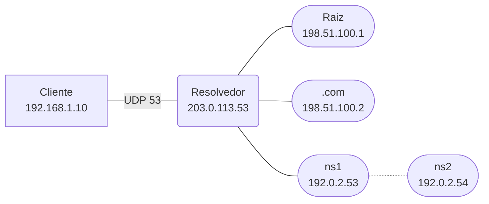

*Figura 3.1 (Tipo A, topologia).* Elementos do modo "Resolução": Cliente (192.168.1.10); Resolvedor (203.0.113.53); Raiz (198.51.100.1); .com (198.51.100.2); ns1 (192.0.2.53); ns2 (192.0.2.54). Linhas tracejadas: enlaces alternativos, forjados ou caídos. Vale para todos os cenários do modo (6.1.1 a 6.1.12).

### 3.2 DNSSEC

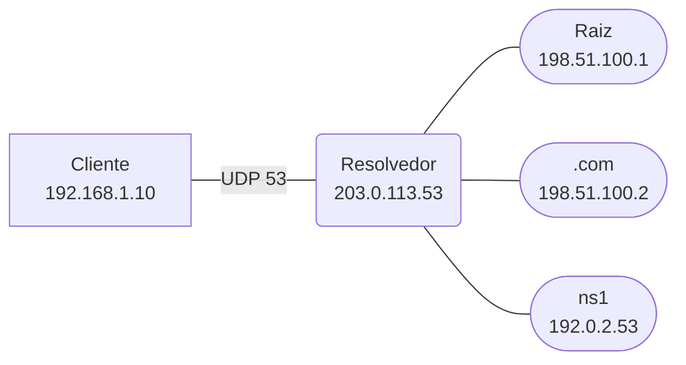

*Figura 3.2 (Tipo A, topologia).* Elementos do modo "DNSSEC": Cliente (192.168.1.10); Resolvedor (203.0.113.53); Raiz (198.51.100.1); .com (198.51.100.2); ns1 (192.0.2.53). Vale para todos os cenários do modo (6.2.1 a 6.2.6).

### 3.3 Envenenamento de cache

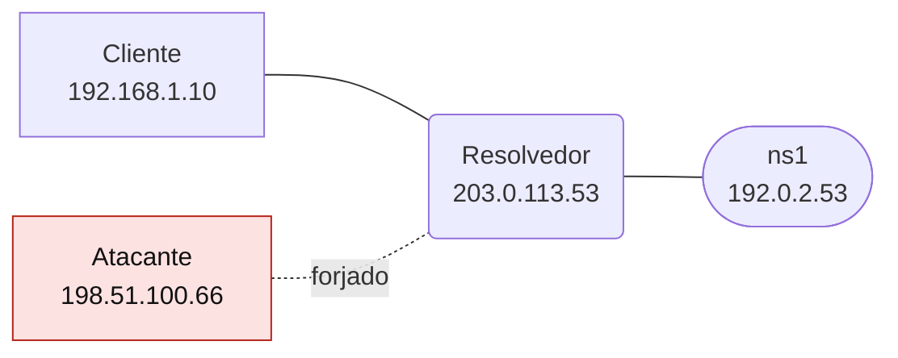

*Figura 3.3 (Tipo A, topologia).* Elementos do modo "Envenenamento de cache": Cliente (192.168.1.10); Resolvedor (203.0.113.53); ns1 (192.0.2.53); Atacante (198.51.100.66). Linhas tracejadas: enlaces alternativos, forjados ou caídos. Vale para todos os cenários do modo (6.3.1 a 6.3.5).

### 3.4 Amplificação

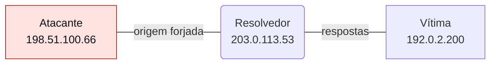

*Figura 3.4 (Tipo A, topologia).* Elementos do modo "Amplificação": Atacante (198.51.100.66); Resolvedor (203.0.113.53); Vítima (192.0.2.200). Vale para todos os cenários do modo (6.4.1 a 6.4.5).

### 3.5 DoT e DoH

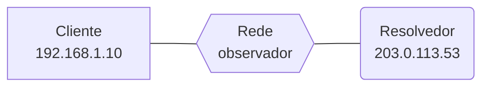

*Figura 3.5 (Tipo A, topologia).* Elementos do modo "DoT e DoH": Cliente (192.168.1.10); Rede (observador); Resolvedor (203.0.113.53). Vale para todos os cenários do modo (6.5.1 a 6.5.5).

## 4. Abas da bancada

Cenário, Captura, Mensagem, Cache (modos: Resolução; DNSSEC; Envenenamento de cache), Zonas (modos: Resolução; DNSSEC), Cadeia (modos: DNSSEC), Experimento, Referência e Log.

## 5. Configurações (campos do painel)

### 5.1 Consulta

- **O que o cliente pergunta**. Valores: A: endereço IPv4 de www.example.com; AAAA: endereço IPv6 de www.example.com; MX: servidor de e-mail de example.com; TXT: texto (SPF) de example.com; CNAME: apelido blog.example.com; Nome que não existe (NXDOMAIN). Padrão: A: endereço IPv4 de www.example.com. Modos: Resolução.
  - Qual informação do DNS o cliente quer.
  - **A e AAAA:** endereço IPv4 e IPv6 do nome.
  - **MX:** para onde entregar o e-mail do domínio; a resposta já traz o endereço do servidor na seção Adicional.
  - **TXT:** texto livre, usado por SPF, DKIM e DMARC.
  - **CNAME:** o nome é um apelido de outro; a resposta traz o apelido e o registro final.
  - **NXDOMAIN:** o nome não existe; o resolvedor guarda a negação por um tempo (cache negativo).

### 5.2 Cache do resolvedor

- **O que o resolvedor já sabe**. Valores: Nada (cache frio); Só a delegação do .com; Delegações do .com e do domínio; A própria resposta (ainda dentro do TTL). Padrão: Nada (cache frio). Modos: Resolução.
  - Quanto da hierarquia o resolvedor consegue pular.
  - **Nada:** o resolvedor parte da raiz e desce até o autoritativo.
  - **Delegação do .com:** a raiz é pulada, porque o resolvedor já sabe quem cuida do .com.
  - **Delegações do .com e do domínio:** vai direto ao servidor autoritativo. É o caso mais comum na prática.
  - **A própria resposta:** responde na hora, sem consultar ninguém, enquanto o TTL não acabar.

### 5.3 Falhas

- **A primeira consulta ao autoritativo se perde**. Valores: caixa de seleção. Padrão: não. Modos: Resolução.
  - Simula perda de um datagrama UDP.
  - O UDP não retransmite: o resolvedor espera 800 ms e envia de novo.
  - O DNS continua funcionando, só mais devagar.
- **ns1 está no ar**. Valores: caixa de seleção. Padrão: sim. Modos: Resolução.
  - Primeiro servidor autoritativo do domínio.
  - Desmarcado, ns1 não responde. Após o tempo limite, o resolvedor tenta o segundo servidor da delegação (ns2).
  - Por isso todo domínio deve ter ao menos dois servidores de nomes, em redes diferentes.
- **A resposta não cabe no UDP (truncada)** (ajuste avançado). Valores: caixa de seleção. Padrão: não. Modos: Resolução.
  - O servidor marca TC=1 e o resolvedor usa TCP.
  - Respostas maiores que o limite do datagrama (1232 bytes com EDNS no simulador, valor proposto pelo DNS Flag Day 2020; a [RFC 9715](https://www.rfc-editor.org/rfc/rfc9715) recomenda 1400 como padrão) são truncadas.
  - O resolvedor abre uma conexão TCP na porta 53 e repete a consulta ([RFC 7766](https://www.rfc-editor.org/rfc/rfc7766)).

### 5.4 Zona example.com

- **Situação do DNSSEC**. Valores: Zona assinada e correta; Zona assinada: nome que não existe (NSEC); Sem DS no .com (zona insegura); Assinatura (RRSIG) vencida; DS no .com não casa com a chave. Padrão: Zona assinada e correta. Modos: DNSSEC.
  - Em que estado está o DNSSEC do domínio.
  - **Assinada e correta:** a cadeia de confiança se fecha da raiz até o registro.
  - **Nome que não existe:** a negação vem com NSEC assinado, provando que o nome não existe.
  - **Sem DS:** o domínio não participa do DNSSEC. A resposta é aceita, mas sem autenticação.
  - **RRSIG vencida:** o operador esqueceu de renovar as assinaturas.
  - **DS que não casa:** a chave do domínio mudou e o DS no .com ficou desatualizado.

### 5.5 Resolvedor

- **O resolvedor valida o DNSSEC**. Valores: caixa de seleção. Padrão: sim. Modos: DNSSEC.
  - Se o resolvedor confere as assinaturas.
  - Marcado, o resolvedor segue a cadeia de confiança e só entrega respostas que consegue provar.
  - Desmarcado, ele ignora os registros DNSSEC: o domínio pode estar assinado e, mesmo assim, ninguém checa. O DNSSEC só protege quem valida.
- **Política do resolvedor**. Valores: Aberto: responde a qualquer endereço; Fechado: só atende a rede interna (ACL); Aberto com limite de taxa (RRL). Padrão: Aberto: responde a qualquer endereço. Modos: Amplificação.
  - Quem pode usar o resolvedor.
  - **Aberto:** responde a todos. É o que o atacante procura.
  - **Fechado (ACL):** recusa quem é de fora, com um REFUSED pequeno.
  - **Limite de taxa:** limita respostas idênticas e responde truncado (TC=1), o que não incomoda quem usa o serviço de verdade.

### 5.6 Defesa do resolvedor

- **Como o resolvedor se protege**. Valores: Nenhuma (porta fixa e ID previsível); Porta e ID aleatórios; Porta e ID aleatórios + 0x20; Validação DNSSEC. Padrão: Nenhuma (porta fixa e ID previsível). Modos: Envenenamento de cache.
  - O que o resolvedor exige para aceitar uma resposta.
  - **Nenhuma:** só o ID de 16 bits identifica a resposta, e a porta é conhecida. Pouca entropia.
  - **Porta e ID aleatórios:** o atacante precisa acertar os dois (cerca de 32 bits) ([RFC 5452](https://www.rfc-editor.org/rfc/rfc5452)).
  - **0x20:** o resolvedor mistura maiúsculas e minúsculas no nome; o autoritativo repete a mesma caixa, e o atacante precisa adivinhá-la também.
  - **DNSSEC:** a resposta só vale com assinatura válida; adivinhar porta e ID deixa de bastar.

### 5.7 Atacante

- **O atacante acerta porta e ID do primeiro palpite**. Valores: caixa de seleção. Padrão: não. Modos: Envenenamento de cache.
  - Mostra o que cada defesa faz quando o atacante tem sorte.
  - Com porta e ID aleatórios, acertar é improvável, mas possível. Marque para ver quais defesas ainda seguram.
  - Sem defesa, o palpite não precisa de sorte: o ID é previsível.

### 5.8 Consulta do atacante

- **Tipo de consulta**. Valores: ANY (resposta grande); A (resposta pequena). Padrão: ANY (resposta grande). Modos: Amplificação.
  - Quanto a resposta supera a pergunta.
  - **ANY** pede tudo o que o nome tem e gera respostas grandes, ainda maiores com DNSSEC.
  - **A** gera uma resposta curta: o ganho é pequeno.

### 5.9 Rede do atacante

- **O provedor filtra origem forjada ([BCP 38](https://www.rfc-editor.org/info/bcp38))**. Valores: caixa de seleção. Padrão: não. Modos: Amplificação.
  - Filtro de origem na borda do provedor.
  - Marcado, o provedor do atacante descarta pacotes cujo endereço de origem não pertence à rede de onde saíram.
  - É a defesa que corta o problema na raiz, mas só funciona se todos a adotarem.

### 5.10 Canal

- **Transporte do DNS**. Valores: DNS puro (UDP 53); DNS sobre TLS: DoT (porta 853); DNS sobre HTTPS: DoH (porta 443). Padrão: DNS puro (UDP 53). Modos: DoT e DoH.
  - Como a consulta chega ao resolvedor.
  - **UDP 53:** texto claro, sem proteção.
  - **DoT:** o DNS dentro de TLS numa porta própria ([RFC 7858](https://www.rfc-editor.org/rfc/rfc7858)).
  - **DoH:** o DNS dentro de HTTPS, indistinguível do tráfego web ([RFC 8484](https://www.rfc-editor.org/rfc/rfc8484)).

### 5.11 Rede

- **A rede bloqueia a porta 853**. Valores: caixa de seleção. Padrão: não. Modos: DoT e DoH.
  - Só vale para o DoT.
  - O DoT usa uma porta própria, fácil de bloquear. O que o cliente faz depois depende da política.
- **Política do cliente DoT**. Valores: Estrita: sem TLS, não consulta; Oportunista: volta ao UDP 53. Padrão: Estrita: sem TLS, não consulta. Modos: DoT e DoH.
  - O que fazer se o DoT não estiver disponível.
  - **Estrita:** prefere ficar sem resposta a revelar a consulta.
  - **Oportunista:** usa TLS quando dá e cai para texto claro quando não dá. É conveniente, mas quem bloqueia a porta força o rebaixamento.

## 6. Cenários

### 6.1 Modo: Resolução

> **Grupo:** Percurso da resolução

Como um resolvedor recursivo percorre a hierarquia (raiz, TLD e autoritativo) e como o cache encurta o caminho.

#### 6.1.1 Resolução completa (cache frio)

*Raiz, TLD e autoritativo: o caminho inteiro.*

O resolvedor não sabe nada: pergunta à raiz, ao .com e ao autoritativo de example.com, nessa ordem, e só então responde ao cliente.

Conte as consultas e some os tempos de cada salto.

**Conceito.** Um **resolvedor recursivo** faz o trabalho pelo cliente. Sem nada no cache, ele começa pela **raiz**, que indica o servidor do **.com**; este indica os servidores de **example.com**; só o **autoritativo** conhece a resposta. Cada etapa devolve uma **delegação** (registros NS com o endereço, o glue). O cliente, por sua vez, faz uma pergunta só.

**O que observar**

- Na Captura: as quatro consultas (cliente, raiz, .com, autoritativo) e as respostas, com os tempos de cada salto.
- Na aba Mensagem: o flag RD=1 na consulta do cliente e RD=0 nas do resolvedor; AA=1 só na resposta do autoritativo.
- Na aba Cache: as delegações guardadas com TTL de 2 dias.

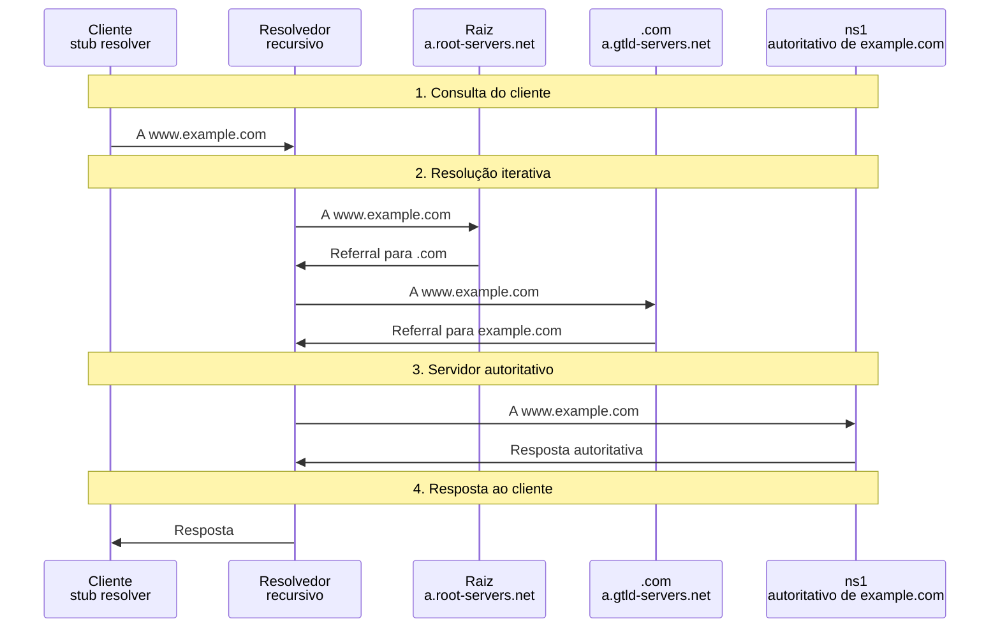

*Figura 6.1.1 (Tipo B, sequência).* Mensagens do cenário "Resolução completa (cache frio)", na ordem do tempo, entre Cliente, Resolvedor, Raiz, .com, ns1: 8 mensagens (em 4 fases). Corresponde ao diagrama de sequência e à aba Captura, no modo "Resolução", com a configuração padrão.

**Mensagens**

| Mensagem | Significado | Origem |
| --- | --- | --- |
| Consulta do cliente | RD=1: resolva por mim | cliente |
| Referral da raiz | NS e glue do .com | raiz |
| Referral do .com | NS e glue de example.com | .com |
| Resposta autoritativa | AA=1, registro final com TTL | ns1 |

**Por que importa.** Entender a hierarquia explica por que o DNS escala e por que cada camada (cache, delegação, redundância) existe. Também mostra onde cada ataque pode agir.

#### 6.1.2 Delegação do .com em cache

*A raiz não é consultada de novo.*

**Configuração aplicada:** O que o resolvedor já sabe = tld

O resolvedor já conhece o servidor do .com e **pula a raiz**.

**Conceito.** As delegações têm **TTL longo** (2 dias). Depois da primeira consulta, o resolvedor lembra quem cuida do .com e **pula a raiz**. Isso é essencial: os servidores raiz receberiam um volume inviável de consultas se cada resolução começasse neles.

**O que observar**

- O diagrama não tem consulta à raiz.
- No log: a nota de que a delegação do .com já estava no cache.

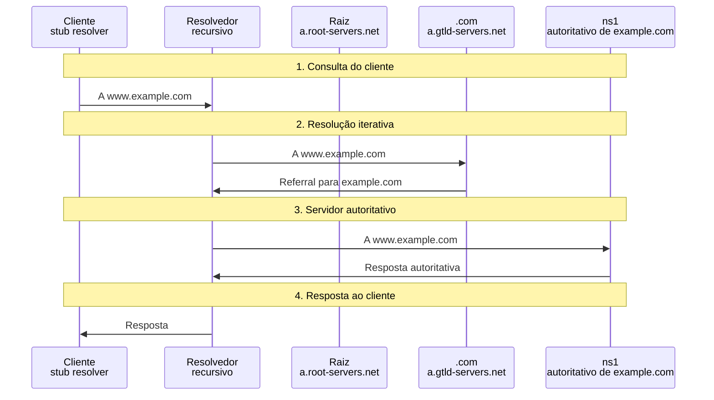

*Figura 6.1.2 (Tipo B, sequência).* Mensagens do cenário "Delegação do .com em cache", na ordem do tempo, entre Cliente, Resolvedor, Raiz, .com, ns1: 6 mensagens (em 4 fases). Corresponde ao diagrama de sequência e à aba Captura, no modo "Resolução", com a configuração aplicada acima.

**Mensagens**

| Mensagem | Significado | Origem |
| --- | --- | --- |
| Consulta ao .com | direto, sem passar pela raiz | resolvedor |
| Referral do .com | NS de example.com | .com |

**Por que importa.** O cache de delegações é o que mantém a raiz leve e a resolução rápida.

#### 6.1.3 Delegação do domínio em cache

*Uma única consulta ao autoritativo.*

**Configuração aplicada:** O que o resolvedor já sabe = ns

As delegações do .com e de example.com estão no cache: uma única consulta, direto ao autoritativo. É o caso mais comum na Internet.

**Conceito.** Com as delegações do .com e do domínio guardadas, o resolvedor vai **direto ao autoritativo**. Na prática, quase toda consulta é assim: a resposta final sai em um salto só.

**O que observar**

- Uma única consulta ao autoritativo.
- Compare o tempo total com a resolução completa.


*Figura 6.1.3 (Tipo B, sequência).* Mensagens do cenário "Delegação do domínio em cache", na ordem do tempo, entre Cliente, Resolvedor, Raiz, .com, ns1: 4 mensagens (em 4 fases). Corresponde ao diagrama de sequência e à aba Captura, no modo "Resolução", com a configuração aplicada acima.

**Mensagens**

| Mensagem | Significado | Origem |
| --- | --- | --- |
| Consulta ao autoritativo | RD=0 | resolvedor |
| Resposta | AA=1 | ns1 |

**Por que importa.** Mostra por que TTLs altos de delegação aceleram a Internet, e por que trocar servidores de nomes leva tempo para propagar.

#### 6.1.4 Resposta em cache

*O resolvedor responde sozinho.*

**Configuração aplicada:** O que o resolvedor já sabe = completo

A resposta ainda está dentro do TTL: o resolvedor responde sozinho, sem consultar nenhum servidor.

**Conceito.** Enquanto o **TTL** não expira, o resolvedor reutiliza a resposta. A resposta sai em milissegundos, sem tráfego para a Internet. O TTL mostrado ao cliente é o **restante**, e AA não vem marcado, porque quem responde não é o dono da zona.

**O que observar**

- Nenhuma consulta é enviada ao lado da Internet.
- O TTL da resposta é menor que o original.

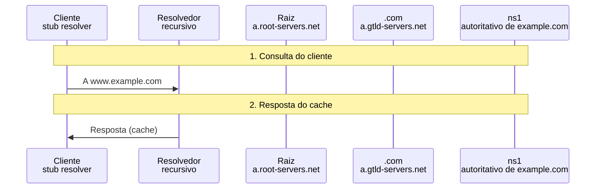

*Figura 6.1.4 (Tipo B, sequência).* Mensagens do cenário "Resposta em cache", na ordem do tempo, entre Cliente, Resolvedor, Raiz, .com, ns1: 2 mensagens (em 2 fases). Corresponde ao diagrama de sequência e à aba Captura, no modo "Resolução", com a configuração aplicada acima.

**Mensagens**

| Mensagem | Significado | Origem |
| --- | --- | --- |
| Consulta do cliente | RD=1 | cliente |
| Resposta do cache | sem AA, TTL restante | resolvedor |

**Por que importa.** O TTL equilibra velocidade e atualização: TTL alto reduz carga, mas atrasa a propagação de mudanças.

> **Grupo:** Tipos de registro

O DNS guarda vários tipos de informação sobre um nome: endereços, e-mail, texto, apelidos e a prova de que um nome não existe.

#### 6.1.5 AAAA (IPv6)

*O tipo da consulta decide o registro.*

**Configuração aplicada:** O que o cliente pergunta = AAAA; O que o resolvedor já sabe = ns

A mesma pergunta, mas o tipo AAAA devolve o endereço IPv6 do nome.

**Conceito.** O DNS é um banco de registros de vários **tipos**. **A** devolve IPv4; **AAAA** devolve IPv6. Um mesmo nome pode ter os dois, e o cliente pergunta pelos dois (e escolhe qual usar).

**O que observar**

- Na aba Mensagem: o tipo AAAA na seção Pergunta e o endereço 2001:db8::80 na Resposta.

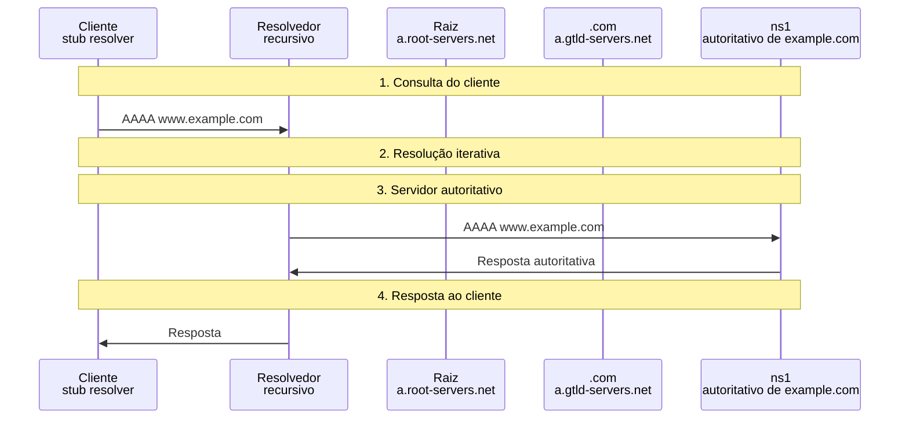

*Figura 6.1.5 (Tipo B, sequência).* Mensagens do cenário "AAAA (IPv6)", na ordem do tempo, entre Cliente, Resolvedor, Raiz, .com, ns1: 4 mensagens (em 4 fases). Corresponde ao diagrama de sequência e à aba Captura, no modo "Resolução", com a configuração aplicada acima.

**Mensagens**

| Mensagem | Significado | Origem |
| --- | --- | --- |
| AAAA | pede o endereço IPv6 | cliente |
| Resposta AAAA | 2001:db8::80 | ns1 |

**Por que importa.** Sem AAAA, hosts só com IPv6 não encontram o servidor. O endereço usa o prefixo de documentação 2001:db8::/32.

#### 6.1.6 MX (e-mail)

*Para onde vai o e-mail do domínio.*

**Configuração aplicada:** O que o cliente pergunta = MX; O que o resolvedor já sabe = ns

Quem entrega o e-mail de example.com? A resposta traz a preferência (10) e o nome do servidor, com o endereço dele na seção Adicional.

**Conceito.** O registro **MX** indica o servidor que recebe o e-mail do domínio, com uma **preferência** (quanto menor, mais preferido). A resposta já traz o endereço do servidor na seção **Adicional**, poupando uma consulta.

**O que observar**

- Seção Resposta: MX 10 mail.example.com.
- Seção Adicional: o A de mail.example.com.


*Figura 6.1.6 (Tipo B, sequência).* Mensagens do cenário "MX (e-mail)", na ordem do tempo, entre Cliente, Resolvedor, Raiz, .com, ns1: 4 mensagens (em 4 fases). Corresponde ao diagrama de sequência e à aba Captura, no modo "Resolução", com a configuração aplicada acima.

**Mensagens**

| Mensagem | Significado | Origem |
| --- | --- | --- |
| MX | quem recebe o e-mail? | cliente |
| Resposta MX | preferência 10 e nome do servidor | ns1 |

**Por que importa.** Falsificar um MX desvia o e-mail do domínio. Daí a importância de DNSSEC e de controles como SPF, DKIM e DMARC.

#### 6.1.7 TXT (SPF)

*Texto livre com função de segurança.*

**Configuração aplicada:** O que o cliente pergunta = TXT; O que o resolvedor já sabe = ns

Registro de texto usado como política SPF: quais endereços podem enviar e-mail em nome do domínio.

**Conceito.** O registro **TXT** guarda texto. O mais conhecido é o **SPF**, que lista os endereços autorizados a enviar e-mail pelo domínio. Também publica DKIM e DMARC.

**O que observar**

- Seção Resposta: o texto entre aspas com a política SPF.

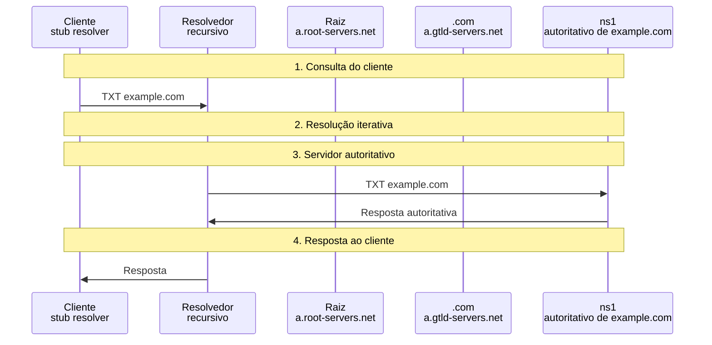

*Figura 6.1.7 (Tipo B, sequência).* Mensagens do cenário "TXT (SPF)", na ordem do tempo, entre Cliente, Resolvedor, Raiz, .com, ns1: 4 mensagens (em 4 fases). Corresponde ao diagrama de sequência e à aba Captura, no modo "Resolução", com a configuração aplicada acima.

**Mensagens**

| Mensagem | Significado | Origem |
| --- | --- | --- |
| TXT | pede o texto do nome | cliente |
| Resposta TXT | v=spf1 ip4:192.0.2.0/24 -all | ns1 |

**Por que importa.** SPF reduz a falsificação de remetente, mas só se o DNS for confiável; o DNSSEC protege essa política.

#### 6.1.8 CNAME (apelido)

*Um nome que aponta para outro.*

**Configuração aplicada:** O que o cliente pergunta = CNAME; O que o resolvedor já sabe = ns

blog.example.com é um apelido de www.example.com. A resposta traz o CNAME e o registro A final.

**Conceito.** Um **CNAME** faz de um nome o apelido de outro. O autoritativo devolve o CNAME **e** o registro final quando ambos estão na mesma zona; se estivessem em outra zona, o resolvedor teria de seguir a cadeia com novas consultas.

**O que observar**

- Seção Resposta com dois registros: o CNAME e o A.
- O cache guarda os dois.

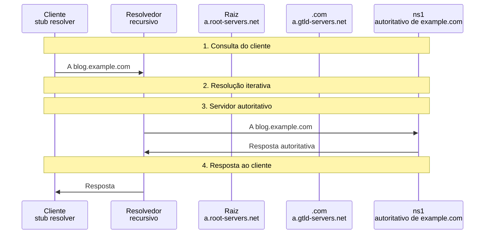

*Figura 6.1.8 (Tipo B, sequência).* Mensagens do cenário "CNAME (apelido)", na ordem do tempo, entre Cliente, Resolvedor, Raiz, .com, ns1: 4 mensagens (em 4 fases). Corresponde ao diagrama de sequência e à aba Captura, no modo "Resolução", com a configuração aplicada acima.

**Mensagens**

| Mensagem | Significado | Origem |
| --- | --- | --- |
| A blog.example.com | pede o endereço do apelido | cliente |
| CNAME + A | alias e endereço final | ns1 |

**Por que importa.** CNAMEs entre domínios (CDN, serviços de terceiros) criam dependências: se o dono do alvo perder o controle, o apelido pode ser sequestrado (subdomain takeover).

#### 6.1.9 Nome inexistente (NXDOMAIN)

*A inexistência também é guardada.*

**Configuração aplicada:** O que o cliente pergunta = NXDOMAIN; O que o resolvedor já sabe = ns

O nome não existe. O autoritativo responde NXDOMAIN com o SOA, e o resolvedor guarda a negação (cache negativo).

**Conceito.** Quando o nome não existe, o autoritativo responde **NXDOMAIN** (RCODE 3) com o **SOA** da zona. O TTL da negação é o menor entre o TTL do SOA e o campo "minimum" dele: é o **cache negativo** ([RFC 2308](https://www.rfc-editor.org/rfc/rfc2308), seção 5).

**O que observar**

- O RCODE 3 (NXDOMAIN) e o SOA na seção Autoridade.
- Na aba Cache: a entrada negativa.

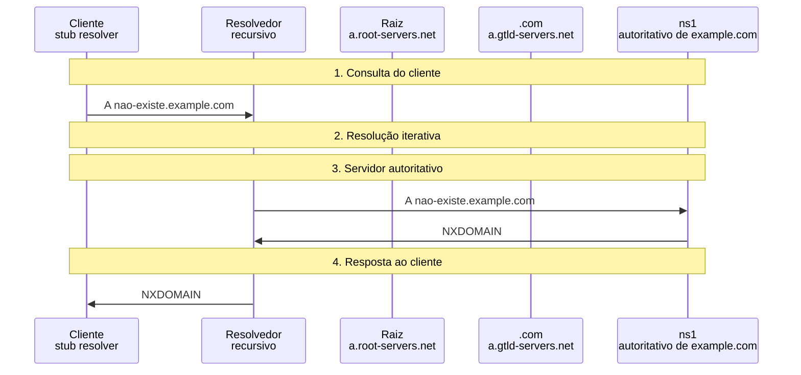

*Figura 6.1.9 (Tipo B, sequência).* Mensagens do cenário "Nome inexistente (NXDOMAIN)", na ordem do tempo, entre Cliente, Resolvedor, Raiz, .com, ns1: 4 mensagens (em 4 fases). Corresponde ao diagrama de sequência e à aba Captura, no modo "Resolução", com a configuração aplicada acima.

**Mensagens**

| Mensagem | Significado | Origem |
| --- | --- | --- |
| A nome inexistente | pergunta por um nome que não existe | cliente |
| NXDOMAIN | RCODE 3 + SOA | ns1 |

**Por que importa.** NXDOMAIN em volume indica erros de digitação, malware com geração de domínios (DGA) e ataques de consulta a nomes aleatórios.

> **Grupo:** Falhas

O que o resolvedor faz quando uma consulta se perde, um servidor cai ou a resposta é grande demais para o UDP.

#### 6.1.10 Consulta perdida

*O UDP não retransmite; o resolvedor sim.*

**Configuração aplicada:** O que o resolvedor já sabe = ns; A primeira consulta ao autoritativo se perde = sim

A primeira consulta ao autoritativo se perde. O resolvedor espera 800 ms e retransmite: o DNS demora mais, mas funciona.

**Conceito.** O DNS usa **UDP**, sem confirmação de entrega. Quem consulta define o **tempo limite** (aqui, 800 ms) e retransmite. A consulta repetida usa o mesmo nome e outro ID.

**O que observar**

- Uma consulta marcada como perdida e a retransmissão 800 ms depois.
- O tempo total subiu em 800 ms.

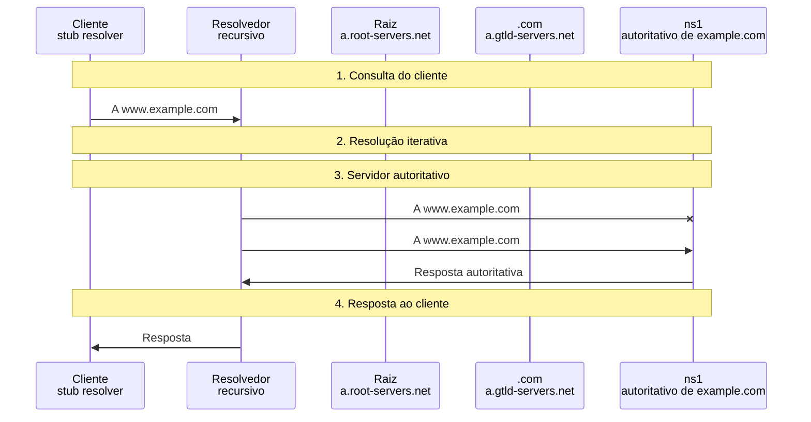

*Figura 6.1.10 (Tipo B, sequência).* Mensagens do cenário "Consulta perdida", na ordem do tempo, entre Cliente, Resolvedor, Raiz, .com, ns1: 5 mensagens (em 4 fases; 1 perdida). Corresponde ao diagrama de sequência e à aba Captura, no modo "Resolução", com a configuração aplicada acima.

**Mensagens**

| Mensagem | Significado | Origem |
| --- | --- | --- |
| Consulta perdida | sem resposta | resolvedor |
| Retransmissão | após o tempo limite | resolvedor |
| Resposta | AA=1 | ns1 |

**Por que importa.** Perda de pacotes aparece para o usuário como "site lento". Distinguir lentidão de DNS de lentidão do site é o primeiro passo do diagnóstico.

#### 6.1.11 ns1 fora do ar (usa ns2)

*Redundância de servidores de nomes.*

**Configuração aplicada:** O que o resolvedor já sabe = ns; ns1 está no ar = não

O primeiro servidor autoritativo não responde. Depois do tempo limite, o resolvedor tenta ns2 e obtém a resposta.

**Conceito.** A delegação lista **mais de um** servidor de nomes. Se ns1 não responde, o resolvedor, após o tempo limite, tenta ns2. O usuário só percebe a demora.

**O que observar**

- A consulta sem resposta a ns1 e a seguinte a ns2.
- O tempo limite de 800 ms antes da troca.

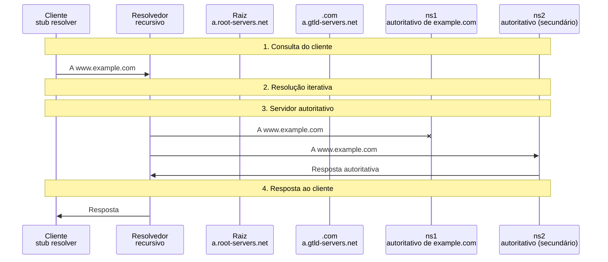

*Figura 6.1.11 (Tipo B, sequência).* Mensagens do cenário "ns1 fora do ar (usa ns2)", na ordem do tempo, entre Cliente, Resolvedor, Raiz, .com, ns1, ns2: 5 mensagens (em 4 fases; 1 perdida). Corresponde ao diagrama de sequência e à aba Captura, no modo "Resolução", com a configuração aplicada acima.

**Mensagens**

| Mensagem | Significado | Origem |
| --- | --- | --- |
| Consulta a ns1 | sem resposta | resolvedor |
| Consulta a ns2 | depois do tempo limite | resolvedor |
| Resposta | AA=1 | ns2 |

**Por que importa.** Servidores de nomes na mesma rede ou no mesmo provedor derrubam o domínio juntos. A boa prática é espalhá-los.

#### 6.1.12 Resposta truncada (TCP)

*TC=1: refaça por TCP.*

**Configuração aplicada:** O que o resolvedor já sabe = ns; A resposta não cabe no UDP (truncada) = sim

A resposta não cabe no UDP: o servidor marca TC=1 e o resolvedor repete a consulta por TCP.

**Conceito.** Datagramas UDP têm limite de tamanho. Se a resposta não cabe, o servidor devolve só o cabeçalho com **TC=1** (truncada), e o resolvedor repete a pergunta por **TCP**, na porta 53 ([RFC 7766](https://www.rfc-editor.org/rfc/rfc7766)). Respostas com DNSSEC são grandes e usam TCP com mais frequência.

**O que observar**

- A resposta com TC=1 e sem registros.
- O handshake TCP (SYN e SYN+ACK) e a consulta repetida.

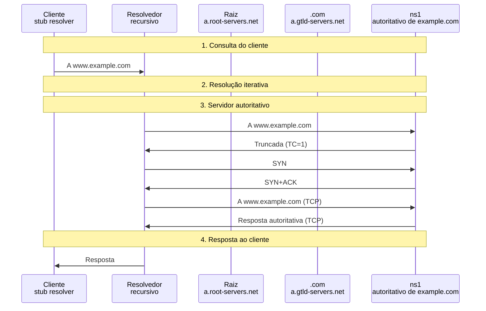

*Figura 6.1.12 (Tipo B, sequência).* Mensagens do cenário "Resposta truncada (TCP)", na ordem do tempo, entre Cliente, Resolvedor, Raiz, .com, ns1: 8 mensagens (em 4 fases). Corresponde ao diagrama de sequência e à aba Captura, no modo "Resolução", com a configuração aplicada acima.

**Mensagens**

| Mensagem | Significado | Origem |
| --- | --- | --- |
| Resposta TC=1 | truncada, sem dados | ns1 |
| SYN / SYN+ACK | abre a conexão TCP | resolvedor |
| Consulta e resposta TCP | sem limite de tamanho | resolvedor e ns1 |

**Por que importa.** Firewalls que bloqueiam o TCP 53 quebram respostas grandes e o DNSSEC. A porta 53 precisa estar liberada em UDP e TCP.

### 6.2 Modo: DNSSEC

> **Grupo:** Validação

O DNSSEC prova que a resposta vem do dono da zona e não foi alterada, por uma cadeia de assinaturas da raiz até o registro.

#### 6.2.1 Cadeia de confiança válida

*A cadeia de confiança da raiz ao registro.*

A zona está assinada e o DS no .com bate com a chave. O resolvedor percorre a cadeia da raiz até o registro e responde com **AD=1**.

**Conceito.** O **DNSSEC** ([RFC 4033](https://www.rfc-editor.org/rfc/rfc4033) a [4035](https://www.rfc-editor.org/rfc/rfc4035)) assina os dados do DNS. Cada zona assina seus registros com a **ZSK** (RRSIG) e publica as chaves (**DNSKEY**); o resumo da **KSK** vai para a zona de cima como **DS**. O resolvedor parte da **âncora de confiança** (a chave da raiz) e vai validando elo por elo: raiz → .com → example.com → registro.

**O que observar**

- As consultas com DO=1 e os registros DS e RRSIG nas referências.
- As consultas de DNSKEY na fase de validação.
- A resposta ao cliente com AD=1.
- A aba Cadeia: cada elo marcado como válido.

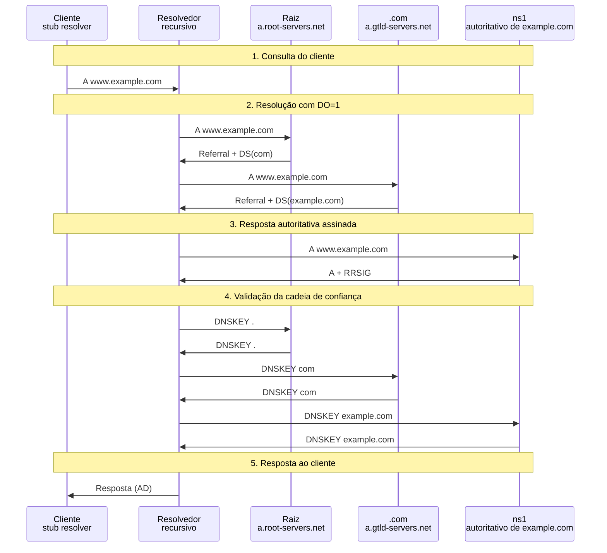

*Figura 6.2.1 (Tipo B, sequência).* Mensagens do cenário "Cadeia de confiança válida", na ordem do tempo, entre Cliente, Resolvedor, Raiz, .com, ns1: 14 mensagens (em 5 fases). Corresponde ao diagrama de sequência e à aba Captura, no modo "DNSSEC", com a configuração padrão.

**Mensagens**

| Mensagem | Significado | Origem |
| --- | --- | --- |
| DS(com) | resumo da chave do .com, assinado pela raiz | raiz |
| DS(example.com) | resumo da chave do domínio, assinado pelo .com | .com |
| A + RRSIG | registro e sua assinatura | ns1 |
| DNSKEY | chaves públicas da zona | cada zona |

**Por que importa.** O DNSSEC garante autenticidade e integridade das respostas, mas não as cifra e não protege o trecho entre o cliente e o resolvedor.

#### 6.2.2 Negação autenticada (NSEC)

*Provar que um nome não existe.*

**Configuração aplicada:** Situação do DNSSEC = nx

O nome não existe, e o NXDOMAIN vem com NSEC assinado: a inexistência é provada, não apenas afirmada.

**Conceito.** Dizer "não existe" também precisa de prova. O registro **NSEC** lista o próximo nome da zona em ordem canônica ([RFC 4034](https://www.rfc-editor.org/rfc/rfc4034), seção 6.1): se o nome consultado cai entre dois nomes consecutivos, ele não existe. Tudo vem assinado. **NSEC3** faz o mesmo sobre nomes com hash, para dificultar listar a zona (zone walking).

**O que observar**

- A seção Autoridade com SOA, NSEC e as assinaturas.
- AD=1 no NXDOMAIN entregue ao cliente.

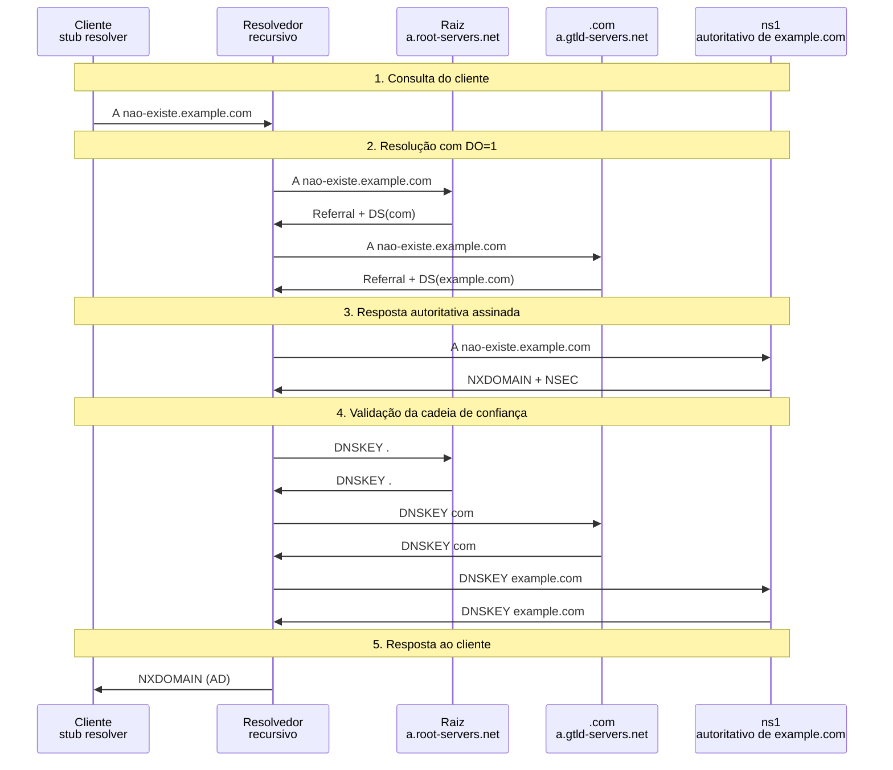

*Figura 6.2.2 (Tipo B, sequência).* Mensagens do cenário "Negação autenticada (NSEC)", na ordem do tempo, entre Cliente, Resolvedor, Raiz, .com, ns1: 14 mensagens (em 5 fases). Corresponde ao diagrama de sequência e à aba Captura, no modo "DNSSEC", com a configuração aplicada acima.

**Mensagens**

| Mensagem | Significado | Origem |
| --- | --- | --- |
| NXDOMAIN | RCODE 3 | ns1 |
| NSEC | mail.example.com → www.example.com | ns1 |
| RRSIG(NSEC) | assina a prova | ns1 |

**Por que importa.** Sem negação autenticada, um atacante poderia fazer um domínio real "desaparecer" forjando NXDOMAIN, sem que o DNSSEC percebesse.

#### 6.2.3 Zona sem DS (insegura)

*Sem DS, a cadeia termina.*

**Configuração aplicada:** Situação do DNSSEC = insegura

O .com não tem DS para example.com. A cadeia termina no .com e a resposta é aceita **sem AD**: funciona, mas sem proteção.

**Conceito.** Se o .com não publica o **DS** de example.com, a zona é **insegura** (insecure): o resolvedor prova a ausência do DS com NSEC3 e aceita a resposta **sem AD**. É o caso da maioria dos domínios.

**O que observar**

- A referência do .com sem DS, mas com NSEC3.
- A aba Cadeia: a cadeia termina no .com.
- A resposta sem AD.

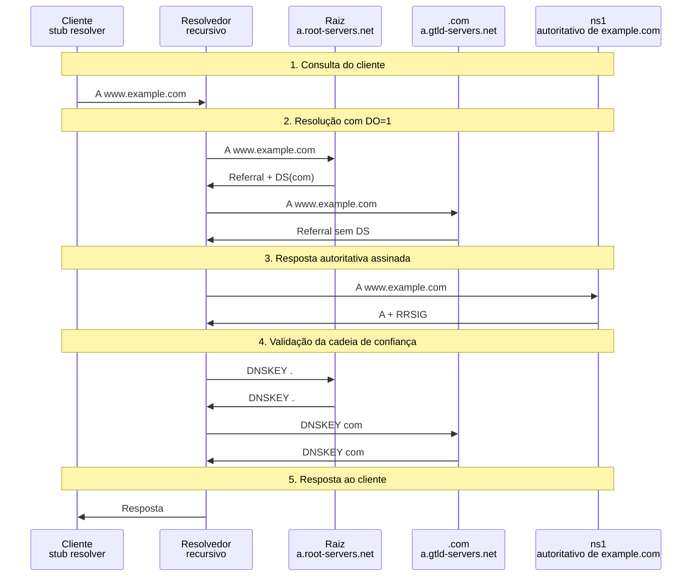

*Figura 6.2.3 (Tipo B, sequência).* Mensagens do cenário "Zona sem DS (insegura)", na ordem do tempo, entre Cliente, Resolvedor, Raiz, .com, ns1: 12 mensagens (em 5 fases). Corresponde ao diagrama de sequência e à aba Captura, no modo "DNSSEC", com a configuração aplicada acima.

**Mensagens**

| Mensagem | Significado | Origem |
| --- | --- | --- |
| Referral sem DS | NS e prova NSEC3 de que não há DS | .com |
| Resposta | sem RRSIG a verificar | ns1 |

**Por que importa.** Assinar a zona não basta: o DS precisa ser publicado no registro do domínio. Sem ele, o DNSSEC não protege nada.

> **Grupo:** Falhas de DNSSEC

O DNSSEC mal operado derruba o domínio para quem valida; e quem não valida não recebe proteção alguma.

#### 6.2.4 Assinatura vencida

*Assinaturas têm validade.*

**Configuração aplicada:** Situação do DNSSEC = expirada

O RRSIG do registro A venceu. O resolvedor que valida devolve **SERVFAIL**: o site some até o operador renovar as assinaturas.

**Conceito.** Cada **RRSIG** tem um período de validade (início e fim). Se o operador não renova a assinatura a tempo, o resolvedor que valida considera a resposta **bogus** e devolve **SERVFAIL**, com o erro estendido "Signature Expired" ([RFC 8914](https://www.rfc-editor.org/rfc/rfc8914)). A falha é do domínio, mas o efeito é a indisponibilidade.

**O que observar**

- O RRSIG com expiração em 30/09/2026.
- O SERVFAIL e o erro estendido 7 na resposta ao cliente.
- Na aba Cadeia: o último elo marcado como falho.

```mermaid
sequenceDiagram
  participant n_cl as Cliente<br/>stub resolver
  participant n_rs as Resolvedor<br/>recursivo
  participant n_rt as Raiz<br/>a.root-servers.net
  participant n_tl as .com<br/>a.gtld-servers.net
  participant n_au as ns1<br/>autoritativo de example.com
  Note over n_cl,n_au: 1. Consulta do cliente
  n_cl ->> n_rs: A www.example.com
  Note over n_cl,n_au: 2. Resolução com DO=1
  n_rs ->> n_rt: A www.example.com
  n_rt ->> n_rs: Referral + DS(com)
  n_rs ->> n_tl: A www.example.com
  n_tl ->> n_rs: Referral + DS(example.com)
  Note over n_cl,n_au: 3. Resposta autoritativa assinada
  n_rs ->> n_au: A www.example.com
  n_au ->> n_rs: A + RRSIG
  Note over n_cl,n_au: 4. Validação da cadeia de confiança
  n_rs ->> n_rt: DNSKEY .
  n_rt ->> n_rs: DNSKEY .
  n_rs ->> n_tl: DNSKEY com
  n_tl ->> n_rs: DNSKEY com
  n_rs ->> n_au: DNSKEY example.com
  n_au ->> n_rs: DNSKEY example.com
  Note over n_cl,n_au: 5. Resposta ao cliente
  n_rs ->> n_cl: SERVFAIL
```

*Figura 6.2.4 (Tipo B, sequência).* Mensagens do cenário "Assinatura vencida", na ordem do tempo, entre Cliente, Resolvedor, Raiz, .com, ns1: 14 mensagens (em 5 fases). Corresponde ao diagrama de sequência e à aba Captura, no modo "DNSSEC", com a configuração aplicada acima.

**Mensagens**

| Mensagem | Significado | Origem |
| --- | --- | --- |
| A + RRSIG vencido | assinatura fora do prazo | ns1 |
| SERVFAIL | EDE 7: Signature Expired | resolvedor |

**Por que importa.** Falhas de operação do DNSSEC (assinatura vencida, troca de chave mal feita) já tiraram do ar domínios inteiros. Automatizar a renovação é essencial.

#### 6.2.5 DS que não casa com a chave

*O elo entre as zonas se rompe.*

**Configuração aplicada:** Situação do DNSSEC = dsruim

A chave do domínio mudou e o DS no .com ficou desatualizado. A cadeia quebra e o resolvedor devolve **SERVFAIL**.

**Conceito.** O **DS** publicado no .com é o resumo da KSK do domínio. Se a chave muda e o DS não é atualizado, o resumo não confere e a **cadeia quebra**: o resolvedor responde SERVFAIL (erro estendido 6, "DNSSEC Bogus"). Todos os nomes da zona ficam inalcançáveis para quem valida.

**O que observar**

- A fase de validação: o hash da KSK difere do DS.
- Na aba Cadeia: o elo de example.com falha e o registro final fica sem verificação.

```mermaid
sequenceDiagram
  participant n_cl as Cliente<br/>stub resolver
  participant n_rs as Resolvedor<br/>recursivo
  participant n_rt as Raiz<br/>a.root-servers.net
  participant n_tl as .com<br/>a.gtld-servers.net
  participant n_au as ns1<br/>autoritativo de example.com
  Note over n_cl,n_au: 1. Consulta do cliente
  n_cl ->> n_rs: A www.example.com
  Note over n_cl,n_au: 2. Resolução com DO=1
  n_rs ->> n_rt: A www.example.com
  n_rt ->> n_rs: Referral + DS(com)
  n_rs ->> n_tl: A www.example.com
  n_tl ->> n_rs: Referral + DS(example.com)
  Note over n_cl,n_au: 3. Resposta autoritativa assinada
  n_rs ->> n_au: A www.example.com
  n_au ->> n_rs: A + RRSIG
  Note over n_cl,n_au: 4. Validação da cadeia de confiança
  n_rs ->> n_rt: DNSKEY .
  n_rt ->> n_rs: DNSKEY .
  n_rs ->> n_tl: DNSKEY com
  n_tl ->> n_rs: DNSKEY com
  n_rs ->> n_au: DNSKEY example.com
  n_au ->> n_rs: DNSKEY example.com
  Note over n_cl,n_au: 5. Resposta ao cliente
  n_rs ->> n_cl: SERVFAIL
```

*Figura 6.2.5 (Tipo B, sequência).* Mensagens do cenário "DS que não casa com a chave", na ordem do tempo, entre Cliente, Resolvedor, Raiz, .com, ns1: 14 mensagens (em 5 fases). Corresponde ao diagrama de sequência e à aba Captura, no modo "DNSSEC", com a configuração aplicada acima.

**Mensagens**

| Mensagem | Significado | Origem |
| --- | --- | --- |
| DS(example.com) | resumo antigo | .com |
| DNSKEY | chave atual, cujo hash não confere | ns1 |
| SERVFAIL | EDE 6: DNSSEC Bogus | resolvedor |

**Por que importa.** A troca de KSK (rollover) exige coordenar a zona e o registro do domínio. É a causa mais comum de falhas de DNSSEC.

#### 6.2.6 Resolvedor que não valida

*Assinatura inválida que ninguém confere.*

**Configuração aplicada:** Situação do DNSSEC = expirada; O resolvedor valida o DNSSEC = não

Mesma assinatura vencida, mas o resolvedor **não valida**: entrega a resposta sem perceber o problema. O DNSSEC só protege quem valida.

**Conceito.** O DNSSEC protege **quem valida**. Um resolvedor que ignora os registros DNSSEC aceita a resposta mesmo com a assinatura inválida, e o cliente não recebe aviso algum. Para o aluno, é o contraste direto com o cenário da assinatura vencida.

**O que observar**

- A mesma zona do cenário anterior, agora com resposta entregue.
- A resposta ao cliente sem AD.

```mermaid
sequenceDiagram
  participant n_cl as Cliente<br/>stub resolver
  participant n_rs as Resolvedor<br/>recursivo
  participant n_rt as Raiz<br/>a.root-servers.net
  participant n_tl as .com<br/>a.gtld-servers.net
  participant n_au as ns1<br/>autoritativo de example.com
  Note over n_cl,n_au: 1. Consulta do cliente
  n_cl ->> n_rs: A www.example.com
  Note over n_cl,n_au: 2. Resolução com DO=1
  n_rs ->> n_rt: A www.example.com
  n_rt ->> n_rs: Referral + DS(com)
  n_rs ->> n_tl: A www.example.com
  n_tl ->> n_rs: Referral + DS(example.com)
  Note over n_cl,n_au: 3. Resposta autoritativa assinada
  n_rs ->> n_au: A www.example.com
  n_au ->> n_rs: A + RRSIG
  Note over n_cl,n_au: 5. Resposta ao cliente
  n_rs ->> n_cl: Resposta
```

*Figura 6.2.6 (Tipo B, sequência).* Mensagens do cenário "Resolvedor que não valida", na ordem do tempo, entre Cliente, Resolvedor, Raiz, .com, ns1: 8 mensagens (em 4 fases). Corresponde ao diagrama de sequência e à aba Captura, no modo "DNSSEC", com a configuração aplicada acima.

**Mensagens**

| Mensagem | Significado | Origem |
| --- | --- | --- |
| A + RRSIG vencido | assinatura fora do prazo | ns1 |
| Resposta | sem AD, entregue mesmo assim | resolvedor |

**Por que importa.** Ativar a validação no resolvedor é a parte que cabe ao provedor ou à empresa. Resolvedores públicos grandes já validam.

### 6.3 Modo: Envenenamento de cache

> **Grupo:** Envenenamento de cache

Um atacante tenta fazer o resolvedor aceitar uma resposta falsa e guardá-la, afetando todos os seus clientes.

#### 6.3.1 Sem defesa (porta fixa)

*Porta fixa e ID previsível: fácil de forjar.*

Porta de origem fixa e ID previsível: uma resposta forjada que chegue antes da verdadeira é aceita. O cache fica envenenado e atinge todos os clientes do resolvedor.

**Conceito.** Uma resposta DNS é aceita se casar com uma consulta pendente: **endereço, porta, ID e pergunta**. Com porta fixa e ID de só 16 bits, o atacante precisa acertar pouco. Se a resposta forjada chega **antes** da verdadeira, o resolvedor a aceita e guarda no cache (**envenenamento**, Kaminsky, 2008), afetando todos os clientes até o TTL expirar.

**O que observar**

- A resposta forjada chega antes da legítima.
- A legítima é descartada por chegar tarde.
- Na aba Cache: a entrada falsa com TTL de 24 horas.
- A segunda consulta é respondida pelo cache envenenado.

```mermaid
sequenceDiagram
  participant n_cl as Cliente<br/>stub resolver
  participant n_rs as Resolvedor<br/>recursivo
  participant n_au as ns1<br/>autoritativo legítimo
  participant n_at as Atacante<br/>resposta forjada
  Note over n_cl,n_at: 1. Consulta que abre a janela
  n_cl ->> n_rs: A www.example.com
  Note over n_cl,n_at: 2. Corrida entre a resposta legítima e a forjada
  n_rs ->> n_au: A www.example.com
  n_at ->> n_rs: Resposta forjada
  n_au -x n_rs: Resposta legítima
  n_rs ->> n_cl: Resposta (198.51.100.66)
  Note over n_cl,n_at: 3. Efeito: o cache continua envenenado
  n_cl ->> n_rs: A www.example.com (depois)
  n_rs ->> n_cl: Resposta (198.51.100.66)
```

*Figura 6.3.1 (Tipo B, sequência).* Mensagens do cenário "Sem defesa (porta fixa)", na ordem do tempo, entre Cliente, Resolvedor, ns1, Atacante: 7 mensagens (em 3 fases; 1 perdida). Corresponde ao diagrama de sequência e à aba Captura, no modo "Envenenamento de cache", com a configuração padrão.

**Mensagens**

| Mensagem | Significado | Origem |
| --- | --- | --- |
| Consulta ao autoritativo | porta de origem 53, ID previsível | resolvedor |
| Resposta forjada | origem trocada, aceita | atacante |
| Resposta legítima | chega tarde e é descartada | ns1 |

**Por que importa.** O envenenamento redireciona o tráfego de todos os usuários de um resolvedor para o atacante, sem que ninguém perceba. O cenário é defensivo: mostra o efeito e as contramedidas, não o passo a passo.

#### 6.3.2 Porta e ID aleatórios

*Cerca de 32 bits a adivinhar.*

**Configuração aplicada:** Como o resolvedor se protege = aleatoria

Porta e ID aleatórios: as respostas forjadas não casam e são descartadas. A legítima é aceita.

**Conceito.** Com **porta de origem aleatória** (cerca de 16 bits) e **ID aleatório** (16 bits), o atacante precisa acertar os dois ao mesmo tempo: da ordem de 2^32 combinações em vez de 2^16 ([RFC 5452](https://www.rfc-editor.org/rfc/rfc5452)). As respostas forjadas não casam e são descartadas.

**O que observar**

- A porta de origem aleatória na consulta.
- As respostas forjadas descartadas, sem alterar o cache.

```mermaid
sequenceDiagram
  participant n_cl as Cliente<br/>stub resolver
  participant n_rs as Resolvedor<br/>recursivo
  participant n_au as ns1<br/>autoritativo legítimo
  participant n_at as Atacante<br/>resposta forjada
  Note over n_cl,n_at: 1. Consulta que abre a janela
  n_cl ->> n_rs: A www.example.com
  Note over n_cl,n_at: 2. Corrida entre a resposta legítima e a forjada
  n_rs ->> n_au: A www.example.com
  n_at -x n_rs: Forjada 1 (palpite)
  n_at -x n_rs: Resposta forjada (palpite)
  n_au ->> n_rs: Resposta legítima
  Note over n_cl,n_at: 3. Resposta ao cliente
  n_rs ->> n_cl: Resposta (192.0.2.80)
```

*Figura 6.3.2 (Tipo B, sequência).* Mensagens do cenário "Porta e ID aleatórios", na ordem do tempo, entre Cliente, Resolvedor, ns1, Atacante: 6 mensagens (em 3 fases; 2 perdidas). Corresponde ao diagrama de sequência e à aba Captura, no modo "Envenenamento de cache", com a configuração aplicada acima.

**Mensagens**

| Mensagem | Significado | Origem |
| --- | --- | --- |
| Consulta | porta e ID aleatórios | resolvedor |
| Respostas forjadas | porta e ID errados: descartadas | atacante |
| Resposta legítima | casa e é aceita | ns1 |

**Por que importa.** Foi a correção emergencial do ataque de Kaminsky e hoje é padrão. Não elimina o risco: um palpite certo ainda funciona.

#### 6.3.3 Aleatórios, mas o palpite acerta

*Probabilidade não é garantia.*

**Configuração aplicada:** Como o resolvedor se protege = aleatoria; O atacante acerta porta e ID do primeiro palpite = sim

O atacante tem sorte e acerta porta e ID. Aleatoriedade é probabilidade, não garantia: o cache é envenenado mesmo assim.

**Conceito.** Com porta e ID aleatórios o ataque é improvável, não impossível. Se o atacante **acerta**, o resolvedor aceita a resposta forjada exatamente como no cenário sem defesa. Daí a necessidade de camadas adicionais.

**O que observar**

- A resposta forjada é aceita.
- Na aba Cache: a entrada falsa.

```mermaid
sequenceDiagram
  participant n_cl as Cliente<br/>stub resolver
  participant n_rs as Resolvedor<br/>recursivo
  participant n_au as ns1<br/>autoritativo legítimo
  participant n_at as Atacante<br/>resposta forjada
  Note over n_cl,n_at: 1. Consulta que abre a janela
  n_cl ->> n_rs: A www.example.com
  Note over n_cl,n_at: 2. Corrida entre a resposta legítima e a forjada
  n_rs ->> n_au: A www.example.com
  n_at ->> n_rs: Resposta forjada
  n_au -x n_rs: Resposta legítima
  n_rs ->> n_cl: Resposta (198.51.100.66)
  Note over n_cl,n_at: 3. Efeito: o cache continua envenenado
  n_cl ->> n_rs: A www.example.com (depois)
  n_rs ->> n_cl: Resposta (198.51.100.66)
```

*Figura 6.3.3 (Tipo B, sequência).* Mensagens do cenário "Aleatórios, mas o palpite acerta", na ordem do tempo, entre Cliente, Resolvedor, ns1, Atacante: 7 mensagens (em 3 fases; 1 perdida). Corresponde ao diagrama de sequência e à aba Captura, no modo "Envenenamento de cache", com a configuração aplicada acima.

**Mensagens**

| Mensagem | Significado | Origem |
| --- | --- | --- |
| Resposta forjada | porta e ID acertados por sorte | atacante |
| Resposta legítima | chega tarde | ns1 |

**Por que importa.** Segredos curtos na camada de transporte só adiam o problema. Só a assinatura (DNSSEC) o resolve de forma estrutural.

> **Grupo:** Defesas adicionais

Camadas que elevam o custo do envenenamento: aleatoriedade extra na consulta e a validação criptográfica.

#### 6.3.4 0x20 + palpite certo

*A caixa das letras como entropia extra.*

**Configuração aplicada:** Como o resolvedor se protege = x20; O atacante acerta porta e ID do primeiro palpite = sim

Mesmo acertando porta e ID, a resposta forjada tem a **caixa das letras** errada. O 0x20 acrescenta mais entropia à consulta.

**Conceito.** No **0x20**, o resolvedor escreve o nome com letras maiúsculas e minúsculas aleatórias (wWw.eXaMpLe.CoM); o autoritativo repete a mesma caixa na resposta. O atacante precisa adivinhar também cada letra, o que multiplica o espaço de busca. Mesmo com porta e ID certos, a resposta com caixa errada é descartada.

**O que observar**

- O nome com caixa mista na consulta.
- A resposta forjada descartada pela caixa diferente.

```mermaid
sequenceDiagram
  participant n_cl as Cliente<br/>stub resolver
  participant n_rs as Resolvedor<br/>recursivo
  participant n_au as ns1<br/>autoritativo legítimo
  participant n_at as Atacante<br/>resposta forjada
  Note over n_cl,n_at: 1. Consulta que abre a janela
  n_cl ->> n_rs: A www.example.com
  Note over n_cl,n_at: 2. Corrida entre a resposta legítima e a forjada
  n_rs ->> n_au: A www.example.com
  n_at -x n_rs: Forjada 1 (palpite)
  n_at -x n_rs: Resposta forjada (palpite)
  n_au ->> n_rs: Resposta legítima
  Note over n_cl,n_at: 3. Resposta ao cliente
  n_rs ->> n_cl: Resposta (192.0.2.80)
```

*Figura 6.3.4 (Tipo B, sequência).* Mensagens do cenário "0x20 + palpite certo", na ordem do tempo, entre Cliente, Resolvedor, ns1, Atacante: 6 mensagens (em 3 fases; 2 perdidas). Corresponde ao diagrama de sequência e à aba Captura, no modo "Envenenamento de cache", com a configuração aplicada acima.

**Mensagens**

| Mensagem | Significado | Origem |
| --- | --- | --- |
| Consulta | nome com caixa aleatória | resolvedor |
| Resposta forjada | caixa do nome não confere | atacante |

**Por que importa.** Funciona com servidores que preservam a caixa. É uma defesa barata, mas não substitui o DNSSEC.

#### 6.3.5 DNSSEC + palpite certo

*A assinatura vale mais que a sorte.*

**Configuração aplicada:** Como o resolvedor se protege = dnssec; O atacante acerta porta e ID do primeiro palpite = sim

A resposta forjada passa em porta e ID, mas não tem RRSIG válido. A validação DNSSEC a rejeita: a defesa não depende de sorte.

**Conceito.** Com a **validação DNSSEC**, a resposta não é aceita por casar com a consulta, mas por ter uma **assinatura válida** da zona. O atacante pode acertar porta e ID, mas não consegue assinar a resposta. A forjada é descartada como bogus.

**O que observar**

- A resposta forjada com porta e ID certos, descartada por não ter RRSIG válido.
- A resposta legítima com RRSIG, aceita.

```mermaid
sequenceDiagram
  participant n_cl as Cliente<br/>stub resolver
  participant n_rs as Resolvedor<br/>recursivo
  participant n_au as ns1<br/>autoritativo legítimo
  participant n_at as Atacante<br/>resposta forjada
  Note over n_cl,n_at: 1. Consulta que abre a janela
  n_cl ->> n_rs: A www.example.com
  Note over n_cl,n_at: 2. Corrida entre a resposta legítima e a forjada
  n_rs ->> n_au: A www.example.com
  n_at -x n_rs: Forjada 1 (palpite)
  n_at -x n_rs: Resposta forjada (palpite)
  n_au ->> n_rs: Resposta legítima
  Note over n_cl,n_at: 3. Resposta ao cliente
  n_rs ->> n_cl: Resposta (192.0.2.80)
```

*Figura 6.3.5 (Tipo B, sequência).* Mensagens do cenário "DNSSEC + palpite certo", na ordem do tempo, entre Cliente, Resolvedor, ns1, Atacante: 6 mensagens (em 3 fases; 2 perdidas). Corresponde ao diagrama de sequência e à aba Captura, no modo "Envenenamento de cache", com a configuração aplicada acima.

**Mensagens**

| Mensagem | Significado | Origem |
| --- | --- | --- |
| Resposta forjada | porta e ID certos, sem RRSIG válido | atacante |
| Resposta legítima | A + RRSIG | ns1 |

**Por que importa.** Só funciona para zonas assinadas. O domínio precisa publicar DNSSEC e o resolvedor precisa validar.

### 6.4 Modo: Amplificação

> **Grupo:** Reflexão e amplificação

Resolvedores abertos podem ser usados para inundar uma vítima com respostas muito maiores que as consultas.

#### 6.4.1 Resolvedor aberto (ANY)

*Pergunta pequena, resposta grande, vítima errada.*

Consultas pequenas com a origem trocada pela da vítima: o resolvedor aberto responde com mensagens muito maiores, que inundam a vítima.

**Conceito.** Na **reflexão com amplificação**, o atacante envia consultas pequenas com o **endereço de origem forjado** (o da vítima) a resolvedores abertos. As respostas, bem maiores, vão para a vítima. O ganho é a razão entre o tamanho da resposta e o da consulta. O atacante esconde a origem e multiplica o tráfego.

**O que observar**

- As consultas com origem forjada (192.0.2.200).
- As respostas grandes dirigidas à vítima.
- O fator de amplificação no quadro de estados.

```mermaid
sequenceDiagram
  participant n_at as Atacante<br/>origem forjada
  participant n_rs as Resolvedor<br/>recursivo
  participant n_vi as Vítima<br/>alvo da inundação
  Note over n_at,n_vi: 1. Consultas com origem forjada
  n_at ->> n_rs: ANY example.com
  Note over n_at,n_vi: 2. O resolvedor responde à vítima
  n_rs ->> n_vi: Resposta grande
  n_at ->> n_rs: ANY example.com
  n_rs ->> n_vi: Resposta grande
  n_at ->> n_rs: ANY example.com
  n_rs ->> n_vi: Resposta grande
```

*Figura 6.4.1 (Tipo B, sequência).* Mensagens do cenário "Resolvedor aberto (ANY)", na ordem do tempo, entre Atacante, Resolvedor, Vítima: 6 mensagens (em 3 fases). Corresponde ao diagrama de sequência e à aba Captura, no modo "Amplificação", com a configuração padrão.

**Mensagens**

| Mensagem | Significado | Origem |
| --- | --- | --- |
| ANY example.com | consulta curta, origem forjada | atacante |
| Resposta grande | dezenas de vezes maior, para a vítima | resolvedor |

**Por que importa.** O DNS é um dos protocolos mais usados em ataques volumétricos (DDoS). Os controles estão no operador do resolvedor e no provedor do atacante. O cenário é defensivo: mostra o mecanismo para que seja evitado.

#### 6.4.2 Consulta A (pouco ganho)

*O tipo da consulta limita o ganho.*

**Configuração aplicada:** Tipo de consulta = a

Uma consulta A gera uma resposta curta: o fator de amplificação é pequeno. O tipo da consulta importa.

**Conceito.** Uma consulta **A** gera uma resposta curta, e o fator de amplificação é pequeno. O atacante prefere tipos que geram respostas grandes (ANY, DNSKEY, TXT longos). Muitos servidores hoje recusam ou reduzem o ANY ([RFC 8482](https://www.rfc-editor.org/rfc/rfc8482)).

**O que observar**

- Compare o fator com o do cenário anterior.

```mermaid
sequenceDiagram
  participant n_at as Atacante<br/>origem forjada
  participant n_rs as Resolvedor<br/>recursivo
  participant n_vi as Vítima<br/>alvo da inundação
  Note over n_at,n_vi: 1. Consultas com origem forjada
  n_at ->> n_rs: A example.com
  Note over n_at,n_vi: 2. O resolvedor responde à vítima
  n_rs ->> n_vi: Resposta grande
  n_at ->> n_rs: A example.com
  n_rs ->> n_vi: Resposta grande
  n_at ->> n_rs: A example.com
  n_rs ->> n_vi: Resposta grande
```

*Figura 6.4.2 (Tipo B, sequência).* Mensagens do cenário "Consulta A (pouco ganho)", na ordem do tempo, entre Atacante, Resolvedor, Vítima: 6 mensagens (em 3 fases). Corresponde ao diagrama de sequência e à aba Captura, no modo "Amplificação", com a configuração aplicada acima.

**Mensagens**

| Mensagem | Significado | Origem |
| --- | --- | --- |
| A example.com | consulta curta | atacante |
| Resposta A | curta | resolvedor |

**Por que importa.** Reduzir o tamanho das respostas de tipos como ANY é uma defesa barata do lado do servidor.

> **Grupo:** Defesas

Controles que impedem a reflexão: filtro de origem, resolvedor fechado e limite de taxa.

#### 6.4.3 Provedor com [BCP 38](https://www.rfc-editor.org/info/bcp38)

*Cortar a forja na origem.*

**Configuração aplicada:** O provedor filtra origem forjada ([BCP 38](https://www.rfc-editor.org/info/bcp38)) = sim

O provedor do atacante descarta pacotes com origem forjada: a reflexão não chega a acontecer.

**Conceito.** A **[BCP 38](https://www.rfc-editor.org/info/bcp38)** ([RFC 2827](https://www.rfc-editor.org/rfc/rfc2827)) manda cada provedor descartar pacotes cuja origem não pertença aos seus clientes. Sem pacotes com origem forjada, a reflexão não existe. É a defesa mais eficaz, mas depende de cada provedor aplicá-la.

**O que observar**

- As consultas descartadas na borda do provedor do atacante.
- Nenhum tráfego chega ao resolvedor nem à vítima.

```mermaid
sequenceDiagram
  participant n_at as Atacante<br/>origem forjada
  participant n_rs as Resolvedor<br/>recursivo
  participant n_vi as Vítima<br/>alvo da inundação
  Note over n_at,n_vi: 1. Consultas com origem forjada
  n_at -x n_rs: ANY example.com
  n_at -x n_rs: ANY example.com
  n_at -x n_rs: ANY example.com
```

*Figura 6.4.3 (Tipo B, sequência).* Mensagens do cenário "Provedor com [BCP 38](https://www.rfc-editor.org/info/bcp38)", na ordem do tempo, entre Atacante, Resolvedor, Vítima: 3 mensagens (em 2 fases; 3 perdidas). Corresponde ao diagrama de sequência e à aba Captura, no modo "Amplificação", com a configuração aplicada acima.

**Mensagens**

| Mensagem | Significado | Origem |
| --- | --- | --- |
| Consulta com origem forjada | descartada pelo filtro | provedor do atacante |

**Por que importa.** É um problema de ação coletiva: o provedor que filtra protege os outros, não a si mesmo.

#### 6.4.4 Resolvedor fechado (ACL)

*Resolvedor só para quem é da casa.*

**Configuração aplicada:** Política do resolvedor = acl

O resolvedor só atende a rede interna e responde REFUSED a quem é de fora: a vítima recebe pacotes mínimos.

**Conceito.** Um resolvedor **recursivo** deve atender apenas à própria rede (ACL). Para quem é de fora, responde **REFUSED**, uma resposta mínima. O fator de amplificação cai a cerca de 1, e o resolvedor deixa de ser útil ao atacante.

**O que observar**

- Os REFUSED dirigidos à vítima, do tamanho da consulta.

```mermaid
sequenceDiagram
  participant n_at as Atacante<br/>origem forjada
  participant n_rs as Resolvedor<br/>recursivo
  participant n_vi as Vítima<br/>alvo da inundação
  Note over n_at,n_vi: 1. Consultas com origem forjada
  n_at ->> n_rs: ANY example.com
  Note over n_at,n_vi: 2. O resolvedor responde à vítima
  n_rs ->> n_vi: REFUSED
  n_at ->> n_rs: ANY example.com
  n_rs ->> n_vi: REFUSED
  n_at ->> n_rs: ANY example.com
  n_rs ->> n_vi: REFUSED
```

*Figura 6.4.4 (Tipo B, sequência).* Mensagens do cenário "Resolvedor fechado (ACL)", na ordem do tempo, entre Atacante, Resolvedor, Vítima: 6 mensagens (em 3 fases). Corresponde ao diagrama de sequência e à aba Captura, no modo "Amplificação", com a configuração aplicada acima.

**Mensagens**

| Mensagem | Significado | Origem |
| --- | --- | --- |
| ANY example.com | origem forjada | atacante |
| REFUSED | resposta mínima | resolvedor |

**Por que importa.** Resolvedores abertos são o problema; a regra básica é nunca expor um resolvedor recursivo à Internet.

#### 6.4.5 Limite de taxa (RRL)

*Limitar respostas repetidas.*

**Configuração aplicada:** Política do resolvedor = rrl

O limite de taxa deixa passar uma resposta truncada e descarta o resto: o ganho do atacante desaparece.

**Conceito.** O **Response Rate Limiting** conta respostas idênticas por origem e, passado o limite, descarta ou responde truncado (**slip**, TC=1). Um cliente legítimo repete por TCP e é atendido; quem forjou a origem não completa o handshake e a vítima recebe pouco.

**O que observar**

- Uma resposta truncada pequena e as demais descartadas.

```mermaid
sequenceDiagram
  participant n_at as Atacante<br/>origem forjada
  participant n_rs as Resolvedor<br/>recursivo
  participant n_vi as Vítima<br/>alvo da inundação
  Note over n_at,n_vi: 1. Consultas com origem forjada
  n_at ->> n_rs: ANY example.com
  Note over n_at,n_vi: 2. O resolvedor responde à vítima
  n_rs ->> n_vi: Truncada (TC=1)
  n_at ->> n_rs: ANY example.com
  n_at ->> n_rs: ANY example.com
```

*Figura 6.4.5 (Tipo B, sequência).* Mensagens do cenário "Limite de taxa (RRL)", na ordem do tempo, entre Atacante, Resolvedor, Vítima: 4 mensagens (em 3 fases). Corresponde ao diagrama de sequência e à aba Captura, no modo "Amplificação", com a configuração aplicada acima.

**Mensagens**

| Mensagem | Significado | Origem |
| --- | --- | --- |
| Resposta truncada | TC=1, pequena | resolvedor |
| Demais consultas | descartadas pelo limite | resolvedor |

**Por que importa.** O RRL é a defesa recomendada para servidores autoritativos, que não podem ser fechados por serem públicos.

### 6.5 Modo: DoT e DoH

> **Grupo:** Canal do DNS

O DNS puro viaja em texto claro; DoT e DoH protegem o trecho entre o cliente e o resolvedor.

#### 6.5.1 DNS puro (UDP 53)

*Nome e resposta à vista de todos.*

Consulta e resposta em texto claro: o observador lê o nome consultado e pode alterar a resposta.

**Conceito.** O DNS puro (**Do53**) viaja em UDP sem cifra. Qualquer equipamento no caminho (provedor, Wi-Fi público) lê os **nomes consultados**, que revelam hábitos e serviços usados, e pode **alterar a resposta**. Não há autenticação do servidor.

**O que observar**

- O observador registrando o nome consultado e a resposta.
- A consulta e a resposta legíveis na aba Mensagem.

```mermaid
sequenceDiagram
  participant n_cl as Cliente<br/>stub resolver
  participant n_ob as Observador<br/>na rede (provedor, Wi-Fi)
  participant n_rs as Resolvedor<br/>dns.example.net
  Note over n_cl,n_rs: Consulta em texto claro (UDP 53)
  n_cl ->> n_rs: A www.example.com
  n_rs ->> n_cl: Resposta 192.0.2.80
```

*Figura 6.5.1 (Tipo B, sequência).* Mensagens do cenário "DNS puro (UDP 53)", na ordem do tempo, entre Cliente, Observador, Resolvedor: 2 mensagens (em 1 fase). Corresponde ao diagrama de sequência e à aba Captura, no modo "DoT e DoH", com a configuração padrão.

**Mensagens**

| Mensagem | Significado | Origem |
| --- | --- | --- |
| A www.example.com | texto claro | cliente |
| Resposta | texto claro, sem autenticação | resolvedor |

**Por que importa.** Mesmo com HTTPS, a consulta DNS revela o site visitado. Por isso a privacidade do DNS se tornou tema de padronização.

#### 6.5.2 DNS sobre TLS (DoT)

*DNS dentro de TLS, em porta própria.*

**Configuração aplicada:** Transporte do DNS = dot

O DNS dentro do TLS, na porta 853. O observador vê a conexão e o SNI, mas não os nomes.

**Conceito.** O **DoT** ([RFC 7858](https://www.rfc-editor.org/rfc/rfc7858)) envia o DNS dentro de uma conexão **TLS** na porta **853**. O cliente autentica o resolvedor pelo certificado, e o observador só vê a conexão e o SNI. A porta própria facilita a identificação e o bloqueio.

**O que observar**

- O handshake TLS antes da consulta.
- O observador vê apenas dados cifrados.
- A mensagem DNS na aba Mensagem, como cliente e resolvedor a enxergam.

```mermaid
sequenceDiagram
  participant n_cl as Cliente<br/>stub resolver
  participant n_ob as Observador<br/>na rede (provedor, Wi-Fi)
  participant n_rs as Resolvedor<br/>dns.example.net
  Note over n_cl,n_rs: 1. Conexão TCP e handshake TLS
  n_cl ->> n_rs: SYN :853
  n_rs ->> n_cl: SYN+ACK
  n_cl ->> n_rs: ClientHello
  n_rs ->> n_cl: [cifrado] ServerHello + Certificado
  n_cl ->> n_rs: [cifrado] Finished
  Note over n_cl,n_rs: 2. Consulta cifrada
  n_cl ->> n_rs: [cifrado] A www.example.com (cifrada)
  n_rs ->> n_cl: [cifrado] Resposta 192.0.2.80 (cifrada)
```

*Figura 6.5.2 (Tipo B, sequência).* Mensagens do cenário "DNS sobre TLS (DoT)", na ordem do tempo, entre Cliente, Observador, Resolvedor: 7 mensagens (em 2 fases; 4 cifradas). Corresponde ao diagrama de sequência e à aba Captura, no modo "DoT e DoH", com a configuração aplicada acima.

**Mensagens**

| Mensagem | Significado | Origem |
| --- | --- | --- |
| SYN :853 e TLS | conexão e handshake | cliente |
| Consulta cifrada | DNS dentro do TLS | cliente |
| Resposta cifrada | DNS dentro do TLS | resolvedor |

**Por que importa.** Protege o trecho cliente-resolvedor, mas o resolvedor continua vendo todas as consultas: a confiança é transferida, não eliminada.

#### 6.5.3 DNS sobre HTTPS (DoH)

*DNS dentro de HTTPS, camuflado no tráfego web.*

**Configuração aplicada:** Transporte do DNS = doh

O DNS dentro de HTTPS, na porta 443, misturado ao tráfego web.

**Conceito.** O **DoH** ([RFC 8484](https://www.rfc-editor.org/rfc/rfc8484)) envia o DNS como requisição **HTTP/2** sobre TLS, na porta **443**, junto ao tráfego web comum. Bloqueá-lo sem bloquear a web é difícil. O ganho de privacidade vem com a perda de visibilidade para quem administra a rede.

**O que observar**

- A requisição POST /dns-query com content-type application/dns-message.
- O observador sem distinguir esse tráfego do restante do HTTPS.

```mermaid
sequenceDiagram
  participant n_cl as Cliente<br/>stub resolver
  participant n_ob as Observador<br/>na rede (provedor, Wi-Fi)
  participant n_rs as Resolvedor<br/>dns.example.net
  Note over n_cl,n_rs: 1. Conexão TCP e handshake TLS
  n_cl ->> n_rs: SYN :443
  n_rs ->> n_cl: SYN+ACK
  n_cl ->> n_rs: ClientHello
  n_rs ->> n_cl: [cifrado] ServerHello + Certificado
  n_cl ->> n_rs: [cifrado] Finished
  Note over n_cl,n_rs: 2. Consulta cifrada
  n_cl ->> n_rs: [cifrado] A www.example.com (cifrada)
  n_rs ->> n_cl: [cifrado] Resposta 192.0.2.80 (cifrada)
```

*Figura 6.5.3 (Tipo B, sequência).* Mensagens do cenário "DNS sobre HTTPS (DoH)", na ordem do tempo, entre Cliente, Observador, Resolvedor: 7 mensagens (em 2 fases; 4 cifradas). Corresponde ao diagrama de sequência e à aba Captura, no modo "DoT e DoH", com a configuração aplicada acima.

**Mensagens**

| Mensagem | Significado | Origem |
| --- | --- | --- |
| TLS na porta 443 | handshake | cliente |
| POST /dns-query | consulta DNS no corpo | cliente |
| 200 OK | resposta DNS no corpo | resolvedor |

**Por que importa.** Para as redes corporativas, o DoH torna mais difícil aplicar filtragem e monitoramento por DNS; é preciso tratá-lo por política (resolvedor oficial, bloqueio de DoH externo).

> **Grupo:** Bloqueio da porta 853

O DoT tem porta própria e pode ser bloqueado; a política do cliente decide entre falhar e voltar ao texto claro.

#### 6.5.4 DoT bloqueado, política estrita

*Prefere falhar a vazar.*

**Configuração aplicada:** Transporte do DNS = dot; A rede bloqueia a porta 853 = sim; Política do cliente DoT = estrita

A rede bloqueia a 853. O cliente estrito prefere ficar sem resposta a consultar em texto claro.

**Conceito.** Com a **porta 853 bloqueada**, o cliente em modo **estrito** não consegue abrir o DoT e **não consulta em texto claro**. A resolução falha, mas nada vaza. É o comportamento seguro quando a privacidade é requisito.

**O que observar**

- A tentativa de conexão bloqueada.
- Nenhuma consulta em UDP 53.
- O quadro de estados: sem resposta (falha fechada).

```mermaid
sequenceDiagram
  participant n_cl as Cliente<br/>stub resolver
  participant n_ob as Observador<br/>na rede (provedor, Wi-Fi)
  participant n_rs as Resolvedor<br/>dns.example.net
  Note over n_cl,n_rs: 1. Tentativa de conexão DoT (porta 853)
  n_cl -x n_rs: SYN :853
```

*Figura 6.5.4 (Tipo B, sequência).* Mensagens do cenário "DoT bloqueado, política estrita", na ordem do tempo, entre Cliente, Observador, Resolvedor: 1 mensagem (em 1 fase; 1 perdida). Corresponde ao diagrama de sequência e à aba Captura, no modo "DoT e DoH", com a configuração aplicada acima.

**Mensagens**

| Mensagem | Significado | Origem |
| --- | --- | --- |
| SYN :853 | bloqueado | cliente |

**Por que importa.** A política estrita troca disponibilidade por confidencialidade; a escolha depende do risco aceito.

#### 6.5.5 DoT bloqueado, política oportunista

*O bloqueio força o rebaixamento.*

**Configuração aplicada:** Transporte do DNS = dot; A rede bloqueia a porta 853 = sim; Política do cliente DoT = oportunista

Com o bloqueio, o cliente oportunista volta ao UDP 53: o bloqueio força o rebaixamento e a consulta vaza.

**Conceito.** No modo **oportunista**, se o DoT falha o cliente volta ao UDP 53. Quem consegue bloquear a porta 853 faz o **ataque de rebaixamento (downgrade)**: a consulta passa a viajar em claro e o observador a lê. É a fraqueza do modo oportunista.

**O que observar**

- O bloqueio da 853, seguido de uma consulta em UDP 53.
- O observador lendo o nome.

```mermaid
sequenceDiagram
  participant n_cl as Cliente<br/>stub resolver
  participant n_ob as Observador<br/>na rede (provedor, Wi-Fi)
  participant n_rs as Resolvedor<br/>dns.example.net
  Note over n_cl,n_rs: 1. Tentativa de conexão DoT (porta 853)
  n_cl -x n_rs: SYN :853
  Note over n_cl,n_rs: Consulta em texto claro (UDP 53)
  n_cl ->> n_rs: A www.example.com
  n_rs ->> n_cl: Resposta 192.0.2.80
```

*Figura 6.5.5 (Tipo B, sequência).* Mensagens do cenário "DoT bloqueado, política oportunista", na ordem do tempo, entre Cliente, Observador, Resolvedor: 3 mensagens (em 2 fases; 1 perdida). Corresponde ao diagrama de sequência e à aba Captura, no modo "DoT e DoH", com a configuração aplicada acima.

**Mensagens**

| Mensagem | Significado | Origem |
| --- | --- | --- |
| SYN :853 | bloqueado | cliente |
| A www.example.com | texto claro, após o rebaixamento | cliente |

**Por que importa.** Se a privacidade é requisito, use a política estrita (ou DoH, que é difícil de bloquear seletivamente).

## 7. Referência

### 7.1 O que é o DNS

O **Domain Name System** ([RFC 1034](https://www.rfc-editor.org/rfc/rfc1034) e [RFC 1035](https://www.rfc-editor.org/rfc/rfc1035)) traduz nomes em dados: endereços IP, servidores de e-mail, textos de política. É um banco de dados **hierárquico e distribuído**: a raiz delega os domínios de primeiro nível (.com, .br), que delegam os domínios de cada organização. O DNS usa a porta **53**, em UDP por padrão e em TCP para respostas grandes e transferências de zona.

### 7.2 Papéis

- **Cliente (stub resolver):** faz uma pergunta só, com RD=1, ao resolvedor configurado.
- **Resolvedor recursivo:** percorre a hierarquia pelo cliente e guarda as respostas no cache. Atende à própria rede.
- **Servidor autoritativo:** dono dos dados de uma zona; responde com AA=1 e não faz recursão.
- **Raiz e TLD:** só delegam, indicando os servidores do nível seguinte.

### 7.3 Resolução e cache ([RFC 1034](https://www.rfc-editor.org/rfc/rfc1034), [RFC 2308](https://www.rfc-editor.org/rfc/rfc2308))

- **Delegação (NS) e glue:** a resposta de um nível indica o próximo; o glue (A do servidor de nomes) evita a dependência circular.
- **TTL:** prazo, em segundos, em que uma resposta pode ser reutilizada. TTL alto reduz carga; TTL baixo acelera mudanças.
- **Cache negativo:** NXDOMAIN também é guardado, pelo menor valor entre o TTL do SOA e o campo "minimum".
- **Redundância:** toda zona precisa de pelo menos dois servidores de nomes, em redes diferentes.

### 7.4 Tipos de registro

| Tipo | Função | Exemplo |
| --- | --- | --- |
| A / AAAA | endereço IPv4 / IPv6 | www.example.com A 192.0.2.80 |
| CNAME | apelido para outro nome | blog.example.com CNAME www.example.com |
| MX | servidor de e-mail, com preferência | 10 mail.example.com |
| TXT | texto (SPF, DKIM, DMARC) | "v=spf1 ip4:192.0.2.0/24 -all" |
| NS | servidores de nomes da zona | ns1.example.com |
| SOA | parâmetros da zona e cache negativo | ns1.example.com ... 3600 |
| DS / DNSKEY / RRSIG / NSEC | DNSSEC | veja a seção seguinte |

### 7.5 Flags e códigos do cabeçalho

- **QR:** 0 consulta, 1 resposta. **AA:** resposta autoritativa. **TC:** truncada, refazer por TCP.
- **RD / RA:** recursão desejada / disponível. **AD / CD:** dados autenticados / validação desligada.
- **RCODE:** 0 NOERROR, 2 SERVFAIL, 3 NXDOMAIN, 5 REFUSED.
- **EDNS(0) ([RFC 6891](https://www.rfc-editor.org/rfc/rfc6891)):** amplia o tamanho do datagrama e carrega o bit DO (DNSSEC OK).

### 7.6 DNSSEC ([RFC 4033](https://www.rfc-editor.org/rfc/rfc4033), [RFC 4034](https://www.rfc-editor.org/rfc/rfc4034), [RFC 4035](https://www.rfc-editor.org/rfc/rfc4035))

- **RRSIG:** assinatura de um conjunto de registros, com início e fim de validade.
- **DNSKEY:** chaves públicas da zona: a **ZSK** assina os dados; a **KSK** assina as chaves.
- **DS:** resumo (hash) da KSK, publicado na zona de cima: é o elo da cadeia de confiança.
- **NSEC / NSEC3:** provam que um nome ou tipo não existe. O NSEC3 ([RFC 5155](https://www.rfc-editor.org/rfc/rfc5155)) usa hashes para dificultar listar a zona; a [RFC 9276](https://www.rfc-editor.org/rfc/rfc9276) recomenda iterações 0 e salt vazio, porque custos maiores ajudam pouco e sobrecarregam o validador.
- **Âncora de confiança:** a chave da raiz, configurada no resolvedor; é a origem de toda a validação.
- **Resultados:** segura (cadeia completa, AD=1), insegura (sem DS, resposta aceita sem AD) e bogus (falha de validação: SERVFAIL).
- **Erros estendidos ([RFC 8914](https://www.rfc-editor.org/rfc/rfc8914)):** explicam o SERVFAIL, como "Signature Expired" e "DNSSEC Bogus".

### 7.7 DNS e segurança

- **Envenenamento de cache:** o resolvedor aceita e guarda uma resposta forjada. Defesas: porta e ID aleatórios ([RFC 5452](https://www.rfc-editor.org/rfc/rfc5452)), 0x20 (mistura de caixa, que a [RFC 4343](https://www.rfc-editor.org/rfc/rfc4343) manda preservar na resposta) e, sobretudo, DNSSEC.
- **Reflexão e amplificação:** consultas pequenas com origem forjada geram respostas grandes contra a vítima. Defesas: [BCP 38](https://www.rfc-editor.org/info/bcp38), resolvedor fechado, limite de taxa (RRL) e respostas ANY reduzidas ([RFC 8482](https://www.rfc-editor.org/rfc/rfc8482)).
- **Privacidade:** o DNS puro expõe os nomes consultados. DoT ([RFC 7858](https://www.rfc-editor.org/rfc/rfc7858)) e DoH ([RFC 8484](https://www.rfc-editor.org/rfc/rfc8484)) cifram o trecho cliente-resolvedor; o resolvedor continua vendo as consultas. A [RFC 8310](https://www.rfc-editor.org/rfc/rfc8310) define os perfis de uso do DoT: o **estrito** exige autenticar o servidor e recusa a consulta se falhar; o **oportunista** volta ao texto puro.
- **Outros riscos:** domínio pendente por CNAME (takeover), domínios gerados por malware (DGA), tunelamento de dados por DNS, sequestro de registro do domínio. Registro de consultas e monitoração de NXDOMAIN ajudam a detectá-los.
- **Boas práticas:** resolvedor fechado e com validação, DNSSEC na zona com renovação automática, ao menos dois autoritativos em redes diferentes, TCP 53 liberado.

### 7.8 Limites do simulador

- Nomes e endereços são de documentação (example.com, [RFC 5737](https://www.rfc-editor.org/rfc/rfc5737) e [RFC 3849](https://www.rfc-editor.org/rfc/rfc3849)); a raiz e o .com aparecem com um servidor cada e os endereços são fictícios.
- Chaves, resumos e assinaturas são valores ilustrativos: não há criptografia real.
- Tamanhos de mensagem e tempos são aproximados. O resolvedor não faz minimização de nome ([RFC 9156](https://www.rfc-editor.org/rfc/rfc9156)).
- O envenenamento e a amplificação são apresentados em nível defensivo: mostram o efeito e as contramedidas, sem o passo a passo operacional.

### 7.9 Roteiro de exercícios

1. No modo **Resolução**, rode a resolução completa e anote o que cada servidor devolveu. Depois escolha **Delegações em cache** e compare consultas e tempo.
2. Pergunte por **MX** e por **CNAME**; na aba Mensagem, localize as seções Resposta e Adicional.
3. Pergunte por um **nome inexistente** e explique, com a aba Cache, o que é cache negativo.
4. Desligue **ns1** e marque **perda**: qual dos dois atrasos é maior e por quê?
5. No modo **DNSSEC**, compare **assinatura vencida** com **DS que não casa** na aba Cadeia. Em qual elo cada uma falha?
6. Desmarque **valida o DNSSEC** e diga por que o domínio assinado continua sem proteção.
7. No modo **Envenenamento**, compare as quatro defesas com o palpite certo. Qual não depende de sorte?
8. No modo **Amplificação**, calcule o fator em cada política e identifique qual controle atua na origem do problema.
9. No modo **DoT e DoH**, compare o que o observador lê nos três transportes e discuta a política estrita contra a oportunista.


---

*Simul-Net é um projeto mantido pelo Prof. Dr. Laerte Peotta de Melo, com apoio de IA generativa no processo de desenvolvimento, com sua estrita supervisão, revisão técnica e responsabilidade. Uso exclusivo para fins de ensino e pesquisa. Universidade de Brasília (UnB) - Departamento de Engenharia Elétrica. Código aberto (licença MIT).*
