# Firewall: filtragem e estado

Filtro sem estado e com estado: regras, ordem de avaliação e negação implícita, tabela de conexões, zonas interna, DMZ e externa, filtro de origem ([BCP 38](https://www.rfc-editor.org/info/bcp38)), varredura e limite de taxa, com cenários defensivos.

- **Categoria:** Protocolos de rede seguros
- **Motor:** nativo (TypeScript puro, apresentado pela bancada genérica)
- **Código-fonte:** `src/sims/firewall/`
- **RFCs e padrões:** [RFC 2979](https://www.rfc-editor.org/rfc/rfc2979) (Firewalls na Internet), [RFC 9293](https://www.rfc-editor.org/rfc/rfc9293) (TCP), [RFC 2827](https://www.rfc-editor.org/rfc/rfc2827) (Filtro de ingresso, [BCP 38](https://www.rfc-editor.org/info/bcp38)), [RFC 5737](https://www.rfc-editor.org/rfc/rfc5737) (Endereços de documentação), [RFC 6298](https://www.rfc-editor.org/rfc/rfc6298) (Retransmissão do TCP)
- **Tópicos:** Lista de regras e política padrão; Tabela de conexões e estados; Perímetro com DMZ; Filtro de origem e limite de taxa

## 1. Modos

| Modo | Cenário inicial | Cenários |
| --- | --- | --- |
| Filtro sem estado (ACL) | Ida e volta permitidas | 6.1.1 a 6.1.7 |
| Filtro com estado | Saída permitida, retorno pela tabela | 6.2.1 a 6.2.7 |
| Perímetro com DMZ | Internet acessa o servidor web da DMZ | 6.3.1 a 6.3.7 |
| Forja, varredura e limite de taxa | Origem interna vinda de fora, sem filtro | 6.4.1 a 6.4.9 |

## 2. Como ler os diagramas

Este documento usa até dois tipos de diagrama. Cada figura traz uma legenda com o tipo, o que mostra e a que modo ou cenário se refere.

| Tipo | O que é | Vale para | Equivale, no simulador, a |
| --- | --- | --- | --- |
| A, topologia | Os elementos da rede e os enlaces que os ligam. É estático. | Um modo inteiro | A visão "Topologia" do quadro principal |
| B, sequência | As mensagens na ordem do tempo, entre os participantes. É dinâmico. | Um único cenário, com a configuração indicada | Ao diagrama de sequência e à aba Captura |

### 2.1 Legenda dos diagramas

**Tipo A (topologia)**

- Retângulo: host (computador ou servidor final).
- Hexágono: switch.
- Retângulo arredondado: roteador, ou dispositivo que encaminha ou traduz.
- Estádio (cantos bem arredondados): servidor ou rede externa.
- Retângulo vermelho: atacante (quando existe no modo).
- Linha contínua: enlace. Linha tracejada: enlace alternativo, forjado ou caído, ou ainda relação de peering (no BGP), conforme o rótulo e o cenário.
- O Mermaid posiciona os elementos automaticamente: o layout difere do simulador, as ligações não.

**Tipo B (sequência)**

- Cada coluna é um participante (cliente, servidor, roteador ou outro). O tempo corre de cima para baixo.
- Seta cheia: mensagem enviada. Seta com X: mensagem perdida.
- `[cifrado]` no início do rótulo: a mensagem viaja cifrada.
- Faixa horizontal com texto: início de uma fase do cenário.
- A ordem é a da aba Captura; os intervalos de tempo não são desenhados em escala.

### 2.2 Lista de figuras

**Tipo A (topologia)**

- [Figura 3.1a](#31-filtro-sem-estado-acl): topologia do modo "Filtro sem estado (ACL)", variante a
- [Figura 3.1b](#31-filtro-sem-estado-acl): topologia do modo "Filtro sem estado (ACL)", variante b
- [Figura 3.2a](#32-filtro-com-estado): topologia do modo "Filtro com estado", variante a
- [Figura 3.2b](#32-filtro-com-estado): topologia do modo "Filtro com estado", variante b
- [Figura 3.3a](#33-perímetro-com-dmz): topologia do modo "Perímetro com DMZ", variante a
- [Figura 3.3b](#33-perímetro-com-dmz): topologia do modo "Perímetro com DMZ", variante b
- [Figura 3.4a](#34-forja-varredura-e-limite-de-taxa): topologia do modo "Forja, varredura e limite de taxa", variante a
- [Figura 3.4b](#34-forja-varredura-e-limite-de-taxa): topologia do modo "Forja, varredura e limite de taxa", variante b

**Tipo B (sequência)**

- [Figura 6.1.1](#611-ida-e-volta-permitidas): sequência de "Ida e volta permitidas"
- [Figura 6.1.2](#612-falta-a-regra-de-retorno): sequência de "Falta a regra de retorno"
- [Figura 6.1.3](#613-ordem-invertida-das-regras): sequência de "Ordem invertida das regras"
- [Figura 6.1.4](#614-negação-implícita-consulta-dns): sequência de "Negação implícita (consulta DNS)"
- [Figura 6.1.5](#615-política-padrão-permitir-consulta-dns): sequência de "Política padrão permitir (consulta DNS)"
- [Figura 6.1.6](#616-retorno-por-porta-de-origem-pacote-de-fora-passa): sequência de "Retorno por porta de origem: pacote de fora passa"
- [Figura 6.1.7](#617-retorno-por-flag-ack): sequência de "Retorno por flag ACK"
- [Figura 6.2.1](#621-saída-permitida-retorno-pela-tabela): sequência de "Saída permitida, retorno pela tabela"
- [Figura 6.2.2](#622-estados-até-o-encerramento): sequência de "Estados até o encerramento"
- [Figura 6.2.3](#623-pacotes-de-fora-sem-conexão-registrada): sequência de "Pacotes de fora sem conexão registrada"
- [Figura 6.2.4](#624-udp-resposta-dentro-da-validade): sequência de "UDP: resposta dentro da validade"
- [Figura 6.2.5](#625-udp-resposta-depois-da-validade): sequência de "UDP: resposta depois da validade"
- [Figura 6.2.6](#626-icmp-ping-e-resposta-repetida): sequência de "ICMP: ping e resposta repetida"
- [Figura 6.2.7](#627-tabela-de-conexões-cheia): sequência de "Tabela de conexões cheia"
- [Figura 6.3.1](#631-internet-acessa-o-servidor-web-da-dmz): sequência de "Internet acessa o servidor web da DMZ"
- [Figura 6.3.2](#632-administrador-interno-acessa-a-dmz): sequência de "Administrador interno acessa a DMZ"
- [Figura 6.3.3](#633-internet-tenta-chegar-à-rede-interna): sequência de "Internet tenta chegar à rede interna"
- [Figura 6.3.4](#634-dmz-tenta-chegar-à-rede-interna-negado): sequência de "DMZ tenta chegar à rede interna (negado)"
- [Figura 6.3.5](#635-dmz-tenta-sair-para-a-internet-negado): sequência de "DMZ tenta sair para a Internet (negado)"
- [Figura 6.3.6](#636-regra-permissiva-de-dmz-para-a-rede-interna): sequência de "Regra permissiva de DMZ para a rede interna"
- [Figura 6.3.7](#637-saída-da-dmz-liberada-para-tcp-80-e-443): sequência de "Saída da DMZ liberada para TCP 80 e 443"
- [Figura 6.4.1](#641-origem-interna-vinda-de-fora-sem-filtro): sequência de "Origem interna vinda de fora, sem filtro"
- [Figura 6.4.2](#642-origem-interna-vinda-de-fora-com-filtro): sequência de "Origem interna vinda de fora, com filtro"
- [Figura 6.4.3](#643-saída-com-origem-alheia-sem-filtro): sequência de "Saída com origem alheia, sem filtro"
- [Figura 6.4.4](#644-saída-com-origem-alheia-com-filtro): sequência de "Saída com origem alheia, com filtro"
- [Figura 6.4.5](#645-varredura-com-descarte-silencioso): sequência de "Varredura com descarte silencioso"
- [Figura 6.4.6](#646-varredura-com-rejeição-por-rst): sequência de "Varredura com rejeição por RST"
- [Figura 6.4.7](#647-rajada-sem-limite-de-taxa): sequência de "Rajada sem limite de taxa"
- [Figura 6.4.8](#648-rajada-com-limite-de-3-por-segundo): sequência de "Rajada com limite de 3 por segundo"
- [Figura 6.4.9](#649-conexão-https-permitida-conteúdo-cifrado): sequência de "Conexão HTTPS permitida, conteúdo cifrado"

## 3. Topologia

Figuras do Tipo A, uma por modo (e uma por variante do desenho, quando a rede muda entre cenários). Foram geradas a partir da mesma definição de topologia que a bancada usa.

### 3.1 Filtro sem estado (ACL)

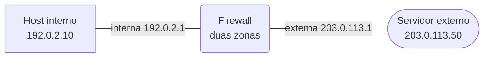

*Figura 3.1a (Tipo A, topologia).* Elementos do modo "Filtro sem estado (ACL)": Firewall (duas zonas); Servidor externo (203.0.113.50); Host interno (192.0.2.10). Vale para os cenários (6.1.1 a 6.1.5).

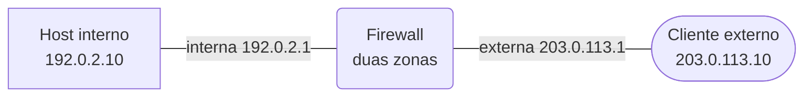

*Figura 3.1b (Tipo A, topologia).* Elementos do modo "Filtro sem estado (ACL)": Firewall (duas zonas); Cliente externo (203.0.113.10); Host interno (192.0.2.10). Vale para os cenários (6.1.6 e 6.1.7).

### 3.2 Filtro com estado


*Figura 3.2a (Tipo A, topologia).* Elementos do modo "Filtro com estado": Firewall (duas zonas); Servidor externo (203.0.113.50); Host interno (192.0.2.10). Vale para os cenários (6.2.1 e 6.2.2; 6.2.4 a 6.2.7).


*Figura 3.2b (Tipo A, topologia).* Elementos do modo "Filtro com estado": Firewall (duas zonas); Cliente externo (203.0.113.10); Host interno (192.0.2.10). Vale para os cenários (6.2.3).

### 3.3 Perímetro com DMZ


*Figura 3.3a (Tipo A, topologia).* Elementos do modo "Perímetro com DMZ": Firewall (três zonas); Cliente externo (203.0.113.10); Host interno (192.0.2.10); Servidor interno (192.0.2.20); Servidor web (198.51.100.80). Vale para os cenários (6.3.1; 6.3.3).

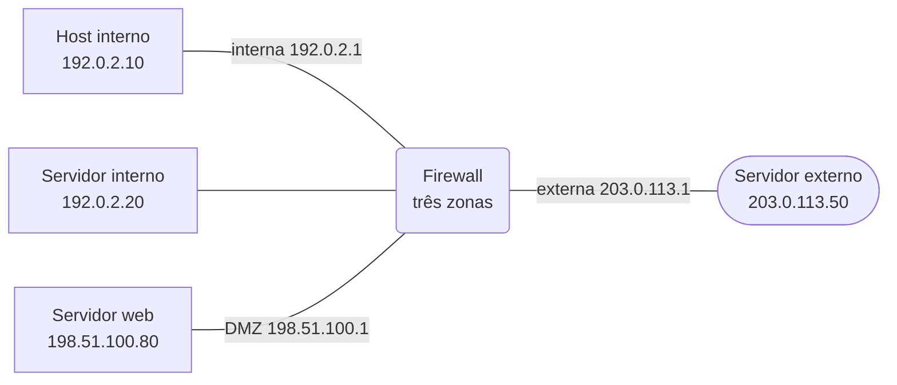

*Figura 3.3b (Tipo A, topologia).* Elementos do modo "Perímetro com DMZ": Firewall (três zonas); Servidor externo (203.0.113.50); Host interno (192.0.2.10); Servidor interno (192.0.2.20); Servidor web (198.51.100.80). Vale para os cenários (6.3.2; 6.3.4 a 6.3.7).

### 3.4 Forja, varredura e limite de taxa

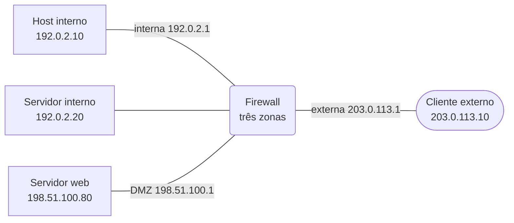

*Figura 3.4a (Tipo A, topologia).* Elementos do modo "Forja, varredura e limite de taxa": Firewall (três zonas); Cliente externo (203.0.113.10); Host interno (192.0.2.10); Servidor interno (192.0.2.20); Servidor web (198.51.100.80). Vale para os cenários (6.4.1 e 6.4.2; 6.4.5 a 6.4.9).


*Figura 3.4b (Tipo A, topologia).* Elementos do modo "Forja, varredura e limite de taxa": Firewall (três zonas); Servidor externo (203.0.113.50); Host interno (192.0.2.10); Servidor interno (192.0.2.20); Servidor web (198.51.100.80). Vale para os cenários (6.4.3 e 6.4.4).

## 4. Abas da bancada

Cenário, Captura, Mensagem, Regras, Conexões (modos: Filtro com estado; Perímetro com DMZ; Forja, varredura e limite de taxa), Experimento, Referência e Log.

## 5. Configurações (campos do painel)

### 5.1 Rede

- **RTT (ms)**. Valores: 2; 10; 20; 50; 100. Padrão: 20. Modos: todos.
  - Tempo de ida e volta entre as pontas.
  - Não muda a decisão do firewall, só os tempos mostrados. Cada pacote leva meio RTT para ir de uma ponta a outra, passando pelo firewall.

### 5.2 Tráfego

- **O que acontece**. Valores: Host interno abre uma conexão TCP para a porta 443; Host interno faz uma consulta DNS (UDP 53); Pacote de fora usa a porta de origem 443 e vai à porta 22 do host interno. Padrão: Host interno abre uma conexão TCP para a porta 443. Modos: Filtro sem estado (ACL).
  - Qual pacote ou conexão a lista de regras vai avaliar.
  - **TCP para a porta 443:** a saída está permitida por uma regra; falta ver se o retorno também está.
  - **Consulta DNS:** nenhuma regra fala de UDP 53, então decide a política padrão da lista.
  - **Pacote de fora:** mostra o que uma regra de retorno escrita por porta de origem deixa passar.
- **O que acontece**. Valores: Conexão TCP de dentro para fora (retorno pela tabela); Conexão TCP até o encerramento e a expiração; Pacotes de fora sem conexão registrada; Consulta e resposta DNS (UDP); Ping de dentro para fora; Conexões que ficam semiabertas e enchem a tabela. Padrão: Conexão TCP de dentro para fora (retorno pela tabela). Modos: Filtro com estado.
  - Qual história da tabela de conexões será simulada.
  - **TCP:** o SYN de dentro cria a entrada, e as respostas passam por ela sem regra de retorno.
  - **Encerramento:** mostra FIN_WAIT, TIME_WAIT e a remoção da entrada.
  - **Pacotes de fora:** respostas e pedidos que ninguém iniciou.
  - **UDP e ICMP:** não têm conexão; o firewall associa a resposta ao pedido por endereços, portas ou identificador.
  - **Tabela cheia:** o efeito de pedidos que nunca se completam.
- **Resposta DNS (fluxo UDP)**. Valores: Chega dentro da validade; Chega depois da validade da entrada. Padrão: Chega dentro da validade. Modos: Filtro com estado.
  - Só vale para o fluxo UDP.
  - A entrada de UDP expira depois de um tempo sem tráfego (30 s no simulador, valor ilustrativo). Uma resposta que chega depois não encontra a entrada e é negada.
- **O que acontece**. Valores: Internet acessa o servidor web da DMZ (443); Internet tenta chegar à rede interna (3389); Administrador interno acessa a DMZ (22); Servidor web da DMZ tenta chegar ao banco de dados interno; Servidor web da DMZ tenta abrir uma conexão para a Internet. Padrão: Internet acessa o servidor web da DMZ (443). Modos: Perímetro com DMZ.
  - Qual par de zonas será atravessado.
  - **Internet para a DMZ:** o serviço público, único acesso de fora.
  - **Internet para a rede interna:** não há regra, vale a negação padrão.
  - **Interna para a DMZ:** administração do servidor.
  - **DMZ para a rede interna:** o movimento lateral que a DMZ existe para conter.
  - **DMZ para a Internet:** a saída do servidor, que raramente precisa existir.
- **O que acontece**. Valores: De fora, com origem do endereço interno; De dentro, com origem que não é da rede interna; Um host da Internet sonda cinco portas do servidor web; Rajada de seis pedidos de conexão da mesma origem; Conexão HTTPS permitida com conteúdo cifrado. Padrão: De fora, com origem do endereço interno. Modos: Forja, varredura e limite de taxa.
  - Qual situação de defesa será mostrada.
  - **Origem forjada:** pacotes cujo endereço de origem não combina com a interface por onde chegam.
  - **Varredura:** o que o firewall mostra a quem sonda as portas.
  - **Rajada:** o limite de novas conexões por segundo.
  - **Conexão cifrada:** o que um firewall de camadas 3 e 4 não consegue ver.

### 5.3 Lista de regras

- **Regra de retorno (respostas de fora)**. Valores: Permitir TCP com porta de origem 443 para a rede interna; Permitir TCP com o flag ACK para a rede interna; Sem regra de retorno. Padrão: Permitir TCP com porta de origem 443 para a rede interna. Modos: Filtro sem estado (ACL).
  - Como um filtro sem estado aceita as respostas.
  - O filtro sem estado não sabe que uma resposta pertence a uma conexão iniciada de dentro. Por isso precisa de uma regra que a descreva.
  - **Porta de origem 443:** aceita qualquer pacote que venha dessa porta, inclusive os que não são respostas.
  - **Flag ACK:** recusa o pedido de nova conexão (SYN, sem ACK), mas aceita qualquer pacote com ACK, inclusive os forjados.
  - **Sem regra:** as respostas são negadas e a conexão não se completa.
- **Ordem das regras**. Valores: Regra específica primeiro; Regra genérica de negação antes da específica. Padrão: Regra específica primeiro. Modos: Filtro sem estado (ACL).
  - A primeira regra que casa decide; as seguintes não são consultadas.
  - Na ordem invertida, a regra que nega todo TCP vindo da rede interna fica antes da que permite a porta 443. Esta última nunca é alcançada.
  - Ao revisar uma lista, convém perguntar de cada regra: algum pacote chega a ela?
- **Política padrão (fim da lista)**. Valores: Negar (negação implícita); Permitir. Padrão: Negar (negação implícita). Modos: Filtro sem estado (ACL).
  - O que acontece com o pacote que nenhuma regra descreve.
  - **Negar:** só passa o que foi permitido de forma explícita. É a postura recomendada.
  - **Permitir:** só é bloqueado o que foi listado. Qualquer serviço esquecido na lista fica exposto.

### 5.4 Tabela de conexões

- **Tamanho da tabela (fluxo de tabela cheia)** (ajuste avançado). Valores: 3 entradas; 4 entradas; 6 entradas. Padrão: 4 entradas. Modos: Filtro com estado.
  - Só vale para o fluxo de tabela cheia.
  - Todo firewall com estado tem um limite de entradas. O simulador usa valores minúsculos para que o esgotamento apareça em poucos pacotes; nos equipamentos reais o limite é de milhares a milhões.

### 5.5 Regras entre zonas

- **Da DMZ para a rede interna**. Valores: Negar; Permitir qualquer protocolo (regra permissiva demais). Padrão: Negar. Modos: Perímetro com DMZ.
  - A regra que decide se um servidor comprometido alcança a rede interna.
  - Negar é o esperado: a DMZ é a zona exposta, e um servidor dela comprometido não deve conseguir iniciar conexões para dentro.
  - Uma regra permissiva, escrita por comodidade (por exemplo para o servidor consultar o banco), desfaz o isolamento.
- **Da DMZ para a Internet**. Valores: Negar; Permitir TCP 80 e 443. Padrão: Negar. Modos: Perímetro com DMZ.
  - Filtro de saída (egresso) da zona exposta.
  - Um servidor público costuma só responder a pedidos, sem iniciar conexões. Negar a saída limita o que um servidor comprometido consegue baixar ou enviar para fora.
  - Permitir 80 e 443 é comum para atualizações, mas abre um caminho de saída.

### 5.6 Defesas

- **Filtro de origem (anti-spoofing)**. Valores: caixa de seleção. Padrão: não. Modos: Forja, varredura e limite de taxa.
  - Confere se o endereço de origem combina com a interface de entrada.
  - De fora para dentro, um pacote com origem da própria rede interna só pode ser forjado e deve ser negado. De dentro para fora, o [BCP 38](https://www.rfc-editor.org/info/bcp38) recomenda que quem origina o tráfego só deixe sair pacotes com origem dos prefixos que lhe pertencem.
  - Ligado, os dois casos são negados antes de qualquer regra.
- **Resposta ao que é negado (varredura)**. Valores: Descartar em silêncio; Rejeitar com RST. Padrão: Descartar em silêncio. Modos: Forja, varredura e limite de taxa.
  - Descartar ou rejeitar o pacote negado.
  - **Descartar:** quem sonda não recebe nada e precisa esperar o tempo esgotar para concluir que a porta está filtrada.
  - **Rejeitar:** o firewall responde com RST, e a porta parece fechada. É mais amigável para quem erra a porta e informa mais a quem sonda.
  - Nenhum dos dois esconde que existe um dispositivo no caminho.
- **Limite de 3 novas conexões por segundo por origem**. Valores: caixa de seleção. Padrão: não. Modos: Forja, varredura e limite de taxa.
  - Vale para a regra que libera o servidor web.
  - Ligado, a regra aceita até 3 pedidos de conexão por segundo de cada origem. Os excedentes são negados até a janela seguinte.
  - Reduz o impacto de rajadas de pedidos, mas não substitui as defesas do próprio servidor.

## 6. Cenários

### 6.1 Modo: Filtro sem estado (ACL)

> **Grupo:** Regras de ida e de volta

Um filtro sem estado avalia cada pacote isolado, só pelo que está no cabeçalho. Uma conexão tem dois sentidos, e cada sentido precisa de uma regra.

#### 6.1.1 Ida e volta permitidas

*Uma regra para a ida e outra para o retorno.*

**Configuração aplicada:** O que acontece = tcp; Regra de retorno (respostas de fora) = porta; Ordem das regras = correta; Política padrão (fim da lista) = deny

Um host interno abre uma conexão TCP para a porta 443 de um servidor externo. A lista tem uma regra para a **ida** e outra para o **retorno**, e a conexão se completa.

**Conceito.** Num filtro sem estado, cada pacote é comparado às regras em ordem, sem lembrar do anterior. Para a conexão funcionar, a lista descreve a ida (TCP da rede interna para a porta 443) e o retorno (TCP com porta de origem 443 para a rede interna).

**O que observar**

- O SYN casa com a regra 1; o SYN+ACK, com a regra 2.
- O ACK e os dados de ida casam de novo com a regra 1; os dados de volta, com a regra 2.
- A aba Regras mostra quantas vezes cada regra foi usada.

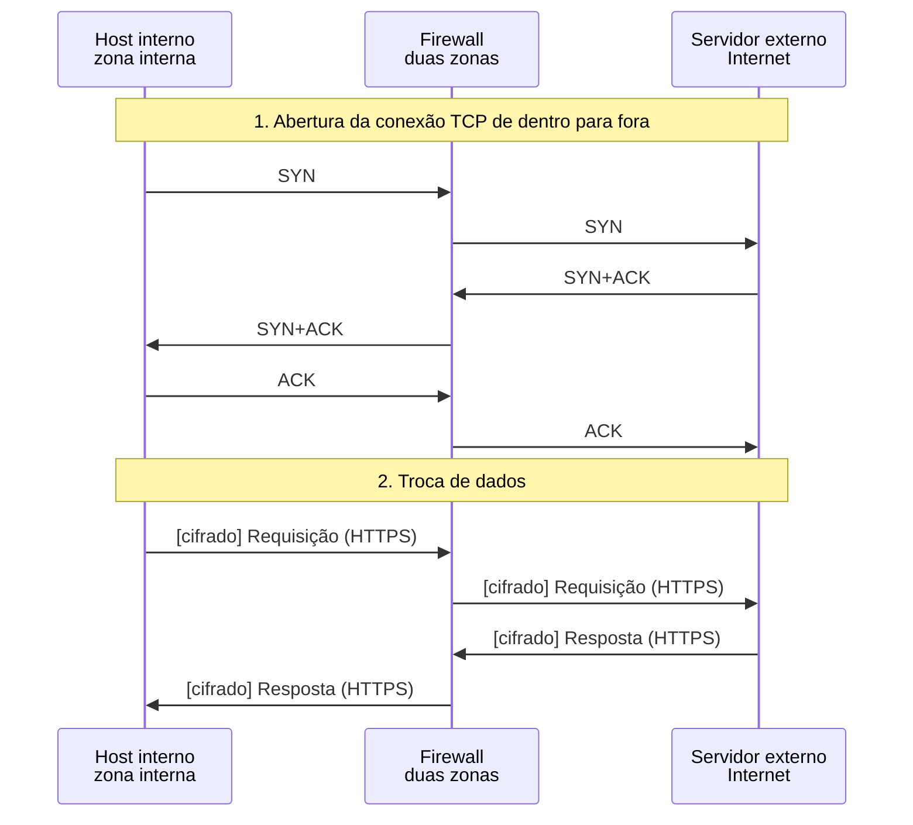

*Figura 6.1.1 (Tipo B, sequência).* Mensagens do cenário "Ida e volta permitidas", na ordem do tempo, entre Host interno, Firewall, Servidor externo: 10 mensagens (em 2 fases; 4 cifradas). Corresponde ao diagrama de sequência e à aba Captura, no modo "Filtro sem estado (ACL)", com a configuração aplicada acima.

**Mensagens**

| Mensagem | Significado | Origem |
| --- | --- | --- |
| SYN | pedido de conexão | host interno |
| SYN+ACK | resposta do servidor | servidor externo |
| ACK | conclusão do handshake | host interno |
| Requisição e resposta | dados cifrados (HTTPS) | host interno e servidor |

**Por que importa.** É o funcionamento esperado, e serve de referência para ver o que muda quando uma regra falta, está fora de ordem ou é permissiva demais.

#### 6.1.2 Falta a regra de retorno

*Sem regra de retorno, a resposta é negada.*

**Configuração aplicada:** O que acontece = tcp; Regra de retorno (respostas de fora) = nenhum; Ordem das regras = correta; Política padrão (fim da lista) = deny

Só a ida está permitida. O SYN chega ao servidor, mas o **SYN+ACK de volta é negado**: o filtro não sabe que ele responde a um pedido de dentro. O host retransmite o SYN e o resultado se repete.

**Conceito.** O firewall sem estado não sabe que o SYN+ACK responde a um SYN que ele deixou passar. Sem uma regra que o descreva, o pacote cai na política padrão e é negado. O host retransmite o SYN depois de 1 s ([RFC 6298](https://www.rfc-editor.org/rfc/rfc6298), seção 2, regra 2.1), e o resultado se repete.

**O que observar**

- O SYN passa e chega ao servidor.
- O SYN+ACK aparece com ✕ no firewall, negado pela política padrão.
- O segundo SYN, depois de 1 s, tem o mesmo destino.

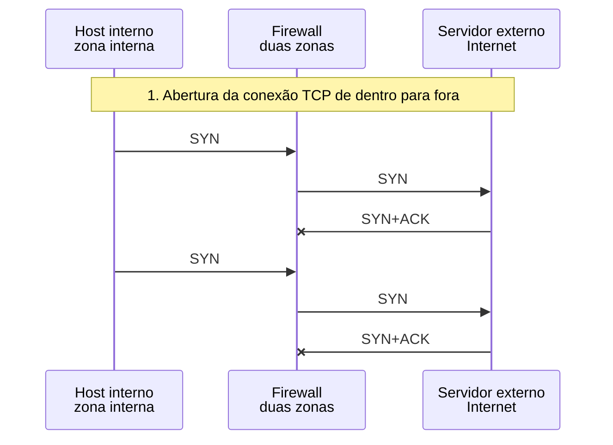

*Figura 6.1.2 (Tipo B, sequência).* Mensagens do cenário "Falta a regra de retorno", na ordem do tempo, entre Host interno, Firewall, Servidor externo: 6 mensagens (em 1 fase; 2 perdidas). Corresponde ao diagrama de sequência e à aba Captura, no modo "Filtro sem estado (ACL)", com a configuração aplicada acima.

**Mensagens**

| Mensagem | Significado | Origem |
| --- | --- | --- |
| SYN | passa pela regra 1 | host interno |
| SYN+ACK | negado: nenhuma regra o descreve | servidor externo |
| SYN (retransmitido) | depois de 1 s sem resposta | host interno |

**Por que importa.** Em listas sem estado, o erro mais comum é esquecer o retorno: o sintoma é uma conexão que "trava", e não uma recusa.

> **Grupo:** Ordem e política

A lista é percorrida de cima para baixo, e a primeira regra que casa decide. Se nenhuma casa, vale a política padrão do fim da lista.

#### 6.1.3 Ordem invertida das regras

*A regra específica fica depois da genérica e nunca é usada.*

**Configuração aplicada:** O que acontece = tcp; Regra de retorno (respostas de fora) = porta; Ordem das regras = invertida; Política padrão (fim da lista) = deny

Uma regra genérica que **nega todo TCP vindo da rede interna** foi escrita antes da que permite a porta 443. A primeira que casa decide, e a regra específica **nunca é alcançada**.

**Conceito.** A lista é percorrida de cima para baixo e para na primeira regra que casa. Se a regra que nega todo TCP da rede interna vem antes da que permite a porta 443, o SYN casa com a negação, e a regra de baixo nunca é consultada.

**O que observar**

- O SYN é negado pela regra 1.
- Na aba Regras, a regra 2 mostra zero usos.
- O host retransmite o SYN, e o resultado é o mesmo.

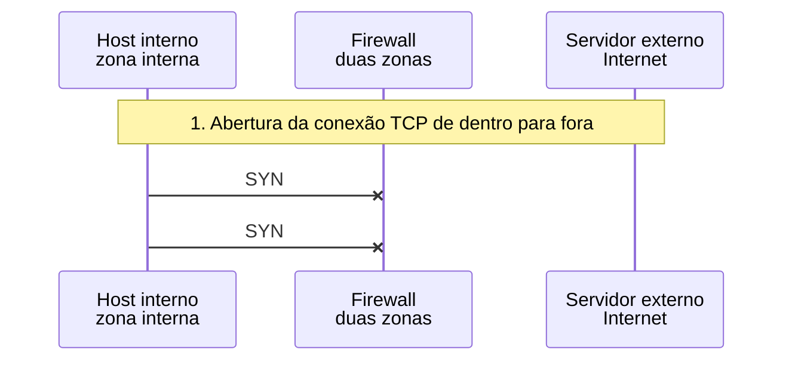

*Figura 6.1.3 (Tipo B, sequência).* Mensagens do cenário "Ordem invertida das regras", na ordem do tempo, entre Host interno, Firewall, Servidor externo: 2 mensagens (em 1 fase; 2 perdidas). Corresponde ao diagrama de sequência e à aba Captura, no modo "Filtro sem estado (ACL)", com a configuração aplicada acima.

**Mensagens**

| Mensagem | Significado | Origem |
| --- | --- | --- |
| SYN | negado pela regra 1 | host interno |
| SYN (retransmitido) | negado de novo | host interno |

**Por que importa.** Ao revisar uma lista, vale perguntar de cada regra se algum pacote chega a ela. Regras nunca usadas indicam ordem errada ou regra desnecessária.

#### 6.1.4 Negação implícita (consulta DNS)

*Sem regra para UDP 53, a política padrão nega.*

**Configuração aplicada:** O que acontece = udp; Regra de retorno (respostas de fora) = porta; Ordem das regras = correta; Política padrão (fim da lista) = deny

Nenhuma regra fala de UDP 53. O pacote chega ao fim da lista e é negado pela **política padrão**: o que não foi permitido de forma explícita não passa.

**Conceito.** Ao fim da lista, vale a política padrão. Com a política em negar (negação implícita), o que não foi permitido de forma explícita não passa. A consulta DNS não casa com nenhuma regra e é negada.

**O que observar**

- A consulta aparece com ✕ no firewall.
- A decisão é atribuída à política padrão, e não a uma regra numerada.
- O host interno fica sem resposta até o tempo esgotar.

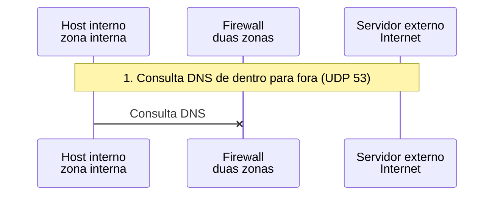

*Figura 6.1.4 (Tipo B, sequência).* Mensagens do cenário "Negação implícita (consulta DNS)", na ordem do tempo, entre Host interno, Firewall, Servidor externo: 1 mensagem (em 1 fase; 1 perdida). Corresponde ao diagrama de sequência e à aba Captura, no modo "Filtro sem estado (ACL)", com a configuração aplicada acima.

**Mensagens**

| Mensagem | Significado | Origem |
| --- | --- | --- |
| Consulta DNS | UDP 53, negada pela política | host interno |

**Por que importa.** A negação implícita é a postura mais segura: esquecer uma regra deixa algo indisponível (um problema que aparece e é corrigido), em vez de deixar algo exposto sem que ninguém perceba.

#### 6.1.5 Política padrão permitir (consulta DNS)

*Com política permitir, passa tudo que não foi listado.*

**Configuração aplicada:** O que acontece = udp; Regra de retorno (respostas de fora) = porta; Ordem das regras = correta; Política padrão (fim da lista) = permit

Mesma consulta, com a política padrão em **permitir**. A consulta e a resposta passam, mas o mesmo vale para **qualquer** serviço que a lista não mencione.

**Conceito.** Com a política padrão em permitir, a lista funciona como uma lista de exceções. A consulta DNS e a resposta passam, mas o mesmo acontece com qualquer serviço que a lista não mencione, inclusive os que ninguém quis expor.

**O que observar**

- A consulta e a resposta são atribuídas à política padrão.
- Nenhuma regra foi necessária para o DNS funcionar.

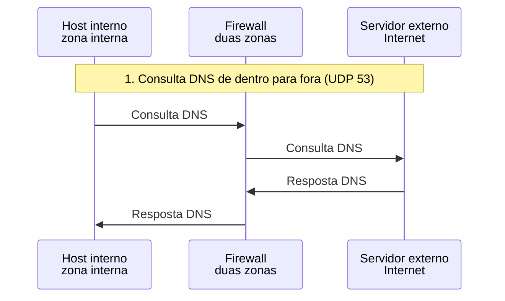

*Figura 6.1.5 (Tipo B, sequência).* Mensagens do cenário "Política padrão permitir (consulta DNS)", na ordem do tempo, entre Host interno, Firewall, Servidor externo: 4 mensagens (em 1 fase). Corresponde ao diagrama de sequência e à aba Captura, no modo "Filtro sem estado (ACL)", com a configuração aplicada acima.

**Mensagens**

| Mensagem | Significado | Origem |
| --- | --- | --- |
| Consulta DNS | UDP 53, permitida pela política | host interno |
| Resposta DNS | permitida pela política | servidor externo |

**Por que importa.** A comodidade tem preço: cada serviço novo ou esquecido nasce exposto. Por isso a política de negar é a recomendada, com as exceções listadas.

> **Grupo:** Limites do filtro sem estado

Sem memória das conexões, o filtro precisa adivinhar, pelo cabeçalho, quais pacotes são respostas. Qualquer palpite escrito em regra pode ser imitado.

#### 6.1.6 Retorno por porta de origem: pacote de fora passa

*Uma regra por porta de origem não prova que o pacote é uma resposta.*

**Configuração aplicada:** O que acontece = fora; Regra de retorno (respostas de fora) = porta; Ordem das regras = correta; Política padrão (fim da lista) = deny

A regra de retorno aceita qualquer TCP com **porta de origem 443** para a rede interna. Um pacote de fora que apenas usa essa porta como origem passa, e alcança a porta 22 de um host interno sem que ele tenha iniciado nada.

**Conceito.** A regra de retorno diz "aceite TCP com porta de origem 443 para a rede interna". Um pacote de fora pode usar essa porta como origem sem ser resposta a nada. O filtro, sem memória das conexões, não distingue, e o pacote chega à porta 22 do host interno.

**O que observar**

- O SYN de fora é permitido pela regra 2, mesmo sem nenhum pedido anterior de dentro.
- O host interno responde, e a resposta sai pela regra 1.
- A conexão se completa, iniciada de fora.

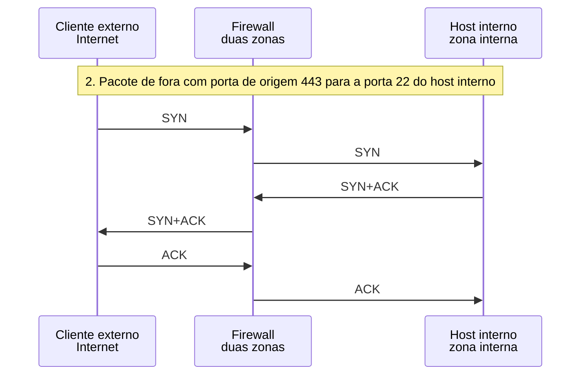

*Figura 6.1.6 (Tipo B, sequência).* Mensagens do cenário "Retorno por porta de origem: pacote de fora passa", na ordem do tempo, entre Cliente externo, Firewall, Host interno: 6 mensagens (em 1 fase). Corresponde ao diagrama de sequência e à aba Captura, no modo "Filtro sem estado (ACL)", com a configuração aplicada acima.

**Mensagens**

| Mensagem | Significado | Origem |
| --- | --- | --- |
| SYN | origem 443, destino 22; permitido pela regra 2 | host externo |
| SYN+ACK | resposta do host interno, permitida pela regra 1 | host interno |
| ACK | permitido pela regra 2 | host externo |

**Por que importa.** O limite do filtro sem estado não está em uma regra mal escrita, e sim na falta de memória. A defesa é um filtro com estado, que só aceita retorno de conexão que ele viu começar.

#### 6.1.7 Retorno por flag ACK

*Exigir ACK barra o pedido de conexão, mas não resolve tudo.*

**Configuração aplicada:** O que acontece = fora; Regra de retorno (respostas de fora) = ack; Ordem das regras = correta; Política padrão (fim da lista) = deny

A regra de retorno exige o **flag ACK**. O pedido de conexão de fora (SYN, sem ACK) é negado. A melhora é parcial: o filtro continua sem saber se o pacote com ACK pertence a alguma conexão.

**Conceito.** Um pedido de nova conexão tem SYN sem ACK. Exigir o flag ACK na regra de retorno nega esse pedido vindo de fora. Mas um pacote com ACK forjado ainda casaria com a regra, porque o filtro não sabe se ele pertence a alguma conexão.

**O que observar**

- O SYN de fora é negado: não tem o flag ACK.
- A decisão é atribuída à política padrão.

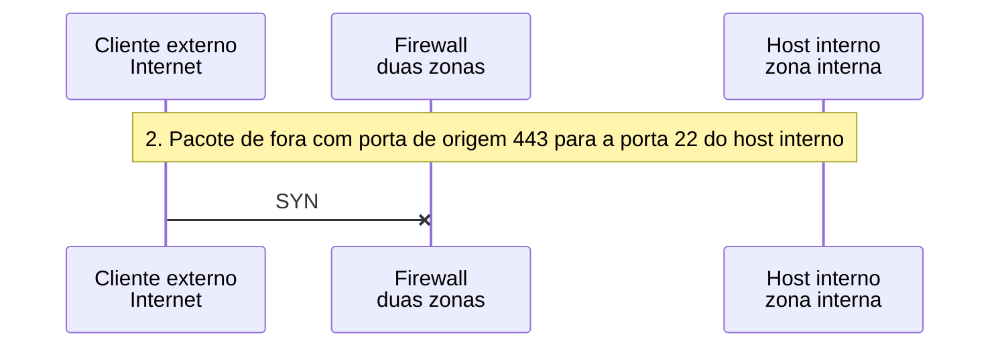

*Figura 6.1.7 (Tipo B, sequência).* Mensagens do cenário "Retorno por flag ACK", na ordem do tempo, entre Cliente externo, Firewall, Host interno: 1 mensagem (em 1 fase; 1 perdida). Corresponde ao diagrama de sequência e à aba Captura, no modo "Filtro sem estado (ACL)", com a configuração aplicada acima.

**Mensagens**

| Mensagem | Significado | Origem |
| --- | --- | --- |
| SYN | sem ACK: não casa com a regra de retorno | host externo |

**Por que importa.** O flag ACK é uma melhora real e barata, mas continua sendo um palpite sobre o cabeçalho. Só a tabela de conexões responde com certeza se o pacote pertence a uma conexão.

### 6.2 Modo: Filtro com estado

> **Grupo:** Conexões TCP

O firewall com estado registra a conexão quando vê o pedido e reconhece as respostas pela tabela. Só o início da conexão passa pelas regras.

#### 6.2.1 Saída permitida, retorno pela tabela

*O SYN cria a entrada; as respostas passam por ela.*

**Configuração aplicada:** O que acontece = tcp; Resposta DNS (fluxo UDP) = rapida; Tamanho da tabela (fluxo de tabela cheia) = 4

Só há regras de **saída**. O SYN cria uma entrada na tabela, e o SYN+ACK, o ACK e os dados passam **por pertencerem a essa conexão**, sem regra de retorno.

**Conceito.** Um firewall com estado avalia só o início da conexão pelas regras. O SYN permitido cria uma entrada na tabela, e os pacotes seguintes, nos dois sentidos, são aceitos por pertencerem a ela. Não existe regra de retorno.

**O que observar**

- A regra 1 aparece só no SYN.
- SYN+ACK, ACK e dados são atribuídos ao estado.
- A aba Conexões mostra a entrada passar por SYN_SENT, SYN_RECV e ESTABLISHED.

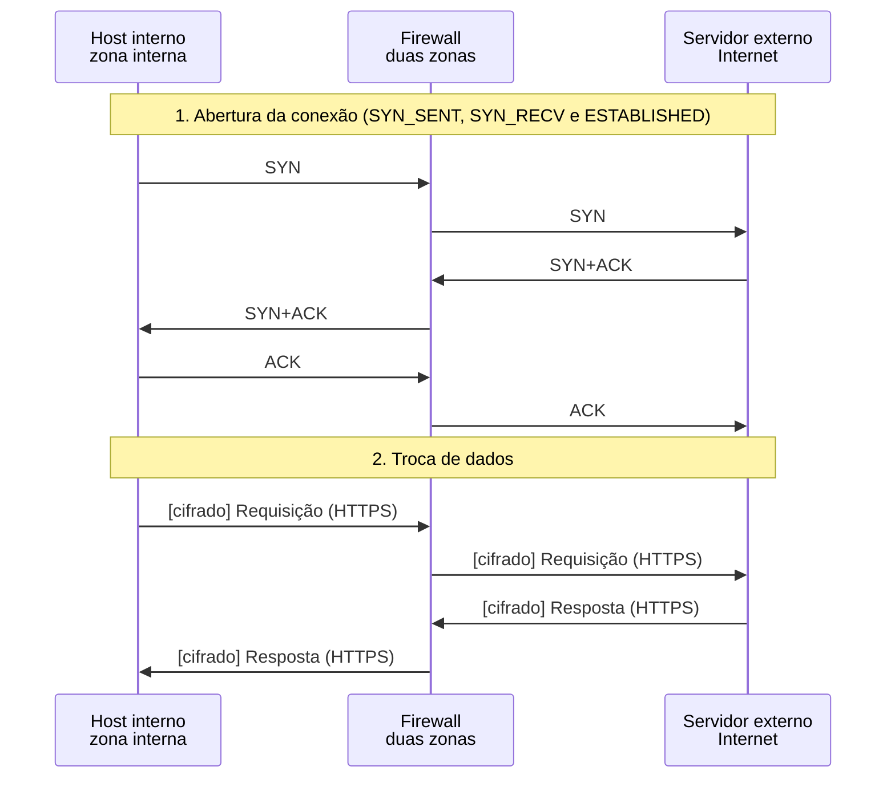

*Figura 6.2.1 (Tipo B, sequência).* Mensagens do cenário "Saída permitida, retorno pela tabela", na ordem do tempo, entre Host interno, Firewall, Servidor externo: 10 mensagens (em 2 fases; 4 cifradas). Corresponde ao diagrama de sequência e à aba Captura, no modo "Filtro com estado", com a configuração aplicada acima.

**Mensagens**

| Mensagem | Significado | Origem |
| --- | --- | --- |
| SYN | casa com a regra 1 e cria a entrada | host interno |
| SYN+ACK | aceito pela tabela (SYN_RECV) | servidor externo |
| ACK | aceito pela tabela (ESTABLISHED) | host interno |
| Requisição e resposta | aceitas pela tabela | host interno e servidor |

**Por que importa.** A tabela elimina a regra de retorno e, com ela, o palpite por porta ou flag: só volta o que tem uma conexão aberta de dentro.

#### 6.2.2 Estados até o encerramento

*Da abertura à expiração: SYN_SENT até TIME_WAIT.*

**Configuração aplicada:** O que acontece = tcp-fim; Resposta DNS (fluxo UDP) = rapida; Tamanho da tabela (fluxo de tabela cheia) = 4

A mesma conexão, acompanhada até o fim: **SYN_SENT, SYN_RECV, ESTABLISHED, FIN_WAIT e TIME_WAIT**. Depois do encerramento, a entrada some quando o prazo vence.

**Conceito.** O firewall acompanha o estado do TCP: SYN_SENT (viu o SYN), SYN_RECV (viu o SYN+ACK), ESTABLISHED (viu o ACK), FIN_WAIT (viu o primeiro FIN) e TIME_WAIT (viu os dois). Depois de um tempo, a entrada é removida. Os nomes se inspiram nos estados do TCP ([RFC 9293](https://www.rfc-editor.org/rfc/rfc9293), seção 3.3.2), sem serem idênticos, porque o firewall os deduz dos pacotes que vê; os prazos do simulador são ilustrativos.

**O que observar**

- A aba Conexões muda o estado a cada pacote.
- Depois do último ACK, a entrada fica em TIME_WAIT e some ao fim do prazo.
- O quadro de topologia mostra a tabela sob o firewall.

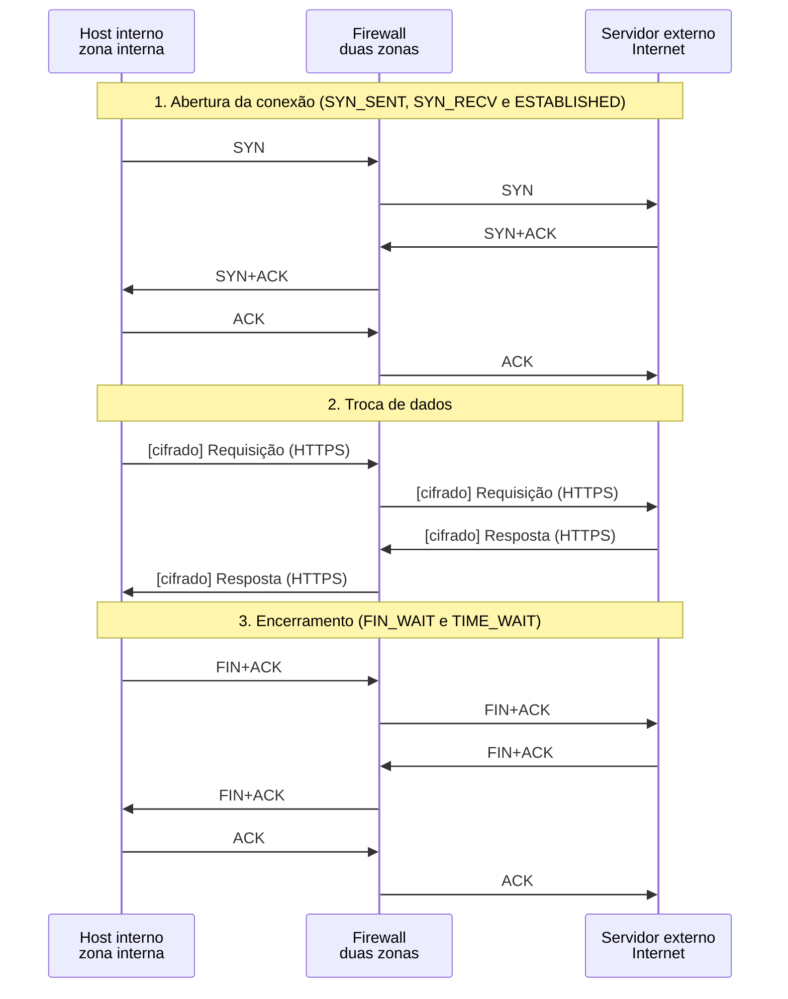

*Figura 6.2.2 (Tipo B, sequência).* Mensagens do cenário "Estados até o encerramento", na ordem do tempo, entre Host interno, Firewall, Servidor externo: 16 mensagens (em 4 fases; 4 cifradas). Corresponde ao diagrama de sequência e à aba Captura, no modo "Filtro com estado", com a configuração aplicada acima.

**Mensagens**

| Mensagem | Significado | Origem |
| --- | --- | --- |
| SYN, SYN+ACK, ACK | abertura | host e servidor |
| FIN+ACK (dois sentidos) | encerramento | host e servidor |
| ACK final | conclui o encerramento | host interno |

**Por que importa.** Entradas que não saem da tabela consomem memória. O encerramento correto e a expiração são o que mantém a tabela com o tamanho do tráfego real.

> **Grupo:** Pacotes fora de estado

Um pacote que não pertence a nenhuma conexão registrada, e que não é um pedido novo, não tem motivo para entrar.

#### 6.2.3 Pacotes de fora sem conexão registrada

*Resposta sem pedido é pacote fora de estado.*

**Configuração aplicada:** O que acontece = espuria; Resposta DNS (fluxo UDP) = rapida; Tamanho da tabela (fluxo de tabela cheia) = 4

Um host da Internet envia um SYN+ACK e um ACK que respondem a nada, e um SYN para a porta 3389. Os dois primeiros são **fora de estado**; o terceiro é um pedido novo, sem regra que o permita.

**Conceito.** Um SYN+ACK ou um ACK que não pertence a nenhuma conexão registrada é negado como fora de estado, antes mesmo das regras. O SYN para a porta 3389 é um pedido novo: passa pelas regras, não encontra nenhuma que o permita e cai na política padrão.

**O que observar**

- SYN+ACK e ACK são negados por não pertencerem a conexão alguma.
- O SYN é negado pela política padrão.
- A tabela de conexões continua vazia.

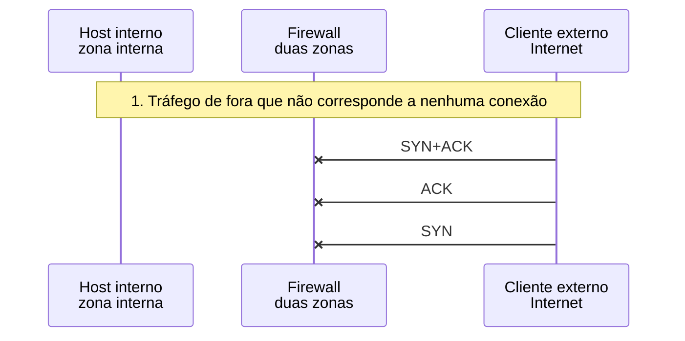

*Figura 6.2.3 (Tipo B, sequência).* Mensagens do cenário "Pacotes de fora sem conexão registrada", na ordem do tempo, entre Host interno, Firewall, Cliente externo: 3 mensagens (em 1 fase; 3 perdidas). Corresponde ao diagrama de sequência e à aba Captura, no modo "Filtro com estado", com a configuração aplicada acima.

**Mensagens**

| Mensagem | Significado | Origem |
| --- | --- | --- |
| SYN+ACK | resposta a nada: fora de estado | host externo |
| ACK | fora de estado | host externo |
| SYN | pedido novo para a porta 3389: política padrão | host externo |

**Por que importa.** Parte do tráfego de varredura e de ruído da Internet são pacotes que parecem respostas. O filtro com estado os descarta sem depender de regra.

> **Grupo:** UDP e ICMP

UDP e ICMP não têm conexão, então o firewall associa a resposta ao pedido por endereços, portas ou identificador, durante um tempo limitado.

#### 6.2.4 UDP: resposta dentro da validade

*A resposta UDP é aceita por casar com a consulta.*

**Configuração aplicada:** O que acontece = udp; Resposta DNS (fluxo UDP) = rapida; Tamanho da tabela (fluxo de tabela cheia) = 4

O UDP não tem conexão. O firewall registra a consulta e aceita a resposta que chega com os **mesmos endereços e portas, invertidos**, antes de a entrada expirar.

**Conceito.** O firewall registra a consulta (endereços e portas) e aceita a resposta que chega com os mesmos valores invertidos, enquanto a entrada vale. Depois da resposta, a entrada continua a valer por um tempo, para pacotes seguintes do mesmo fluxo.

**O que observar**

- A consulta casa com a regra 2 e cria a entrada em NEW.
- A resposta é aceita pela tabela, e a entrada passa a REPLIED.

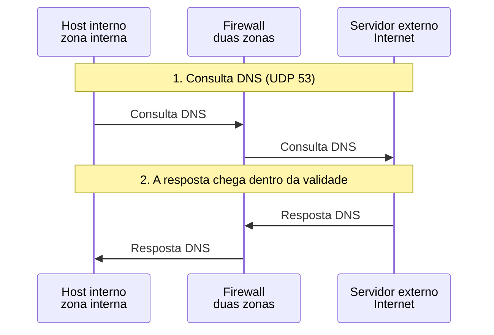

*Figura 6.2.4 (Tipo B, sequência).* Mensagens do cenário "UDP: resposta dentro da validade", na ordem do tempo, entre Host interno, Firewall, Servidor externo: 4 mensagens (em 2 fases). Corresponde ao diagrama de sequência e à aba Captura, no modo "Filtro com estado", com a configuração aplicada acima.

**Mensagens**

| Mensagem | Significado | Origem |
| --- | --- | --- |
| Consulta DNS | UDP 53, cria a entrada | host interno |
| Resposta DNS | aceita pela tabela | servidor externo |

**Por que importa.** O UDP não tem conexão, mas o firewall cria uma pseudoconexão. É o que permite o DNS funcionar sem abrir o UDP de fora para dentro.

#### 6.2.5 UDP: resposta depois da validade

*Resposta depois da validade encontra a entrada expirada.*

**Configuração aplicada:** O que acontece = udp; Resposta DNS (fluxo UDP) = tardia; Tamanho da tabela (fluxo de tabela cheia) = 4

A resposta demora mais que a validade da entrada (30 s no simulador). Quando chega, a entrada já expirou, e a resposta é **negada**.

**Conceito.** A entrada de UDP expira depois de um tempo sem tráfego (30 s no simulador, valor ilustrativo; cada produto usa o seu). Uma resposta que chega depois não encontra mais a entrada e, como pedido novo vindo de fora, é negada.

**O que observar**

- A aba Conexões mostra a entrada desaparecer.
- A resposta é negada pela política padrão.
- O host interno fica sem resposta.

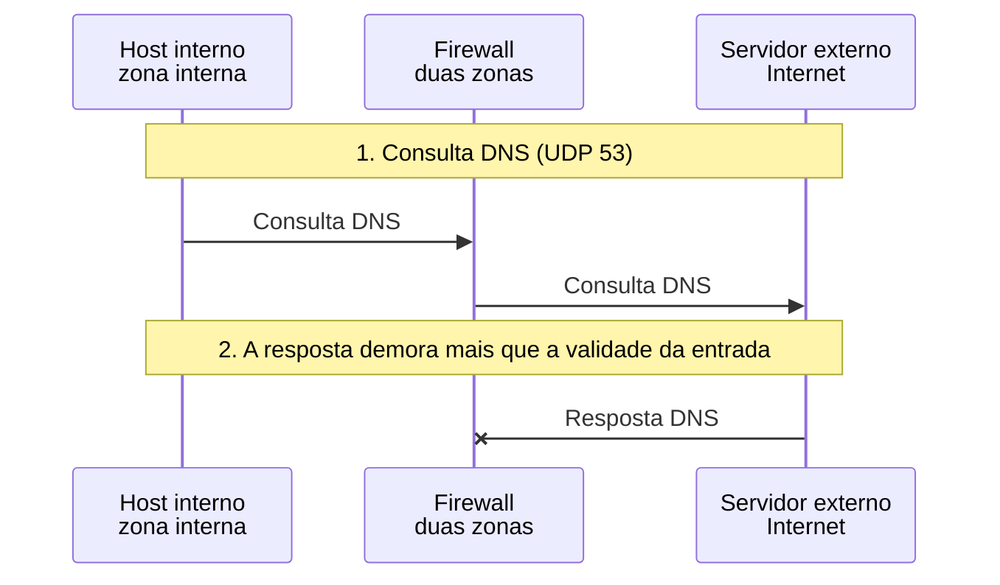

*Figura 6.2.5 (Tipo B, sequência).* Mensagens do cenário "UDP: resposta depois da validade", na ordem do tempo, entre Host interno, Firewall, Servidor externo: 3 mensagens (em 2 fases; 1 perdida). Corresponde ao diagrama de sequência e à aba Captura, no modo "Filtro com estado", com a configuração aplicada acima.

**Mensagens**

| Mensagem | Significado | Origem |
| --- | --- | --- |
| Consulta DNS | cria a entrada | host interno |
| Resposta DNS | chega depois da expiração: negada | servidor externo |

**Por que importa.** O prazo de UDP é um compromisso: curto demais derruba respostas lentas, longo demais ocupa a tabela. Servidores lentos ou distantes mostram o efeito.

#### 6.2.6 ICMP: ping e resposta repetida

*O Echo Reply é associado ao pedido pelo identificador.*

**Configuração aplicada:** O que acontece = icmp; Resposta DNS (fluxo UDP) = rapida; Tamanho da tabela (fluxo de tabela cheia) = 4

O Echo Reply é associado ao Echo Request pelo **identificador**. A primeira resposta passa e consome a entrada; uma segunda resposta idêntica é negada.

**Conceito.** O firewall registra o Echo Request com seu identificador. O primeiro Echo Reply com o identificador correspondente é aceito e consome a entrada (modelo simplificado do simulador). Uma segunda resposta idêntica já não encontra pedido para responder e é negada.

**O que observar**

- O pedido casa com a regra 3.
- A primeira resposta passa pela tabela e a entrada é removida.
- A segunda resposta é negada como fora de estado.

```mermaid
sequenceDiagram
  participant n_int as Host interno<br/>zona interna
  participant n_fw as Firewall<br/>duas zonas
  participant n_ext as Servidor externo<br/>Internet
  Note over n_int,n_ext: 1. Ping de dentro para fora
  n_int ->> n_fw: Echo Request
  n_fw ->> n_ext: Echo Request
  n_ext ->> n_fw: Echo Reply
  n_fw ->> n_int: Echo Reply
  Note over n_int,n_ext: 2. Segunda resposta com o mesmo identificador
  n_ext -x n_fw: Echo Reply
```

*Figura 6.2.6 (Tipo B, sequência).* Mensagens do cenário "ICMP: ping e resposta repetida", na ordem do tempo, entre Host interno, Firewall, Servidor externo: 5 mensagens (em 2 fases; 1 perdida). Corresponde ao diagrama de sequência e à aba Captura, no modo "Filtro com estado", com a configuração aplicada acima.

**Mensagens**

| Mensagem | Significado | Origem |
| --- | --- | --- |
| Echo Request | cria a entrada | host interno |
| Echo Reply | aceito e consome a entrada | servidor externo |
| Echo Reply (repetido) | fora de estado | servidor externo |

**Por que importa.** Permitir ping de saída não exige permitir o ICMP de entrada: a resposta volta pela tabela, e só ela.

> **Grupo:** Limites da tabela

A tabela de conexões é um recurso finito. Quem consegue enchê-la nega serviço a todos os outros.

#### 6.2.7 Tabela de conexões cheia

*Entradas semiabertas ocupam a tabela até o limite.*

**Configuração aplicada:** O que acontece = cheia; Resposta DNS (fluxo UDP) = rapida; Tamanho da tabela (fluxo de tabela cheia) = 4

Seis pedidos de conexão de dentro para um servidor que não responde. As entradas ficam em SYN_SENT; ao atingir o limite (4), os pedidos seguintes são negados, **inclusive os legítimos**.

**Conceito.** Cada SYN permitido cria uma entrada em SYN_SENT, e ela só sai quando o prazo vence. Se o servidor não responde, as entradas se acumulam. Ao chegar ao limite, o firewall nega os novos pedidos, inclusive os legítimos. O simulador usa uma tabela minúscula; os equipamentos reais têm limites muito maiores, mas finitos.

**O que observar**

- Os quatro primeiros SYN passam, e a tabela fica cheia.
- O quinto e o sexto são negados por tabela cheia.
- O servidor externo não responde, então as entradas ficam em SYN_SENT.

```mermaid
sequenceDiagram
  participant n_int as Host interno<br/>zona interna
  participant n_fw as Firewall<br/>duas zonas
  participant n_ext as Servidor externo<br/>Internet
  Note over n_int,n_ext: 1. Conexões que ficam semiabertas (o servidor não responde)
  n_int ->> n_fw: SYN
  n_fw ->> n_ext: SYN
  n_int ->> n_fw: SYN
  n_fw ->> n_ext: SYN
  n_int ->> n_fw: SYN
  n_fw ->> n_ext: SYN
  n_int ->> n_fw: SYN
  n_fw ->> n_ext: SYN
  n_int -x n_fw: SYN
  n_int -x n_fw: SYN
```

*Figura 6.2.7 (Tipo B, sequência).* Mensagens do cenário "Tabela de conexões cheia", na ordem do tempo, entre Host interno, Firewall, Servidor externo: 10 mensagens (em 1 fase; 2 perdidas). Corresponde ao diagrama de sequência e à aba Captura, no modo "Filtro com estado", com a configuração aplicada acima.

**Mensagens**

| Mensagem | Significado | Origem |
| --- | --- | --- |
| SYN (quatro primeiros) | permitidos, cada um cria uma entrada | host interno |
| SYN (quinto e sexto) | negados: tabela cheia | host interno |

**Por que importa.** O esgotamento da tabela é uma forma de negação de serviço. As defesas são limites por origem, prazos curtos para entradas semiabertas e o dimensionamento da tabela.

### 6.3 Modo: Perímetro com DMZ

> **Grupo:** Acessos permitidos

A política de um perímetro com DMZ lista poucos caminhos permitidos: o serviço público, de fora para a DMZ, e a administração, de dentro para a DMZ.

#### 6.3.1 Internet acessa o servidor web da DMZ

*O serviço público é o único acesso de fora.*

**Configuração aplicada:** O que acontece = pub; Da DMZ para a rede interna = negar; Da DMZ para a Internet = negar

Um cliente da Internet acessa a porta 443 do servidor web na DMZ. É o **único acesso de fora** que a política permite.

**Conceito.** A política permite TCP 80 e 443 da Internet para o servidor web da DMZ. O SYN cria a entrada, e o resto da conexão passa pela tabela. O servidor fica numa zona própria, separada da rede interna.

**O que observar**

- O SYN casa com a regra 1.
- Os pacotes seguintes são atribuídos ao estado.
- A topologia mostra as três zonas ligadas ao firewall.

```mermaid
sequenceDiagram
  participant n_ext as Cliente externo<br/>Internet
  participant n_fw as Firewall<br/>três zonas
  participant n_web as Servidor web<br/>zona DMZ
  Note over n_ext,n_web: 1. Cliente da Internet acessa o servidor web da DMZ
  n_ext ->> n_fw: SYN
  n_fw ->> n_web: SYN
  n_web ->> n_fw: SYN+ACK
  n_fw ->> n_ext: SYN+ACK
  n_ext ->> n_fw: ACK
  n_fw ->> n_web: ACK
  Note over n_ext,n_web: 2. Troca de dados
  n_ext ->> n_fw: [cifrado] Requisição (HTTPS)
  n_fw ->> n_web: [cifrado] Requisição (HTTPS)
  n_web ->> n_fw: [cifrado] Resposta (HTTPS)
  n_fw ->> n_ext: [cifrado] Resposta (HTTPS)
```

*Figura 6.3.1 (Tipo B, sequência).* Mensagens do cenário "Internet acessa o servidor web da DMZ", na ordem do tempo, entre Cliente externo, Firewall, Servidor web: 10 mensagens (em 2 fases; 4 cifradas). Corresponde ao diagrama de sequência e à aba Captura, no modo "Perímetro com DMZ", com a configuração aplicada acima.

**Mensagens**

| Mensagem | Significado | Origem |
| --- | --- | --- |
| SYN, SYN+ACK, ACK | abertura da conexão | cliente e servidor web |
| Requisição e resposta | HTTPS, cifradas | cliente e servidor web |

**Por que importa.** A DMZ concentra o que precisa ser acessível de fora. Quanto menos caminhos permitidos, menos o que se precisa vigiar.

#### 6.3.2 Administrador interno acessa a DMZ

*De dentro para a DMZ pode; o inverso, não.*

**Configuração aplicada:** O que acontece = admin; Da DMZ para a rede interna = negar; Da DMZ para a Internet = negar

Um host da rede interna administra o servidor web pela porta 22. A política permite **interna para DMZ**, mas não o caminho inverso.

**Conceito.** A administração do servidor web parte da rede interna: a regra 2 permite TCP 22 e 443 da zona interna para o servidor. O sentido contrário (DMZ para interna) não está permitido, e a sessão iniciada de dentro volta pela tabela.

**O que observar**

- O SYN casa com a regra 2.
- A sessão SSH (cifrada) passa pela tabela.

```mermaid
sequenceDiagram
  participant n_int as Host interno<br/>zona interna
  participant n_fw as Firewall<br/>três zonas
  participant n_web as Servidor web<br/>zona DMZ
  Note over n_int,n_web: 1. Administrador interno acessa o servidor web da DMZ (porta 22)
  n_int ->> n_fw: SYN
  n_fw ->> n_web: SYN
  n_web ->> n_fw: SYN+ACK
  n_fw ->> n_int: SYN+ACK
  n_int ->> n_fw: ACK
  n_fw ->> n_web: ACK
  Note over n_int,n_web: 2. Sessão
  n_int ->> n_fw: [cifrado] Sessão (SSH)
  n_fw ->> n_web: [cifrado] Sessão (SSH)
  n_web ->> n_fw: [cifrado] Sessão (SSH)
  n_fw ->> n_int: [cifrado] Sessão (SSH)
```

*Figura 6.3.2 (Tipo B, sequência).* Mensagens do cenário "Administrador interno acessa a DMZ", na ordem do tempo, entre Host interno, Firewall, Servidor web: 10 mensagens (em 2 fases; 4 cifradas). Corresponde ao diagrama de sequência e à aba Captura, no modo "Perímetro com DMZ", com a configuração aplicada acima.

**Mensagens**

| Mensagem | Significado | Origem |
| --- | --- | --- |
| SYN, SYN+ACK, ACK | abertura da sessão | host interno e servidor web |
| Sessão SSH | dados cifrados | host interno e servidor web |

**Por que importa.** Quem inicia a conexão determina a direção da confiança. A DMZ nunca inicia conexões para a rede interna.

> **Grupo:** Acessos que a política nega

O que não está permitido é negado. A DMZ existe para que o comprometimento de um servidor exposto não alcance a rede interna.

#### 6.3.3 Internet tenta chegar à rede interna

*Sem regra de fora para dentro, vale a negação.*

**Configuração aplicada:** O que acontece = ext-int; Da DMZ para a rede interna = negar; Da DMZ para a Internet = negar

Um host da Internet tenta abrir a porta 3389 de um host interno. Nenhuma regra descreve esse caminho, e a **política padrão nega**. O SYN é retransmitido uma vez e negado de novo.

**Conceito.** Nenhuma regra permite que a Internet alcance a rede interna. O SYN para a porta 3389 não casa com regra alguma e cai na política padrão. O cliente retransmite o SYN depois de 1 s e recebe o mesmo resultado, em silêncio.

**O que observar**

- O SYN é negado pela política padrão, duas vezes.
- O host interno nem chega a ver os pacotes.

```mermaid
sequenceDiagram
  participant n_ext as Cliente externo<br/>Internet
  participant n_fw as Firewall<br/>três zonas
  participant n_int as Host interno<br/>zona interna
  Note over n_ext,n_int: 1. Cliente da Internet tenta chegar à rede interna (porta 3389)
  n_ext -x n_fw: SYN
  n_ext -x n_fw: SYN
```

*Figura 6.3.3 (Tipo B, sequência).* Mensagens do cenário "Internet tenta chegar à rede interna", na ordem do tempo, entre Cliente externo, Firewall, Host interno: 2 mensagens (em 1 fase; 2 perdidas). Corresponde ao diagrama de sequência e à aba Captura, no modo "Perímetro com DMZ", com a configuração aplicada acima.

**Mensagens**

| Mensagem | Significado | Origem |
| --- | --- | --- |
| SYN | porta 3389, negado | cliente externo |
| SYN (retransmitido) | negado de novo | cliente externo |

**Por que importa.** A rede interna não precisa de nenhum serviço exposto à Internet. Qualquer porta interna alcançável de fora é uma decisão consciente, e não um efeito colateral.

#### 6.3.4 DMZ tenta chegar à rede interna (negado)

*A regra DMZ para interna nega: o dano fica contido.*

**Configuração aplicada:** O que acontece = lateral; Da DMZ para a rede interna = negar; Da DMZ para a Internet = negar

Suponha o servidor web comprometido. Ele tenta alcançar o banco de dados interno, mas a regra **DMZ para interna nega**, e o dano fica contido na DMZ.

**Conceito.** Se o servidor web for comprometido, o atacante controla uma máquina da DMZ. A regra 5 nega qualquer protocolo da DMZ para a rede interna, e a tentativa de alcançar o banco de dados é negada. A DMZ existe para esse caso.

**O que observar**

- O SYN do servidor web é negado pela regra 5.
- A tabela de conexões continua vazia.
- O SYN é retransmitido uma vez e negado de novo.

```mermaid
sequenceDiagram
  participant n_web as Servidor web<br/>zona DMZ
  participant n_fw as Firewall<br/>três zonas
  participant n_db as Servidor interno<br/>zona interna
  Note over n_web,n_db: 1. Servidor web (suposto comprometido) tenta chegar ao banco de dados interno
  n_web -x n_fw: SYN
  n_web -x n_fw: SYN
```

*Figura 6.3.4 (Tipo B, sequência).* Mensagens do cenário "DMZ tenta chegar à rede interna (negado)", na ordem do tempo, entre Servidor web, Firewall, Servidor interno: 2 mensagens (em 1 fase; 2 perdidas). Corresponde ao diagrama de sequência e à aba Captura, no modo "Perímetro com DMZ", com a configuração aplicada acima.

**Mensagens**

| Mensagem | Significado | Origem |
| --- | --- | --- |
| SYN | DMZ para o banco de dados: negado pela regra 5 | servidor web |
| SYN (retransmitido) | negado de novo | servidor web |

**Por que importa.** O objetivo não é impedir o comprometimento do servidor, e sim impedir que ele se torne ponto de partida para a rede interna.

#### 6.3.5 DMZ tenta sair para a Internet (negado)

*O filtro de saída limita o que o servidor comprometido faz.*

**Configuração aplicada:** O que acontece = egresso; Da DMZ para a rede interna = negar; Da DMZ para a Internet = negar

O servidor web tenta abrir uma conexão para a Internet. A regra de **filtro de saída** da DMZ nega, e um servidor comprometido não baixa nem envia nada por esse caminho.

**Conceito.** Um servidor público costuma só responder a pedidos. A regra 6 nega as conexões que ele inicia para a Internet. Um servidor comprometido não consegue, por esse caminho, baixar ferramentas nem enviar dados para fora.

**O que observar**

- O SYN do servidor web é negado pela regra 6.
- As respostas a clientes continuam funcionando, pelo estado.

```mermaid
sequenceDiagram
  participant n_web as Servidor web<br/>zona DMZ
  participant n_fw as Firewall<br/>três zonas
  participant n_ext as Servidor externo<br/>Internet
  Note over n_web,n_ext: 1. Servidor web tenta abrir uma conexão para a Internet (porta 443)
  n_web -x n_fw: SYN
  n_web -x n_fw: SYN
```

*Figura 6.3.5 (Tipo B, sequência).* Mensagens do cenário "DMZ tenta sair para a Internet (negado)", na ordem do tempo, entre Servidor web, Firewall, Servidor externo: 2 mensagens (em 1 fase; 2 perdidas). Corresponde ao diagrama de sequência e à aba Captura, no modo "Perímetro com DMZ", com a configuração aplicada acima.

**Mensagens**

| Mensagem | Significado | Origem |
| --- | --- | --- |
| SYN | DMZ para a Internet: negado pela regra 6 | servidor web |
| SYN (retransmitido) | negado de novo | servidor web |

**Por que importa.** Filtrar a saída é tão importante quanto filtrar a entrada, e é frequentemente esquecido. Atualizações podem ser feitas por um ponto controlado, em vez de liberar a saída do servidor.

> **Grupo:** Regras que enfraquecem o perímetro

Regras escritas por comodidade desfazem o isolamento que a estrutura de zonas oferece.

#### 6.3.6 Regra permissiva de DMZ para a rede interna

*Uma regra permissiva desfaz o isolamento da DMZ.*

**Configuração aplicada:** O que acontece = lateral; Da DMZ para a rede interna = permissiva; Da DMZ para a Internet = negar

Uma regra **permite qualquer protocolo da DMZ para a rede interna**, escrita para facilitar a consulta ao banco. O servidor comprometido alcança o banco de dados, e o isolamento da DMZ se perde.

**Conceito.** A regra 5 foi trocada por uma que permite qualquer protocolo da DMZ para a rede interna, por comodidade. O servidor web, se comprometido, alcança o banco de dados. A estrutura de zonas continua no desenho, mas deixou de proteger.

**O que observar**

- O SYN é permitido pela regra 5.
- A consulta ao banco de dados passa, em texto puro.
- O resto da conexão passa pela tabela.

```mermaid
sequenceDiagram
  participant n_web as Servidor web<br/>zona DMZ
  participant n_fw as Firewall<br/>três zonas
  participant n_db as Servidor interno<br/>zona interna
  Note over n_web,n_db: 1. Servidor web (suposto comprometido) tenta chegar ao banco de dados interno
  n_web ->> n_fw: SYN
  n_fw ->> n_db: SYN
  n_db ->> n_fw: SYN+ACK
  n_fw ->> n_web: SYN+ACK
  n_web ->> n_fw: ACK
  n_fw ->> n_db: ACK
  Note over n_web,n_db: 2. Consulta ao banco de dados
  n_web ->> n_fw: Consulta SQL
  n_fw ->> n_db: Consulta SQL
  n_db ->> n_fw: Resultado
  n_fw ->> n_web: Resultado
```

*Figura 6.3.6 (Tipo B, sequência).* Mensagens do cenário "Regra permissiva de DMZ para a rede interna", na ordem do tempo, entre Servidor web, Firewall, Servidor interno: 10 mensagens (em 2 fases). Corresponde ao diagrama de sequência e à aba Captura, no modo "Perímetro com DMZ", com a configuração aplicada acima.

**Mensagens**

| Mensagem | Significado | Origem |
| --- | --- | --- |
| SYN, SYN+ACK, ACK | conexão da DMZ para o banco de dados | servidor web e banco |
| Consulta SQL e resultado | dados que o servidor comprometido alcança | servidor web e banco |

**Por que importa.** Regras amplas feitas para resolver um problema pontual costumam ficar. O caminho necessário é restrito (um host, uma porta), e não "qualquer protocolo".

#### 6.3.7 Saída da DMZ liberada para TCP 80 e 443

*Saída liberada: o servidor comprometido também sai.*

**Configuração aplicada:** O que acontece = egresso; Da DMZ para a rede interna = negar; Da DMZ para a Internet = permitir

A saída da DMZ foi liberada para atualizações. A conexão passa, e **qualquer** código no servidor também pode abrir conexões para a Internet por esse caminho.

**Conceito.** A saída foi liberada para TCP 80 e 443, para atualizações. A conexão do servidor passa. Qualquer código executado nele também pode abrir conexões para a Internet por esse caminho, que parece tráfego web comum.

**O que observar**

- O SYN é permitido pela regra 6.
- A conexão é registrada e acompanhada pela tabela.

```mermaid
sequenceDiagram
  participant n_web as Servidor web<br/>zona DMZ
  participant n_fw as Firewall<br/>três zonas
  participant n_ext as Servidor externo<br/>Internet
  Note over n_web,n_ext: 1. Servidor web tenta abrir uma conexão para a Internet (porta 443)
  n_web ->> n_fw: SYN
  n_fw ->> n_ext: SYN
  n_ext ->> n_fw: SYN+ACK
  n_fw ->> n_web: SYN+ACK
  n_web ->> n_fw: ACK
  n_fw ->> n_ext: ACK
```

*Figura 6.3.7 (Tipo B, sequência).* Mensagens do cenário "Saída da DMZ liberada para TCP 80 e 443", na ordem do tempo, entre Servidor web, Firewall, Servidor externo: 6 mensagens (em 1 fase). Corresponde ao diagrama de sequência e à aba Captura, no modo "Perímetro com DMZ", com a configuração aplicada acima.

**Mensagens**

| Mensagem | Significado | Origem |
| --- | --- | --- |
| SYN, SYN+ACK, ACK | conexão da DMZ para a Internet | servidor web e servidor externo |

**Por que importa.** Liberar 80 e 443 para a saída é comum, mas é um caminho aberto. Restringir os destinos (por exemplo, o repositório de atualizações) reduz o risco.

### 6.4 Modo: Forja, varredura e limite de taxa

> **Grupo:** Origem forjada

O endereço de origem de um pacote IP não é autenticado. O filtro de origem confere se ele é plausível para a interface por onde o pacote passa. Na saída, é a recomendação do [BCP 38](https://www.rfc-editor.org/info/bcp38).

#### 6.4.1 Origem interna vinda de fora, sem filtro

*Sem filtro de origem, uma origem interna vinda de fora é aceita.*

**Configuração aplicada:** O que acontece = forja-in; Filtro de origem (anti-spoofing) = não; Resposta ao que é negado (varredura) = descartar; Limite de 3 novas conexões por segundo por origem = não

Um pacote chega pela interface **externa** com origem de um endereço da rede **interna**. Sem filtro de origem, a regra que permite o tráfego interno para a DMZ o aceita.

**Conceito.** O endereço de origem de um pacote IP não é autenticado. Aqui, um pacote chega pela interface externa com origem de um endereço da rede interna. A regra 4 permite TCP 443 da zona interna para o servidor web, e, por olhar só o endereço, aceita o pacote. O servidor responde ao dono verdadeiro do endereço, que reage com RST.

**O que observar**

- O SYN é permitido pela regra 4, mesmo chegando pela interface externa.
- O SYN+ACK segue para o host interno verdadeiro.
- O host interno responde com RST, porque não abriu aquela conexão.

```mermaid
sequenceDiagram
  participant n_ext as Cliente externo<br/>Internet
  participant n_fw as Firewall<br/>três zonas
  participant n_web as Servidor web<br/>zona DMZ
  participant n_int as Host interno<br/>zona interna
  Note over n_ext,n_int: 1. Pacote vindo da Internet com origem do endereço interno 192.0.2.10
  n_ext ->> n_fw: SYN
  n_fw ->> n_web: SYN
  Note over n_ext,n_int: 2. O servidor responde ao dono verdadeiro do endereço
  n_web ->> n_fw: SYN+ACK
  n_fw ->> n_int: SYN+ACK
  n_int ->> n_fw: RST
  n_fw ->> n_web: RST
```

*Figura 6.4.1 (Tipo B, sequência).* Mensagens do cenário "Origem interna vinda de fora, sem filtro", na ordem do tempo, entre Cliente externo, Firewall, Servidor web, Host interno: 6 mensagens (em 2 fases). Corresponde ao diagrama de sequência e à aba Captura, no modo "Forja, varredura e limite de taxa", com a configuração aplicada acima.

**Mensagens**

| Mensagem | Significado | Origem |
| --- | --- | --- |
| SYN | origem interna, vindo da interface externa | host externo |
| SYN+ACK | enviado ao dono verdadeiro do endereço | servidor web |
| RST | o host interno não reconhece a conexão | host interno |

**Por que importa.** Regras que olham só o endereço presumem que ele é verdadeiro. O filtro de origem conserta a premissa na entrada da rede.

#### 6.4.2 Origem interna vinda de fora, com filtro

*O filtro de origem nega antes de qualquer regra.*

**Configuração aplicada:** O que acontece = forja-in; Filtro de origem (anti-spoofing) = sim; Resposta ao que é negado (varredura) = descartar; Limite de 3 novas conexões por segundo por origem = não

Com o filtro de origem ligado, o pacote é negado **antes das regras**, porque uma origem da zona interna não pode chegar pela interface externa.

**Conceito.** Com o filtro de origem ligado, o firewall compara o endereço de origem com a interface de chegada. Uma origem da zona interna chegando pela externa só pode ser forjada, e o pacote é negado antes das regras.

**O que observar**

- A decisão é atribuída ao filtro de origem, e não a uma regra numerada.
- O servidor web e o host interno nem chegam a ver o pacote.

```mermaid
sequenceDiagram
  participant n_ext as Cliente externo<br/>Internet
  participant n_fw as Firewall<br/>três zonas
  participant n_web as Servidor web<br/>zona DMZ
  participant n_int as Host interno<br/>zona interna
  Note over n_ext,n_int: 1. Pacote vindo da Internet com origem do endereço interno 192.0.2.10
  n_ext -x n_fw: SYN
```

*Figura 6.4.2 (Tipo B, sequência).* Mensagens do cenário "Origem interna vinda de fora, com filtro", na ordem do tempo, entre Cliente externo, Firewall, Servidor web, Host interno: 1 mensagem (em 1 fase; 1 perdida). Corresponde ao diagrama de sequência e à aba Captura, no modo "Forja, varredura e limite de taxa", com a configuração aplicada acima.

**Mensagens**

| Mensagem | Significado | Origem |
| --- | --- | --- |
| SYN | origem interna pela interface externa: negado | host externo |

**Por que importa.** É uma verificação simples e barata, que elimina uma classe inteira de pacotes antes de qualquer regra.

#### 6.4.3 Saída com origem alheia, sem filtro

*Sem filtro, a regra de saída deixa passar origem alheia.*

**Configuração aplicada:** O que acontece = forja-out; Filtro de origem (anti-spoofing) = não; Resposta ao que é negado (varredura) = descartar; Limite de 3 novas conexões por segundo por origem = não

Um host interno envia um pacote cuja origem **não pertence à rede interna**. Sem filtro, a regra de saída só olha a interface e o destino, e o pacote sai.

**Conceito.** A regra de saída olha a interface de chegada e o destino, e não a origem. Um host interno que envia um pacote com origem que não é da rede interna é atendido, e o pacote sai. A resposta irá ao dono do endereço forjado, e não a quem o enviou.

**O que observar**

- O pacote é permitido pela regra 3 e segue para a Internet.
- O destino recebe um pacote com origem que não condiz com o caminho.

```mermaid
sequenceDiagram
  participant n_int as Host interno<br/>zona interna
  participant n_fw as Firewall<br/>três zonas
  participant n_ext as Servidor externo<br/>Internet
  Note over n_int,n_ext: 1. Pacote saindo com origem que não pertence à rede interna
  n_int ->> n_fw: UDP 53 (origem forjada)
  n_fw ->> n_ext: UDP 53 (origem forjada)
```

*Figura 6.4.3 (Tipo B, sequência).* Mensagens do cenário "Saída com origem alheia, sem filtro", na ordem do tempo, entre Host interno, Firewall, Servidor externo: 2 mensagens (em 1 fase). Corresponde ao diagrama de sequência e à aba Captura, no modo "Forja, varredura e limite de taxa", com a configuração aplicada acima.

**Mensagens**

| Mensagem | Significado | Origem |
| --- | --- | --- |
| UDP 53 (origem forjada) | origem que não é da zona interna | host interno |

**Por que importa.** Uma rede que deixa sair pacotes com origem forjada ajuda quem os usa contra terceiros. Cada rede é a melhor posição para impedir o que parte dela.

#### 6.4.4 Saída com origem alheia, com filtro

*O filtro de saída é a medida central do [BCP 38](https://www.rfc-editor.org/info/bcp38).*

**Configuração aplicada:** O que acontece = forja-out; Filtro de origem (anti-spoofing) = sim; Resposta ao que é negado (varredura) = descartar; Limite de 3 novas conexões por segundo por origem = não

Com o filtro de origem ligado, o pacote não sai: a origem não pertence à zona interna. É a medida central do [BCP 38](https://www.rfc-editor.org/info/bcp38): **cada rede cuida do que sai dela**.

**Conceito.** Com o filtro de origem ligado, o firewall confere que a origem de um pacote vindo da interface interna pertence à zona interna. Uma origem alheia é negada. O [BCP 38](https://www.rfc-editor.org/info/bcp38) recomenda esse filtro na borda de quem origina o tráfego.

**O que observar**

- A decisão é atribuída ao filtro de origem.
- O pacote não chega à Internet.

```mermaid
sequenceDiagram
  participant n_int as Host interno<br/>zona interna
  participant n_fw as Firewall<br/>três zonas
  participant n_ext as Servidor externo<br/>Internet
  Note over n_int,n_ext: 1. Pacote saindo com origem que não pertence à rede interna
  n_int -x n_fw: UDP 53 (origem forjada)
```

*Figura 6.4.4 (Tipo B, sequência).* Mensagens do cenário "Saída com origem alheia, com filtro", na ordem do tempo, entre Host interno, Firewall, Servidor externo: 1 mensagem (em 1 fase; 1 perdida). Corresponde ao diagrama de sequência e à aba Captura, no modo "Forja, varredura e limite de taxa", com a configuração aplicada acima.

**Mensagens**

| Mensagem | Significado | Origem |
| --- | --- | --- |
| UDP 53 (origem forjada) | origem fora da zona interna: negado | host interno |

**Por que importa.** O filtro de saída protege os outros, não a própria rede, e por isso depende de cada operador fazer a sua parte.

> **Grupo:** Varredura de portas

Quem sonda portas aprende com as respostas, ou com o silêncio. O firewall escolhe quanto revelar.

#### 6.4.5 Varredura com descarte silencioso

*O descarte silencioso não diz o que há na porta.*

**Configuração aplicada:** O que acontece = varredura; Filtro de origem (anti-spoofing) = não; Resposta ao que é negado (varredura) = descartar; Limite de 3 novas conexões por segundo por origem = não

Um host da Internet sonda cinco portas do servidor web. As portas 80 e 443 respondem; as demais são **descartadas em silêncio**, e quem sonda só conclui que estão filtradas.

**Conceito.** Um host da Internet envia SYN às portas 22, 23, 80, 443 e 3389 do servidor web. A política permite só 80 e 443, que respondem com SYN+ACK. Nas demais, o firewall descarta sem responder, e quem sonda precisa esperar o tempo esgotar para concluir que a porta está filtrada.

**O que observar**

- Os SYN para 22, 23 e 3389 são negados pela política padrão.
- Os SYN para 80 e 443 são permitidos e respondidos.
- Nenhuma resposta volta das portas negadas.

```mermaid
sequenceDiagram
  participant n_ext as Cliente externo<br/>Internet
  participant n_fw as Firewall<br/>três zonas
  participant n_web as Servidor web<br/>zona DMZ
  Note over n_ext,n_web: 1. Um host da Internet sonda cinco portas do servidor web
  n_ext -x n_fw: SYN
  n_ext -x n_fw: SYN
  n_ext ->> n_fw: SYN
  n_fw ->> n_web: SYN
  n_web ->> n_fw: SYN+ACK
  n_fw ->> n_ext: SYN+ACK
  n_ext ->> n_fw: SYN
  n_fw ->> n_web: SYN
  n_web ->> n_fw: SYN+ACK
  n_fw ->> n_ext: SYN+ACK
  n_ext -x n_fw: SYN
```

*Figura 6.4.5 (Tipo B, sequência).* Mensagens do cenário "Varredura com descarte silencioso", na ordem do tempo, entre Cliente externo, Firewall, Servidor web: 11 mensagens (em 1 fase; 3 perdidas). Corresponde ao diagrama de sequência e à aba Captura, no modo "Forja, varredura e limite de taxa", com a configuração aplicada acima.

**Mensagens**

| Mensagem | Significado | Origem |
| --- | --- | --- |
| SYN (cinco portas) | sondagem | host externo |
| SYN+ACK (80 e 443) | portas abertas | servidor web |

**Por que importa.** O descarte atrasa a sondagem e não confirma nada. Registrar as tentativas negadas dá visibilidade de quem está sondando.

#### 6.4.6 Varredura com rejeição por RST

*A rejeição por RST responde rápido e informa mais.*

**Configuração aplicada:** O que acontece = varredura; Filtro de origem (anti-spoofing) = não; Resposta ao que é negado (varredura) = rejeitar; Limite de 3 novas conexões por segundo por origem = não

Mesma sondagem, mas o firewall **rejeita** as portas negadas com RST. A resposta é imediata e as portas parecem fechadas, o que informa mais a quem sonda.

**Conceito.** Mesma sondagem, mas o firewall responde às negadas com RST. Quem sonda recebe a resposta na hora e vê as portas como fechadas. Isso ajuda clientes legítimos que erram a porta, e revela a quem sonda o que está e o que não está disponível.

**O que observar**

- Cada porta negada é seguida por um RST do firewall.
- As portas 80 e 443 respondem com SYN+ACK.

```mermaid
sequenceDiagram
  participant n_ext as Cliente externo<br/>Internet
  participant n_fw as Firewall<br/>três zonas
  participant n_web as Servidor web<br/>zona DMZ
  Note over n_ext,n_web: 1. Um host da Internet sonda cinco portas do servidor web
  n_ext -x n_fw: SYN
  n_fw ->> n_ext: RST (recusado)
  n_ext -x n_fw: SYN
  n_fw ->> n_ext: RST (recusado)
  n_ext ->> n_fw: SYN
  n_fw ->> n_web: SYN
  n_web ->> n_fw: SYN+ACK
  n_fw ->> n_ext: SYN+ACK
  n_ext ->> n_fw: SYN
  n_fw ->> n_web: SYN
  n_web ->> n_fw: SYN+ACK
  n_fw ->> n_ext: SYN+ACK
  n_ext -x n_fw: SYN
  n_fw ->> n_ext: RST (recusado)
```

*Figura 6.4.6 (Tipo B, sequência).* Mensagens do cenário "Varredura com rejeição por RST", na ordem do tempo, entre Cliente externo, Firewall, Servidor web: 14 mensagens (em 1 fase; 3 perdidas). Corresponde ao diagrama de sequência e à aba Captura, no modo "Forja, varredura e limite de taxa", com a configuração aplicada acima.

**Mensagens**

| Mensagem | Significado | Origem |
| --- | --- | --- |
| SYN (cinco portas) | sondagem | host externo |
| RST (recusado) | resposta do firewall às portas negadas | firewall |
| SYN+ACK (80 e 443) | portas abertas | servidor web |

**Por que importa.** Descartar ou rejeitar é uma escolha de política: o descarte revela menos, a rejeição é mais amigável. Nenhuma das duas esconde que há um dispositivo no caminho.

> **Grupo:** Rajada de conexões

Um limite de taxa por origem reduz o efeito de uma rajada de pedidos, sem impedir o uso normal.

#### 6.4.7 Rajada sem limite de taxa

*Sem limite, uma rajada de pedidos chega inteira ao servidor.*

**Configuração aplicada:** O que acontece = rajada; Filtro de origem (anti-spoofing) = não; Resposta ao que é negado (varredura) = descartar; Limite de 3 novas conexões por segundo por origem = não

Seis pedidos de conexão da mesma origem em poucos milissegundos. Sem limite, **todos passam** e chegam ao servidor, que deixa cada um semiaberto.

**Conceito.** Seis SYN seguidos da mesma origem casam com a regra do servidor web. Sem limite de taxa, todos passam, e cada um cria uma entrada no firewall e uma conexão semiaberta no servidor, que não recebe o ACK final.

**O que observar**

- Os seis SYN são permitidos pela regra 1.
- A aba Conexões acumula seis entradas em SYN_RECV.

```mermaid
sequenceDiagram
  participant n_ext as Cliente externo<br/>Internet
  participant n_fw as Firewall<br/>três zonas
  participant n_web as Servidor web<br/>zona DMZ
  Note over n_ext,n_web: 1. Rajada de seis pedidos de conexão da mesma origem
  n_ext ->> n_fw: SYN
  n_fw ->> n_web: SYN
  n_web ->> n_fw: SYN+ACK
  n_fw ->> n_ext: SYN+ACK
  n_ext ->> n_fw: SYN
  n_fw ->> n_web: SYN
  n_web ->> n_fw: SYN+ACK
  n_fw ->> n_ext: SYN+ACK
  n_ext ->> n_fw: SYN
  n_fw ->> n_web: SYN
  n_web ->> n_fw: SYN+ACK
  n_fw ->> n_ext: SYN+ACK
  n_ext ->> n_fw: SYN
  n_fw ->> n_web: SYN
  n_web ->> n_fw: SYN+ACK
  n_fw ->> n_ext: SYN+ACK
  n_ext ->> n_fw: SYN
  n_fw ->> n_web: SYN
  n_web ->> n_fw: SYN+ACK
  n_fw ->> n_ext: SYN+ACK
  n_ext ->> n_fw: SYN
  n_fw ->> n_web: SYN
  n_web ->> n_fw: SYN+ACK
  n_fw ->> n_ext: SYN+ACK
```

*Figura 6.4.7 (Tipo B, sequência).* Mensagens do cenário "Rajada sem limite de taxa", na ordem do tempo, entre Cliente externo, Firewall, Servidor web: 24 mensagens (em 1 fase). Corresponde ao diagrama de sequência e à aba Captura, no modo "Forja, varredura e limite de taxa", com a configuração aplicada acima.

**Mensagens**

| Mensagem | Significado | Origem |
| --- | --- | --- |
| SYN (seis) | todos permitidos | host externo |
| SYN+ACK (seis) | respostas do servidor | servidor web |

**Por que importa.** Um servidor tem um limite de conexões semiabertas. Uma rajada sem controle consome esse limite e o do firewall.

#### 6.4.8 Rajada com limite de 3 por segundo

*O limite por origem corta o excedente da rajada.*

**Configuração aplicada:** O que acontece = rajada; Filtro de origem (anti-spoofing) = não; Resposta ao que é negado (varredura) = descartar; Limite de 3 novas conexões por segundo por origem = sim

A regra aceita até **3 novas conexões por segundo** por origem. Os três primeiros pedidos passam; os demais são negados pelo limite.

**Conceito.** A regra aceita até 3 novas conexões por segundo por origem. Os três primeiros SYN passam; os demais são negados pelo limite, e o servidor recebe só o que pode tratar.

**O que observar**

- Os três primeiros SYN são permitidos pela regra 1.
- O quarto, o quinto e o sexto são negados pelo limite de taxa.

```mermaid
sequenceDiagram
  participant n_ext as Cliente externo<br/>Internet
  participant n_fw as Firewall<br/>três zonas
  participant n_web as Servidor web<br/>zona DMZ
  Note over n_ext,n_web: 1. Rajada de seis pedidos de conexão da mesma origem
  n_ext ->> n_fw: SYN
  n_fw ->> n_web: SYN
  n_web ->> n_fw: SYN+ACK
  n_fw ->> n_ext: SYN+ACK
  n_ext ->> n_fw: SYN
  n_fw ->> n_web: SYN
  n_web ->> n_fw: SYN+ACK
  n_fw ->> n_ext: SYN+ACK
  n_ext ->> n_fw: SYN
  n_fw ->> n_web: SYN
  n_web ->> n_fw: SYN+ACK
  n_fw ->> n_ext: SYN+ACK
  n_ext -x n_fw: SYN
  n_ext -x n_fw: SYN
  n_ext -x n_fw: SYN
```

*Figura 6.4.8 (Tipo B, sequência).* Mensagens do cenário "Rajada com limite de 3 por segundo", na ordem do tempo, entre Cliente externo, Firewall, Servidor web: 15 mensagens (em 1 fase; 3 perdidas). Corresponde ao diagrama de sequência e à aba Captura, no modo "Forja, varredura e limite de taxa", com a configuração aplicada acima.

**Mensagens**

| Mensagem | Significado | Origem |
| --- | --- | --- |
| SYN (três primeiros) | permitidos | host externo |
| SYN (três últimos) | negados pelo limite | host externo |
| SYN+ACK (três) | respostas do servidor | servidor web |

**Por que importa.** O limite protege o servidor sem bloquear a origem para sempre. Ele não substitui as defesas do próprio servidor, e pode atingir usuários legítimos atrás de um mesmo endereço.

> **Grupo:** O que o firewall não vê

Um firewall de camadas 3 e 4 decide por cabeçalhos e estado. O conteúdo de uma sessão cifrada permitida passa sem exame.

#### 6.4.9 Conexão HTTPS permitida, conteúdo cifrado

*O firewall decide por cabeçalho e estado, não por conteúdo.*

**Configuração aplicada:** O que acontece = cego; Filtro de origem (anti-spoofing) = não; Resposta ao que é negado (varredura) = descartar; Limite de 3 novas conexões por segundo por origem = não

A regra permite a porta 443 do servidor web. A conexão passa, e o firewall **não vê o conteúdo**: decide por endereços, protocolo, portas e estado. O que for enviado dentro da sessão cifrada não é examinado.

**Conceito.** A regra libera TCP 443 para o servidor web, e a conexão passa. O conteúdo da sessão é cifrado, e o firewall não o examina: só enxerga endereços, portas, flags e o estado. Um pedido malicioso dentro da sessão permitida atravessa como qualquer outro.

**O que observar**

- A conexão é permitida pela regra 1, e o resto pelo estado.
- Os dados cifrados atravessam sem exame.
- O evento do firewall lembra o que ele vê e o que não vê.

```mermaid
sequenceDiagram
  participant n_ext as Cliente externo<br/>Internet
  participant n_fw as Firewall<br/>três zonas
  participant n_web as Servidor web<br/>zona DMZ
  Note over n_ext,n_web: 1. Conexão HTTPS permitida pela regra
  n_ext ->> n_fw: SYN
  n_fw ->> n_web: SYN
  n_web ->> n_fw: SYN+ACK
  n_fw ->> n_ext: SYN+ACK
  n_ext ->> n_fw: ACK
  n_fw ->> n_web: ACK
  Note over n_ext,n_web: 2. Conteúdo cifrado atravessa o firewall
  n_ext ->> n_fw: [cifrado] Requisição HTTPS (cifrada)
  n_fw ->> n_web: [cifrado] Requisição HTTPS (cifrada)
  n_web ->> n_fw: [cifrado] Resposta HTTPS (cifrada)
  n_fw ->> n_ext: [cifrado] Resposta HTTPS (cifrada)
```

*Figura 6.4.9 (Tipo B, sequência).* Mensagens do cenário "Conexão HTTPS permitida, conteúdo cifrado", na ordem do tempo, entre Cliente externo, Firewall, Servidor web: 10 mensagens (em 2 fases; 4 cifradas). Corresponde ao diagrama de sequência e à aba Captura, no modo "Forja, varredura e limite de taxa", com a configuração aplicada acima.

**Mensagens**

| Mensagem | Significado | Origem |
| --- | --- | --- |
| SYN, SYN+ACK, ACK | abertura permitida | cliente e servidor web |
| Requisição e resposta HTTPS | cifradas: o firewall não vê o conteúdo | cliente e servidor web |

**Por que importa.** Esta é a fronteira do firewall de camadas 3 e 4. Proteger a aplicação exige outros controles, como o WAF e a validação no próprio servidor.

## 7. Referência

### 7.1 O que um firewall faz

Um **firewall** é um ponto de controle entre redes que decide, segundo uma política, quais pacotes passam. A **[RFC 2979](https://www.rfc-editor.org/rfc/rfc2979)** descreve o comportamento esperado de firewalls na Internet, e o **NIST SP 800-41 Rev. 1** (2009) traz orientações sobre tipos de firewall e sobre a escrita da política. Este simulador trata do firewall de rede que decide por **camadas 3 e 4** (endereços, protocolo, portas e estado). O firewall que examina o conteúdo da aplicação é assunto de outro simulador.

### 7.2 Filtro sem estado (lista de regras)

- Cada pacote é avaliado **isoladamente**, só pelo cabeçalho: origem, destino, protocolo, portas e, no TCP, os flags.
- As regras são percorridas **de cima para baixo**, e a **primeira que casa decide**. Regras depois dela não são consultadas.
- Se nenhuma regra casa, vale a **política padrão** do fim da lista. Negar o que não foi permitido (negação implícita) é a postura mais segura.
- Como o filtro não lembra dos pacotes anteriores, o **retorno** de uma conexão precisa de regra própria, escrita por porta de origem ou por flag ACK. Ambas são palpites sobre o cabeçalho que um pacote de fora pode imitar.

### 7.3 Filtro com estado e tabela de conexões

O firewall com estado registra cada conexão permitida numa **tabela**. Só o primeiro pacote (o SYN, no TCP) passa pelas regras. Os seguintes são aceitos se pertencem a uma entrada da tabela, nos dois sentidos, e um pacote que não pertence a nenhuma e não é um pedido novo é negado como **fora de estado**.

| Estado | Significado no simulador |
| --- | --- |
| SYN_SENT | o firewall viu o SYN |
| SYN_RECV | viu o SYN+ACK |
| ESTABLISHED | viu o ACK: conexão estabelecida |
| FIN_WAIT | viu o primeiro FIN |
| TIME_WAIT | viu os dois FIN; a entrada sai ao fim do prazo |
| NEW e REPLIED | UDP e ICMP, sem e com resposta |

Os nomes se inspiram nos estados do TCP ([RFC 9293](https://www.rfc-editor.org/rfc/rfc9293), seção 3.3.2, que descreve os estados das pontas) e nos que firewalls com estado costumam exibir, sem serem idênticos: o firewall deduz o estado dos pacotes que observa. Os **prazos de expiração** do simulador (60 s em SYN_SENT e SYN_RECV, 30 s em FIN_WAIT e em UDP, 10 s em ICMP, 5 s em TIME_WAIT) são **ilustrativos**: cada produto usa os seus e permite ajustá-los.

UDP e ICMP não têm conexão. O firewall associa a resposta ao pedido por endereços e portas invertidos (UDP) ou pelo identificador (ICMP Echo), durante um tempo limitado.

### 7.4 Zonas e DMZ

- Uma **zona** é um conjunto de redes tratado da mesma forma. O simulador usa três: **interna** (192.0.2.0/24), **DMZ** (198.51.100.0/24) e **externa** (a Internet). São faixas de documentação ([RFC 5737](https://www.rfc-editor.org/rfc/rfc5737)).
- A **DMZ** abriga o que precisa ser acessível de fora (por exemplo, um servidor web). Se ele for comprometido, a política entre zonas impede que seja ponto de partida para a rede interna.
- A política típica: a Internet alcança só o serviço público da DMZ; a rede interna alcança a DMZ para administração; a DMZ **não inicia** conexões para a rede interna e, em geral, nem para a Internet.
- O **filtro de saída** (egresso) é tão importante quanto o de entrada: limita o que um servidor comprometido consegue baixar ou enviar para fora.

### 7.5 Filtro de origem (anti-spoofing)

O endereço de origem de um pacote IP não é autenticado. O **[BCP 38](https://www.rfc-editor.org/info/bcp38) ([RFC 2827](https://www.rfc-editor.org/rfc/rfc2827))** recomenda o **filtro de ingresso**: o provedor aceita de cada cliente só pacotes com origem nos prefixos que o cliente de fato usa, e a RFC pede também que administradores de redes corporativas filtrem para que suas redes não sejam origem de tráfego forjado. Este simulador mostra as duas direções: **de dentro para fora**, negar origem que não pertence à rede interna (o caso do [BCP 38](https://www.rfc-editor.org/info/bcp38), que protege terceiros e por isso depende de cada operador); e **de fora para dentro**, negar origem que pertence à rede interna, que só pode ser forjada (prática comum de borda, que não é o foco do [BCP 38](https://www.rfc-editor.org/info/bcp38)). Firewalls que classificam o tráfego pela **interface**, e não pelo endereço, já evitam parte do problema.

### 7.6 Descartar ou rejeitar

- **Descartar** (*drop*): não responde. Quem sonda espera o tempo esgotar e conclui que a porta está **filtrada**.
- **Rejeitar**: responde com RST (TCP) ou com uma mensagem ICMP de destino inalcançável. A porta parece **fechada**, e a resposta é imediata.
- Nenhuma das duas esconde que há um dispositivo no caminho. A escolha equilibra o que se revela a quem sonda e o comportamento para quem erra a porta.

### 7.7 Limite de taxa

Uma regra pode aceitar um número máximo de novas conexões por segundo por origem. Reduz o efeito de rajadas de pedidos, mas pode atingir usuários legítimos atrás de um mesmo endereço (por exemplo, atrás de um NAT) e não substitui as defesas do servidor.

### 7.8 O que o simulador não modela

- **NAT**: os endereços não são traduzidos. O NAT tem simulador próprio.
- **Fragmentação, IPv6 e opções de IP**.
- **Inspeção de aplicação** (IPS, WAF, proxies e inspeção de TLS) e filtragem por URL ou por usuário.
- **Desempenho, alta disponibilidade e sincronização de tabelas** entre firewalls.
- **Produtos específicos**: a notação das regras é genérica, e não a sintaxe de nenhum fabricante ou sistema. Estados, prazos e comportamentos diante de pacotes inválidos variam entre produtos.
- **Retransmissão do TCP**: o SYN é retransmitido uma vez, depois de 1 s ([RFC 6298](https://www.rfc-editor.org/rfc/rfc6298), seção 2, regra 2.1). Os sistemas reais continuam tentando com intervalos crescentes.
- **Segurança**: os cenários de forja, varredura e rajada mostram o ponto de vista do defensor (o que o firewall vê, decide e registra), sem ensinar a executá-los.

### 7.9 Roteiro de exercícios

1. Em **Ida e volta permitidas** e **Falta a regra de retorno**, compare as duas listas. Por que o SYN+ACK é negado no segundo caso, se o SYN foi aceito?
2. Em **Ordem invertida das regras**, explique por que a primeira regra que casa decide. Reordene mentalmente a lista para obter o resultado desejado.
3. Compare **Negação implícita** e **Política padrão permitir** para a consulta DNS: qual postura é mais segura e que custo operacional ela traz?
4. Compare **Retorno por porta de origem** e **Retorno por flag ACK** com **Saída permitida, retorno pela tabela**. Que pacote de fora passa em cada filtro sem estado e por que a tabela de conexões o barra?
5. Em **Estados até o encerramento**, acompanhe a entrada da tabela. Em **UDP: resposta depois da validade**, explique o que mudou em relação à resposta dentro da validade.
6. Em **Tabela de conexões cheia**, descreva o efeito sobre usuários legítimos e que controle reduz o risco.
7. Percorra os cenários de DMZ: que fluxos são permitidos, quais são negados e por que a **regra permissiva de DMZ para a rede interna** anula a função da DMZ?
8. Compare as variantes com e sem filtro de origem ([BCP 38](https://www.rfc-editor.org/info/bcp38)). Que endereços de origem são impossíveis de chegar de fora?
9. Compare a **varredura com descarte silencioso** e com **rejeição por RST**: o que o atacante aprende em cada uma e o que o administrador ganha ou perde ao depurar?
10. Em **Rajada com limite de 3 por segundo**, avalie o equilíbrio entre proteger o servidor e atingir usuários legítimos atrás de um mesmo NAT.

### 7.10 Para ir além

- [RFC 2979](https://www.rfc-editor.org/rfc/rfc2979): comportamento e requisitos de firewalls na Internet.
- NIST SP 800-41 Rev. 1: guia de firewalls e de política de firewall.
- [RFC 9293](https://www.rfc-editor.org/rfc/rfc9293): TCP (estados, seção 3.3.2).
- [BCP 38](https://www.rfc-editor.org/info/bcp38) ([RFC 2827](https://www.rfc-editor.org/rfc/rfc2827)): filtro de ingresso contra origem forjada.
- [RFC 5737](https://www.rfc-editor.org/rfc/rfc5737): endereços reservados para documentação.
- [RFC 6298](https://www.rfc-editor.org/rfc/rfc6298): temporizador de retransmissão do TCP.


---

*Simul-Net é um projeto mantido pelo Prof. Dr. Laerte Peotta de Melo, com apoio de IA generativa no processo de desenvolvimento, com sua estrita supervisão, revisão técnica e responsabilidade. Uso exclusivo para fins de ensino e pesquisa. Universidade de Brasília (UnB) - Departamento de Engenharia Elétrica. Código aberto (licença MIT).*
