# HTTP/1.1, HTTP/2 e HTTP/3

O carregamento de uma página em HTTP/1.1, HTTP/2 e HTTP/3: conexões paralelas e fila de pedidos, multiplexação de fluxos com HPACK, QUIC sobre UDP com handshake de 1 RTT e 0-RTT, perda de pacote (bloqueio de cabeça de fila no TCP) e fallback quando o UDP é bloqueado.

- **Categoria:** Camada de transporte e segurança
- **Motor:** nativo (TypeScript puro, apresentado pela bancada genérica)
- **Código-fonte:** `src/sims/http-versoes/`
- **RFCs e padrões:** [RFC 9110](https://www.rfc-editor.org/rfc/rfc9110) (Semântica do HTTP), [RFC 9112](https://www.rfc-editor.org/rfc/rfc9112) (HTTP/1.1), [RFC 9113](https://www.rfc-editor.org/rfc/rfc9113) (HTTP/2), [RFC 9114](https://www.rfc-editor.org/rfc/rfc9114) (HTTP/3), [RFC 9000](https://www.rfc-editor.org/rfc/rfc9000) (QUIC), [RFC 7541](https://www.rfc-editor.org/rfc/rfc7541) (HPACK), [RFC 9204](https://www.rfc-editor.org/rfc/rfc9204) (QPACK)
- **Tópicos:** Conexões e fila no HTTP/1.1; Fluxos e HPACK no HTTP/2; QUIC, 0-RTT e fallback no HTTP/3; Perda de pacote e bloqueio de cabeça de fila

## 1. Modos

| Modo | Cenário inicial | Cenários |
| --- | --- | --- |
| HTTP/1.1 | Seis conexões paralelas | 6.1.1 a 6.1.5 |
| HTTP/2 | Uma conexão, vários fluxos | 6.2.1 a 6.2.5 |
| HTTP/3 | Handshake de 1 RTT | 6.3.1 a 6.3.5 |

## 2. Como ler os diagramas

Este documento usa até dois tipos de diagrama. Cada figura traz uma legenda com o tipo, o que mostra e a que modo ou cenário se refere.

| Tipo | O que é | Vale para | Equivale, no simulador, a |
| --- | --- | --- | --- |
| A, topologia | Os elementos da rede e os enlaces que os ligam. É estático. | Um modo inteiro | A visão "Topologia" do quadro principal |
| B, sequência | As mensagens na ordem do tempo, entre os participantes. É dinâmico. | Um único cenário, com a configuração indicada | Ao diagrama de sequência e à aba Captura |

### 2.1 Legenda dos diagramas

**Tipo A (topologia)**

- Retângulo: host (computador ou servidor final).
- Hexágono: switch.
- Retângulo arredondado: roteador, ou dispositivo que encaminha ou traduz.
- Estádio (cantos bem arredondados): servidor ou rede externa.
- Retângulo vermelho: atacante (quando existe no modo).
- Linha contínua: enlace. Linha tracejada: enlace alternativo, forjado ou caído, ou ainda relação de peering (no BGP), conforme o rótulo e o cenário.
- O Mermaid posiciona os elementos automaticamente: o layout difere do simulador, as ligações não.

**Tipo B (sequência)**

- Cada coluna é um participante (cliente, servidor, roteador ou outro). O tempo corre de cima para baixo.
- Seta cheia: mensagem enviada. Seta com X: mensagem perdida.
- `[cifrado]` no início do rótulo: a mensagem viaja cifrada.
- Faixa horizontal com texto: início de uma fase do cenário.
- A ordem é a da aba Captura; os intervalos de tempo não são desenhados em escala.

### 2.2 Lista de figuras

**Tipo A (topologia)**

- [Figura 3.1a](#31-http11): topologia do modo "HTTP/1.1", variante a
- [Figura 3.1b](#31-http11): topologia do modo "HTTP/1.1", variante b
- [Figura 3.1c](#31-http11): topologia do modo "HTTP/1.1", variante c
- [Figura 3.2a](#32-http2): topologia do modo "HTTP/2", variante a
- [Figura 3.2b](#32-http2): topologia do modo "HTTP/2", variante b
- [Figura 3.3a](#33-http3): topologia do modo "HTTP/3", variante a
- [Figura 3.3b](#33-http3): topologia do modo "HTTP/3", variante b
- [Figura 3.3c](#33-http3): topologia do modo "HTTP/3", variante c

**Tipo B (sequência)**

- [Figura 6.1.1](#611-seis-conexões-paralelas): sequência de "Seis conexões paralelas"
- [Figura 6.1.2](#612-uma-conexão-pedidos-em-fila): sequência de "Uma conexão, pedidos em fila"
- [Figura 6.1.3](#613-imagem-grande-ocupa-a-conexão): sequência de "Imagem grande ocupa a conexão"
- [Figura 6.1.4](#614-http-sem-tls): sequência de "HTTP sem TLS"
- [Figura 6.1.5](#615-perda-de-um-pacote): sequência de "Perda de um pacote"
- [Figura 6.2.1](#621-uma-conexão-vários-fluxos): sequência de "Uma conexão, vários fluxos"
- [Figura 6.2.2](#622-muitos-recursos): sequência de "Muitos recursos"
- [Figura 6.2.3](#623-imagem-grande-sem-bloquear): sequência de "Imagem grande sem bloquear"
- [Figura 6.2.4](#624-rede-de-alta-latência): sequência de "Rede de alta latência"
- [Figura 6.2.5](#625-perda-bloqueio-no-tcp): sequência de "Perda: bloqueio no TCP"
- [Figura 6.3.1](#631-handshake-de-1-rtt): sequência de "Handshake de 1 RTT"
- [Figura 6.3.2](#632-retomada-com-0-rtt): sequência de "Retomada com 0-RTT"
- [Figura 6.3.3](#633-rede-de-alta-latência): sequência de "Rede de alta latência"
- [Figura 6.3.4](#634-perda-só-um-fluxo-espera): sequência de "Perda: só um fluxo espera"
- [Figura 6.3.5](#635-udp-bloqueado-volta-ao-http2): sequência de "UDP bloqueado: volta ao HTTP/2"

## 3. Topologia

Figuras do Tipo A, uma por modo (e uma por variante do desenho, quando a rede muda entre cenários). Foram geradas a partir da mesma definição de topologia que a bancada usa.

### 3.1 HTTP/1.1


*Figura 3.1a (Tipo A, topologia).* Elementos do modo "HTTP/1.1": Navegador (cliente); Internet (RTT de 80 ms); www.example.com (HTTP/1.1). Vale para os cenários (6.1.1 a 6.1.3).

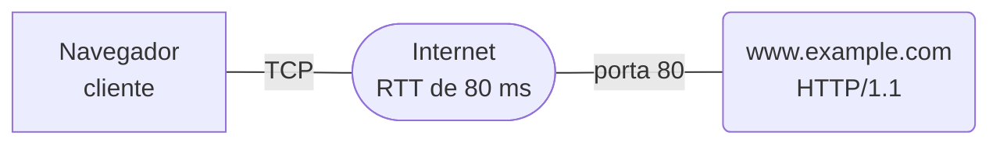

*Figura 3.1b (Tipo A, topologia).* Elementos do modo "HTTP/1.1": Navegador (cliente); Internet (RTT de 80 ms); www.example.com (HTTP/1.1). Vale para os cenários (6.1.4).

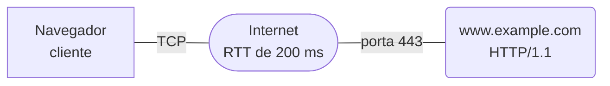

*Figura 3.1c (Tipo A, topologia).* Elementos do modo "HTTP/1.1": Navegador (cliente); Internet (RTT de 200 ms); www.example.com (HTTP/1.1). Vale para os cenários (6.1.5).

### 3.2 HTTP/2


*Figura 3.2a (Tipo A, topologia).* Elementos do modo "HTTP/2": Navegador (cliente); Internet (RTT de 80 ms); www.example.com (HTTP/2). Vale para os cenários (6.2.1 a 6.2.3).

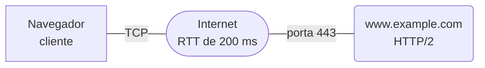

*Figura 3.2b (Tipo A, topologia).* Elementos do modo "HTTP/2": Navegador (cliente); Internet (RTT de 200 ms); www.example.com (HTTP/2). Vale para os cenários (6.2.4 e 6.2.5).

### 3.3 HTTP/3

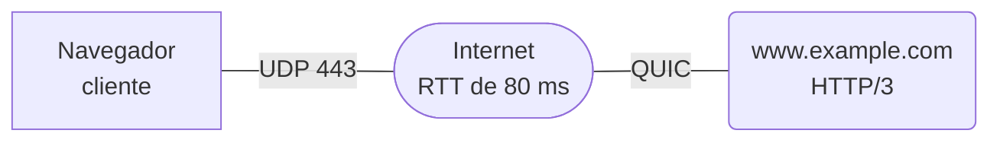

*Figura 3.3a (Tipo A, topologia).* Elementos do modo "HTTP/3": Navegador (cliente); Internet (RTT de 80 ms); www.example.com (HTTP/3). Vale para os cenários (6.3.1 e 6.3.2).

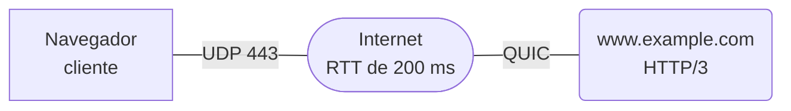

*Figura 3.3b (Tipo A, topologia).* Elementos do modo "HTTP/3": Navegador (cliente); Internet (RTT de 200 ms); www.example.com (HTTP/3). Vale para os cenários (6.3.3 e 6.3.4).

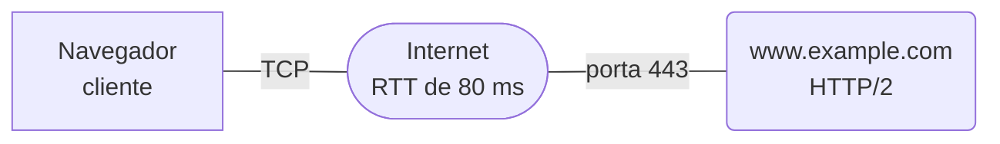

*Figura 3.3c (Tipo A, topologia).* Elementos do modo "HTTP/3": Navegador (cliente); Internet (RTT de 80 ms); www.example.com (HTTP/2). Vale para os cenários (6.3.5).

## 4. Abas da bancada

Cenário, Captura, Mensagem, Cascata, Comparação, Experimento, Referência e Log.

## 5. Configurações (campos do painel)

### 5.1 Rede

- **Latência da rede (RTT)**. Valores: Fibra ou rede local (20 ms); Móvel 4G (80 ms); Satélite ou rede ruim (200 ms). Padrão: Móvel 4G (80 ms). Modos: todos.
  - Tempo de ida e volta entre o navegador e o servidor.
  - Quanto maior o RTT, mais caro é cada viagem de ida e volta: abrir conexões, esperar a resposta de um pedido antes de enviar o seguinte e recuperar uma perda.
  - A largura de banda é fixa em 10 Mbit/s e dividida em partes iguais entre as respostas em andamento. O que muda entre as versões do HTTP é quantas viagens de ida e volta cada uma gasta.

### 5.2 Página

- **Recursos da página**. Valores: 4 recursos; 8 recursos; 16 recursos. Padrão: 8 recursos. Modos: todos.
  - Quantos arquivos o navegador baixa, contando o HTML.
  - O primeiro é sempre o documento HTML. Os demais (CSS, JavaScript, imagens, fonte, dados) só são pedidos depois que o navegador lê o HTML e descobre que precisa deles.
  - Com muitos recursos, o HTTP/1.1 esbarra no limite de conexões; o HTTP/2 e o HTTP/3 enviam todos os pedidos de uma vez.
- **Incluir uma imagem grande (400 KB)**. Valores: caixa de seleção. Padrão: não. Modos: todos.
  - Acrescenta /hero.jpg, de 400 KB, logo depois do HTML.
  - No HTTP/1.1, a conexão que baixa a imagem fica ocupada até o último byte e nenhum outro pedido passa por ela (bloqueio de cabeça de fila).
  - No HTTP/2 e no HTTP/3, a imagem divide a banda com os demais fluxos e não impede que os outros terminem.

### 5.3 Conexão

- **Usar TLS (HTTPS)**. Valores: caixa de seleção. Padrão: sim. Modos: HTTP/1.1.
  - HTTP/1.1 sobre TLS (https) ou em texto claro (http).
  - Com TLS 1.3, a conexão gasta 2 RTT antes do primeiro pedido (1 do TCP e 1 do TLS). Sem TLS, gasta 1 RTT, mas o conteúdo e os cabeçalhos viajam em texto claro e podem ser lidos ou alterados no caminho.
  - No HTTP/2 e no HTTP/3 do simulador o TLS é sempre usado: os navegadores só falam essas versões sobre conexões cifradas.
- **Conexões paralelas**. Valores: 1 conexão; 2 conexões; 6 conexões (como os navegadores). Padrão: 6 conexões (como os navegadores). Modos: HTTP/1.1.
  - Quantas conexões TCP o navegador abre para o servidor.
  - No HTTP/1.1 cada conexão atende um pedido por vez, sem pipelining. Os navegadores contornam isso abrindo até 6 conexões por servidor, e cada uma paga seu próprio handshake.
  - Com 1 conexão, os pedidos esperam em fila: cada recurso só é pedido depois que o anterior termina.
- **Retomar sessão anterior (0-RTT)**. Valores: caixa de seleção. Padrão: não. Modos: HTTP/3.
  - O cliente já conhece o servidor e envia o pedido no primeiro pacote.
  - Com um ticket de uma visita anterior, o QUIC envia o pedido junto do primeiro voo, sem esperar o handshake: o tempo de conexão cai de 1 RTT para zero.
  - Os dados 0-RTT podem ser reenviados por um atacante (replay). Por isso os servidores só os aceitam para pedidos que não alteram estado, como GET ([RFC 8470](https://www.rfc-editor.org/rfc/rfc8470)).

### 5.4 Falhas

- **Perder um pacote de /app.js**. Valores: caixa de seleção. Padrão: não. Modos: todos.
  - Um pacote com dados de /app.js se perde na metade da transferência.
  - O TCP entrega os bytes em ordem: enquanto o trecho perdido não for retransmitido, nada que chegou depois dele é entregue à aplicação. No HTTP/2, isso vale para todos os fluxos da conexão.
  - No QUIC, cada fluxo tem sua própria ordem. Só o fluxo que perdeu dados espera pela retransmissão.
- **UDP 443 bloqueado na rede**. Valores: caixa de seleção. Padrão: não. Modos: HTTP/3.
  - Um firewall descarta o tráfego QUIC.
  - O navegador tenta o QUIC, não recebe resposta e recorre ao HTTP/2 sobre TCP. O tempo de espera do simulador (300 ms) é ilustrativo: cada navegador usa a sua estratégia, como disputar QUIC e TCP em paralelo.
  - É por isso que o HTTP/3 é sempre oferecido junto com uma alternativa por TCP.

## 6. Cenários

### 6.1 Modo: HTTP/1.1

> **Grupo:** Conexões

Como o HTTP/1.1 usa conexões TCP: um pedido por vez em cada uma, com várias conexões paralelas para ganhar tempo.

#### 6.1.1 Seis conexões paralelas

*Seis conexões TCP paralelas, um pedido por vez em cada uma.*

O navegador carrega a página em HTTP/1.1 sobre TLS, com 6 conexões TCP paralelas (o limite típico por servidor).

Depois do HTML, ele abre mais 5 conexões. Cada uma paga o próprio handshake de TCP e TLS antes de pedir o primeiro recurso.

**Conceito.** No **HTTP/1.1** ([RFC 9112](https://www.rfc-editor.org/rfc/rfc9112)) uma conexão atende um pedido de cada vez: o próximo só é enviado depois que a resposta anterior termina (o **pipelining** existe na especificação, mas os navegadores o desativaram). Para ganhar tempo, o navegador abre **várias conexões** em paralelo, tipicamente até 6 por servidor. Cada conexão paga o seu handshake de TCP e de TLS.

**O que observar**

- Na Captura: o handshake da primeira conexão e, depois do HTML, mais cinco handshakes simultâneos.
- Na aba Cascata: cada recurso com a sua conexão; quando uma termina, ela pega o próximo da fila.
- Na aba Mensagem de um pedido: os mesmos cabeçalhos (User-Agent, Accept, Cookie) repetidos em todo pedido.

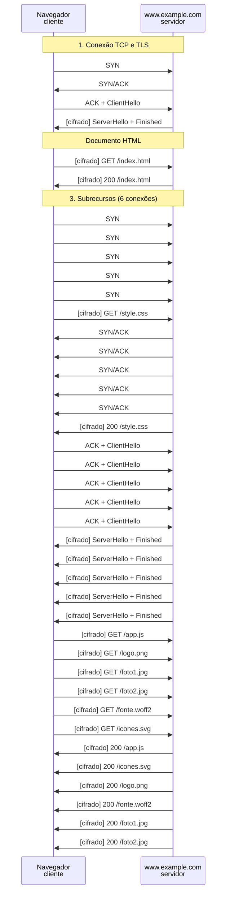

*Figura 6.1.1 (Tipo B, sequência).* Mensagens do cenário "Seis conexões paralelas", na ordem do tempo, entre Navegador, www.example.com: 40 mensagens (em 3 fases; 22 cifradas). Corresponde ao diagrama de sequência e à aba Captura, no modo "HTTP/1.1", com a configuração padrão.

**Mensagens**

| Mensagem | Significado | Origem |
| --- | --- | --- |
| SYN, SYN/ACK, ACK | abre uma conexão TCP | cliente e servidor |
| ClientHello, ServerHello | handshake do TLS 1.3 | cliente e servidor |
| GET /recurso | pedido em texto | cliente |
| 200 /recurso | resposta com o corpo inteiro | servidor |

**Por que importa.** Seis conexões consomem memória no servidor, repetem handshakes e competem entre si pela banda. Foi a solução possível dentro do HTTP/1.1, e deu origem a práticas como dividir recursos em vários domínios.

#### 6.1.2 Uma conexão, pedidos em fila

*Com uma conexão, cada pedido espera a resposta anterior.*

**Configuração aplicada:** Conexões paralelas = 1

Só uma conexão: cada recurso é pedido depois que o anterior termina. Entre dois recursos há sempre uma ida e volta inteira sem dados na linha.

Veja na aba Cascata os degraus, um recurso depois do outro.

**Conceito.** Sem paralelismo, o navegador pede um recurso, espera a resposta inteira e só então pede o próximo. Entre o fim de uma resposta e o início da seguinte passa **1 RTT** (o tempo de o pedido chegar e o primeiro byte voltar), durante o qual a conexão fica ociosa.

**O que observar**

- Na aba Cascata: as barras formam degraus, sem sobreposição.
- Na Captura: cada GET sai logo depois da chegada da resposta anterior.
- Mude para 6 conexões e compare o tempo da página completa na aba Comparação.

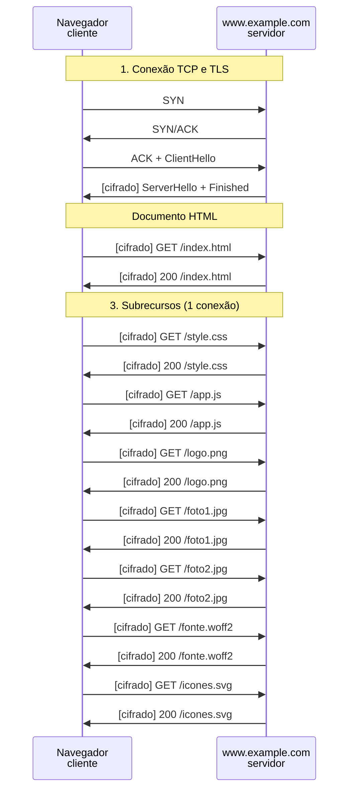

*Figura 6.1.2 (Tipo B, sequência).* Mensagens do cenário "Uma conexão, pedidos em fila", na ordem do tempo, entre Navegador, www.example.com: 20 mensagens (em 3 fases; 17 cifradas). Corresponde ao diagrama de sequência e à aba Captura, no modo "HTTP/1.1", com a configuração aplicada acima.

**Mensagens**

| Mensagem | Significado | Origem |
| --- | --- | --- |
| GET /recurso | só sai quando a conexão está livre | cliente |
| 200 /recurso | ocupa a conexão até o último byte | servidor |

**Por que importa.** É o comportamento do HTTP/1.1 antes do paralelismo de conexões e explica por que a latência (RTT), mais que a banda, domina o tempo de carregamento de páginas com muitos recursos.

#### 6.1.3 Imagem grande ocupa a conexão

*Uma resposta grande ocupa a conexão e atrasa o que está na fila.*

**Configuração aplicada:** Conexões paralelas = 2; Incluir uma imagem grande (400 KB) = sim

Duas conexões e uma imagem de 400 KB logo depois do HTML. A conexão que a recebe fica ocupada até o último byte, e os outros recursos se acumulam na fila da outra.

É o bloqueio de cabeça de fila do HTTP/1.1, na camada da aplicação.

**Conceito.** Em uma conexão HTTP/1.1, as respostas voltam na ordem dos pedidos e uma de cada vez. Se a resposta da vez é grande, tudo o que depende da mesma conexão espera: é o **bloqueio de cabeça de fila** (head-of-line blocking) da camada de aplicação. Com poucas conexões, o efeito aparece logo.

**O que observar**

- Na aba Cascata: uma barra longa (/hero.jpg) e, na outra conexão, os recursos pequenos em fila.
- Na Captura: a resposta de /hero.jpg dura bastante, e a conexão não recebe outro GET nesse intervalo.
- Aumente para 6 conexões: o efeito diminui, mas não desaparece.

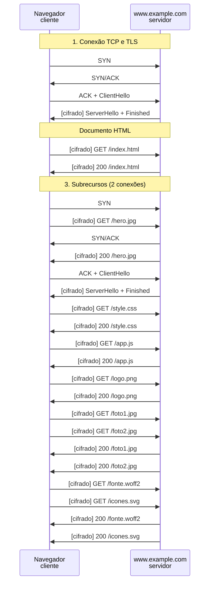

*Figura 6.1.3 (Tipo B, sequência).* Mensagens do cenário "Imagem grande ocupa a conexão", na ordem do tempo, entre Navegador, www.example.com: 26 mensagens (em 3 fases; 20 cifradas). Corresponde ao diagrama de sequência e à aba Captura, no modo "HTTP/1.1", com a configuração aplicada acima.

**Mensagens**

| Mensagem | Significado | Origem |
| --- | --- | --- |
| GET /hero.jpg | pedido da imagem grande | cliente |
| 200 /hero.jpg | ocupa a conexão por todo o corpo | servidor |

**Por que importa.** O HTTP/2 resolve esse bloqueio na aplicação com fluxos independentes na mesma conexão.

> **Grupo:** Variações

O HTTP/1.1 sem TLS e com perda de pacote.

#### 6.1.4 HTTP sem TLS

*Sem TLS: 1 RTT para abrir, mas tudo em texto claro.*

**Configuração aplicada:** Usar TLS (HTTPS) = não

Sem TLS, a conexão fica pronta em 1 RTT (só o TCP) e todo o conteúdo viaja em texto claro.

Compare a aba Mensagem de um pedido: os cabeçalhos aparecem legíveis, o que não acontece com o TLS.

**Conceito.** Em **HTTP** (porta 80), a conexão fica pronta depois do handshake do TCP, em 1 RTT. O preço é que cabeçalhos e corpo viajam **sem cifragem e sem autenticação**: quem está no caminho pode ler, e também alterar, as respostas (por exemplo, injetar conteúdo).

**O que observar**

- Na aba Mensagem de um pedido: a seção Transporte indica cifragem nenhuma.
- Na Captura: não há mensagens de TLS e as mensagens não têm o cadeado.
- O tempo até o primeiro pedido cai em 1 RTT, e é essa vantagem que o TLS 1.3 e o QUIC reduzem.

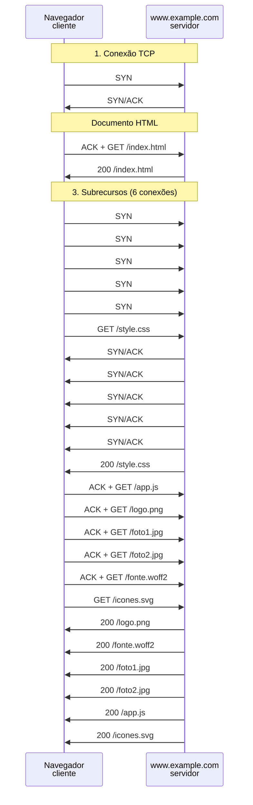

*Figura 6.1.4 (Tipo B, sequência).* Mensagens do cenário "HTTP sem TLS", na ordem do tempo, entre Navegador, www.example.com: 28 mensagens (em 3 fases). Corresponde ao diagrama de sequência e à aba Captura, no modo "HTTP/1.1", com a configuração aplicada acima.

**Mensagens**

| Mensagem | Significado | Origem |
| --- | --- | --- |
| SYN, SYN/ACK, ACK | abre a conexão TCP | cliente e servidor |
| GET /index.html | pedido em texto claro | cliente |

**Por que importa.** Sem TLS não há confidencialidade, integridade nem autenticação do servidor. O HTTP/2 e o HTTP/3 são usados na prática apenas sobre conexões cifradas.

#### 6.1.5 Perda de um pacote

*A perda afeta só a conexão TCP que perdeu o pacote.*

**Configuração aplicada:** Perder um pacote de /app.js = sim; Latência da rede (RTT) = 200

Um pacote de /app.js se perde. No HTTP/1.1 cada recurso tem a sua conexão TCP, então só a conexão afetada espera pela retransmissão.

**Conceito.** Cada conexão HTTP/1.1 é uma conexão TCP separada. Quando um segmento se perde, o TCP retém os bytes seguintes **daquela conexão** até a retransmissão (cerca de 1 RTT depois). As outras conexões seguem normalmente.

**O que observar**

- Na Captura: o segmento perdido (vermelho), o ACK duplicado e a retransmissão.
- No estado Rede: a perda e a retransmissão recebida.
- Na aba Cascata: só a barra de /app.js é afetada.

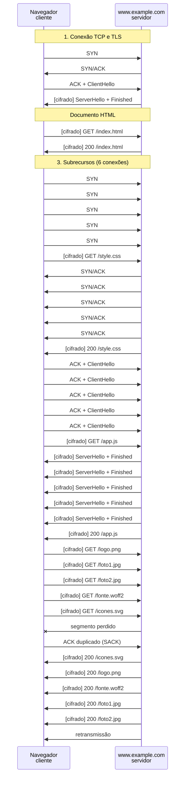

*Figura 6.1.5 (Tipo B, sequência).* Mensagens do cenário "Perda de um pacote", na ordem do tempo, entre Navegador, www.example.com: 43 mensagens (em 3 fases; 1 perdida; 22 cifradas). Corresponde ao diagrama de sequência e à aba Captura, no modo "HTTP/1.1", com a configuração aplicada acima.

**Mensagens**

| Mensagem | Significado | Origem |
| --- | --- | --- |
| segmento perdido | um pacote de /app.js não chega | servidor |
| ACK duplicado (SACK) | o cliente avisa do buraco | cliente |
| retransmissão | o servidor reenvia o trecho | servidor |

**Por que importa.** Seis conexões isolam as perdas umas das outras, e esse é um dos poucos benefícios de usar várias conexões.

### 6.2 Modo: HTTP/2

> **Grupo:** Multiplexação

O HTTP/2 divide uma só conexão em fluxos independentes, com cabeçalhos comprimidos.

#### 6.2.1 Uma conexão, vários fluxos

*Uma conexão, muitos fluxos, cabeçalhos comprimidos.*

Uma única conexão TCP com TLS. Depois do HTML, todos os pedidos saem de uma vez, cada um em seu fluxo (stream), e as respostas voltam intercaladas.

Repare no HPACK: o primeiro pedido tem cerca de 330 bytes de cabeçalho e os seguintes, cerca de 50.

**Conceito.** O **HTTP/2** ([RFC 9113](https://www.rfc-editor.org/rfc/rfc9113)) usa uma só conexão TCP com TLS (ALPN `h2`) e a divide em **fluxos** (streams) identificados por número. O navegador envia todos os pedidos de uma vez, e o servidor devolve as respostas **intercaladas** em quadros (frames). Os cabeçalhos são comprimidos pelo **HPACK** ([RFC 7541](https://www.rfc-editor.org/rfc/rfc7541)): o que se repete vira um índice.

**O que observar**

- Na Captura: depois do HTML, todos os HEADERS saem no mesmo instante, cada um em um fluxo ímpar.
- Na aba Mensagem: o primeiro pedido tem cerca de 330 bytes de cabeçalho; os seguintes, cerca de 50.
- Na aba Cascata: as barras começam juntas e terminam em tempos diferentes, conforme o tamanho.

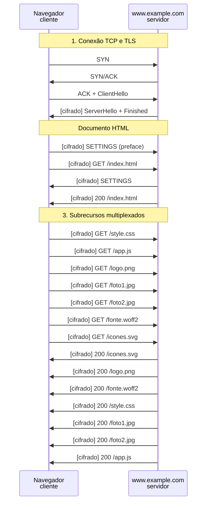

*Figura 6.2.1 (Tipo B, sequência).* Mensagens do cenário "Uma conexão, vários fluxos", na ordem do tempo, entre Navegador, www.example.com: 22 mensagens (em 3 fases; 19 cifradas). Corresponde ao diagrama de sequência e à aba Captura, no modo "HTTP/2", com a configuração padrão.

**Mensagens**

| Mensagem | Significado | Origem |
| --- | --- | --- |
| SETTINGS | parâmetros da conexão | cliente e servidor |
| HEADERS (GET) | abre o fluxo com o pedido | cliente |
| HEADERS + DATA | resposta em quadros | servidor |

**Por que importa.** Uma conexão só paga um handshake e deixa o controle de congestionamento do TCP trabalhar com mais dados em trânsito. Em compensação, depende de uma única sequência de bytes do TCP.

#### 6.2.2 Muitos recursos

*Dezesseis recursos sem fila nem limite de conexões.*

**Configuração aplicada:** Recursos da página = 16

16 recursos na mesma conexão. Não há limite de seis conexões nem fila: o número de fluxos simultâneos só é limitado pelo parâmetro do servidor (tipicamente 100).

**Conceito.** Com a multiplexação, o número de recursos deixa de ser um problema de conexões. O limite passa a ser o **MAX_CONCURRENT_STREAMS** (o servidor anuncia no SETTINGS; ao menos 100 é o valor recomendado) e a banda disponível.

**O que observar**

- Na Captura: 15 pedidos saindo juntos depois do HTML.
- Na aba Comparação: o HTTP/1.1 perde mais tempo quanto mais recursos a página tem.
- Na aba Mensagem: o identificador dos fluxos (1, 3, 5...).

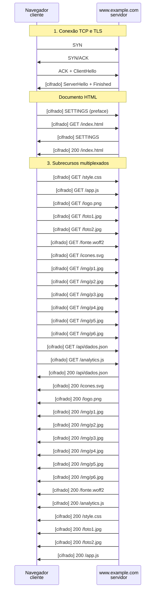

*Figura 6.2.2 (Tipo B, sequência).* Mensagens do cenário "Muitos recursos", na ordem do tempo, entre Navegador, www.example.com: 38 mensagens (em 3 fases; 35 cifradas). Corresponde ao diagrama de sequência e à aba Captura, no modo "HTTP/2", com a configuração aplicada acima.

**Mensagens**

| Mensagem | Significado | Origem |
| --- | --- | --- |
| HEADERS (GET) | um por recurso, no mesmo instante | cliente |
| 200 | respostas intercaladas | servidor |

**Por que importa.** Páginas modernas têm dezenas ou centenas de recursos. O HTTP/2 elimina a fila de pedidos sem exigir mais conexões.

#### 6.2.3 Imagem grande sem bloquear

*A imagem grande divide a banda e não bloqueia os outros.*

**Configuração aplicada:** Incluir uma imagem grande (400 KB) = sim

A imagem de 400 KB divide a banda com os demais fluxos. Os recursos pequenos terminam antes dela, ao contrário do HTTP/1.1.

A imagem fica pronta mais tarde porque disputa a banda, mas nada fica parado esperando por ela.

**Conceito.** No HTTP/2 as respostas são fatiadas em quadros DATA (até 16 KB, por padrão) e os quadros de fluxos diferentes se alternam. Uma resposta grande **não impede** as pequenas de terminar. Em implementações reais, o servidor pode priorizar fluxos ([RFC 9218](https://www.rfc-editor.org/rfc/rfc9218)); o simulador divide a banda em partes iguais.

**O que observar**

- Na aba Cascata: os recursos pequenos terminam cedo, a imagem grande, por último.
- Compare com o cenário Imagem grande ocupa a conexão, do HTTP/1.1.
- Na aba Mensagem da resposta: o número de quadros DATA do recurso.

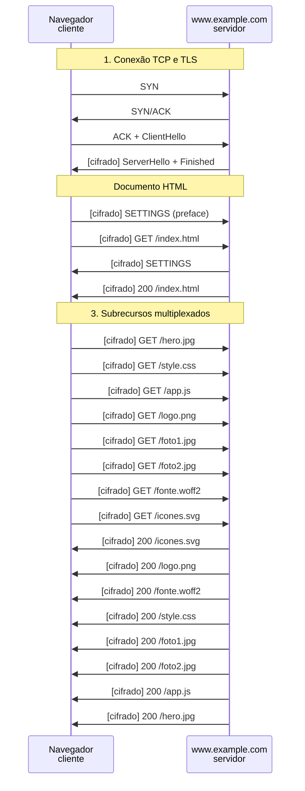

*Figura 6.2.3 (Tipo B, sequência).* Mensagens do cenário "Imagem grande sem bloquear", na ordem do tempo, entre Navegador, www.example.com: 24 mensagens (em 3 fases; 21 cifradas). Corresponde ao diagrama de sequência e à aba Captura, no modo "HTTP/2", com a configuração aplicada acima.

**Mensagens**

| Mensagem | Significado | Origem |
| --- | --- | --- |
| HEADERS (GET /hero.jpg) | pedido da imagem grande | cliente |
| DATA (vários) | quadros da imagem, intercalados com os dos outros fluxos | servidor |

**Por que importa.** É o ganho central da multiplexação: o bloqueio de cabeça de fila da aplicação deixa de existir.

> **Grupo:** Latência e perda

Onde o TCP limita o HTTP/2: o custo dos dois RTT de abertura e o bloqueio de todos os fluxos quando um pacote se perde.

#### 6.2.4 Rede de alta latência

*Com RTT alto, os dois RTT de abertura pesam.*

**Configuração aplicada:** Latência da rede (RTT) = 200

Com RTT de 200 ms, os 2 RTT de TCP e TLS pesam: o primeiro pedido só sai depois de 400 ms.

Compare com o HTTP/3 na aba Comparação.

**Conceito.** O HTTP/2 sobre TCP e TLS 1.3 gasta **2 RTT** antes do primeiro pedido: um para o handshake do TCP e outro para o do TLS. Em redes de alta latência, esse custo fixo domina o tempo de carregamento de páginas pequenas.

**O que observar**

- Na Captura: o primeiro GET só sai em 2 RTT (400 ms).
- Na aba Comparação: o HTTP/3 sai 1 RTT na frente.
- O tempo do HTML (TTFB) não muda entre as versões; muda o instante em que o pedido pode sair.


*Figura 6.2.4 (Tipo B, sequência).* Mensagens do cenário "Rede de alta latência", na ordem do tempo, entre Navegador, www.example.com: 22 mensagens (em 3 fases; 19 cifradas). Corresponde ao diagrama de sequência e à aba Captura, no modo "HTTP/2", com a configuração aplicada acima.

**Mensagens**

| Mensagem | Significado | Origem |
| --- | --- | --- |
| SYN, SYN/ACK, ACK | 1 RTT | cliente e servidor |
| ClientHello, ServerHello + Finished | 1 RTT | cliente e servidor |

**Por que importa.** Parte do projeto do QUIC foi reduzir esse custo de abertura, que não depende da versão do HTTP, e sim do transporte.

#### 6.2.5 Perda: bloqueio no TCP

*Um pacote perdido retém todos os fluxos da conexão TCP.*

**Configuração aplicada:** Perder um pacote de /app.js = sim; Latência da rede (RTT) = 200

Um pacote de /app.js se perde. Como todos os fluxos compartilham uma só conexão TCP, os bytes que chegam depois do buraco ficam retidos até a retransmissão, e os fluxos que terminariam nesse intervalo são atrasados junto.

É o bloqueio de cabeça de fila na camada de transporte.

**Conceito.** O TCP entrega uma sequência de bytes **em ordem**. Quando um segmento se perde, os bytes que chegam depois dele ficam retidos no receptor até a retransmissão (cerca de 1 RTT). Como o HTTP/2 mistura todos os fluxos nessa sequência, **todos** são afetados, mesmo os que não perderam nada: é o bloqueio de cabeça de fila na camada de transporte.

**O que observar**

- Na Captura: o segmento perdido, o ACK duplicado e a retransmissão.
- Na aba Cascata: as barras vermelhas de /app.js e de outros fluxos cuja entrega foi retida.
- Na aba Comparação: o número de fluxos atrasados pela perda no HTTP/2 e no HTTP/3.

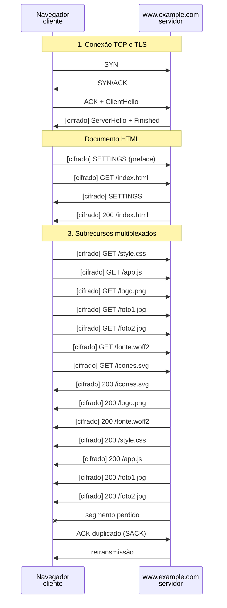

*Figura 6.2.5 (Tipo B, sequência).* Mensagens do cenário "Perda: bloqueio no TCP", na ordem do tempo, entre Navegador, www.example.com: 25 mensagens (em 3 fases; 1 perdida; 19 cifradas). Corresponde ao diagrama de sequência e à aba Captura, no modo "HTTP/2", com a configuração aplicada acima.

**Mensagens**

| Mensagem | Significado | Origem |
| --- | --- | --- |
| segmento perdido | um pacote de /app.js não chega | servidor |
| ACK duplicado (SACK) | o cliente avisa do buraco | cliente |
| retransmissão | o servidor reenvia o trecho | servidor |

**Por que importa.** Quanto maior o RTT e a perda, pior o efeito. Em redes móveis com perdas frequentes, esse bloqueio é uma das motivações do HTTP/3.

### 6.3 Modo: HTTP/3

> **Grupo:** Conexão e fluxos

O HTTP/3 sobre QUIC: handshake de 1 RTT (ou zero, na retomada) e fluxos com ordem própria.

#### 6.3.1 Handshake de 1 RTT

*QUIC: transporte e TLS 1.3 num só handshake, sobre UDP.*

O QUIC junta o transporte e o TLS 1.3 em um só handshake sobre UDP: o primeiro pedido sai depois de 1 RTT, contra 2 do HTTP/2.

Cada pedido usa um fluxo QUIC próprio, com ordem e recuperação de perda independentes.

**Conceito.** O **HTTP/3** ([RFC 9114](https://www.rfc-editor.org/rfc/rfc9114)) roda sobre o **QUIC** ([RFC 9000](https://www.rfc-editor.org/rfc/rfc9000)), que usa UDP e incorpora o TLS 1.3. O primeiro voo já leva o ClientHello e, com 1 RTT, o cliente termina o handshake e envia o pedido. Cada pedido usa um **fluxo QUIC** próprio, com ordem e recuperação de perda independentes. Os cabeçalhos são comprimidos pelo **QPACK** ([RFC 9204](https://www.rfc-editor.org/rfc/rfc9204)).

**O que observar**

- Na Captura: apenas três mensagens de abertura, contra sete do HTTP/2 (TCP, TLS e SETTINGS).
- Na aba Mensagem: o pacote QUIC e o fluxo, com identificador múltiplo de 4.
- No estado Conexões: a conexão pronta depois de 1 RTT.

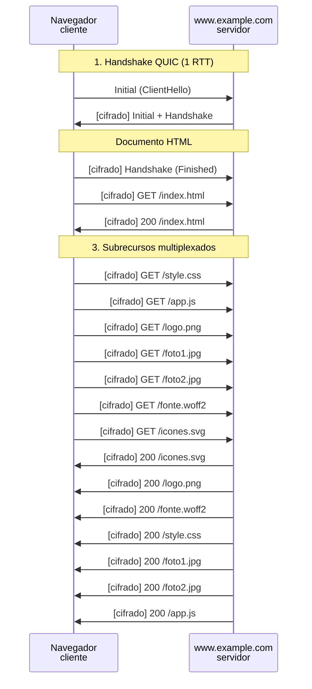

*Figura 6.3.1 (Tipo B, sequência).* Mensagens do cenário "Handshake de 1 RTT", na ordem do tempo, entre Navegador, www.example.com: 19 mensagens (em 3 fases; 18 cifradas). Corresponde ao diagrama de sequência e à aba Captura, no modo "HTTP/3", com a configuração padrão.

**Mensagens**

| Mensagem | Significado | Origem |
| --- | --- | --- |
| Initial (ClientHello) | primeiro voo, em UDP | cliente |
| Initial + Handshake | ServerHello, certificado e Finished | servidor |
| Handshake (Finished) | conclui o handshake | cliente |

**Por que importa.** O QUIC roda em espaço de usuário e criptografa quase todo o cabeçalho de transporte, o que dificulta intervenções de equipamentos no meio do caminho e facilita evoluir o protocolo.

#### 6.3.2 Retomada com 0-RTT

*Com sessão anterior, o pedido vai no primeiro pacote.*

**Configuração aplicada:** Retomar sessão anterior (0-RTT) = sim

O cliente já visitou o servidor e guarda um ticket de sessão. O pedido do HTML vai no primeiro pacote, sem esperar o handshake.

Os dados 0-RTT podem ser reenviados por um atacante; por isso só pedidos que não alteram estado são aceitos.

**Conceito.** Se o cliente já falou com o servidor, guarda um **ticket de sessão**. Na visita seguinte, o QUIC envia o pedido **junto do primeiro pacote** (dados 0-RTT), antes de o handshake terminar. O custo de abertura vai a zero. Em contrapartida, os dados 0-RTT **não são protegidos contra replay**: um atacante pode reenviar o pacote capturado.

**O que observar**

- Na Captura: o GET sai no instante zero, junto do Initial.
- A tag 0-RTT na mensagem Initial.
- Na Referência: por que só pedidos idempotentes são aceitos em 0-RTT.

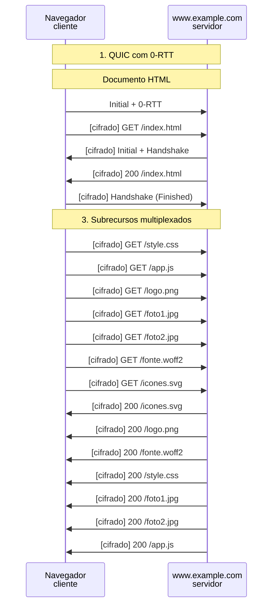

*Figura 6.3.2 (Tipo B, sequência).* Mensagens do cenário "Retomada com 0-RTT", na ordem do tempo, entre Navegador, www.example.com: 19 mensagens (em 3 fases; 18 cifradas). Corresponde ao diagrama de sequência e à aba Captura, no modo "HTTP/3", com a configuração aplicada acima.

**Mensagens**

| Mensagem | Significado | Origem |
| --- | --- | --- |
| Initial + 0-RTT | ClientHello e o pedido, no mesmo voo | cliente |
| Initial + Handshake | servidor aceita o 0-RTT | servidor |

**Por que importa.** O ganho é real, mas exige cuidado: o servidor deve recusar 0-RTT em pedidos que alteram estado ([RFC 8470](https://www.rfc-editor.org/rfc/rfc8470) define a resposta 425 Too Early).

#### 6.3.3 Rede de alta latência

*Em rede de 200 ms, o handshake de 1 RTT poupa 200 ms.*

**Configuração aplicada:** Latência da rede (RTT) = 200

Mesmo cenário do HTTP/2 em rede de 200 ms. O handshake de 1 RTT poupa 200 ms antes do primeiro pedido.

**Conceito.** O custo de abertura do HTTP/3 é metade do HTTP/2 sobre TLS 1.3: 1 RTT contra 2. A vantagem é fixa em número de RTT, então cresce com a latência da rede.

**O que observar**

- Na Captura: o primeiro GET sai em 200 ms, em vez de 400 ms.
- Na aba Comparação: a diferença entre as três versões no tempo da página completa.

```mermaid
sequenceDiagram
  participant n_cli as Navegador<br/>cliente
  participant n_srv as www.example.com<br/>servidor
  Note over n_cli,n_srv: 1. Handshake QUIC (1 RTT)
  n_cli ->> n_srv: Initial (ClientHello)
  n_srv ->> n_cli: [cifrado] Initial + Handshake
  Note over n_cli,n_srv: Documento HTML
  n_cli ->> n_srv: [cifrado] Handshake (Finished)
  n_cli ->> n_srv: [cifrado] GET /index.html
  n_srv ->> n_cli: [cifrado] 200 /index.html
  Note over n_cli,n_srv: 3. Subrecursos multiplexados
  n_cli ->> n_srv: [cifrado] GET /style.css
  n_cli ->> n_srv: [cifrado] GET /app.js
  n_cli ->> n_srv: [cifrado] GET /logo.png
  n_cli ->> n_srv: [cifrado] GET /foto1.jpg
  n_cli ->> n_srv: [cifrado] GET /foto2.jpg
  n_cli ->> n_srv: [cifrado] GET /fonte.woff2
  n_cli ->> n_srv: [cifrado] GET /icones.svg
  n_srv ->> n_cli: [cifrado] 200 /icones.svg
  n_srv ->> n_cli: [cifrado] 200 /logo.png
  n_srv ->> n_cli: [cifrado] 200 /fonte.woff2
  n_srv ->> n_cli: [cifrado] 200 /style.css
  n_srv ->> n_cli: [cifrado] 200 /foto1.jpg
  n_srv ->> n_cli: [cifrado] 200 /foto2.jpg
  n_srv ->> n_cli: [cifrado] 200 /app.js
```

*Figura 6.3.3 (Tipo B, sequência).* Mensagens do cenário "Rede de alta latência", na ordem do tempo, entre Navegador, www.example.com: 19 mensagens (em 3 fases; 18 cifradas). Corresponde ao diagrama de sequência e à aba Captura, no modo "HTTP/3", com a configuração aplicada acima.

**Mensagens**

| Mensagem | Significado | Origem |
| --- | --- | --- |
| Initial (ClientHello) | primeiro voo | cliente |
| Initial + Handshake | resposta do servidor | servidor |

**Por que importa.** Em redes de satélite ou móveis ruins, 1 RTT a menos pode ser mais perceptível que qualquer outra otimização do protocolo.

> **Grupo:** Perda e rede

Como o HTTP/3 reage à perda de pacote e a uma rede que bloqueia o UDP.

#### 6.3.4 Perda: só um fluxo espera

*Só o fluxo que perdeu dados espera pela retransmissão.*

**Configuração aplicada:** Perder um pacote de /app.js = sim; Latência da rede (RTT) = 200

O mesmo pacote de /app.js se perde. No QUIC, cada fluxo tem a sua própria ordem de entrega, então só /app.js espera pela retransmissão.

Os outros fluxos entregam seus dados normalmente. Compare com o cenário de perda do HTTP/2.

**Conceito.** No QUIC cada fluxo tem a sua **própria ordem de entrega**. Quando um pacote se perde, apenas o fluxo cujos dados estavam nele espera. Os demais entregam à aplicação o que já chegou. O pacote perdido é reenviado em um **pacote novo**, com número novo ([RFC 9002](https://www.rfc-editor.org/rfc/rfc9002)).

**O que observar**

- Na Captura: o pacote perdido, o ACK com intervalo e a retransmissão.
- Na aba Cascata: só a barra de /app.js fica vermelha.
- Na aba Comparação: um fluxo atrasado no HTTP/3, contra mais de um no HTTP/2.

```mermaid
sequenceDiagram
  participant n_cli as Navegador<br/>cliente
  participant n_srv as www.example.com<br/>servidor
  Note over n_cli,n_srv: 1. Handshake QUIC (1 RTT)
  n_cli ->> n_srv: Initial (ClientHello)
  n_srv ->> n_cli: [cifrado] Initial + Handshake
  Note over n_cli,n_srv: Documento HTML
  n_cli ->> n_srv: [cifrado] Handshake (Finished)
  n_cli ->> n_srv: [cifrado] GET /index.html
  n_srv ->> n_cli: [cifrado] 200 /index.html
  Note over n_cli,n_srv: 3. Subrecursos multiplexados
  n_cli ->> n_srv: [cifrado] GET /style.css
  n_cli ->> n_srv: [cifrado] GET /app.js
  n_cli ->> n_srv: [cifrado] GET /logo.png
  n_cli ->> n_srv: [cifrado] GET /foto1.jpg
  n_cli ->> n_srv: [cifrado] GET /foto2.jpg
  n_cli ->> n_srv: [cifrado] GET /fonte.woff2
  n_cli ->> n_srv: [cifrado] GET /icones.svg
  n_srv ->> n_cli: [cifrado] 200 /icones.svg
  n_srv ->> n_cli: [cifrado] 200 /logo.png
  n_srv ->> n_cli: [cifrado] 200 /fonte.woff2
  n_srv ->> n_cli: [cifrado] 200 /style.css
  n_srv ->> n_cli: [cifrado] 200 /foto1.jpg
  n_srv ->> n_cli: [cifrado] 200 /foto2.jpg
  n_srv ->> n_cli: [cifrado] 200 /app.js
  n_srv -x n_cli: pacote QUIC perdido
  n_cli ->> n_srv: ACK com intervalo
  n_srv ->> n_cli: retransmissão (novo pacote)
```

*Figura 6.3.4 (Tipo B, sequência).* Mensagens do cenário "Perda: só um fluxo espera", na ordem do tempo, entre Navegador, www.example.com: 22 mensagens (em 3 fases; 1 perdida; 18 cifradas). Corresponde ao diagrama de sequência e à aba Captura, no modo "HTTP/3", com a configuração aplicada acima.

**Mensagens**

| Mensagem | Significado | Origem |
| --- | --- | --- |
| pacote QUIC perdido | dados de /app.js | servidor |
| ACK com intervalo | aponta o buraco | cliente |
| retransmissão (novo pacote) | mesmo conteúdo, número novo | servidor |

**Por que importa.** Na prática um pacote QUIC pode carregar quadros de mais de um fluxo e afetar todos eles. O simulador supõe que os dados perdidos pertencem a um só fluxo.

#### 6.3.5 UDP bloqueado: volta ao HTTP/2

*O QUIC não passa pelo firewall; o navegador recorre ao TCP.*

**Configuração aplicada:** UDP 443 bloqueado na rede = sim

Um firewall descarta o UDP 443. O QUIC Initial se perde, o navegador espera e recorre ao HTTP/2 sobre TCP.

Por isso o HTTP/3 é sempre uma melhoria opcional: a página carrega mesmo sem ele, só que depois de uma espera.

**Conceito.** Muitas redes bloqueiam ou limitam o UDP na porta 443. O navegador tenta o QUIC (descoberto por `Alt-Svc`, [RFC 7838](https://www.rfc-editor.org/rfc/rfc7838), ou por registro DNS HTTPS), não recebe resposta e **recorre ao HTTP/2 sobre TCP**. O tempo perdido na tentativa é o custo do fallback.

**O que observar**

- Na Captura: o QUIC Initial perdido (vermelho) e, 300 ms depois, o handshake TCP e TLS.
- No estado Protocolo: de tentando HTTP/3 para HTTP/2 (fallback).
- Na aba Comparação: o tempo da página completa passa a incluir a espera.

```mermaid
sequenceDiagram
  participant n_cli as Navegador<br/>cliente
  participant n_srv as www.example.com<br/>servidor
  Note over n_cli,n_srv: 1. Tentativa de QUIC (UDP 443)
  n_cli -x n_srv: QUIC Initial
  Note over n_cli,n_srv: 2. Fallback: TCP e TLS (HTTP/2)
  n_cli ->> n_srv: SYN
  n_srv ->> n_cli: SYN/ACK
  n_cli ->> n_srv: ACK + ClientHello
  n_srv ->> n_cli: [cifrado] ServerHello + Finished
  Note over n_cli,n_srv: Documento HTML
  n_cli ->> n_srv: [cifrado] SETTINGS (preface)
  n_cli ->> n_srv: [cifrado] GET /index.html
  n_srv ->> n_cli: [cifrado] SETTINGS
  n_srv ->> n_cli: [cifrado] 200 /index.html
  Note over n_cli,n_srv: 3. Subrecursos multiplexados
  n_cli ->> n_srv: [cifrado] GET /style.css
  n_cli ->> n_srv: [cifrado] GET /app.js
  n_cli ->> n_srv: [cifrado] GET /logo.png
  n_cli ->> n_srv: [cifrado] GET /foto1.jpg
  n_cli ->> n_srv: [cifrado] GET /foto2.jpg
  n_cli ->> n_srv: [cifrado] GET /fonte.woff2
  n_cli ->> n_srv: [cifrado] GET /icones.svg
  n_srv ->> n_cli: [cifrado] 200 /icones.svg
  n_srv ->> n_cli: [cifrado] 200 /logo.png
  n_srv ->> n_cli: [cifrado] 200 /fonte.woff2
  n_srv ->> n_cli: [cifrado] 200 /style.css
  n_srv ->> n_cli: [cifrado] 200 /foto1.jpg
  n_srv ->> n_cli: [cifrado] 200 /foto2.jpg
  n_srv ->> n_cli: [cifrado] 200 /app.js
```

*Figura 6.3.5 (Tipo B, sequência).* Mensagens do cenário "UDP bloqueado: volta ao HTTP/2", na ordem do tempo, entre Navegador, www.example.com: 23 mensagens (em 4 fases; 1 perdida; 19 cifradas). Corresponde ao diagrama de sequência e à aba Captura, no modo "HTTP/3", com a configuração aplicada acima.

**Mensagens**

| Mensagem | Significado | Origem |
| --- | --- | --- |
| QUIC Initial | descartado pelo firewall | cliente |
| SYN, ClientHello... | handshake TCP e TLS depois da espera | cliente e servidor |

**Por que importa.** A possibilidade de fallback é o que permite implantar o HTTP/3 aos poucos, sem quebrar redes que não o suportam. A espera de 300 ms do simulador é ilustrativa.

## 7. Referência

### 7.1 O que muda entre as versões

A **semântica** do HTTP ([RFC 9110](https://www.rfc-editor.org/rfc/rfc9110)) é a mesma nas três versões: métodos como GET e POST, códigos de status, cabeçalhos e corpo. Cada versão muda apenas **como** essas mensagens são levadas pela rede: o formato na linha, o uso de conexões e o transporte por baixo.

### 7.2 HTTP/1.1 ([RFC 9112](https://www.rfc-editor.org/rfc/rfc9112))

- **Formato em texto:** linha de requisição, cabeçalhos e corpo, legíveis a olho nu. Os mesmos cabeçalhos (User-Agent, Accept, Cookie) se repetem em todo pedido.
- **Conexões persistentes** (keep-alive): a conexão TCP é reaproveitada para vários pedidos, mas um de cada vez.
- **Pipelining:** a especificação permite enviar vários pedidos sem esperar as respostas, que voltam na mesma ordem. Na prática os navegadores o desativaram por causa do bloqueio de cabeça de fila e de intermediários problemáticos. O simulador não usa pipelining.
- **Várias conexões:** para paralelizar, os navegadores abrem até 6 conexões por servidor, e cada uma paga o handshake de TCP e TLS.

### 7.3 HTTP/2 ([RFC 9113](https://www.rfc-editor.org/rfc/rfc9113))

- **Formato binário em quadros** (HEADERS, DATA, SETTINGS...). A semântica não muda, mas a mensagem passa a ser fatiada.
- **Fluxos (streams):** uma só conexão TCP leva muitos pedidos e respostas ao mesmo tempo, cada um com seu identificador (ímpar quando iniciado pelo cliente). Os quadros de fluxos diferentes se intercalam.
- **HPACK ([RFC 7541](https://www.rfc-editor.org/rfc/rfc7541)):** compressão de cabeçalhos com tabela estática e tabela dinâmica. O primeiro pedido paga o preço inteiro; os seguintes viram índices.
- **Controle de fluxo** por fluxo e por conexão, e limite de fluxos simultâneos (`SETTINGS_MAX_CONCURRENT_STREAMS`).
- **Negociação:** a versão é escolhida no TLS pela extensão ALPN (`h2`). Os navegadores só usam HTTP/2 sobre TLS.
- **Limite:** tudo viaja na mesma sequência de bytes do TCP. Um segmento perdido retém a entrega de todos os fluxos até a retransmissão (bloqueio de cabeça de fila no TCP).
- O *server push* do HTTP/2 foi pouco usado e removido dos principais navegadores. Não é simulado.

### 7.4 HTTP/3 e QUIC ([RFC 9114](https://www.rfc-editor.org/rfc/rfc9114), 9000, 9001 e 9002)

- **QUIC sobre UDP:** o transporte é reimplementado em espaço de usuário, com o TLS 1.3 embutido ([RFC 9001](https://www.rfc-editor.org/rfc/rfc9001)). O handshake de transporte e de criptografia ocorre junto, em 1 RTT.
- **Fluxos com ordem própria:** cada pedido do HTTP/3 usa um fluxo QUIC (identificador múltiplo de 4 para fluxos bidirecionais iniciados pelo cliente). Uma perda só atrasa o fluxo afetado.
- **Recuperação de perdas ([RFC 9002](https://www.rfc-editor.org/rfc/rfc9002)):** o conteúdo perdido é reenviado em um pacote novo, com número novo, o que elimina a ambiguidade entre original e retransmissão.
- **QPACK ([RFC 9204](https://www.rfc-editor.org/rfc/rfc9204)):** compressão de cabeçalhos desenhada para funcionar mesmo com fluxos chegando fora de ordem.
- **0-RTT:** com um ticket de sessão, o cliente envia dados no primeiro voo. Esses dados podem ser repetidos por um atacante (replay). Os servidores devem aceitar 0-RTT só para pedidos que não alteram estado ([RFC 8470](https://www.rfc-editor.org/rfc/rfc8470) define a resposta 425 Too Early).
- **Descoberta:** o navegador costuma saber que o servidor fala HTTP/3 pelo cabeçalho `Alt-Svc` ([RFC 7838](https://www.rfc-editor.org/rfc/rfc7838)) ou por registros DNS do tipo HTTPS ([RFC 9460](https://www.rfc-editor.org/rfc/rfc9460)). Se o UDP 443 estiver bloqueado, usa HTTP/2 sobre TCP.
- O QUIC também permite **migração de conexão** (trocar de Wi-Fi para 4G sem recomeçar) e limita as respostas a endereços não validados, para reduzir ataques de amplificação. Nenhum dos dois é simulado.

### 7.5 Comparação resumida

|  | HTTP/1.1 | HTTP/2 | HTTP/3 |
| --- | --- | --- | --- |
| Transporte | TCP | TCP | QUIC sobre UDP |
| RTT até o 1º pedido (TLS 1.3) | 2 (1 sem TLS) | 2 | 1 (0 com retomada) |
| Formato | texto | binário | binário |
| Paralelismo | várias conexões | fluxos em uma conexão | fluxos em uma conexão |
| Compressão de cabeçalhos | nenhuma | HPACK | QPACK |
| Bloqueio por perda | só a conexão | todos os fluxos | só o fluxo |

### 7.6 Considerações de segurança (nível defensivo)

- **HTTP sem TLS** não protege confidencialidade nem integridade: o conteúdo pode ser lido ou alterado no caminho. Use HTTPS e HSTS ([RFC 6797](https://www.rfc-editor.org/rfc/rfc6797)). A [RFC 9112](https://www.rfc-editor.org/rfc/rfc9112) foi atualizada pela [RFC 9931](https://www.rfc-editor.org/rfc/rfc9931), que trata das considerações de segurança de transições otimistas de protocolo no HTTP/1.1 (Upgrade); o simulador não modela essa transição.
- **0-RTT e replay:** aceite 0-RTT apenas em pedidos idempotentes e sem efeito colateral, ou desative-o quando isso não puder ser garantido.
- **Abuso de fluxos no HTTP/2:** servidores devem limitar fluxos simultâneos, quadros e a taxa de abertura e cancelamento de fluxos (o ataque conhecido como Rapid Reset, de 2023, explorou a falta desse limite) e manter o software atualizado.
- **Visibilidade:** o QUIC cifra quase todo o cabeçalho de transporte, o que reduz o que firewalls e sensores no caminho conseguem ver. A inspeção passa a depender de pontos de terminação do TLS e de telemetria nos extremos.

### 7.7 Limitações do simulador

- O enlace tem 10 Mbit/s fixos, dividido em partes iguais entre as respostas em andamento. Não há slow start, controle de congestionamento nem priorização de fluxos ([RFC 9218](https://www.rfc-editor.org/rfc/rfc9218)).
- Os tamanhos de cabeçalho, de handshake e do tempo de processamento do servidor (10 ms) são ilustrativos. O HPACK e o QPACK não são codificados de verdade.
- O HTML é pedido primeiro e os demais recursos só depois de ele chegar por inteiro. Os navegadores reais começam a pedir enquanto o HTML ainda chega (preload scanner).
- A perda atinge um pacote de `/app.js`, na metade da resposta. A recuperação leva cerca de 1 RTT. O simulador supõe que o pacote perdido contém dados de um único fluxo.
- Não há cache, cookies reais, redirecionamentos, server push, priorização, migração de conexão nem retomada de sessão TLS no HTTP/1.1 e no HTTP/2.
- Nenhuma criptografia real é feita: valores como chaves e identificadores são ilustrativos.


---

*Simul-Net é um projeto mantido pelo Prof. Dr. Laerte Peotta de Melo, com apoio de IA generativa no processo de desenvolvimento, com sua estrita supervisão, revisão técnica e responsabilidade. Uso exclusivo para fins de ensino e pesquisa. Universidade de Brasília (UnB) - Departamento de Engenharia Elétrica. Código aberto (licença MIT).*
