# HTTPS e TLS

Handshake TLS 1.3 e 1.2, validação de certificados X.509, retomada e 0-RTT, HSTS e a comparação entre HTTP e HTTPS, com nota de hardening.

- **Categoria:** Protocolos de rede seguros
- **Motor:** nativo (TypeScript puro, apresentado pela bancada genérica)
- **Código-fonte:** `src/sims/https/`
- **RFCs e padrões:** [RFC 9846](https://www.rfc-editor.org/rfc/rfc9846) (TLS 1.3), [RFC 5246](https://www.rfc-editor.org/rfc/rfc5246) (TLS 1.2), [RFC 9525](https://www.rfc-editor.org/rfc/rfc9525) (verificação de nome), [RFC 8996](https://www.rfc-editor.org/rfc/rfc8996) (TLS 1.0 e 1.1), [RFC 5280](https://www.rfc-editor.org/rfc/rfc5280) (X.509), [RFC 6797](https://www.rfc-editor.org/rfc/rfc6797) (HSTS)
- **Tópicos:** Handshake TLS 1.3 e 1.2; Certificados e validação; Retomada, 0-RTT e HSTS; Comparação HTTP x HTTPS

## 1. Modos

| Modo | Cenário inicial | Cenários |
| --- | --- | --- |
| Handshake TLS | TLS 1.3 completo (1 RTT) | 5.1.1 a 5.1.9 |
| Certificados | Certificado válido | 5.2.1 a 5.2.8 |
| HTTP, HTTPS e HSTS | Primeiro acesso: HTTP e 301 | 5.3.1 a 5.3.5 |
| Comparação HTTP x HTTPS | Login: senha em claro x cifrada | 5.4.1 a 5.4.6 |

## 2. Como ler os diagramas

Este documento usa até dois tipos de diagrama. Cada figura traz uma legenda com o tipo, o que mostra e a que modo ou cenário se refere.

| Tipo | O que é | Vale para | Equivale, no simulador, a |
| --- | --- | --- | --- |
| B, sequência | As mensagens na ordem do tempo, entre os participantes. É dinâmico. | Um único cenário, com a configuração indicada | Ao diagrama de sequência e à aba Captura |

### 2.1 Legenda dos diagramas

**Tipo B (sequência)**

- Cada coluna é um participante (cliente, servidor, roteador ou outro). O tempo corre de cima para baixo.
- Seta cheia: mensagem enviada. Seta com X: mensagem perdida.
- `[cifrado]` no início do rótulo: a mensagem viaja cifrada.
- Faixa horizontal com texto: início de uma fase do cenário.
- A ordem é a da aba Captura; os intervalos de tempo não são desenhados em escala.

### 2.2 Lista de figuras

**Tipo B (sequência)**

- [Figura 5.1.1](#511-tls-13-completo-1-rtt): sequência de "TLS 1.3 completo (1 RTT)"
- [Figura 5.1.2](#512-tls-12-completo-2-rtt): sequência de "TLS 1.2 completo (2 RTT)"
- [Figura 5.1.3](#513-retomada-de-sessão-ticket): sequência de "Retomada de sessão (ticket)"
- [Figura 5.1.4](#514-0-rtt-e-risco-de-replay): sequência de "0-RTT e risco de replay"
- [Figura 5.1.5](#515-mtls-certificado-de-cliente): sequência de "mTLS (certificado de cliente)"
- [Figura 5.1.6](#516-sem-versão-em-comum): sequência de "Sem versão em comum"
- [Figura 5.1.7](#517-sem-cifra-em-comum): sequência de "Sem cifra em comum"
- [Figura 5.1.8](#518-tls-legado-sem-sigilo-futuro): sequência de "TLS legado sem sigilo futuro"
- [Figura 5.1.9](#519-downgrade-detectado): sequência de "Downgrade detectado"
- [Figura 5.2.1](#521-certificado-válido): sequência de "Certificado válido"
- [Figura 5.2.2](#522-certificado-expirado): sequência de "Certificado expirado"
- [Figura 5.2.3](#523-nome-não-confere): sequência de "Nome não confere"
- [Figura 5.2.4](#524-autoassinado-ca-desconhecida): sequência de "Autoassinado (CA desconhecida)"
- [Figura 5.2.5](#525-cadeia-incompleta): sequência de "Cadeia incompleta"
- [Figura 5.2.6](#526-revogado-com-stapling): sequência de "Revogado (com stapling)"
- [Figura 5.2.7](#527-sem-stapling-consulta-ocsp): sequência de "Sem stapling: consulta OCSP"
- [Figura 5.2.8](#528-revogado-sem-stapling): sequência de "Revogado, sem stapling"
- [Figura 5.3.1](#531-primeiro-acesso-http-e-301): sequência de "Primeiro acesso: HTTP e 301"
- [Figura 5.3.2](#532-com-hsts-em-cache): sequência de "Com HSTS em cache"
- [Figura 5.3.3](#533-hsts-preload): sequência de "HSTS preload"
- [Figura 5.3.4](#534-sem-redirecionamento): sequência de "Sem redirecionamento"
- [Figura 5.3.5](#535-sem-https): sequência de "Sem HTTPS"
- [Figura 5.4.1](#541-login-senha-em-claro-x-cifrada): sequência de "Login: senha em claro x cifrada"
- [Figura 5.4.2](#542-busca-o-termo-vai-na-url): sequência de "Busca: o termo vai na URL"
- [Figura 5.4.3](#543-página-com-cookie-de-sessão): sequência de "Página com cookie de sessão"
- [Figura 5.4.4](#544-conteúdo-alterado-no-caminho): sequência de "Conteúdo alterado no caminho"
- [Figura 5.4.5](#545-custo-do-https-com-tls-12): sequência de "Custo do HTTPS com TLS 1.2"
- [Figura 5.4.6](#546-custo-em-rtt-alto-tls-13): sequência de "Custo em RTT alto (TLS 1.3)"

## 3. Abas da bancada

Cenário, Captura, Mensagem, O que o observador vê (modos: Comparação HTTP x HTTPS), Comparação (modos: Comparação HTTP x HTTPS), Chaves e sessão, Certificado, Configuração, Experimento, Referência e Log.

## 4. Configurações (campos do painel)

### 4.1 Rede

- **RTT (ms)**. Valores: 5; 20; 50; 100; 200. Padrão: 50. Modos: todos.
  - Tempo de ida e volta entre navegador e servidor.
  - O TLS 1.3 completo custa 1 RTT além do TCP; o TLS 1.2, 2 RTT. A retomada e o 0-RTT reduzem esse custo.
- **Equipamento no caminho força TLS 1.2** (ajuste avançado). Valores: caixa de seleção. Padrão: não. Modos: Handshake TLS.
  - Um equipamento remove o TLS 1.3 do ClientHello.
  - O servidor vê só TLS 1.2 e responde com a versão menor. Mas, se ele suporta TLS 1.3, coloca um valor sentinela no final do campo random do ServerHello, e o cliente que suporta 1.3 percebe e aborta.

### 4.2 Navegador

- **Perfil do navegador**. Valores: Moderno (TLS 1.3 e 1.2); Intermediário (só TLS 1.2); Legado (TLS 1.0 e 1.1). Padrão: Moderno (TLS 1.3 e 1.2). Modos: todos.
  - Versões e cifras que o cliente oferece.
  - **Moderno:** TLS 1.3 e 1.2, só com cifras AEAD e sigilo futuro.
  - **Intermediário:** só TLS 1.2, com algumas cifras CBC.
  - **Legado:** TLS 1.0 e 1.1, com RSA sem sigilo futuro, CBC e 3DES. Navegadores atuais já recusam estes protocolos.
- **HSTS no navegador**. Valores: Nunca visitou (sem HSTS); Em cache (visita anterior); Na lista de preload. Padrão: Nunca visitou (sem HSTS). Modos: HTTP, HTTPS e HSTS.
  - Se o navegador já sabe que o site só usa HTTPS.
  - **Sem HSTS:** a primeira requisição pode sair em HTTP puro.
  - **Em cache:** o navegador lembra do cabeçalho Strict-Transport-Security de uma visita anterior e troca http por https internamente.
  - **Preload:** o domínio já vem na lista embutida do navegador, protegendo até a primeira visita.

### 4.3 Handshake

- **Tipo de conexão**. Valores: Completa (primeira visita); Retomada de sessão (ticket); Retomada com 0-RTT (dados antecipados). Padrão: Completa (primeira visita). Modos: Handshake TLS.
  - Handshake completo ou retomado.
  - **Completa:** há troca de chaves e o servidor envia o certificado.
  - **Retomada:** usa um ticket da conexão anterior (PSK) e dispensa o certificado.
  - **0-RTT:** no TLS 1.3, o cliente já envia a requisição junto com o primeiro pacote. É mais rápido, mas esses dados podem ser repetidos por um atacante (replay).
- **Certificado de cliente (mTLS)**. Valores: caixa de seleção. Padrão: não. Modos: Handshake TLS.
  - O servidor também autentica o cliente.
  - Com mTLS, o servidor envia CertificateRequest e o cliente apresenta o próprio certificado. É comum em APIs internas e redes de confiança zero.

### 4.4 Certificado

- **Situação do certificado**. Valores: Válido; Expirado; Nome não confere (SAN); Autoassinado (CA desconhecida); Cadeia incompleta (sem intermediário); Revogado. Padrão: Válido. Modos: Certificados.
  - O que o navegador encontra ao validar.
  - Cada defeito leva a um teste que falha e a um alerta TLS diferente.
  - O usuário vê um erro do navegador (por exemplo ERR_CERT_DATE_INVALID).
- **OCSP stapling no servidor**. Valores: caixa de seleção. Padrão: sim. Modos: Certificados.
  - O servidor anexa a resposta de revogação.
  - Com stapling, o servidor entrega a resposta OCSP da CA junto ao certificado. O navegador não consulta a CA, o que é mais rápido e preserva a privacidade.
  - Sem stapling, o navegador pergunta à CA, gastando 1 RTT e revelando a ela qual site você visita.

### 4.5 Servidor

- **Perfil do servidor**. Valores: Moderno (TLS 1.3 e 1.2); Intermediário (só TLS 1.2); Legado (TLS 1.0 a 1.2, RSA); Endurecido (só TLS 1.3). Padrão: Moderno (TLS 1.3 e 1.2). Modos: todos.
  - Versões e cifras que o servidor aceita.
  - Sem versão ou cifra em comum, o servidor responde com alerta fatal (protocol_version ou handshake_failure).
  - **Legado:** aceita TLS 1.0 e RSA sem sigilo futuro.
  - **Endurecido:** só TLS 1.3.
- **Redireciona HTTP para HTTPS**. Valores: caixa de seleção. Padrão: sim. Modos: HTTP, HTTPS e HSTS.
  - O servidor responde 301 na porta 80.
  - Sem o redirecionamento, quem digita o endereço sem https continua em HTTP.
- **Envia o cabeçalho HSTS**. Valores: caixa de seleção. Padrão: sim. Modos: HTTP, HTTPS e HSTS.
  - Cabeçalho que ativa o HSTS.
  - O servidor manda `Strict-Transport-Security: max-age=31536000; includeSubDomains; preload` nas respostas HTTPS. O navegador passa a usar só HTTPS neste site pelo prazo indicado.
- **Atende HTTPS (porta 443)**. Valores: caixa de seleção. Padrão: sim. Modos: HTTP, HTTPS e HSTS.
  - Se a porta 443 está ativa.
  - Desmarcado, o site só existe em HTTP: nada é cifrado nem autenticado.
- **Chave do certificado** (ajuste avançado). Valores: ECDSA P-256; RSA 2048. Padrão: ECDSA P-256. Modos: Handshake TLS; Certificados.
  - Tipo de chave do servidor.
  - ECDSA gera assinaturas e certificados menores e mais rápidos. As cifras RSA do TLS 1.2 exigem chave RSA.

### 4.6 Comparação

- **O que o usuário faz**. Valores: Login com usuário e senha; Busca (GET com termo); Página com sessão (cookie). Padrão: Login com usuário e senha. Modos: Comparação HTTP x HTTPS.
  - A mesma ação é feita em HTTP e em HTTPS.
  - **Login:** envia usuário e senha no corpo de um POST e recebe um cookie de sessão.
  - **Busca:** envia o termo pesquisado na URL.
  - **Página com sessão:** pede uma página enviando o cookie de sessão.
  - Compare o que um observador na rede consegue ler em cada caso.
- **Equipamento no caminho altera a página**. Valores: caixa de seleção. Padrão: não. Modos: Comparação HTTP x HTTPS.
  - Um proxy ou rede Wi-Fi pública injeta conteúdo na resposta.
  - Em HTTP, a página é alterada e o navegador a exibe sem perceber.
  - Em HTTPS, o registro alterado falha na verificação de autenticidade (AEAD) e a conexão é encerrada.
  - É a diferença entre confidencialidade e integridade: o HTTPS protege as duas.

## 5. Cenários

### 5.1 Modo: Handshake TLS

> **Grupo:** Handshake

Como o TLS abre a conexão: versões, retomada e 0-RTT.

#### 5.1.1 TLS 1.3 completo (1 RTT)

*O handshake mais curto: 1 RTT e certificado cifrado.*

Navegador e servidor modernos. O ClientHello já leva a metade do ECDHE (key_share), e o servidor responde com o ServerHello e, **cifrados**, o certificado, a assinatura e o Finished. Depois de 1 RTT, o cliente envia a requisição HTTP.

**Conceito.** O **TLS 1.3** ([RFC 9846](https://www.rfc-editor.org/rfc/rfc9846)) reduziu o handshake a **1 RTT**: o ClientHello já leva a metade pública do ECDHE (**key_share**). O ServerHello devolve a do servidor e, a partir daí, as duas pontas derivam as chaves de handshake com HKDF. O certificado, a assinatura (**CertificateVerify**) e o **Finished** já vão cifrados.

**O que observar**

- O SNI (nome do site) no ClientHello, em claro (aba Mensagem, marcado).
- Depois do ServerHello, as setas ficam verdes com cadeado.
- Na aba Chaves e sessão: segredo ECDHE e chaves de handshake e de aplicação.

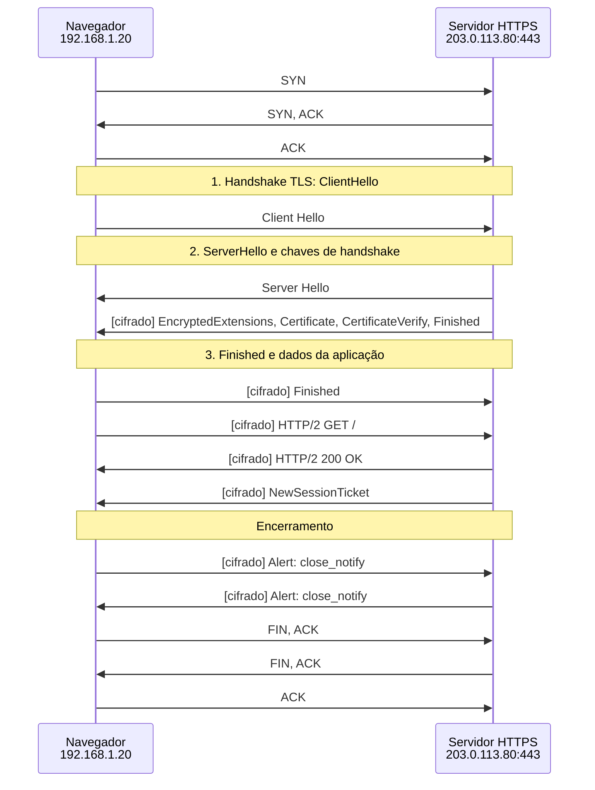

*Figura 5.1.1 (Tipo B, sequência).* Mensagens do cenário "TLS 1.3 completo (1 RTT)", na ordem do tempo, entre Navegador, Servidor HTTPS: 15 mensagens (em 4 fases; 7 cifradas). Corresponde ao diagrama de sequência e à aba Captura, no modo "Handshake TLS", com a configuração padrão.

**Mensagens**

| Mensagem | Significado | Origem |
| --- | --- | --- |
| ClientHello | versões, cifras, SNI e key_share | navegador |
| ServerHello | versão, cifra e key_share | servidor |
| EncryptedExtensions, Certificate, CertificateVerify, Finished | identidade e confirmação, cifrados | servidor |
| Finished | confirma o handshake | navegador |
| Application Data | HTTP cifrado | os dois |

**Por que importa.** Menos latência e menos exposição: o certificado deixa de ser visível a quem observa a rede, e só suítes com sigilo futuro existem no TLS 1.3.

#### 5.1.2 TLS 1.2 completo (2 RTT)

*Dois RTTs e o certificado trafegando em claro.*

**Configuração aplicada:** Perfil do navegador = intermediario; Perfil do servidor = intermediario

Os dois lados só falam TLS 1.2. O handshake leva 2 RTT: ClientHello e ServerHello, depois a troca de chaves do cliente e o Finished. O **certificado trafega em claro**, visível a quem observa a rede.

**Conceito.** No **TLS 1.2** ([RFC 5246](https://www.rfc-editor.org/rfc/rfc5246), obsoleta pela [RFC 9846](https://www.rfc-editor.org/rfc/rfc9846), que mantém o TLS 1.2 no apêndice D), o servidor responde com ServerHello, **Certificate** (em claro), ServerKeyExchange e ServerHelloDone. O cliente só então envia o ClientKeyExchange e o Finished: **2 RTT** até a primeira requisição. Com ECDHE há sigilo futuro; com troca RSA, não.

**O que observar**

- O Certificate aparece em claro na captura (aba Mensagem).
- Dois ciclos de ida e volta antes dos dados.
- O NewSessionTicket ainda vai em claro (vem antes do Change Cipher Spec); só o Finished do servidor vai cifrado.

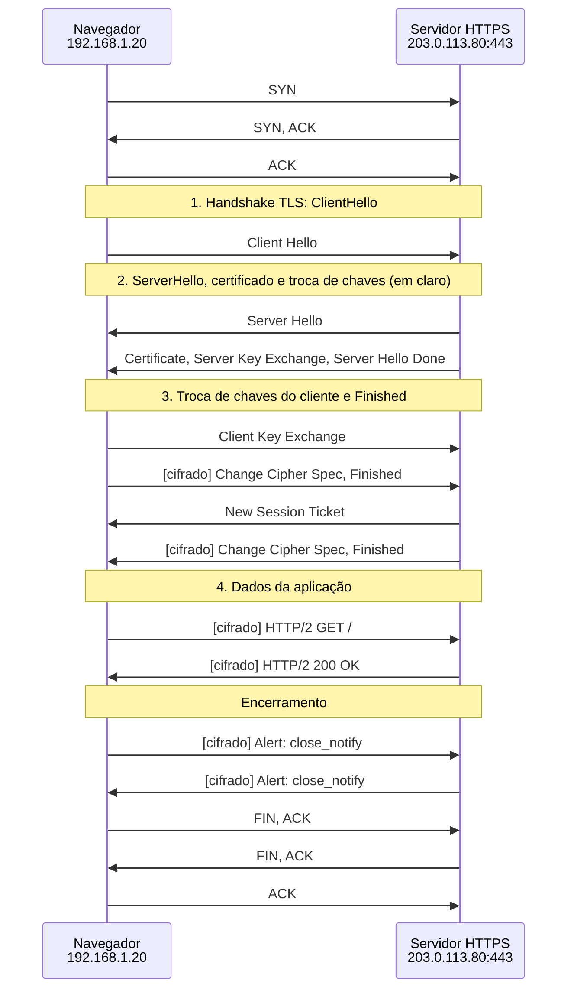

*Figura 5.1.2 (Tipo B, sequência).* Mensagens do cenário "TLS 1.2 completo (2 RTT)", na ordem do tempo, entre Navegador, Servidor HTTPS: 17 mensagens (em 5 fases; 6 cifradas). Corresponde ao diagrama de sequência e à aba Captura, no modo "Handshake TLS", com a configuração aplicada acima.

**Mensagens**

| Mensagem | Significado | Origem |
| --- | --- | --- |
| ClientHello | abre a negociação | navegador |
| Certificate, ServerKeyExchange, ServerHelloDone | certificado e parâmetros ECDHE | servidor |
| ClientKeyExchange, ChangeCipherSpec, Finished | troca de chaves e confirmação | navegador |
| NewSessionTicket | ticket para retomar a sessão (em claro) | servidor |
| ChangeCipherSpec, Finished | confirmação do servidor | servidor |

**Por que importa.** O TLS 1.2 ainda é muito usado. Os servidores que só o oferecem pagam mais latência e expõem o certificado e metadados.

#### 5.1.3 Retomada de sessão (ticket)

*Ticket de sessão: sem certificado, mantendo o sigilo futuro.*

**Configuração aplicada:** Tipo de conexão = resume

O navegador já visitou o site e tem um ticket (PSK) do NewSessionTicket. O ClientHello leva o ticket; o servidor dispensa certificado e assinatura. A troca ECDHE continua, então o sigilo futuro permanece.

**Conceito.** Depois de um handshake completo, o servidor entrega um **NewSessionTicket**. Na visita seguinte, o ClientHello leva o ticket (**pre_shared_key**) e o modo **psk_dhe_ke**: o servidor dispensa Certificate e CertificateVerify, e ainda há uma troca ECDHE nova, preservando o sigilo futuro.

**O que observar**

- O ClientHello com pre_shared_key.
- O voo do servidor sem Certificate nem CertificateVerify.
- Estado "verificado (ticket)" no painel.

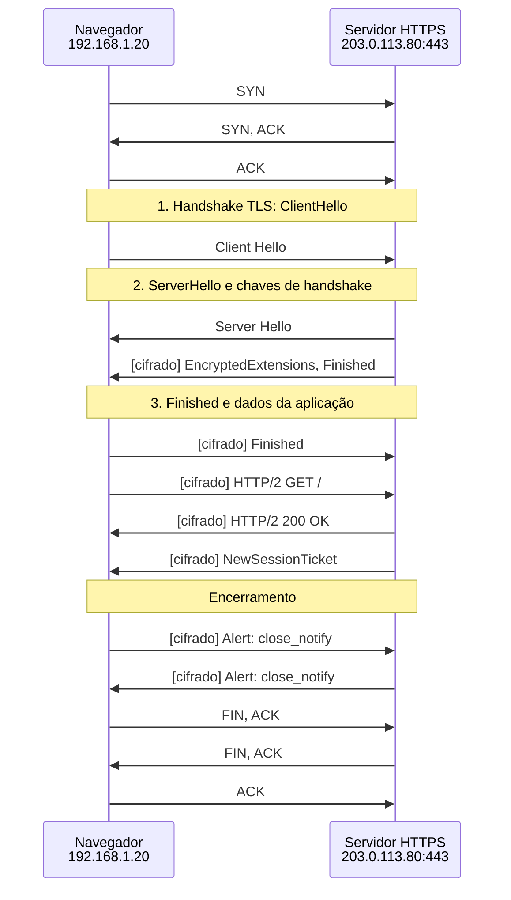

*Figura 5.1.3 (Tipo B, sequência).* Mensagens do cenário "Retomada de sessão (ticket)", na ordem do tempo, entre Navegador, Servidor HTTPS: 15 mensagens (em 4 fases; 7 cifradas). Corresponde ao diagrama de sequência e à aba Captura, no modo "Handshake TLS", com a configuração aplicada acima.

**Mensagens**

| Mensagem | Significado | Origem |
| --- | --- | --- |
| ClientHello (pre_shared_key) | apresenta o ticket | navegador |
| ServerHello, EncryptedExtensions, Finished | aceita o ticket | servidor |

**Por que importa.** Reduz CPU e tamanho do handshake. A chave de tickets do servidor precisa ser rotacionada, senão compromete o sigilo futuro.

#### 5.1.4 0-RTT e risco de replay

*Dados antecipados: mais rápido, com risco de replay.*

**Configuração aplicada:** Tipo de conexão = zero

Com 0-RTT, a requisição sai junto com o ClientHello, antes de qualquer resposta. Economiza 1 RTT, mas esses dados **podem ser repetidos** por um atacante (replay) e não têm sigilo futuro. Use só para requisições idempotentes (GET).

**Conceito.** No **0-RTT** (early data), o cliente envia a requisição junto do ClientHello, cifrada com a chave derivada do ticket. O servidor não consegue saber se é um envio novo ou uma **repetição** por um atacante, e esses dados não têm sigilo futuro.

**O que observar**

- A requisição sai no primeiro voo, antes do ServerHello.
- O evento de aviso sobre replay.
- A resposta pode sair antes do Finished do cliente (0,5 RTT).

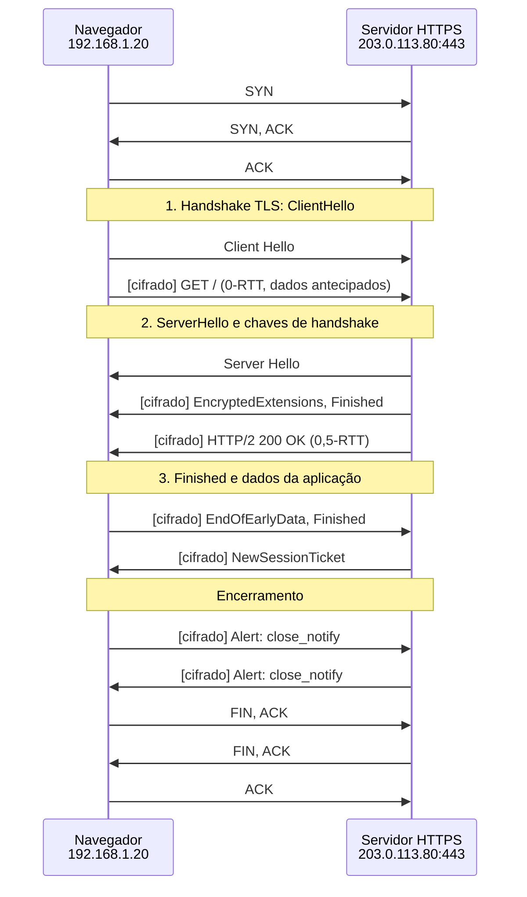

*Figura 5.1.4 (Tipo B, sequência).* Mensagens do cenário "0-RTT e risco de replay", na ordem do tempo, entre Navegador, Servidor HTTPS: 15 mensagens (em 4 fases; 7 cifradas). Corresponde ao diagrama de sequência e à aba Captura, no modo "Handshake TLS", com a configuração aplicada acima.

**Mensagens**

| Mensagem | Significado | Origem |
| --- | --- | --- |
| ClientHello + early_data | abre e já envia a requisição | navegador |
| Application Data (0-RTT) | requisição antecipada | navegador |
| Application Data (0,5-RTT) | resposta antecipada | servidor |

**Por que importa.** Aceite 0-RTT apenas em requisições idempotentes (GET sem efeito colateral) e use proteção contra replay no servidor ou no CDN.

#### 5.1.5 mTLS (certificado de cliente)

*Cliente e servidor se autenticam com certificados.*

**Configuração aplicada:** Certificado de cliente (mTLS) = sim

O servidor envia CertificateRequest e o cliente apresenta o próprio certificado, com CertificateVerify. As duas pontas se autenticam. É comum entre serviços e em redes de confiança zero.

**Conceito.** No **mTLS**, o servidor inclui **CertificateRequest** no voo cifrado. O cliente responde com o seu **Certificate** e **CertificateVerify** antes do Finished. O servidor valida o certificado do cliente contra a sua CA de clientes.

**O que observar**

- CertificateRequest no voo do servidor.
- Certificate e CertificateVerify do cliente.
- Estado "Cliente autenticado (mTLS)".

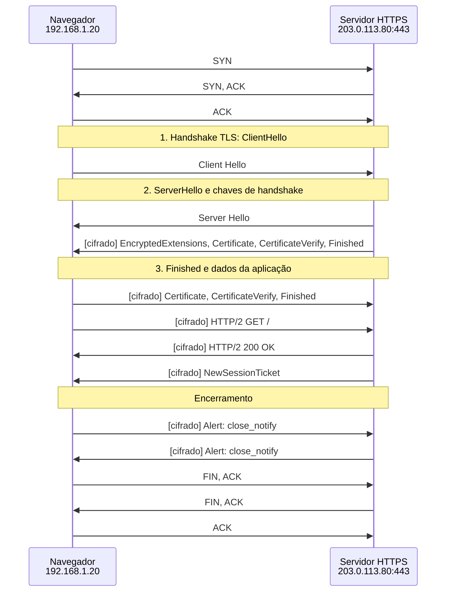

*Figura 5.1.5 (Tipo B, sequência).* Mensagens do cenário "mTLS (certificado de cliente)", na ordem do tempo, entre Navegador, Servidor HTTPS: 15 mensagens (em 4 fases; 7 cifradas). Corresponde ao diagrama de sequência e à aba Captura, no modo "Handshake TLS", com a configuração aplicada acima.

**Mensagens**

| Mensagem | Significado | Origem |
| --- | --- | --- |
| CertificateRequest | pede o certificado do cliente | servidor |
| Certificate, CertificateVerify | identifica o cliente | navegador |

**Por que importa.** É a base de muitas APIs internas e arquiteturas de confiança zero: o certificado de cliente substitui senhas e tokens estáticos.

> **Grupo:** Compatibilidade

Versão e cifra em comum, TLS legado e a proteção contra downgrade.

#### 5.1.6 Sem versão em comum

*Sem versão em comum: alerta protocol_version.*

**Configuração aplicada:** Perfil do navegador = legado; Perfil do servidor = moderno

Um navegador antigo (só TLS 1.0 e 1.1) tenta falar com um servidor moderno. Não há versão em comum e o servidor responde com o alerta fatal `protocol_version`. Nada foi cifrado nem enviado.

**Conceito.** O servidor escolhe a maior versão suportada pelos dois. Se não houver nenhuma, responde com um alerta fatal **protocol_version** (70). Navegadores atuais não oferecem mais TLS 1.0 e 1.1, e servidores modernos os desativaram.

**O que observar**

- O ClientHello só com TLS 1.0 e 1.1.
- O alerta em claro do servidor.
- Nenhuma credencial ou dado foi enviado.

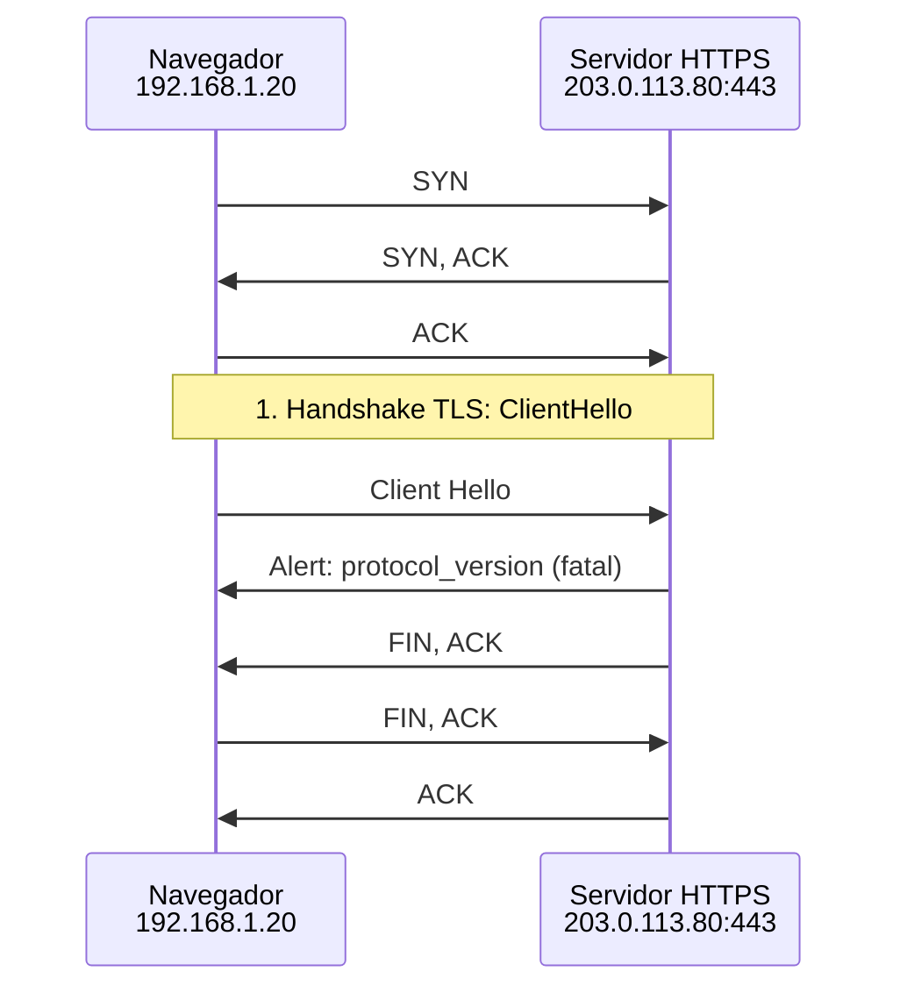

*Figura 5.1.6 (Tipo B, sequência).* Mensagens do cenário "Sem versão em comum", na ordem do tempo, entre Navegador, Servidor HTTPS: 8 mensagens (em 1 fase). Corresponde ao diagrama de sequência e à aba Captura, no modo "Handshake TLS", com a configuração aplicada acima.

**Mensagens**

| Mensagem | Significado | Origem |
| --- | --- | --- |
| ClientHello | versões antigas | navegador |
| Alert protocol_version | recusa | servidor |

**Por que importa.** Desativar protocolos antigos reduz a superfície de ataque (POODLE, BEAST) ao custo de perder clientes muito velhos.

#### 5.1.7 Sem cifra em comum

*Versão em comum, mas nenhuma cifra utilizável.*

**Configuração aplicada:** Perfil do navegador = legado; Perfil do servidor = legado; Chave do certificado = ecdsa

Há versão em comum, mas as únicas cifras de ambos usam troca RSA, e o certificado do servidor é ECDSA. As cifras RSA exigem chave RSA, então não há combinação e o servidor envia `handshake_failure`.

**Conceito.** As suítes de troca **RSA** (TLS_RSA_*) exigem certificado RSA; as ECDHE-ECDSA exigem ECDSA. Se as cifras comuns não combinam com o tipo de chave do certificado, o servidor envia **handshake_failure** (40).

**O que observar**

- A lista de cifras no ClientHello.
- O alerta handshake_failure.
- Mude "Chave do certificado" para RSA (Ajustes avançados) e veja funcionar.

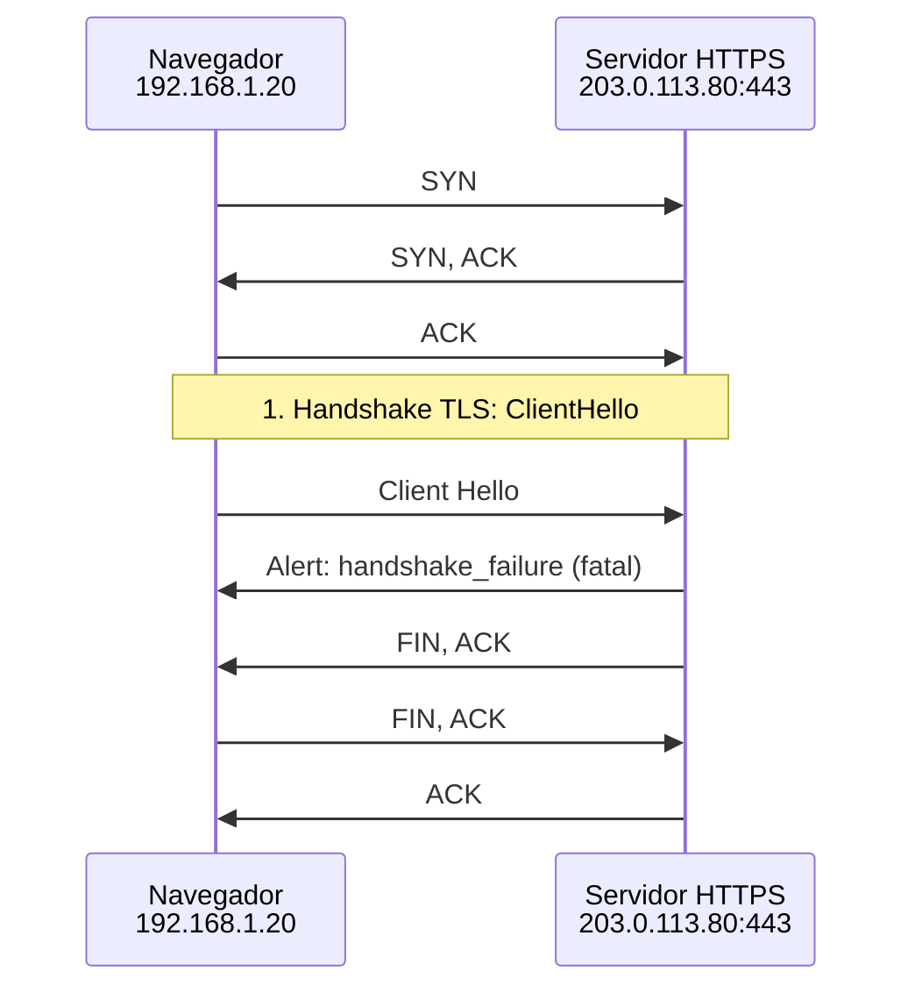

*Figura 5.1.7 (Tipo B, sequência).* Mensagens do cenário "Sem cifra em comum", na ordem do tempo, entre Navegador, Servidor HTTPS: 8 mensagens (em 1 fase). Corresponde ao diagrama de sequência e à aba Captura, no modo "Handshake TLS", com a configuração aplicada acima.

**Mensagens**

| Mensagem | Significado | Origem |
| --- | --- | --- |
| ClientHello | cifras RSA | navegador |
| Alert handshake_failure | sem cifra compatível | servidor |

**Por que importa.** A escolha do tipo de chave do certificado também limita as cifras que o servidor consegue oferecer.

#### 5.1.8 TLS legado sem sigilo futuro

*TLS 1.1 com RSA e CBC: funciona, sem sigilo futuro.*

**Configuração aplicada:** Perfil do navegador = legado; Perfil do servidor = legado; Chave do certificado = rsa

Os dois lados negociam TLS 1.1 com RSA e CBC. Funciona, mas o segredo viaja cifrado pela chave RSA do servidor: quem gravar o tráfego e obtiver a chave privada um dia decifra tudo (sem sigilo futuro).

**Conceito.** Na troca de chaves por **RSA**, o cliente cifra o pre-master secret com a chave pública do servidor. Como esse segredo fica protegido apenas pela chave de longo prazo do servidor, **quem gravar o tráfego e obtiver a chave privada um dia decifra tudo**. Combinado com CBC e TLS 1.1, é uma configuração obsoleta.

**O que observar**

- A marcação "sem sigilo futuro" no ClientKeyExchange.
- Estado "Sigilo futuro: NÃO (RSA)".
- Nota de hardening baixa na aba Configuração.

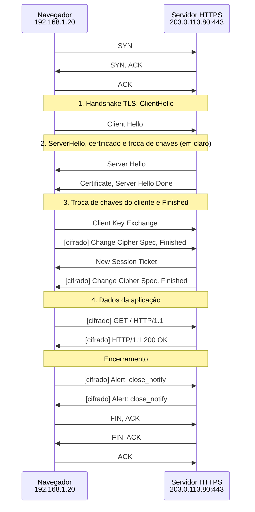

*Figura 5.1.8 (Tipo B, sequência).* Mensagens do cenário "TLS legado sem sigilo futuro", na ordem do tempo, entre Navegador, Servidor HTTPS: 17 mensagens (em 5 fases; 6 cifradas). Corresponde ao diagrama de sequência e à aba Captura, no modo "Handshake TLS", com a configuração aplicada acima.

**Mensagens**

| Mensagem | Significado | Origem |
| --- | --- | --- |
| ClientKeyExchange | pre-master secret cifrado com RSA | navegador |

**Por que importa.** O sigilo futuro (ECDHE) é o que impede que um vazamento futuro da chave do servidor exponha o tráfego passado.

#### 5.1.9 Downgrade detectado

*A proteção do TLS 1.3 contra downgrade.*

**Configuração aplicada:** Equipamento no caminho força TLS 1.2 = sim

Um equipamento no caminho remove o TLS 1.3 do ClientHello para forçar o TLS 1.2. O servidor, que suporta 1.3, responde em 1.2 mas põe o sentinela `DOWNGRD` no random. O cliente percebe e aborta com `illegal_parameter`.

**Conceito.** Um atacante no caminho pode tentar **rebaixar** a versão removendo o TLS 1.3 do ClientHello. Para detectar isso, o servidor que suporta 1.3 mas negocia 1.2 coloca **DOWNGRD** (44 4F 57 4E 47 52 44 01) no final do random do ServerHello. O cliente que suporta 1.3 vê o sentinela e aborta com **illegal_parameter**.

**O que observar**

- O sentinela no random do ServerHello (aba Mensagem).
- O alerta do cliente e o evento de downgrade.
- A conexão não segue em TLS 1.2.

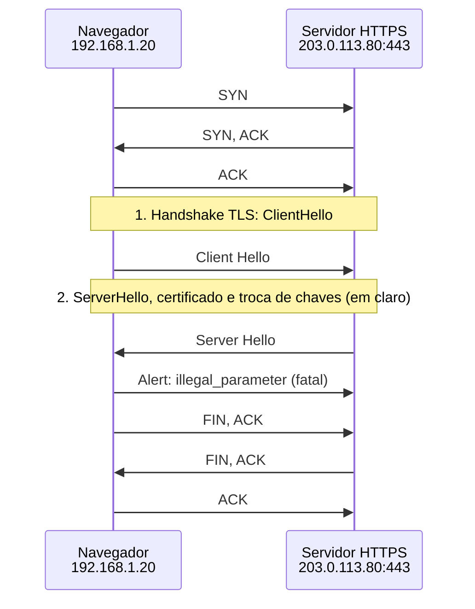

*Figura 5.1.9 (Tipo B, sequência).* Mensagens do cenário "Downgrade detectado", na ordem do tempo, entre Navegador, Servidor HTTPS: 9 mensagens (em 2 fases). Corresponde ao diagrama de sequência e à aba Captura, no modo "Handshake TLS", com a configuração aplicada acima.

**Mensagens**

| Mensagem | Significado | Origem |
| --- | --- | --- |
| ClientHello (sem 1.3) | alterado no caminho | equipamento no caminho |
| ServerHello (random com DOWNGRD) | denuncia o downgrade | servidor |
| Alert illegal_parameter | cliente aborta | navegador |

**Por que importa.** Sem essa proteção, ataques de downgrade levariam o cliente a versões e cifras fracas.

### 5.2 Modo: Certificados

> **Grupo:** Validação

O que o navegador confere em um certificado antes de confiar no servidor.

#### 5.2.1 Certificado válido

*Sete testes antes de confiar no servidor.*

O navegador valida a cadeia (leaf, intermediário, raiz), as assinaturas, a validade, o nome no SAN, a revogação (OCSP grampeado) e a transparência (SCT). Todos os testes passam e o handshake segue.

**Conceito.** O navegador valida o certificado: **cadeia** até uma raiz do repositório, **assinaturas**, **validade**, **nome no SAN**, **uso permitido** (EKU), **revogação** (OCSP) e **Certificate Transparency**. Só se todos passarem o handshake continua. O CertificateVerify prova que o servidor tem a chave privada.

**O que observar**

- A aba Certificado: a cadeia e os testes.
- O evento de validação no cliente.
- Estado "Servidor autenticado".


*Figura 5.2.1 (Tipo B, sequência).* Mensagens do cenário "Certificado válido", na ordem do tempo, entre Navegador, Servidor HTTPS: 15 mensagens (em 4 fases; 7 cifradas). Corresponde ao diagrama de sequência e à aba Captura, no modo "Certificados", com a configuração padrão.

**Mensagens**

| Mensagem | Significado | Origem |
| --- | --- | --- |
| Certificate | cadeia leaf, intermediário e raiz | servidor |
| CertificateVerify | assinatura do hash da conversa | servidor |

**Por que importa.** A confiança da web depende dessa validação: sem ela, qualquer um poderia se passar pelo site.

#### 5.2.2 Certificado expirado

*Validade vencida: ERR_CERT_DATE_INVALID.*

**Configuração aplicada:** Situação do certificado = expired

O certificado passou do notAfter. O navegador recusa, envia `certificate_expired` e mostra ERR_CERT_DATE_INVALID. Certificados vencem de propósito, para limitar o dano de chaves comprometidas.

**Conceito.** Todo certificado tem **notBefore** e **notAfter**. Depois do prazo, o navegador recusa. Os prazos são curtos (desde 15/03/2026, até 200 dias; 100 dias em 2027 e 47 dias em 2029, pelas regras do CA/B Forum, SC-081v3) para limitar o efeito de chaves comprometidas e forçar a automação da renovação (ACME).

**O que observar**

- O teste de validade falha na aba Certificado.
- O alerta certificate_expired do cliente.
- O erro mostrado ao usuário.

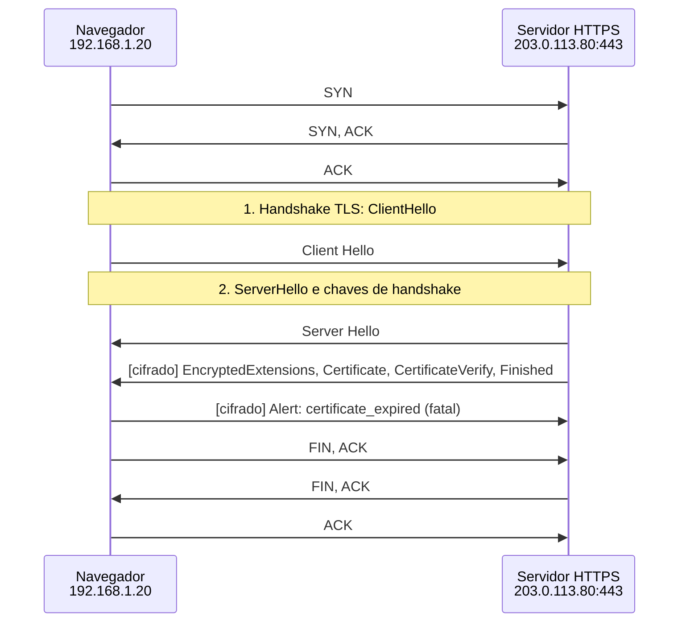

*Figura 5.2.2 (Tipo B, sequência).* Mensagens do cenário "Certificado expirado", na ordem do tempo, entre Navegador, Servidor HTTPS: 10 mensagens (em 2 fases; 2 cifradas). Corresponde ao diagrama de sequência e à aba Captura, no modo "Certificados", com a configuração aplicada acima.

**Mensagens**

| Mensagem | Significado | Origem |
| --- | --- | --- |
| Certificate | certificado vencido | servidor |
| Alert certificate_expired | recusa | navegador |

**Por que importa.** Certificados expirados são uma das causas mais comuns de indisponibilidade. Automatize a renovação e monitore os prazos.

#### 5.2.3 Nome não confere

*Certificado de outro nome: ERR_CERT_COMMON_NAME_INVALID.*

**Configuração aplicada:** Situação do certificado = name

O certificado é válido, mas emitido para outro nome (shop.example.net). O SNI diz `www.example.org`, e o navegador exige que o nome conste no SAN. Sem essa checagem, qualquer certificado válido serviria para qualquer site.

**Conceito.** O navegador compara o nome acessado com a lista **SAN** do certificado (o CN é ignorado). Um certificado válido para outro nome não serve: caso contrário, qualquer certificado legítimo permitiria se passar por qualquer site.

**O que observar**

- O SAN do certificado e o nome acessado, na aba Certificado.
- O teste "Nome do site na lista SAN" falha.
- O alerta bad_certificate.


*Figura 5.2.3 (Tipo B, sequência).* Mensagens do cenário "Nome não confere", na ordem do tempo, entre Navegador, Servidor HTTPS: 10 mensagens (em 2 fases; 2 cifradas). Corresponde ao diagrama de sequência e à aba Captura, no modo "Certificados", com a configuração aplicada acima.

**Mensagens**

| Mensagem | Significado | Origem |
| --- | --- | --- |
| Certificate | SAN não inclui o site | servidor |
| Alert bad_certificate | recusa | navegador |

**Por que importa.** É a checagem que liga a chave ao nome do site: a identidade vem do SAN, validado pela CA.

#### 5.2.4 Autoassinado (CA desconhecida)

*Sem CA de confiança: ERR_CERT_AUTHORITY_INVALID.*

**Configuração aplicada:** Situação do certificado = selfsigned

O certificado é assinado por ele mesmo: nenhuma CA do repositório de confiança o garante. O navegador recusa (unknown_ca). Aceitar a exceção sem conferir o fingerprint remove a proteção contra interceptação.

**Conceito.** Um certificado **autoassinado** não tem emissor no repositório de confiança do navegador. O sistema de confiança da web depende de CAs: sem elas, o navegador não tem como saber se a chave pertence mesmo ao site.

**O que observar**

- O teste de cadeia falha na aba Certificado.
- O alerta unknown_ca.
- O que significa aceitar a exceção sem conferir o fingerprint.

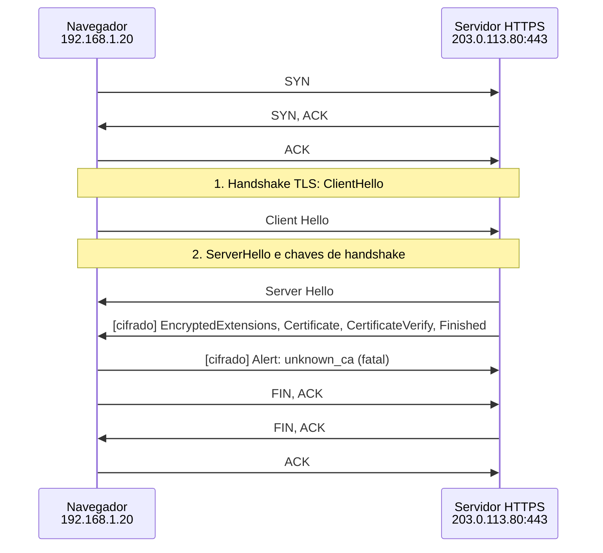

*Figura 5.2.4 (Tipo B, sequência).* Mensagens do cenário "Autoassinado (CA desconhecida)", na ordem do tempo, entre Navegador, Servidor HTTPS: 10 mensagens (em 2 fases; 2 cifradas). Corresponde ao diagrama de sequência e à aba Captura, no modo "Certificados", com a configuração aplicada acima.

**Mensagens**

| Mensagem | Significado | Origem |
| --- | --- | --- |
| Certificate | só o próprio certificado | servidor |
| Alert unknown_ca | recusa | navegador |

**Por que importa.** Em redes internas, use uma CA privada instalada nos clientes. Aceitar exceções por hábito derruba a proteção contra interceptação.

#### 5.2.5 Cadeia incompleta

*Falta o certificado intermediário.*

**Configuração aplicada:** Situação do certificado = chain

O servidor enviou só o certificado do site, sem o intermediário. Alguns clientes completam a cadeia sozinhos, mas outros não: o navegador não consegue ligar o leaf a uma raiz confiável e recusa.

**Conceito.** O servidor deve enviar o **leaf** e os **intermediários**; a raiz já está no cliente. Se faltar o intermediário, o navegador não liga o leaf a uma raiz (**unable to get local issuer certificate**). Alguns clientes buscam o intermediário sozinhos (AIA), outros não.

**O que observar**

- A cadeia incompleta na aba Certificado.
- O teste de cadeia falha.
- O alerta unknown_ca.


*Figura 5.2.5 (Tipo B, sequência).* Mensagens do cenário "Cadeia incompleta", na ordem do tempo, entre Navegador, Servidor HTTPS: 10 mensagens (em 2 fases; 2 cifradas). Corresponde ao diagrama de sequência e à aba Captura, no modo "Certificados", com a configuração aplicada acima.

**Mensagens**

| Mensagem | Significado | Origem |
| --- | --- | --- |
| Certificate | só o leaf | servidor |
| Alert unknown_ca | recusa | navegador |

**Por que importa.** É um erro comum de configuração: sempre sirva o "fullchain".

#### 5.2.6 Revogado (com stapling)

*Revogado: a CA diz que o certificado não vale mais.*

**Configuração aplicada:** Situação do certificado = revoked

A CA revogou o certificado (chave comprometida). O servidor anexa a resposta OCSP "revoked" ao certificado (stapling), e o navegador a vê sem precisar consultar a CA. Conexão recusada com `certificate_revoked`.

**Conceito.** Quando uma chave é comprometida, a CA **revoga** o certificado. Com **OCSP stapling**, o servidor anexa a resposta assinada da CA ao certificado, e o navegador vê o status "revoked" sem consultar a CA.

**O que observar**

- O teste de revogação falha na aba Certificado.
- O alerta certificate_revoked.
- Nenhuma mensagem para a CA: a resposta já veio com o certificado.


*Figura 5.2.6 (Tipo B, sequência).* Mensagens do cenário "Revogado (com stapling)", na ordem do tempo, entre Navegador, Servidor HTTPS: 10 mensagens (em 2 fases; 2 cifradas). Corresponde ao diagrama de sequência e à aba Captura, no modo "Certificados", com a configuração aplicada acima.

**Mensagens**

| Mensagem | Significado | Origem |
| --- | --- | --- |
| Certificate + resposta OCSP | status revoked grampeado | servidor |
| Alert certificate_revoked | recusa | navegador |

**Por que importa.** A revogação só funciona se o cliente a verifica. Stapling torna isso rápido e privado.

> **Grupo:** Revogação

Como o navegador descobre que um certificado foi revogado.

#### 5.2.7 Sem stapling: consulta OCSP

*Sem stapling: o navegador pergunta à CA.*

**Configuração aplicada:** OCSP stapling no servidor = não

Sem stapling, o navegador pergunta à CA, por conta própria, se o certificado foi revogado. Isso gasta 1 RTT extra e **revela à CA qual site você visita**. É o motivo de o stapling ser recomendado.

**Conceito.** Sem **OCSP stapling**, o navegador consulta o responder OCSP da CA em uma conexão separada (HTTP, porta 80). Isso custa **1 RTT** e **a CA fica sabendo qual site você visita**. Se o responder estiver fora do ar, o navegador costuma seguir mesmo assim (soft-fail). Nota: o OCSP está em retirada na prática (o Let’s Encrypt encerrou o serviço em 2025 e adotou listas de revogação, CRL); o cenário mostra o mecanismo clássico da [RFC 6960](https://www.rfc-editor.org/rfc/rfc6960).

**O que observar**

- A terceira coluna: a CA.
- O OCSP request e a resposta "good".
- A latência extra antes do Finished.

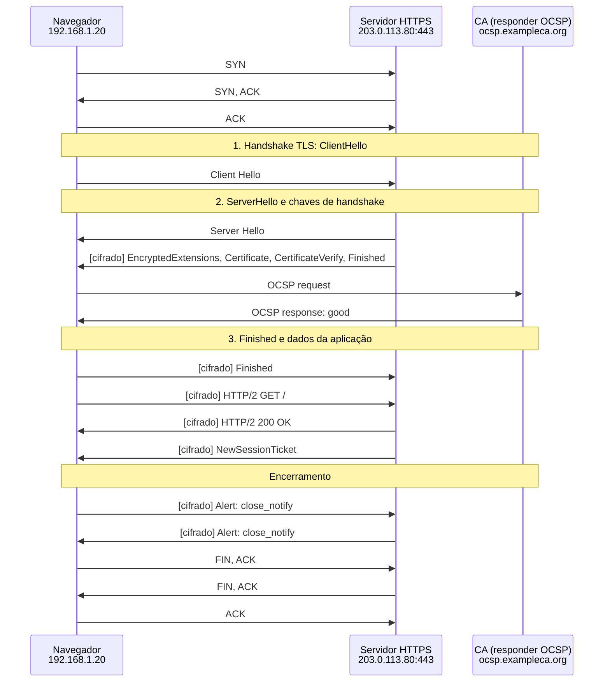

*Figura 5.2.7 (Tipo B, sequência).* Mensagens do cenário "Sem stapling: consulta OCSP", na ordem do tempo, entre Navegador, Servidor HTTPS, CA (responder OCSP): 17 mensagens (em 4 fases; 7 cifradas). Corresponde ao diagrama de sequência e à aba Captura, no modo "Certificados", com a configuração aplicada acima.

**Mensagens**

| Mensagem | Significado | Origem |
| --- | --- | --- |
| OCSP request | pergunta se o serial foi revogado | navegador |
| OCSP response | good ou revoked | CA |

**Por que importa.** Stapling e a extensão Must-Staple evitam a consulta e o vazamento de privacidade.

#### 5.2.8 Revogado, sem stapling

*Revogado e descoberto só depois da consulta à CA.*

**Configuração aplicada:** Situação do certificado = revoked; OCSP stapling no servidor = não

O navegador consulta a CA (OCSP) e recebe "revoked". A recusa acontece, mas depois de uma ida e volta extra e de expor o site visitado à CA.

**Conceito.** O navegador consulta a CA, recebe **revoked** e aborta com `certificate_revoked`. O resultado é o mesmo do cenário com stapling, mas com uma ida e volta a mais e exposição do site visitado à CA.

**O que observar**

- O OCSP response "revoked".
- O alerta do cliente depois da consulta.
- Compare o tempo com o cenário com stapling.

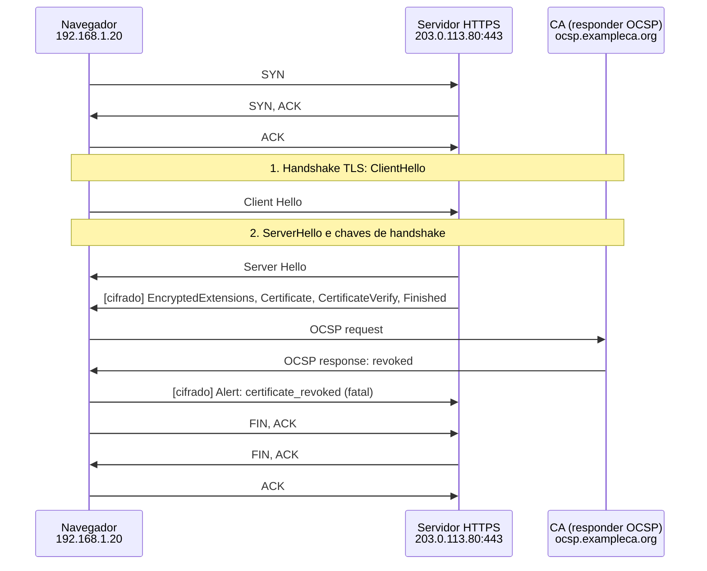

*Figura 5.2.8 (Tipo B, sequência).* Mensagens do cenário "Revogado, sem stapling", na ordem do tempo, entre Navegador, Servidor HTTPS, CA (responder OCSP): 12 mensagens (em 2 fases; 2 cifradas). Corresponde ao diagrama de sequência e à aba Captura, no modo "Certificados", com a configuração aplicada acima.

**Mensagens**

| Mensagem | Significado | Origem |
| --- | --- | --- |
| OCSP request e response | consulta e resposta revoked | navegador e CA |
| Alert certificate_revoked | recusa | navegador |

**Por que importa.** Revogação em tempo real é difícil: por isso os certificados são cada vez mais curtos.

### 5.3 Modo: HTTP, HTTPS e HSTS

> **Grupo:** HSTS

Do HTTP ao HTTPS e como o HSTS fecha a janela de exposição.

#### 5.3.1 Primeiro acesso: HTTP e 301

*A primeira requisição em HTTP é a janela de exposição.*

O usuário digita só o nome do site. Sem HSTS, a primeira requisição sai em HTTP (porta 80), o servidor responde 301 para HTTPS e só então começa o TLS. Essa primeira troca em claro é a janela de exposição. Na resposta HTTPS, o servidor envia o cabeçalho HSTS.

**Conceito.** Quando o usuário digita só o nome do site, o navegador tenta HTTP (porta 80). O servidor responde **301** para HTTPS, mas essa troca vai em claro: um atacante no caminho pode alterá-la ou impedir o upgrade (ataques de *SSL stripping*). O cabeçalho **Strict-Transport-Security**, recebido já em HTTPS, faz o navegador exigir HTTPS nas próximas visitas.

**O que observar**

- A requisição e o 301 em claro (aba Mensagem).
- O cabeçalho HSTS na resposta HTTPS e o estado do HSTS.
- O cenário "Com HSTS em cache" mostra a segunda visita.

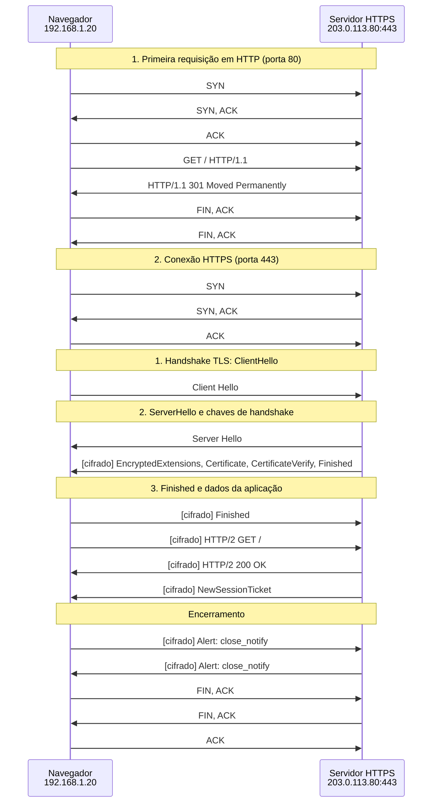

*Figura 5.3.1 (Tipo B, sequência).* Mensagens do cenário "Primeiro acesso: HTTP e 301", na ordem do tempo, entre Navegador, Servidor HTTPS: 22 mensagens (em 6 fases; 7 cifradas). Corresponde ao diagrama de sequência e à aba Captura, no modo "HTTP, HTTPS e HSTS", com a configuração padrão.

**Mensagens**

| Mensagem | Significado | Origem |
| --- | --- | --- |
| GET / (HTTP) | primeira requisição, em claro | navegador |
| 301 Moved Permanently | redireciona para HTTPS | servidor |
| Strict-Transport-Security | ensina o navegador a exigir HTTPS | servidor |

**Por que importa.** O redirecionamento sozinho não basta: HSTS (com preload) fecha a janela em que um intermediário poderia impedir o HTTPS.

#### 5.3.2 Com HSTS em cache

*Segunda visita: o navegador nem tenta HTTP.*

**Configuração aplicada:** HSTS no navegador = cached

O navegador lembra do cabeçalho Strict-Transport-Security de uma visita anterior. Antes de enviar qualquer pacote, ele troca http por https internamente. Nenhuma requisição HTTP sai.

**Conceito.** Com o **HSTS** em cache, o navegador reescreve internamente http:// para https:// (307 Internal Redirect) antes de enviar qualquer pacote. Não há requisição em claro para interceptar, e os erros de certificado deixam de poder ser contornados pelo usuário.

**O que observar**

- Nenhum pacote na porta 80.
- O evento de upgrade interno.
- A conexão começa direto no TLS.

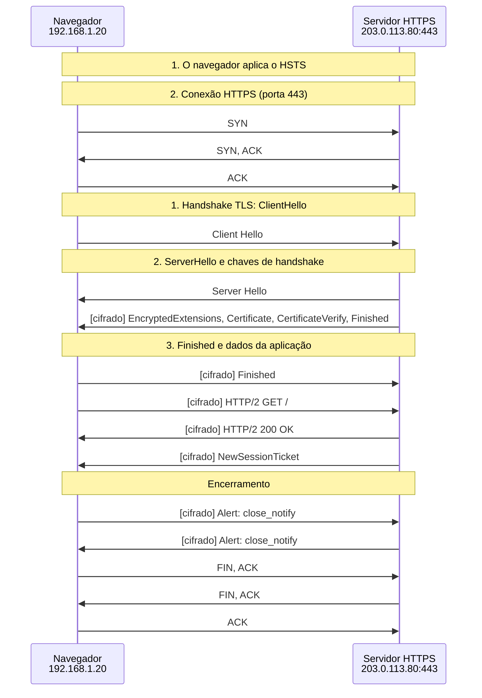

*Figura 5.3.2 (Tipo B, sequência).* Mensagens do cenário "Com HSTS em cache", na ordem do tempo, entre Navegador, Servidor HTTPS: 15 mensagens (em 6 fases; 7 cifradas). Corresponde ao diagrama de sequência e à aba Captura, no modo "HTTP, HTTPS e HSTS", com a configuração aplicada acima.

**Mensagens**

| Mensagem | Significado | Origem |
| --- | --- | --- |
| (nenhuma requisição HTTP) | o navegador já sabe que o site é só HTTPS | navegador |

**Por que importa.** HSTS elimina o SSL stripping para quem já visitou o site, e também torna os erros de certificado impossíveis de ignorar.

#### 5.3.3 HSTS preload

*A lista de preload protege até a primeira visita.*

**Configuração aplicada:** HSTS no navegador = preload

O domínio consta na lista de preload embutida no navegador. O HTTPS é exigido já na primeira visita, fechando a janela que o HSTS comum deixa.

**Conceito.** O HSTS comum só protege depois da primeira visita. A **lista de preload**, embutida nos navegadores, inclui domínios que exigem HTTPS desde o início, sem depender de uma visita anterior. Para entrar, o site precisa enviar o cabeçalho com `includeSubDomains; preload` e ter HTTPS em todos os subdomínios.

**O que observar**

- Nenhum pacote HTTP, mesmo sem visita anterior.
- O evento "Domínio na lista de preload".
- O estado do HSTS: preload.


*Figura 5.3.3 (Tipo B, sequência).* Mensagens do cenário "HSTS preload", na ordem do tempo, entre Navegador, Servidor HTTPS: 15 mensagens (em 6 fases; 7 cifradas). Corresponde ao diagrama de sequência e à aba Captura, no modo "HTTP, HTTPS e HSTS", com a configuração aplicada acima.

**Mensagens**

| Mensagem | Significado | Origem |
| --- | --- | --- |
| (nenhuma requisição HTTP) | HTTPS exigido pela lista embutida | navegador |

**Por que importa.** É a proteção mais forte do HSTS, mas difícil de desfazer: só entre se todos os subdomínios usam HTTPS.

> **Grupo:** Falhas comuns

Configurações que deixam o usuário exposto mesmo com certificado.

#### 5.3.4 Sem redirecionamento

*HTTPS existe, mas o usuário não é levado a ele.*

**Configuração aplicada:** Redireciona HTTP para HTTPS = não

O site tem HTTPS, mas o servidor atende HTTP sem redirecionar e não há HSTS. Quem digita o endereço sem https permanece em HTTP, em claro, embora o HTTPS exista.

**Conceito.** Sem redirecionamento e sem HSTS, quem digita o endereço sem **https://** permanece em HTTP. Ter um certificado não basta: o navegador precisa ser conduzido ao HTTPS.

**O que observar**

- A resposta 200 em HTTP, sem redirecionamento.
- Os eventos de aviso.
- Compare com o primeiro acesso com 301.

```mermaid
sequenceDiagram
  participant n_c as Navegador<br/>192.168.1.20
  participant n_s as Servidor HTTPS<br/>203.0.113.80:443
  Note over n_c,n_s: 1. Requisição HTTP (porta 80)
  n_c ->> n_s: SYN
  n_s ->> n_c: SYN, ACK
  n_c ->> n_s: ACK
  n_c ->> n_s: GET / HTTP/1.1
  n_s ->> n_c: HTTP/1.1 200 OK
```

*Figura 5.3.4 (Tipo B, sequência).* Mensagens do cenário "Sem redirecionamento", na ordem do tempo, entre Navegador, Servidor HTTPS: 5 mensagens (em 1 fase). Corresponde ao diagrama de sequência e à aba Captura, no modo "HTTP, HTTPS e HSTS", com a configuração aplicada acima.

**Mensagens**

| Mensagem | Significado | Origem |
| --- | --- | --- |
| GET / (HTTP) | requisição sem https | navegador |
| 200 OK (HTTP) | conteúdo em claro | servidor |

**Por que importa.** Configure o redirecionamento 301 e o cabeçalho HSTS em todos os hosts do domínio.

#### 5.3.5 Sem HTTPS

*Sem TLS: nada é cifrado nem autenticado.*

**Configuração aplicada:** Atende HTTPS (porta 443) = não

O site só existe em HTTP. Conteúdo, cookies e senhas trafegam em texto puro, sem integridade nem autenticação do servidor.

**Conceito.** Um site só em **HTTP** expõe conteúdo, cookies e senhas, e permite que um intermediário altere páginas (injeção de anúncios ou de código). Navegadores marcam esses sites como "não seguros".

**O que observar**

- O cookie de sessão em claro (aba Mensagem).
- Os avisos de exposição.
- Nenhum TLS na linha do tempo.

```mermaid
sequenceDiagram
  participant n_c as Navegador<br/>192.168.1.20
  participant n_s as Servidor HTTPS<br/>203.0.113.80:443
  Note over n_c,n_s: 1. Somente HTTP (porta 80)
  n_c ->> n_s: SYN
  n_s ->> n_c: SYN, ACK
  n_c ->> n_s: ACK
  n_c ->> n_s: GET / HTTP/1.1
  n_s ->> n_c: HTTP/1.1 200 OK
```

*Figura 5.3.5 (Tipo B, sequência).* Mensagens do cenário "Sem HTTPS", na ordem do tempo, entre Navegador, Servidor HTTPS: 5 mensagens (em 1 fase). Corresponde ao diagrama de sequência e à aba Captura, no modo "HTTP, HTTPS e HSTS", com a configuração aplicada acima.

**Mensagens**

| Mensagem | Significado | Origem |
| --- | --- | --- |
| GET / (HTTP) | requisição em claro | navegador |
| 200 OK (HTTP) | resposta em claro | servidor |

**Por que importa.** Hoje HTTPS é o padrão mínimo: gratuito (ACME) e exigido por navegadores e APIs modernas.

### 5.4 Modo: Comparação HTTP x HTTPS

> **Grupo:** HTTP x HTTPS

A mesma ação do usuário em HTTP e em HTTPS, com um observador na rede.

#### 5.4.1 Login: senha em claro x cifrada

*A senha viaja em texto puro no HTTP e cifrada no HTTPS.*

**Configuração aplicada:** O que o usuário faz = login

O usuário faz login: um POST com usuário e senha e uma resposta com o cookie de sessão. Em HTTP, um observador na rede lê a senha e o cookie. Em HTTPS, só vê registros cifrados.

**Conceito.** O **HTTP** não tem proteção: o corpo do POST (usuário e senha) e o **cookie de sessão** da resposta trafegam em texto puro, e qualquer equipamento no caminho os lê. No **HTTPS**, o mesmo POST vai dentro do TLS: o observador vê só registros cifrados, além do IP e do nome do site (SNI).

**O que observar**

- As duas metades do diagrama, uma abaixo da outra: A (HTTP) e B (HTTPS).
- A aba "O que o observador vê": a captura de cada lado, com a senha destacada em vermelho no HTTP.
- A aba "Comparação": tempo, bytes, confidencialidade, integridade e autenticação.

```mermaid
sequenceDiagram
  participant n_c as Navegador<br/>192.168.1.20
  participant n_o as Observador na rede<br/>Wi-Fi público ou provedor
  participant n_s as Servidor<br/>203.0.113.80
  Note over n_c,n_s: A. HTTP (porta 80, sem proteção)
  n_c ->> n_s: SYN
  n_s ->> n_c: SYN, ACK
  n_c ->> n_s: ACK
  n_c ->> n_s: POST /login
  n_s ->> n_c: 200 OK + Set-Cookie
  n_c ->> n_s: FIN, ACK
  n_s ->> n_c: FIN, ACK
  Note over n_c,n_s: B. HTTPS (porta 443, TLS)
  n_c ->> n_s: SYN
  n_s ->> n_c: SYN, ACK
  n_c ->> n_s: ACK
  Note over n_c,n_s: 1. Handshake TLS: ClientHello
  n_c ->> n_s: Client Hello
  Note over n_c,n_s: 2. ServerHello e chaves de handshake
  n_s ->> n_c: Server Hello
  n_s ->> n_c: [cifrado] EncryptedExtensions, Certificate, CertificateVerify, Finished
  Note over n_c,n_s: 3. Finished e dados da aplicação
  n_c ->> n_s: [cifrado] Finished
  n_c ->> n_s: [cifrado] HTTP/2 POST /login
  n_s ->> n_c: [cifrado] HTTP/2 200 OK
  n_s ->> n_c: [cifrado] NewSessionTicket
  Note over n_c,n_s: Encerramento
  n_c ->> n_s: [cifrado] Alert: close_notify
  n_s ->> n_c: [cifrado] Alert: close_notify
  n_c ->> n_s: FIN, ACK
  n_s ->> n_c: FIN, ACK
  n_c ->> n_s: ACK
```

*Figura 5.4.1 (Tipo B, sequência).* Mensagens do cenário "Login: senha em claro x cifrada", na ordem do tempo, entre Navegador, Observador na rede, Servidor: 22 mensagens (em 6 fases; 7 cifradas). Corresponde ao diagrama de sequência e à aba Captura, no modo "Comparação HTTP x HTTPS", com a configuração aplicada acima.

**Mensagens**

| Mensagem | Significado | Origem |
| --- | --- | --- |
| POST /login (HTTP) | usuário e senha em texto puro | navegador |
| 200 OK + Set-Cookie (HTTP) | cookie de sessão em claro | servidor |
| Application Data (HTTPS) | o mesmo POST, cifrado | navegador |

**Por que importa.** É a razão pela qual formulários de login, APIs e qualquer página com sessão precisam de HTTPS: a senha e o cookie são exatamente o que um observador quer capturar.

#### 5.4.2 Busca: o termo vai na URL

*A URL e o termo pesquisado ficam expostos no HTTP.*

**Configuração aplicada:** O que o usuário faz = search

Uma busca com o termo na URL. Em HTTP, o observador sabe exatamente o que o usuário pesquisou. Em HTTPS, ele só sabe qual site foi acessado (pelo SNI).

**Conceito.** A URL, incluindo a **query string**, vai no cabeçalho da requisição. Em HTTP, o observador lê o que o usuário pesquisa e quais páginas visita. Em HTTPS, a URL fica dentro do canal cifrado; só o **nome do site** (SNI) e o IP aparecem.

**O que observar**

- A linha "GET /busca?q=..." em vermelho na captura HTTP.
- No HTTPS, o SNI no ClientHello e nada da URL.
- A linha "O observador lê" na aba Comparação.

```mermaid
sequenceDiagram
  participant n_c as Navegador<br/>192.168.1.20
  participant n_o as Observador na rede<br/>Wi-Fi público ou provedor
  participant n_s as Servidor<br/>203.0.113.80
  Note over n_c,n_s: A. HTTP (porta 80, sem proteção)
  n_c ->> n_s: SYN
  n_s ->> n_c: SYN, ACK
  n_c ->> n_s: ACK
  n_c ->> n_s: GET /busca?q=resultado+do+exame
  n_s ->> n_c: 200 OK (resultados)
  n_c ->> n_s: FIN, ACK
  n_s ->> n_c: FIN, ACK
  Note over n_c,n_s: B. HTTPS (porta 443, TLS)
  n_c ->> n_s: SYN
  n_s ->> n_c: SYN, ACK
  n_c ->> n_s: ACK
  Note over n_c,n_s: 1. Handshake TLS: ClientHello
  n_c ->> n_s: Client Hello
  Note over n_c,n_s: 2. ServerHello e chaves de handshake
  n_s ->> n_c: Server Hello
  n_s ->> n_c: [cifrado] EncryptedExtensions, Certificate, CertificateVerify, Finished
  Note over n_c,n_s: 3. Finished e dados da aplicação
  n_c ->> n_s: [cifrado] Finished
  n_c ->> n_s: [cifrado] HTTP/2 GET /busca?q=resultado+do+exame
  n_s ->> n_c: [cifrado] HTTP/2 200 OK
  n_s ->> n_c: [cifrado] NewSessionTicket
  Note over n_c,n_s: Encerramento
  n_c ->> n_s: [cifrado] Alert: close_notify
  n_s ->> n_c: [cifrado] Alert: close_notify
  n_c ->> n_s: FIN, ACK
  n_s ->> n_c: FIN, ACK
  n_c ->> n_s: ACK
```

*Figura 5.4.2 (Tipo B, sequência).* Mensagens do cenário "Busca: o termo vai na URL", na ordem do tempo, entre Navegador, Observador na rede, Servidor: 22 mensagens (em 6 fases; 7 cifradas). Corresponde ao diagrama de sequência e à aba Captura, no modo "Comparação HTTP x HTTPS", com a configuração aplicada acima.

**Mensagens**

| Mensagem | Significado | Origem |
| --- | --- | --- |
| GET /busca?q=... (HTTP) | termo na URL, em claro | navegador |
| ClientHello (HTTPS) | SNI visível; URL oculta | navegador |

**Por que importa.** Metadados também importam: o HTTPS protege o conteúdo e a URL, mas o SNI ainda revela o site (o ECH esconderia).

#### 5.4.3 Página com cookie de sessão

*O cookie de sessão em claro permite assumir a sessão.*

**Configuração aplicada:** O que o usuário faz = page

Uma página pessoal acessada com o cookie de sessão. Em HTTP, o cookie e a página trafegam em claro, e quem copia o cookie assume a sessão. Em HTTPS, ficam protegidos.

**Conceito.** O **cookie de sessão** identifica o usuário já autenticado. Em HTTP, ele trafega em claro e quem o copia pode usar a sessão do usuário (*session hijacking*). Em HTTPS, o cookie vai cifrado, e os atributos `Secure` e `HttpOnly` reforçam a proteção.

**O que observar**

- O cabeçalho Cookie destacado na captura HTTP.
- No HTTPS, o pedido e a resposta como "Application Data".
- Estado "Observador lê o conteúdo?" no painel lateral.

```mermaid
sequenceDiagram
  participant n_c as Navegador<br/>192.168.1.20
  participant n_o as Observador na rede<br/>Wi-Fi público ou provedor
  participant n_s as Servidor<br/>203.0.113.80
  Note over n_c,n_s: A. HTTP (porta 80, sem proteção)
  n_c ->> n_s: SYN
  n_s ->> n_c: SYN, ACK
  n_c ->> n_s: ACK
  n_c ->> n_s: GET /notas
  n_s ->> n_c: 200 OK (notas)
  n_c ->> n_s: FIN, ACK
  n_s ->> n_c: FIN, ACK
  Note over n_c,n_s: B. HTTPS (porta 443, TLS)
  n_c ->> n_s: SYN
  n_s ->> n_c: SYN, ACK
  n_c ->> n_s: ACK
  Note over n_c,n_s: 1. Handshake TLS: ClientHello
  n_c ->> n_s: Client Hello
  Note over n_c,n_s: 2. ServerHello e chaves de handshake
  n_s ->> n_c: Server Hello
  n_s ->> n_c: [cifrado] EncryptedExtensions, Certificate, CertificateVerify, Finished
  Note over n_c,n_s: 3. Finished e dados da aplicação
  n_c ->> n_s: [cifrado] Finished
  n_c ->> n_s: [cifrado] HTTP/2 GET /notas
  n_s ->> n_c: [cifrado] HTTP/2 200 OK
  n_s ->> n_c: [cifrado] NewSessionTicket
  Note over n_c,n_s: Encerramento
  n_c ->> n_s: [cifrado] Alert: close_notify
  n_s ->> n_c: [cifrado] Alert: close_notify
  n_c ->> n_s: FIN, ACK
  n_s ->> n_c: FIN, ACK
  n_c ->> n_s: ACK
```

*Figura 5.4.3 (Tipo B, sequência).* Mensagens do cenário "Página com cookie de sessão", na ordem do tempo, entre Navegador, Observador na rede, Servidor: 22 mensagens (em 6 fases; 7 cifradas). Corresponde ao diagrama de sequência e à aba Captura, no modo "Comparação HTTP x HTTPS", com a configuração aplicada acima.

**Mensagens**

| Mensagem | Significado | Origem |
| --- | --- | --- |
| GET /notas + Cookie (HTTP) | cookie em claro | navegador |
| Application Data (HTTPS) | pedido cifrado | navegador |

**Por que importa.** Cookies de sessão sem HTTPS são uma das falhas mais antigas e ainda comuns. O atributo Secure impede o envio do cookie por HTTP.

> **Grupo:** Integridade

O que acontece quando um equipamento no caminho altera a resposta.

#### 5.4.4 Conteúdo alterado no caminho

*O HTTPS não só esconde, também detecta a alteração.*

**Configuração aplicada:** O que o usuário faz = page; Equipamento no caminho altera a página = sim

Um equipamento no caminho (proxy ou Wi-Fi público) injeta um banner na resposta. Em HTTP, a página alterada é exibida sem aviso. Em HTTPS, o registro alterado falha na verificação de autenticidade e o navegador encerra a conexão (`bad_record_mac`).

**Conceito.** A **integridade** é diferente da confidencialidade. Em HTTP, um equipamento no caminho pode **alterar** a resposta (injetar anúncios ou código) e o navegador a exibe sem perceber. No HTTPS, cada registro tem uma **tag de autenticação** (AEAD): um registro alterado falha na verificação, é descartado e a conexão termina com `bad_record_mac`.

**O que observar**

- A seta vermelha da resposta alterada em HTTP e em HTTPS.
- O evento do cliente: "Exibe a página alterada" contra "Tag de autenticação inválida".
- A linha de cada captura marcada como alterada.

```mermaid
sequenceDiagram
  participant n_c as Navegador<br/>192.168.1.20
  participant n_o as Observador na rede<br/>Wi-Fi público ou provedor
  participant n_s as Servidor<br/>203.0.113.80
  Note over n_c,n_s: A. HTTP (porta 80, sem proteção)
  n_c ->> n_s: SYN
  n_s ->> n_c: SYN, ACK
  n_c ->> n_s: ACK
  n_c ->> n_s: GET /notas
  n_s ->> n_c: 200 OK (notas) (+ conteúdo injetado)
  n_c ->> n_s: FIN, ACK
  n_s ->> n_c: FIN, ACK
  Note over n_c,n_s: B. HTTPS (porta 443, TLS)
  n_c ->> n_s: SYN
  n_s ->> n_c: SYN, ACK
  n_c ->> n_s: ACK
  Note over n_c,n_s: 1. Handshake TLS: ClientHello
  n_c ->> n_s: Client Hello
  Note over n_c,n_s: 2. ServerHello e chaves de handshake
  n_s ->> n_c: Server Hello
  n_s ->> n_c: [cifrado] EncryptedExtensions, Certificate, CertificateVerify, Finished
  Note over n_c,n_s: 3. Finished e dados da aplicação
  n_c ->> n_s: [cifrado] Finished
  n_c ->> n_s: [cifrado] HTTP/2 GET /notas
  n_s ->> n_c: [cifrado] HTTP/2 200 OK (alterada no caminho)
  n_c ->> n_s: [cifrado] Alert: bad_record_mac (fatal)
  n_c ->> n_s: FIN, ACK
  n_s ->> n_c: FIN, ACK
  n_c ->> n_s: ACK
```

*Figura 5.4.4 (Tipo B, sequência).* Mensagens do cenário "Conteúdo alterado no caminho", na ordem do tempo, entre Navegador, Observador na rede, Servidor: 20 mensagens (em 5 fases; 5 cifradas). Corresponde ao diagrama de sequência e à aba Captura, no modo "Comparação HTTP x HTTPS", com a configuração aplicada acima.

**Mensagens**

| Mensagem | Significado | Origem |
| --- | --- | --- |
| Resposta alterada (HTTP) | banner injetado, exibido sem aviso | equipamento no caminho |
| Registro alterado (HTTPS) | tag AEAD não confere | equipamento no caminho |
| Alert bad_record_mac | cliente encerra a conexão | navegador |

**Por que importa.** Isso impede a injeção de anúncios, de código e de conteúdo falso por provedores e redes Wi-Fi públicas, e protege também o conteúdo "público".

> **Grupo:** Custo

O que o HTTPS acrescenta em tempo e em bytes.

#### 5.4.5 Custo do HTTPS com TLS 1.2

*Com TLS 1.2, o HTTPS acrescenta 2 RTT ao TCP.*

**Configuração aplicada:** O que o usuário faz = login; Perfil do navegador = intermediario; Perfil do servidor = intermediario; RTT (ms) = 100

Com TLS 1.2, o HTTPS precisa de 3 RTT até a requisição (TCP e dois do TLS). Com RTT de 100 ms, a diferença para o HTTP fica bem visível na tabela de comparação.

**Conceito.** O HTTPS tem custo: o **handshake TLS** acontece antes da primeira requisição. O TLS 1.3 gasta 1 RTT (total de 2 com o TCP); o TLS 1.2 gasta 2 (total de 3). O HTTP gasta só o do TCP. Em RTT alto, a diferença é perceptível na tabela.

**O que observar**

- A linha "Idas e voltas até o pedido" (3 RTT contra 1).
- A linha "Tempo até a resposta": a diferença em ms.
- Os bytes extras do handshake e do certificado.

```mermaid
sequenceDiagram
  participant n_c as Navegador<br/>192.168.1.20
  participant n_o as Observador na rede<br/>Wi-Fi público ou provedor
  participant n_s as Servidor<br/>203.0.113.80
  Note over n_c,n_s: A. HTTP (porta 80, sem proteção)
  n_c ->> n_s: SYN
  n_s ->> n_c: SYN, ACK
  n_c ->> n_s: ACK
  n_c ->> n_s: POST /login
  n_s ->> n_c: 200 OK + Set-Cookie
  n_c ->> n_s: FIN, ACK
  n_s ->> n_c: FIN, ACK
  Note over n_c,n_s: B. HTTPS (porta 443, TLS)
  n_c ->> n_s: SYN
  n_s ->> n_c: SYN, ACK
  n_c ->> n_s: ACK
  Note over n_c,n_s: 1. Handshake TLS: ClientHello
  n_c ->> n_s: Client Hello
  Note over n_c,n_s: 2. ServerHello, certificado e troca de chaves (em claro)
  n_s ->> n_c: Server Hello
  n_s ->> n_c: Certificate, Server Key Exchange, Server Hello Done
  Note over n_c,n_s: 3. Troca de chaves do cliente e Finished
  n_c ->> n_s: Client Key Exchange
  n_c ->> n_s: [cifrado] Change Cipher Spec, Finished
  n_s ->> n_c: New Session Ticket
  n_s ->> n_c: [cifrado] Change Cipher Spec, Finished
  Note over n_c,n_s: 4. Dados da aplicação
  n_c ->> n_s: [cifrado] HTTP/2 POST /login
  n_s ->> n_c: [cifrado] HTTP/2 200 OK
  Note over n_c,n_s: Encerramento
  n_c ->> n_s: [cifrado] Alert: close_notify
  n_s ->> n_c: [cifrado] Alert: close_notify
  n_c ->> n_s: FIN, ACK
  n_s ->> n_c: FIN, ACK
  n_c ->> n_s: ACK
```

*Figura 5.4.5 (Tipo B, sequência).* Mensagens do cenário "Custo do HTTPS com TLS 1.2", na ordem do tempo, entre Navegador, Observador na rede, Servidor: 24 mensagens (em 7 fases; 6 cifradas). Corresponde ao diagrama de sequência e à aba Captura, no modo "Comparação HTTP x HTTPS", com a configuração aplicada acima.

**Mensagens**

| Mensagem | Significado | Origem |
| --- | --- | --- |
| ClientHello e ServerHello | negociação | navegador e servidor |
| ClientKeyExchange e Finished | troca de chaves e confirmação | navegador |

**Por que importa.** Para diminuir o custo: TLS 1.3, retomada de sessão, conexões persistentes (keep-alive) e HTTP/2 ou HTTP/3.

#### 5.4.6 Custo em RTT alto (TLS 1.3)

*O preço do HTTPS cai com conexões reutilizadas.*

**Configuração aplicada:** O que o usuário faz = login; RTT (ms) = 200

Com RTT de 200 ms, o TLS 1.3 acrescenta 1 RTT (200 ms) ao HTTP. É o preço da proteção, e diminui com conexões reutilizadas, retomada de sessão e HTTP/3.

**Conceito.** Em enlaces de RTT alto, o 1 RTT extra do TLS 1.3 fica evidente (200 ms nesta configuração). Na prática, o custo é **pago uma vez por conexão**: com keep-alive, HTTP/2 e retomada de sessão, as requisições seguintes não repetem o handshake.

**O que observar**

- A diferença de tempo na aba Comparação (cerca de +1 RTT).
- Compare com o cenário do TLS 1.2.
- Retomada e 0-RTT no modo Handshake TLS.

```mermaid
sequenceDiagram
  participant n_c as Navegador<br/>192.168.1.20
  participant n_o as Observador na rede<br/>Wi-Fi público ou provedor
  participant n_s as Servidor<br/>203.0.113.80
  Note over n_c,n_s: A. HTTP (porta 80, sem proteção)
  n_c ->> n_s: SYN
  n_s ->> n_c: SYN, ACK
  n_c ->> n_s: ACK
  n_c ->> n_s: POST /login
  n_s ->> n_c: 200 OK + Set-Cookie
  n_c ->> n_s: FIN, ACK
  n_s ->> n_c: FIN, ACK
  Note over n_c,n_s: B. HTTPS (porta 443, TLS)
  n_c ->> n_s: SYN
  n_s ->> n_c: SYN, ACK
  n_c ->> n_s: ACK
  Note over n_c,n_s: 1. Handshake TLS: ClientHello
  n_c ->> n_s: Client Hello
  Note over n_c,n_s: 2. ServerHello e chaves de handshake
  n_s ->> n_c: Server Hello
  n_s ->> n_c: [cifrado] EncryptedExtensions, Certificate, CertificateVerify, Finished
  Note over n_c,n_s: 3. Finished e dados da aplicação
  n_c ->> n_s: [cifrado] Finished
  n_c ->> n_s: [cifrado] HTTP/2 POST /login
  n_s ->> n_c: [cifrado] HTTP/2 200 OK
  n_s ->> n_c: [cifrado] NewSessionTicket
  Note over n_c,n_s: Encerramento
  n_c ->> n_s: [cifrado] Alert: close_notify
  n_s ->> n_c: [cifrado] Alert: close_notify
  n_c ->> n_s: FIN, ACK
  n_s ->> n_c: FIN, ACK
  n_c ->> n_s: ACK
```

*Figura 5.4.6 (Tipo B, sequência).* Mensagens do cenário "Custo em RTT alto (TLS 1.3)", na ordem do tempo, entre Navegador, Observador na rede, Servidor: 22 mensagens (em 6 fases; 7 cifradas). Corresponde ao diagrama de sequência e à aba Captura, no modo "Comparação HTTP x HTTPS", com a configuração aplicada acima.

**Mensagens**

| Mensagem | Significado | Origem |
| --- | --- | --- |
| Handshake TLS 1.3 | 1 RTT além do TCP | navegador e servidor |

**Por que importa.** O custo do HTTPS é pequeno frente ao benefício, e desaparece quase por completo com conexões reutilizadas.

## 6. Referência

### 6.1 HTTPS = HTTP sobre TLS

O **HTTPS** é o HTTP dentro de uma conexão **TLS**, normalmente na porta 443. O TLS oferece **confidencialidade** (cifragem), **integridade** (detecção de alteração) e **autenticação do servidor** (por certificado X.509) e, opcionalmente, do cliente (mTLS). Ele roda sobre o TCP; o QUIC (HTTP/3) integra o TLS 1.3 sobre UDP.

### 6.2 TLS 1.3 contra TLS 1.2

| Aspecto | TLS 1.3 ([RFC 9846](https://www.rfc-editor.org/rfc/rfc9846)) | TLS 1.2 ([RFC 5246](https://www.rfc-editor.org/rfc/rfc5246), obsoleta pela [RFC 9846](https://www.rfc-editor.org/rfc/rfc9846), que mantém o TLS 1.2 no apêndice D) |
| --- | --- | --- |
| Handshake | 1 RTT (0-RTT na retomada) | 2 RTT (1 RTT na retomada) |
| Certificado | cifrado | em claro |
| Sigilo futuro | sempre (só ECDHE e DHE) | só nas suítes ECDHE/DHE; não na troca RSA |
| Cifras | só AEAD (AES-GCM, ChaCha20-Poly1305) | AEAD e também CBC, 3DES, RC4 (legado) |
| Troca de chaves | x25519, secp256r1 | ECDHE, DHE ou RSA |
| Derivação | HKDF | PRF |
| Downgrade | sentinela DOWNGRD no random | sem proteção própria |

### 6.3 O handshake do TLS 1.3

- **ClientHello:** versões (supported_versions), cifras, **key_share** (metade do ECDHE), **SNI** (nome do site, em claro), ALPN e outras extensões.
- **ServerHello:** versão, cifra e key_share. A partir daqui, as chaves de handshake saem do HKDF e tudo é cifrado.
- **EncryptedExtensions, Certificate, CertificateVerify, Finished:** identidade do servidor, assinatura do hash da conversa e confirmação.
- **Finished do cliente:** o cliente já pode enviar dados. Depois, o servidor entrega o **NewSessionTicket**.

### 6.4 Certificados e validação

- O navegador valida: **cadeia** até uma raiz confiável, **assinaturas**, **validade**, **nome no SAN**, **uso permitido** (EKU), **revogação** e **Certificate Transparency** (SCT).
- A identidade vem do **SAN**; o campo CN é ignorado ([RFC 9525](https://www.rfc-editor.org/rfc/rfc9525)).
- **Revogação:** OCSP (consulta à CA) ou **OCSP stapling** (o servidor anexa a resposta assinada). O stapling é mais rápido e preserva a privacidade. Na prática o OCSP está em retirada (o Let’s Encrypt o encerrou em 2025 e usa CRL), e a extensão do stapling da [RFC 6961](https://www.rfc-editor.org/rfc/rfc6961) foi obsoleta pela [RFC 9846](https://www.rfc-editor.org/rfc/rfc9846).
- Os prazos são curtos (até 200 dias desde 15/03/2026, caindo para 100 em 2027 e 47 em 2029, CA/B Forum SC-081v3), e a renovação deve ser automática (ACME, Let's Encrypt).
- O servidor deve enviar o **fullchain** (leaf e intermediários).

### 6.5 Retomada, 0-RTT e privacidade

- **Ticket (PSK):** evita novo certificado e assinatura. Em modo psk_dhe_ke mantém o sigilo futuro.
- **0-RTT:** envia dados no primeiro voo. Sem proteção contra **replay** e sem sigilo futuro para esses dados: só para requisições idempotentes.
- **SNI** em claro revela o site visitado; o **ECH** (Encrypted Client Hello) o esconde.
- **ALPN** negocia o protocolo de aplicação (h2 ou http/1.1).

### 6.6 HTTP x HTTPS: o que muda

| Aspecto | HTTP | HTTPS |
| --- | --- | --- |
| Porta | 80 | 443 |
| Confidencialidade | nenhuma: o conteúdo, a URL, os cookies e as senhas são legíveis | cifrada (AEAD); o observador vê só IP, SNI, tamanhos e tempos |
| Integridade | nenhuma: um intermediário pode alterar a resposta | cada registro tem uma tag de autenticação: a alteração é detectada |
| Autenticação do servidor | nenhuma | certificado X.509 validado pelo navegador |
| Custo inicial | 1 RTT (TCP) | 2 RTT com TLS 1.3 e 3 RTT com TLS 1.2, além de bytes de handshake e certificado |
| Recursos modernos | HTTP/1.1 | HTTP/2 e HTTP/3 (exigem TLS na prática), cookies Secure, service workers e APIs sensíveis do navegador |

O custo do HTTPS é pago uma vez por conexão e diminui com TLS 1.3, retomada de sessão, conexões persistentes e HTTP/2 ou HTTP/3. Por isso, hoje o HTTPS é o padrão mínimo, inclusive para conteúdo público.

### 6.7 HSTS e a primeira requisição

- Sem HSTS, a primeira requisição pode sair em **HTTP** e o redirecionamento 301 também: um intermediário pode alterá-lo ou impedir o upgrade (*SSL stripping*).
- O cabeçalho `Strict-Transport-Security: max-age=31536000; includeSubDomains; preload` ([RFC 6797](https://www.rfc-editor.org/rfc/rfc6797)) faz o navegador usar só HTTPS, trocando http por https internamente.
- A **lista de preload** protege até a primeira visita, mas exige HTTPS em todo o domínio e é difícil de desfazer. O atributo `preload` não faz parte da [RFC 6797](https://www.rfc-editor.org/rfc/rfc6797): é uma convenção dos navegadores, que mantêm a lista por fora da especificação.

### 6.8 Boas práticas de hardening

- Habilitar TLS 1.3 e 1.2; desativar TLS 1.0, 1.1 e SSL.
- Só suítes com sigilo futuro e AEAD; sem CBC, 3DES e RC4.
- Certificado ECDSA (ou RSA 2048 no mínimo), cadeia completa e renovação automática.
- OCSP stapling, HSTS com preload e redirecionamento 301.
- 0-RTT só quando o servidor tem proteção contra replay.
- Testar com SSL Labs ou testssl.sh e acompanhar os logs de Certificate Transparency do próprio domínio.

### 6.9 O que este simulador simplifica

Não há criptografia real: chaves, assinaturas e hashes são valores ilustrativos. Não são simulados o HelloRetryRequest, o pós-handshake (KeyUpdate), a compressão, o DTLS, o QUIC, o ECH, o certificate pinning e o Must-Staple. Os tamanhos de registro são aproximados.

### 6.10 Segurança

- O TLS protege o **canal**: não protege contra um servidor malicioso nem contra vulnerabilidades da aplicação.
- Aceitar exceções de certificado por hábito remove a proteção contra interceptação.
- Proxies de inspeção TLS corporativos reencerram a conexão com uma CA privada: a confiança passa a ser neles.
- Para praticar a defesa de serviços sobre TCP, use o Simulador de Ataques e Defesas TCP/UDP. Para o acesso remoto seguro, veja o SSH neste simulador.

### 6.11 Roteiro de exercícios

1. **TLS 1.3 completo:** a partir de qual mensagem as setas ficam cifradas? O que continua visível a quem observa a rede (SNI, tamanhos, tempos)?
2. **TLS 1.2 completo:** compare o número de RTTs e a visibilidade do certificado com o TLS 1.3.
3. **Retomada** e **0-RTT:** o que cada uma economiza? Qual o risco do 0-RTT e quando é aceitável?
4. **TLS legado sem sigilo futuro:** explique por que a troca RSA permite decifrar o tráfego gravado se a chave vazar no futuro.
5. **Downgrade detectado:** como o sentinela permite ao cliente perceber o ataque?
6. **Validação:** para cada defeito (expirado, nome, autoassinado, cadeia, revogado), qual teste falha e que alerta o navegador envia?
7. **Sem stapling:** o que muda na latência e na privacidade?
8. **HSTS:** compare o primeiro acesso, o acesso com HSTS em cache e o preload. Em qual deles há uma requisição em claro?
9. **Comparação HTTP x HTTPS:** para cada ação (login, busca, página com cookie), liste o que o observador lê em HTTP e o que ainda consegue ver em HTTPS. Que informação sobra mesmo com HTTPS?
10. **Conteúdo alterado no caminho:** o que acontece com a página em HTTP e em HTTPS? Que mecanismo do TLS detecta a alteração?


---

*Simul-Net é um projeto mantido pelo Prof. Dr. Laerte Peotta de Melo, com apoio de IA generativa no processo de desenvolvimento, com sua estrita supervisão, revisão técnica e responsabilidade. Uso exclusivo para fins de ensino e pesquisa. Universidade de Brasília (UnB) - Departamento de Engenharia Elétrica. Código aberto (licença MIT).*
