# ICMP (ping e traceroute)

ping, traceroute, tracert e hping3 em uma rede simulada: Echo, Time Exceeded, Destination Unreachable, fragmentação, PMTUD, ACLs e loops, com captura e hex dump.

- **Categoria:** Roteamento e serviços de rede
- **Motor:** nativo (TypeScript puro, apresentado pela bancada genérica)
- **Código-fonte:** `src/sims/icmp/`
- **RFCs e padrões:** [RFC 792](https://www.rfc-editor.org/rfc/rfc792) (ICMP), [RFC 1191](https://www.rfc-editor.org/rfc/rfc1191) (Path MTU Discovery), [RFC 1812](https://www.rfc-editor.org/rfc/rfc1812) (Roteadores IPv4), [RFC 2923](https://www.rfc-editor.org/rfc/rfc2923) (Problemas de PMTUD)
- **Tópicos:** Echo e Time Exceeded; Fragmentação e PMTUD; ACLs e loops de roteamento; Captura e hex dump

## 1. Modos

| Modo | Cenário inicial | Cenários |
| --- | --- | --- |
| Ping | Echo (ping) | 6.1.1 a 6.1.9 |
| Traceroute e tracert | traceroute (UDP) | 6.2.1 a 6.2.3 |
| Scan UDP (hping3) | Porta inalcançável | 6.3.1 |

## 2. Como ler os diagramas

Este documento usa até dois tipos de diagrama. Cada figura traz uma legenda com o tipo, o que mostra e a que modo ou cenário se refere.

| Tipo | O que é | Vale para | Equivale, no simulador, a |
| --- | --- | --- | --- |
| A, topologia | Os elementos da rede e os enlaces que os ligam. É estático. | Um modo inteiro | A visão "Topologia" do quadro principal |
| B, sequência | As mensagens na ordem do tempo, entre os participantes. É dinâmico. | Um único cenário, com a configuração indicada | Ao diagrama de sequência e à aba Captura |

### 2.1 Legenda dos diagramas

**Tipo A (topologia)**

- Retângulo: host (computador ou servidor final).
- Hexágono: switch.
- Retângulo arredondado: roteador, ou dispositivo que encaminha ou traduz.
- Estádio (cantos bem arredondados): servidor ou rede externa.
- Retângulo vermelho: atacante (quando existe no modo).
- Linha contínua: enlace. Linha tracejada: enlace alternativo, forjado ou caído, ou ainda relação de peering (no BGP), conforme o rótulo e o cenário.
- O Mermaid posiciona os elementos automaticamente: o layout difere do simulador, as ligações não.

**Tipo B (sequência)**

- Cada coluna é um participante (cliente, servidor, roteador ou outro). O tempo corre de cima para baixo.
- Seta cheia: mensagem enviada. Seta com X: mensagem perdida.
- `[cifrado]` no início do rótulo: a mensagem viaja cifrada.
- Faixa horizontal com texto: início de uma fase do cenário.
- A ordem é a da aba Captura; os intervalos de tempo não são desenhados em escala.

### 2.2 Lista de figuras

**Tipo A (topologia)**

- [Figura 3.1a](#31-ping): topologia do modo "Ping", variante a
- [Figura 3.1b](#31-ping): topologia do modo "Ping", variante b
- [Figura 3.1c](#31-ping): topologia do modo "Ping", variante c
- [Figura 3.2](#32-traceroute-e-tracert): topologia do modo "Traceroute e tracert"
- [Figura 3.3](#33-scan-udp-hping3): topologia do modo "Scan UDP (hping3)"

**Tipo B (sequência)**

- [Figura 6.1.1](#611-echo-ping): sequência de "Echo (ping)"
- [Figura 6.1.2](#612-ttl-expirado): sequência de "TTL expirado"
- [Figura 6.1.3](#613-rede-inalcançável): sequência de "Rede inalcançável"
- [Figura 6.1.4](#614-host-inalcançável): sequência de "Host inalcançável"
- [Figura 6.1.5](#615-fragmentação): sequência de "Fragmentação"
- [Figura 6.1.6](#616-pmtud-df): sequência de "PMTUD (DF)"
- [Figura 6.1.7](#617-proibido-313): sequência de "Proibido (3/13)"
- [Figura 6.1.8](#618-buraco-negro-pmtud): sequência de "Buraco negro PMTUD"
- [Figura 6.1.9](#619-loop-de-roteamento): sequência de "Loop de roteamento"
- [Figura 6.2.1](#621-traceroute-udp): sequência de "traceroute (UDP)"
- [Figura 6.2.2](#622-tracert-windows): sequência de "tracert (Windows)"
- [Figura 6.2.3](#623-filtro-silencioso): sequência de "Filtro silencioso"
- [Figura 6.3.1](#631-porta-inalcançável): sequência de "Porta inalcançável"

## 3. Topologia

Figuras do Tipo A, uma por modo (e uma por variante do desenho, quando a rede muda entre cenários). Foram geradas a partir da mesma definição de topologia que a bancada usa.

### 3.1 Ping

*Figura 3.1a (Tipo A, topologia).* Elementos do modo "Ping": PC-A (10.0.1.10); R1 (10.0.1.1); R2 (10.0.12.2); R3 (10.0.23.2); SW2 (switch L2); SRV (10.0.4.20); 10.0.4.99 (sem host); 192.168.50.0/24 (sem rota em R2). Linhas tracejadas: enlaces alternativos, forjados ou caídos. Vale para os cenários (6.1.1 a 6.1.4; 6.1.7).

*Figura 3.1b (Tipo A, topologia).* Elementos do modo "Ping": PC-A (10.0.1.10); R1 (10.0.1.1); R2 (10.0.12.2); R3 (10.0.23.2); SW2 (switch L2); SRV (10.0.4.20); 10.0.4.99 (sem host); 192.168.50.0/24 (sem rota em R2). Linhas tracejadas: enlaces alternativos, forjados ou caídos. Vale para os cenários (6.1.5 e 6.1.6; 6.1.8).

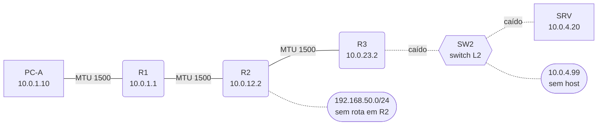

*Figura 3.1c (Tipo A, topologia).* Elementos do modo "Ping": PC-A (10.0.1.10); R1 (10.0.1.1); R2 (10.0.12.2); R3 (10.0.23.2); SW2 (switch L2); SRV (10.0.4.20); 10.0.4.99 (sem host); 192.168.50.0/24 (sem rota em R2). Linhas tracejadas: enlaces alternativos, forjados ou caídos. Vale para os cenários (6.1.9).

### 3.2 Traceroute e tracert

*Figura 3.2 (Tipo A, topologia).* Elementos do modo "Traceroute e tracert": PC-A (10.0.1.10); R1 (10.0.1.1); R2 (10.0.12.2); R3 (10.0.23.2); SW2 (switch L2); SRV (10.0.4.20); 10.0.4.99 (sem host); 192.168.50.0/24 (sem rota em R2). Linhas tracejadas: enlaces alternativos, forjados ou caídos. Vale para todos os cenários do modo (6.2.1 a 6.2.3).

### 3.3 Scan UDP (hping3)

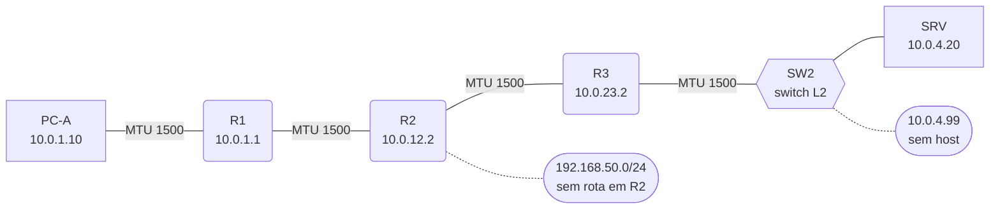

*Figura 3.3 (Tipo A, topologia).* Elementos do modo "Scan UDP (hping3)": PC-A (10.0.1.10); R1 (10.0.1.1); R2 (10.0.12.2); R3 (10.0.23.2); SW2 (switch L2); SRV (10.0.4.20); 10.0.4.99 (sem host); 192.168.50.0/24 (sem rota em R2). Linhas tracejadas: enlaces alternativos, forjados ou caídos. Vale para todos os cenários do modo (6.3.1).

## 4. Abas da bancada

Cenário, Captura, Mensagem, Terminal, Comando, Rotas, Experimento, Referência e Log.

## 5. Configurações (campos do painel)

### 5.1 Comando

- **Ferramenta**. Valores: traceroute (Linux, sondas UDP); traceroute -I (Linux, sondas ICMP); tracert (Windows, sondas ICMP). Padrão: traceroute (Linux, sondas UDP). Modos: Traceroute e tracert.
  - Programa executado no PC-A.
  - **ping:** envia ICMP Echo Request (tipo 8) e espera Echo Reply (tipo 0). Mede alcançabilidade, tempo de ida e volta (RTT) e perda; o TTL da resposta indica quantos roteadores existem no caminho.
  - **traceroute (sondas UDP):** envia datagramas UDP para portas altas (33434 em diante) com TTL 1, 2, 3... Cada roteador onde o TTL se esgota responde Time Exceeded (11/0); o destino responde Port Unreachable (3/3), o que encerra o rastreamento.
  - **traceroute -I (sondas ICMP):** a mesma lógica, mas com Echo Request; o destino responde Echo Reply. Útil quando um firewall bloqueia UDP.
  - **tracert (Windows):** sempre usa Echo Request, com 3 sondas por salto, e mostra "Request timed out." quando ninguém responde.
  - **hping3 --udp:** envia datagramas UDP para uma porta escolhida. Porta fechada gera Port Unreachable (3/3); porta aberta ou filtrada em silêncio não responde. É a técnica do scan UDP.
- **Destino**. Valores: 10.0.4.20 (SRV); 10.0.23.2 (R3, g0/0); 10.0.1.1 (R1, gateway); 10.0.4.99 (host inexistente); 192.168.50.1 (rede sem rota). Padrão: 10.0.4.20 (SRV). Modos: todos.
  - Endereço IPv4 alvo. Cada opção provoca um comportamento diferente.
  - **10.0.4.20:** servidor SRV (Linux), 3 roteadores adiante. Responde ping com TTL inicial 64 e tem as portas UDP 53 (DNS) e 123 (NTP) abertas.
  - **10.0.23.2:** interface g0/0 do roteador R3. Roteadores respondem com TTL inicial 255.
  - **10.0.1.1:** gateway padrão do PC-A (R1), a 1 salto.
  - **10.0.4.99:** endereço sem host na LAN do servidor. R3 tenta ARP três vezes e devolve Host Unreachable (3/1) depois de cerca de 3 s.
  - **192.168.50.1:** rede para a qual R2 não tem rota. R2 devolve Net Unreachable (3/0).
  - No terminal, qualquer endereço IPv4 pode ser usado. O simulador não tem DNS.
- **Quantidade (-c)**. Valores: 1; 2; 3; 4; 5; 10. Padrão: 4. Modos: Ping; Scan UDP (hping3).
  - Número de sondas enviadas.
  - No ping, quantos Echo Requests; no hping3, quantos datagramas UDP. O intervalo entre envios é de 1 s.
  - Ao final, o ping mostra a estatística: pacotes transmitidos, recebidos, % de perda e RTT mínimo, médio, máximo e desvio (mdev).
  - No Linux real, sem -c o ping só para com Ctrl+C. Aqui o padrão é 4 e o máximo é 10.
- **TTL inicial (-t)**. Valores: 1; 2; 3; 4; 5; 16; 32; 64; 128; 255. Padrão: 64. Modos: Ping; Scan UDP (hping3).
  - Valor do campo Time To Live no cabeçalho IP da sonda.
  - Cada roteador decrementa o TTL em 1. Quem recebe o pacote com TTL 1 descarta e devolve Time Exceeded (11/0) à origem.
  - Com -t 1 a sonda morre no primeiro roteador; com -t 2, no segundo. É o princípio do traceroute feito à mão.
  - Valores iniciais típicos: 64 no Linux, 128 no Windows e 255 em roteadores.
- **Dados (-s, bytes)**. Valores: 0; 56; 500; 1000; 1400; 1472. Padrão: 56. Modos: Ping.
  - Tamanho dos dados do Echo Request, sem os cabeçalhos.
  - O datagrama IP tem s + 8 (cabeçalho ICMP) + 20 (cabeçalho IP) bytes. O padrão 56 gera 84 bytes, como em "56(84) bytes of data".
  - 1472 é o maior valor que cabe numa MTU de 1500 sem fragmentar (1472 + 28 = 1500).
  - Use valores grandes junto com o DF para testar MTU e PMTUD.
- **DF / PMTUD (-M)**. Valores: want (padrão); do (DF, sem fragmentar); dont (DF desligado). Padrão: want (padrão). Modos: Ping.
  - Controla o bit Don't Fragment (DF) e a descoberta da MTU do caminho.
  - **want** (padrão do Linux): liga o DF. Se um roteador devolver Fragmentation Needed (3/4), o PC-A grava a MTU no cache e passa a fragmentar localmente.
  - **do:** liga o DF e proíbe fragmentar também no PC-A. Se o pacote não couber na MTU conhecida, o ping recusa enviar ("message too long").
  - **dont:** desliga o DF. Os roteadores fragmentam no caminho e o destino remonta.
- **Porta UDP (-p)**. Valores: 53; 123; 9999; 1. Padrão: 9999. Modos: Scan UDP (hping3).
  - Porta de destino dos datagramas do hping3.
  - Porta fechada: o destino gera Port Unreachable (3/3). Porta aberta: a aplicação recebe o datagrama e nada volta.
  - No SRV, as portas 53 (DNS) e 123 (NTP) estão abertas; 9999 está fechada.
  - Sem resposta, não dá para distinguir porta aberta de porta filtrada em silêncio. É a limitação do scan UDP.
- **Máx. saltos (-m, -h)**. Valores: 2; 3; 4; 6; 8; 10; 16; 30. Padrão: 10. Modos: Traceroute e tracert.
  - Maior TTL que o traceroute ou o tracert vai testar.
  - O rastreamento termina ao alcançar o destino ou ao chegar a este limite.
  - Linhas com * * * são saltos que não responderam: filtro silencioso, ACL ou roteador com no ip unreachables.
  - O padrão das ferramentas reais é 30; aqui, 10 basta para a topologia.

### 5.2 Enlaces

- **Enlace PC-A / R1 ativo** (ajuste avançado). Valores: caixa de seleção. Padrão: sim. Modos: todos.
  - Rede 10.0.1.0/24, atraso de 0,3 ms.
  - Derrubado, o PC-A perde a rota para o gateway e o ping falha localmente ("Network is unreachable").
- **Enlace R1 / R2 ativo**. Valores: caixa de seleção. Padrão: sim. Modos: todos.
  - Rede 10.0.12.0/30, atraso de 4,2 ms.
  - Derrubado, R1 perde a rota padrão e devolve Net Unreachable (3/0) ao PC-A.
- **Enlace R2 / R3 ativo**. Valores: caixa de seleção. Padrão: sim. Modos: todos.
  - Rede 10.0.23.0/30, atraso de 7,1 ms.
  - Derrubado, R2 perde o caminho até a LAN do servidor e devolve Net Unreachable (3/0).
- **LAN do servidor ativa**. Valores: caixa de seleção. Padrão: sim. Modos: todos.
  - Rede 10.0.4.0/24, atraso de 0,2 ms.
  - Derrubada, R3 perde a rota conectada e usa a rota padrão de volta para R2, que devolve para R3: um loop de roteamento. O TTL cai a cada volta até um roteador gerar Time Exceeded.
- **MTU PC-A / R1** (ajuste avançado). Valores: 1500 (Ethernet); 1400 (túnel/VPN); 1280; 576 (mínimo IPv4). Padrão: 1500 (Ethernet). Modos: todos.
  - Tamanho máximo do pacote neste enlace.
  - Pacotes maiores são fragmentados pelo roteador ou, com o bit DF ligado, descartados com Fragmentation Needed (3/4).
- **MTU R1 / R2** (ajuste avançado). Valores: 1500 (Ethernet); 1400 (túnel/VPN); 1280; 576 (mínimo IPv4). Padrão: 1500 (Ethernet). Modos: todos.
  - Tamanho máximo do pacote neste enlace.
  - Pacotes maiores são fragmentados pelo roteador ou, com o bit DF ligado, descartados com Fragmentation Needed (3/4).
- **MTU R2 / R3**. Valores: 1500 (Ethernet); 1400 (túnel/VPN); 1280; 576 (mínimo IPv4). Padrão: 1500 (Ethernet). Modos: todos.
  - Tamanho máximo do pacote neste enlace.
  - Pacotes maiores são fragmentados pelo roteador ou, com o bit DF ligado, descartados com Fragmentation Needed (3/4).
  - 1400 simula um túnel ou VPN no enlace WAN.
- **MTU da LAN do servidor** (ajuste avançado). Valores: 1500 (Ethernet); 1400 (túnel/VPN); 1280; 576 (mínimo IPv4). Padrão: 1500 (Ethernet). Modos: todos.
  - Tamanho máximo do pacote neste enlace.
  - Pacotes maiores são fragmentados pelo roteador ou, com o bit DF ligado, descartados com Fragmentation Needed (3/4).

### 5.3 Roteadores e servidor

- **ACL de entrada em R1 (g0/1)**. Valores: permitir tudo; negar todo ICMP; só echo-reply. Padrão: permitir tudo. Modos: todos.
  - Filtra o que volta da WAN para a LAN do PC-A.
  - **Só echo-reply** parece segura, mas bloqueia os erros ICMP no caminho de volta e cria o buraco negro de PMTUD ([RFC 2923](https://www.rfc-editor.org/rfc/rfc2923)).
  - **Negar todo ICMP** descarta em silêncio inclusive as respostas do ping.
- **ACL de saída em R3 (g0/1)**. Valores: permitir tudo; negar com 3/13; negar em silêncio. Padrão: permitir tudo. Modos: todos.
  - Filtra o tráfego para a LAN do servidor.
  - **Negar com 3/13:** o roteador avisa a origem (Communication Administratively Prohibited). Facilita o diagnóstico e revela o filtro.
  - **Negar em silêncio:** descarta sem ICMP. A origem só vê timeout.
- **R2 tem a rota para 10.0.4.0/24**. Valores: caixa de seleção. Padrão: sim. Modos: todos.
  - Rota estática 10.0.4.0/24 via R3.
  - R2 não tem rota padrão. Sem esta rota, o SRV fica inalcançável e R2 devolve Net Unreachable (3/0).
- **SRV responde ao ping**. Valores: caixa de seleção. Padrão: sim. Modos: todos.
  - Responder ou descartar Echo Request.
  - Bloquear o ping no host não esconde o servidor: o traceroute UDP ainda recebe Port Unreachable.
- **R1 gera "ip unreachables"** (ajuste avançado). Valores: caixa de seleção. Padrão: sim. Modos: todos.
  - Se o roteador gera Destination Unreachable.
  - Desligado (no ip unreachables), o roteador descarta sem gerar ICMP tipo 3. A origem vê timeout. Time Exceeded continua sendo gerado.
- **R2 gera "ip unreachables"** (ajuste avançado). Valores: caixa de seleção. Padrão: sim. Modos: todos.
  - Se o roteador gera Destination Unreachable.
  - Desligado (no ip unreachables), o roteador descarta sem gerar ICMP tipo 3. A origem vê timeout. Time Exceeded continua sendo gerado.
- **R3 gera "ip unreachables"** (ajuste avançado). Valores: caixa de seleção. Padrão: sim. Modos: todos.
  - Se o roteador gera Destination Unreachable.
  - Desligado (no ip unreachables), o roteador descarta sem gerar ICMP tipo 3. A origem vê timeout. Time Exceeded continua sendo gerado.

## 6. Cenários

### 6.1 Modo: Ping

> **Grupo:** Consultas

Mensagens de consulta do ICMP (Echo Request e Echo Reply) e as ferramentas que exploram o TTL para descobrir o caminho até o destino.

#### 6.1.1 Echo (ping)

*Echo Request e Echo Reply: a consulta mais básica do ICMP.*

Echo Request (tipo 8) vai até o SRV, que responde com Echo Reply (tipo 0) usando o mesmo identificador e sequência.

Observe no terminal **ttl=61**: o Linux do servidor começa em 64 e três roteadores decrementaram. Troque o destino para **10.0.23.2** (R3): um roteador começa em 255.

**Conceito.** O **ping** é a consulta mais simples do ICMP. A origem envia um **Echo Request** (tipo 8, código 0) e o destino devolve os mesmos dados em um **Echo Reply** (tipo 0, código 0). O identificador e o número de sequência casam cada resposta com o seu pedido, e o tempo entre os dois é o RTT (tempo de ida e volta).

**O que observar**

- Na aba Terminal: o RTT de cada resposta e **ttl=61** (o Linux do SRV começa em 64 e três roteadores decrementaram).
- Na Captura: pares de Echo Request e Echo Reply com o mesmo id e a mesma seq.
- Na aba Mensagem: os campos Type, Code, Identifier, Sequence Number e o checksum.

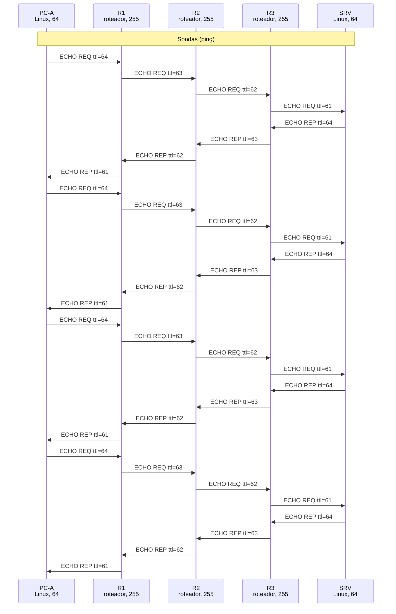

*Figura 6.1.1 (Tipo B, sequência).* Mensagens do cenário "Echo (ping)", na ordem do tempo, entre PC-A, R1, R2, R3, SRV: 32 mensagens (em 2 fases). Corresponde ao diagrama de sequência e à aba Captura, no modo "Ping", com a configuração padrão.

**Mensagens**

| Mensagem | Significado | Origem |
| --- | --- | --- |
| 8/0 | Echo Request | PC-A para o SRV |
| 0/0 | Echo Reply | SRV para o PC-A |

**Por que importa.** O ping confirma a conectividade de camada 3 e mede a latência. Para quem faz reconhecimento, ele revela hosts ativos (ping sweep); por isso muitas redes limitam ou bloqueiam Echo Request vindo de fora.

#### 6.1.2 TTL expirado

*O TTL chega a zero no meio do caminho e o roteador avisa com Time Exceeded.*

**Configuração aplicada:** Quantidade (-c) = 2; TTL inicial (-t) = 2

O pacote sai com TTL 2. R1 decrementa para 1; R2 recebe TTL 1, não pode encaminhar e gera **Time Exceeded (11/0)** a partir da interface voltada para PC-A (10.0.12.2).

Abra o erro na aba Mensagem: o datagrama original citado mostra TTL 1 e o mesmo id/seq do ping.

**Conceito.** O **TTL** (Time To Live) é um contador no cabeçalho IP. Cada roteador o diminui em 1. Quem recebe um pacote com TTL 1 não pode encaminhá-lo: descarta e avisa a origem com **Time Exceeded** (tipo 11, código 0). Sem esse mecanismo, um pacote preso em um laço circularia para sempre.

**O que observar**

- Na aba Terminal: "From 10.0.12.2 icmp_seq=1 Time to live exceeded".
- O endereço que responde é o da interface de R2 voltada para o PC-A, não o do destino.
- Na aba Mensagem do erro: o cabeçalho IP original citado, com TTL 1 e o mesmo id e seq do ping.

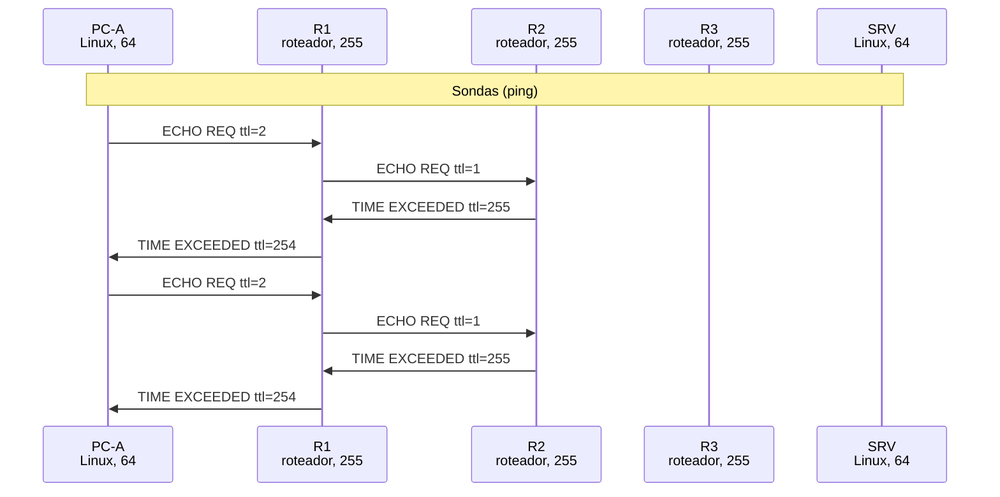

*Figura 6.1.2 (Tipo B, sequência).* Mensagens do cenário "TTL expirado", na ordem do tempo, entre PC-A, R1, R2, R3, SRV: 8 mensagens (em 2 fases). Corresponde ao diagrama de sequência e à aba Captura, no modo "Ping", com a configuração aplicada acima.

**Mensagens**

| Mensagem | Significado | Origem |
| --- | --- | --- |
| 8/0 | Echo Request | com TTL 2 |
| 11/0 | Time Exceeded | R2 para o PC-A |

**Por que importa.** É a peça que o traceroute usa para descobrir cada salto, e um dos sinais de que existe um loop de roteamento.

> **Grupo:** Destination Unreachable

O tipo 3 avisa a origem que o pacote não pôde ser entregue. O código diz o motivo: rede sem rota (0), host que não responde (1), porta fechada (3), MTU (4) ou filtro (13).

#### 6.1.3 Rede inalcançável

*Destination Unreachable código 0: o roteador não tem rota.*

**Configuração aplicada:** Quantidade (-c) = 2; Destino = 192.168.50.1

R1 encaminha pela rota padrão, mas R2 não tem rota para 192.168.50.0/24 nem rota padrão. R2 gera **3/0 Net Unreachable** ([RFC 1812](https://www.rfc-editor.org/rfc/rfc1812): obrigatório quando não há nenhuma rota).

O endereço de origem do erro mostra **onde** o caminho termina. Tente também derrubar o enlace R1 / R2 e repetir.

**Conceito.** **Net Unreachable** (tipo 3, código 0): um roteador recebeu um pacote para uma rede que não está na tabela de rotas e também não tem rota padrão. A [RFC 1812](https://www.rfc-editor.org/rfc/rfc1812) obriga o roteador a descartar e avisar a origem.

**O que observar**

- Na aba Terminal: "From 10.0.12.2 icmp_seq=1 Destination Net Unreachable".
- O erro vem de R2: o endereço de origem do erro mostra **onde** o caminho termina.
- Na aba Rotas: R1 encaminha pela rota padrão, mas R2 não tem rota para 192.168.50.0/24 nem rota padrão.

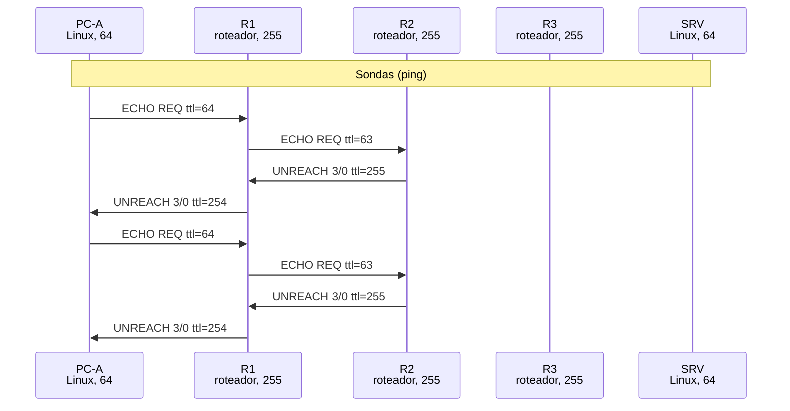

*Figura 6.1.3 (Tipo B, sequência).* Mensagens do cenário "Rede inalcançável", na ordem do tempo, entre PC-A, R1, R2, R3, SRV: 8 mensagens (em 2 fases). Corresponde ao diagrama de sequência e à aba Captura, no modo "Ping", com a configuração aplicada acima.

**Mensagens**

| Mensagem | Significado | Origem |
| --- | --- | --- |
| 8/0 | Echo Request | para 192.168.50.1 |
| 3/0 | Net Unreachable | R2 para o PC-A |

**Por que importa.** É o diagnóstico de rota faltando. Derrubar o enlace R1 / R2 e repetir mostra o mesmo erro vindo de outro ponto.

#### 6.1.4 Host inalcançável

*Destination Unreachable código 1: ninguém responde ao ARP.*

**Configuração aplicada:** Quantidade (-c) = 2; Destino = 10.0.4.99

A rede 10.0.4.0/24 existe e está conectada a R3, mas ninguém usa 10.0.4.99. R3 envia 3 ARP Requests sem resposta e gera **3/1 Host Unreachable**.

Repare no tempo: o erro só chega cerca de 3 s depois, a espera do ARP.

**Conceito.** **Host Unreachable** (tipo 3, código 1): a rede de destino existe e está ligada ao último roteador, mas nenhum equipamento responde ao **ARP** pelo endereço pedido. Sem o endereço MAC, o roteador não consegue montar o quadro de entrega.

**O que observar**

- Na Captura: três ARP Requests de R3 perguntando por 10.0.4.99, sem resposta.
- O erro só chega cerca de 3 s depois: é o tempo das tentativas de ARP.
- Na aba Terminal: "Destination Host Unreachable" vindo de R3.

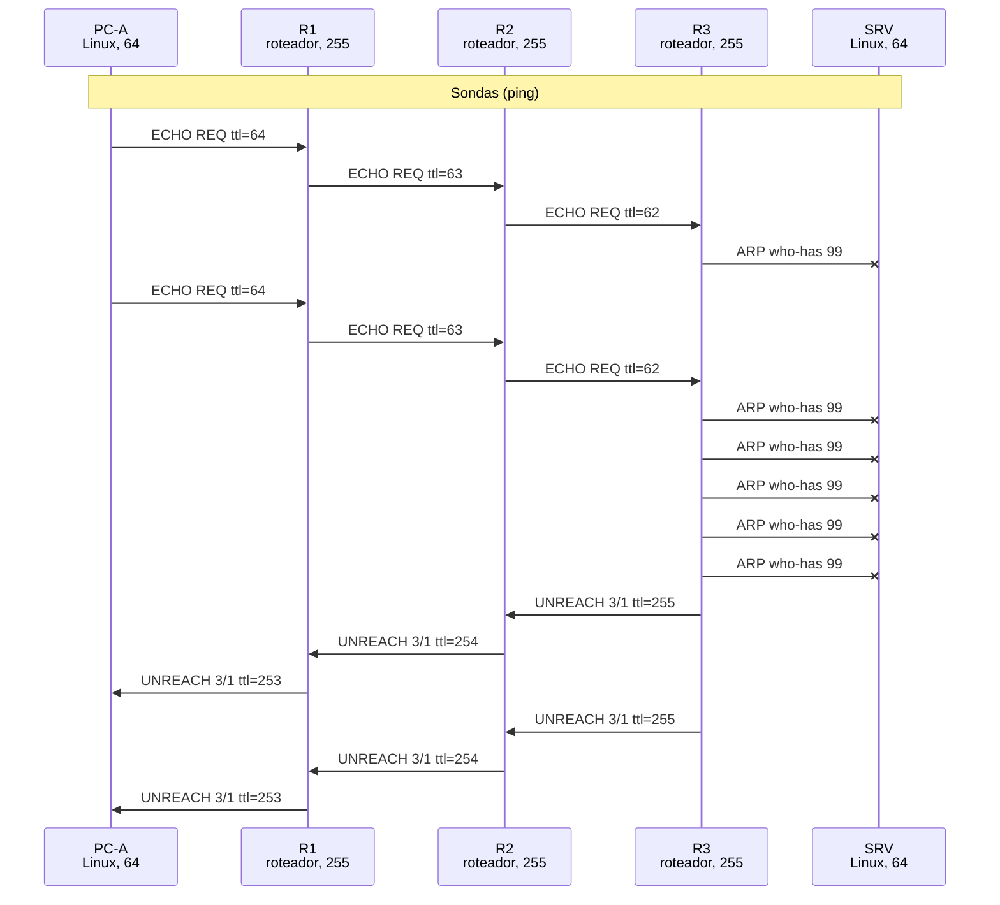

*Figura 6.1.4 (Tipo B, sequência).* Mensagens do cenário "Host inalcançável", na ordem do tempo, entre PC-A, R1, R2, R3, SRV: 18 mensagens (em 2 fases; 6 perdidas). Corresponde ao diagrama de sequência e à aba Captura, no modo "Ping", com a configuração aplicada acima.

**Mensagens**

| Mensagem | Significado | Origem |
| --- | --- | --- |
| 8/0 | Echo Request | para 10.0.4.99 |
| ARP | Who has 10.0.4.99? | R3, três vezes |
| 3/1 | Host Unreachable | R3 para o PC-A |

**Por que importa.** Explica por que um ping para um host desligado na mesma LAN demora antes de falhar.

> **Grupo:** MTU

Cada enlace tem um tamanho máximo de pacote (MTU). Pacotes maiores são fragmentados pelos roteadores ou, com o bit DF ligado, geram um aviso para a origem reduzir o tamanho (PMTUD).

#### 6.1.5 Fragmentação

*O pacote não cabe no enlace e o roteador o divide em fragmentos.*

**Configuração aplicada:** Quantidade (-c) = 2; Dados (-s, bytes) = 1472; DF / PMTUD (-M) = dont; MTU R2 / R3 = 1400

O enlace R2/R3 tem MTU 1400. O pacote de 1500 bytes sai sem DF; R2 o divide em 2 fragmentos (offsets 0 e 172, em unidades de 8 bytes) e o SRV remonta. A resposta é fragmentada por R3 no caminho de volta.

Veja os campos Flags e Fragment Offset na aba Mensagem.

**Conceito.** **Fragmentação**: quando um datagrama é maior que a MTU do próximo enlace e o bit DF está desligado, o roteador o divide em fragmentos. Todos levam o mesmo campo **Identification**; o **Fragment Offset** (em blocos de 8 bytes) indica a posição de cada parte e o bit **MF** avisa que ainda há mais. Só o destino remonta o datagrama.

**O que observar**

- O enlace R2 / R3 tem MTU 1400, e o pacote tem 1500 bytes com DF desligado (-M dont).
- Na Captura: R2 gera 2 fragmentos (offsets 0 e 172); na volta, R3 fragmenta o Echo Reply.
- Na aba Mensagem: os campos Flags (MF) e Fragment Offset.

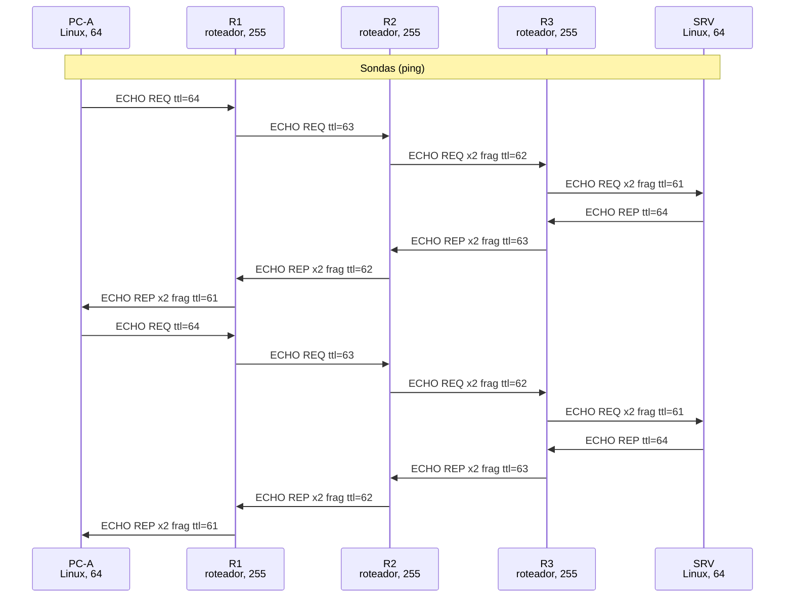

*Figura 6.1.5 (Tipo B, sequência).* Mensagens do cenário "Fragmentação", na ordem do tempo, entre PC-A, R1, R2, R3, SRV: 16 mensagens (em 2 fases). Corresponde ao diagrama de sequência e à aba Captura, no modo "Ping", com a configuração aplicada acima.

**Mensagens**

| Mensagem | Significado | Origem |
| --- | --- | --- |
| 8/0 | Echo Request | fragmentado por R2 |
| 0/0 | Echo Reply | fragmentado por R3 |

**Por que importa.** Fragmentar custa processamento, e a perda de um único fragmento perde o datagrama inteiro. Ataques antigos (Teardrop, fragmentos sobrepostos) exploravam a remontagem. No IPv6, roteadores não fragmentam.

#### 6.1.6 PMTUD (DF)

*Com DF ligado, o roteador avisa a MTU e a origem se adapta.*

**Configuração aplicada:** Quantidade (-c) = 3; Dados (-s, bytes) = 1472; DF / PMTUD (-M) = do; MTU R2 / R3 = 1400

Com DF ligado, R2 não pode fragmentar: descarta e devolve **3/4 Fragmentation Needed** com o campo Next-Hop MTU = 1400 ([RFC 1191](https://www.rfc-editor.org/rfc/rfc1191)). PC-A grava 1400 no cache de PMTU e, com -M do, recusa enviar os próximos (local error).

Repita com **-M want** (padrão do Linux): depois de aprender a PMTU, o PC-A fragmenta localmente e o ping funciona.

**Conceito.** **Path MTU Discovery** ([RFC 1191](https://www.rfc-editor.org/rfc/rfc1191)): a origem envia com o bit DF ligado. O roteador cujo próximo enlace tem MTU menor não pode fragmentar: descarta o pacote e devolve **Fragmentation Needed** (tipo 3, código 4) com o campo **Next-Hop MTU**. A origem guarda esse valor no cache de PMTU e passa a enviar pacotes menores.

**O que observar**

- Na aba Terminal: "Frag needed and DF set (mtu = 1400)" vindo de R2.
- Os envios seguintes falham no próprio PC-A ("message too long"), porque -M do proíbe fragmentar localmente.
- No estado do simulador, o "Cache de PMTU do PC-A" passa a mostrar 10.0.4.20 = 1400.

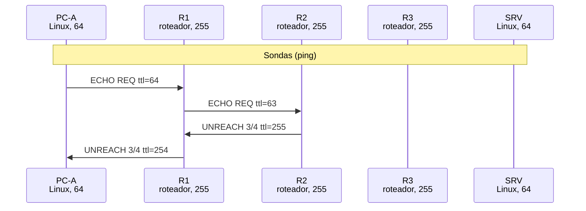

*Figura 6.1.6 (Tipo B, sequência).* Mensagens do cenário "PMTUD (DF)", na ordem do tempo, entre PC-A, R1, R2, R3, SRV: 4 mensagens (em 2 fases). Corresponde ao diagrama de sequência e à aba Captura, no modo "Ping", com a configuração aplicada acima.

**Mensagens**

| Mensagem | Significado | Origem |
| --- | --- | --- |
| 8/0 | Echo Request | 1500 bytes, DF=1 |
| 3/4 | Fragmentation Needed | R2 para o PC-A, MTU 1400 |

**Por que importa.** É assim que conexões TCP se ajustam a túneis e VPNs, que têm MTU menor. Mas tudo depende de o 3/4 chegar à origem: veja o cenário Buraco negro PMTUD.

> **Grupo:** Filtros e falhas

Como ACLs, firewalls e erros de roteamento aparecem (ou deixam de aparecer) para quem testa a rede, e que problemas um filtro mal planejado pode criar.

#### 6.1.7 Proibido (3/13)

*Destination Unreachable código 13: o filtro se anuncia.*

**Configuração aplicada:** Quantidade (-c) = 2; ACL de saída em R3 (g0/1) = deny-unreach

A ACL de saída de R3 para a LAN do servidor nega o tráfego e responde com **3/13 Communication Administratively Prohibited**. O ping do Linux mostra "Packet filtered".

O erro deixa claro que existe um filtro e onde ele está.

**Conceito.** **Communication Administratively Prohibited** (tipo 3, código 13): uma ACL negou o pacote e o roteador avisa a origem de que o tráfego foi bloqueado por política. O ping do Linux mostra "Packet filtered"; o traceroute mostra a anotação !X.

**O que observar**

- Na aba Terminal: "From 10.0.23.2 icmp_seq=1 Packet filtered".
- O erro vem de R3, onde está a ACL de saída para a LAN do servidor.
- No log: a ACL nega e responde com 3/13.

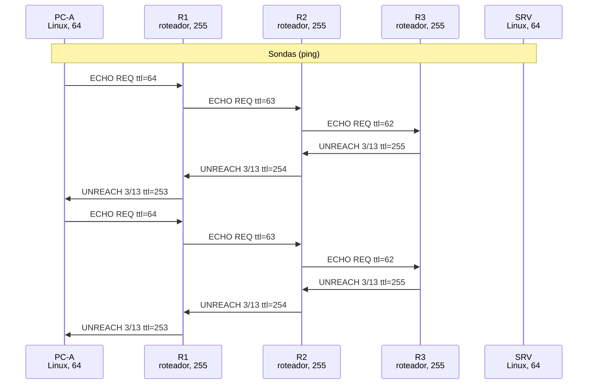

*Figura 6.1.7 (Tipo B, sequência).* Mensagens do cenário "Proibido (3/13)", na ordem do tempo, entre PC-A, R1, R2, R3, SRV: 12 mensagens (em 2 fases). Corresponde ao diagrama de sequência e à aba Captura, no modo "Ping", com a configuração aplicada acima.

**Mensagens**

| Mensagem | Significado | Origem |
| --- | --- | --- |
| 8/0 | Echo Request | para o SRV |
| 3/13 | Administratively Prohibited | R3 para o PC-A |

**Por que importa.** Facilita o diagnóstico (fica claro que existe um filtro e onde ele está), mas entrega essa mesma informação a quem faz reconhecimento. Compare com o Filtro silencioso.

#### 6.1.8 Buraco negro PMTUD

*O firewall bloqueia o aviso de MTU e os pacotes grandes somem.*

**Configuração aplicada:** Quantidade (-c) = 2; Dados (-s, bytes) = 1472; DF / PMTUD (-M) = do; MTU R2 / R3 = 1400; ACL de entrada em R1 (g0/1) = deny-icmp-errors

R1 tem uma ACL "segura" que só aceita Echo Reply e bloqueia todo ICMP de erro. R2 gera o 3/4, mas ele é descartado em R1: o PC-A nunca aprende a PMTU e os pacotes grandes somem (timeout).

Mude **Dados** para 56 e rode de novo: pacotes pequenos funcionam. Esse é o sintoma clássico ([RFC 2923](https://www.rfc-editor.org/rfc/rfc2923)).

**Conceito.** O **buraco negro de PMTUD** ([RFC 2923](https://www.rfc-editor.org/rfc/rfc2923)) acontece quando um firewall bloqueia todo ICMP de erro "por segurança". O roteador gera o **Fragmentation Needed** (3/4), mas o aviso é descartado no caminho de volta. A origem nunca aprende a MTU menor, continua enviando pacotes grandes com DF e eles desaparecem sem nenhum aviso.

**O que observar**

- Na aba Terminal: só timeouts, nenhuma mensagem de erro.
- Na Captura: o 3/4 **foi gerado** por R2, mas não chegou ao PC-A (a ACL de R1 o descartou).
- Mude "Dados" para 56 e rode de novo: pacotes pequenos funcionam normalmente.

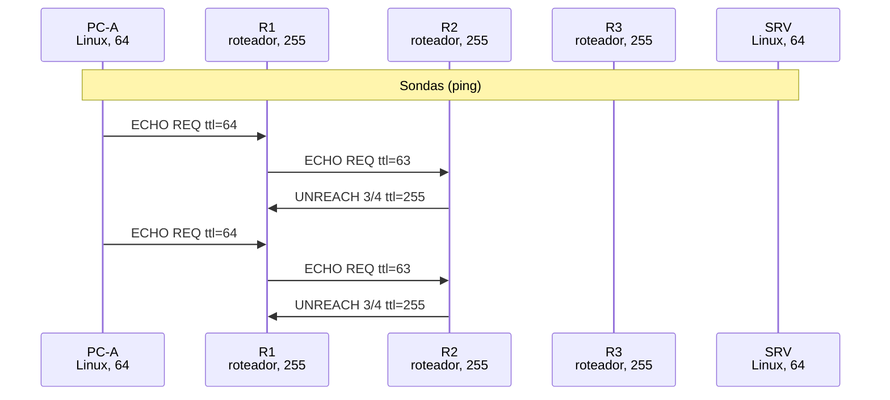

*Figura 6.1.8 (Tipo B, sequência).* Mensagens do cenário "Buraco negro PMTUD", na ordem do tempo, entre PC-A, R1, R2, R3, SRV: 6 mensagens (em 2 fases). Corresponde ao diagrama de sequência e à aba Captura, no modo "Ping", com a configuração aplicada acima.

**Mensagens**

| Mensagem | Significado | Origem |
| --- | --- | --- |
| 8/0 | Echo Request | 1500 bytes, DF=1 |
| 3/4 | Fragmentation Needed | gerado por R2, descartado em R1 |

**Por que importa.** É o sintoma clássico de VPNs e túneis: a conexão TCP abre (o handshake usa pacotes pequenos), mas trava ao transferir dados, como páginas que nunca terminam de carregar. A correção é liberar o ICMP tipo 3 código 4 (e o tipo 11) ou ajustar o MSS do TCP (MSS clamping). Nunca filtre o 3/4.

#### 6.1.9 Loop de roteamento

*Dois roteadores apontam um para o outro e o TTL salva a rede.*

**Configuração aplicada:** Quantidade (-c) = 1; TTL inicial (-t) = 16; LAN do servidor ativa = não

O enlace da LAN do servidor caiu. R3 perde a rota conectada e usa a rota padrão de volta para R2, que devolve para R3: um loop. O TTL cai a cada volta até um roteador gerar **Time Exceeded**.

É exatamente para isso que o TTL existe.

**Conceito.** Um **loop de roteamento** acontece quando roteadores apontam uns para os outros como caminho para o mesmo destino. O pacote fica indo e voltando entre eles. Quem salva a rede é o **TTL**: ele cai a cada volta até um roteador descartar o pacote e gerar Time Exceeded.

**O que observar**

- O enlace da LAN do servidor caiu: R3 perde a rota conectada e usa a rota padrão de volta para R2, que devolve o pacote para R3.
- Na animação e no log: o pacote vai e volta entre R2 e R3 com o TTL diminuindo.
- Na aba Terminal: o Time Exceeded vem de um dos dois roteadores do laço.

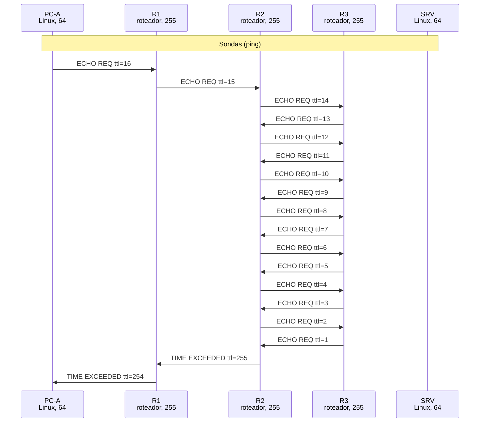

*Figura 6.1.9 (Tipo B, sequência).* Mensagens do cenário "Loop de roteamento", na ordem do tempo, entre PC-A, R1, R2, R3, SRV: 18 mensagens (em 2 fases). Corresponde ao diagrama de sequência e à aba Captura, no modo "Ping", com a configuração aplicada acima.

**Mensagens**

| Mensagem | Significado | Origem |
| --- | --- | --- |
| 8/0 | Echo Request | preso entre R2 e R3 |
| 11/0 | Time Exceeded | quando o TTL chega a 1 |

**Por que importa.** Loops surgem de rotas estáticas mal planejadas ou durante a convergência de protocolos dinâmicos. Enquanto existem, consomem banda e CPU; o TTL limita o estrago, mas não resolve a causa.

### 6.2 Modo: Traceroute e tracert

> **Grupo:** Consultas

Mensagens de consulta do ICMP (Echo Request e Echo Reply) e as ferramentas que exploram o TTL para descobrir o caminho até o destino.

#### 6.2.1 traceroute (UDP)

*Sondas UDP com TTL crescente revelam cada roteador do caminho.*

**Configuração aplicada:** Ferramenta = traceroute; Máx. saltos (-m, -h) = 10

O traceroute do Linux envia 3 sondas UDP por salto, com TTL 1, 2, 3... e portas a partir de 33434. Cada roteador devolve Time Exceeded; o SRV responde **Port Unreachable (3/3)**, o que encerra o rastreamento.

O simulador desenha a primeira sonda de cada salto; as três aparecem no terminal.

**Conceito.** O **traceroute** descobre o caminho explorando o TTL: envia sondas com TTL 1, 2, 3... e cada roteador onde o TTL se esgota se revela ao devolver Time Exceeded. No Linux, as sondas são **datagramas UDP** para portas altas (33434 em diante), que nenhuma aplicação usa. Quando a sonda chega ao destino, ele responde **Port Unreachable** (3/3), e é isso que encerra o rastreamento.

**O que observar**

- Na aba Terminal: as linhas 1, 2 e 3 mostram R1, R2 e R3; a linha 4 mostra o SRV.
- Cada linha tem 3 tempos: são 3 sondas por salto.
- Na Captura: UDP com portas 33434, 33435..., Time Exceeded dos roteadores e Port Unreachable do SRV.

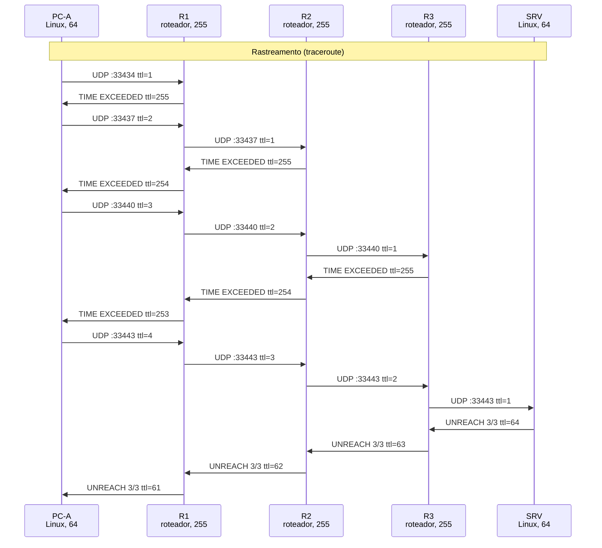

*Figura 6.2.1 (Tipo B, sequência).* Mensagens do cenário "traceroute (UDP)", na ordem do tempo, entre PC-A, R1, R2, R3, SRV: 20 mensagens (em 2 fases). Corresponde ao diagrama de sequência e à aba Captura, no modo "Traceroute e tracert", com a configuração aplicada acima.

**Mensagens**

| Mensagem | Significado | Origem |
| --- | --- | --- |
| UDP | Sonda | portas a partir de 33434 |
| 11/0 | Time Exceeded | R1, R2 e R3 |
| 3/3 | Port Unreachable | SRV, no último salto |

**Por que importa.** O traceroute mapeia a topologia, o que serve tanto ao diagnóstico quanto ao reconhecimento. Linhas com * * * são saltos que não responderam.

#### 6.2.2 tracert (Windows)

*A versão do Windows usa Echo Request como sonda.*

**Configuração aplicada:** Ferramenta = tracert; Máx. saltos (-m, -h) = 10

O tracert usa Echo Request em vez de UDP. Os roteadores respondem Time Exceeded e o destino responde com **Echo Reply**.

Compare com o traceroute do Linux: um firewall que bloqueia UDP mas libera ping dá resultados diferentes nas duas ferramentas.

**Conceito.** O **tracert** do Windows segue a mesma ideia do traceroute, mas usa **Echo Request** como sonda. Os roteadores intermediários respondem Time Exceeded e o destino responde com **Echo Reply**.

**O que observar**

- Na aba Terminal: o formato do Windows, com "Tracing route to" e os tempos em ms.
- Na Captura: Echo Requests com TTL crescente e, no último salto, um Echo Reply.
- Compare com o cenário traceroute (UDP): o caminho é o mesmo, as mensagens são outras.

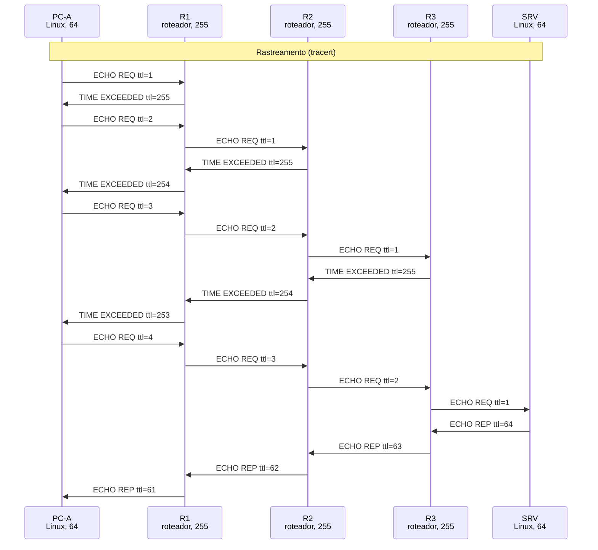

*Figura 6.2.2 (Tipo B, sequência).* Mensagens do cenário "tracert (Windows)", na ordem do tempo, entre PC-A, R1, R2, R3, SRV: 20 mensagens (em 2 fases). Corresponde ao diagrama de sequência e à aba Captura, no modo "Traceroute e tracert", com a configuração aplicada acima.

**Mensagens**

| Mensagem | Significado | Origem |
| --- | --- | --- |
| 8/0 | Echo Request | sonda |
| 11/0 | Time Exceeded | roteadores intermediários |
| 0/0 | Echo Reply | destino |

**Por que importa.** Um firewall que bloqueia UDP e libera ping faz o traceroute do Linux falhar e o tracert funcionar (e o contrário). Por isso o Linux oferece o traceroute -I, que usa ICMP.

> **Grupo:** Filtros e falhas

Como ACLs, firewalls e erros de roteamento aparecem (ou deixam de aparecer) para quem testa a rede, e que problemas um filtro mal planejado pode criar.

#### 6.2.3 Filtro silencioso

*O filtro descarta sem avisar: só sobra o timeout.*

**Configuração aplicada:** Ferramenta = traceroute; Máx. saltos (-m, -h) = 6; ACL de saída em R3 (g0/1) = deny-silent

A mesma ACL agora descarta sem avisar. O traceroute mostra os três roteadores e depois só *** * *** até o limite de saltos: o atacante não sabe se o host existe.

Compare com o cenário 3/13.

**Conceito.** **Filtro silencioso**: a ACL descarta o pacote sem gerar nenhuma mensagem ICMP. A origem não recebe erro nenhum, só espera até o tempo limite. O mesmo efeito aparece em roteadores configurados com **no ip unreachables**.

**O que observar**

- No traceroute (aba Terminal): R1, R2 e R3 aparecem; dali em diante, só * * * até o limite de saltos.
- Na Captura: sondas UDP sem nenhuma resposta depois de R3.
- Compare com o cenário Proibido (3/13): o bloqueio é o mesmo, a resposta não.

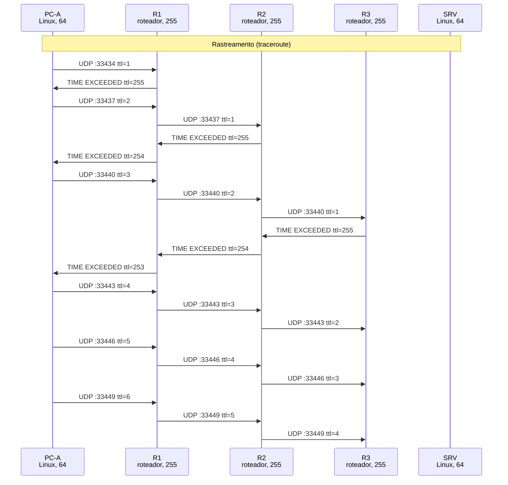

*Figura 6.2.3 (Tipo B, sequência).* Mensagens do cenário "Filtro silencioso", na ordem do tempo, entre PC-A, R1, R2, R3, SRV: 21 mensagens (em 2 fases). Corresponde ao diagrama de sequência e à aba Captura, no modo "Traceroute e tracert", com a configuração aplicada acima.

**Mensagens**

| Mensagem | Significado | Origem |
| --- | --- | --- |
| UDP | Sonda | sem resposta após R3 |
| 11/0 | Time Exceeded | só de R1, R2 e R3 |

**Por que importa.** Esconde a rede de varreduras: o atacante não sabe se o host existe. Em troca, o diagnóstico fica mais difícil, e o próprio silêncio indica que algo filtra depois de R3.

### 6.3 Modo: Scan UDP (hping3)

> **Grupo:** Destination Unreachable

O tipo 3 avisa a origem que o pacote não pôde ser entregue. O código diz o motivo: rede sem rota (0), host que não responde (1), porta fechada (3), MTU (4) ou filtro (13).

#### 6.3.1 Porta inalcançável

*Destination Unreachable código 3: a porta UDP está fechada.*

**Configuração aplicada:** Porta UDP (-p) = 9999; Quantidade (-c) = 2

Datagramas UDP para a porta 9999, onde nada escuta. O próprio SRV gera **3/3 Port Unreachable** e cita até 548 bytes do original (hosts Linux citam mais que os 8 bytes mínimos).

Troque para **-p 53**: a porta está aberta e não há resposta ICMP. É assim que um scan UDP diferencia portas fechadas.

**Conceito.** **Port Unreachable** (tipo 3, código 3): o datagrama chegou ao destino, mas nenhuma aplicação escuta aquela porta UDP. Quem gera o erro é o **próprio host de destino**, não um roteador.

**O que observar**

- No hping3 (aba Terminal): "ICMP Port Unreachable from ip=10.0.4.20".
- Troque para a porta 53 (DNS, aberta no SRV): a aplicação recebe e nada volta.
- Na aba Mensagem do erro: o SRV cita uma parte maior do datagrama original (hosts Linux citam até 548 bytes).

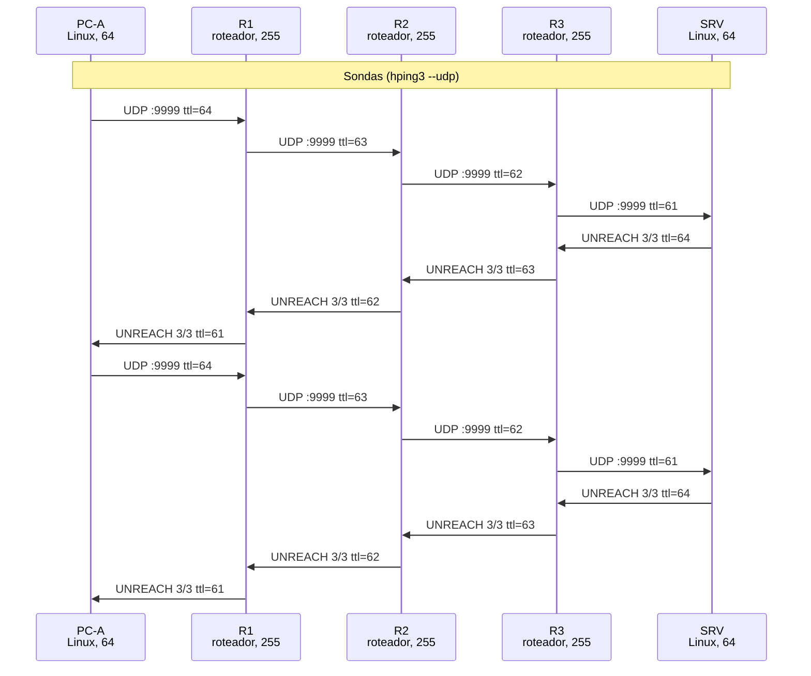

*Figura 6.3.1 (Tipo B, sequência).* Mensagens do cenário "Porta inalcançável", na ordem do tempo, entre PC-A, R1, R2, R3, SRV: 16 mensagens (em 2 fases). Corresponde ao diagrama de sequência e à aba Captura, no modo "Scan UDP (hping3)", com a configuração aplicada acima.

**Mensagens**

| Mensagem | Significado | Origem |
| --- | --- | --- |
| UDP | Datagrama | PC-A para a porta 9999 |
| 3/3 | Port Unreachable | SRV para o PC-A |

**Por que importa.** É a base do scan UDP (nmap -sU): porta fechada responde 3/3; porta aberta ou filtrada em silêncio não responde, por isso o nmap a marca como "open|filtered".

## 7. Referência

### 7.1 O que é o ICMP

          

O **Internet Control Message Protocol** ([RFC 792](https://www.rfc-editor.org/rfc/rfc792)) é o canal de controle e diagnóstico do IPv4. Suas mensagens viajam dentro de datagramas IP com **protocolo 1**, mas o ICMP não é um protocolo de transporte: ele não carrega dados de aplicação e serve para relatar erros e responder consultas. Todo cabeçalho ICMP começa com **tipo** (1 byte), **código** (1 byte) e **checksum** (2 bytes).

          

Há duas famílias. As **consultas** (Echo Request/Reply) são iniciadas por um host e respondidas pelo destino. As **mensagens de erro** são geradas por um roteador ou host que não conseguiu processar um datagrama e são sempre enviadas à **origem** do datagrama, nunca ao destino. Cada erro carrega o **cabeçalho IP original mais pelo menos os 8 primeiros bytes** do datagrama que o provocou (8 bytes é o mínimo da [RFC 792](https://www.rfc-editor.org/rfc/rfc792); os roteadores atuais citam o máximo possível, até 576 bytes no total, [RFC 1812](https://www.rfc-editor.org/rfc/rfc1812) seção 4.3.2.3); é assim que o ping e o traceroute associam o erro à sonda certa (pelo identificador e sequência ICMP ou pelas portas UDP).

### 7.2 Regras de geração de erros ([RFC 1122](https://www.rfc-editor.org/rfc/rfc1122) e [RFC 1812](https://www.rfc-editor.org/rfc/rfc1812))

          

- Nunca se gera um erro ICMP sobre outra mensagem de erro ICMP (evita tempestades de erros).
- Nunca se gera erro sobre broadcast, multicast ou fragmentos que não sejam o primeiro.
- O endereço de origem do erro é o da interface por onde o roteador envia a mensagem ([RFC 1812](https://www.rfc-editor.org/rfc/rfc1812), seção 4.3.2.4). Por isso o traceroute mostra o IP da interface voltada para você.
- Sem nenhuma rota para o destino, o roteador gera o código 0 (Network Unreachable). Se a rede está conectada mas o host não responde ao ARP, gera o código 1 (Host Unreachable).
- Roteadores limitam a taxa de geração de erros (rate limiting). Na prática, isso faz aparecer asteriscos esporádicos no traceroute mesmo sem filtro.

### 7.3 Tipos e códigos principais

          

| Tipo | Código | Nome | Quem gera / uso |
| --- | --- | --- | --- |
| 0 | 0 | Echo Reply | Destino, em resposta ao tipo 8 (ping) |
| 3 | 0 | Net Unreachable | Roteador sem rota para a rede de destino |
| 3 | 1 | Host Unreachable | Último roteador: ARP sem resposta na rede conectada |
| 3 | 2 | Protocol Unreachable | Destino não suporta o protocolo indicado no IP |
| 3 | 3 | Port Unreachable | Destino: nenhuma aplicação na porta UDP (fim do traceroute Linux) |
| 3 | 4 | Fragmentation Needed and DF Set | Roteador cuja MTU de saída é menor que o pacote com DF; traz a MTU do próximo salto ([RFC 1191](https://www.rfc-editor.org/rfc/rfc1191)) |
| 3 | 13 | Communication Administratively Prohibited | Filtro/ACL que rejeita em vez de descartar em silêncio |
| 4 | 0 | Source Quench | Obsoleto ([RFC 6633](https://www.rfc-editor.org/rfc/rfc6633)): não deve ser gerado |
| 5 | 0 a 3 | Redirect | Roteador indica um gateway melhor no mesmo segmento |
| 8 | 0 | Echo Request | ping, traceroute -I e tracert |
| 9 / 10 | 0 | Router Advertisement / Solicitation | Descoberta de roteadores ([RFC 1256](https://www.rfc-editor.org/rfc/rfc1256)) |
| 11 | 0 | Time Exceeded in Transit | Roteador que recebeu TTL 1 (base do traceroute) |
| 11 | 1 | Fragment Reassembly Time Exceeded | Destino que não recebeu todos os fragmentos a tempo |
| 12 | 0 | Parameter Problem | Cabeçalho IP com campo inválido (ponteiro indica o byte) |
| 13 / 14 | 0 | Timestamp / Timestamp Reply | Consulta de relógio; frequentemente bloqueada |

### 7.4 Como funcionam as ferramentas

          

**ping** envia Echo Request (tipo 8) com identificador e sequência e mede o RTT até o Echo Reply (tipo 0). O TTL exibido é o que chegou: 64 menos o número de roteadores indica um destino Linux; 255 menos os saltos indica um roteador.

          

**traceroute** (Linux) envia sondas UDP para portas altas (33434 em diante) com TTL 1, 2, 3... Cada roteador onde o TTL se esgota devolve Time Exceeded; o destino responde Port Unreachable, o que encerra o rastreamento. **tracert** (Windows) e **traceroute -I** usam Echo Request e terminam com Echo Reply. Anotações do Linux: `!N` rede, `!H` host, `!X` proibido, `!F` fragmentação necessária.

          

**Path MTU Discovery** ([RFC 1191](https://www.rfc-editor.org/rfc/rfc1191)): o host envia com DF ligado; o roteador cujo enlace de saída tem MTU menor descarta e devolve tipo 3 código 4 com a MTU do próximo salto. O host guarda esse valor (cache de PMTU) e passa a usar pacotes menores. No Linux, `-M want` (padrão) fragmenta localmente depois de aprender a PMTU, `-M do` recusa enviar e `-M dont` desliga o DF e deixa o roteador fragmentar.

### 7.5 ICMP e segurança

          

- **Reconhecimento:** ping sweep descobre hosts ativos; traceroute revela a topologia; Port Unreachable revela portas UDP fechadas (base do scan UDP do nmap).
- **Filtragem:** descartar em silêncio produz timeouts (`* * *`); rejeitar com 3/13 revela que existe um filtro. Ambos são escolhas de projeto.
- **Buraco negro de PMTUD** ([RFC 2923](https://www.rfc-editor.org/rfc/rfc2923)): bloquear todo ICMP de erro impede o 3/4 de chegar. Pacotes pequenos funcionam, mas os grandes com DF somem; conexões TCP travam após o handshake. Nunca filtre o tipo 3 código 4.
- **Ataques históricos:** Smurf (Echo para broadcast direcionado, mitigado pela [RFC 2644](https://www.rfc-editor.org/rfc/rfc2644)), Ping of Death (datagrama remontado acima de 65535 bytes), túneis ICMP (dados escondidos no payload do Echo) e Redirect forjado para desviar tráfego.

### 7.6 Limites do simulador

O modelo cobre o ICMP do IPv4 ([RFC 792](https://www.rfc-editor.org/rfc/rfc792)). O ICMPv6, que também assume o papel do ARP (Neighbor Discovery, [RFC 4861](https://www.rfc-editor.org/rfc/rfc4861)), está fora de escopo. Como a filtragem do ICMP quebra a descoberta de MTU de caminho ([RFC 1191](https://www.rfc-editor.org/rfc/rfc1191)), a [RFC 4821](https://www.rfc-editor.org/rfc/rfc4821) define o PLPMTUD, que detecta o MTU pela própria camada de transporte, sem depender de mensagens ICMP.

### 7.7 Roteiro de exercícios

          

1. **Echo (ping):** anote o TTL recebido e calcule quantos roteadores existem até o SRV. Repita com `ping 10.0.23.2` e explique a diferença no TTL inicial.
2. **traceroute (UDP)** e **tracert (Windows)**: compare os pacotes na aba Captura. Por que o último salto responde com mensagens diferentes nas duas ferramentas?
3. **Rede, Host e Porta inalcançável:** para cada cenário, identifique quem gerou o erro (endereço de origem) e explique por que o Host Unreachable demora cerca de 3 s.
4. **PMTUD (DF)** e depois **Buraco negro PMTUD**: por que o mesmo comando funciona no primeiro e some no segundo? Por que nunca se deve filtrar o tipo 3 código 4?
5. **Proibido (3/13)** e **Filtro silencioso:** o que cada um revela a quem faz reconhecimento? Qual você usaria na borda de uma rede corporativa, e por quê?
6. **Porta inalcançável** com `-p 9999` e com `-p 53`: como um scan UDP distingue porta aberta, fechada e filtrada?

---

*Simul-Net é um projeto mantido pelo Prof. Dr. Laerte Peotta de Melo, com apoio de IA generativa no processo de desenvolvimento, com sua estrita supervisão, revisão técnica e responsabilidade. Uso exclusivo para fins de ensino e pesquisa. Universidade de Brasília (UnB) - Departamento de Engenharia Elétrica. Código aberto (licença MIT).*
