# IPv4 (encaminhamento e endereçamento)

Como o host e o roteador decidem: máscara e gateway, prefixo mais específico, rota padrão, distância administrativa e métrica, TTL e loops, rotas ausentes e blackhole, uRPF contra origem forjada, broadcast, /31 e blocos de uso especial.

- **Categoria:** Roteamento e serviços de rede
- **Motor:** nativo (TypeScript puro, apresentado pela bancada genérica)
- **Código-fonte:** `src/sims/ipv4/`
- **RFCs e padrões:** [RFC 791](https://www.rfc-editor.org/rfc/rfc791) (IPv4), [RFC 1122](https://www.rfc-editor.org/rfc/rfc1122) (Requisitos de hosts), [RFC 1812](https://www.rfc-editor.org/rfc/rfc1812) (Requisitos de roteadores), [RFC 1071](https://www.rfc-editor.org/rfc/rfc1071) (Checksum), [RFC 1918](https://www.rfc-editor.org/rfc/rfc1918) (Endereços privados), [RFC 2644](https://www.rfc-editor.org/rfc/rfc2644) (Broadcast dirigido), [RFC 3021](https://www.rfc-editor.org/rfc/rfc3021) (Prefixo /31), [RFC 3704](https://www.rfc-editor.org/rfc/rfc3704) (uRPF), [RFC 2827](https://www.rfc-editor.org/rfc/rfc2827) ([BCP 38](https://www.rfc-editor.org/info/bcp38)), [RFC 3927](https://www.rfc-editor.org/rfc/rfc3927) (Link-local), [RFC 5737](https://www.rfc-editor.org/rfc/rfc5737) (Documentação), [RFC 6598](https://www.rfc-editor.org/rfc/rfc6598) (CGNAT), [RFC 6890](https://www.rfc-editor.org/rfc/rfc6890) (Uso especial), [RFC 919](https://www.rfc-editor.org/rfc/rfc919) (Broadcast limitado)
- **Tópicos:** Prefixo mais específico; Máscara, gateway e ARP; TTL, loops e falhas de rota; uRPF e endereços especiais

## 1. Modos

| Modo | Cenário inicial | Cenários |
| --- | --- | --- |
| Encaminhamento | Dois candidatos: vence o /16 | 6.1.1 a 6.1.16 |
| Endereçamento | Destino na mesma sub-rede | 6.2.1 a 6.2.14 |

## 2. Como ler os diagramas

Este documento usa até dois tipos de diagrama. Cada figura traz uma legenda com o tipo, o que mostra e a que modo ou cenário se refere.

| Tipo | O que é | Vale para | Equivale, no simulador, a |
| --- | --- | --- | --- |
| A, topologia | Os elementos da rede e os enlaces que os ligam. É estático. | Um modo inteiro | A visão "Topologia" do painel principal |
| B, sequência | As mensagens na ordem do tempo, entre os participantes. É dinâmico. | Um único cenário, com a configuração indicada | Ao diagrama de sequência e à aba Captura |

### 2.1 Legenda dos diagramas

**Tipo A (topologia)**

- Retângulo: host (computador ou servidor final).
- Hexágono: switch.
- Retângulo arredondado: roteador, ou dispositivo que encaminha ou traduz.
- Estádio (cantos bem arredondados): servidor ou rede externa.
- Retângulo vermelho: atacante (quando existe no modo).
- Linha contínua: enlace. Linha tracejada: enlace alternativo, forjado ou caído, ou ainda relação de peering (no BGP), conforme o rótulo e o cenário.
- O Mermaid posiciona os elementos automaticamente: o layout difere do simulador, as ligações não.

**Tipo B (sequência)**

- Cada coluna é um participante (cliente, servidor, roteador ou outro). O tempo corre de cima para baixo.
- Seta cheia: mensagem enviada. Seta com X: mensagem perdida.
- `[cifrado]` no início do rótulo: a mensagem viaja cifrada.
- Faixa horizontal com texto: início de uma fase do cenário.
- A ordem é a da aba Captura; os intervalos de tempo não são desenhados em escala.

### 2.2 Lista de figuras

**Tipo A (topologia)**

- [Figura 3.1](#31-encaminhamento): topologia do modo "Encaminhamento"
- [Figura 3.2a](#32-endereçamento): topologia do modo "Endereçamento", variante a
- [Figura 3.2b](#32-endereçamento): topologia do modo "Endereçamento", variante b
- [Figura 3.2c](#32-endereçamento): topologia do modo "Endereçamento", variante c
- [Figura 3.2d](#32-endereçamento): topologia do modo "Endereçamento", variante d

**Tipo B (sequência)**

- [Figura 6.1.1](#611-dois-candidatos-vence-o-16): sequência de "Dois candidatos: vence o /16"
- [Figura 6.1.2](#612-três-candidatos-vence-o-24): sequência de "Três candidatos: vence o /24"
- [Figura 6.1.3](#613-rota-padrão-até-a-borda): sequência de "Rota padrão até a borda"
- [Figura 6.1.4](#614-mesmo-prefixo-fontes-diferentes): sequência de "Mesmo prefixo, fontes diferentes"
- [Figura 6.1.5](#615-mesma-fonte-métricas-diferentes): sequência de "Mesma fonte, métricas diferentes"
- [Figura 6.1.6](#616-sem-rota-no-r3-icmp-30): sequência de "Sem rota no R3 (ICMP 3/0)"
- [Figura 6.1.7](#617-sem-agregada-e-sem-padrão): sequência de "Sem agregada e sem padrão"
- [Figura 6.1.8](#618-a-rota-padrão-esconde-a-falha): sequência de "A rota padrão esconde a falha"
- [Figura 6.1.9](#619-rota-blackhole): sequência de "Rota blackhole"
- [Figura 6.1.10](#6110-ida-entregue-volta-perdida): sequência de "Ida entregue, volta perdida"
- [Figura 6.1.11](#6111-ttl-expira-no-r3): sequência de "TTL expira no R3"
- [Figura 6.1.12](#6112-loop-entre-r2-e-r3): sequência de "Loop entre R2 e R3"
- [Figura 6.1.13](#6113-origem-forjada-sem-urpf): sequência de "Origem forjada, sem uRPF"
- [Figura 6.1.14](#6114-urpf-estrito-descarta): sequência de "uRPF estrito descarta"
- [Figura 6.1.15](#6115-urpf-flexível-e-a-rota-padrão): sequência de "uRPF flexível e a rota padrão"
- [Figura 6.1.16](#6116-urpf-estrito-com-origem-legítima): sequência de "uRPF estrito com origem legítima"
- [Figura 6.2.1](#621-destino-na-mesma-sub-rede): sequência de "Destino na mesma sub-rede"
- [Figura 6.2.2](#622-destino-remoto-via-gateway): sequência de "Destino remoto, via gateway"
- [Figura 6.2.3](#623-sem-gateway-configurado): sequência de "Sem gateway configurado"
- [Figura 6.2.4](#624-gateway-fora-da-sub-rede): sequência de "Gateway fora da sub-rede"
- [Figura 6.2.5](#625-máscara-larga-demais): sequência de "Máscara larga demais"
- [Figura 6.2.6](#626-sub-redes-sobrepostas): sequência de "Sub-redes sobrepostas"
- [Figura 6.2.7](#627-enlace-ponto-a-ponto-31): sequência de "Enlace ponto a ponto /31"
- [Figura 6.2.8](#628-broadcast-da-sub-rede): sequência de "Broadcast da sub-rede"
- [Figura 6.2.9](#629-broadcast-limitado): sequência de "Broadcast limitado"
- [Figura 6.2.10](#6210-broadcast-dirigido-bloqueado): sequência de "Broadcast dirigido, bloqueado"
- [Figura 6.2.11](#6211-broadcast-dirigido-encaminhado): sequência de "Broadcast dirigido, encaminhado"
- [Figura 6.2.12](#6212-link-local): sequência de "Link-local"
- [Figura 6.2.13](#6213-espaço-do-cgnat): sequência de "Espaço do CGNAT"
- [Figura 6.2.14](#6214-endereço-de-documentação): sequência de "Endereço de documentação"

## 3. Topologia

Figuras do Tipo A, uma por modo (e uma por variante do desenho, quando a rede muda entre cenários). Foram geradas a partir da mesma definição de topologia que a bancada usa.

### 3.1 Encaminhamento

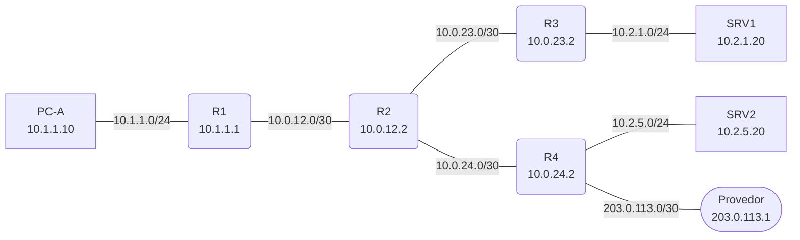

*Figura 3.1 (Tipo A, topologia).* Elementos do modo "Encaminhamento": PC-A (10.1.1.10); R1 (10.1.1.1); R2 (10.0.12.2); R3 (10.0.23.2); R4 (10.0.24.2); SRV1 (10.2.1.20); SRV2 (10.2.5.20); Provedor (203.0.113.1). Vale para todos os cenários do modo (6.1.1 a 6.1.16).

### 3.2 Endereçamento

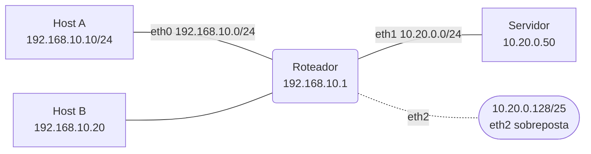

*Figura 3.2a (Tipo A, topologia).* Elementos do modo "Endereçamento": Host A (192.168.10.10/24); Host B (192.168.10.20); Roteador (192.168.10.1); Servidor (10.20.0.50); 10.20.0.128/25 (eth2 sobreposta). Linhas tracejadas: enlaces alternativos, forjados ou caídos. Vale para os cenários (6.2.1 a 6.2.4; 6.2.6; 6.2.8 a 6.2.10; 6.2.12 a 6.2.14).

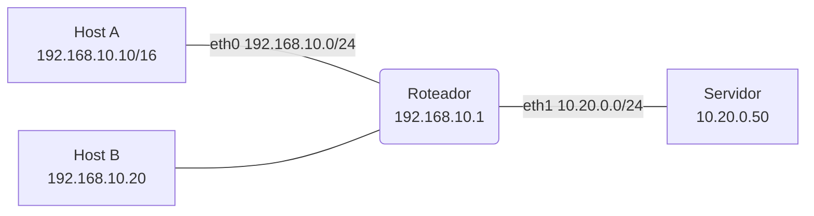

*Figura 3.2b (Tipo A, topologia).* Elementos do modo "Endereçamento": Host A (192.168.10.10/16); Host B (192.168.10.20); Roteador (192.168.10.1); Servidor (10.20.0.50). Vale para os cenários (6.2.5).

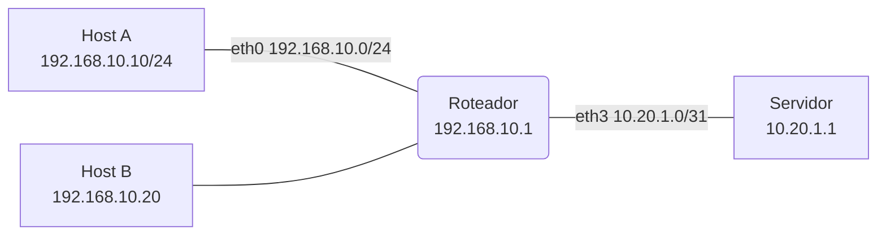

*Figura 3.2c (Tipo A, topologia).* Elementos do modo "Endereçamento": Host A (192.168.10.10/24); Host B (192.168.10.20); Roteador (192.168.10.1); Servidor (10.20.1.1). Vale para os cenários (6.2.7).

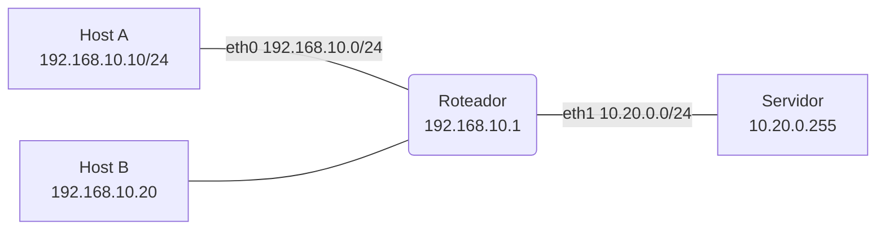

*Figura 3.2d (Tipo A, topologia).* Elementos do modo "Endereçamento": Host A (192.168.10.10/24); Host B (192.168.10.20); Roteador (192.168.10.1); Servidor (10.20.0.255). Vale para os cenários (6.2.11).

## 4. Abas da bancada

Cenário, Captura, Mensagem, Tabela de rotas (modos: Encaminhamento), Endereços (modos: Endereçamento), Cabeçalho IPv4, Experimento, Referência e Log.

## 5. Configurações (campos do painel)

### 5.1 Rede

- **Atraso por enlace (ms)**. Valores: 1; 2; 5; 10; 20. Padrão: 2. Modos: todos.
  - Tempo de cada salto.
  - Define quanto tempo o pacote leva em cada enlace. Não muda nenhuma decisão de rota: só estica ou encolhe a linha do tempo.

### 5.2 Pacote

- **Destino do ping**. Valores: SRV1, 10.2.1.20 (atrás do R3); SRV2, 10.2.5.20 (atrás do R4); 10.2.9.9 (na faixa 10.2.0.0/16, sem host); 198.51.100.9 (internet). Padrão: SRV1, 10.2.1.20 (atrás do R3). Modos: Encaminhamento.
  - Para onde o PC-A envia o ping.
  - Cada destino casa com um conjunto diferente de rotas. O **SRV2** casa com três rotas em R2 (/24, /16 e a padrão), o **SRV1** com duas (/16 e a padrão) e o **10.2.9.9** pertence ao /16, mas nenhuma rede conectada o contém. O endereço da internet só casa com a rota padrão.
- **TTL inicial**. Valores: 64 (padrão do Linux); 16; 8; 4 (o mínimo para chegar ao SRV1); 3; 2; 1. Padrão: 64 (padrão do Linux). Modos: Encaminhamento.
  - Tempo de vida do pacote, em saltos.
  - Cada roteador diminui o TTL de um. Um pacote que chega com TTL 1 é descartado, e o roteador avisa a origem com ICMP 11/0 ([RFC 1812](https://www.rfc-editor.org/rfc/rfc1812), seção 5.3.1). É o que impede um loop de rotas de durar para sempre e o que o traceroute explora.
- **A origem do pacote é forjada (192.0.2.77)**. Valores: caixa de seleção. Padrão: não. Modos: Encaminhamento.
  - O PC-A usa um endereço de origem que não é o dele.
  - O endereço 192.0.2.77 (documentação, [RFC 5737](https://www.rfc-editor.org/rfc/rfc5737)) não pertence à LAN de A. É o caso que o uRPF existe para barrar na borda ([BCP 38](https://www.rfc-editor.org/info/bcp38)). Este simulador só mostra o efeito e a defesa.

### 5.3 Rotas do R2

- **R2 tem a rota agregada 10.2.0.0/16**. Valores: caixa de seleção. Padrão: sim. Modos: Encaminhamento.
  - Uma rota que cobre toda a faixa 10.2.0.0/16 via R3.
  - A agregação resume muitas redes em um só prefixo. Sem ela, o R2 só alcança o SRV1 pela rota padrão, se houver.
- **R2 tem rota padrão (via R4)**. Valores: caixa de seleção. Padrão: sim. Modos: Encaminhamento.
  - 0.0.0.0/0: o que não casa com nada mais específico.
  - É o prefixo mais curto possível, por isso só vence quando nada mais casa. Também esconde falhas: um destino sem rota sai pela borda em vez de gerar erro.
- **Rotas repetidas para o mesmo prefixo**. Valores: Nenhuma; 10.2.5.0/24 por duas fontes (estática e OSPF); 10.2.0.0/16 por dois caminhos OSPF (métricas 20 e 30). Padrão: Nenhuma. Modos: Encaminhamento.
  - O que decide entre rotas de mesmo prefixo.
  - **Duas fontes:** com o mesmo prefixo, vence a menor **distância administrativa** (estática 1, OSPF 110). **Dois caminhos da mesma fonte:** vence a menor **métrica**. O conceito é a preferência administrativa da [RFC 1812](https://www.rfc-editor.org/rfc/rfc1812) (seção 5.2.4.4); os valores usuais variam por fabricante.

### 5.4 Rotas do R3

- **R3 tem rota padrão apontando para R2**. Valores: caixa de seleção. Padrão: não. Modos: Encaminhamento.
  - Cria um loop com a rota agregada do R2.
  - O R2 manda a faixa 10.2.0.0/16 ao R3, e o R3 manda de volta o que não conhece. Para um destino sem host, o pacote vai e volta entre os dois até o TTL acabar.
- **R3 descarta 10.2.9.0/24 (blackhole)**. Valores: caixa de seleção. Padrão: não. Modos: Encaminhamento.
  - Rota que descarta em silêncio.
  - Usada de propósito para derrubar tráfego indesejado. Diferente de "sem rota", não gera ICMP: a origem fica sem saber o que houve.
- **R3 tem rota de volta para a LAN de A (10.1.0.0/16)**. Valores: caixa de seleção. Padrão: sim. Modos: Encaminhamento.
  - A resposta também precisa de rota.
  - O ping só funciona se o caminho de volta existir. Sem a rota no R3, o pedido é entregue, a resposta não, e o PC-A só vê um timeout.

### 5.5 Defesa na borda (R1)

- **uRPF na entrada da LAN do R1**. Valores: Desligado; Estrito; Flexível. Padrão: Desligado. Modos: Encaminhamento.
  - Confere a origem pela tabela de rotas ([RFC 3704](https://www.rfc-editor.org/rfc/rfc3704)).
  - **Estrito:** aceita só se a rota de volta para a origem sai pela mesma interface por onde o pacote chegou. **Flexível:** aceita se existir qualquer rota para a origem, e com uma rota padrão isso vale para qualquer endereço. O estrito exige rotas simétricas.

### 5.6 Destino

- **Destino do ping**. Valores: Host B, 192.168.10.20 (mesma LAN); Servidor, 10.20.0.50; Servidor, 10.20.0.200; Servidor, 10.20.1.1 (enlace /31); 192.168.20.7 (outra rede 192.168.x.x); 192.168.10.255 (broadcast da sub-rede); 255.255.255.255 (broadcast limitado); 10.20.0.255 (broadcast dirigido); 169.254.10.5 (link-local); 100.64.5.5 (espaço do CGNAT); 192.0.2.7 (documentação). Padrão: Host B, 192.168.10.20 (mesma LAN). Modos: Endereçamento.
  - O tipo de endereço decide o caminho.
  - Cada destino aciona uma regra diferente: entrega direta, gateway, broadcast, descarte ou erro. A aba Endereços mostra a conta bit a bit e o bloco especial a que o destino pertence.

### 5.7 Host A (192.168.10.10)

- **Máscara do host**. Valores: /24 (255.255.255.0); /16 (255.255.0.0). Padrão: /24 (255.255.255.0). Modos: Endereçamento.
  - Define o que o host considera "na mesma rede".
  - O host faz um E lógico entre o destino e a máscara e compara com a própria rede. Uma máscara larga demais faz o host tratar como vizinho quem está atrás do roteador.
- **Gateway do host**. Valores: 192.168.10.1 (correto); Sem gateway; 192.168.11.1 (fora da sub-rede). Padrão: 192.168.10.1 (correto). Modos: Endereçamento.
  - Para onde vai o que não é local.
  - O gateway precisa estar na sub-rede do host, porque o host o alcança por ARP. Sem gateway, o que é de outra rede nem sai do host.

### 5.8 Roteador

- **Interface eth2 sobreposta (10.20.0.128/25)**. Valores: caixa de seleção. Padrão: não. Modos: Endereçamento.
  - Duas redes conectadas que se cobrem.
  - A eth2 usa 10.20.0.128/25, que está dentro do 10.20.0.0/24 da eth1. Para um endereço nessa metade, as duas rotas casam e vence o prefixo mais longo, que leva à rede errada.
- **Encaminhar broadcast dirigido (ip directed-broadcast)**. Valores: caixa de seleção. Padrão: não. Modos: Endereçamento.
  - Permite que o roteador converta o pacote em broadcast da rede de destino.
  - O padrão correto é bloquear ([RFC 2644](https://www.rfc-editor.org/rfc/rfc2644)). Ligado, qualquer um pode fazer todos os hosts da rede responderem a um alvo. Serve aqui apenas para mostrar por que o padrão mudou.

## 6. Cenários

### 6.1 Modo: Encaminhamento

> **Grupo:** Prefixo mais específico

O roteador compara o destino com todos os prefixos da tabela e escolhe o que casa com mais bits. A rota padrão (/0) só vence quando nada mais específico casa.

#### 6.1.1 Dois candidatos: vence o /16

*O maior prefixo vence, mesmo com a rota padrão também casando.*

**Configuração aplicada:** Destino do ping = srv1; TTL inicial = 64; A origem do pacote é forjada (192.0.2.77) = não; R2 tem a rota agregada 10.2.0.0/16 = sim; R2 tem rota padrão (via R4) = sim; Rotas repetidas para o mesmo prefixo = none; R3 tem rota padrão apontando para R2 = não; R3 descarta 10.2.9.0/24 (blackhole) = não; R3 tem rota de volta para a LAN de A (10.1.0.0/16) = sim; uRPF na entrada da LAN do R1 = off

O PC-A faz ping no SRV1 (10.2.1.20). No R2, o destino casa com **duas rotas**: a padrão (/0) e a agregada 10.2.0.0/16. Vence a de **maior prefixo**, que leva ao R3.

**Conceito.** O destino 10.2.1.20 casa com duas rotas do R2: 0.0.0.0/0 e 10.2.0.0/16. O roteador escolhe a de **maior prefixo** (/16), porque ela descreve melhor onde o destino está. A rota padrão só vale para o que nada mais cobre.

**O que observar**

- Na aba Rotas, as linhas que casam ficam marcadas e a vencedora tem destaque.
- O número de bits em comum é maior no /16 do que no /0.
- O TTL cai de um em cada roteador: 64, 63, 62, 61.

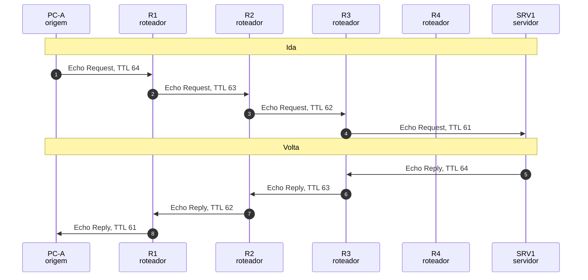

*Figura 6.1.1 (Tipo B, sequência).* Mensagens do cenário "Dois candidatos: vence o /16", na ordem do tempo, entre PC-A, R1, R2, R3, R4, SRV1: 8 mensagens, numeradas de 1 a 8 na ordem da comunicação (em 2 fases). Corresponde ao diagrama de sequência e à aba Captura, no modo "Encaminhamento", com a configuração aplicada acima.

**Mensagens**

| Mensagem | Significado | Origem |
| --- | --- | --- |
| Echo Request | ping do PC-A ao SRV1 | PC-A |
| Echo Reply | resposta, com a busca repetida na volta | SRV1 |

**Por que importa.** A regra do prefixo mais longo é o que permite agregar rotas e, ao mesmo tempo, abrir exceções mais específicas ([RFC 1812](https://www.rfc-editor.org/rfc/rfc1812), seção 5.2.4.3).

#### 6.1.2 Três candidatos: vence o /24

*Três rotas casam e a mais específica manda o pacote por outro caminho.*

**Configuração aplicada:** Destino do ping = srv2; TTL inicial = 64; A origem do pacote é forjada (192.0.2.77) = não; R2 tem a rota agregada 10.2.0.0/16 = sim; R2 tem rota padrão (via R4) = sim; Rotas repetidas para o mesmo prefixo = none; R3 tem rota padrão apontando para R2 = não; R3 descarta 10.2.9.0/24 (blackhole) = não; R3 tem rota de volta para a LAN de A (10.1.0.0/16) = sim; uRPF na entrada da LAN do R1 = off

O SRV2 (10.2.5.20) casa no R2 com **três rotas**: /0, /16 e /24. A mais específica (10.2.5.0/24) manda o pacote ao R4, embora o /16 apontasse para o R3.

**Conceito.** O destino 10.2.5.20 casa com /0, /16 e /24 no R2. O /16 apontaria para o R3, mas o /24 é mais específico e aponta para o R4, onde o servidor realmente está. A exceção mais específica prevalece sobre a rota agregada.

**O que observar**

- A tabela do R2 mostra três linhas marcadas e a de /24 como vencedora.
- O pacote vai por R4, e não por R3.
- O SRV2 responde pelo R4, pelo caminho de volta.

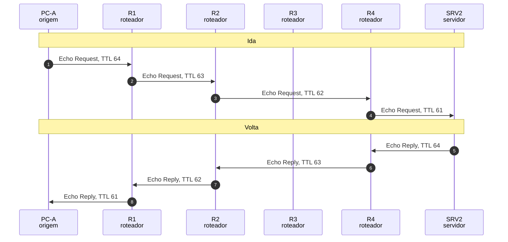

*Figura 6.1.2 (Tipo B, sequência).* Mensagens do cenário "Três candidatos: vence o /24", na ordem do tempo, entre PC-A, R1, R2, R3, R4, SRV2: 8 mensagens, numeradas de 1 a 8 na ordem da comunicação (em 2 fases). Corresponde ao diagrama de sequência e à aba Captura, no modo "Encaminhamento", com a configuração aplicada acima.

**Mensagens**

| Mensagem | Significado | Origem |
| --- | --- | --- |
| Echo Request | ping ao SRV2 | PC-A |
| Echo Reply | resposta pelo R4 | SRV2 |

**Por que importa.** Sem a regra do maior prefixo, uma exceção dentro de uma rota agregada nunca seria respeitada.

#### 6.1.3 Rota padrão até a borda

*O que não tem rota específica segue a rota padrão até a borda.*

**Configuração aplicada:** Destino do ping = inet; TTL inicial = 64; A origem do pacote é forjada (192.0.2.77) = não; R2 tem a rota agregada 10.2.0.0/16 = sim; R2 tem rota padrão (via R4) = sim; Rotas repetidas para o mesmo prefixo = none; R3 tem rota padrão apontando para R2 = não; R3 descarta 10.2.9.0/24 (blackhole) = não; R3 tem rota de volta para a LAN de A (10.1.0.0/16) = sim; uRPF na entrada da LAN do R1 = off

O destino 198.51.100.9 é da internet e não tem rota específica em lugar nenhum. A **rota padrão** de cada roteador o empurra até a borda, no R4, e dali ao provedor.

**Conceito.** Ninguém na rede conhece 198.51.100.9. Cada roteador usa a rota padrão (0.0.0.0/0) e empurra o pacote para mais perto da saída. No R4, a padrão aponta para o provedor. O trajeto simulado termina ali.

**O que observar**

- Em cada roteador só uma rota casa: a padrão.
- O pacote atravessa R1, R2 e R4 e sai para o provedor.
- Não há resposta: o endereço de origem é privado e precisaria de NAT para voltar (veja o simulador de NAT).

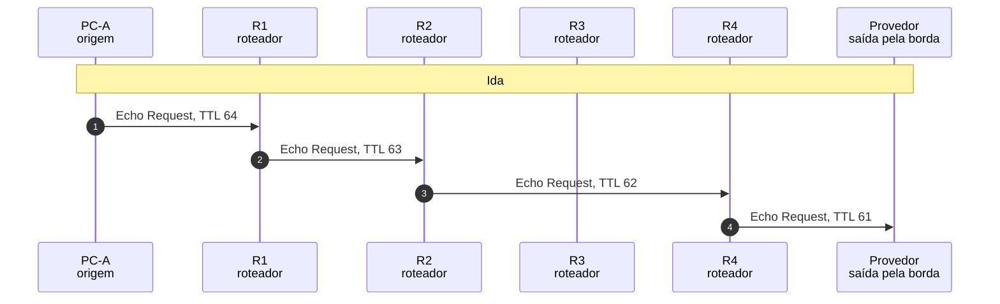

*Figura 6.1.3 (Tipo B, sequência).* Mensagens do cenário "Rota padrão até a borda", na ordem do tempo, entre PC-A, R1, R2, R3, R4, Provedor: 4 mensagens, numeradas de 1 a 4 na ordem da comunicação (em 1 fase). Corresponde ao diagrama de sequência e à aba Captura, no modo "Encaminhamento", com a configuração aplicada acima.

**Mensagens**

| Mensagem | Significado | Origem |
| --- | --- | --- |
| Echo Request | ping a um endereço da internet | PC-A |

**Por que importa.** A rota padrão é o que dá acesso à internet sem que cada roteador conheça todos os prefixos do mundo.

> **Grupo:** Distância administrativa e métrica

Quando duas rotas têm o mesmo prefixo, o prefixo não decide mais. Vence a fonte mais confiável (menor distância administrativa) e, na mesma fonte, o caminho mais barato (menor métrica).

#### 6.1.4 Mesmo prefixo, fontes diferentes

*Com o mesmo prefixo, vence a fonte mais confiável.*

**Configuração aplicada:** Destino do ping = srv2; TTL inicial = 64; A origem do pacote é forjada (192.0.2.77) = não; R2 tem a rota agregada 10.2.0.0/16 = sim; R2 tem rota padrão (via R4) = sim; Rotas repetidas para o mesmo prefixo = ad; R3 tem rota padrão apontando para R2 = não; R3 descarta 10.2.9.0/24 (blackhole) = não; R3 tem rota de volta para a LAN de A (10.1.0.0/16) = sim; uRPF na entrada da LAN do R1 = off

O R2 conhece 10.2.5.0/24 por duas fontes: **estática** (via R4) e **OSPF** (via R3). Com o mesmo prefixo, vence a de menor **distância administrativa**: a estática (1 contra 110).

**Conceito.** O R2 recebe a rota 10.2.5.0/24 de duas fontes: uma estática (distância administrativa 1) e o OSPF (110). Como o prefixo é igual, o desempate é a **distância administrativa**: a estática vence, mesmo que a métrica do OSPF seja menor.

**O que observar**

- Duas linhas de /24 aparecem na tabela do R2, uma S e uma O.
- A S, de AD 1, vence a O, de AD 110.
- O pacote vai ao R4 pela rota estática.


*Figura 6.1.4 (Tipo B, sequência).* Mensagens do cenário "Mesmo prefixo, fontes diferentes", na ordem do tempo, entre PC-A, R1, R2, R3, R4, SRV2: 8 mensagens, numeradas de 1 a 8 na ordem da comunicação (em 2 fases). Corresponde ao diagrama de sequência e à aba Captura, no modo "Encaminhamento", com a configuração aplicada acima.

**Mensagens**

| Mensagem | Significado | Origem |
| --- | --- | --- |
| Echo Request | ping ao SRV2 | PC-A |
| Echo Reply | resposta | SRV2 |

**Por que importa.** A distância administrativa permite que uma rota estática de contingência ou de política prevaleça sobre o que o protocolo de roteamento aprende. O conceito é a preferência administrativa da [RFC 1812](https://www.rfc-editor.org/rfc/rfc1812) (seção 5.2.4.4); os valores são convenções de fabricantes.

#### 6.1.5 Mesma fonte, métricas diferentes

*Na mesma fonte, vence o caminho de menor métrica.*

**Configuração aplicada:** Destino do ping = srv1; TTL inicial = 64; A origem do pacote é forjada (192.0.2.77) = não; R2 tem a rota agregada 10.2.0.0/16 = sim; R2 tem rota padrão (via R4) = sim; Rotas repetidas para o mesmo prefixo = metric; R3 tem rota padrão apontando para R2 = não; R3 descarta 10.2.9.0/24 (blackhole) = não; R3 tem rota de volta para a LAN de A (10.1.0.0/16) = sim; uRPF na entrada da LAN do R1 = off

O R2 aprende 10.2.0.0/16 por dois caminhos OSPF, com métricas 20 (via R3) e 30 (via R4). Mesmo prefixo, mesma fonte: vence a **menor métrica**.

**Conceito.** O R2 aprende 10.2.0.0/16 por dois vizinhos OSPF, com métricas 20 e 30. O prefixo e a distância administrativa são iguais, então vence a **menor métrica**: o caminho via R3.

**O que observar**

- As duas linhas O de /16 aparecem na tabela do R2.
- A de métrica 20 vence a de 30.
- A métrica compara caminhos da mesma fonte, e só deles.


*Figura 6.1.5 (Tipo B, sequência).* Mensagens do cenário "Mesma fonte, métricas diferentes", na ordem do tempo, entre PC-A, R1, R2, R3, R4, SRV1: 8 mensagens, numeradas de 1 a 8 na ordem da comunicação (em 2 fases). Corresponde ao diagrama de sequência e à aba Captura, no modo "Encaminhamento", com a configuração aplicada acima.

**Mensagens**

| Mensagem | Significado | Origem |
| --- | --- | --- |
| Echo Request | ping ao SRV1 | PC-A |
| Echo Reply | resposta | SRV1 |

**Por que importa.** A métrica é do protocolo de roteamento: comparar métricas de fontes diferentes não faz sentido, e por isso existe a distância administrativa.

> **Grupo:** Falhas de rota

Uma tabela incompleta produz sintomas diferentes: aviso ICMP, silêncio, vazamento pela rota padrão ou uma resposta sem caminho de volta.

#### 6.1.6 Sem rota no R3 (ICMP 3/0)

*Sem rota, o roteador descarta e avisa a origem.*

**Configuração aplicada:** Destino do ping = nonet; TTL inicial = 64; A origem do pacote é forjada (192.0.2.77) = não; R2 tem a rota agregada 10.2.0.0/16 = sim; R2 tem rota padrão (via R4) = sim; Rotas repetidas para o mesmo prefixo = none; R3 tem rota padrão apontando para R2 = não; R3 descarta 10.2.9.0/24 (blackhole) = não; R3 tem rota de volta para a LAN de A (10.1.0.0/16) = sim; uRPF na entrada da LAN do R1 = off

O endereço 10.2.9.9 pertence à faixa que o R2 manda ao R3, mas o R3 não tem nenhuma rota para ele. O R3 **descarta e avisa a origem** com ICMP 3/0.

**Conceito.** O R2 manda o 10.2.9.9 ao R3 pelo /16, mas o R3 só conhece 10.2.1.0/24 como rede conectada. Sem nenhuma rota, o R3 descarta o pacote e envia à origem um ICMP 3/0 (rede inalcançável), com origem no endereço da interface por onde o pacote chegou.

**O que observar**

- A busca no R3 não casa com nenhuma linha.
- O aviso ICMP volta pelo R2 e pelo R1 até o PC-A.
- A origem do aviso é 10.0.23.2, o R3.

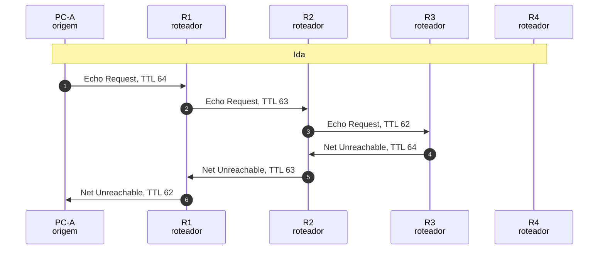

*Figura 6.1.6 (Tipo B, sequência).* Mensagens do cenário "Sem rota no R3 (ICMP 3/0)", na ordem do tempo, entre PC-A, R1, R2, R3, R4: 6 mensagens, numeradas de 1 a 6 na ordem da comunicação (em 1 fase). Corresponde ao diagrama de sequência e à aba Captura, no modo "Encaminhamento", com a configuração aplicada acima.

**Mensagens**

| Mensagem | Significado | Origem |
| --- | --- | --- |
| Echo Request | ping a um endereço sem rota no R3 | PC-A |
| Destination Unreachable 3/0 | aviso de rede inalcançável | R3 |

**Por que importa.** O ICMP 3/0 é o sintoma de uma rota que falta e aponta exatamente o roteador onde a rota faltou.

#### 6.1.7 Sem agregada e sem padrão

*Sem rota agregada nem padrão, o R2 não tem como encaminhar.*

**Configuração aplicada:** Destino do ping = srv1; TTL inicial = 64; A origem do pacote é forjada (192.0.2.77) = não; R2 tem a rota agregada 10.2.0.0/16 = não; R2 tem rota padrão (via R4) = não; Rotas repetidas para o mesmo prefixo = none; R3 tem rota padrão apontando para R2 = não; R3 descarta 10.2.9.0/24 (blackhole) = não; R3 tem rota de volta para a LAN de A (10.1.0.0/16) = sim; uRPF na entrada da LAN do R1 = off

O R2 perde a rota agregada e não tem rota padrão. Para o SRV1 não há **nenhuma** rota, e o R2 avisa a origem com ICMP 3/0.

**Conceito.** Sem a rota 10.2.0.0/16 e sem a rota padrão, nenhum prefixo do R2 cobre o 10.2.1.20. O R2 descarta o pacote e avisa a origem com ICMP 3/0.

**O que observar**

- A busca no R2 não casa com nenhuma rota.
- Quem avisa é o R2 (10.0.12.2), antes de o pacote chegar ao R3.
- Compare com o cenário seguinte, em que a rota padrão existe.

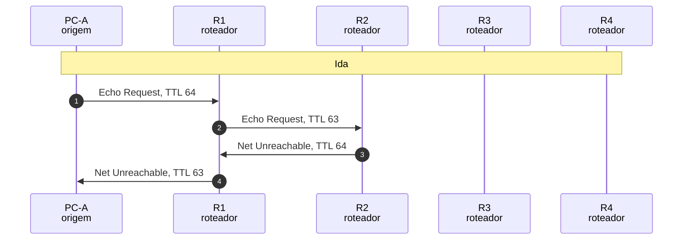

*Figura 6.1.7 (Tipo B, sequência).* Mensagens do cenário "Sem agregada e sem padrão", na ordem do tempo, entre PC-A, R1, R2, R3, R4: 4 mensagens, numeradas de 1 a 4 na ordem da comunicação (em 1 fase). Corresponde ao diagrama de sequência e à aba Captura, no modo "Encaminhamento", com a configuração aplicada acima.

**Mensagens**

| Mensagem | Significado | Origem |
| --- | --- | --- |
| Echo Request | ping ao SRV1 | PC-A |
| Destination Unreachable 3/0 | aviso do R2 | R2 |

**Por que importa.** Mostra que o erro aponta para o roteador que não sabe chegar ao destino, e não para o destino.

#### 6.1.8 A rota padrão esconde a falha

*A rota padrão transforma uma rota que falta em vazamento.*

**Configuração aplicada:** Destino do ping = srv1; TTL inicial = 64; A origem do pacote é forjada (192.0.2.77) = não; R2 tem a rota agregada 10.2.0.0/16 = não; R2 tem rota padrão (via R4) = sim; Rotas repetidas para o mesmo prefixo = none; R3 tem rota padrão apontando para R2 = não; R3 descarta 10.2.9.0/24 (blackhole) = não; R3 tem rota de volta para a LAN de A (10.1.0.0/16) = sim; uRPF na entrada da LAN do R1 = off

O R2 perde a rota agregada, mas ainda tem a padrão. O pacote para o SRV1, **de endereço privado**, sai pela borda em vez de gerar erro: a falha fica escondida e o tráfego vaza.

**Conceito.** Sem a rota agregada, o 10.2.1.20 cai na rota padrão do R2, que o manda ao R4 e, de lá, ao provedor. Não há erro: o tráfego interno, com endereço privado, sai pela borda. Na prática o provedor o descarta ([RFC 1918](https://www.rfc-editor.org/rfc/rfc1918)), mas ele já deixou a rede.

**O que observar**

- No R2, só a rota padrão casa.
- O pacote chega ao provedor, o que não deveria ocorrer com um endereço privado.
- Nenhum ICMP avisa a origem.


*Figura 6.1.8 (Tipo B, sequência).* Mensagens do cenário "A rota padrão esconde a falha", na ordem do tempo, entre PC-A, R1, R2, R3, R4, Provedor: 4 mensagens, numeradas de 1 a 4 na ordem da comunicação (em 1 fase). Corresponde ao diagrama de sequência e à aba Captura, no modo "Encaminhamento", com a configuração aplicada acima.

**Mensagens**

| Mensagem | Significado | Origem |
| --- | --- | --- |
| Echo Request | ping ao SRV1, que sai pela borda | PC-A |

**Por que importa.** A rota padrão esconde falhas. Em redes reais, isso exige filtros de saída para endereços privados e de documentação ([RFC 6890](https://www.rfc-editor.org/rfc/rfc6890)).

#### 6.1.9 Rota blackhole

*A rota blackhole descarta sem avisar ninguém.*

**Configuração aplicada:** Destino do ping = nonet; TTL inicial = 64; A origem do pacote é forjada (192.0.2.77) = não; R2 tem a rota agregada 10.2.0.0/16 = sim; R2 tem rota padrão (via R4) = sim; Rotas repetidas para o mesmo prefixo = none; R3 tem rota padrão apontando para R2 = não; R3 descarta 10.2.9.0/24 (blackhole) = sim; R3 tem rota de volta para a LAN de A (10.1.0.0/16) = sim; uRPF na entrada da LAN do R1 = off

O R3 tem uma rota blackhole para 10.2.9.0/24. O pacote é **descartado em silêncio**: nenhum ICMP volta, e o PC-A só vê o tempo esgotar.

**Conceito.** O R3 tem uma rota para 10.2.9.0/24 cujo destino é o descarte. O pacote é jogado fora sem ICMP. Do lado da origem só há silêncio, o que torna o problema mais difícil de diagnosticar do que um erro 3/0.

**O que observar**

- A busca no R3 casa com a rota blackhole.
- Nenhuma mensagem ICMP volta.
- O PC-A só vê o tempo esgotar.

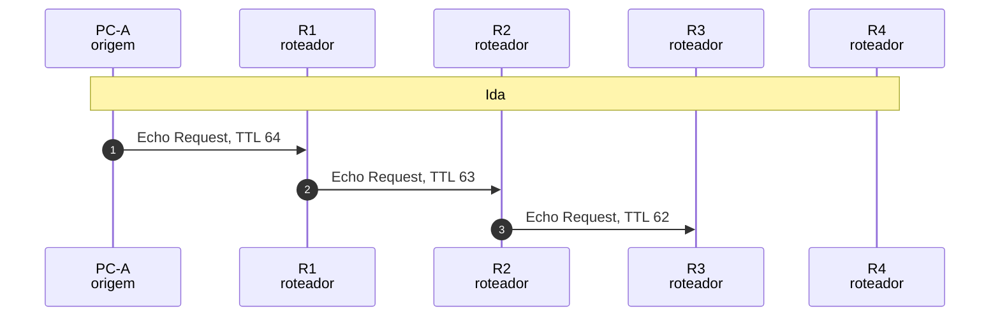

*Figura 6.1.9 (Tipo B, sequência).* Mensagens do cenário "Rota blackhole", na ordem do tempo, entre PC-A, R1, R2, R3, R4: 3 mensagens, numeradas de 1 a 3 na ordem da comunicação (em 1 fase). Corresponde ao diagrama de sequência e à aba Captura, no modo "Encaminhamento", com a configuração aplicada acima.

**Mensagens**

| Mensagem | Significado | Origem |
| --- | --- | --- |
| Echo Request | ping que desaparece no R3 | PC-A |

**Por que importa.** Blackholes são usados de propósito para conter tráfego indesejado (por exemplo, em resposta a ataques), com o custo de não dar nenhum sinal.

#### 6.1.10 Ida entregue, volta perdida

*A ida funciona, mas a resposta não tem caminho de volta.*

**Configuração aplicada:** Destino do ping = srv1; TTL inicial = 64; A origem do pacote é forjada (192.0.2.77) = não; R2 tem a rota agregada 10.2.0.0/16 = sim; R2 tem rota padrão (via R4) = sim; Rotas repetidas para o mesmo prefixo = none; R3 tem rota padrão apontando para R2 = não; R3 descarta 10.2.9.0/24 (blackhole) = não; R3 tem rota de volta para a LAN de A (10.1.0.0/16) = não; uRPF na entrada da LAN do R1 = off

O R3 não tem rota para a LAN do PC-A. O pedido chega ao SRV1, mas a **resposta não tem caminho** de volta, e o ping parece falhar mesmo com a ida perfeita.

**Conceito.** O pedido chega ao SRV1, que responde. Mas o R3 não tem rota para 10.1.0.0/16, então descarta a resposta. O SRV1 recebe um ICMP 3/0 sobre a própria resposta, e o PC-A, que não sabe disso, só vê o tempo esgotar.

**O que observar**

- O Echo Request chega ao SRV1.
- O R3 não casa o 10.1.1.10 com nenhuma rota e avisa o SRV1.
- A origem não recebe nada.

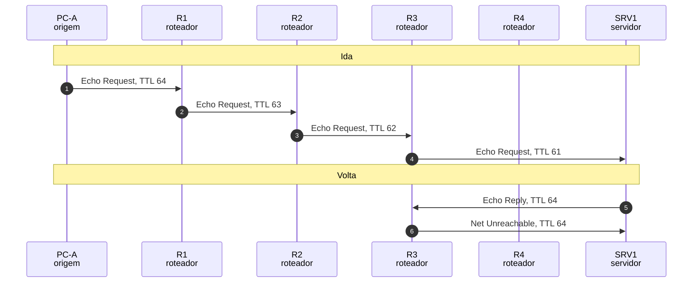

*Figura 6.1.10 (Tipo B, sequência).* Mensagens do cenário "Ida entregue, volta perdida", na ordem do tempo, entre PC-A, R1, R2, R3, R4, SRV1: 6 mensagens, numeradas de 1 a 6 na ordem da comunicação (em 2 fases). Corresponde ao diagrama de sequência e à aba Captura, no modo "Encaminhamento", com a configuração aplicada acima.

**Mensagens**

| Mensagem | Significado | Origem |
| --- | --- | --- |
| Echo Request | chega ao SRV1 | PC-A |
| Echo Reply | a resposta não tem rota de volta | SRV1 |
| Destination Unreachable 3/0 | aviso ao SRV1 | R3 |

**Por que importa.** Roteamento tem de ser pensado nos dois sentidos: o ping falha mesmo quando a ida é perfeita.

> **Grupo:** TTL e loops

O TTL limita a vida do pacote em saltos. Ele corta loops de roteamento e é a base do traceroute.

#### 6.1.11 TTL expira no R3

*O TTL acaba no caminho e o roteador avisa a origem.*

**Configuração aplicada:** Destino do ping = srv1; TTL inicial = 3; A origem do pacote é forjada (192.0.2.77) = não; R2 tem a rota agregada 10.2.0.0/16 = sim; R2 tem rota padrão (via R4) = sim; Rotas repetidas para o mesmo prefixo = none; R3 tem rota padrão apontando para R2 = não; R3 descarta 10.2.9.0/24 (blackhole) = não; R3 tem rota de volta para a LAN de A (10.1.0.0/16) = sim; uRPF na entrada da LAN do R1 = off

O PC-A envia com TTL 3, mas o SRV1 está a três roteadores. O pacote chega ao R3 com TTL 1 e é descartado, e o **R3 avisa a origem** com ICMP 11/0. É o princípio do traceroute.

**Conceito.** Cada roteador decrementa o TTL. O pacote sai do PC-A com TTL 3, chega ao R1 com 3, ao R2 com 2 e ao R3 com 1. Como ao decrementar o TTL vira 0, o R3 descarta e envia ICMP 11/0 (Time Exceeded) à origem ([RFC 1812](https://www.rfc-editor.org/rfc/rfc1812), seção 5.3.1).

**O que observar**

- O TTL mostrado na mensagem cai em cada salto.
- O aviso 11/0 vem do R3, com origem 10.0.23.2.
- Um traceroute faz isso de propósito, com TTL 1, 2, 3 e assim por diante.

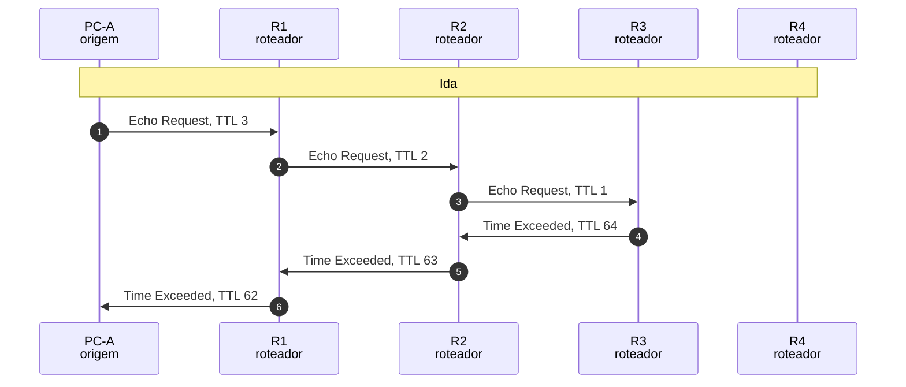

*Figura 6.1.11 (Tipo B, sequência).* Mensagens do cenário "TTL expira no R3", na ordem do tempo, entre PC-A, R1, R2, R3, R4: 6 mensagens, numeradas de 1 a 6 na ordem da comunicação (em 1 fase). Corresponde ao diagrama de sequência e à aba Captura, no modo "Encaminhamento", com a configuração aplicada acima.

**Mensagens**

| Mensagem | Significado | Origem |
| --- | --- | --- |
| Echo Request | TTL 3, que não chega ao destino | PC-A |
| Time Exceeded 11/0 | aviso do roteador onde o TTL acabou | R3 |

**Por que importa.** O TTL impede que pacotes vivam para sempre e revela, salto a salto, o caminho percorrido.

#### 6.1.12 Loop entre R2 e R3

*Rotas inconsistentes fazem o pacote circular até o TTL acabar.*

**Configuração aplicada:** Destino do ping = nonet; TTL inicial = 8; A origem do pacote é forjada (192.0.2.77) = não; R2 tem a rota agregada 10.2.0.0/16 = sim; R2 tem rota padrão (via R4) = sim; Rotas repetidas para o mesmo prefixo = none; R3 tem rota padrão apontando para R2 = sim; R3 descarta 10.2.9.0/24 (blackhole) = não; R3 tem rota de volta para a LAN de A (10.1.0.0/16) = sim; uRPF na entrada da LAN do R1 = off

O R2 manda o 10.2.9.9 ao R3 (pelo /16), e o R3 o devolve ao R2 (pela padrão). O pacote **circula** até o TTL acabar, e só então a origem recebe o aviso.

**Conceito.** O R2 manda 10.2.9.9 ao R3 (pelo /16) e o R3 o devolve ao R2 (pela rota padrão). O pacote vai e volta, com o TTL caindo a cada salto, até chegar a 1 e ser descartado. Só o TTL evita que o loop seja infinito.

**O que observar**

- O mesmo destino aparece várias vezes no R2 e no R3.
- O TTL cai de 8 até 1 durante a circulação.
- O aviso 11/0 sai do roteador onde o TTL acaba.

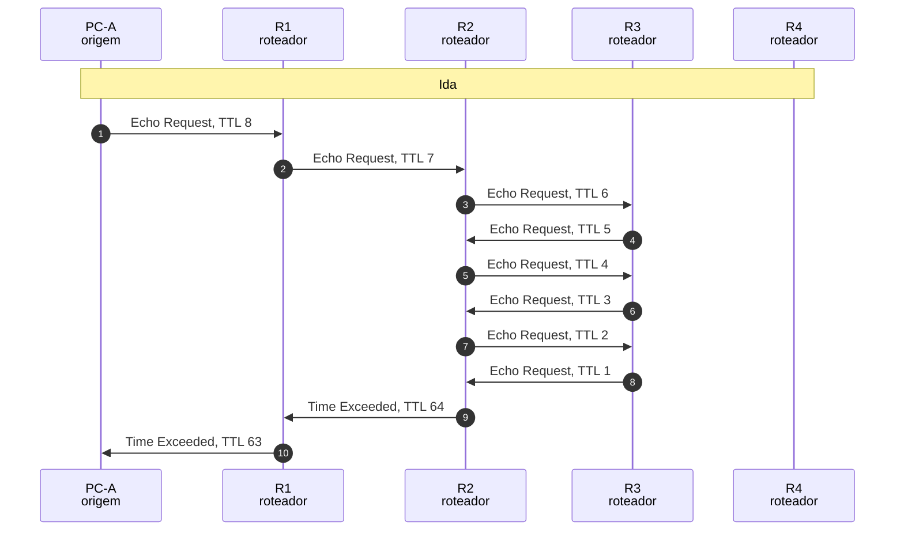

*Figura 6.1.12 (Tipo B, sequência).* Mensagens do cenário "Loop entre R2 e R3", na ordem do tempo, entre PC-A, R1, R2, R3, R4: 10 mensagens, numeradas de 1 a 10 na ordem da comunicação (em 1 fase). Corresponde ao diagrama de sequência e à aba Captura, no modo "Encaminhamento", com a configuração aplicada acima.

**Mensagens**

| Mensagem | Significado | Origem |
| --- | --- | --- |
| Echo Request | circula entre R2 e R3 | PC-A |
| Time Exceeded 11/0 | aviso ao fim do TTL | R2 |

**Por que importa.** Loops de roteamento são uma falha clássica. Sem o TTL, um único pacote giraria para sempre e saturaria o enlace.

> **Grupo:** Defesa na borda (uRPF)

O uRPF confere se a origem de um pacote é plausível, olhando a tabela de rotas ao contrário ([RFC 3704](https://www.rfc-editor.org/rfc/rfc3704) e [BCP 38](https://www.rfc-editor.org/info/bcp38)). Barra origens forjadas, com limites que dependem do modo.

#### 6.1.13 Origem forjada, sem uRPF

*Sem verificação, a origem forjada atravessa a borda.*

**Configuração aplicada:** Destino do ping = srv1; TTL inicial = 64; A origem do pacote é forjada (192.0.2.77) = sim; R2 tem a rota agregada 10.2.0.0/16 = sim; R2 tem rota padrão (via R4) = sim; Rotas repetidas para o mesmo prefixo = none; R3 tem rota padrão apontando para R2 = não; R3 descarta 10.2.9.0/24 (blackhole) = não; R3 tem rota de volta para a LAN de A (10.1.0.0/16) = sim; uRPF na entrada da LAN do R1 = off

O PC-A usa uma origem que não é a dele. Sem verificação, o **R1 encaminha** e o SRV1 recebe o pedido. A resposta vai ao endereço forjado e nunca volta ao PC-A.

**Conceito.** O PC-A envia um pacote com origem 192.0.2.77. O R1 não confere a origem, e o pedido chega ao SRV1. A resposta vai ao endereço forjado, que não é o do PC-A: quem forjou não recebe nada, e quem tem aquele endereço receberia uma resposta que não pediu.

**O que observar**

- O R1 encaminha o pacote sem questionar a origem.
- O SRV1 responde a 192.0.2.77, e o R3 não tem rota para esse endereço.
- O PC-A não vê resposta alguma.


*Figura 6.1.13 (Tipo B, sequência).* Mensagens do cenário "Origem forjada, sem uRPF", na ordem do tempo, entre PC-A, R1, R2, R3, R4, SRV1: 6 mensagens, numeradas de 1 a 6 na ordem da comunicação (em 2 fases). Corresponde ao diagrama de sequência e à aba Captura, no modo "Encaminhamento", com a configuração aplicada acima.

**Mensagens**

| Mensagem | Significado | Origem |
| --- | --- | --- |
| Echo Request | origem forjada | PC-A |
| Echo Reply | vai ao endereço forjado | SRV1 |

**Por que importa.** É por isso que o provedor ou o administrador da borda deve filtrar origens inválidas ([BCP 38](https://www.rfc-editor.org/info/bcp38)).

#### 6.1.14 uRPF estrito descarta

*O uRPF estrito barra a origem que não volta pela mesma interface.*

**Configuração aplicada:** Destino do ping = srv1; TTL inicial = 64; A origem do pacote é forjada (192.0.2.77) = sim; R2 tem a rota agregada 10.2.0.0/16 = sim; R2 tem rota padrão (via R4) = sim; Rotas repetidas para o mesmo prefixo = none; R3 tem rota padrão apontando para R2 = não; R3 descarta 10.2.9.0/24 (blackhole) = não; R3 tem rota de volta para a LAN de A (10.1.0.0/16) = sim; uRPF na entrada da LAN do R1 = strict

Com **uRPF estrito**, o R1 confere que a rota de volta para a origem sai pela interface da LAN. Não sai (é a padrão, pela eth1), e o pacote é descartado na entrada.

**Conceito.** O R1 recebe o pacote na eth0 e procura a rota de volta para 192.0.2.77. A única rota é a padrão, pela eth1. No modo estrito, a interface de volta precisa ser a de chegada: não é, e o pacote é descartado ([RFC 3704](https://www.rfc-editor.org/rfc/rfc3704), seção 2.2).

**O que observar**

- O R1 mostra a rota de volta (a padrão) e a interface eth1.
- O pacote não passa do R1.
- O descarte é silencioso para a origem.

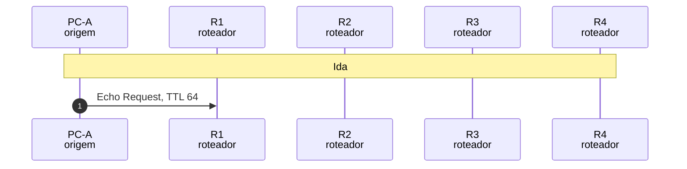

*Figura 6.1.14 (Tipo B, sequência).* Mensagens do cenário "uRPF estrito descarta", na ordem do tempo, entre PC-A, R1, R2, R3, R4: 1 mensagem, numeradas de 1 a 1 na ordem da comunicação (em 1 fase). Corresponde ao diagrama de sequência e à aba Captura, no modo "Encaminhamento", com a configuração aplicada acima.

**Mensagens**

| Mensagem | Significado | Origem |
| --- | --- | --- |
| Echo Request | origem forjada, barrada no R1 | PC-A |

**Por que importa.** O uRPF estrito é a forma mais eficaz de barrar origens forjadas na borda de clientes, mas exige rotas simétricas: com roteamento assimétrico, derruba tráfego legítimo.

#### 6.1.15 uRPF flexível e a rota padrão

*No modo flexível, a rota padrão faz qualquer origem passar.*

**Configuração aplicada:** Destino do ping = srv1; TTL inicial = 64; A origem do pacote é forjada (192.0.2.77) = sim; R2 tem a rota agregada 10.2.0.0/16 = sim; R2 tem rota padrão (via R4) = sim; Rotas repetidas para o mesmo prefixo = none; R3 tem rota padrão apontando para R2 = não; R3 descarta 10.2.9.0/24 (blackhole) = não; R3 tem rota de volta para a LAN de A (10.1.0.0/16) = sim; uRPF na entrada da LAN do R1 = loose

O **uRPF flexível** só exige que exista alguma rota para a origem. Como o R1 tem rota padrão, **qualquer** origem passa: a verificação perde o efeito.

**Conceito.** O uRPF flexível só exige que exista alguma rota para a origem. Como o R1 tem rota padrão, 192.0.2.77 tem rota, e o pacote passa. A verificação só ainda barraria endereços sem nenhuma rota. Algumas implementações ignoram a rota padrão nessa conferência ([RFC 3704](https://www.rfc-editor.org/rfc/rfc3704), seções 2.4 e 2.5), o que este simulador não faz.

**O que observar**

- O R1 aprova a origem e informa que a rota usada é a padrão.
- O pacote chega ao SRV1.
- Compare com o modo estrito.


*Figura 6.1.15 (Tipo B, sequência).* Mensagens do cenário "uRPF flexível e a rota padrão", na ordem do tempo, entre PC-A, R1, R2, R3, R4, SRV1: 6 mensagens, numeradas de 1 a 6 na ordem da comunicação (em 2 fases). Corresponde ao diagrama de sequência e à aba Captura, no modo "Encaminhamento", com a configuração aplicada acima.

**Mensagens**

| Mensagem | Significado | Origem |
| --- | --- | --- |
| Echo Request | origem forjada, aceita pelo R1 | PC-A |
| Echo Reply | vai ao endereço forjado | SRV1 |

**Por que importa.** O modo flexível é útil em borda com várias saídas, mas com rota padrão ele quase não filtra.

#### 6.1.16 uRPF estrito com origem legítima

*O uRPF estrito aceita a origem verdadeira.*

**Configuração aplicada:** Destino do ping = srv1; TTL inicial = 64; A origem do pacote é forjada (192.0.2.77) = não; R2 tem a rota agregada 10.2.0.0/16 = sim; R2 tem rota padrão (via R4) = sim; Rotas repetidas para o mesmo prefixo = none; R3 tem rota padrão apontando para R2 = não; R3 descarta 10.2.9.0/24 (blackhole) = não; R3 tem rota de volta para a LAN de A (10.1.0.0/16) = sim; uRPF na entrada da LAN do R1 = strict

Com o uRPF estrito ligado e a origem verdadeira, a rota de volta passa pela eth0, a mesma interface de chegada, e o pacote **é aceito**.

**Conceito.** A origem 10.1.1.10 pertence à LAN da eth0. A rota de volta para ela sai pela eth0, a mesma interface de chegada: o uRPF estrito aprova, e o ping funciona normalmente.

**O que observar**

- O R1 aprova a origem, pela rota 10.1.1.0/24 da eth0.
- O ping completa a ida e a volta.
- Compare com o cenário de origem forjada.

```mermaid
sequenceDiagram
  autonumber
  participant n_pc as PC-A<br/>origem
  participant n_r1 as R1<br/>roteador
  participant n_r2 as R2<br/>roteador
  participant n_r3 as R3<br/>roteador
  participant n_r4 as R4<br/>roteador
  participant n_dst as SRV1<br/>servidor
  Note over n_pc,n_dst: Ida
  n_pc ->> n_r1: Echo Request, TTL 64
  n_r1 ->> n_r2: Echo Request, TTL 63
  n_r2 ->> n_r3: Echo Request, TTL 62
  n_r3 ->> n_dst: Echo Request, TTL 61
  Note over n_pc,n_dst: Volta
  n_dst ->> n_r3: Echo Reply, TTL 64
  n_r3 ->> n_r2: Echo Reply, TTL 63
  n_r2 ->> n_r1: Echo Reply, TTL 62
  n_r1 ->> n_pc: Echo Reply, TTL 61
```

*Figura 6.1.16 (Tipo B, sequência).* Mensagens do cenário "uRPF estrito com origem legítima", na ordem do tempo, entre PC-A, R1, R2, R3, R4, SRV1: 8 mensagens, numeradas de 1 a 8 na ordem da comunicação (em 2 fases). Corresponde ao diagrama de sequência e à aba Captura, no modo "Encaminhamento", com a configuração aplicada acima.

**Mensagens**

| Mensagem | Significado | Origem |
| --- | --- | --- |
| Echo Request | origem legítima | PC-A |
| Echo Reply | resposta | SRV1 |

**Por que importa.** O uRPF bem aplicado é transparente para o tráfego legítimo e só incomoda quem forja a origem.

### 6.2 Modo: Endereçamento

> **Grupo:** Mesmo enlace ou gateway

O host compara o destino com a própria rede, usando a máscara. Se é a mesma, entrega direto. Se não, envia ao gateway.

#### 6.2.1 Destino na mesma sub-rede

*Mesma sub-rede: o host resolve o MAC do próprio destino.*

**Configuração aplicada:** Destino do ping = b; Máscara do host = 24; Gateway do host = ok; Interface eth2 sobreposta (10.20.0.128/25) = não; Encaminhar broadcast dirigido (ip directed-broadcast) = não

O host A (192.168.10.10/24) faz ping no host B (192.168.10.20). O E lógico com a máscara dá a mesma rede, então A resolve o **MAC do próprio B** e entrega direto, sem roteador.

**Conceito.** O host faz um E lógico entre o endereço de destino e a máscara e compara com a própria rede. 192.168.10.20 E 255.255.255.0 dá 192.168.10.0, igual à rede de A: o destino está no mesmo enlace. O host pergunta por ARP o MAC do destino e entrega o quadro direto.

**O que observar**

- A aba Endereços mostra a conta em binário.
- O ARP pergunta pelo IP do destino.
- Não há roteador no caminho, e a resposta volta com TTL 64.

```mermaid
sequenceDiagram
  autonumber
  participant n_a as Host A<br/>origem
  participant n_b as Host B<br/>mesma LAN
  participant n_r as Roteador<br/>gateway
  Note over n_a,n_r: Decisão do host
  Note over n_a,n_r: ARP do próximo salto
  n_a ->> n_b: ARP: quem tem 192.168.10.20?
  n_b ->> n_a: ARP: 192.168.10.20 está em 00:00:5e:00:53:14
  Note over n_a,n_r: Pacote IP
  n_a ->> n_b: Echo Request para 192.168.10.20
  n_b ->> n_a: Echo Reply para 192.168.10.10
```

*Figura 6.2.1 (Tipo B, sequência).* Mensagens do cenário "Destino na mesma sub-rede", na ordem do tempo, entre Host A, Host B, Roteador: 4 mensagens, numeradas de 1 a 4 na ordem da comunicação (em 3 fases). Corresponde ao diagrama de sequência e à aba Captura, no modo "Endereçamento", com a configuração aplicada acima.

**Mensagens**

| Mensagem | Significado | Origem |
| --- | --- | --- |
| ARP | resolve o MAC de B | A e B |
| Echo Request e Reply | entrega direta | A e B |

**Por que importa.** A máscara é o que separa "vizinho" de "outra rede". Todo o resto da decisão parte dessa comparação.

#### 6.2.2 Destino remoto, via gateway

*Fora da sub-rede: o quadro vai ao gateway, o IP vai ao destino.*

**Configuração aplicada:** Destino do ping = srv; Máscara do host = 24; Gateway do host = ok; Interface eth2 sobreposta (10.20.0.128/25) = não; Encaminhar broadcast dirigido (ip directed-broadcast) = não

O servidor 10.20.0.50 está em outra rede. A resolve o **MAC do gateway** e envia a ele: o MAC do quadro é do roteador, mas o IP de destino continua sendo o do servidor.

**Conceito.** O servidor 10.20.0.50 não pertence à rede de A. O host resolve o MAC do **gateway** (192.168.10.1) e envia o quadro a ele. O MAC vale só neste enlace: o IP de destino continua sendo o do servidor, e o roteador encaminha. A resposta volta com TTL 63, porque passou por um roteador.

**O que observar**

- O ARP pergunta pelo gateway, e não pelo servidor.
- No Echo Request, o MAC de destino é do roteador e o IP é do servidor.
- O TTL chega ao servidor com 63.

```mermaid
sequenceDiagram
  autonumber
  participant n_a as Host A<br/>origem
  participant n_r as Roteador<br/>gateway
  participant n_s as Servidor<br/>rede 10.20
  Note over n_a,n_s: Decisão do host
  Note over n_a,n_s: ARP do próximo salto
  n_a ->> n_r: ARP: quem tem 192.168.10.1?
  n_r ->> n_a: ARP: 192.168.10.1 está em 00:00:5e:00:53:01
  Note over n_a,n_s: Pacote IP
  n_a ->> n_r: Echo Request para 10.20.0.50
  n_r ->> n_s: Echo Request para 10.20.0.50
  n_s ->> n_r: Echo Reply para 192.168.10.10
  n_r ->> n_a: Echo Reply para 192.168.10.10
```

*Figura 6.2.2 (Tipo B, sequência).* Mensagens do cenário "Destino remoto, via gateway", na ordem do tempo, entre Host A, Roteador, Servidor: 6 mensagens, numeradas de 1 a 6 na ordem da comunicação (em 3 fases). Corresponde ao diagrama de sequência e à aba Captura, no modo "Endereçamento", com a configuração aplicada acima.

**Mensagens**

| Mensagem | Significado | Origem |
| --- | --- | --- |
| ARP | resolve o MAC do gateway | A e R |
| Echo Request | ao roteador, com IP do servidor | A |
| Echo Reply | volta pelo roteador | servidor |

**Por que importa.** O endereço físico vale em um enlace e o IP vale fim a fim: é a ideia central do encaminhamento.

> **Grupo:** Configuração do host

Máscara e gateway errados quebram a comunicação de formas diferentes: o pacote nem sai, ou o host tenta alcançar diretamente quem está atrás de um roteador.

#### 6.2.3 Sem gateway configurado

*Sem gateway, o que é de outra rede nem sai do host.*

**Configuração aplicada:** Destino do ping = srv; Máscara do host = 24; Gateway do host = none; Interface eth2 sobreposta (10.20.0.128/25) = não; Encaminhar broadcast dirigido (ip directed-broadcast) = não

O host não tem gateway. O servidor está fora da sub-rede, e o sistema recusa o envio com **rede inalcançável**: nenhum pacote sai pela placa. Só o ping de controle ao host B, na mesma LAN, funciona.

**Conceito.** O servidor está fora da sub-rede e o host não tem gateway. A tabela de rotas do host só tem a rede local, então o sistema devolve "Network is unreachable" e não envia nenhum pacote. É uma falha do host, e não da rede.

**O que observar**

- Para o servidor, nenhuma mensagem sai do host: o estado mostra que não há rota.
- O ping de controle ao host B, na mesma LAN, funciona normalmente.
- Nenhum ICMP circula: o erro é local.

```mermaid
sequenceDiagram
  autonumber
  participant n_a as Host A<br/>origem
  participant n_b as Host B<br/>mesma LAN
  participant n_r as Roteador<br/>gateway
  Note over n_a,n_r: Decisão do host
  Note over n_a,n_r: Controle: ping ao host B
  n_a ->> n_b: ARP: quem tem 192.168.10.20?
  n_b ->> n_a: ARP: 192.168.10.20 está em 00:00:5e:00:53:14
  n_a ->> n_b: Echo Request para 192.168.10.20
  n_b ->> n_a: Echo Reply para 192.168.10.10
```

*Figura 6.2.3 (Tipo B, sequência).* Mensagens do cenário "Sem gateway configurado", na ordem do tempo, entre Host A, Host B, Roteador: 4 mensagens, numeradas de 1 a 4 na ordem da comunicação (em 2 fases). Corresponde ao diagrama de sequência e à aba Captura, no modo "Endereçamento", com a configuração aplicada acima.

**Mensagens**

| Mensagem | Significado | Origem |
| --- | --- | --- |
| ARP e Echo | controle: ping ao host B | A e B |

**Por que importa.** Um ping que falha na hora, sem tráfego na rede, aponta para a configuração do próprio host.

#### 6.2.4 Gateway fora da sub-rede

*O gateway precisa estar na sub-rede do host.*

**Configuração aplicada:** Destino do ping = srv; Máscara do host = 24; Gateway do host = outside; Interface eth2 sobreposta (10.20.0.128/25) = não; Encaminhar broadcast dirigido (ip directed-broadcast) = não

O gateway configurado, 192.168.11.1, **não pertence** à sub-rede do host. A não consegue alcançá-lo por ARP, a rota é inválida e nada é enviado ao remoto. O ping de controle ao host B funciona.

**Conceito.** O gateway 192.168.11.1 não está na rede 192.168.10.0/24. O host o alcançaria por ARP, e só se alcança por ARP quem está no mesmo enlace. O Linux rejeita a rota ("Nexthop has invalid gateway") e o pacote não sai.

**O que observar**

- O gateway não passa no teste da máscara.
- Nada é enviado ao servidor; o ping de controle ao host B funciona.
- Compare com o gateway correto.

```mermaid
sequenceDiagram
  autonumber
  participant n_a as Host A<br/>origem
  participant n_b as Host B<br/>mesma LAN
  participant n_r as Roteador<br/>gateway
  Note over n_a,n_r: Decisão do host
  Note over n_a,n_r: Controle: ping ao host B
  n_a ->> n_b: ARP: quem tem 192.168.10.20?
  n_b ->> n_a: ARP: 192.168.10.20 está em 00:00:5e:00:53:14
  n_a ->> n_b: Echo Request para 192.168.10.20
  n_b ->> n_a: Echo Reply para 192.168.10.10
```

*Figura 6.2.4 (Tipo B, sequência).* Mensagens do cenário "Gateway fora da sub-rede", na ordem do tempo, entre Host A, Host B, Roteador: 4 mensagens, numeradas de 1 a 4 na ordem da comunicação (em 2 fases). Corresponde ao diagrama de sequência e à aba Captura, no modo "Endereçamento", com a configuração aplicada acima.

**Mensagens**

| Mensagem | Significado | Origem |
| --- | --- | --- |
| ARP e Echo | controle: ping ao host B | A e B |

**Por que importa.** Um erro de digitação no gateway ou na máscara produz exatamente este sintoma: o host recusa a configuração.

#### 6.2.5 Máscara larga demais

*A máscara larga trata como vizinho quem está atrás do roteador.*

**Configuração aplicada:** Destino do ping = other; Máscara do host = 16; Gateway do host = ok; Interface eth2 sobreposta (10.20.0.128/25) = não; Encaminhar broadcast dirigido (ip directed-broadcast) = não

Com a máscara /16, o host acha que 192.168.20.7 está na **mesma rede** e pergunta por ele por ARP. Ninguém responde, e o ping falha com host inalcançável.

**Conceito.** Com /16, a rede de A passa a ser 192.168.0.0/16, e 192.168.20.7 cai dentro dela. O host pergunta por ARP o MAC desse endereço, em vez de usar o gateway. Como ele está em outra rede, ninguém responde. Depois de três tentativas, o sistema desiste: host inalcançável.

**O que observar**

- O teste da máscara dá "mesma sub-rede".
- São três requisições ARP sem resposta, 1 s entre elas.
- Compare com a máscara /24, em que o mesmo destino vai ao gateway.

```mermaid
sequenceDiagram
  autonumber
  participant n_a as Host A<br/>origem
  participant n_r as Roteador<br/>gateway
  Note over n_a,n_r: Decisão do host
  Note over n_a,n_r: ARP do próximo salto
  n_a ->> n_r: ARP: quem tem 192.168.20.7?
  n_a ->> n_r: ARP: quem tem 192.168.20.7?
  n_a ->> n_r: ARP: quem tem 192.168.20.7?
```

*Figura 6.2.5 (Tipo B, sequência).* Mensagens do cenário "Máscara larga demais", na ordem do tempo, entre Host A, Roteador: 3 mensagens, numeradas de 1 a 3 na ordem da comunicação (em 2 fases). Corresponde ao diagrama de sequência e à aba Captura, no modo "Endereçamento", com a configuração aplicada acima.

**Mensagens**

| Mensagem | Significado | Origem |
| --- | --- | --- |
| ARP Request | sem resposta, 3 vezes | A |

**Por que importa.** Máscara errada é uma das falhas mais comuns. Com proxy ARP no roteador a falha passaria despercebida (veja o simulador de ARP).

> **Grupo:** Roteador e sub-redes

No roteador, cada interface conectada vira uma rota. Prefixos que se cobrem e enlaces ponto a ponto mudam qual interface recebe o pacote.

#### 6.2.6 Sub-redes sobrepostas

*O prefixo mais longo leva o pacote à rede errada.*

**Configuração aplicada:** Destino do ping = srv200; Máscara do host = 24; Gateway do host = ok; Interface eth2 sobreposta (10.20.0.128/25) = sim; Encaminhar broadcast dirigido (ip directed-broadcast) = não

O roteador tem 10.20.0.0/24 na eth1 e **10.20.0.128/25 na eth2**. O servidor 10.20.0.200 está na eth1, mas o /25, mais longo, vence e leva o pacote à rede errada.

**Conceito.** O servidor 10.20.0.200 está na eth1 (10.20.0.0/24). Mas a eth2 foi configurada com 10.20.0.128/25, que contém o endereço. As duas rotas conectadas casam, e vence a mais longa: a eth2. O roteador pergunta por ARP naquela interface, ninguém responde, e a origem recebe ICMP 3/1.

**O que observar**

- Duas linhas casam na tabela do roteador, e a de /25 vence.
- O ARP do roteador, na eth2, fica sem resposta.
- O aviso é 3/1 (host inalcançável), e não 3/0.

```mermaid
sequenceDiagram
  autonumber
  participant n_a as Host A<br/>origem
  participant n_r as Roteador<br/>gateway
  Note over n_a,n_r: Decisão do host
  Note over n_a,n_r: ARP do próximo salto
  n_a ->> n_r: ARP: quem tem 192.168.10.1?
  n_r ->> n_a: ARP: 192.168.10.1 está em 00:00:5e:00:53:01
  Note over n_a,n_r: Pacote IP
  n_a ->> n_r: Echo Request para 10.20.0.200
  n_r ->> n_a: Dest. Unreachable para 192.168.10.10
```

*Figura 6.2.6 (Tipo B, sequência).* Mensagens do cenário "Sub-redes sobrepostas", na ordem do tempo, entre Host A, Roteador: 4 mensagens, numeradas de 1 a 4 na ordem da comunicação (em 3 fases). Corresponde ao diagrama de sequência e à aba Captura, no modo "Endereçamento", com a configuração aplicada acima.

**Mensagens**

| Mensagem | Significado | Origem |
| --- | --- | --- |
| Echo Request | ao roteador | A |
| Destination Unreachable 3/1 | host inalcançável | roteador |

**Por que importa.** Sub-redes sobrepostas são um erro de planejamento de endereços: o roteador não reclama, apenas escolhe o prefixo mais longo.

#### 6.2.7 Enlace ponto a ponto /31

*Em um /31, os dois endereços são de hosts.*

**Configuração aplicada:** Destino do ping = srv31; Máscara do host = 24; Gateway do host = ok; Interface eth2 sobreposta (10.20.0.128/25) = não; Encaminhar broadcast dirigido (ip directed-broadcast) = não

O enlace entre o roteador e o servidor é um **/31**: os dois endereços, .0 e .1, são de hosts, sem endereço de rede nem de broadcast. O ping ao 10.20.1.1 funciona.

**Conceito.** Um prefixo /31 tem só dois endereços. Pela [RFC 3021](https://www.rfc-editor.org/rfc/rfc3021), ambos são de host: não há endereço de rede nem de broadcast. Economiza endereços em enlaces ponto a ponto. O ping ao 10.20.1.1 funciona normalmente.

**O que observar**

- A aba Endereços mostra os dois endereços utilizáveis do /31.
- O roteador entrega o pacote pela eth3.
- Um /30 gastaria quatro endereços para o mesmo enlace.

```mermaid
sequenceDiagram
  autonumber
  participant n_a as Host A<br/>origem
  participant n_r as Roteador<br/>gateway
  participant n_s as SRV (/31)<br/>rede 10.20
  Note over n_a,n_s: Decisão do host
  Note over n_a,n_s: ARP do próximo salto
  n_a ->> n_r: ARP: quem tem 192.168.10.1?
  n_r ->> n_a: ARP: 192.168.10.1 está em 00:00:5e:00:53:01
  Note over n_a,n_s: Pacote IP
  n_a ->> n_r: Echo Request para 10.20.1.1
  n_r ->> n_s: Echo Request para 10.20.1.1
  n_s ->> n_r: Echo Reply para 192.168.10.10
  n_r ->> n_a: Echo Reply para 192.168.10.10
```

*Figura 6.2.7 (Tipo B, sequência).* Mensagens do cenário "Enlace ponto a ponto /31", na ordem do tempo, entre Host A, Roteador, SRV (/31): 6 mensagens, numeradas de 1 a 6 na ordem da comunicação (em 3 fases). Corresponde ao diagrama de sequência e à aba Captura, no modo "Endereçamento", com a configuração aplicada acima.

**Mensagens**

| Mensagem | Significado | Origem |
| --- | --- | --- |
| Echo Request | via roteador | A |
| Echo Reply | resposta | servidor |

**Por que importa.** Em redes grandes, usar /31 nos enlaces entre roteadores economiza muitos endereços.

> **Grupo:** Broadcast

Há três tipos: o da sub-rede, o limitado (255.255.255.255) e o dirigido a outra rede. Só o dirigido atravessa roteadores, e hoje vem desligado por padrão.

#### 6.2.8 Broadcast da sub-rede

*O último endereço da sub-rede alcança todos do enlace.*

**Configuração aplicada:** Destino do ping = bcast; Máscara do host = 24; Gateway do host = ok; Interface eth2 sobreposta (10.20.0.128/25) = não; Encaminhar broadcast dirigido (ip directed-broadcast) = não

O destino é o último endereço da sub-rede (192.168.10.255). O quadro vai em **broadcast** a todos do enlace. Os hosts, por padrão, ignoram o eco.

**Conceito.** O endereço 192.168.10.255 é o broadcast da rede 192.168.10.0/24. O host o envia a ff:ff:ff:ff:ff:ff e todos do enlace recebem o quadro. Por padrão, hosts Linux ignoram eco para broadcast ([RFC 1122](https://www.rfc-editor.org/rfc/rfc1122), seção 3.2.2.6 permite descartá-lo).

**O que observar**

- O quadro tem MAC de destino ff:ff:ff:ff:ff:ff.
- O host B e o roteador recebem o mesmo quadro.
- Ninguém responde.

```mermaid
sequenceDiagram
  autonumber
  participant n_a as Host A<br/>origem
  participant n_b as Host B<br/>mesma LAN
  participant n_r as Roteador<br/>gateway
  Note over n_a,n_r: Decisão do host
  n_a ->> n_b: Echo Request para 192.168.10.255
  n_a ->> n_r: Echo Request para 192.168.10.255
```

*Figura 6.2.8 (Tipo B, sequência).* Mensagens do cenário "Broadcast da sub-rede", na ordem do tempo, entre Host A, Host B, Roteador: 2 mensagens, numeradas de 1 a 2 na ordem da comunicação (em 1 fase). Corresponde ao diagrama de sequência e à aba Captura, no modo "Endereçamento", com a configuração aplicada acima.

**Mensagens**

| Mensagem | Significado | Origem |
| --- | --- | --- |
| Echo Request | em broadcast | A |

**Por que importa.** O broadcast da sub-rede é o endereço que torna perigoso o ping de broadcast, e por isso quase todo sistema o ignora.

#### 6.2.9 Broadcast limitado

*O broadcast limitado nunca passa do enlace.*

**Configuração aplicada:** Destino do ping = lbcast; Máscara do host = 24; Gateway do host = ok; Interface eth2 sobreposta (10.20.0.128/25) = não; Encaminhar broadcast dirigido (ip directed-broadcast) = não

O destino 255.255.255.255 vai a todos do enlace e **nunca é encaminhado** por roteadores, qualquer que seja a rede.

**Conceito.** O endereço 255.255.255.255 vai a todos do enlace e não é encaminhado por nenhum roteador, não importa a rede ([RFC 919](https://www.rfc-editor.org/rfc/rfc919)). É o endereço que um host usa quando ainda não sabe em que rede está, como no DHCP.

**O que observar**

- O quadro vai em broadcast ao enlace.
- O roteador o recebe e não o encaminha.
- O alcance é só a rede local.

```mermaid
sequenceDiagram
  autonumber
  participant n_a as Host A<br/>origem
  participant n_b as Host B<br/>mesma LAN
  participant n_r as Roteador<br/>gateway
  Note over n_a,n_r: Decisão do host
  n_a ->> n_b: Echo Request para 255.255.255.255
  n_a ->> n_r: Echo Request para 255.255.255.255
```

*Figura 6.2.9 (Tipo B, sequência).* Mensagens do cenário "Broadcast limitado", na ordem do tempo, entre Host A, Host B, Roteador: 2 mensagens, numeradas de 1 a 2 na ordem da comunicação (em 1 fase). Corresponde ao diagrama de sequência e à aba Captura, no modo "Endereçamento", com a configuração aplicada acima.

**Mensagens**

| Mensagem | Significado | Origem |
| --- | --- | --- |
| Echo Request | em broadcast limitado | A |

**Por que importa.** Mostra o alcance mínimo do broadcast: o enlace local. O DHCP depende exatamente disso.

#### 6.2.10 Broadcast dirigido, bloqueado

*O broadcast dirigido a outra rede é descartado por padrão.*

**Configuração aplicada:** Destino do ping = dbcast; Máscara do host = 24; Gateway do host = ok; Interface eth2 sobreposta (10.20.0.128/25) = não; Encaminhar broadcast dirigido (ip directed-broadcast) = não

O destino 10.20.0.255 é o broadcast **de outra rede**. O roteador, no padrão, não o converte em broadcast: descarta, como manda a [RFC 2644](https://www.rfc-editor.org/rfc/rfc2644).

**Conceito.** O endereço 10.20.0.255 é o broadcast da rede 10.20.0.0/24. Em tese, o roteador o entregaria como broadcast naquela LAN. Desde a [RFC 2644](https://www.rfc-editor.org/rfc/rfc2644), o padrão é bloquear: o roteador descarta e não responde.

**O que observar**

- O roteador reconhece o endereço como broadcast da rede da eth1.
- Ele descarta o pacote, sem ICMP.
- Nenhum host da LAN o recebe.

```mermaid
sequenceDiagram
  autonumber
  participant n_a as Host A<br/>origem
  participant n_r as Roteador<br/>gateway
  Note over n_a,n_r: Decisão do host
  Note over n_a,n_r: ARP do próximo salto
  n_a ->> n_r: ARP: quem tem 192.168.10.1?
  n_r ->> n_a: ARP: 192.168.10.1 está em 00:00:5e:00:53:01
  Note over n_a,n_r: Pacote IP
  n_a ->> n_r: Echo Request para 10.20.0.255
```

*Figura 6.2.10 (Tipo B, sequência).* Mensagens do cenário "Broadcast dirigido, bloqueado", na ordem do tempo, entre Host A, Roteador: 3 mensagens, numeradas de 1 a 3 na ordem da comunicação (em 3 fases). Corresponde ao diagrama de sequência e à aba Captura, no modo "Endereçamento", com a configuração aplicada acima.

**Mensagens**

| Mensagem | Significado | Origem |
| --- | --- | --- |
| Echo Request | ao roteador, com destino de broadcast dirigido | A |

**Por que importa.** Bloquear o broadcast dirigido por padrão elimina a base de ataques de amplificação como o smurf.

#### 6.2.11 Broadcast dirigido, encaminhado

*Encaminhar broadcast dirigido amplifica o tráfego.*

**Configuração aplicada:** Destino do ping = dbcast; Máscara do host = 24; Gateway do host = ok; Interface eth2 sobreposta (10.20.0.128/25) = não; Encaminhar broadcast dirigido (ip directed-broadcast) = sim

Com o encaminhamento ligado, o roteador converte o pacote em **broadcast da LAN 10.20.0.0/24**. É o comportamento que a [RFC 2644](https://www.rfc-editor.org/rfc/rfc2644) passou a desligar, porque amplifica o tráfego.

**Conceito.** Com o encaminhamento ligado, o roteador converte o pacote em um quadro de broadcast na LAN 10.20.0.0/24. Todos os hosts da rede o recebem, e cada um pode responder à origem. Com uma origem forjada, um único pacote gera várias respostas contra a vítima, o que a [RFC 2644](https://www.rfc-editor.org/rfc/rfc2644) evitou ao mudar o padrão.

**O que observar**

- O roteador entrega um quadro de broadcast ao servidor.
- O estado mostra o aviso de risco.
- Compare com o cenário anterior, em que o padrão bloqueia.

```mermaid
sequenceDiagram
  autonumber
  participant n_a as Host A<br/>origem
  participant n_r as Roteador<br/>gateway
  participant n_s as Servidor<br/>rede 10.20
  Note over n_a,n_s: Decisão do host
  Note over n_a,n_s: ARP do próximo salto
  n_a ->> n_r: ARP: quem tem 192.168.10.1?
  n_r ->> n_a: ARP: 192.168.10.1 está em 00:00:5e:00:53:01
  Note over n_a,n_s: Pacote IP
  n_a ->> n_r: Echo Request para 10.20.0.255
  n_r ->> n_s: Echo Request para 10.20.0.255
```

*Figura 6.2.11 (Tipo B, sequência).* Mensagens do cenário "Broadcast dirigido, encaminhado", na ordem do tempo, entre Host A, Roteador, Servidor: 4 mensagens, numeradas de 1 a 4 na ordem da comunicação (em 3 fases). Corresponde ao diagrama de sequência e à aba Captura, no modo "Endereçamento", com a configuração aplicada acima.

**Mensagens**

| Mensagem | Significado | Origem |
| --- | --- | --- |
| Echo Request | convertido em broadcast da LAN | roteador |

**Por que importa.** A defesa é manter o padrão (sem ip directed-broadcast) e filtrar origens forjadas na borda ([BCP 38](https://www.rfc-editor.org/info/bcp38)).

> **Grupo:** Endereços especiais

Alguns blocos têm regras próprias ([RFC 6890](https://www.rfc-editor.org/rfc/rfc6890)): link-local, o espaço do CGNAT e os de documentação não se comportam como endereços comuns.

#### 6.2.12 Link-local

*Link-local só vale no enlace e o roteador não o encaminha.*

**Configuração aplicada:** Destino do ping = ll; Máscara do host = 24; Gateway do host = ok; Interface eth2 sobreposta (10.20.0.128/25) = não; Encaminhar broadcast dirigido (ip directed-broadcast) = não

O endereço 169.254.10.5 só vale no enlace. O host o envia ao gateway, e o roteador o **descarta em silêncio**, porque link-local nunca é encaminhado.

**Conceito.** Os endereços 169.254.0.0/16 são de configuração automática no enlace. A [RFC 3927](https://www.rfc-editor.org/rfc/rfc3927) (seção 2.7) proíbe encaminhá-los. O host, sem rota específica, envia ao gateway, e o roteador descarta em silêncio.

**O que observar**

- O host usa o gateway, porque não há rota específica.
- O roteador descarta, sem ICMP.
- A origem só vê o tempo esgotar.

```mermaid
sequenceDiagram
  autonumber
  participant n_a as Host A<br/>origem
  participant n_r as Roteador<br/>gateway
  Note over n_a,n_r: Decisão do host
  Note over n_a,n_r: ARP do próximo salto
  n_a ->> n_r: ARP: quem tem 192.168.10.1?
  n_r ->> n_a: ARP: 192.168.10.1 está em 00:00:5e:00:53:01
  Note over n_a,n_r: Pacote IP
  n_a ->> n_r: Echo Request para 169.254.10.5
```

*Figura 6.2.12 (Tipo B, sequência).* Mensagens do cenário "Link-local", na ordem do tempo, entre Host A, Roteador: 3 mensagens, numeradas de 1 a 3 na ordem da comunicação (em 3 fases). Corresponde ao diagrama de sequência e à aba Captura, no modo "Endereçamento", com a configuração aplicada acima.

**Mensagens**

| Mensagem | Significado | Origem |
| --- | --- | --- |
| Echo Request | ao gateway, destino link-local | A |

**Por que importa.** Um host com endereço 169.254.x.x indica que o DHCP falhou: ele só fala com quem está no mesmo enlace.

#### 6.2.13 Espaço do CGNAT

*O espaço do CGNAT não é roteável aqui.*

**Configuração aplicada:** Destino do ping = cgnat; Máscara do host = 24; Gateway do host = ok; Interface eth2 sobreposta (10.20.0.128/25) = não; Encaminhar broadcast dirigido (ip directed-broadcast) = não

O endereço 100.64.5.5 pertence ao **espaço compartilhado** das operadoras. Esta rede não tem rota para ele, e o roteador responde com ICMP 3/0.

**Conceito.** A faixa 100.64.0.0/10 é reservada às operadoras para o NAT em grande escala ([RFC 6598](https://www.rfc-editor.org/rfc/rfc6598)). Fora do provedor, não tem rota. O roteador, sem rota padrão, responde com ICMP 3/0.

**O que observar**

- A aba Endereços mostra o bloco e a RFC.
- O roteador não tem rota e avisa a origem.
- Em uma rede real, o endereço só existiria dentro da operadora.

```mermaid
sequenceDiagram
  autonumber
  participant n_a as Host A<br/>origem
  participant n_r as Roteador<br/>gateway
  Note over n_a,n_r: Decisão do host
  Note over n_a,n_r: ARP do próximo salto
  n_a ->> n_r: ARP: quem tem 192.168.10.1?
  n_r ->> n_a: ARP: 192.168.10.1 está em 00:00:5e:00:53:01
  Note over n_a,n_r: Pacote IP
  n_a ->> n_r: Echo Request para 100.64.5.5
  n_r ->> n_a: Dest. Unreachable para 192.168.10.10
```

*Figura 6.2.13 (Tipo B, sequência).* Mensagens do cenário "Espaço do CGNAT", na ordem do tempo, entre Host A, Roteador: 4 mensagens, numeradas de 1 a 4 na ordem da comunicação (em 3 fases). Corresponde ao diagrama de sequência e à aba Captura, no modo "Endereçamento", com a configuração aplicada acima.

**Mensagens**

| Mensagem | Significado | Origem |
| --- | --- | --- |
| Echo Request | ao gateway | A |
| Destination Unreachable 3/0 | sem rota | roteador |

**Por que importa.** Ver 100.64.x.x no traceroute indica que há um NAT de operadora no caminho.

#### 6.2.14 Endereço de documentação

*Endereços de documentação não devem ser roteados.*

**Configuração aplicada:** Destino do ping = doc; Máscara do host = 24; Gateway do host = ok; Interface eth2 sobreposta (10.20.0.128/25) = não; Encaminhar broadcast dirigido (ip directed-broadcast) = não

O endereço 192.0.2.7 é de **documentação** e não deve ser roteado. Sem rota, o roteador responde com ICMP 3/0.

**Conceito.** O bloco 192.0.2.0/24 (TEST-NET-1) existe para exemplos em livros e RFCs ([RFC 5737](https://www.rfc-editor.org/rfc/rfc5737)). Não deve aparecer na internet nem ter rota. O roteador, sem rota, responde com ICMP 3/0.

**O que observar**

- A aba Endereços mostra o bloco de documentação.
- O roteador não tem rota e avisa a origem.
- Os exemplos deste simulador usam esses endereços de propósito.

```mermaid
sequenceDiagram
  autonumber
  participant n_a as Host A<br/>origem
  participant n_r as Roteador<br/>gateway
  Note over n_a,n_r: Decisão do host
  Note over n_a,n_r: ARP do próximo salto
  n_a ->> n_r: ARP: quem tem 192.168.10.1?
  n_r ->> n_a: ARP: 192.168.10.1 está em 00:00:5e:00:53:01
  Note over n_a,n_r: Pacote IP
  n_a ->> n_r: Echo Request para 192.0.2.7
  n_r ->> n_a: Dest. Unreachable para 192.168.10.10
```

*Figura 6.2.14 (Tipo B, sequência).* Mensagens do cenário "Endereço de documentação", na ordem do tempo, entre Host A, Roteador: 4 mensagens, numeradas de 1 a 4 na ordem da comunicação (em 3 fases). Corresponde ao diagrama de sequência e à aba Captura, no modo "Endereçamento", com a configuração aplicada acima.

**Mensagens**

| Mensagem | Significado | Origem |
| --- | --- | --- |
| Echo Request | ao gateway | A |
| Destination Unreachable 3/0 | sem rota | roteador |

**Por que importa.** Usar blocos de documentação nos exemplos evita colidir com endereços reais de alguém.

## 7. Referência

### 7.1 O que o IPv4 faz

O IP ([RFC 791](https://www.rfc-editor.org/rfc/rfc791)) entrega datagramas de uma origem a um destino pela rede, salto a salto, sem garantia de entrega, de ordem ou de ausência de duplicatas. Cada roteador decide sozinho, olhando só o endereço de destino e a própria tabela de rotas. Confiabilidade e ordem ficam para as camadas de cima (por exemplo, o TCP).

### 7.2 Decisão do host: mesma rede ou gateway

- O host faz um E lógico entre o endereço de destino e a máscara e compara com a própria rede ([RFC 1122](https://www.rfc-editor.org/rfc/rfc1122), seção 3.3.1.1; [RFC 1812](https://www.rfc-editor.org/rfc/rfc1812), seção 5.2.4.2).
- **Igual:** entrega direta. O host resolve por ARP o MAC do destino.
- **Diferente:** o quadro vai ao gateway. O MAC de destino é o do gateway e o IP de destino continua sendo o final. O gateway precisa estar na sub-rede do host, porque é alcançado por ARP.

### 7.3 Decisão do roteador: o prefixo mais específico

1. Seleciona todas as rotas cujo prefixo contém o destino.
2. Fica com a de **maior comprimento de prefixo** ([RFC 1812](https://www.rfc-editor.org/rfc/rfc1812), seção 5.2.4.3). A rota padrão, 0.0.0.0/0, é a de menor prefixo e só vence quando nada mais casa.
3. Em empate de prefixo, usa a **preferência administrativa** ([RFC 1812](https://www.rfc-editor.org/rfc/rfc1812), seção 5.2.4.4), que nas implementações aparece como distância administrativa, e depois a métrica da rota.
4. Sem nenhuma rota, descarta o pacote e envia ICMP 3/0 (rede inalcançável).

| Origem da rota | Distância administrativa usual |
| --- | --- |
| Conectada | 0 |
| Estática | 1 |
| OSPF | 110 |

Os valores são convenções de fabricantes (os do quadro são os mais comuns), e não de RFC.

### 7.4 TTL e ICMP

- Todo roteador que encaminha um pacote decrementa o TTL de ao menos um. Se ele chegaria a zero, o roteador descarta e envia à origem ICMP 11/0, Time Exceeded ([RFC 1812](https://www.rfc-editor.org/rfc/rfc1812), seção 5.3.1).
- Sem rota, o roteador envia ICMP 3/0 (rede inalcançável). Quando a rede é conectada mas o host não responde, envia 3/1 (host inalcançável).
- Nunca se gera um erro ICMP sobre outro erro ICMP ([RFC 1812](https://www.rfc-editor.org/rfc/rfc1812), seção 4.3.2.7).
- O checksum do cabeçalho ([RFC 1071](https://www.rfc-editor.org/rfc/rfc1071)) cobre só o cabeçalho e é recalculado a cada salto, porque o TTL muda.

### 7.5 Defesa na borda: uRPF

- **Estrito** ([RFC 3704](https://www.rfc-editor.org/rfc/rfc3704), seção 2.2): aceita o pacote só se a rota de volta para a origem sai pela interface de chegada. Barra bem origens forjadas, mas exige rotas simétricas.
- **Flexível** (seção 2.4): aceita se existir qualquer rota para a origem. Com uma rota padrão, isso vale para qualquer endereço, salvo nas implementações que a ignoram nessa conferência (seção 2.5).
- A recomendação de filtrar origens inválidas na entrada da rede é o [BCP 38](https://www.rfc-editor.org/info/bcp38) ([RFC 2827](https://www.rfc-editor.org/rfc/rfc2827)).

### 7.6 Blocos de endereço especiais

| Bloco | Uso | Definido em |
| --- | --- | --- |
| 10.0.0.0/8, 172.16.0.0/12 e 192.168.0.0/16 | uso privado, não roteado na internet | [RFC 1918](https://www.rfc-editor.org/rfc/rfc1918) |
| 100.64.0.0/10 | espaço compartilhado do NAT de operadora | [RFC 6598](https://www.rfc-editor.org/rfc/rfc6598) |
| 127.0.0.0/8 | loopback, nunca sai do host (não simulado: nenhum pacote chega à rede) | [RFC 1122](https://www.rfc-editor.org/rfc/rfc1122), seção 3.2.1.3 |
| 169.254.0.0/16 | link-local, nunca é encaminhado | [RFC 3927](https://www.rfc-editor.org/rfc/rfc3927) |
| 192.0.2.0/24, 198.51.100.0/24 e 203.0.113.0/24 | documentação e exemplos | [RFC 5737](https://www.rfc-editor.org/rfc/rfc5737) |
| 255.255.255.255 | broadcast limitado, nunca é encaminhado | [RFC 919](https://www.rfc-editor.org/rfc/rfc919) |

A lista completa e atual está no registro de endereços de uso especial ([RFC 6890](https://www.rfc-editor.org/rfc/rfc6890), atualizada pela [RFC 8190](https://www.rfc-editor.org/rfc/rfc8190)).

### 7.7 Broadcast e /31

- **Da sub-rede:** o último endereço da rede. O quadro vai a ff:ff:ff:ff:ff:ff e todos do enlace o recebem. Um host pode descartar eco enviado a endereço de broadcast ([RFC 1122](https://www.rfc-editor.org/rfc/rfc1122), seção 3.2.2.6).
- **Dirigido:** o broadcast de uma rede remota. O padrão dos roteadores é **não encaminhar** ([RFC 2644](https://www.rfc-editor.org/rfc/rfc2644), seção 5.3.5.2), para evitar a amplificação de tráfego.
- **/31:** em enlaces ponto a ponto, os dois endereços são de hosts, sem endereço de rede nem de broadcast ([RFC 3021](https://www.rfc-editor.org/rfc/rfc3021), seção 2.1).

### 7.8 Limitações do simulador

As rotas são estáticas, e as entradas "OSPF" são apenas rotas de outra origem, sem o protocolo em execução (veja os simuladores de OSPF, RIP, BGP e IS-IS). Não há ECMP, roteamento por política, multicast, opções IP, fragmentação (veja o simulador de ICMP para a fragmentação e o PMTUD) nem IPv6. As tabelas ARP já estão preenchidas, exceto no primeiro salto do host A. O ping é só a sonda: os tempos são didáticos e não há tráfego real. A distância administrativa e as métricas seguem convenções comuns de fabricantes. No uRPF flexível, o simulador considera a rota padrão como qualquer outra rota. Os endereços são de uso privado ([RFC 1918](https://www.rfc-editor.org/rfc/rfc1918)) e de documentação ([RFC 5737](https://www.rfc-editor.org/rfc/rfc5737)).


## 8. Glossário

Significado e finalidade das siglas usadas neste documento.

| Sigla | Significado | Para que serve |
| --- | --- | --- |
| **ARP** | Address Resolution Protocol, protocolo de resolução de endereços | descobre o endereço MAC que corresponde a um endereço IPv4 na rede local |
| **BCP** | Best Current Practice, melhor prática atual | série de RFCs com práticas recomendadas de operação, como a [BCP 38](https://www.rfc-editor.org/info/bcp38) (filtragem de endereços de origem forjados) |
| **BGP** | Border Gateway Protocol, protocolo de roteador de borda | troca rotas entre sistemas autônomos e sustenta o roteamento entre operadoras na Internet |
| **CGNAT** | Carrier-Grade NAT | NAT em grande escala feito pela operadora, que compartilha um endereço público entre muitos clientes |
| **DHCP** | Dynamic Host Configuration Protocol, protocolo de configuração dinâmica de hosts | entrega ao cliente endereço IP, máscara, gateway e DNS, por empréstimo (lease) |
| **ICMP** | Internet Control Message Protocol | leva mensagens de controle e de erro da camada IP, como o eco do ping e o aviso de destino inalcançável |
| **IP** | Internet Protocol, protocolo de internet | endereça e encaminha pacotes entre redes, de origem a destino |
| **LAN** | Local Area Network, rede local | rede de alcance restrito, como a de um prédio ou laboratório, ligada por switches ou por Wi-Fi |
| **MAC** | Media Access Control | camada de enlace que controla o acesso ao meio; também nomeia o endereço físico de 48 bits de uma interface |
| **NAT** | Network Address Translation, tradução de endereços de rede | troca endereços e portas dos pacotes, para que uma rede privada compartilhe poucos endereços públicos |
| **OSPF** | Open Shortest Path First | protocolo de roteamento interno que calcula o menor caminho a partir do mapa completo da rede |
| **PMTUD** | Path MTU Discovery, descoberta da MTU do caminho | descobre o maior pacote que passa pelo caminho sem fragmentar, usando mensagens ICMP |
| **RFC** | Request for Comments, pedido de comentários | documento numerado do IETF que define ou descreve um protocolo da Internet; cada documento do projeto cita as RFCs com link para o RFC Editor |
| **RIP** | Routing Information Protocol, protocolo de informação de roteamento | protocolo de vetor de distância que usa a contagem de saltos (máximo de 15) |
| **TCP** | Transmission Control Protocol, protocolo de controle de transmissão | entrega dados de forma ordenada e confiável, com conexão, confirmação e controle de congestionamento |
| **TTL** | Time To Live, tempo de vida | limita quantos saltos um pacote pode dar; cada roteador o reduz de 1, e ao chegar a zero o pacote é descartado |


---

*Simul-Net é um projeto mantido pelo Prof. Dr. Laerte Peotta de Melo, com apoio de IA generativa no processo de desenvolvimento, com sua estrita supervisão, revisão técnica e responsabilidade. Uso exclusivo para fins de ensino e pesquisa. Universidade de Brasília (UnB) - Departamento de Engenharia Elétrica. Código aberto (licença MIT).*
