# IPv6 (fundamentos)

Os fundamentos do IPv6: endereço de 128 bits e seus tipos, identificador de interface EUI-64 e temporário, SLAAC com Router Advertisement e DAD, Neighbor Discovery no lugar do ARP, prefixo mais específico, Hop Limit e avisos ICMPv6.

- **Categoria:** Roteamento e serviços de rede
- **Motor:** nativo (TypeScript puro, apresentado pela bancada genérica)
- **Código-fonte:** `src/sims/ipv6/`
- **RFCs e padrões:** [RFC 8200](https://www.rfc-editor.org/rfc/rfc8200) (IPv6), [RFC 4291](https://www.rfc-editor.org/rfc/rfc4291) (Endereçamento), [RFC 4443](https://www.rfc-editor.org/rfc/rfc4443) (ICMPv6), [RFC 4861](https://www.rfc-editor.org/rfc/rfc4861) (Neighbor Discovery), [RFC 4862](https://www.rfc-editor.org/rfc/rfc4862) (SLAAC e DAD), [RFC 5952](https://www.rfc-editor.org/rfc/rfc5952) (Representação textual), [RFC 3849](https://www.rfc-editor.org/rfc/rfc3849) (Documentação), [RFC 4193](https://www.rfc-editor.org/rfc/rfc4193) (Local único (ULA)), [RFC 8981](https://www.rfc-editor.org/rfc/rfc8981) (Endereços temporários), [RFC 7217](https://www.rfc-editor.org/rfc/rfc7217) (Identificador estável opaco), [RFC 2464](https://www.rfc-editor.org/rfc/rfc2464) (IPv6 sobre Ethernet)
- **Tópicos:** Endereços e tipos; SLAAC e DAD; Neighbor Discovery; Encaminhamento, Hop Limit e ICMPv6

## 1. Modos

| Modo | Cenário inicial | Cenários |
| --- | --- | --- |
| Endereçamento e SLAAC | SLAAC com EUI-64 e ping ao vizinho | 7.1.1 a 7.1.10 |
| Encaminhamento | Dois candidatos: vence o /48 | 7.2.1 a 7.2.8 |

## 2. Fundamentação

### 2.1 O problema que o IPv6 resolve

O IPv4 tem endereços de 32 bits, cerca de 4,3 bilhões, e a internet os esgotou. O IPv6 (*Internet Protocol* versão 6, [RFC 8200](https://www.rfc-editor.org/rfc/rfc8200)) dá a cada interface um **endereço de 128 bits**, o que torna a escassez de endereços um problema do passado e devolve a comunicação fim a fim, sem depender de NAT. Ele também simplifica o cabeçalho e muda a forma de configurar os hosts.

O serviço continua sendo de **melhor esforço**, como no IPv4: o IP não garante entrega, ordem nem ausência de duplicatas. Cada roteador decide sozinho, olhando só o destino e a própria tabela de rotas.

### 2.2 O que muda em relação ao IPv4

| Assunto | IPv4 | IPv6 |
| --- | --- | --- |
| Endereço | 32 bits | 128 bits |
| Cabeçalho | 20 a 60 bytes, com opções | 40 bytes fixos, extras em cabeçalhos de extensão |
| Checksum do cabeçalho | sim, recalculado a cada salto | não existe |
| Fragmentação | pela origem e pelos roteadores | só pela origem ([RFC 8200](https://www.rfc-editor.org/rfc/rfc8200), seção 4.5) |
| Limite de saltos | TTL | Hop Limit |
| Resolução de MAC | ARP | Neighbor Discovery, sobre ICMPv6 ([RFC 4861](https://www.rfc-editor.org/rfc/rfc4861)) |
| Broadcast | existe | não existe: usa multicast |
| Configuração | manual ou DHCP | SLAAC, DHCPv6 ou manual |

### 2.3 Como se lê um endereço IPv6

Um endereço tem oito grupos de 16 bits, escritos em hexadecimal e separados por dois-pontos. Para encurtar, tiram-se os zeros à esquerda de cada grupo, e uma única sequência de grupos zero vira "::" ([RFC 4291](https://www.rfc-editor.org/rfc/rfc4291), seção 2.2). A forma recomendada para texto é a da [RFC 5952](https://www.rfc-editor.org/rfc/rfc5952): minúsculas, e o "::" na maior sequência de grupos zero.

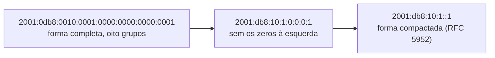

*Esquema 1 (as três formas do mesmo endereço).* O "::" só pode aparecer uma vez, senão não se saberia quantos grupos cada um representa.

Os endereços do simulador são do bloco **2001:db8::/32**, reservado a documentação ([RFC 3849](https://www.rfc-editor.org/rfc/rfc3849)).

### 2.4 Anatomia do endereço: prefixo e identificador de interface

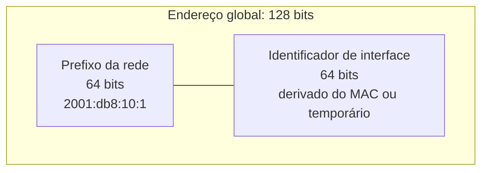

*Esquema 2 (divisão em 64 e 64).* Nas redes que usam SLAAC, o prefixo tem 64 bits, e os outros 64 identificam a interface no enlace. O identificador pode vir do MAC pelo método **EUI-64 modificado**: insere-se ff:fe no meio do MAC e inverte-se o bit U/L do primeiro byte ([RFC 4291](https://www.rfc-editor.org/rfc/rfc4291), apêndice A). Como isso revela o MAC, existem alternativas: o endereço temporário ([RFC 8981](https://www.rfc-editor.org/rfc/rfc8981)) e o identificador estável e opaco ([RFC 7217](https://www.rfc-editor.org/rfc/rfc7217)).

### 2.5 Tipos de endereço

| Bloco | Tipo | Alcance |
| --- | --- | --- |
| ::1/128 | loopback | o próprio nó |
| fe80::/10 | enlace local | só o enlace; roteadores não o encaminham ([RFC 4291](https://www.rfc-editor.org/rfc/rfc4291), seção 2.5.6) |
| fc00::/7 | local único (ULA, [RFC 4193](https://www.rfc-editor.org/rfc/rfc4193)) | a organização, sem rota na internet |
| ff00::/8 | multicast | conforme o escopo do grupo |
| 2000::/3 | unicast global | a internet |

O IPv6 **não tem broadcast**. O papel dele é feito por grupos multicast, como ff02::1 (todos os nós do enlace) e ff02::2 (todos os roteadores do enlace). Vantagem: só escuta o grupo quem precisa, e os demais nós não são interrompidos.

### 2.6 Neighbor Discovery: o ARP do IPv6

O ARP não existe no IPv6. Quem resolve o MAC de um vizinho é o **Neighbor Discovery**, definido sobre mensagens ICMPv6 ([RFC 4861](https://www.rfc-editor.org/rfc/rfc4861)).

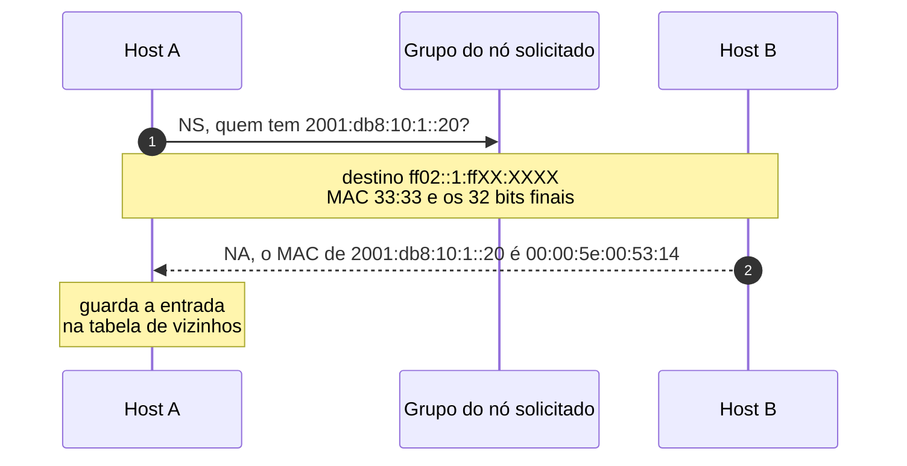

*Esquema 3 (Neighbor Solicitation e Advertisement).* A pergunta não vai a todos: vai ao endereço **multicast de nó solicitado**, formado por ff02::1:ff e os 24 bits finais do endereço procurado. Só os nós com esses mesmos 24 bits o escutam. Todas as mensagens do ND saem com Hop Limit 255, o que prova que vieram do mesmo enlace ([RFC 4861](https://www.rfc-editor.org/rfc/rfc4861), seção 7.1).

| Mensagem | Tipo ICMPv6 | Função |
| --- | --- | --- |
| Router Solicitation (RS) | 133 | o host pede um anúncio de roteador |
| Router Advertisement (RA) | 134 | o roteador anuncia prefixo, flags e que é roteador padrão |
| Neighbor Solicitation (NS) | 135 | pergunta o MAC de um endereço |
| Neighbor Advertisement (NA) | 136 | responde com o MAC |

### 2.7 Autoconfiguração sem estado (SLAAC) e DAD

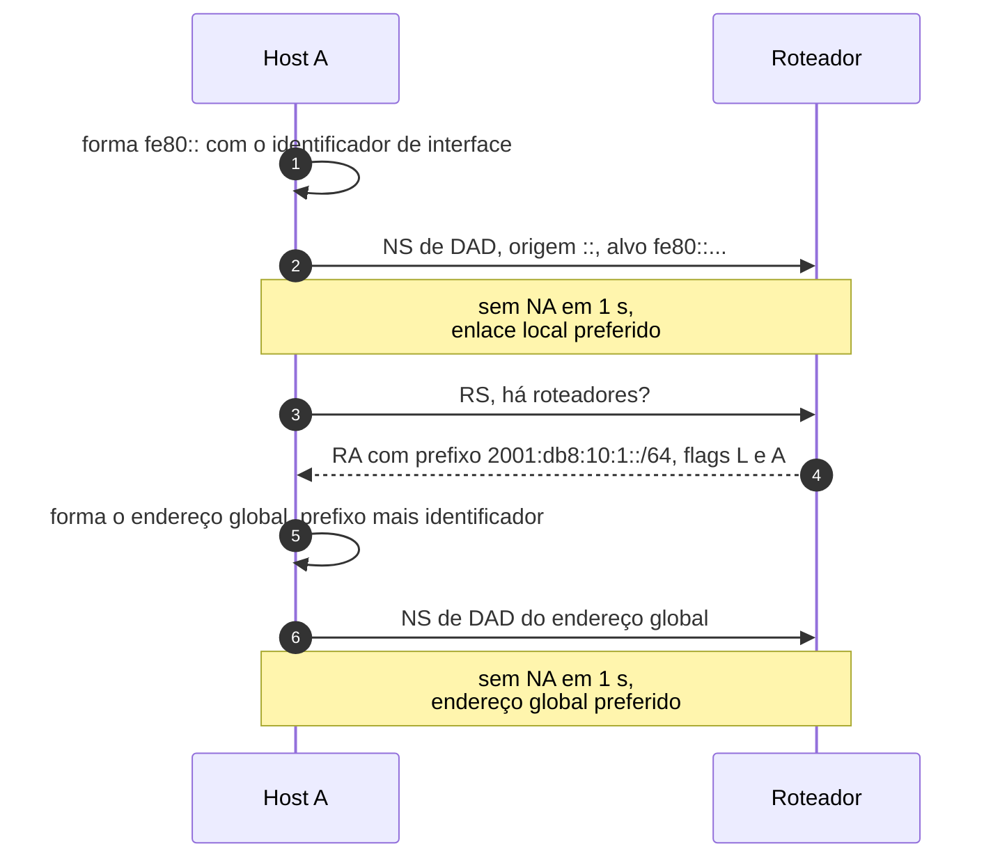

*Esquema 4 (do enlace local ao endereço global).* O host forma o próprio endereço sem servidor: o roteador diz o prefixo, e o host completa o resto. Antes de usar qualquer endereço unicast, ele o testa por **DAD**, a detecção de duplicidade ([RFC 4862](https://www.rfc-editor.org/rfc/rfc4862), seção 5.4): envia um NS com origem não especificada (::), e qualquer resposta significa que o endereço já está em uso.

O host só forma o endereço global se o prefixo anunciado tiver a **flag A** ligada e comprimento **/64** ([RFC 4862](https://www.rfc-editor.org/rfc/rfc4862), seção 5.5.3). Sem RA, o host fica só com o endereço de enlace local, que serve ao enlace e não atravessa o roteador.

### 2.8 A decisão de encaminhamento

A regra é a do IPv4: o roteador escolhe, entre as rotas cujo prefixo contém o destino, a de **maior comprimento de prefixo**. A rota padrão é ::/0.

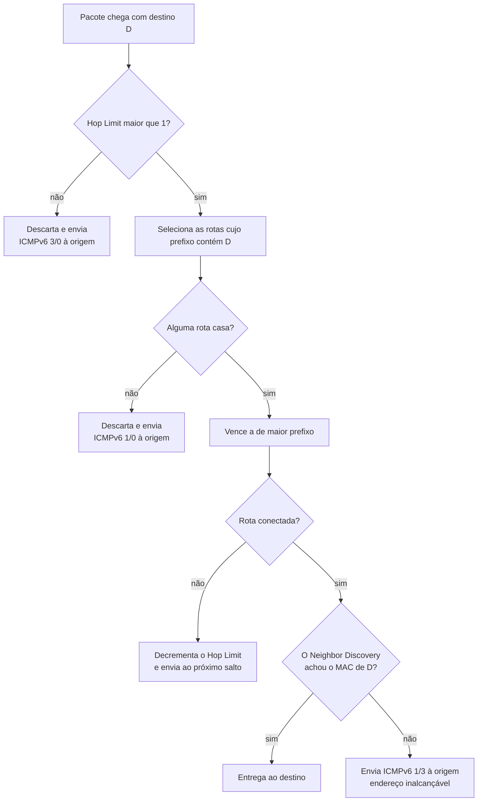

*Esquema 5 (decisão do roteador).* Os avisos do ICMPv6 ([RFC 4443](https://www.rfc-editor.org/rfc/rfc4443)) distinguem as falhas: **1/0** é falta de rota, **1/3** é um endereço da rede conectada que não responde no enlace (o Neighbor Discovery falhou), e **3/0** é o Hop Limit esgotado. Também não há erro ICMPv6 sobre outro erro ICMPv6, e o aviso leva o máximo do pacote original sem passar do MTU mínimo do IPv6, 1280 bytes (seção 2.4; [RFC 8200](https://www.rfc-editor.org/rfc/rfc8200), seção 5).

### 2.9 O cabeçalho fixo de 40 bytes

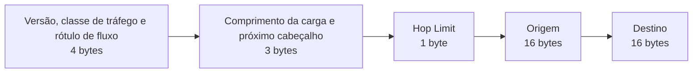

*Esquema 6 (os campos do cabeçalho).* O cabeçalho tem tamanho fixo, o que facilita o trabalho dos roteadores, e não tem checksum: a integridade fica com o protocolo de cima. O checksum do ICMPv6 inclui as origens e destinos IPv6 em um pseudocabeçalho ([RFC 8200](https://www.rfc-editor.org/rfc/rfc8200), seção 8.1; [RFC 4443](https://www.rfc-editor.org/rfc/rfc4443), seção 2.3). Opções, quando existem, vão em **cabeçalhos de extensão** depois deste.

### 2.10 Como o simulador mostra essas ideias

O simulador tem dois modos. O **Endereçamento e SLAAC** mostra como o host A forma o endereço de enlace local, o testa por DAD, pede o RA, forma o endereço global e usa o resultado para falar com um vizinho, com o roteador, com o grupo multicast ou com um endereço sem rota. O **Encaminhamento** leva um ping por quatro roteadores com tabelas estáticas e mostra a escolha do prefixo mais específico, o Neighbor Discovery no lugar do ARP, o Hop Limit e os avisos ICMPv6. As limitações estão na aba Referência.

## 3. Como ler os diagramas

Este documento usa até dois tipos de diagrama. Cada figura traz uma legenda com o tipo, o que mostra e a que modo ou cenário se refere.

| Tipo | O que é | Vale para | Equivale, no simulador, a |
| --- | --- | --- | --- |
| A, topologia | Os elementos da rede e os enlaces que os ligam. É estático. | Um modo inteiro | A visão "Topologia" do painel principal |
| B, sequência | As mensagens na ordem do tempo, entre os participantes. É dinâmico. | Um único cenário, com a configuração indicada | Ao diagrama de sequência e à aba Captura |

### 3.1 Legenda dos diagramas

**Tipo A (topologia)**

- Retângulo: host (computador ou servidor final).
- Hexágono: switch.
- Retângulo arredondado: roteador, ou dispositivo que encaminha ou traduz.
- Estádio (cantos bem arredondados): servidor ou rede externa.
- Retângulo vermelho: atacante (quando existe no modo).
- Linha contínua: enlace. Linha tracejada: enlace alternativo, forjado ou caído, ou ainda relação de peering (no BGP), conforme o rótulo e o cenário.
- O Mermaid posiciona os elementos automaticamente: o layout difere do simulador, as ligações não.

**Tipo B (sequência)**

- Cada coluna é um participante (cliente, servidor, roteador ou outro). O tempo corre de cima para baixo.
- Seta cheia: mensagem enviada. Seta com X: mensagem perdida.
- `[cifrado]` no início do rótulo: a mensagem viaja cifrada.
- Faixa horizontal com texto: início de uma fase do cenário.
- A ordem é a da aba Captura; os intervalos de tempo não são desenhados em escala.

### 3.2 Lista de figuras

**Tipo A (topologia)**

- [Figura 4.1a](#41-endereçamento-e-slaac): topologia do modo "Endereçamento e SLAAC", variante a
- [Figura 4.1b](#41-endereçamento-e-slaac): topologia do modo "Endereçamento e SLAAC", variante b
- [Figura 4.2](#42-encaminhamento): topologia do modo "Encaminhamento"

**Tipo B (sequência)**

- [Figura 7.1.1](#711-slaac-com-eui-64-e-ping-ao-vizinho): sequência de "SLAAC com EUI-64 e ping ao vizinho"
- [Figura 7.1.2](#712-destino-remoto-pelo-roteador-padrão): sequência de "Destino remoto pelo roteador padrão"
- [Figura 7.1.3](#713-identificador-temporário-privacidade): sequência de "Identificador temporário (privacidade)"
- [Figura 7.1.4](#714-sem-router-advertisement): sequência de "Sem Router Advertisement"
- [Figura 7.1.5](#715-flag-a-desligada): sequência de "Flag A desligada"
- [Figura 7.1.6](#716-prefixo-80-anunciado): sequência de "Prefixo /80 anunciado"
- [Figura 7.1.7](#717-endereço-duplicado-dad): sequência de "Endereço duplicado (DAD)"
- [Figura 7.1.8](#718-enlace-local-sem-roteador): sequência de "Enlace local sem roteador"
- [Figura 7.1.9](#719-multicast-de-todos-os-nós-ff021): sequência de "Multicast de todos os nós (ff02::1)"
- [Figura 7.1.10](#7110-endereço-local-único-ula): sequência de "Endereço local único (ULA)"
- [Figura 7.2.1](#721-dois-candidatos-vence-o-48): sequência de "Dois candidatos: vence o /48"
- [Figura 7.2.2](#722-três-candidatos-vence-o-64): sequência de "Três candidatos: vence o /64"
- [Figura 7.2.3](#723-rota-padrão-até-a-borda): sequência de "Rota padrão até a borda"
- [Figura 7.2.4](#724-sem-rota-no-r3-icmpv6-10): sequência de "Sem rota no R3 (ICMPv6 1/0)"
- [Figura 7.2.5](#725-sem-agregada-e-sem-padrão): sequência de "Sem agregada e sem padrão"
- [Figura 7.2.6](#726-neighbor-discovery-sem-resposta-13): sequência de "Neighbor Discovery sem resposta (1/3)"
- [Figura 7.2.7](#727-ida-entregue-volta-perdida): sequência de "Ida entregue, volta perdida"
- [Figura 7.2.8](#728-hop-limit-expira-no-r3): sequência de "Hop Limit expira no R3"

## 4. Topologia

Figuras do Tipo A, uma por modo (e uma por variante do desenho, quando a rede muda entre cenários). Foram geradas a partir da mesma definição de topologia que a bancada usa.

### 4.1 Endereçamento e SLAAC

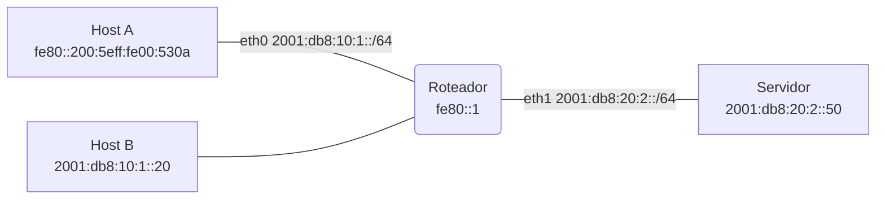

*Figura 4.1a (Tipo A, topologia).* Elementos do modo "Endereçamento e SLAAC": Host A (fe80::200:5eff:fe00:530a); Host B (2001:db8:10:1::20); Roteador (fe80::1); Servidor (2001:db8:20:2::50). Vale para os cenários (7.1.1 e 7.1.2; 7.1.4 a 7.1.10).

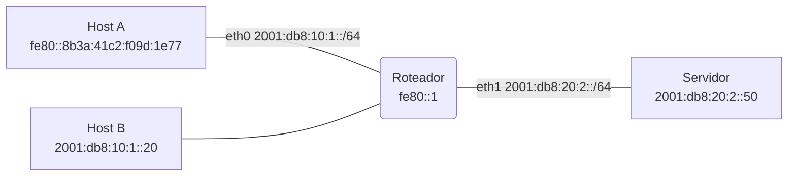

*Figura 4.1b (Tipo A, topologia).* Elementos do modo "Endereçamento e SLAAC": Host A (fe80::8b3a:41c2:f09d:1e77); Host B (2001:db8:10:1::20); Roteador (fe80::1); Servidor (2001:db8:20:2::50). Vale para os cenários (7.1.3).

### 4.2 Encaminhamento

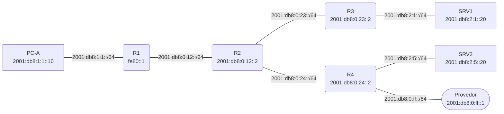

*Figura 4.2 (Tipo A, topologia).* Elementos do modo "Encaminhamento": PC-A (2001:db8:1:1::10); R1 (fe80::1); R2 (2001:db8:0:12::2); R3 (2001:db8:0:23::2); R4 (2001:db8:0:24::2); SRV1 (2001:db8:2:1::20); SRV2 (2001:db8:2:5::20); Provedor (2001:db8:0:ff::1). Vale para todos os cenários do modo (7.2.1 a 7.2.8).

## 5. Abas da bancada

Cenário, Captura, Mensagem, Tabela de rotas (modos: Encaminhamento), Endereços (modos: Endereçamento e SLAAC), Cabeçalho IPv6, Experimento, Referência e Log.

## 6. Configurações (campos do painel)

### 6.1 Rede

- **Atraso por enlace (ms)**. Valores: 1; 2; 5; 10; 20. Padrão: 2. Modos: todos.
  - Tempo de cada salto.
  - Define quanto tempo o pacote leva em cada enlace. Não muda nenhuma decisão de rota: só estica ou encolhe a linha do tempo.
- **Duplicidade do endereço global**. Valores: Nenhum outro host usa o endereço; O host B já usa o endereço que A formaria. Padrão: Nenhum outro host usa o endereço. Modos: Endereçamento e SLAAC.
  - Detecção de duplicidade antes de usar o endereço.
  - Todo endereço unicast passa por DAD: o host pergunta se alguém já o usa, com a origem não especificada. Se houver resposta, o endereço não é atribuído ([RFC 4862](https://www.rfc-editor.org/rfc/rfc4862), seções 5.4 e 5.4.5).

### 6.2 Pacote

- **Destino do ping**. Valores: SRV1, 2001:db8:2:1::20 (atrás do R3); SRV2, 2001:db8:2:5::20 (atrás do R4); 2001:db8:2:1::99 (rede do R3, sem host); 2001:db8:2:9::9 (faixa 2001:db8:2::/48, sem rota no R3); 2001:db8:ffff::1 (internet). Padrão: SRV1, 2001:db8:2:1::20 (atrás do R3). Modos: Encaminhamento.
  - Para onde o PC-A envia o ping.
  - Cada destino casa com um conjunto diferente de rotas. O **SRV2** casa com três rotas em R2 (/64, /48 e a padrão), o **SRV1** com duas (/48 e a padrão). O **2001:db8:2:1::99** está na rede do R3, mas nenhum host responde por ele. O **2001:db8:2:9::9** pertence ao /48, mas o R3 não tem rota para ele.
- **Hop Limit inicial**. Valores: 64 (padrão do Linux); 16; 8; 4 (o mínimo para chegar ao SRV1); 3; 2; 1. Padrão: 64 (padrão do Linux). Modos: Encaminhamento.
  - Limite de saltos do pacote.
  - É o equivalente do TTL do IPv4. Cada roteador o diminui de um. Um pacote que chega com Hop Limit 1 é descartado, e o roteador avisa a origem com ICMPv6 3/0 ([RFC 8200](https://www.rfc-editor.org/rfc/rfc8200), seção 3; [RFC 4443](https://www.rfc-editor.org/rfc/rfc4443), seção 3.3). O IPv6 não tem checksum de cabeçalho, então nada precisa ser recalculado a cada salto.

### 6.3 Rotas do R2

- **R2 tem a rota agregada 2001:db8:2::/48**. Valores: caixa de seleção. Padrão: sim. Modos: Encaminhamento.
  - Uma rota que cobre toda a faixa 2001:db8:2::/48 via R3.
  - A agregação resume muitas redes em um só prefixo. Sem ela, o R2 só alcança o SRV1 pela rota padrão, se houver.
- **R2 tem rota padrão (::/0, via R4)**. Valores: caixa de seleção. Padrão: sim. Modos: Encaminhamento.
  - ::/0: o que não casa com nada mais específico.
  - É o prefixo mais curto possível, por isso só vence quando nada mais casa. Também esconde falhas: um destino sem rota sai pela borda em vez de gerar erro.

### 6.4 Rotas do R3

- **R3 tem rota de volta para a LAN de A (2001:db8:1::/48)**. Valores: caixa de seleção. Padrão: sim. Modos: Encaminhamento.
  - A resposta também precisa de rota.
  - O ping só funciona se o caminho de volta existir. Sem a rota no R3, o pedido é entregue, a resposta não, e o PC-A só vê um timeout.

### 6.5 Destino

- **Destino do ping**. Valores: Host B, 2001:db8:10:1::20 (mesma LAN); fe80::1 (enlace local do roteador); Servidor, 2001:db8:20:2::50; ff02::1 (todos os nós do enlace); fd12:3456:789a:1::50 (local único, ULA). Padrão: Host B, 2001:db8:10:1::20 (mesma LAN). Modos: Endereçamento e SLAAC.
  - O tipo de endereço decide o caminho.
  - Cada destino aciona uma regra diferente: vizinho, roteador padrão, multicast do enlace ou erro. A aba Endereços mostra o tipo do destino e a anatomia dos endereços do host.

### 6.6 Host A

- **Identificador de interface**. Valores: EUI-64 modificado, derivado do MAC; Temporário, aleatório ([RFC 8981](https://www.rfc-editor.org/rfc/rfc8981)). Padrão: EUI-64 modificado, derivado do MAC. Modos: Endereçamento e SLAAC.
  - Os 64 bits finais do endereço do host.
  - **EUI-64:** deriva do MAC, inserindo ff:fe no meio e invertendo o bit U/L ([RFC 4291](https://www.rfc-editor.org/rfc/rfc4291), apêndice A). É estável, mas permite rastrear o dispositivo por onde ele passa.
  - **Temporário:** um valor aleatório que não revela o MAC e que muda com o tempo ([RFC 8981](https://www.rfc-editor.org/rfc/rfc8981)), o que protege a privacidade.

### 6.7 Roteador

- **O roteador envia Router Advertisement**. Valores: caixa de seleção. Padrão: sim. Modos: Endereçamento e SLAAC.
  - Sem RA, o host fica só com o endereço de enlace local.
  - O RA traz o prefixo da rede e diz que o roteador é o padrão ([RFC 4861](https://www.rfc-editor.org/rfc/rfc4861), seção 4.2). Sem ele, o host não tem prefixo nem rota padrão, e só se comunica no enlace.
- **Comprimento do prefixo anunciado**. Valores: /64; /80. Padrão: /64. Modos: Endereçamento e SLAAC.
  - O SLAAC exige um prefixo /64 com identificador de 64 bits.
  - O endereço tem 128 bits. Com identificador de interface de 64 bits, o prefixo precisa ter 64 bits. Se o prefixo anunciado tiver outro comprimento, o host ignora o RA para SLAAC ([RFC 4862](https://www.rfc-editor.org/rfc/rfc4862), seção 5.5.3).
- **Flag A (autoconfiguração) ligada no prefixo**. Valores: caixa de seleção. Padrão: sim. Modos: Endereçamento e SLAAC.
  - Autoriza o host a formar o próprio endereço com o prefixo.
  - Com a flag A desligada, o prefixo só informa o que está no enlace (flag L) e o host não forma endereço global ([RFC 4862](https://www.rfc-editor.org/rfc/rfc4862), seção 5.5.3). Seria preciso outro meio de configuração, como o DHCPv6.

## 7. Cenários

### 7.1 Modo: Endereçamento e SLAAC

> **Grupo:** SLAAC

A autoconfiguração sem estado: o host forma o endereço de enlace local, descobre o prefixo por um Router Advertisement e monta o endereço global, testando cada um por DAD.

#### 7.1.1 SLAAC com EUI-64 e ping ao vizinho

*O host forma o endereço de enlace local, descobre o prefixo e monta o endereço global.*

**Configuração aplicada:** Destino do ping = b; Identificador de interface = eui64; O roteador envia Router Advertisement = sim; Comprimento do prefixo anunciado = 64; Flag A (autoconfiguração) ligada no prefixo = sim; Duplicidade do endereço global = ok

A interface sobe e o host A forma o endereço de enlace local, que passa por **DAD**. Ele pede e recebe um **Router Advertisement** com o prefixo 2001:db8:10:1::/64 e forma o endereço global (prefixo e EUI-64 do MAC), que também passa por DAD. Depois, faz ping no host B pelo **Neighbor Discovery**.

**Conceito.** A interface sobe e o host forma fe80::, com o identificador de interface (EUI-64 do MAC). A DAD testa o endereço. O host envia um Router Solicitation, e o roteador responde com um Router Advertisement com o prefixo 2001:db8:10:1::/64 e a flag A ligada. O host junta prefixo e identificador, e o novo endereço também passa por DAD. O ping ao host B precisa do ND, porque o MAC dele não é conhecido.

**O que observar**

- A aba Endereços mostra os 128 bits do endereço, dividindo prefixo e identificador.
- Os dois NS de DAD têm origem :: (não especificada).
- O RA traz o prefixo, as flags L e A e o MAC do roteador.
- Depois da DAD, o ND resolve o MAC do host B.

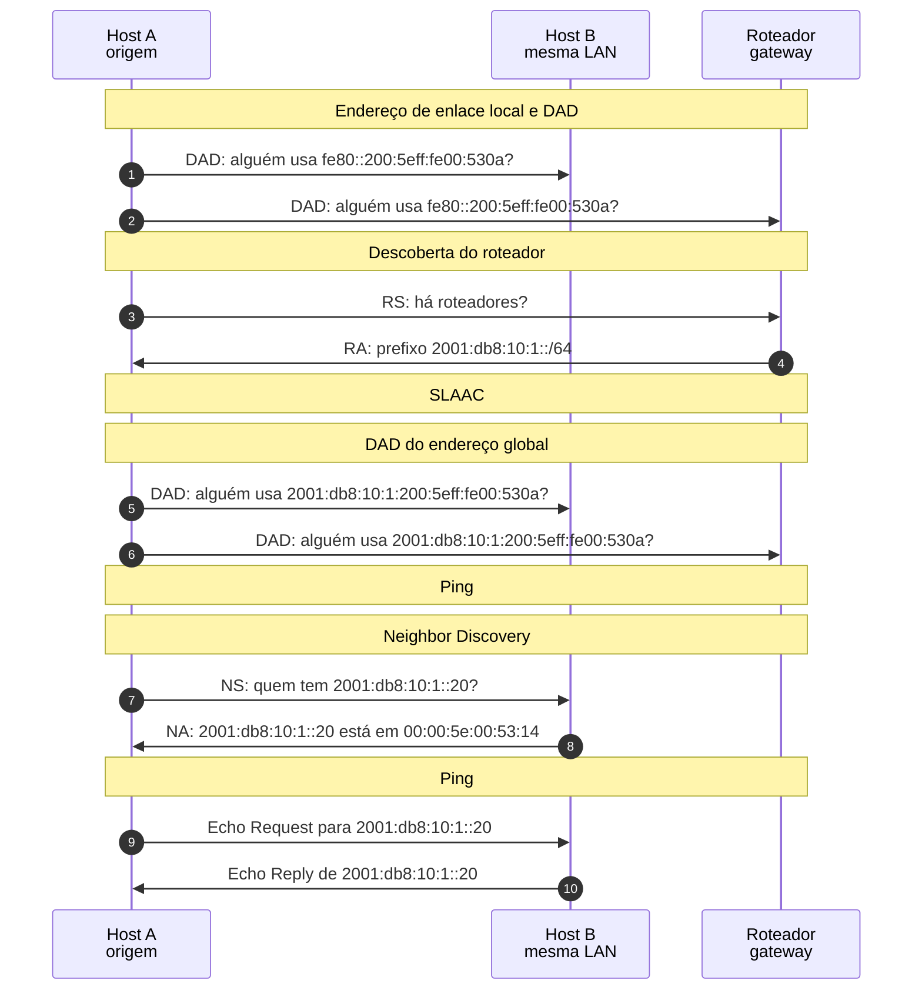

*Figura 7.1.1 (Tipo B, sequência).* Mensagens do cenário "SLAAC com EUI-64 e ping ao vizinho", na ordem do tempo, entre Host A, Host B, Roteador: 10 mensagens, numeradas de 1 a 10 na ordem da comunicação (em 7 fases). Corresponde ao diagrama de sequência e à aba Captura, no modo "Endereçamento e SLAAC", com a configuração aplicada acima.

**Mensagens**

| Mensagem | Significado | Origem |
| --- | --- | --- |
| NS (DAD) | teste do endereço de enlace local | A |
| RS e RA | descobrem o prefixo e o roteador | A e R |
| NS (DAD) | teste do endereço global | A |
| NS e NA | resolvem o MAC de B | A e B |
| Echo Request e Reply | entrega direta | A e B |

**Por que importa.** O SLAAC dispensa um servidor de endereços: o roteador diz o prefixo, e o host completa o endereço.

#### 7.1.2 Destino remoto pelo roteador padrão

*Fora do prefixo do enlace, o pacote vai ao roteador padrão aprendido no RA.*

**Configuração aplicada:** Destino do ping = srv; Identificador de interface = eui64; O roteador envia Router Advertisement = sim; Comprimento do prefixo anunciado = 64; Flag A (autoconfiguração) ligada no prefixo = sim; Duplicidade do endereço global = ok

Com o endereço global formado, o host A faz ping no servidor 2001:db8:20:2::50, fora do prefixo do enlace. O próximo salto é o **roteador padrão** aprendido no RA, e o MAC dele já veio na opção de endereço de enlace do RA, então **não há Neighbor Solicitation**.

**Conceito.** O servidor 2001:db8:20:2::50 não pertence ao prefixo do enlace. O host usa o roteador padrão do RA (fe80::1). O MAC do roteador já veio na opção de endereço de enlace do RA, então não há Neighbor Solicitation. O roteador encaminha, e a resposta volta com Hop Limit 63, porque passou por um roteador.

**O que observar**

- Não há NS antes do ping: o cache de vizinhos já tem o roteador.
- No Echo Request, o MAC de destino é do roteador e o IP é do servidor.
- O Hop Limit chega ao servidor com 63.

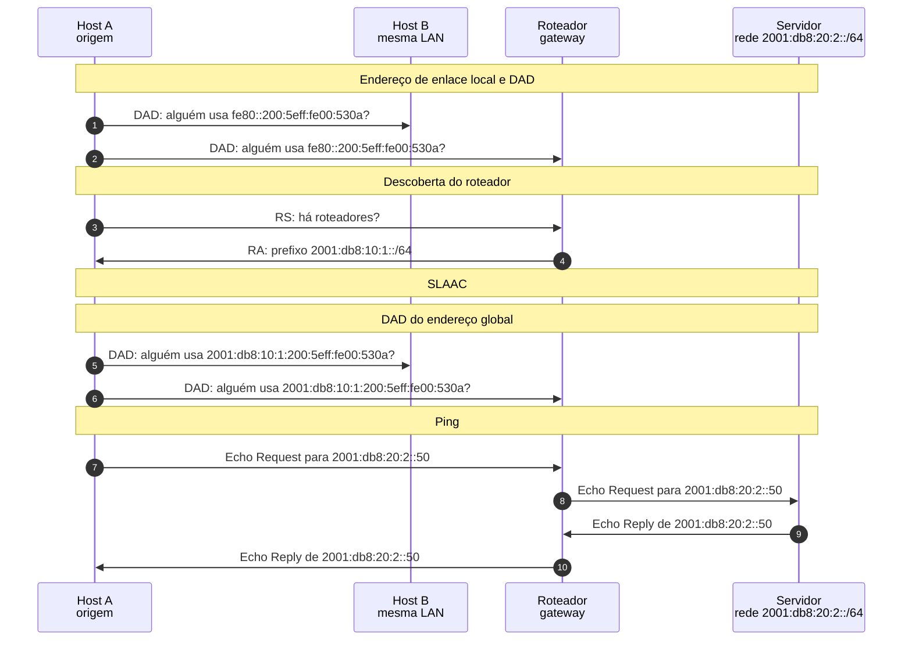

*Figura 7.1.2 (Tipo B, sequência).* Mensagens do cenário "Destino remoto pelo roteador padrão", na ordem do tempo, entre Host A, Host B, Roteador, Servidor: 10 mensagens, numeradas de 1 a 10 na ordem da comunicação (em 5 fases). Corresponde ao diagrama de sequência e à aba Captura, no modo "Endereçamento e SLAAC", com a configuração aplicada acima.

**Mensagens**

| Mensagem | Significado | Origem |
| --- | --- | --- |
| Echo Request | ao roteador, com IP do servidor | A |
| Echo Reply | resposta do servidor | S e R |

**Por que importa.** O MAC vale em um enlace, e o IP vale fim a fim. O RA já entrega o necessário para alcançar o roteador.

#### 7.1.3 Identificador temporário (privacidade)

*O identificador temporário esconde o MAC e muda com o tempo.*

**Configuração aplicada:** Destino do ping = srv; Identificador de interface = priv; O roteador envia Router Advertisement = sim; Comprimento do prefixo anunciado = 64; Flag A (autoconfiguração) ligada no prefixo = sim; Duplicidade do endereço global = ok

O identificador de interface é um valor temporário e aleatório ([RFC 8981](https://www.rfc-editor.org/rfc/rfc8981)), que não revela o MAC. O processo é o mesmo, mas o endereço **não revela o fabricante nem o MAC**, e muda com o tempo, o que dificulta rastrear o dispositivo.

**Conceito.** Com EUI-64, o identificador (e o endereço) revela o MAC e é o mesmo em toda rede por onde o dispositivo passa. Com o identificador temporário da [RFC 8981](https://www.rfc-editor.org/rfc/rfc8981), o endereço não revela o MAC e é trocado de tempos em tempos, o que dificulta rastrear o dispositivo.

**O que observar**

- Compare o identificador na aba Endereços com o do cenário EUI-64.
- O restante do processo (DAD, RA, SLAAC) é igual.
- O ping ao servidor funciona do mesmo modo.

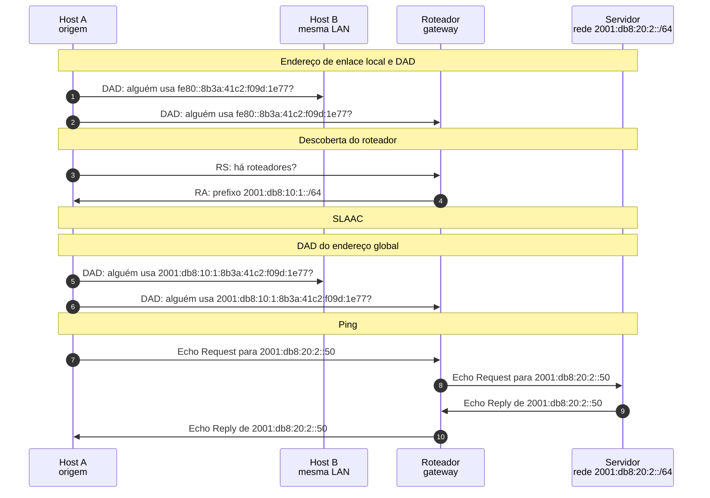

*Figura 7.1.3 (Tipo B, sequência).* Mensagens do cenário "Identificador temporário (privacidade)", na ordem do tempo, entre Host A, Host B, Roteador, Servidor: 10 mensagens, numeradas de 1 a 10 na ordem da comunicação (em 5 fases). Corresponde ao diagrama de sequência e à aba Captura, no modo "Endereçamento e SLAAC", com a configuração aplicada acima.

**Mensagens**

| Mensagem | Significado | Origem |
| --- | --- | --- |
| NS (DAD) | testam os endereços | A |
| RS e RA | descobrem o prefixo | A e R |
| Echo Request e Reply | ao servidor | A e S |

**Por que importa.** A privacidade é uma escolha do host: a especificação oferece o EUI-64, o temporário e o estável opaco ([RFC 7217](https://www.rfc-editor.org/rfc/rfc7217)).

> **Grupo:** Quando o SLAAC falha

Sem RA, com a flag A desligada, com prefixo de comprimento errado ou com endereço duplicado, o host fica só com o endereço de enlace local, que o roteador não encaminha.

#### 7.1.4 Sem Router Advertisement

*Sem RA, o host só tem enlace local e não sai da rede.*

**Configuração aplicada:** Destino do ping = srv; Identificador de interface = eui64; O roteador envia Router Advertisement = não; Comprimento do prefixo anunciado = 64; Flag A (autoconfiguração) ligada no prefixo = sim; Duplicidade do endereço global = ok

Nenhum roteador responde às três Router Solicitation. O host fica só com o **endereço de enlace local**, sem prefixo e sem roteador padrão. O ping ao servidor **nem sai** do host: rede inalcançável.

**Conceito.** O host envia até três Router Solicitation, com intervalo de 4 s, e nenhum roteador responde. Sem RA, não há prefixo nem roteador padrão. O host mantém só o endereço de enlace local, e o ping a um endereço global nem sai: o sistema devolve rede inalcançável.

**O que observar**

- São três RS sem resposta, com 4 s entre eles.
- Nenhum pacote sai para o servidor.
- Só o enlace local funciona (veja o cenário de enlace local sem roteador).

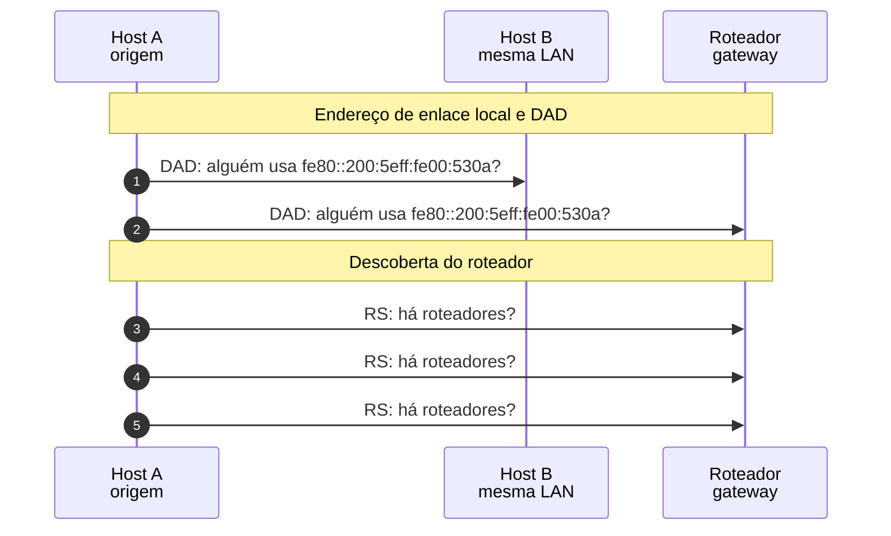

*Figura 7.1.4 (Tipo B, sequência).* Mensagens do cenário "Sem Router Advertisement", na ordem do tempo, entre Host A, Host B, Roteador: 5 mensagens, numeradas de 1 a 5 na ordem da comunicação (em 3 fases). Corresponde ao diagrama de sequência e à aba Captura, no modo "Endereçamento e SLAAC", com a configuração aplicada acima.

**Mensagens**

| Mensagem | Significado | Origem |
| --- | --- | --- |
| RS | três solicitações sem resposta | A |

**Por que importa.** Sem roteador anunciando o prefixo, o SLAAC não tem o que montar.

#### 7.1.5 Flag A desligada

*Sem a flag A, o host não forma o endereço global.*

**Configuração aplicada:** Destino do ping = srv; Identificador de interface = eui64; O roteador envia Router Advertisement = sim; Comprimento do prefixo anunciado = 64; Flag A (autoconfiguração) ligada no prefixo = não; Duplicidade do endereço global = ok

O RA anuncia o prefixo, mas com a **flag A desligada**: o host não forma endereço global e só tem o de enlace local. O roteador padrão existe, mas o pacote sai com origem de enlace local, e o roteador o recusa com ICMPv6 1/2.

**Conceito.** O RA anuncia o prefixo com a flag A desligada: o prefixo só diz o que está no enlace. O host não forma endereço global e tem apenas o de enlace local. Ele sabe qual é o roteador padrão, então envia o pacote, mas com origem de enlace local. O roteador não encaminha pacotes com origem de enlace local ([RFC 4291](https://www.rfc-editor.org/rfc/rfc4291), seção 2.5.6) e responde com ICMPv6 1/2, além do escopo da origem.

**O que observar**

- O host não mostra endereço global.
- A origem do Echo Request é fe80::.
- O aviso do roteador é o tipo 1, código 2.

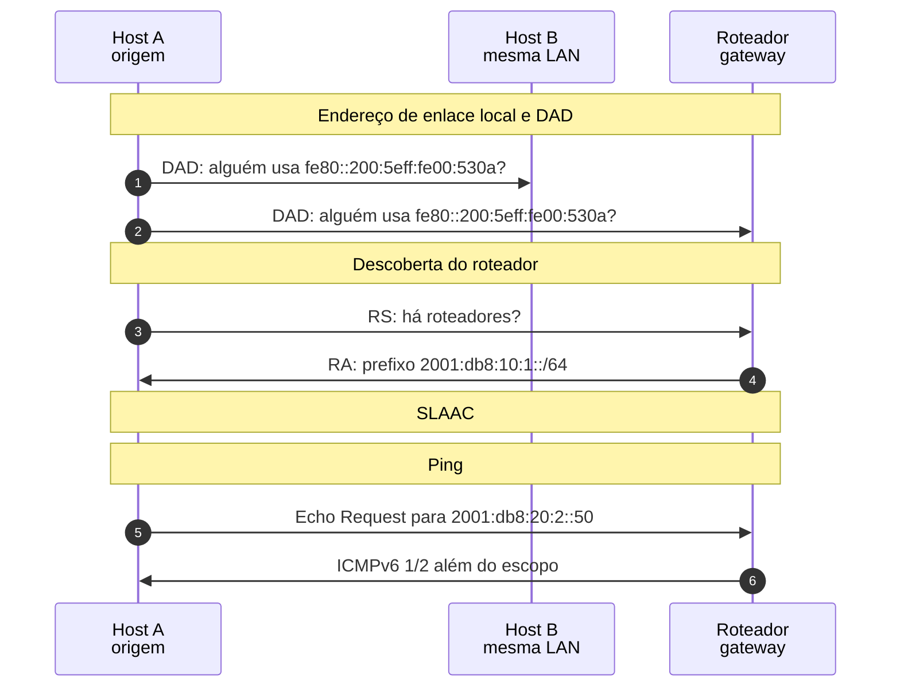

*Figura 7.1.5 (Tipo B, sequência).* Mensagens do cenário "Flag A desligada", na ordem do tempo, entre Host A, Host B, Roteador: 6 mensagens, numeradas de 1 a 6 na ordem da comunicação (em 4 fases). Corresponde ao diagrama de sequência e à aba Captura, no modo "Endereçamento e SLAAC", com a configuração aplicada acima.

**Mensagens**

| Mensagem | Significado | Origem |
| --- | --- | --- |
| RS e RA | RA sem flag A | A e R |
| Echo Request | com origem de enlace local | A |
| Destination Unreachable 1/2 | aviso do roteador | R |

**Por que importa.** O código 2 existe para este caso: o destino está além do escopo da origem.

#### 7.1.6 Prefixo /80 anunciado

*Um prefixo que não é /64 não serve para SLAAC.*

**Configuração aplicada:** Destino do ping = srv; Identificador de interface = eui64; O roteador envia Router Advertisement = sim; Comprimento do prefixo anunciado = 80; Flag A (autoconfiguração) ligada no prefixo = sim; Duplicidade do endereço global = ok

O RA anuncia um prefixo /80. Com identificador de 64 bits, a soma passaria de 128, então o host **ignora o RA para SLAAC** e fica só com o endereço de enlace local. O ping ao servidor é recusado pelo roteador (ICMPv6 1/2).

**Conceito.** O RA anuncia um /80. O identificador de interface tem 64 bits, então prefixo e identificador somariam 144 bits. O host ignora a opção para SLAAC ([RFC 4862](https://www.rfc-editor.org/rfc/rfc4862), seção 5.5.3) e fica só com o enlace local. O resto é como no cenário da flag A: o roteador recusa a origem de enlace local.

**O que observar**

- O estado mostra que o endereço global não foi formado.
- O RA chega, mas é ignorado para SLAAC.
- O aviso do roteador é o tipo 1, código 2.


*Figura 7.1.6 (Tipo B, sequência).* Mensagens do cenário "Prefixo /80 anunciado", na ordem do tempo, entre Host A, Host B, Roteador: 6 mensagens, numeradas de 1 a 6 na ordem da comunicação (em 4 fases). Corresponde ao diagrama de sequência e à aba Captura, no modo "Endereçamento e SLAAC", com a configuração aplicada acima.

**Mensagens**

| Mensagem | Significado | Origem |
| --- | --- | --- |
| RS e RA | RA com prefixo /80 | A e R |
| Echo Request | com origem de enlace local | A |
| Destination Unreachable 1/2 | aviso do roteador | R |

**Por que importa.** O SLAAC fixa o tamanho do identificador, então os prefixos de redes que o usam são /64.

#### 7.1.7 Endereço duplicado (DAD)

*A DAD impede o uso de um endereço que já existe no enlace.*

**Configuração aplicada:** Destino do ping = srv; Identificador de interface = eui64; O roteador envia Router Advertisement = sim; Comprimento do prefixo anunciado = 64; Flag A (autoconfiguração) ligada no prefixo = sim; Duplicidade do endereço global = conflict

O host B já usa o endereço que o host A formaria. Na **DAD**, B responde com um Neighbor Advertisement, e A **não atribui** o endereço à interface. Sem endereço global, o ping ao servidor sai com origem de enlace local e o roteador o recusa (ICMPv6 1/2).

**Conceito.** O host B já usa o endereço global que o host A formaria. Na DAD, A pergunta, com origem ::, quem usa o endereço, e B responde com um Neighbor Advertisement. A não atribui o endereço ([RFC 4862](https://www.rfc-editor.org/rfc/rfc4862), seção 5.4.5) e fica só com o de enlace local. O ping ao servidor sai com origem de enlace local e o roteador o recusa com ICMPv6 1/2.

**O que observar**

- A resposta de B vai ao multicast de todos os nós.
- O estado do host A mostra o endereço como duplicado.
- O ping segue o mesmo caminho do cenário da flag A.

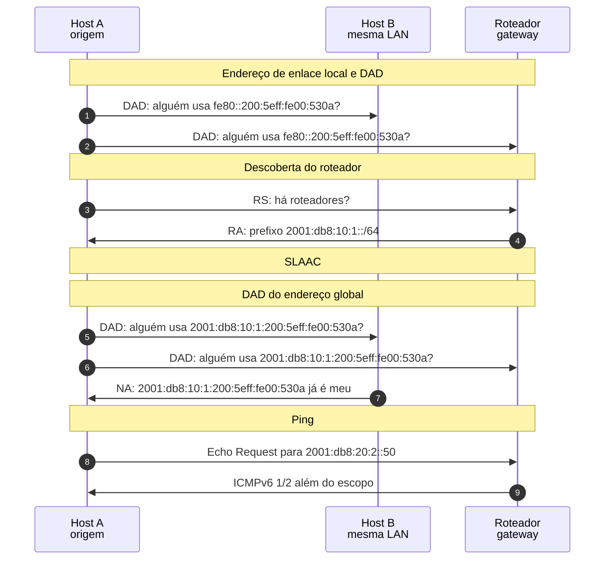

*Figura 7.1.7 (Tipo B, sequência).* Mensagens do cenário "Endereço duplicado (DAD)", na ordem do tempo, entre Host A, Host B, Roteador: 9 mensagens, numeradas de 1 a 9 na ordem da comunicação (em 5 fases). Corresponde ao diagrama de sequência e à aba Captura, no modo "Endereçamento e SLAAC", com a configuração aplicada acima.

**Mensagens**

| Mensagem | Significado | Origem |
| --- | --- | --- |
| NS (DAD) | teste do endereço global | A |
| NA | B diz que o endereço é dele | B |
| Echo Request | com origem de enlace local | A |

**Por que importa.** Sem a DAD, dois hosts com o mesmo endereço disputariam o tráfego em silêncio.

> **Grupo:** Endereços especiais

O IPv6 tem tipos de endereço com regras próprias: enlace local, multicast (que substitui o broadcast) e local único (ULA).

#### 7.1.8 Enlace local sem roteador

*O enlace local funciona sem RA, com o ND para achar o MAC.*

**Configuração aplicada:** Destino do ping = llr; Identificador de interface = eui64; O roteador envia Router Advertisement = não; Comprimento do prefixo anunciado = 64; Flag A (autoconfiguração) ligada no prefixo = sim; Duplicidade do endereço global = ok

Mesmo sem Router Advertisement, o host fala com o roteador pelo endereço de **enlace local** fe80::1. Como o MAC do roteador não veio de um RA, o host usa o **Neighbor Discovery** para obtê-lo. O enlace local sempre funciona dentro do enlace.

**Conceito.** O endereço fe80::1 é do roteador no mesmo enlace. Não há RA, então o host não tem o MAC do roteador na tabela de vizinhos e usa Neighbor Solicitation e Advertisement. O ping é entregue direto, com origem e destino de enlace local.

**O que observar**

- O host tenta o RA e desiste, mas o enlace local funciona.
- O NS vai ao endereço de nó solicitado de fe80::1.
- A resposta volta direto.

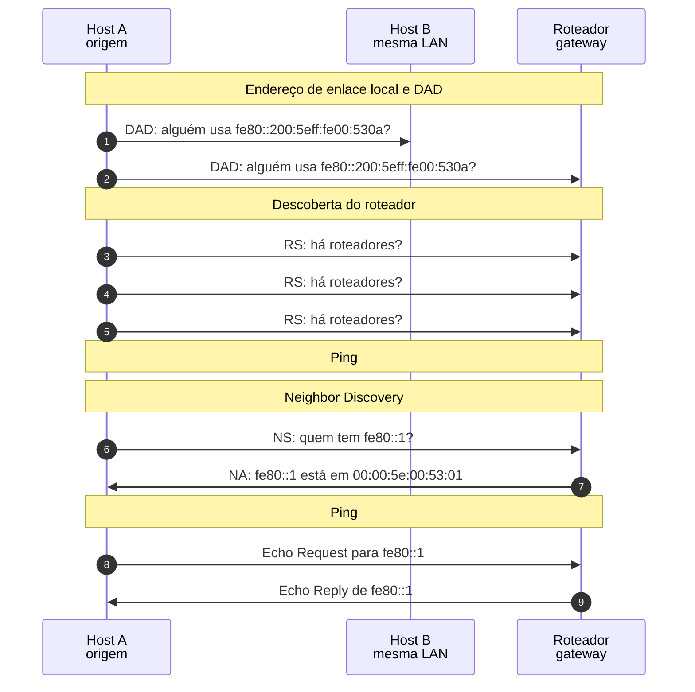

*Figura 7.1.8 (Tipo B, sequência).* Mensagens do cenário "Enlace local sem roteador", na ordem do tempo, entre Host A, Host B, Roteador: 9 mensagens, numeradas de 1 a 9 na ordem da comunicação (em 5 fases). Corresponde ao diagrama de sequência e à aba Captura, no modo "Endereçamento e SLAAC", com a configuração aplicada acima.

**Mensagens**

| Mensagem | Significado | Origem |
| --- | --- | --- |
| NS e NA | resolvem o MAC do roteador | A e R |
| Echo Request e Reply | entrega direta | A e R |

**Por que importa.** O enlace local é a base do IPv6: tudo no enlace funciona com ele, e o roteamento começa só além dele.

#### 7.1.9 Multicast de todos os nós (ff02::1)

*O multicast de todos os nós substitui o broadcast.*

**Configuração aplicada:** Destino do ping = mc; Identificador de interface = eui64; O roteador envia Router Advertisement = sim; Comprimento do prefixo anunciado = 64; Flag A (autoconfiguração) ligada no prefixo = sim; Duplicidade do endereço global = ok

O endereço ff02::1 é o grupo de **todos os nós** do enlace, o equivalente do broadcast, que o IPv6 não tem. O quadro vai ao MAC multicast 33:33:00:00:00:01, e os nós do enlace respondem, cada um de seu endereço unicast.

**Conceito.** O IPv6 não tem broadcast. O endereço ff02::1 (todos os nós, escopo de enlace) faz o mesmo papel. O quadro vai ao MAC 33:33:00:00:00:01, e cada nó do enlace responde com a própria origem unicast ([RFC 4443](https://www.rfc-editor.org/rfc/rfc4443), seção 4.2).

**O que observar**

- O MAC de destino é 33:33:00:00:00:01.
- O host B e o roteador recebem o mesmo pedido.
- As duas respostas vêm de endereços unicast diferentes.

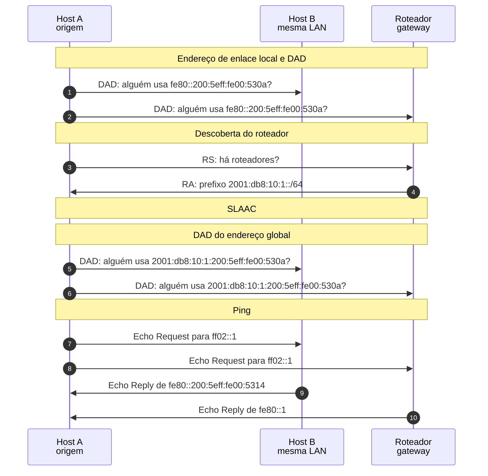

*Figura 7.1.9 (Tipo B, sequência).* Mensagens do cenário "Multicast de todos os nós (ff02::1)", na ordem do tempo, entre Host A, Host B, Roteador: 10 mensagens, numeradas de 1 a 10 na ordem da comunicação (em 5 fases). Corresponde ao diagrama de sequência e à aba Captura, no modo "Endereçamento e SLAAC", com a configuração aplicada acima.

**Mensagens**

| Mensagem | Significado | Origem |
| --- | --- | --- |
| Echo Request | em multicast, a todos os nós | A |
| Echo Reply | um de cada nó | B e R |

**Por que importa.** O multicast alcança só quem escuta o grupo, e não interrompe os demais nós como o broadcast do IPv4.

#### 7.1.10 Endereço local único (ULA)

*Os endereços locais únicos não são roteáveis na internet.*

**Configuração aplicada:** Destino do ping = ula; Identificador de interface = eui64; O roteador envia Router Advertisement = sim; Comprimento do prefixo anunciado = 64; Flag A (autoconfiguração) ligada no prefixo = sim; Duplicidade do endereço global = ok

O endereço fd12:3456:789a:1::50 pertence ao bloco **local único** (fc00::/7, [RFC 4193](https://www.rfc-editor.org/rfc/rfc4193)), de uso privado, como o [RFC 1918](https://www.rfc-editor.org/rfc/rfc1918) do IPv4. O roteador, sem rota para ele, responde com ICMPv6 1/0.

**Conceito.** O bloco fc00::/7 ([RFC 4193](https://www.rfc-editor.org/rfc/rfc4193)) é de uso privado, como o [RFC 1918](https://www.rfc-editor.org/rfc/rfc1918) do IPv4. Fora da organização, não tem rota. O roteador, sem rota, responde com ICMPv6 1/0.

**O que observar**

- A aba Endereços mostra o bloco e a RFC.
- O roteador não tem rota e avisa a origem.
- Em uma rede real, o endereço só existiria dentro da organização.

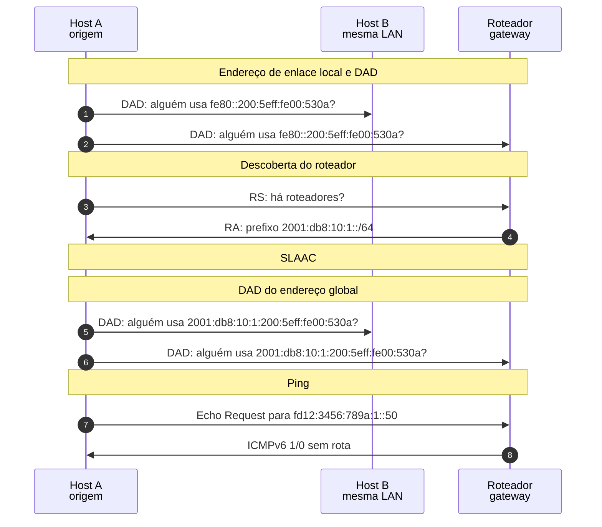

*Figura 7.1.10 (Tipo B, sequência).* Mensagens do cenário "Endereço local único (ULA)", na ordem do tempo, entre Host A, Host B, Roteador: 8 mensagens, numeradas de 1 a 8 na ordem da comunicação (em 5 fases). Corresponde ao diagrama de sequência e à aba Captura, no modo "Endereçamento e SLAAC", com a configuração aplicada acima.

**Mensagens**

| Mensagem | Significado | Origem |
| --- | --- | --- |
| Echo Request | ao roteador | A |
| Destination Unreachable 1/0 | aviso do roteador | R |

**Por que importa.** Um ULA é estável e privado, mas não resolve a conectividade com a internet.

### 7.2 Modo: Encaminhamento

> **Grupo:** Prefixo mais específico

O roteador compara o destino com todos os prefixos da tabela e escolhe o que casa com mais bits. A rota padrão (::/0) só vence quando nada mais específico casa. A regra é a mesma do IPv4, com endereços de 128 bits.

#### 7.2.1 Dois candidatos: vence o /48

*O maior prefixo vence, mesmo com a rota padrão também casando.*

**Configuração aplicada:** Destino do ping = srv1; Hop Limit inicial = 64; R2 tem a rota agregada 2001:db8:2::/48 = sim; R2 tem rota padrão (::/0, via R4) = sim; R3 tem rota de volta para a LAN de A (2001:db8:1::/48) = sim

O PC-A faz ping no SRV1 (2001:db8:2:1::20). No R2, o destino casa com **duas rotas**: a padrão (::/0) e a agregada 2001:db8:2::/48. Vence a de **maior prefixo**, que leva ao R3. Antes de enviar, o PC-A usa o **Neighbor Discovery** para obter o MAC do roteador.

**Conceito.** O destino 2001:db8:2:1::20 casa com duas rotas do R2: ::/0 e 2001:db8:2::/48. O roteador escolhe a de **maior prefixo** (/48), porque ela descreve melhor onde o destino está. A rota padrão só vale para o que nada mais cobre. O PC-A, antes do primeiro pacote, usa o Neighbor Discovery para obter o MAC do roteador, no lugar do ARP.

**O que observar**

- Na aba Rotas, as linhas que casam ficam marcadas e a vencedora tem destaque.
- O número de bits em comum é maior no /48 do que no /0.
- Duas mensagens ICMPv6 (NS e NA) antecedem o ping, em vez de um ARP.
- O Hop Limit cai de um em cada roteador.

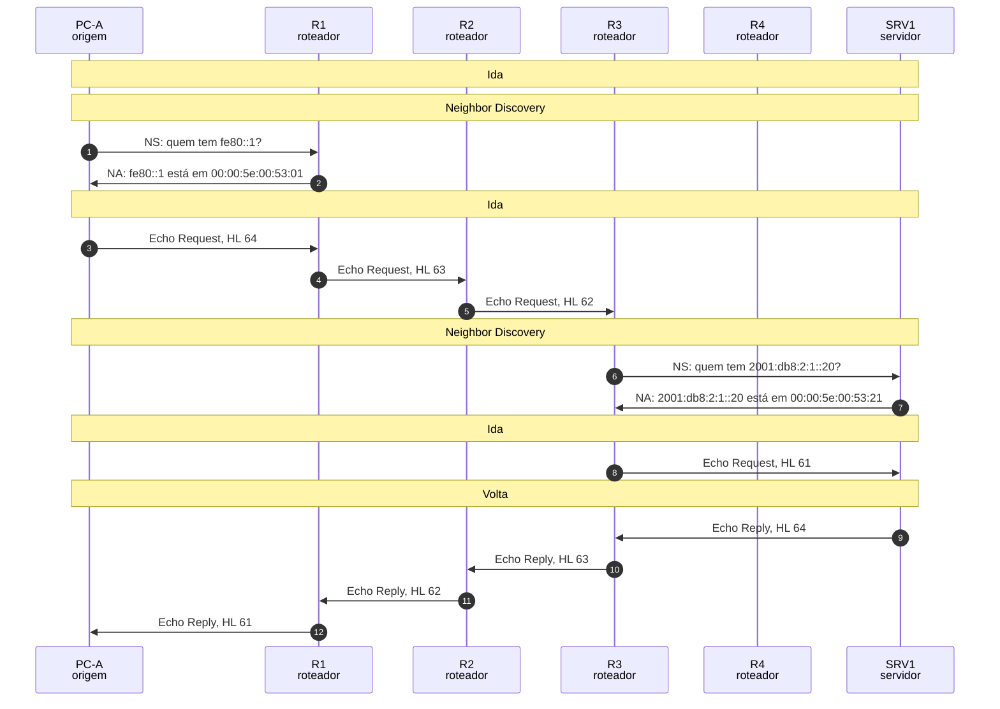

*Figura 7.2.1 (Tipo B, sequência).* Mensagens do cenário "Dois candidatos: vence o /48", na ordem do tempo, entre PC-A, R1, R2, R3, R4, SRV1: 12 mensagens, numeradas de 1 a 12 na ordem da comunicação (em 6 fases). Corresponde ao diagrama de sequência e à aba Captura, no modo "Encaminhamento", com a configuração aplicada acima.

**Mensagens**

| Mensagem | Significado | Origem |
| --- | --- | --- |
| NS e NA | resolvem o MAC do roteador padrão | PC-A e R1 |
| Echo Request | ping ao SRV1 | PC-A |
| Echo Reply | resposta do SRV1 | SRV1 |

**Por que importa.** A escolha pelo prefixo mais específico é igual à do IPv4. A diferença está nos endereços de 128 bits e no uso do ND em lugar do ARP.

#### 7.2.2 Três candidatos: vence o /64

*Três rotas casam e a mais específica manda o pacote por outro caminho.*

**Configuração aplicada:** Destino do ping = srv2; Hop Limit inicial = 64; R2 tem a rota agregada 2001:db8:2::/48 = sim; R2 tem rota padrão (::/0, via R4) = sim; R3 tem rota de volta para a LAN de A (2001:db8:1::/48) = sim

O SRV2 (2001:db8:2:5::20) casa no R2 com **três rotas**: /0, /48 e /64. A mais específica (2001:db8:2:5::/64) manda o pacote ao R4, embora o /48 apontasse para o R3.

**Conceito.** O destino 2001:db8:2:5::20 casa com /0, /48 e /64 no R2. O /48 apontaria para o R3, mas o /64 é mais específico e aponta para o R4, onde o servidor realmente está. A exceção mais específica prevalece sobre a rota agregada.

**O que observar**

- A tabela do R2 mostra três linhas marcadas e a de /64 como vencedora.
- O pacote vai por R4, e não por R3.
- A resposta volta pelo mesmo caminho.

```mermaid
sequenceDiagram
  autonumber
  participant n_pc as PC-A<br/>origem
  participant n_r1 as R1<br/>roteador
  participant n_r2 as R2<br/>roteador
  participant n_r3 as R3<br/>roteador
  participant n_r4 as R4<br/>roteador
  participant n_dst as SRV2<br/>servidor
  Note over n_pc,n_dst: Ida
  Note over n_pc,n_dst: Neighbor Discovery
  n_pc ->> n_r1: NS: quem tem fe80::1?
  n_r1 ->> n_pc: NA: fe80::1 está em 00:00:5e:00:53:01
  Note over n_pc,n_dst: Ida
  n_pc ->> n_r1: Echo Request, HL 64
  n_r1 ->> n_r2: Echo Request, HL 63
  n_r2 ->> n_r4: Echo Request, HL 62
  Note over n_pc,n_dst: Neighbor Discovery
  n_r4 ->> n_dst: NS: quem tem 2001:db8:2:5::20?
  n_dst ->> n_r4: NA: 2001:db8:2:5::20 está em 00:00:5e:00:53:22
  Note over n_pc,n_dst: Ida
  n_r4 ->> n_dst: Echo Request, HL 61
  Note over n_pc,n_dst: Volta
  n_dst ->> n_r4: Echo Reply, HL 64
  n_r4 ->> n_r2: Echo Reply, HL 63
  n_r2 ->> n_r1: Echo Reply, HL 62
  n_r1 ->> n_pc: Echo Reply, HL 61
```

*Figura 7.2.2 (Tipo B, sequência).* Mensagens do cenário "Três candidatos: vence o /64", na ordem do tempo, entre PC-A, R1, R2, R3, R4, SRV2: 12 mensagens, numeradas de 1 a 12 na ordem da comunicação (em 6 fases). Corresponde ao diagrama de sequência e à aba Captura, no modo "Encaminhamento", com a configuração aplicada acima.

**Mensagens**

| Mensagem | Significado | Origem |
| --- | --- | --- |
| Echo Request | ping ao SRV2 | PC-A |
| Echo Reply | resposta do SRV2 | SRV2 |

**Por que importa.** Agregar e abrir exceções é a base do roteamento hierárquico do IPv6.

#### 7.2.3 Rota padrão até a borda

*O que não tem rota específica segue a rota padrão até a borda.*

**Configuração aplicada:** Destino do ping = ext; Hop Limit inicial = 64; R2 tem a rota agregada 2001:db8:2::/48 = sim; R2 tem rota padrão (::/0, via R4) = sim; R3 tem rota de volta para a LAN de A (2001:db8:1::/48) = sim

O destino 2001:db8:ffff::1 não tem rota específica em lugar nenhum. A **rota padrão** de cada roteador o empurra até a borda, no R4, e dali ao provedor.

**Conceito.** Ninguém na rede conhece 2001:db8:ffff::1. Cada roteador usa a rota padrão (::/0) e empurra o pacote para mais perto da saída. No R4, a padrão aponta para o provedor. O trajeto simulado termina ali.

**O que observar**

- Em cada roteador só uma rota casa: a padrão.
- O pacote atravessa R1, R2 e R4 e sai para o provedor.
- Não há resposta neste simulador.

```mermaid
sequenceDiagram
  autonumber
  participant n_pc as PC-A<br/>origem
  participant n_r1 as R1<br/>roteador
  participant n_r2 as R2<br/>roteador
  participant n_r3 as R3<br/>roteador
  participant n_r4 as R4<br/>roteador
  participant n_isp as Provedor<br/>saída pela borda
  Note over n_pc,n_isp: Ida
  Note over n_pc,n_isp: Neighbor Discovery
  n_pc ->> n_r1: NS: quem tem fe80::1?
  n_r1 ->> n_pc: NA: fe80::1 está em 00:00:5e:00:53:01
  Note over n_pc,n_isp: Ida
  n_pc ->> n_r1: Echo Request, HL 64
  n_r1 ->> n_r2: Echo Request, HL 63
  n_r2 ->> n_r4: Echo Request, HL 62
  n_r4 ->> n_isp: Echo Request, HL 61
```

*Figura 7.2.3 (Tipo B, sequência).* Mensagens do cenário "Rota padrão até a borda", na ordem do tempo, entre PC-A, R1, R2, R3, R4, Provedor: 6 mensagens, numeradas de 1 a 6 na ordem da comunicação (em 3 fases). Corresponde ao diagrama de sequência e à aba Captura, no modo "Encaminhamento", com a configuração aplicada acima.

**Mensagens**

| Mensagem | Significado | Origem |
| --- | --- | --- |
| Echo Request | ping saindo pela borda | PC-A |

**Por que importa.** A rota padrão evita listar a internet inteira, mas também esconde falhas de rota.

> **Grupo:** Falhas de rota

Uma tabela incompleta produz sintomas diferentes: aviso ICMPv6 de rota ausente, o aviso de endereço inalcançável quando o Neighbor Discovery falha, ou uma resposta sem caminho de volta.

#### 7.2.4 Sem rota no R3 (ICMPv6 1/0)

*Sem rota, o roteador descarta e avisa a origem.*

**Configuração aplicada:** Destino do ping = nonet; Hop Limit inicial = 64; R2 tem a rota agregada 2001:db8:2::/48 = sim; R2 tem rota padrão (::/0, via R4) = sim; R3 tem rota de volta para a LAN de A (2001:db8:1::/48) = sim

O endereço 2001:db8:2:9::9 pertence à faixa que o R2 manda ao R3, mas o R3 não tem nenhuma rota para ele. O R3 **descarta e avisa a origem** com ICMPv6 1/0, sem rota para o destino.

**Conceito.** O R2 manda 2001:db8:2:9::9 ao R3 pelo /48, mas o R3 só conhece 2001:db8:2:1::/64 como rede conectada. Sem nenhuma rota, o R3 descarta o pacote e envia à origem um ICMPv6 1/0 (sem rota para o destino), com origem no endereço da interface por onde o pacote chegou ([RFC 4443](https://www.rfc-editor.org/rfc/rfc4443), seção 3.1).

**O que observar**

- A busca no R3 não casa com nenhuma linha.
- O aviso ICMPv6 volta pelo R2 e pelo R1 até o PC-A.
- A origem do aviso é 2001:db8:0:23::2, o R3.

```mermaid
sequenceDiagram
  autonumber
  participant n_pc as PC-A<br/>origem
  participant n_r1 as R1<br/>roteador
  participant n_r2 as R2<br/>roteador
  participant n_r3 as R3<br/>roteador
  participant n_r4 as R4<br/>roteador
  Note over n_pc,n_r4: Ida
  Note over n_pc,n_r4: Neighbor Discovery
  n_pc ->> n_r1: NS: quem tem fe80::1?
  n_r1 ->> n_pc: NA: fe80::1 está em 00:00:5e:00:53:01
  Note over n_pc,n_r4: Ida
  n_pc ->> n_r1: Echo Request, HL 64
  n_r1 ->> n_r2: Echo Request, HL 63
  n_r2 ->> n_r3: Echo Request, HL 62
  n_r3 ->> n_r2: No Route, HL 64
  n_r2 ->> n_r1: No Route, HL 63
  n_r1 ->> n_pc: No Route, HL 62
```

*Figura 7.2.4 (Tipo B, sequência).* Mensagens do cenário "Sem rota no R3 (ICMPv6 1/0)", na ordem do tempo, entre PC-A, R1, R2, R3, R4: 8 mensagens, numeradas de 1 a 8 na ordem da comunicação (em 3 fases). Corresponde ao diagrama de sequência e à aba Captura, no modo "Encaminhamento", com a configuração aplicada acima.

**Mensagens**

| Mensagem | Significado | Origem |
| --- | --- | --- |
| Echo Request | ping ao endereço sem rota | PC-A |
| Destination Unreachable 1/0 | aviso do R3 | R3 |

**Por que importa.** O código 0 do tipo 1 diz que não existe rota. Compare com o código 3, do cenário do Neighbor Discovery.

#### 7.2.5 Sem agregada e sem padrão

*Sem rota agregada nem padrão, o R2 não tem como encaminhar.*

**Configuração aplicada:** Destino do ping = srv1; Hop Limit inicial = 64; R2 tem a rota agregada 2001:db8:2::/48 = não; R2 tem rota padrão (::/0, via R4) = não; R3 tem rota de volta para a LAN de A (2001:db8:1::/48) = sim

O R2 perde a rota agregada e não tem rota padrão. Para o SRV1 não há **nenhuma** rota, e o R2 avisa a origem com ICMPv6 1/0.

**Conceito.** Sem a rota 2001:db8:2::/48 e sem a rota padrão, nenhum prefixo do R2 cobre o 2001:db8:2:1::20. O R2 descarta o pacote e avisa a origem com ICMPv6 1/0.

**O que observar**

- A busca no R2 não casa com nenhuma rota.
- Quem avisa é o R2, antes de o pacote chegar ao R3.
- Compare com o cenário em que a rota padrão existe.

```mermaid
sequenceDiagram
  autonumber
  participant n_pc as PC-A<br/>origem
  participant n_r1 as R1<br/>roteador
  participant n_r2 as R2<br/>roteador
  participant n_r3 as R3<br/>roteador
  participant n_r4 as R4<br/>roteador
  Note over n_pc,n_r4: Ida
  Note over n_pc,n_r4: Neighbor Discovery
  n_pc ->> n_r1: NS: quem tem fe80::1?
  n_r1 ->> n_pc: NA: fe80::1 está em 00:00:5e:00:53:01
  Note over n_pc,n_r4: Ida
  n_pc ->> n_r1: Echo Request, HL 64
  n_r1 ->> n_r2: Echo Request, HL 63
  n_r2 ->> n_r1: No Route, HL 64
  n_r1 ->> n_pc: No Route, HL 63
```

*Figura 7.2.5 (Tipo B, sequência).* Mensagens do cenário "Sem agregada e sem padrão", na ordem do tempo, entre PC-A, R1, R2, R3, R4: 6 mensagens, numeradas de 1 a 6 na ordem da comunicação (em 3 fases). Corresponde ao diagrama de sequência e à aba Captura, no modo "Encaminhamento", com a configuração aplicada acima.

**Mensagens**

| Mensagem | Significado | Origem |
| --- | --- | --- |
| Echo Request | ping ao SRV1 | PC-A |
| Destination Unreachable 1/0 | aviso do R2 | R2 |

**Por que importa.** Sem rota padrão, a falha vira um aviso claro, em vez de um vazamento.

#### 7.2.6 Neighbor Discovery sem resposta (1/3)

*O ND sem resposta produz o aviso de endereço inalcançável.*

**Configuração aplicada:** Destino do ping = ghost; Hop Limit inicial = 64; R2 tem a rota agregada 2001:db8:2::/48 = sim; R2 tem rota padrão (::/0, via R4) = sim; R3 tem rota de volta para a LAN de A (2001:db8:1::/48) = sim

O endereço 2001:db8:2:1::99 está na rede conectada do R3, mas ninguém responde por ele. O R3 envia **três Neighbor Solicitation** sem resposta e então avisa a origem com ICMPv6 1/3, endereço inalcançável. É o equivalente do ARP sem resposta e do ICMP 3/1 do IPv4.

**Conceito.** O endereço 2001:db8:2:1::99 está na rede conectada do R3. O roteador precisa do MAC dele e envia Neighbor Solicitation ao endereço multicast de nó solicitado. Sem resposta, repete até três vezes, com 1 s de intervalo, e então envia à origem o ICMPv6 1/3 (endereço inalcançável), conforme a [RFC 4443](https://www.rfc-editor.org/rfc/rfc4443), seção 3.1.

**O que observar**

- São três Neighbor Solicitation do R3, sem Neighbor Advertisement.
- O aviso é o tipo 1, código 3, e não o código 0 (sem rota).
- A busca na tabela de rotas encontrou a rota conectada: o problema é de enlace, e não de rota.

```mermaid
sequenceDiagram
  autonumber
  participant n_pc as PC-A<br/>origem
  participant n_r1 as R1<br/>roteador
  participant n_r2 as R2<br/>roteador
  participant n_r3 as R3<br/>roteador
  participant n_r4 as R4<br/>roteador
  participant n_dst as Destino<br/>sem host
  Note over n_pc,n_dst: Ida
  Note over n_pc,n_dst: Neighbor Discovery
  n_pc ->> n_r1: NS: quem tem fe80::1?
  n_r1 ->> n_pc: NA: fe80::1 está em 00:00:5e:00:53:01
  Note over n_pc,n_dst: Ida
  n_pc ->> n_r1: Echo Request, HL 64
  n_r1 ->> n_r2: Echo Request, HL 63
  n_r2 ->> n_r3: Echo Request, HL 62
  Note over n_pc,n_dst: Neighbor Discovery
  n_r3 -x n_dst: NS: quem tem 2001:db8:2:1::99?
  n_r3 -x n_dst: NS: quem tem 2001:db8:2:1::99?
  n_r3 -x n_dst: NS: quem tem 2001:db8:2:1::99?
  n_r3 ->> n_r2: Address Unreachable, HL 64
  n_r2 ->> n_r1: Address Unreachable, HL 63
  n_r1 ->> n_pc: Address Unreachable, HL 62
```

*Figura 7.2.6 (Tipo B, sequência).* Mensagens do cenário "Neighbor Discovery sem resposta (1/3)", na ordem do tempo, entre PC-A, R1, R2, R3, R4, Destino: 11 mensagens, numeradas de 1 a 11 na ordem da comunicação (em 4 fases; 3 perdidas). Corresponde ao diagrama de sequência e à aba Captura, no modo "Encaminhamento", com a configuração aplicada acima.

**Mensagens**

| Mensagem | Significado | Origem |
| --- | --- | --- |
| NS | três perguntas sem resposta | R3 |
| Destination Unreachable 1/3 | aviso do R3 | R3 |

**Por que importa.** No IPv4 o mesmo problema aparece como ARP sem resposta e ICMP 3/1. No IPv6, o ND é o mecanismo, e o código 3 do ICMPv6 é o aviso.

#### 7.2.7 Ida entregue, volta perdida

*A ida funciona, mas a resposta não tem caminho de volta.*

**Configuração aplicada:** Destino do ping = srv1; Hop Limit inicial = 64; R2 tem a rota agregada 2001:db8:2::/48 = sim; R2 tem rota padrão (::/0, via R4) = sim; R3 tem rota de volta para a LAN de A (2001:db8:1::/48) = não

O R3 não tem rota para a LAN do PC-A. O pedido chega ao SRV1, mas a **resposta não tem caminho** de volta, e o ping parece falhar mesmo com a ida perfeita.

**Conceito.** O pedido chega ao SRV1, que responde. Mas o R3 não tem rota para 2001:db8:1::/48, então descarta a resposta. O SRV1 recebe um ICMPv6 1/0 sobre a própria resposta, e o PC-A, que não sabe disso, só vê o tempo esgotar.

**O que observar**

- O Echo Request chega ao SRV1.
- O R3 não casa o 2001:db8:1:1::10 com nenhuma rota e avisa o SRV1.
- A origem não recebe nada.

```mermaid
sequenceDiagram
  autonumber
  participant n_pc as PC-A<br/>origem
  participant n_r1 as R1<br/>roteador
  participant n_r2 as R2<br/>roteador
  participant n_r3 as R3<br/>roteador
  participant n_r4 as R4<br/>roteador
  participant n_dst as SRV1<br/>servidor
  Note over n_pc,n_dst: Ida
  Note over n_pc,n_dst: Neighbor Discovery
  n_pc ->> n_r1: NS: quem tem fe80::1?
  n_r1 ->> n_pc: NA: fe80::1 está em 00:00:5e:00:53:01
  Note over n_pc,n_dst: Ida
  n_pc ->> n_r1: Echo Request, HL 64
  n_r1 ->> n_r2: Echo Request, HL 63
  n_r2 ->> n_r3: Echo Request, HL 62
  Note over n_pc,n_dst: Neighbor Discovery
  n_r3 ->> n_dst: NS: quem tem 2001:db8:2:1::20?
  n_dst ->> n_r3: NA: 2001:db8:2:1::20 está em 00:00:5e:00:53:21
  Note over n_pc,n_dst: Ida
  n_r3 ->> n_dst: Echo Request, HL 61
  Note over n_pc,n_dst: Volta
  n_dst ->> n_r3: Echo Reply, HL 64
  n_r3 ->> n_dst: No Route, HL 64
```

*Figura 7.2.7 (Tipo B, sequência).* Mensagens do cenário "Ida entregue, volta perdida", na ordem do tempo, entre PC-A, R1, R2, R3, R4, SRV1: 10 mensagens, numeradas de 1 a 10 na ordem da comunicação (em 6 fases). Corresponde ao diagrama de sequência e à aba Captura, no modo "Encaminhamento", com a configuração aplicada acima.

**Mensagens**

| Mensagem | Significado | Origem |
| --- | --- | --- |
| Echo Request | chega ao SRV1 | PC-A |
| Destination Unreachable 1/0 | aviso do R3 ao SRV1 | R3 |

**Por que importa.** O ping só funciona com rota de ida e de volta.

> **Grupo:** Hop Limit

O Hop Limit limita a vida do pacote em saltos. Ele corta loops de roteamento e é a base do traceroute. No IPv6 não há checksum de cabeçalho a recalcular.

#### 7.2.8 Hop Limit expira no R3

*O Hop Limit acaba no caminho e o roteador avisa a origem.*

**Configuração aplicada:** Destino do ping = srv1; Hop Limit inicial = 3; R2 tem a rota agregada 2001:db8:2::/48 = sim; R2 tem rota padrão (::/0, via R4) = sim; R3 tem rota de volta para a LAN de A (2001:db8:1::/48) = sim

O PC-A envia com Hop Limit 3, mas o SRV1 está a três roteadores. O pacote chega ao R3 com Hop Limit 1 e é descartado, e o **R3 avisa a origem** com ICMPv6 3/0. É o princípio do traceroute, e não há checksum de cabeçalho a recalcular em cada salto.

**Conceito.** Cada roteador decrementa o Hop Limit. O pacote sai do PC-A com 3, chega ao R1 com 3, ao R2 com 2 e ao R3 com 1. Como ao decrementar vira 0, o R3 descarta e envia ICMPv6 3/0 (Time Exceeded) à origem ([RFC 4443](https://www.rfc-editor.org/rfc/rfc4443), seção 3.3). Ao contrário do IPv4, o cabeçalho não tem checksum, então nenhum roteador recalcula nada.

**O que observar**

- O Hop Limit mostrado na mensagem cai em cada salto.
- O aviso 3/0 vem do R3, com origem 2001:db8:0:23::2.
- Um traceroute faz isso de propósito, com Hop Limit 1, 2, 3 e assim por diante.

```mermaid
sequenceDiagram
  autonumber
  participant n_pc as PC-A<br/>origem
  participant n_r1 as R1<br/>roteador
  participant n_r2 as R2<br/>roteador
  participant n_r3 as R3<br/>roteador
  participant n_r4 as R4<br/>roteador
  Note over n_pc,n_r4: Ida
  Note over n_pc,n_r4: Neighbor Discovery
  n_pc ->> n_r1: NS: quem tem fe80::1?
  n_r1 ->> n_pc: NA: fe80::1 está em 00:00:5e:00:53:01
  Note over n_pc,n_r4: Ida
  n_pc ->> n_r1: Echo Request, HL 3
  n_r1 ->> n_r2: Echo Request, HL 2
  n_r2 ->> n_r3: Echo Request, HL 1
  n_r3 ->> n_r2: Time Exceeded, HL 64
  n_r2 ->> n_r1: Time Exceeded, HL 63
  n_r1 ->> n_pc: Time Exceeded, HL 62
```

*Figura 7.2.8 (Tipo B, sequência).* Mensagens do cenário "Hop Limit expira no R3", na ordem do tempo, entre PC-A, R1, R2, R3, R4: 8 mensagens, numeradas de 1 a 8 na ordem da comunicação (em 3 fases). Corresponde ao diagrama de sequência e à aba Captura, no modo "Encaminhamento", com a configuração aplicada acima.

**Mensagens**

| Mensagem | Significado | Origem |
| --- | --- | --- |
| Echo Request | ping com Hop Limit 3 | PC-A |
| Time Exceeded 3/0 | aviso do R3 | R3 |

**Por que importa.** O Hop Limit é o que impede um loop de rotas de durar para sempre.

## 8. Referência

### 8.1 O que o IPv6 muda em relação ao IPv4

O IPv6 ([RFC 8200](https://www.rfc-editor.org/rfc/rfc8200)) usa endereços de 128 bits e um cabeçalho fixo de 40 bytes, sem checksum e sem fragmentação em roteadores: só a origem fragmenta (seção 4.5). O Hop Limit substitui o TTL, e o Neighbor Discovery ([RFC 4861](https://www.rfc-editor.org/rfc/rfc4861)), sobre ICMPv6, substitui o ARP. O IPv6 não tem broadcast: usa multicast.

### 8.2 Representação e tipos de endereço

- Oito grupos de 16 bits em hexadecimal. Zeros à esquerda podem sumir, e uma sequência de grupos zero pode virar "::", uma só vez ([RFC 4291](https://www.rfc-editor.org/rfc/rfc4291), seção 2.2). A forma recomendada para texto é a da [RFC 5952](https://www.rfc-editor.org/rfc/rfc5952): minúsculas e "::" na maior sequência.
- **Link-local** fe80::/10: vale só no enlace; roteadores não o encaminham ([RFC 4291](https://www.rfc-editor.org/rfc/rfc4291), seção 2.5.6).
- **Local único (ULA)** fc00::/7: uso privado, sem rota na internet ([RFC 4193](https://www.rfc-editor.org/rfc/rfc4193)).
- **Multicast** ff00::/8: ff02::1 (todos os nós) e ff02::2 (todos os roteadores) são do escopo do enlace; o nó solicitado ff02::1:ff00:0/104 serve ao ND ([RFC 4291](https://www.rfc-editor.org/rfc/rfc4291), seção 2.7).
- **Unicast global**: hoje alocado dentro de 2000::/3. O bloco 2001:db8::/32 é de documentação ([RFC 3849](https://www.rfc-editor.org/rfc/rfc3849)) e aparece em todo o simulador.

### 8.3 Encaminhamento

A decisão é a do IPv4: entre as rotas cujo prefixo contém o destino, vence a de maior comprimento; a rota padrão é ::/0. Sem nenhuma rota, o roteador descarta e envia ICMPv6 1/0 ([RFC 4443](https://www.rfc-editor.org/rfc/rfc4443), seção 3.1). Cada roteador decrementa o Hop Limit; ao chegar a zero, o pacote é descartado com ICMPv6 3/0 (seção 3.3). Não se gera erro ICMPv6 sobre outro erro, e o erro leva o máximo do pacote original sem passar do MTU mínimo do IPv6, 1280 bytes (seção 2.4; [RFC 8200](https://www.rfc-editor.org/rfc/rfc8200), seção 5).

### 8.4 Neighbor Discovery

- **NS e NA** (tipos 135 e 136) resolvem o MAC de um vizinho. O NS vai ao endereço de nó solicitado do alvo, e o MAC de destino é 33:33 mais os 32 bits finais ([RFC 2464](https://www.rfc-editor.org/rfc/rfc2464)).
- **RS e RA** (tipos 133 e 134): o host pede, e o roteador anuncia prefixo, flags L e A, tempo de vida como roteador padrão e MTU ([RFC 4861](https://www.rfc-editor.org/rfc/rfc4861), seção 4).
- Todas as mensagens saem com Hop Limit 255: um valor menor indicaria que vieram de fora do enlace (seção 7.1).
- Sem resposta ao NS, o roteador desiste e envia ICMPv6 1/3, endereço inalcançável: são até 3 Neighbor Solicitation com intervalo de 1 s ([RFC 4861](https://www.rfc-editor.org/rfc/rfc4861), seções 7.2.2 e 10; [RFC 4443](https://www.rfc-editor.org/rfc/rfc4443), seção 3.1).

### 8.5 Autoconfiguração (SLAAC) e DAD

1. O host forma o endereço de enlace local fe80:: com o identificador de interface ([RFC 4862](https://www.rfc-editor.org/rfc/rfc4862), seção 5.3).
2. Antes de usar qualquer endereço unicast, testa-o por **DAD**: NS com origem :: ao nó solicitado; uma resposta indica duplicidade (seção 5.4).
3. Pede e recebe o RA. Com a flag A e prefixo /64, forma o endereço global: prefixo mais identificador de interface (seção 5.5.3).
4. O identificador pode ser o EUI-64 modificado do MAC ([RFC 4291](https://www.rfc-editor.org/rfc/rfc4291), apêndice A), um temporário ([RFC 8981](https://www.rfc-editor.org/rfc/rfc8981)) ou um estável opaco ([RFC 7217](https://www.rfc-editor.org/rfc/rfc7217)).

### 8.6 Limitações do simulador

As rotas são estáticas e não há protocolo de roteamento em execução. Não há cabeçalhos de extensão, fragmentação, Path MTU Discovery, DHCPv6, Redirect, NUD (detecção de inalcançabilidade de vizinho), Router Advertisement periódico, nem as demais opções do ND. A DAD usa uma só tentativa, e os temporizadores são os padrões do [RFC 4861](https://www.rfc-editor.org/rfc/rfc4861), seção 10, mas simplificados. A tabela de vizinhos dos roteadores intermediários é suposta preenchida, e o endereço temporário do modo privado é um valor fixo de exemplo, usado também no endereço de enlace local (a [RFC 8981](https://www.rfc-editor.org/rfc/rfc8981) trata dos endereços globais). A DAD de um endereço de enlace local duplicado, que pode desativar o IP da interface ([RFC 4862](https://www.rfc-editor.org/rfc/rfc4862), seção 5.4.5), não é simulada. Os endereços são de documentação ([RFC 3849](https://www.rfc-editor.org/rfc/rfc3849)) e locais únicos ([RFC 4193](https://www.rfc-editor.org/rfc/rfc4193)). Os tempos são didáticos.


## 9. Glossário

Significado e finalidade das siglas usadas neste documento.

| Sigla | Significado | Para que serve |
| --- | --- | --- |
| **ARP** | Address Resolution Protocol, protocolo de resolução de endereços | descobre o endereço MAC que corresponde a um endereço IPv4 na rede local |
| **BGP** | Border Gateway Protocol, protocolo de roteador de borda | troca rotas entre sistemas autônomos e sustenta o roteamento entre operadoras na Internet |
| **DAD** | Duplicate Address Detection, detecção de endereço duplicado | teste que o host faz antes de usar um endereço IPv6: um Neighbor Solicitation com origem :: e, se alguém responder, o endereço não é atribuído |
| **DHCP** | Dynamic Host Configuration Protocol, protocolo de configuração dinâmica de hosts | entrega ao cliente endereço IP, máscara, gateway e DNS, por empréstimo (lease) |
| **EUI-64** | Extended Unique Identifier de 64 bits, identificador único estendido de 64 bits | identificador de interface formado a partir do MAC, com ff:fe no meio e o bit U/L invertido; revela o MAC, por isso há alternativas temporárias |
| **ICMP** | Internet Control Message Protocol | leva mensagens de controle e de erro da camada IP, como o eco do ping e o aviso de destino inalcançável |
| **IP** | Internet Protocol, protocolo de internet | endereça e encaminha pacotes entre redes, de origem a destino |
| **LAN** | Local Area Network, rede local | rede de alcance restrito, como a de um prédio ou laboratório, ligada por switches ou por Wi-Fi |
| **MAC** | Media Access Control | camada de enlace que controla o acesso ao meio; também nomeia o endereço físico de 48 bits de uma interface |
| **MTU** | Maximum Transmission Unit, unidade máxima de transmissão | maior pacote que um enlace transporta sem fragmentar |
| **NA** | Neighbor Advertisement, anúncio de vizinho | mensagem ICMPv6 (tipo 136) que informa o MAC de um endereço, em resposta a um Neighbor Solicitation |
| **NAT** | Network Address Translation, tradução de endereços de rede | troca endereços e portas dos pacotes, para que uma rede privada compartilhe poucos endereços públicos |
| **RFC** | Request for Comments, pedido de comentários | documento numerado do IETF que define ou descreve um protocolo da Internet; cada documento do projeto cita as RFCs com link para o RFC Editor |
| **RS** | Router Solicitation, solicitação de roteador | mensagem ICMPv6 (tipo 133) com que o host pede um Router Advertisement sem esperar o próximo envio periódico |
| **SLAAC** | Stateless Address Autoconfiguration, autoconfiguração de endereço sem estado | o host forma o próprio endereço IPv6 global com o prefixo anunciado pelo roteador e um identificador de interface, sem servidor de endereços |
| **TTL** | Time To Live, tempo de vida | limita quantos saltos um pacote pode dar; cada roteador o reduz de 1, e ao chegar a zero o pacote é descartado |
| **ULA** | Unique Local Address, endereço local único | bloco fc00::/7 de uso privado no IPv6, sem rota na internet, equivalente ao [RFC 1918](https://www.rfc-editor.org/rfc/rfc1918) do IPv4 |


---

*Simul-Net é um projeto mantido pelo Prof. Dr. Laerte Peotta de Melo, com apoio de IA generativa no processo de desenvolvimento, com sua estrita supervisão, revisão técnica e responsabilidade. Uso exclusivo para fins de ensino e pesquisa. Universidade de Brasília (UnB) - Departamento de Engenharia Elétrica. Código aberto (licença MIT).*
