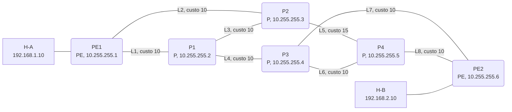
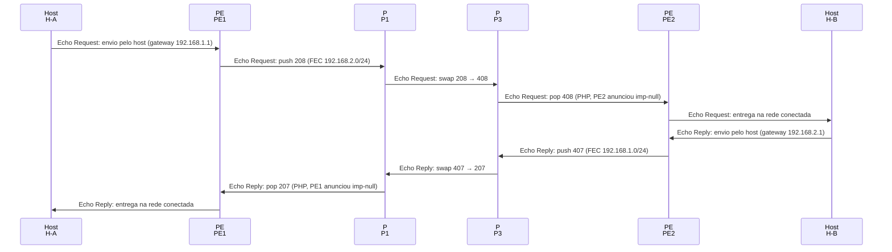
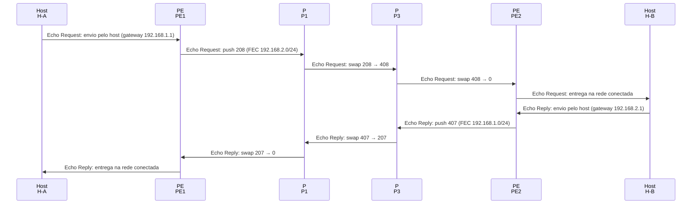
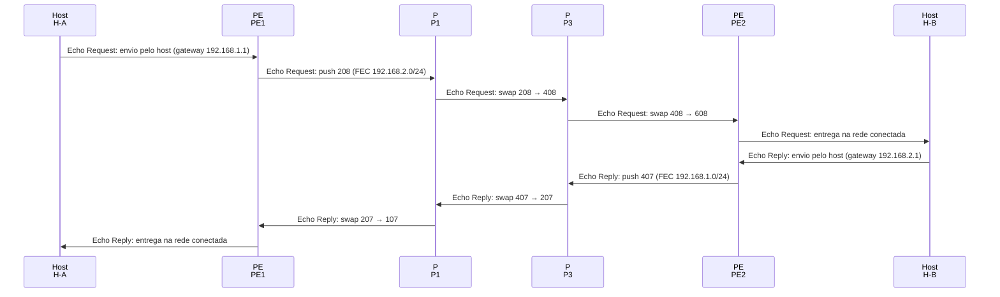
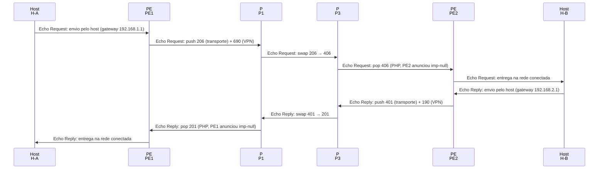

# MPLS (LDP e L3VPN)

Núcleo MPLS com seis LSRs: sessões LDP, LIB e LFIB, push, swap e pop, PHP, modelos de TTL, traceroute com rótulos e L3VPN com pilha de dois rótulos.

- **Categoria:** Roteamento e serviços de rede
- **Motor:** legado (página autônoma em `public/sims/mpls-simulator.html`, incorporada por `iframe`)
- **RFCs e padrões:** [RFC 3031](https://www.rfc-editor.org/rfc/rfc3031), [RFC 5036](https://www.rfc-editor.org/rfc/rfc5036), [RFC 4364](https://www.rfc-editor.org/rfc/rfc4364)
- **Tópicos:** LDP, LIB e LFIB; Push, swap e pop; PHP e TTL; L3VPN com dois rótulos

## 1. Como ler os diagramas

Este documento usa até dois tipos de diagrama. Cada figura traz uma legenda com o tipo, o que mostra e a que modo ou cenário se refere.

| Tipo | O que é | Vale para | Equivale, no simulador, a |
| --- | --- | --- | --- |
| A, topologia | Os elementos da rede e os enlaces que os ligam. É estático. | Um modo inteiro | A visão "Topologia" do quadro principal |
| B, sequência | As mensagens na ordem do tempo, entre os participantes. É dinâmico. | Um único cenário, com a configuração indicada | Ao diagrama de sequência e à aba Captura |

### 1.1 Legenda dos diagramas

**Tipo A (topologia)**

- Retângulo: host (computador ou servidor final).
- Hexágono: switch.
- Retângulo arredondado: roteador, ou dispositivo que encaminha ou traduz.
- Estádio (cantos bem arredondados): servidor ou rede externa.
- Retângulo vermelho: atacante (quando existe no modo).
- Linha contínua: enlace. Linha tracejada: enlace alternativo, forjado ou caído, conforme o rótulo e o cenário.
- O Mermaid posiciona os elementos automaticamente: o layout difere do simulador, as ligações não.

**Tipo B (sequência)**

- Cada coluna é um participante (cliente, servidor, roteador ou outro). O tempo corre de cima para baixo.
- Seta cheia: mensagem enviada. Seta com X: mensagem perdida.
- `[cifrado]` no início do rótulo: a mensagem viaja cifrada.
- Faixa horizontal com texto: início de uma fase do cenário.
- A ordem é a da aba Captura; os intervalos de tempo não são desenhados em escala.

### 1.2 Lista de figuras

**Tipo A (topologia)**

- [Figura 2.1](#21-topologia-de-6-lsr-e-2-hosts): topologia do núcleo MPLS e dos hosts

**Tipo B (sequência)**

- [Figura 5.2](#52-push-swap-e-pop): sequência de "Push, swap e pop"
- [Figura 5.3](#53-explicit-null): sequência de "explicit-null"
- [Figura 5.4](#54-sem-php): sequência de "Sem PHP"
- [Figura 5.7](#57-l3vpn): sequência de "L3VPN"

## 2. Topologia

Figuras do Tipo A, geradas a partir da mesma definição que a página usa para desenhar a rede.

### 2.1 Topologia de 6 LSR e 2 hosts

*Figura 2.1 (Tipo A, topologia).* 2 roteadores de borda (PE), 4 roteadores de núcleo (P) e 2 hosts. Cada enlace traz o identificador e o custo IGP; o endereço sob o nome é o de loopback do LSR (ou o IP do host). Os P encaminham por rótulos; o PE1 e o PE2 ligam as redes 192.168.1.0/24 e 192.168.2.0/24. Vale para todos os cenários.

## 3. Abas

Cenário, LIB / LFIB, Captura, Pacote, Terminal, Experimento, Referência, Log de eventos.

## 4. Configurações (campos do painel)

- **Serviço**. Valores: IP sobre MPLS (1 rótulo); L3VPN (pilha de 2 rótulos). Padrão: IP sobre MPLS (1 rótulo).
  - **IP sobre MPLS:** todos os LSRs conhecem as redes dos clientes e o pacote leva 1 rótulo.
  - **L3VPN:** as redes dos clientes ficam só na VRF dos PEs, trocadas por MP-BGP; o pacote leva 2 rótulos (transporte e VPN).
  - Mudar o serviço reinicia a simulação.
- **Sentido do tráfego**. Valores: H-A (192.168.1.10) → H-B; H-B (192.168.2.10) → H-A. Padrão: H-A (192.168.1.10) → H-B.
  - Escolhe se o teste sai de H-A para H-B ou de H-B para H-A.
  - LSPs são unidirecionais: cada sentido usa rótulos diferentes.
- **Rótulo do egresso (PHP)**. Valores: implicit-null (3): PHP; explicit-null (0); sem PHP (rótulo próprio). Padrão: implicit-null (3): PHP.
  - **implicit-null (3):** o penúltimo salto remove o rótulo (PHP) e o PE de saída faz uma só consulta.
  - **explicit-null (0):** o rótulo 0 chega ao PE de saída, preservando o campo TC de QoS.
  - **sem PHP:** o egresso anuncia um rótulo próprio e faz o pop e a consulta IP.
- **Propagar TTL (modelo Uniform)**. Valores: caixa de seleção. Padrão: sim.
  - **Marcado (Uniform):** o TTL do IP é copiado para o rótulo, e os P aparecem no traceroute.
  - **Desmarcado (Pipe):** o rótulo começa com TTL 255 e o núcleo fica invisível para o cliente.
  - Equivale ao comando mpls ip propagate-ttl do Cisco IOS.
- **Ver LIB / LFIB do LSR**. Valores: PE1 (PE); P1 (P); P2 (P); P3 (P); P4 (P); PE2 (PE). Padrão: PE1 (PE).
  - A **LIB** guarda os rótulos anunciados por todos os vizinhos (retenção liberal).
  - A **LFIB** guarda só o rótulo do próximo salto do IGP, que é o usado de fato no encaminhamento.
- **Velocidade da animação**. Valores: Lenta; Normal; Rápida. Padrão: Normal.
  - Muda só a velocidade de exibição; rótulos, TTL e tempos são os mesmos.
  - Use Avançar fase para acompanhar o LDP passo a passo.

## 5. Cenários

> **Grupo:** LDP e LSP

Como o plano de controle (LDP sobre o IGP) monta os caminhos rotulados e como o plano de dados os percorre.

### 5.1 Montagem do LSP

Configuração do cenário: IP sobre MPLS; egresso implicit-null; TTL Uniform

**O que é.**

O MPLS encaminha pacotes por **rótulos** curtos em vez de consultar o endereço IP em cada salto. O **LDP** ([RFC 5036](https://www.rfc-editor.org/rfc/rfc5036)) distribui esses rótulos: cada LSR descobre os vizinhos, abre uma sessão TCP com cada um e anuncia um rótulo local para cada destino (**FEC**) que conhece pelo IGP. O caminho rotulado resultante é o **LSP**.

**Neste cenário.**

Clique em **Avançar fase** quatro vezes: Discovery (Hello em UDP 646), Sessão (TCP 646), Mapping (distribuição de rótulos) e LSP (LFIB instalada).

Depois escolha um LSR em **Ver LIB / LFIB** e compare a LIB, com os rótulos de todos os vizinhos, com a LFIB, que guarda só o do próximo salto.

**O que observar.**

- No trilho de fases: Discovery, Sessão, Mapping e LSP.
- Na aba LIB / LFIB: a LIB guarda o rótulo de cada vizinho; a LFIB usa só o do próximo salto do IGP.
- No log: em cada par, o LSR com a maior loopback abre a sessão TCP.

**Mensagens envolvidas.**

| Mensagem | Função | Quem envia |
| --- | --- | --- |
| LDP Hello | descobre vizinhos (UDP 646, 224.0.0.2) | todos os LSRs |
| Initialization e KeepAlive | abrem e mantêm a sessão (TCP 646) | cada par de vizinhos |
| Label Mapping | anuncia a FEC e o rótulo local | todos os LSRs |

**Por que importa.**

Sem LDP não há rótulos, e o tráfego segue por roteamento IP comum (ou é descartado, na L3VPN). O LDP depende do IGP: só existem rótulos para destinos que o OSPF conhece.

### 5.2 Push, swap e pop

Configuração do cenário: IP sobre MPLS; egresso implicit-null; TTL Uniform

**O que é.**

No plano de dados, o PE de entrada classifica o pacote em uma FEC e empilha o rótulo (**push**). Cada P olha só o rótulo do topo e o troca pelo rótulo que o próximo salto anunciou (**swap**), sem consultar o IP. No fim do LSP, o rótulo é removido (**pop**) e o pacote volta a ser IP.

**Neste cenário.**

Avance as quatro fases e clique em **ping**. Na aba Captura, acompanhe cada operação: o PE1 faz push, os P fazem swap e o penúltimo salto faz pop.

Troque o sentido para H-B → H-A e repita: a volta usa outro LSP, com outros rótulos.

**O que observar.**

- Na aba Captura: a coluna Pilha de rótulos muda a cada enlace.
- Na aba Pacote: o cabeçalho de rótulo (Label, TC, S e TTL, [RFC 3032](https://www.rfc-editor.org/rfc/rfc3032)).
- Na aba Experimento: as operações da ida e da volta, roteador por roteador.

**Mensagens envolvidas.**

| Operação | O que faz | Onde |
| --- | --- | --- |
| push | empilha o rótulo da FEC | PE de entrada |
| swap | troca o rótulo do topo | cada P |
| pop | remove o rótulo | penúltimo salto (PHP) |

**Por que importa.**

Comutar por rótulo permite engenharia de tráfego, VPNs e caminhos independentes do destino IP; o núcleo nem precisa conhecer as redes dos clientes.

*Figura 5.2 (Tipo B, sequência).* Mensagens do cenário "Push, swap e pop", na ordem do tempo, entre Host H-A, PE PE1, P P1, P P3, PE PE2, Host H-B: 10 mensagens. Mostra um ping do host H-A ao H-B (ida e volta), depois de avançar as quatro fases. Corresponde à aba Captura, na ordem em que os pacotes aparecem; os intervalos de tempo não estão em escala.

> **Grupo:** Rótulo do egresso

O rótulo que o PE de saída anuncia para as próprias FECs define onde o último rótulo é removido.

### 5.3 explicit-null

Configuração do cenário: IP sobre MPLS; egresso explicit-null; TTL Uniform

**O que é.**

Com **explicit-null** (rótulo 0 no IPv4), o penúltimo salto troca o rótulo por 0 em vez de removê-lo. O pacote chega ao egresso ainda rotulado, o que preserva o campo **TC** (antigo EXP), usado para QoS, até o último salto.

**Neste cenário.**

O PE de saída anuncia o rótulo 0 (explicit-null) para as próprias FECs. Avance as fases e rode um ping.

Na Captura, o último enlace leva o rótulo 0 até o PE2, que o remove.

**O que observar.**

- Na Captura: swap para 0 no último enlace antes do PE2.
- O PE2 remove o rótulo 0 e consulta o IP.
- Compare com o cenário Push, swap e pop (implicit-null).

**Mensagens envolvidas.**

| Operação | O que faz | Onde |
| --- | --- | --- |
| swap para 0 | troca pelo explicit-null | penúltimo salto |
| pop 0 | remove o rótulo 0 | PE de saída |

**Por que importa.**

Provedores usam explicit-null quando a marcação de QoS do núcleo precisa valer até a borda.

*Figura 5.3 (Tipo B, sequência).* Mensagens do cenário "explicit-null", na ordem do tempo, entre Host H-A, PE PE1, P P1, P P3, PE PE2, Host H-B: 10 mensagens. Mostra um ping do host H-A ao H-B (ida e volta), depois de avançar as quatro fases. Corresponde à aba Captura, na ordem em que os pacotes aparecem; os intervalos de tempo não estão em escala.

### 5.4 Sem PHP

Configuração do cenário: IP sobre MPLS; egresso sem PHP; TTL Uniform

**O que é.**

Sem PHP, o egresso anuncia um rótulo próprio para as suas FECs. O rótulo chega até ele, que faz o pop e depois consulta o IP: são **duas consultas** no mesmo roteador.

**Neste cenário.**

Avance as fases e rode um ping. O PE2 recebe o pacote ainda com o rótulo que ele mesmo anunciou.

Compare onde o pop acontece nos três modos de rótulo do egresso.

**O que observar.**

- Na Captura: o último enlace ainda leva um rótulo comum, da faixa do PE2 (601 a 699).
- No log: o PE2 faz o pop e a consulta IP.
- Na aba LIB / LFIB do PE2: o rótulo local anunciado para as próprias FECs.

**Mensagens envolvidas.**

| Operação | O que faz | Onde |
| --- | --- | --- |
| swap | troca para o rótulo do PE2 | P3 ou P4 |
| pop | remove o próprio rótulo | PE2 |

**Por que importa.**

O PHP (penultimate hop popping) existe justamente para evitar essa consulta dupla no egresso.

*Figura 5.4 (Tipo B, sequência).* Mensagens do cenário "Sem PHP", na ordem do tempo, entre Host H-A, PE PE1, P P1, P P3, PE PE2, Host H-B: 10 mensagens. Mostra um ping do host H-A ao H-B (ida e volta), depois de avançar as quatro fases. Corresponde à aba Captura, na ordem em que os pacotes aparecem; os intervalos de tempo não estão em escala.

> **Grupo:** TTL

Se o TTL do IP é copiado para o rótulo, o núcleo aparece ou some no traceroute do cliente.

### 5.5 TTL Uniform

Configuração do cenário: IP sobre MPLS; egresso implicit-null; TTL Uniform

**O que é.**

No modelo **Uniform** ([RFC 3443](https://www.rfc-editor.org/rfc/rfc3443)), o PE copia o TTL do IP para o rótulo na entrada e de volta na saída. Cada P decrementa o TTL do rótulo, então o traceroute enxerga todos os saltos do núcleo. Quando o TTL expira dentro do LSP, o ICMP Time Exceeded leva a pilha de rótulos recebida ([RFC 4950](https://www.rfc-editor.org/rfc/rfc4950)).

**Neste cenário.**

Avance as fases e rode o **traceroute**. Com a propagação de TTL, o TTL do IP é copiado para o rótulo e cada LSR do núcleo aparece no resultado.

**O que observar.**

- No terminal: os P aparecem com a anotação .
- Um ping mostra TTL recebido 60: quatro decrementos.
- Na aba Experimento: cada salto com a pilha devolvida no ICMP.

**Mensagens envolvidas.**

| Mensagem | Função | Quem envia |
| --- | --- | --- |
| UDP | sondas com TTL 1, 2, 3... | H-A |
| Time Exceeded | com a pilha de rótulos ([RFC 4950](https://www.rfc-editor.org/rfc/rfc4950)) | cada LSR |

**Por que importa.**

Facilita o diagnóstico do núcleo, mas revela a topologia interna do provedor a qualquer cliente.

### 5.6 TTL Pipe

Configuração do cenário: IP sobre MPLS; egresso implicit-null; TTL Pipe

**O que é.**

No modelo **Pipe** (no mpls ip propagate-ttl), o rótulo começa com TTL 255, independente do TTL do IP. O núcleo inteiro conta como um único salto para o cliente.

**Neste cenário.**

Avance as fases e rode o **traceroute**: só os PEs aparecem.

Rode também um ping e compare o TTL recebido com o do modelo Uniform.

**O que observar.**

- No terminal: o traceroute vai do PE1 direto ao PE2.
- Um ping mostra TTL recebido 62: só os PEs decrementaram.
- Compare com o cenário TTL Uniform.

**Mensagens envolvidas.**

| Mensagem | Função | Quem envia |
| --- | --- | --- |
| UDP | sondas com TTL 1, 2, 3... | H-A |
| Time Exceeded | só dos PEs | PE1 e PE2 |

**Por que importa.**

Esconde a topologia do provedor dos clientes. É uma escolha comum em redes de operadoras.

> **Grupo:** Serviços

O MPLS usado para separar clientes sobre o mesmo núcleo: a VPN de camada 3.

### 5.7 L3VPN

Configuração do cenário: L3VPN; egresso implicit-null; TTL Uniform

**O que é.**

Na **L3VPN** ([RFC 4364](https://www.rfc-editor.org/rfc/rfc4364)), cada cliente tem uma tabela própria (**VRF**) nos PEs, e as rotas dos clientes trocam de PE por **MP-BGP**, cada uma com um rótulo VPN. O pacote atravessa o núcleo com dois rótulos: o externo (transporte, do LDP) leva até o PE de saída; o interno (VPN) indica a VRF.

**Neste cenário.**

Avance as fases (o Mapping inclui a troca de rotas por MP-BGP) e rode um ping. Na Captura, veja a pilha de dois rótulos.

Os P só olham o rótulo de transporte: não conhecem as redes dos clientes.

**O que observar.**

- Na Captura: a pilha [transporte | VPN], por exemplo [206 | 690].
- Com PHP, o penúltimo salto remove só o rótulo de transporte; o rótulo VPN chega ao PE2.
- Rode um ping antes do LSP: o PE descarta, porque não há rota VPN sem LDP e MP-BGP.

**Mensagens envolvidas.**

| Mensagem | Função | Quem envia |
| --- | --- | --- |
| MP-BGP | troca rotas VPNv4 e rótulos VPN | PE1 e PE2 |
| push | transporte + VPN | PE de entrada |
| pop VPN | consulta a VRF do cliente | PE de saída |

**Por que importa.**

Permite atender vários clientes, até com endereços repetidos, sobre o mesmo núcleo. A separação é lógica, não criptográfica: o PE nunca deve aceitar pacotes rotulados vindos do cliente.

*Figura 5.7 (Tipo B, sequência).* Mensagens do cenário "L3VPN", na ordem do tempo, entre Host H-A, PE PE1, P P1, P P3, PE PE2, Host H-B: 10 mensagens. Mostra um ping do host H-A ao H-B (ida e volta), depois de avançar as quatro fases. Corresponde à aba Captura, na ordem em que os pacotes aparecem; os intervalos de tempo não estão em escala.

> **Grupo:** Falhas

Como os LSPs reagem a mudanças de topologia.

### 5.8 Falha de enlace

Configuração do cenário: IP sobre MPLS; egresso implicit-null; TTL Uniform

**O que é.**

Quando um enlace cai, o IGP reconverge e cada LSR passa a usar outro próximo salto. Graças à **retenção liberal**, os rótulos dos outros vizinhos já estavam na LIB, então a LFIB muda na hora. A sessão LDP do enlace caído termina e leva junto os rótulos aprendidos por ela.

**Neste cenário.**

Avance as fases e rode um ping. Depois clique no enlace **P1 / P3**, use **Derrubar** e rode o ping de novo.

O caminho e os rótulos mudam sem esperar nova sinalização LDP.

**O que observar.**

- No log: a queda, a reconvergência e o novo LSP.
- Na aba Experimento: o LSP de ida antes e depois da falha.
- Na aba LIB / LFIB do PE1: o próximo salto do LSP muda de P1 para P2.

**Mensagens envolvidas.**

| Mensagem | Função | Quem envia |
| --- | --- | --- |
| LDP | sessão P1 / P3 encerrada | P1 e P3 |
| Novo LSP | via P2 e P4 | PE1 até PE2 |

**Por que importa.**

A convergência do MPLS depende do IGP. Em produção, mecanismos como a sincronização LDP-IGP e o Fast Reroute reduzem a perda durante a troca.

## 6. Referência

### 6.1 O que é o MPLS

          

No **Multiprotocol Label Switching** ([RFC 3031](https://www.rfc-editor.org/rfc/rfc3031)), o roteador de entrada classifica o pacote uma única vez em uma **FEC** (Forwarding Equivalence Class, por exemplo um prefixo de destino) e cola nele um **rótulo** curto. No núcleo, cada LSR encaminha consultando só o rótulo, sem olhar o cabeçalho IP. O caminho percorrido por uma FEC é o **LSP** (Label Switched Path), que é **unidirecional**: ida e volta usam LSPs e rótulos diferentes.

          

- **LER / PE (Provider Edge):** borda. Faz **push** (impõe o rótulo) na entrada e remove a pilha na saída.
- **LSR / P (Provider):** núcleo. Faz **swap** (troca o rótulo do topo) ou **pop** (remove).
- **Rótulo de significado local:** cada LSR escolhe os próprios rótulos. O mesmo número pode significar FECs diferentes em LSRs diferentes. Neste simulador, cada LSR usa uma faixa própria (PE1 100+, P1 200+...) só para facilitar a leitura.

          

### 6.2 Cabeçalho de rótulo ([RFC 3032](https://www.rfc-editor.org/rfc/rfc3032))

          

O rótulo fica entre o cabeçalho de enlace e o IP (EtherType **0x8847**). Cada entrada da pilha tem 32 bits:

| Rótulo (20 bits) | TC (3) | S (1) | TTL (8) |
  TC: Traffic Class, antes chamado EXP ([RFC 5462](https://www.rfc-editor.org/rfc/rfc5462)), usado para QoS
  S:  1 na última entrada da pilha (fundo)
  TTL: decrementado a cada LSR, como no IP
          

| Rótulo | Nome | Uso |
| --- | --- | --- |
| 0 | IPv4 Explicit NULL | O egresso pede para receber o pacote rotulado (preserva o TC para QoS) e então faz pop |
| 1 | Router Alert | Entrega ao plano de controle do LSR |
| 2 | IPv6 Explicit NULL | Igual ao 0, para IPv6 |
| 3 | Implicit NULL | Anunciado pelo egresso, nunca aparece no pacote: o penúltimo salto faz pop (PHP) |
| 7 | Entropy Label Indicator | Balanceamento de carga ([RFC 6790](https://www.rfc-editor.org/rfc/rfc6790)) |
| 13 | GAL | Canal de OAM do MPLS-TP ([RFC 5586](https://www.rfc-editor.org/rfc/rfc5586)) |
| 16 em diante | Rótulos livres | Alocados pelos protocolos de distribuição |

          

### 6.3 LDP ([RFC 5036](https://www.rfc-editor.org/rfc/rfc5036))

          

- **Discovery:** Hello em UDP 646 para 224.0.0.2 em cada interface. O LDP ID tem a forma roteador:espaço (ex.: 10.255.255.2:0).
- **Sessão:** TCP 646. O LSR com o maior endereço de transporte assume o papel ativo e abre a conexão. Seguem Initialization e KeepAlive até o estado OPERATIONAL.
- **Distribuição:** mensagens Label Mapping associam FEC e rótulo. O modo típico é **Downstream Unsolicited** (anuncia sem esperar pedido) com controle **independente**.
- **LIB e LFIB:** com **retenção liberal**, a LIB guarda os rótulos de todos os vizinhos. A LFIB usa só o do próximo salto escolhido pelo IGP. Se o IGP mudar de caminho, o rótulo novo já está na LIB e a convergência é rápida.
- Outras mensagens: Address, Label Withdraw, Label Release e Notification.

          

### 6.4 PHP e modelos de TTL

          Com **PHP** (Penultimate Hop Popping), o egresso anuncia implicit-null (3) e o penúltimo LSR remove o rótulo. Assim, o egresso faz uma única consulta (IP) em vez de duas (rótulo e IP). Com **explicit-null** (0), o rótulo chega ao egresso, o que preserva o campo TC para QoS. A [RFC 3032](https://www.rfc-editor.org/rfc/rfc3032) só permitia o explicit-null no fundo da pilha; a [RFC 4182](https://www.rfc-editor.org/rfc/rfc4182) removeu essa restrição, o que permite usá-lo também sobre o rótulo VPN.

          

No modelo **Uniform** ([RFC 3443](https://www.rfc-editor.org/rfc/rfc3443)), o TTL do IP é copiado para o rótulo na entrada e de volta na saída, e cada LSR do núcleo aparece no traceroute. No modelo **Pipe** (**no mpls ip propagate-ttl** no Cisco IOS), o rótulo começa com TTL 255 e o núcleo fica invisível: o traceroute mostra só os PEs.

          

Quando o TTL expira dentro do LSP, o LSR gera o ICMP Time Exceeded, copia a pilha de rótulos e o encaminha **adiante pelo LSP** até o egresso, que o devolve à origem ([RFC 3032](https://www.rfc-editor.org/rfc/rfc3032), seção 2.3.2). Por isso todos os saltos do núcleo mostram quase o mesmo RTT. A extensão ICMP da [RFC 4950](https://www.rfc-editor.org/rfc/rfc4950) informa a pilha recebida, que o traceroute do Linux exibe com **-e**.

          

### 6.5 L3VPN ([RFC 4364](https://www.rfc-editor.org/rfc/rfc4364))

          

Os PEs mantêm uma tabela de roteamento por cliente (**VRF**) e trocam as rotas dos clientes por **MP-BGP** (VPNv4, com Route Distinguisher). Junto com cada rota vai um **rótulo VPN**. O PE de entrada empilha dois rótulos: o **rótulo de transporte** (LDP, leva até o PE de saída) e, embaixo, o **rótulo VPN** (diz ao PE de saída em qual VRF procurar). Os roteadores P só olham o rótulo de transporte e não conhecem as rotas dos clientes, por isso endereços privados repetidos entre clientes não conflitam.

          

### 6.6 MPLS e segurança

          

- **MPLS não é criptografia:** a separação de uma L3VPN é lógica. Quem tem acesso ao núcleo lê o tráfego. Dados sensíveis exigem IPsec ou MACsec.
- **Pacotes rotulados vindos do cliente:** o PE nunca deve aceitar MPLS na interface do cliente. Caso contrário, um rótulo VPN forjado injeta tráfego em outra VRF (label spoofing).
- **Proteção do LDP e do BGP:** autenticação TCP-MD5 ou TCP-AO ([RFC 5925](https://www.rfc-editor.org/rfc/rfc5925)) e filtros que aceitem LDP e BGP só de vizinhos conhecidos.
- **Ocultação da topologia:** desativar a propagação de TTL esconde o núcleo no traceroute. As extensões da [RFC 4950](https://www.rfc-editor.org/rfc/rfc4950), por outro lado, revelam os rótulos em uso.

          

### 6.7 Limitações do simulador

          

- Seis LSRs e um único IGP (OSPF simplificado): sem iBGP completo, sem Route Reflector e sem Inter-AS.
- O LDP mostra Hello, sessão e Label Mapping; não simula temporizadores de Hello e KeepAlive, Label Withdraw, Label Release nem a sincronização LDP-IGP.
- A L3VPN usa dois rótulos e um par de PEs; os Route Targets e o Route Distinguisher são explicados, mas não configurados.
- Os rótulos de cada LSR usam uma faixa própria só para facilitar a leitura (a [RFC 5036](https://www.rfc-editor.org/rfc/rfc5036) deixa a escolha livre).

          

### 6.8 Roteiro de exercícios

          

1. Rode um **ping** antes de avançar as fases e outro depois da fase LSP. Compare na aba Captura: onde aparecem push, swap e pop?
2. Na aba **LIB / LFIB**, escolha P1 e explique por que a LIB tem mais rótulos que a LFIB para a mesma FEC (retenção liberal).
3. Rode o **traceroute** com **Propagar TTL** ligado e desligado. Quais saltos somem, e por que um provedor faria isso?
4. Troque o rótulo do egresso entre **implicit-null**, **explicit-null** e **sem PHP**. Em que roteador o último rótulo é removido em cada caso?
5. Mude para **L3VPN** e rode um ping: que rótulos cada P enxerga, e por que os P não precisam conhecer as rotas dos clientes?
6. Derrube o enlace **P1 / P3** com os LSPs instalados: o caminho e os rótulos mudam? Por que não é preciso esperar nova sinalização LDP?

---

*Simul-Net é um projeto mantido pelo Prof. Dr. Laerte Peotta de Melo, com apoio de IA generativa no processo de desenvolvimento, com sua estrita supervisão, revisão técnica e responsabilidade. Uso exclusivo para fins de ensino e pesquisa. Universidade de Brasília (UnB) - Departamento de Engenharia Elétrica. Código aberto (licença MIT).*
