# MPLS (LDP e L3VPN)

Núcleo MPLS com seis LSRs: sessões LDP, LIB e LFIB, push, swap e pop, PHP, modelos de TTL, traceroute com rótulos e L3VPN com pilha de dois rótulos.

- **Categoria:** Roteamento e serviços de rede
- **Motor:** nativo (TypeScript puro, apresentado pela bancada genérica)
- **Código-fonte:** `src/sims/mpls/`
- **RFCs e padrões:** [RFC 3031](https://www.rfc-editor.org/rfc/rfc3031) (Arquitetura), [RFC 3032](https://www.rfc-editor.org/rfc/rfc3032) (Cabeçalho de rótulo), [RFC 5036](https://www.rfc-editor.org/rfc/rfc5036) (LDP), [RFC 4364](https://www.rfc-editor.org/rfc/rfc4364) (L3VPN), [RFC 4381](https://www.rfc-editor.org/rfc/rfc4381) (Segurança das VPNs)
- **Tópicos:** LDP, LIB e LFIB; Push, swap e pop; PHP e TTL; L3VPN com dois rótulos

## 1. Modos

| Modo | Cenário inicial | Cenários |
| --- | --- | --- |
| LDP e LSP | Montagem do LSP | 6.1.1 e 6.1.2 |
| Plano de dados | Push, swap e pop | 6.2.1 a 6.2.6 |
| TTL e traceroute | TTL Uniform | 6.3.1 e 6.3.2 |
| Falha de enlace | Falha de enlace | 6.4.1 |

## 2. Como ler os diagramas

Este documento usa até dois tipos de diagrama. Cada figura traz uma legenda com o tipo, o que mostra e a que modo ou cenário se refere.

| Tipo | O que é | Vale para | Equivale, no simulador, a |
| --- | --- | --- | --- |
| A, topologia | Os elementos da rede e os enlaces que os ligam. É estático. | Um modo inteiro | A visão "Topologia" do painel principal |
| B, sequência | As mensagens na ordem do tempo, entre os participantes. É dinâmico. | Um único cenário, com a configuração indicada | Ao diagrama de sequência e à aba Captura |

### 2.1 Legenda dos diagramas

**Tipo A (topologia)**

- Retângulo: host (computador ou servidor final).
- Hexágono: switch.
- Retângulo arredondado: roteador, ou dispositivo que encaminha ou traduz.
- Estádio (cantos bem arredondados): servidor ou rede externa.
- Retângulo vermelho: atacante (quando existe no modo).
- Linha contínua: enlace. Linha tracejada: enlace alternativo, forjado ou caído, ou ainda relação de peering (no BGP), conforme o rótulo e o cenário.
- O Mermaid posiciona os elementos automaticamente: o layout difere do simulador, as ligações não.

**Tipo B (sequência)**

- Cada coluna é um participante (cliente, servidor, roteador ou outro). O tempo corre de cima para baixo.
- Seta cheia: mensagem enviada. Seta com X: mensagem perdida.
- `[cifrado]` no início do rótulo: a mensagem viaja cifrada.
- Faixa horizontal com texto: início de uma fase do cenário.
- A ordem é a da aba Captura; os intervalos de tempo não são desenhados em escala.

### 2.2 Lista de figuras

**Tipo A (topologia)**

- [Figura 3.1](#31-ldp-e-lsp): topologia do modo "LDP e LSP"
- [Figura 3.2](#32-plano-de-dados): topologia do modo "Plano de dados"
- [Figura 3.3](#33-ttl-e-traceroute): topologia do modo "TTL e traceroute"
- [Figura 3.4](#34-falha-de-enlace): topologia do modo "Falha de enlace"

**Tipo B (sequência)**

- [Figura 6.1.1](#611-montagem-do-lsp): sequência de "Montagem do LSP"
- [Figura 6.1.2](#612-l3vpn-mp-bgp-e-rótulos-vpn): sequência de "L3VPN: MP-BGP e rótulos VPN"
- [Figura 6.2.1](#621-push-swap-e-pop): sequência de "Push, swap e pop"
- [Figura 6.2.2](#622-ping-antes-do-ldp): sequência de "Ping antes do LDP"
- [Figura 6.2.3](#623-explicit-null): sequência de "explicit-null"
- [Figura 6.2.4](#624-sem-php): sequência de "Sem PHP"
- [Figura 6.2.5](#625-l3vpn-pilha-de-dois-rótulos): sequência de "L3VPN: pilha de dois rótulos"
- [Figura 6.2.6](#626-l3vpn-sem-ldp-o-pe-descarta): sequência de "L3VPN sem LDP: o PE descarta"
- [Figura 6.3.1](#631-ttl-uniform): sequência de "TTL Uniform"
- [Figura 6.3.2](#632-ttl-pipe): sequência de "TTL Pipe"
- [Figura 6.4.1](#641-falha-de-enlace): sequência de "Falha de enlace"

## 3. Topologia

Figuras do Tipo A, uma por modo (e uma por variante do desenho, quando a rede muda entre cenários). Foram geradas a partir da mesma definição de topologia que a bancada usa.

### 3.1 LDP e LSP

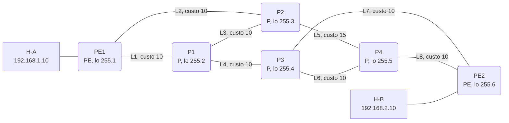

*Figura 3.1 (Tipo A, topologia).* Elementos do modo "LDP e LSP": PE1 (PE, lo 255.1); P1 (P, lo 255.2); P2 (P, lo 255.3); P3 (P, lo 255.4); P4 (P, lo 255.5); PE2 (PE, lo 255.6); H-A (192.168.1.10); H-B (192.168.2.10). Vale para todos os cenários do modo (6.1.1 e 6.1.2).

### 3.2 Plano de dados

*Figura 3.2 (Tipo A, topologia).* Elementos do modo "Plano de dados": PE1 (PE, lo 255.1); P1 (P, lo 255.2); P2 (P, lo 255.3); P3 (P, lo 255.4); P4 (P, lo 255.5); PE2 (PE, lo 255.6); H-A (192.168.1.10); H-B (192.168.2.10). Vale para todos os cenários do modo (6.2.1 a 6.2.6).

### 3.3 TTL e traceroute

*Figura 3.3 (Tipo A, topologia).* Elementos do modo "TTL e traceroute": PE1 (PE, lo 255.1); P1 (P, lo 255.2); P2 (P, lo 255.3); P3 (P, lo 255.4); P4 (P, lo 255.5); PE2 (PE, lo 255.6); H-A (192.168.1.10); H-B (192.168.2.10). Vale para todos os cenários do modo (6.3.1 e 6.3.2).

### 3.4 Falha de enlace

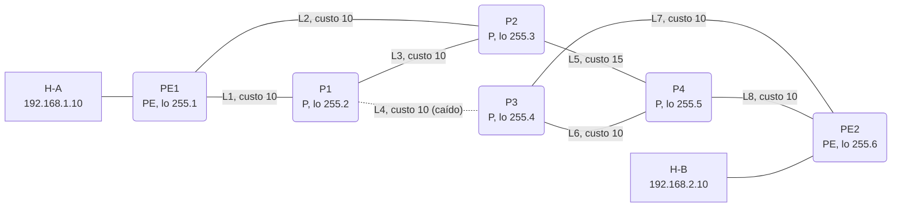

*Figura 3.4 (Tipo A, topologia).* Elementos do modo "Falha de enlace": PE1 (PE, lo 255.1); P1 (P, lo 255.2); P2 (P, lo 255.3); P3 (P, lo 255.4); P4 (P, lo 255.5); PE2 (PE, lo 255.6); H-A (192.168.1.10); H-B (192.168.2.10). Linhas tracejadas: enlaces alternativos, forjados ou caídos. Vale para todos os cenários do modo (6.4.1).

## 4. Abas da bancada

Cenário, Captura, Mensagem, LIB / LFIB, Terminal (modos: Plano de dados; TTL e traceroute; Falha de enlace), Experimento, Referência e Log.

## 5. Configurações (campos do painel)

### 5.1 Serviço

- **Serviço**. Valores: IP sobre MPLS (1 rótulo); L3VPN (pilha de 2 rótulos). Padrão: IP sobre MPLS (1 rótulo). Modos: todos.
  - Como o núcleo MPLS é usado.
  - **IP sobre MPLS:** todos os LSRs conhecem as redes dos clientes e o pacote leva 1 rótulo.
  - **L3VPN:** as redes dos clientes ficam só na VRF dos PEs, trocadas por MP-BGP; o pacote leva 2 rótulos (transporte e VPN).

### 5.2 Egresso e TTL

- **Rótulo do egresso (PHP)**. Valores: implicit-null (3): PHP; explicit-null (0); sem PHP (rótulo próprio). Padrão: implicit-null (3): PHP. Modos: todos.
  - O que o PE de saída anuncia para as próprias FECs.
  - **implicit-null (3):** o penúltimo salto remove o rótulo (PHP) e o PE de saída faz uma só consulta.
  - **explicit-null (0):** o rótulo 0 chega ao PE de saída, preservando o campo TC de QoS.
  - **sem PHP:** o egresso anuncia um rótulo próprio e faz o pop e a consulta IP.
- **Propagar TTL (modelo Uniform)**. Valores: caixa de seleção. Padrão: sim. Modos: todos.
  - Copia o TTL do IP para o rótulo (modelo Uniform).
  - **Marcado (Uniform):** o TTL do IP é copiado para o rótulo, e os P aparecem no traceroute.
  - **Desmarcado (Pipe):** o rótulo começa com TTL 255 e o núcleo fica invisível para o cliente.
  - Equivale ao comando `mpls ip propagate-ttl` do Cisco IOS.

### 5.3 Teste

- **Sentido do tráfego**. Valores: H-A (192.168.1.10) → H-B; H-B (192.168.2.10) → H-A. Padrão: H-A (192.168.1.10) → H-B. Modos: Plano de dados; TTL e traceroute; Falha de enlace.
  - Quem envia o ping e o traceroute.
  - Escolhe se o teste sai de H-A para H-B ou de H-B para H-A.
  - LSPs são unidirecionais: cada sentido usa rótulos diferentes.
- **Plano de controle**. Valores: LSPs instalados (LDP completo); Só o IGP (sem rótulos). Padrão: LSPs instalados (LDP completo). Modos: Plano de dados.
  - Se o LDP já montou os LSPs antes do teste.
  - **LSPs instalados:** o LDP descobriu vizinhos, abriu sessões, distribuiu rótulos e instalou a LFIB.
  - **Só o IGP:** ainda não há rótulos. No IP sobre MPLS o pacote segue por roteamento IP comum; na L3VPN o PE o descarta, porque não há rota VPN sem LDP e MP-BGP.

### 5.4 Falha

- **Enlace que cai**. Valores: L1: PE1 / P1; L2: PE1 / P2; L3: P1 / P2; L4: P1 / P3; L5: P2 / P4; L6: P3 / P4; L7: P3 / PE2; L8: P4 / PE2. Padrão: L4: P1 / P3. Modos: Falha de enlace.
  - O enlace do núcleo que falha entre o primeiro e o segundo ping.
  - Qualquer falha isolada mantém o núcleo conectado: PE1 e PE2 têm dois caminhos.
  - Se o enlace não fazia parte do LSP, o caminho não muda. Para ver a troca de rótulos, escolha um enlace do caminho (por padrão, PE1, P1, P3 e PE2).

### 5.5 Tabelas

- **Ver LIB / LFIB do LSR**. Valores: PE1 (PE); P1 (P); P2 (P); P3 (P); P4 (P); PE2 (PE). Padrão: PE1 (PE). Modos: todos.
  - Escolhe o LSR cujas tabelas aparecem na aba LIB / LFIB.
  - A **LIB** guarda os rótulos anunciados por todos os vizinhos (retenção liberal).
  - A **LFIB** guarda só o rótulo do próximo salto do IGP, que é o usado de fato no encaminhamento. Não muda o resultado da simulação.

## 6. Cenários

### 6.1 Modo: LDP e LSP

> **Grupo:** LDP e LSP

Como o plano de controle (LDP sobre o IGP) monta os caminhos rotulados e como o plano de dados os percorre.

#### 6.1.1 Montagem do LSP

*O LDP descobre vizinhos, abre sessões e distribui rótulos.*

**Configuração aplicada:** Serviço = ip; Rótulo do egresso (PHP) = implicit; Propagar TTL (modelo Uniform) = sim

Acompanhe as quatro fases: **Discovery** (Hello em UDP 646), **Sessão** (TCP 646), **Mapping** (distribuição de rótulos) e **LSP** (LFIB instalada).

Depois escolha um LSR em **Ver LIB / LFIB do LSR** e compare a LIB, com os rótulos de todos os vizinhos, com a LFIB, que guarda só o do próximo salto. A aba LIB / LFIB acompanha o relógio: as tabelas se preenchem conforme as fases terminam.

**Conceito.** O MPLS encaminha pacotes por **rótulos** curtos em vez de consultar o endereço IP em cada salto. O **LDP** ([RFC 5036](https://www.rfc-editor.org/rfc/rfc5036)) distribui esses rótulos: cada LSR descobre os vizinhos, abre uma sessão TCP com cada um e anuncia um rótulo local para cada destino (**FEC**) que conhece pelo IGP. O caminho rotulado resultante é o **LSP**.

**O que observar**

- No diagrama: Discovery, Sessão, Mapping e LSP, uma fase após a outra.
- Na aba LIB / LFIB: a LIB guarda o rótulo de cada vizinho; a LFIB usa só o do próximo salto do IGP.
- No log: em cada par, o LSR com a maior loopback abre a sessão TCP.

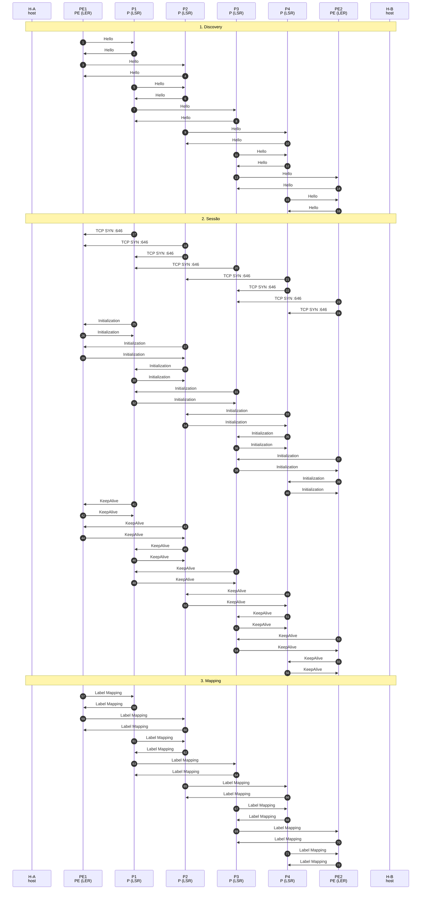

*Figura 6.1.1 (Tipo B, sequência).* Mensagens do cenário "Montagem do LSP", na ordem do tempo, entre H-A, PE1, P1, P2, P3, P4, PE2, H-B: 72 mensagens, numeradas de 1 a 72 na ordem da comunicação (em 5 fases). Corresponde ao diagrama de sequência e à aba Captura, no modo "LDP e LSP", com a configuração aplicada acima.

**Mensagens**

| Mensagem | Significado | Origem |
| --- | --- | --- |
| LDP Hello | descobre vizinhos (UDP 646, 224.0.0.2) | todos os LSRs |
| Initialization e KeepAlive | abrem e mantêm a sessão (TCP 646) | cada par de vizinhos |
| Label Mapping | anuncia a FEC e o rótulo local | todos os LSRs |

**Por que importa.** Sem LDP não há rótulos, e o tráfego segue por roteamento IP comum (ou é descartado, na L3VPN). O LDP depende do IGP: só existem rótulos para destinos que o OSPF conhece.

> **Grupo:** Serviços

O MPLS usado para separar clientes sobre o mesmo núcleo: a VPN de camada 3.

#### 6.1.2 L3VPN: MP-BGP e rótulos VPN

*Os PEs trocam rotas VPNv4 e rótulos VPN por MP-BGP.*

**Configuração aplicada:** Serviço = vpn; Rótulo do egresso (PHP) = implicit; Propagar TTL (modelo Uniform) = sim

Além do LDP, na fase Mapping os PEs trocam por **MP-BGP** as rotas VPNv4 da VRF CLIENTE, cada uma com um **rótulo VPN**.

As redes dos clientes não entram no IGP nem nas FECs do LDP: os P não as conhecem.

**Conceito.** Na **L3VPN** ([RFC 4364](https://www.rfc-editor.org/rfc/rfc4364)), cada cliente tem uma tabela própria (**VRF**) nos PEs. As rotas dos clientes trocam de PE por **MP-BGP** (família VPNv4), cada uma com um **rótulo VPN**. O LDP continua distribuindo só os rótulos de transporte para as loopbacks.

**O que observar**

- Na fase Mapping: a mensagem MP-BGP UPDATE entre PE1 e PE2, atravessando o núcleo.
- Nas FECs do LDP: só as seis loopbacks, sem as redes dos clientes.
- Nos rótulos VPN: 190 (do PE1) e 690 (do PE2), cada um da faixa do próprio PE.

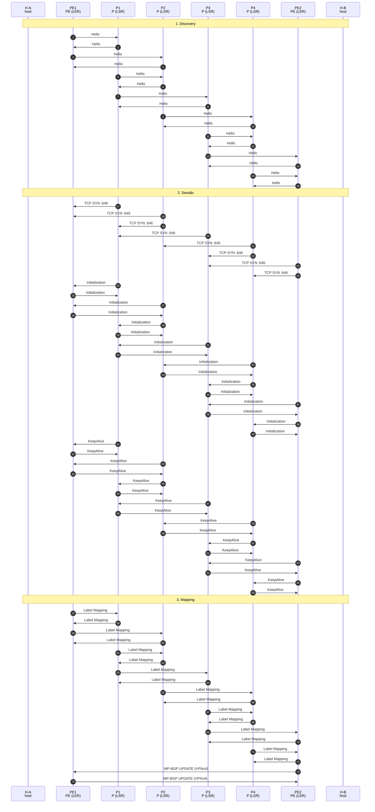

*Figura 6.1.2 (Tipo B, sequência).* Mensagens do cenário "L3VPN: MP-BGP e rótulos VPN", na ordem do tempo, entre H-A, PE1, P1, P2, P3, P4, PE2, H-B: 74 mensagens, numeradas de 1 a 74 na ordem da comunicação (em 5 fases). Corresponde ao diagrama de sequência e à aba Captura, no modo "LDP e LSP", com a configuração aplicada acima.

**Mensagens**

| Mensagem | Significado | Origem |
| --- | --- | --- |
| Label Mapping | rótulos de transporte para as loopbacks | todos os LSRs |
| MP-BGP UPDATE | rota VPNv4, RD, next hop e rótulo VPN | PE1 e PE2 |

**Por que importa.** Os P não participam do BGP dos clientes: a tabela de rotas de cada cliente fica só nos PEs, o que permite redes de clientes com endereços repetidos.

### 6.2 Modo: Plano de dados

> **Grupo:** LDP e LSP

Como o plano de controle (LDP sobre o IGP) monta os caminhos rotulados e como o plano de dados os percorre.

#### 6.2.1 Push, swap e pop

*O pacote atravessa o núcleo trocando de rótulo a cada salto.*

**Configuração aplicada:** Serviço = ip; Rótulo do egresso (PHP) = implicit; Propagar TTL (modelo Uniform) = sim

Com os LSPs instalados, o H-A envia um ping ao H-B. Na aba Captura, acompanhe cada operação: o PE1 faz **push**, os P fazem **swap** e o penúltimo salto faz **pop**.

Troque o sentido para H-B → H-A e repita: a volta usa outro LSP, com outros rótulos.

**Conceito.** No plano de dados, o PE de entrada classifica o pacote em uma FEC e empilha o rótulo (**push**). Cada P olha só o rótulo do topo e o troca pelo rótulo que o próximo salto anunciou (**swap**), sem consultar o IP. No fim do LSP, o rótulo é removido (**pop**) e o pacote volta a ser IP.

**O que observar**

- Na aba Captura: a pilha de rótulos muda a cada enlace.
- Na aba Mensagem: o cabeçalho de rótulo (Label, TC, S e TTL, [RFC 3032](https://www.rfc-editor.org/rfc/rfc3032)).
- Na aba Experimento: as operações da ida e da volta, roteador por roteador.

*Figura 6.2.1 (Tipo B, sequência).* Mensagens do cenário "Push, swap e pop", na ordem do tempo, entre H-A, PE1, P1, P2, P3, P4, PE2, H-B: 10 mensagens, numeradas de 1 a 10 na ordem da comunicação (em 3 fases). Corresponde ao diagrama de sequência e à aba Captura, no modo "Plano de dados", com a configuração aplicada acima.

**Mensagens**

| Mensagem | Significado | Origem |
| --- | --- | --- |
| push | empilha o rótulo da FEC | PE de entrada |
| swap | troca o rótulo do topo | cada P |
| pop | remove o rótulo | penúltimo salto (PHP) |

**Por que importa.** Comutar por rótulo permite engenharia de tráfego, VPNs e caminhos independentes do destino IP; o núcleo nem precisa conhecer as redes dos clientes.

#### 6.2.2 Ping antes do LDP

*Sem rótulos, o pacote segue por roteamento IP comum.*

**Configuração aplicada:** Serviço = ip; Rótulo do egresso (PHP) = implicit; Propagar TTL (modelo Uniform) = sim; Plano de controle = semldp

O IGP já convergiu, mas o LDP ainda não distribuiu rótulos. O ping segue por **roteamento IP comum**, salto a salto, sem pilha de rótulos.

Compare com o cenário Push, swap e pop: as mesmas máquinas, o mesmo destino, outro plano de dados.

**Conceito.** O MPLS é construído sobre o IGP. Enquanto o LDP não distribui rótulos, cada roteador encaminha o pacote por **consulta IP** (maior prefixo) e o núcleo funciona como uma rede IP comum. Os rótulos só aparecem depois que o LDP instala a LFIB.

**O que observar**

- Na Captura: a coluna de pilha mostra IP em todos os enlaces.
- O TTL do IP cai a cada salto, inclusive nos P.
- Compare com o cenário Push, swap e pop.

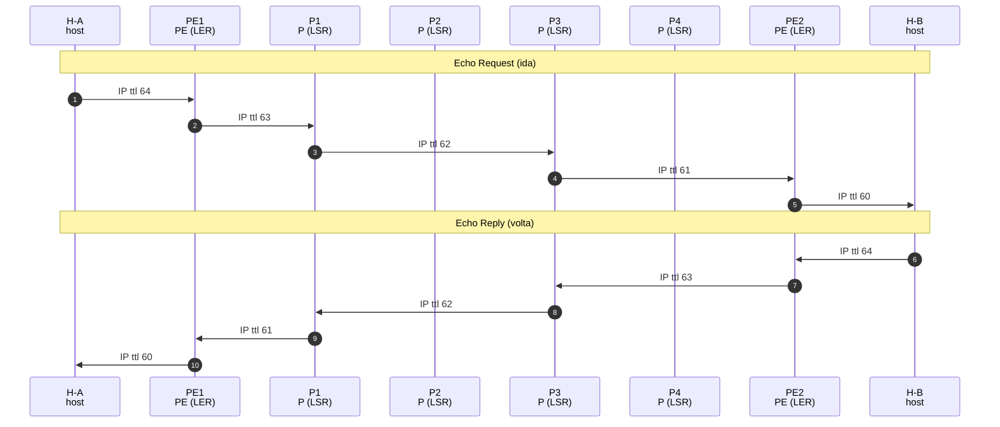

*Figura 6.2.2 (Tipo B, sequência).* Mensagens do cenário "Ping antes do LDP", na ordem do tempo, entre H-A, PE1, P1, P2, P3, P4, PE2, H-B: 10 mensagens, numeradas de 1 a 10 na ordem da comunicação (em 3 fases). Corresponde ao diagrama de sequência e à aba Captura, no modo "Plano de dados", com a configuração aplicada acima.

**Mensagens**

| Mensagem | Significado | Origem |
| --- | --- | --- |
| consulta IP (LPM) | escolhe o próximo salto pelo maior prefixo | cada roteador |
| sem rótulo | o pacote não leva pilha MPLS | todos os enlaces |

**Por que importa.** Mostra que o MPLS é uma camada de encaminhamento sobre o IGP, não um substituto dele: se o LDP falha, o IP continua funcionando (no IP sobre MPLS).

> **Grupo:** Rótulo do egresso

O rótulo que o PE de saída anuncia para as próprias FECs define onde o último rótulo é removido.

#### 6.2.3 explicit-null

*O rótulo 0 chega ao egresso e preserva a marcação de QoS.*

**Configuração aplicada:** Serviço = ip; Rótulo do egresso (PHP) = explicit; Propagar TTL (modelo Uniform) = sim

O PE de saída anuncia o rótulo 0 (explicit-null) para as próprias FECs. Rode o ping e veja, na Captura, o último enlace levar o **rótulo 0** até o PE2, que o remove.

**Conceito.** Com **explicit-null** (rótulo 0 no IPv4), o penúltimo salto troca o rótulo por 0 em vez de removê-lo. O pacote chega ao egresso ainda rotulado, o que preserva o campo **TC** (antigo EXP), usado para QoS, até o último salto.

**O que observar**

- Na Captura: swap para 0 no último enlace antes do PE2.
- O PE2 remove o rótulo 0 e consulta o IP.
- Compare com o cenário Push, swap e pop (implicit-null).

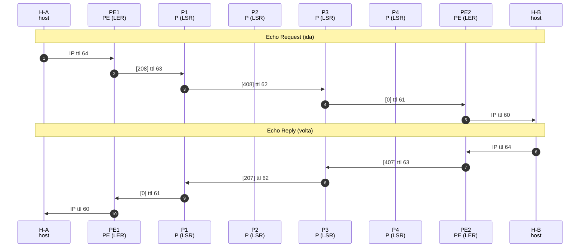

*Figura 6.2.3 (Tipo B, sequência).* Mensagens do cenário "explicit-null", na ordem do tempo, entre H-A, PE1, P1, P2, P3, P4, PE2, H-B: 10 mensagens, numeradas de 1 a 10 na ordem da comunicação (em 3 fases). Corresponde ao diagrama de sequência e à aba Captura, no modo "Plano de dados", com a configuração aplicada acima.

**Mensagens**

| Mensagem | Significado | Origem |
| --- | --- | --- |
| swap para 0 | troca pelo explicit-null | penúltimo salto |
| pop 0 | remove o rótulo 0 | PE de saída |

**Por que importa.** Provedores usam explicit-null quando a marcação de QoS do núcleo precisa valer até a borda.

#### 6.2.4 Sem PHP

*O egresso recebe o próprio rótulo e faz duas consultas.*

**Configuração aplicada:** Serviço = ip; Rótulo do egresso (PHP) = none; Propagar TTL (modelo Uniform) = sim

O PE2 recebe o pacote ainda com o rótulo que ele mesmo anunciou e faz duas consultas: remove o rótulo e depois consulta o IP.

Compare onde o pop acontece nos três modos de rótulo do egresso.

**Conceito.** Sem PHP, o egresso anuncia um rótulo próprio para as suas FECs. O rótulo chega até ele, que faz o pop e depois consulta o IP: são **duas consultas** no mesmo roteador.

**O que observar**

- Na Captura: o último enlace ainda leva um rótulo comum, da faixa do PE2 (601 a 699).
- No log: o PE2 faz o pop e a consulta IP.
- Na aba LIB / LFIB do PE2: o rótulo local anunciado para as próprias FECs.

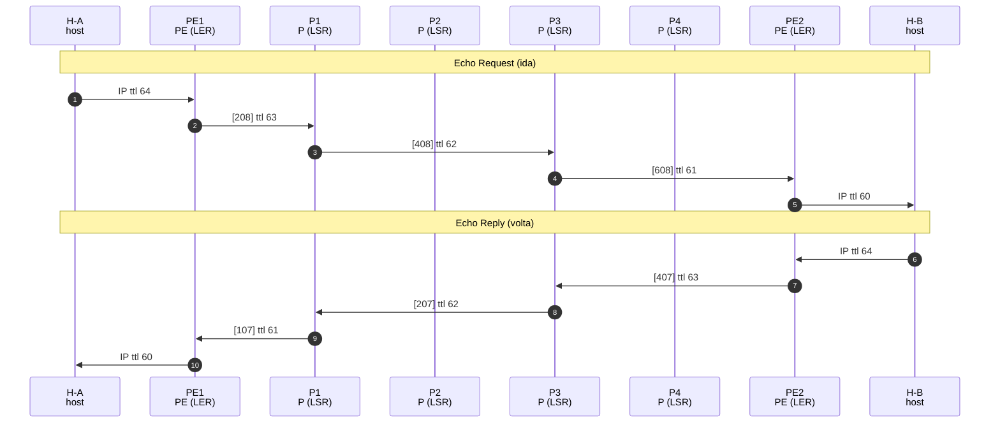

*Figura 6.2.4 (Tipo B, sequência).* Mensagens do cenário "Sem PHP", na ordem do tempo, entre H-A, PE1, P1, P2, P3, P4, PE2, H-B: 10 mensagens, numeradas de 1 a 10 na ordem da comunicação (em 3 fases). Corresponde ao diagrama de sequência e à aba Captura, no modo "Plano de dados", com a configuração aplicada acima.

**Mensagens**

| Mensagem | Significado | Origem |
| --- | --- | --- |
| swap | troca para o rótulo do PE2 | P3 ou P4 |
| pop | remove o próprio rótulo | PE2 |

**Por que importa.** O PHP (penultimate hop popping) existe justamente para evitar essa consulta dupla no egresso.

> **Grupo:** Serviços

O MPLS usado para separar clientes sobre o mesmo núcleo: a VPN de camada 3.

#### 6.2.5 L3VPN: pilha de dois rótulos

*Dois rótulos: transporte até o PE de saída e VPN até a VRF.*

**Configuração aplicada:** Serviço = vpn; Rótulo do egresso (PHP) = implicit; Propagar TTL (modelo Uniform) = sim

Rode o ping e veja, na Captura, a pilha de **dois rótulos**: transporte e VPN.

Os P só olham o rótulo de transporte: não conhecem as redes dos clientes.

**Conceito.** Na **L3VPN** ([RFC 4364](https://www.rfc-editor.org/rfc/rfc4364)), o pacote atravessa o núcleo com dois rótulos: o externo (transporte, do LDP) leva até o PE de saída; o interno (VPN, aprendido por MP-BGP) indica a VRF.

**O que observar**

- Na Captura: a pilha [transporte | VPN], por exemplo [206 | 690].
- Com PHP, o penúltimo salto remove só o rótulo de transporte; o rótulo VPN chega ao PE2.
- Na aba Mensagem: duas entradas MPLS, só a última com S = 1.

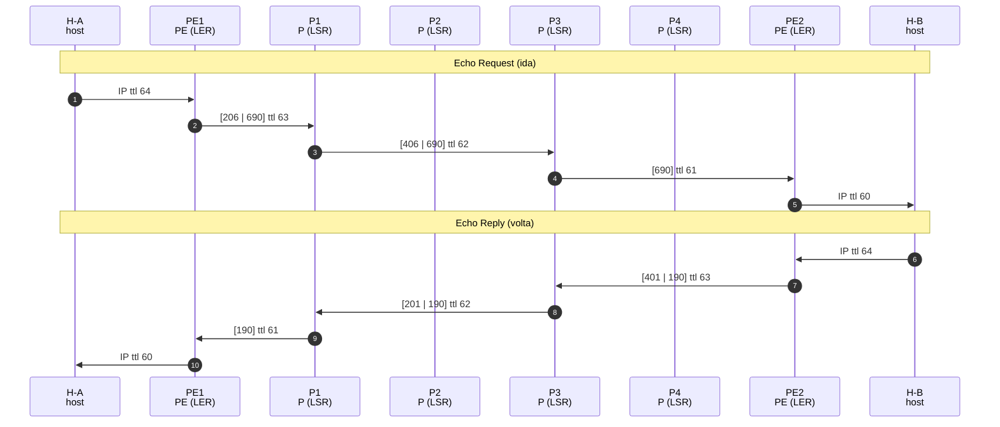

*Figura 6.2.5 (Tipo B, sequência).* Mensagens do cenário "L3VPN: pilha de dois rótulos", na ordem do tempo, entre H-A, PE1, P1, P2, P3, P4, PE2, H-B: 10 mensagens, numeradas de 1 a 10 na ordem da comunicação (em 3 fases). Corresponde ao diagrama de sequência e à aba Captura, no modo "Plano de dados", com a configuração aplicada acima.

**Mensagens**

| Mensagem | Significado | Origem |
| --- | --- | --- |
| push | transporte + VPN | PE de entrada |
| swap | troca só o rótulo de transporte | cada P |
| pop VPN | consulta a VRF do cliente | PE de saída |

**Por que importa.** Permite atender vários clientes, até com endereços repetidos, sobre o mesmo núcleo. A separação é lógica, não criptográfica: o PE nunca deve aceitar pacotes rotulados vindos do cliente.

#### 6.2.6 L3VPN sem LDP: o PE descarta

*Sem rota VPN e sem LSP, o PE descarta o pacote.*

**Configuração aplicada:** Serviço = vpn; Rótulo do egresso (PHP) = implicit; Propagar TTL (modelo Uniform) = sim; Plano de controle = semldp

Sem LDP e sem MP-BGP, o PE1 não tem rota VPN nem LSP até o PE2. Diferente do IP sobre MPLS, o ping **não segue por roteamento comum**: o PE o descarta.

**Conceito.** Na L3VPN as redes dos clientes existem só nas VRFs dos PEs. Sem o MP-BGP e o LDP, o PE de entrada não sabe qual é o PE de saída nem tem rótulo de transporte até ele. Como os P não conhecem rotas de clientes, **não há roteamento comum** para recorrer.

**O que observar**

- No diagrama: o pacote chega ao PE1 e não sai dele.
- Na aba Experimento: o motivo do descarte.
- Compare com o cenário Ping antes do LDP, no IP sobre MPLS.

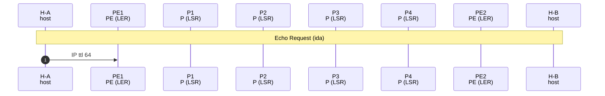

*Figura 6.2.6 (Tipo B, sequência).* Mensagens do cenário "L3VPN sem LDP: o PE descarta", na ordem do tempo, entre H-A, PE1, P1, P2, P3, P4, PE2, H-B: 1 mensagem, numeradas de 1 a 1 na ordem da comunicação (em 2 fases). Corresponde ao diagrama de sequência e à aba Captura, no modo "Plano de dados", com a configuração aplicada acima.

**Mensagens**

| Mensagem | Significado | Origem |
| --- | --- | --- |
| Echo Request | enviado pelo host ao gateway | o host de origem |
| descarte | sem rota VPNv4 nem LSP | PE de entrada |

**Por que importa.** Na L3VPN, uma falha do LDP ou do MP-BGP interrompe o serviço do cliente, ao contrário do IP sobre MPLS, que cai de volta para o IP.

### 6.3 Modo: TTL e traceroute

> **Grupo:** TTL

Se o TTL do IP é copiado para o rótulo, o núcleo aparece ou some no traceroute do cliente.

#### 6.3.1 TTL Uniform

*O TTL do IP vai para o rótulo e os P aparecem no traceroute.*

**Configuração aplicada:** Serviço = ip; Rótulo do egresso (PHP) = implicit; Propagar TTL (modelo Uniform) = sim

Com a propagação de TTL, o TTL do IP é copiado para o rótulo e **cada LSR do núcleo aparece** no traceroute. Os P respondem com a pilha de rótulos recebida ([RFC 4950](https://www.rfc-editor.org/rfc/rfc4950)).

**Conceito.** No modelo **Uniform** ([RFC 3443](https://www.rfc-editor.org/rfc/rfc3443)), o PE copia o TTL do IP para o rótulo na entrada e de volta na saída. Cada P decrementa o TTL do rótulo, então o traceroute enxerga todos os saltos do núcleo. Quando o TTL expira dentro do LSP, o ICMP Time Exceeded leva a pilha de rótulos recebida ([RFC 4950](https://www.rfc-editor.org/rfc/rfc4950)).

**O que observar**

- Na aba Terminal: os P aparecem com a anotação <MPLS:L=...>.
- Cada sonda mostra o ICMP Time Exceeded seguindo adiante pelo LSP até o egresso.
- Na aba Experimento: cada salto com a pilha devolvida no ICMP.

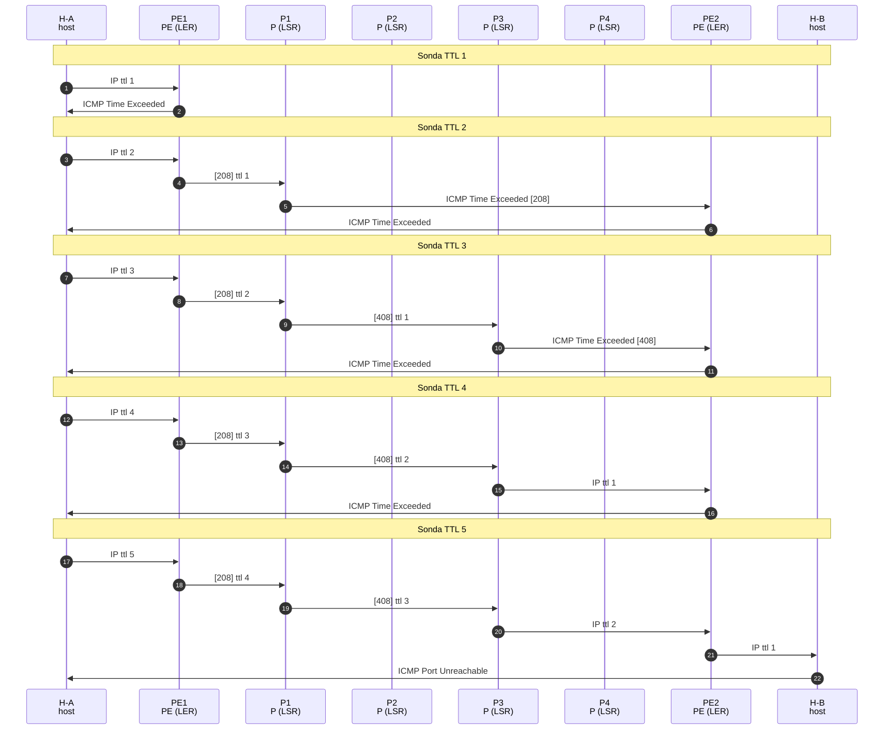

*Figura 6.3.1 (Tipo B, sequência).* Mensagens do cenário "TTL Uniform", na ordem do tempo, entre H-A, PE1, P1, P2, P3, P4, PE2, H-B: 22 mensagens, numeradas de 1 a 22 na ordem da comunicação (em 6 fases). Corresponde ao diagrama de sequência e à aba Captura, no modo "TTL e traceroute", com a configuração aplicada acima.

**Mensagens**

| Mensagem | Significado | Origem |
| --- | --- | --- |
| UDP | sondas com TTL 1, 2, 3... | o host de origem |
| Time Exceeded | com a pilha de rótulos ([RFC 4950](https://www.rfc-editor.org/rfc/rfc4950)) | cada LSR |

**Por que importa.** Facilita o diagnóstico do núcleo, mas revela a topologia interna do provedor a qualquer cliente.

#### 6.3.2 TTL Pipe

*O rótulo começa com TTL 255 e o núcleo some.*

**Configuração aplicada:** Serviço = ip; Rótulo do egresso (PHP) = implicit; Propagar TTL (modelo Uniform) = não

Sem a propagação, o rótulo começa com TTL 255 e **só os PEs aparecem** no traceroute.

Rode também o ping no modo Plano de dados e compare o TTL recebido com o do modelo Uniform.

**Conceito.** No modelo **Pipe** (`no mpls ip propagate-ttl`), o rótulo começa com TTL 255, independente do TTL do IP. O núcleo inteiro conta como um único salto para o cliente.

**O que observar**

- Na aba Terminal: o traceroute vai do PE1 direto ao PE2.
- Compare com o cenário TTL Uniform.
- No modo Plano de dados, o ping mostra TTL recebido 62: só os PEs decrementaram.

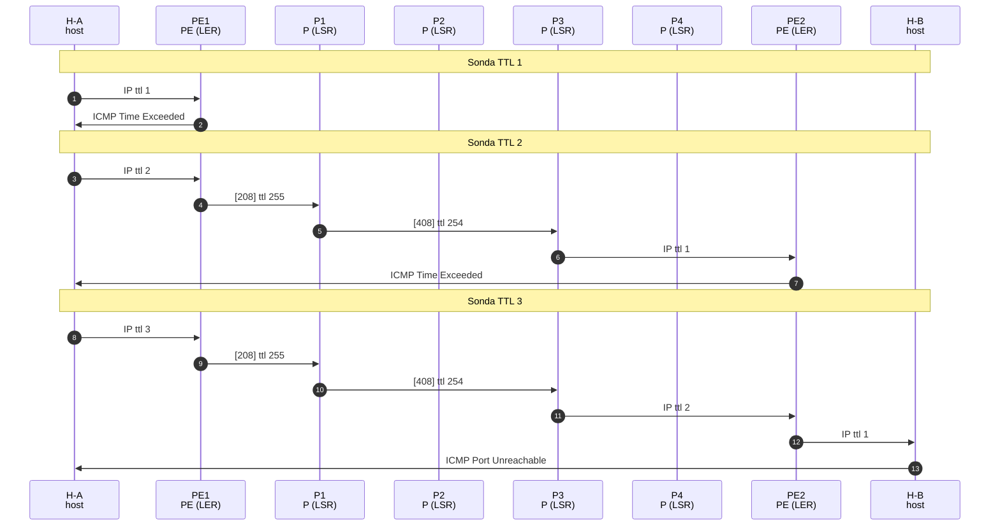

*Figura 6.3.2 (Tipo B, sequência).* Mensagens do cenário "TTL Pipe", na ordem do tempo, entre H-A, PE1, P1, P2, P3, P4, PE2, H-B: 13 mensagens, numeradas de 1 a 13 na ordem da comunicação (em 4 fases). Corresponde ao diagrama de sequência e à aba Captura, no modo "TTL e traceroute", com a configuração aplicada acima.

**Mensagens**

| Mensagem | Significado | Origem |
| --- | --- | --- |
| UDP | sondas com TTL 1, 2, 3... | o host de origem |
| Time Exceeded | só dos PEs | PE1 e PE2 |

**Por que importa.** Esconde a topologia do provedor dos clientes. É uma escolha comum em redes de operadoras.

### 6.4 Modo: Falha de enlace

> **Grupo:** Falhas

Como os LSPs reagem a mudanças de topologia.

#### 6.4.1 Falha de enlace

*O IGP reconverge e a LFIB troca de rótulo na hora.*

**Configuração aplicada:** Serviço = ip; Rótulo do egresso (PHP) = implicit; Propagar TTL (modelo Uniform) = sim; Enlace que cai = L4

Um primeiro ping percorre PE1, P1, P3 e PE2. O enlace **L4 (P1 / P3)** cai, o OSPF reconverge e um segundo ping segue por outro caminho, com outros rótulos, sem esperar nova sinalização LDP.

Troque o enlace que cai e veja quando o caminho muda.

**Conceito.** Quando um enlace cai, o IGP reconverge e cada LSR passa a usar outro próximo salto. Graças à **retenção liberal**, os rótulos dos outros vizinhos já estavam na LIB, então a LFIB muda na hora. A sessão LDP do enlace caído termina e leva junto os rótulos aprendidos por ela.

**O que observar**

- No diagrama: o Hello sem resposta, a reconvergência e o segundo ping por outro caminho.
- Na aba Experimento: o LSP de ida antes e depois da falha.
- Na aba LIB / LFIB do PE1: o próximo salto do LSP muda de P1 para P2.

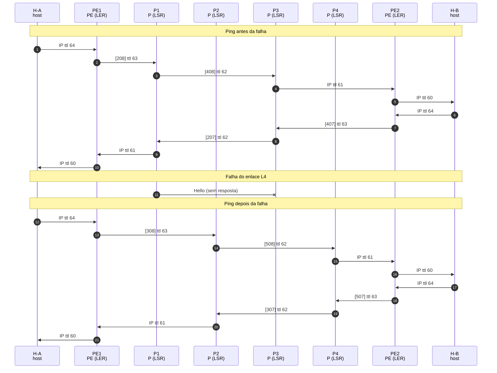

*Figura 6.4.1 (Tipo B, sequência).* Mensagens do cenário "Falha de enlace", na ordem do tempo, entre H-A, PE1, P1, P2, P3, P4, PE2, H-B: 21 mensagens, numeradas de 1 a 21 na ordem da comunicação (em 4 fases; 1 perdida). Corresponde ao diagrama de sequência e à aba Captura, no modo "Falha de enlace", com a configuração aplicada acima.

**Mensagens**

| Mensagem | Significado | Origem |
| --- | --- | --- |
| LDP | sessão P1 / P3 encerrada | P1 e P3 |
| Novo LSP | via P2 e P4 | PE1 até PE2 |

**Por que importa.** A convergência do MPLS depende do IGP. Em produção, mecanismos como a sincronização LDP-IGP e o Fast Reroute reduzem a perda durante a troca.

## 7. Referência

### 7.1 O que é o MPLS

No **Multiprotocol Label Switching** ([RFC 3031](https://www.rfc-editor.org/rfc/rfc3031)), o roteador de entrada classifica o pacote uma única vez em uma **FEC** (Forwarding Equivalence Class, por exemplo um prefixo de destino) e cola nele um **rótulo** curto. No núcleo, cada LSR encaminha consultando só o rótulo, sem olhar o cabeçalho IP. O caminho percorrido por uma FEC é o **LSP** (Label Switched Path), que é **unidirecional**: ida e volta usam LSPs e rótulos diferentes.

- **LER / PE (Provider Edge):** borda. Faz **push** (impõe o rótulo) na entrada e remove a pilha na saída.
- **LSR / P (Provider):** núcleo. Faz **swap** (troca o rótulo do topo) ou **pop** (remove).
- **Rótulo de significado local:** cada LSR escolhe os próprios rótulos. O mesmo número pode significar FECs diferentes em LSRs diferentes. Neste simulador, cada LSR usa uma faixa própria (PE1 100+, P1 200+...) só para facilitar a leitura.

### 7.2 Cabeçalho de rótulo ([RFC 3032](https://www.rfc-editor.org/rfc/rfc3032))

O rótulo fica entre o cabeçalho de enlace e o IP (EtherType **0x8847**). Cada entrada da pilha tem 32 bits:

| Rótulo (20 bits) | TC (3) | S (1) | TTL (8) |
TC: Traffic Class, antes chamado EXP ([RFC 5462](https://www.rfc-editor.org/rfc/rfc5462)), usado para QoS
S:  1 na última entrada da pilha (fundo)
TTL: decrementado a cada LSR, como no IP

| Rótulo | Nome | Uso |
| --- | --- | --- |
| 0 | IPv4 Explicit NULL | O egresso pede para receber o pacote rotulado (preserva o TC para QoS) e então faz pop |
| 1 | Router Alert | Entrega ao plano de controle do LSR |
| 2 | IPv6 Explicit NULL | Igual ao 0, para IPv6 |
| 3 | Implicit NULL | Anunciado pelo egresso, nunca aparece no pacote: o penúltimo salto faz pop (PHP) |
| 7 | Entropy Label Indicator | Balanceamento de carga ([RFC 6790](https://www.rfc-editor.org/rfc/rfc6790)) |
| 13 | GAL | Canal de OAM do MPLS-TP ([RFC 5586](https://www.rfc-editor.org/rfc/rfc5586)) |
| 16 em diante | Rótulos livres | Alocados pelos protocolos de distribuição |

### 7.3 LDP ([RFC 5036](https://www.rfc-editor.org/rfc/rfc5036))

- **Discovery:** Hello em UDP 646 para 224.0.0.2 em cada interface. O LDP ID tem a forma roteador:espaço (ex.: 10.255.255.2:0).
- **Sessão:** TCP 646. O LSR com o maior endereço de transporte assume o papel ativo e abre a conexão. Seguem Initialization e KeepAlive até o estado OPERATIONAL.
- **Distribuição:** mensagens Label Mapping associam FEC e rótulo. O modo típico é **Downstream Unsolicited** (anuncia sem esperar pedido) com controle **independente**.
- **LIB e LFIB:** com **retenção liberal**, a LIB guarda os rótulos de todos os vizinhos. A LFIB usa só o do próximo salto escolhido pelo IGP. Se o IGP mudar de caminho, o rótulo novo já está na LIB e a convergência é rápida.
- Outras mensagens: Address, Label Withdraw, Label Release e Notification.

### 7.4 PHP e modelos de TTL

Com **PHP** (Penultimate Hop Popping), o egresso anuncia implicit-null (3) e o penúltimo LSR remove o rótulo. Assim, o egresso faz uma única consulta (IP) em vez de duas (rótulo e IP). Com **explicit-null** (0), o rótulo chega ao egresso, o que preserva o campo TC para QoS. A [RFC 3032](https://www.rfc-editor.org/rfc/rfc3032) só permitia o explicit-null no fundo da pilha; a [RFC 4182](https://www.rfc-editor.org/rfc/rfc4182) removeu essa restrição, o que permite usá-lo também sobre o rótulo VPN.

No modelo **Uniform** ([RFC 3443](https://www.rfc-editor.org/rfc/rfc3443)), o TTL do IP é copiado para o rótulo na entrada e de volta na saída, e cada LSR do núcleo aparece no traceroute. No modelo **Pipe** (`no mpls ip propagate-ttl` no Cisco IOS), o rótulo começa com TTL 255 e o núcleo fica invisível: o traceroute mostra só os PEs.

Quando o TTL expira dentro do LSP, o LSR gera o ICMP Time Exceeded, copia a pilha de rótulos e o encaminha **adiante pelo LSP** até o egresso, que o devolve à origem ([RFC 3032](https://www.rfc-editor.org/rfc/rfc3032), seção 2.3.2). Por isso todos os saltos do núcleo mostram quase o mesmo RTT. A extensão ICMP da [RFC 4950](https://www.rfc-editor.org/rfc/rfc4950) informa a pilha recebida, que o traceroute do Linux exibe com `-e`.

### 7.5 L3VPN ([RFC 4364](https://www.rfc-editor.org/rfc/rfc4364))

Os PEs mantêm uma tabela de roteamento por cliente (**VRF**) e trocam as rotas dos clientes por **MP-BGP** (VPNv4, com Route Distinguisher). Junto com cada rota vai um **rótulo VPN**. O PE de entrada empilha dois rótulos: o **rótulo de transporte** (LDP, leva até o PE de saída) e, embaixo, o **rótulo VPN** (diz ao PE de saída em qual VRF procurar). Os roteadores P só olham o rótulo de transporte e não conhecem as rotas dos clientes, por isso endereços privados repetidos entre clientes não conflitam.

Dois conceitos distintos aparecem nas rotas VPNv4. O **Route Distinguisher (RD)** é um prefixo de 64 bits acrescentado ao endereço IPv4 só para torná-lo único no MP-BGP: dois clientes podem usar 10.0.0.0/24 sem colisão. Ele não decide quem recebe a rota. Quem decide é o **Route Target (RT)**, uma extended community: cada VRF exporta suas rotas com um ou mais RT e importa apenas as rotas cujo RT está na sua lista de importação. Assim se montam topologias como full-mesh, hub-and-spoke e extranet. O RD é definido na seção 4.2 da [RFC 4364](https://www.rfc-editor.org/rfc/rfc4364) e o RT, na seção 4.3.1. O simulador mostra o RD (65000:1) nas rotas trocadas, mas não configura nem usa o RT.

### 7.6 MPLS e segurança

- **Modelo de ameaças:** a [RFC 4381](https://www.rfc-editor.org/rfc/rfc4381) analisa a segurança das VPNs MPLS/BGP e as compara às VPNs de camada 2.
- **MPLS não é criptografia:** a separação de uma L3VPN é lógica. Quem tem acesso ao núcleo lê o tráfego. Dados sensíveis exigem IPsec ou MACsec.
- **Pacotes rotulados vindos do cliente:** o PE nunca deve aceitar MPLS na interface do cliente. Caso contrário, um rótulo VPN forjado injeta tráfego em outra VRF (label spoofing).
- **Proteção do LDP e do BGP:** autenticação TCP-MD5 ou TCP-AO ([RFC 5925](https://www.rfc-editor.org/rfc/rfc5925)) e filtros que aceitem LDP e BGP só de vizinhos conhecidos.
- **Ocultação da topologia:** desativar a propagação de TTL esconde o núcleo no traceroute. As extensões da [RFC 4950](https://www.rfc-editor.org/rfc/rfc4950), por outro lado, revelam os rótulos em uso.

### 7.7 O que o simulador simplifica

- Seis LSRs e um único IGP (OSPF simplificado, com Dijkstra e custo igual nos dois sentidos): sem iBGP completo, sem Route Reflector e sem Inter-AS.
- O LDP mostra Hello, sessão e Label Mapping; não simula temporizadores de Hello e KeepAlive, Label Withdraw, Label Release nem a sincronização LDP-IGP.
- A L3VPN usa dois rótulos e um par de PEs; o Route Distinguisher aparece nas rotas, mas o Route Target não é configurado nem trocado via MP-BGP (a [RFC 4364](https://www.rfc-editor.org/rfc/rfc4364) define os dois). Há um só cliente (VRF CLIENTE).
- Os rótulos de cada LSR usam uma faixa própria só para facilitar a leitura (a [RFC 5036](https://www.rfc-editor.org/rfc/rfc5036) deixa a escolha livre).
- Os atrasos dos enlaces e os tempos do ping e do traceroute são ilustrativos e fixos, sem a variação de uma rede real. O custo OSPF de cada enlace é fixo; só a falha de enlace é simulável.
- O plano de controle mostra mensagens por enlace (uma por vizinho e sentido) com atraso uniforme, para o diagrama ficar legível; a ordem entre enlaces diferentes numa mesma fase é a mesma.

### 7.8 Roteiro de exercícios

1. No modo **LDP**, acompanhe as quatro fases e a aba **LIB / LFIB** se preenchendo. Onde aparecem push, swap e pop no modo Plano de dados?
2. Na aba **LIB / LFIB**, escolha P1 e explique por que a LIB tem mais rótulos que a LFIB para a mesma FEC (retenção liberal).
3. No modo **TTL**, rode o traceroute com **Propagar TTL** ligado e desligado. Quais saltos somem, e por que um provedor faria isso?
4. Troque o rótulo do egresso entre **implicit-null**, **explicit-null** e **sem PHP**. Em que roteador o último rótulo é removido em cada caso?
5. Mude para **L3VPN** e rode um ping: que rótulos cada P enxerga, e por que os P não precisam conhecer as rotas dos clientes?
6. No modo **Falha de enlace**, derrube o enlace **L4** e depois outros: o caminho e os rótulos mudam? Por que não é preciso esperar nova sinalização LDP?

## 8. Glossário

Significado e finalidade das siglas usadas neste documento.

| Sigla | Significado | Para que serve |
| --- | --- | --- |
| **BGP** | Border Gateway Protocol, protocolo de roteador de borda | troca rotas entre sistemas autônomos e sustenta o roteamento entre operadoras na Internet |
| **EXP** | Experimental | nome antigo dos 3 bits de classe de serviço do rótulo, hoje chamados Traffic Class (TC) |
| **FEC** | Forwarding Equivalence Class, classe de equivalência de encaminhamento | conjunto de pacotes que recebe o mesmo rótulo e o mesmo caminho no MPLS |
| **GAL** | Generic Associated Channel Label | rótulo reservado (13) que indica um canal de gerência no MPLS-TP |
| **ICMP** | Internet Control Message Protocol | leva mensagens de controle e de erro da camada IP, como o eco do ping e o aviso de destino inalcançável |
| **ID** | Identifier, identificador | valor que distingue uma entidade ou uma consulta, como o router ID do BGP e o ID da consulta DNS |
| **IGP** | Interior Gateway Protocol, protocolo de roteamento interno | roteamento dentro de um sistema autônomo, como o OSPF; contrasta com o BGP, que liga sistemas autônomos |
| **IOS** | Internetwork Operating System | sistema operacional dos equipamentos Cisco; os valores padrão citados nos exemplos vêm dele |
| **IP** | Internet Protocol, protocolo de internet | endereça e encaminha pacotes entre redes, de origem a destino |
| **L2** | Layer 2, camada 2 (enlace) | indica que o equipamento encaminha por endereço MAC, como um switch |
| **L3VPN** | Layer 3 Virtual Private Network, rede privada virtual de camada 3 | VPN do provedor que isola clientes com VRFs e BGP ([RFC 4364](https://www.rfc-editor.org/rfc/rfc4364)) |
| **LDP** | Label Distribution Protocol, protocolo de distribuição de rótulos | protocolo que distribui rótulos entre roteadores vizinhos ([RFC 5036](https://www.rfc-editor.org/rfc/rfc5036)) |
| **LER** | Label Edge Router, roteador de borda de rótulos | roteador de borda do MPLS, que insere ou remove o rótulo |
| **LFIB** | Label Forwarding Information Base, base de encaminhamento de rótulos | tabela usada no encaminhamento: rótulo de entrada, ação e rótulo de saída |
| **LIB** | Label Information Base, base de informação de rótulos | tabela com todos os rótulos aprendidos dos vizinhos |
| **LSP** | Label Switched Path, caminho comutado por rótulos | caminho que o pacote percorre pelos rótulos, de um LER até outro |
| **LSR** | Label Switching Router, roteador de comutação por rótulos | roteador MPLS que encaminha pacotes pelo rótulo, sem consultar o endereço IP de destino |
| **MP-BGP** | Multiprotocol BGP | extensão do BGP que anuncia outras famílias de rotas, como as VPNs ([RFC 4760](https://www.rfc-editor.org/rfc/rfc4760)) |
| **MPLS** | Multiprotocol Label Switching, comutação multiprotocolo por rótulos | encaminha pacotes por rótulos curtos, usado em redes de operadora e em VPNs |
| **MPLS-TP** | MPLS Transport Profile, perfil de transporte do MPLS | perfil do MPLS para redes de transporte, sem exigir plano de controle IP |
| **OAM** | Operations, Administration and Maintenance, operação, administração e manutenção | mecanismos de teste e monitoramento de um enlace ou caminho |
| **OSPF** | Open Shortest Path First | protocolo de roteamento interno que calcula o menor caminho a partir do mapa completo da rede |
| **PE** | Provider Edge, borda do provedor | roteador do provedor que se liga ao cliente e aplica ou retira o rótulo e a VRF |
| **PHP** | Penultimate Hop Popping, retirada do rótulo no penúltimo salto | o penúltimo roteador retira o rótulo, para o último fazer só uma consulta |
| **RD** | Route Distinguisher, distinguidor de rota | prefixo de 64 bits que torna únicos prefixos IP repetidos de clientes diferentes numa VPN MPLS |
| **RT** | Route Target, alvo de rota | comunidade BGP que decide em quais VRFs uma rota é importada |
| **RTT** | Round-Trip Time, tempo de ida e volta | mede o tempo entre enviar um pacote e receber a resposta; base dos temporizadores e da latência |
| **TC** | Traffic Class, classe de tráfego | campo de 3 bits do rótulo MPLS usado para qualidade de serviço (antigo EXP) |
| **TCP** | Transmission Control Protocol, protocolo de controle de transmissão | entrega dados de forma ordenada e confiável, com conexão, confirmação e controle de congestionamento |
| **TCP-AO** | TCP Authentication Option, opção de autenticação do TCP | autentica cada segmento TCP por chave compartilhada; sucede a opção TCP MD5 e protege sessões como as do BGP |
| **TTL** | Time To Live, tempo de vida | limita quantos saltos um pacote pode dar; cada roteador o reduz de 1, e ao chegar a zero o pacote é descartado |
| **UDP** | User Datagram Protocol | entrega datagramas sem conexão nem confirmação, com baixo custo; usado em consultas curtas e em tempo real |
| **VPN** | Virtual Private Network, rede privada virtual | cria um canal protegido, em geral cifrado, sobre uma rede pública |
| **VRF** | Virtual Routing and Forwarding, roteamento e encaminhamento virtuais | tabela de roteamento separada por cliente no mesmo roteador |

---

*Simul-Net é um projeto mantido pelo Prof. Dr. Laerte Peotta de Melo, com apoio de IA generativa no processo de desenvolvimento, com sua estrita supervisão, revisão técnica e responsabilidade. Uso exclusivo para fins de ensino e pesquisa. Universidade de Brasília (UnB) - Departamento de Engenharia Elétrica. Código aberto (licença MIT).*
