# NAT (SNAT, DNAT e NAPT)

Tradução de endereços e portas: Basic NAT estático e dinâmico, NAPT (PAT), SNAT e DNAT, com a tabela de traduções, colisão de portas, esgotamento, expiração, hairpinning, ESP com NAT-T e CGNAT.

- **Categoria:** Roteamento e serviços de rede
- **Motor:** nativo (TypeScript puro, apresentado pela bancada genérica)
- **Código-fonte:** `src/sims/nat/`
- **RFCs e padrões:** [RFC 2663](https://www.rfc-editor.org/rfc/rfc2663) (Terminologia), [RFC 3022](https://www.rfc-editor.org/rfc/rfc3022) (NAT tradicional), [RFC 4787](https://www.rfc-editor.org/rfc/rfc4787) (UDP), [RFC 5382](https://www.rfc-editor.org/rfc/rfc5382) (TCP), [RFC 5508](https://www.rfc-editor.org/rfc/rfc5508) (ICMP), [RFC 6598](https://www.rfc-editor.org/rfc/rfc6598) (Espaço 100.64.0.0/10), [RFC 6888](https://www.rfc-editor.org/rfc/rfc6888) (CGN)
- **Tópicos:** Basic NAT e NAPT (PAT); SNAT e DNAT; Tabela de traduções e portas; Hairpinning e redirecionamento transparente; Esgotamento de portas e expiração; ESP, NAT-T e CGNAT

## 1. Modos

| Modo | Cenário inicial | Cenários |
| --- | --- | --- |
| Saída: Basic NAT e NAPT | NAPT (PAT): dois hosts, um endereço | 6.1.1 a 6.1.8 |
| Entrada: DNAT | Publicar um serviço (443 para 8443) | 6.2.1 a 6.2.6 |
| Limites, IPsec e CGNAT | Esgotamento de portas | 6.3.1 a 6.3.8 |

## 2. Como ler os diagramas

Este documento usa até dois tipos de diagrama. Cada figura traz uma legenda com o tipo, o que mostra e a que modo ou cenário se refere.

| Tipo | O que é | Vale para | Equivale, no simulador, a |
| --- | --- | --- | --- |
| A, topologia | Os elementos da rede e os enlaces que os ligam. É estático. | Um modo inteiro | A visão "Topologia" do quadro principal |
| B, sequência | As mensagens na ordem do tempo, entre os participantes. É dinâmico. | Um único cenário, com a configuração indicada | Ao diagrama de sequência e à aba Captura |

### 2.1 Legenda dos diagramas

**Tipo A (topologia)**

- Retângulo: host (computador ou servidor final).
- Hexágono: switch.
- Retângulo arredondado: roteador, ou dispositivo que encaminha ou traduz.
- Estádio (cantos bem arredondados): servidor ou rede externa.
- Retângulo vermelho: atacante (quando existe no modo).
- Linha contínua: enlace. Linha tracejada: enlace alternativo, forjado ou caído, ou ainda relação de peering (no BGP), conforme o rótulo e o cenário.
- O Mermaid posiciona os elementos automaticamente: o layout difere do simulador, as ligações não.

**Tipo B (sequência)**

- Cada coluna é um participante (cliente, servidor, roteador ou outro). O tempo corre de cima para baixo.
- Seta cheia: mensagem enviada. Seta com X: mensagem perdida.
- `[cifrado]` no início do rótulo: a mensagem viaja cifrada.
- Faixa horizontal com texto: início de uma fase do cenário.
- A ordem é a da aba Captura; os intervalos de tempo não são desenhados em escala.

### 2.2 Lista de figuras

**Tipo A (topologia)**

- [Figura 3.1](#31-saída-basic-nat-e-napt): topologia do modo "Saída: Basic NAT e NAPT"
- [Figura 3.2a](#32-entrada-dnat): topologia do modo "Entrada: DNAT", variante a
- [Figura 3.2b](#32-entrada-dnat): topologia do modo "Entrada: DNAT", variante b
- [Figura 3.2c](#32-entrada-dnat): topologia do modo "Entrada: DNAT", variante c
- [Figura 3.3a](#33-limites-ipsec-e-cgnat): topologia do modo "Limites, IPsec e CGNAT", variante a
- [Figura 3.3b](#33-limites-ipsec-e-cgnat): topologia do modo "Limites, IPsec e CGNAT", variante b

**Tipo B (sequência)**

- [Figura 6.1.1](#611-basic-nat-estático-11): sequência de "Basic NAT estático (1:1)"
- [Figura 6.1.2](#612-basic-nat-dinâmico-pool-de-2): sequência de "Basic NAT dinâmico (pool de 2)"
- [Figura 6.1.3](#613-pool-esgotado-1-endereço-2-hosts): sequência de "Pool esgotado (1 endereço, 2 hosts)"
- [Figura 6.1.4](#614-napt-pat-dois-hosts-um-endereço): sequência de "NAPT (PAT): dois hosts, um endereço"
- [Figura 6.1.5](#615-colisão-de-portas): sequência de "Colisão de portas"
- [Figura 6.1.6](#616-icmp-echo-ping-sem-portas): sequência de "ICMP Echo (ping) sem portas"
- [Figura 6.1.7](#617-mapeamento-independente-do-destino-eim): sequência de "Mapeamento independente do destino (EIM)"
- [Figura 6.1.8](#618-mapeamento-dependente-do-destino-apdm): sequência de "Mapeamento dependente do destino (APDM)"
- [Figura 6.2.1](#621-publicar-um-serviço-443-para-8443): sequência de "Publicar um serviço (443 para 8443)"
- [Figura 6.2.2](#622-retorno-assimétrico): sequência de "Retorno assimétrico"
- [Figura 6.2.3](#623-hairpin-sem-suporte): sequência de "Hairpin sem suporte"
- [Figura 6.2.4](#624-hairpin-só-com-dnat-quebra): sequência de "Hairpin só com DNAT (quebra)"
- [Figura 6.2.5](#625-hairpin-com-dnat-e-snat): sequência de "Hairpin com DNAT e SNAT"
- [Figura 6.2.6](#626-redirecionamento-transparente-para-proxy): sequência de "Redirecionamento transparente para proxy"
- [Figura 6.3.1](#631-esgotamento-de-portas): sequência de "Esgotamento de portas"
- [Figura 6.3.2](#632-expiração-por-inatividade): sequência de "Expiração por inatividade"
- [Figura 6.3.3](#633-entrada-não-solicitada-no-napt): sequência de "Entrada não solicitada no NAPT"
- [Figura 6.3.4](#634-entrada-não-solicitada-no-nat-estático): sequência de "Entrada não solicitada no NAT estático"
- [Figura 6.3.5](#635-esp-atrás-de-napt): sequência de "ESP atrás de NAPT"
- [Figura 6.3.6](#636-esp-atrás-de-basic-nat-estático): sequência de "ESP atrás de Basic NAT estático"
- [Figura 6.3.7](#637-nat-t-esp-dentro-de-udp-4500): sequência de "NAT-T: ESP dentro de UDP 4500"
- [Figura 6.3.8](#638-cgnat-nat-em-duas-camadas): sequência de "CGNAT: NAT em duas camadas"

## 3. Topologia

Figuras do Tipo A, uma por modo (e uma por variante do desenho, quando a rede muda entre cenários). Foram geradas a partir da mesma definição de topologia que a bancada usa.

### 3.1 Saída: Basic NAT e NAPT

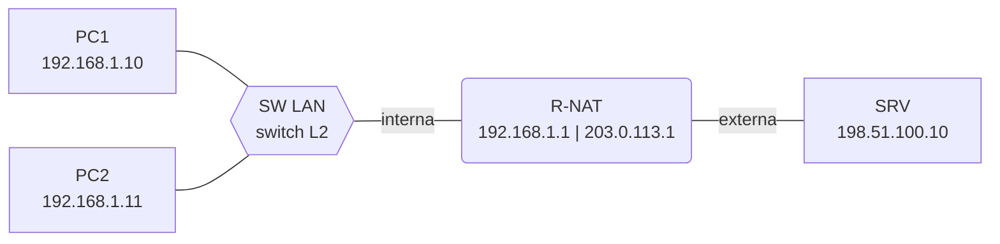

*Figura 3.1 (Tipo A, topologia).* Elementos do modo "Saída: Basic NAT e NAPT": PC1 (192.168.1.10); PC2 (192.168.1.11); SW LAN (switch L2); R-NAT (192.168.1.1 | 203.0.113.1); SRV (198.51.100.10). Vale para todos os cenários do modo (6.1.1 a 6.1.8).

### 3.2 Entrada: DNAT

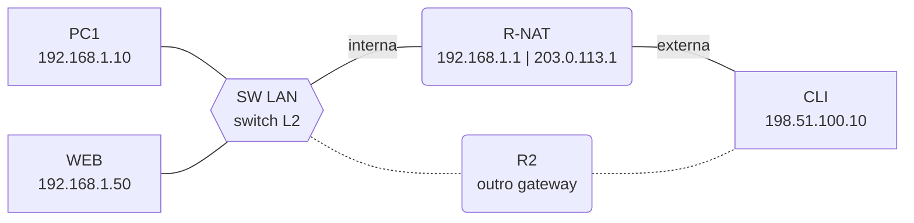

*Figura 3.2a (Tipo A, topologia).* Elementos do modo "Entrada: DNAT": PC1 (192.168.1.10); WEB (192.168.1.50); SW LAN (switch L2); R-NAT (192.168.1.1 | 203.0.113.1); CLI (198.51.100.10); R2 (outro gateway). Linhas tracejadas: enlaces alternativos, forjados ou caídos. Vale para os cenários (6.2.1 e 6.2.2).

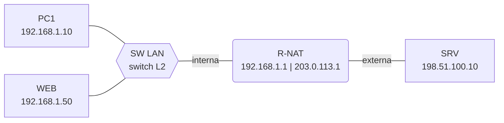

*Figura 3.2b (Tipo A, topologia).* Elementos do modo "Entrada: DNAT": PC1 (192.168.1.10); WEB (192.168.1.50); SW LAN (switch L2); R-NAT (192.168.1.1 | 203.0.113.1); SRV (198.51.100.10). Vale para os cenários (6.2.3 a 6.2.5).

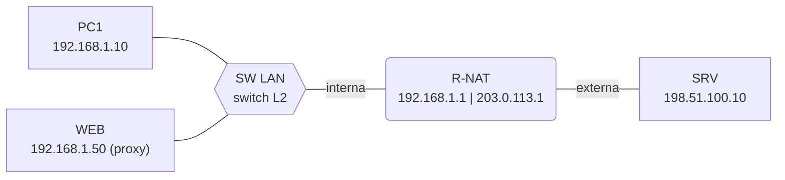

*Figura 3.2c (Tipo A, topologia).* Elementos do modo "Entrada: DNAT": PC1 (192.168.1.10); WEB (192.168.1.50 (proxy)); SW LAN (switch L2); R-NAT (192.168.1.1 | 203.0.113.1); SRV (198.51.100.10). Vale para os cenários (6.2.6).

### 3.3 Limites, IPsec e CGNAT

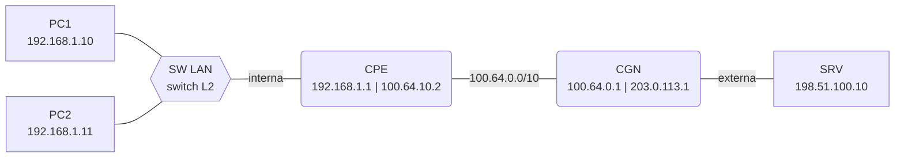

*Figura 3.3a (Tipo A, topologia).* Elementos do modo "Limites, IPsec e CGNAT": PC1 (192.168.1.10); PC2 (192.168.1.11); SW LAN (switch L2); CPE (192.168.1.1 | 100.64.10.2); CGN (100.64.0.1 | 203.0.113.1); SRV (198.51.100.10). Vale para os cenários (6.3.8).


*Figura 3.3b (Tipo A, topologia).* Elementos do modo "Limites, IPsec e CGNAT": PC1 (192.168.1.10); PC2 (192.168.1.11); SW LAN (switch L2); R-NAT (192.168.1.1 | 203.0.113.1); SRV (198.51.100.10). Vale para os cenários (6.3.1 a 6.3.7).

## 4. Abas da bancada

Cenário, Captura, Mensagem, Tabela NAT, Portas (modos: Saída: Basic NAT e NAPT; Limites, IPsec e CGNAT), Experimento, Referência e Log.

## 5. Configurações (campos do painel)

### 5.1 Tradução

- **Tipo de tradução**. Valores: Basic NAT estático (1:1); Basic NAT dinâmico (pool); NAPT (PAT): endereço e porta. Padrão: NAPT (PAT): endereço e porta. Modos: Saída: Basic NAT e NAPT; Limites, IPsec e CGNAT.
  - O que o NAT traduz ([RFC 3022](https://www.rfc-editor.org/rfc/rfc3022)).
  - **Basic NAT estático:** cada host interno tem um endereço público fixo (1:1). Só o endereço IP é traduzido e o mapeamento é permanente, nos dois sentidos.
  - **Basic NAT dinâmico:** o host recebe um endereço de um pool quando começa a falar e o devolve depois do tempo de inatividade. Também traduz só o endereço.
  - **NAPT (PAT):** traduz o endereço **e a porta** (ou o identificador do ICMP). Muitos hosts compartilham um único endereço público. É o que o mercado chama de PAT, *overload* ou, no Linux, *masquerade*.
- **Endereços públicos no pool (dinâmico)**. Valores: 1 endereço; 2 endereços; 3 endereços. Padrão: 2 endereços. Modos: Saída: Basic NAT e NAPT; Limites, IPsec e CGNAT.
  - Quantos endereços o NAT dinâmico pode distribuir.
  - Vale para o Basic NAT dinâmico. Com menos endereços que hosts, o host que chega depois fica sem tradução até um vínculo expirar.
  - Os endereços do pool (203.0.113.11 em diante) são da faixa de documentação da [RFC 5737](https://www.rfc-editor.org/rfc/rfc5737) e fazem o papel de endereços públicos.
- **Protocolo**. Valores: TCP; UDP; ICMP (ping); ESP (IPsec). Padrão: TCP. Modos: Saída: Basic NAT e NAPT; Limites, IPsec e CGNAT.
  - O protocolo do pacote que atravessa o NAT.
  - **TCP e UDP:** o NAPT usa as portas de origem e de destino.
  - **ICMP:** não há porta; o NAT usa o campo *Identifier* do Echo como se fosse a porta ([RFC 5508](https://www.rfc-editor.org/rfc/rfc5508)).
  - **ESP (IPsec):** não há porta. O Basic NAT atravessa sem problema (se não houver AH), mas o NAPT não tem como distinguir dois hosts. A saída é encapsular o ESP em UDP (NAT-T).
- **Comportamento de mapeamento (NAPT)** (ajuste avançado). Valores: Independente do destino (EIM); Dependente de endereço e porta (APDM). Padrão: Independente do destino (EIM). Modos: Saída: Basic NAT e NAPT.
  - Quando o NAPT reaproveita a porta externa ([RFC 4787](https://www.rfc-editor.org/rfc/rfc4787)).
  - **Independente do destino (EIM):** a mesma porta interna usa sempre a mesma porta externa, qualquer que seja o destino. Facilita aplicações ponto a ponto.
  - **Dependente de endereço e porta (APDM):** cada destino distinto recebe sua própria porta externa. É o comportamento do NAT dito "simétrico" e dificulta a conexão direta entre dois hosts atrás de NATs.

### 5.2 Hosts

- **Conexões por host**. Valores: 1 conexão; 2 conexões. Padrão: 1 conexão. Modos: Saída: Basic NAT e NAPT; Limites, IPsec e CGNAT.
  - Quantas conexões cada host abre, em sequência.
  - Cada conexão usa uma porta de origem diferente (50000, 50001...). Mais conexões ocupam mais entradas da tabela e mais portas externas.
  - No ICMP, cada conexão usa um identificador diferente; no ESP, há uma associação por host.
- **PC2 usa a mesma porta de origem do PC1**. Valores: caixa de seleção. Padrão: não. Modos: Saída: Basic NAT e NAPT; Limites, IPsec e CGNAT.
  - Provoca colisão de portas no NAPT.
  - Por padrão o PC2 usa portas na faixa 40000. Marcado, ele passa a usar as mesmas portas do PC1 (50000...), e o NAPT precisa escolher outra porta externa para um dos dois.
  - Os hosts não sabem que há outro host na mesma situação: a colisão é resolvida só pelo NAT.
- **PC1 usa a mesma porta para dois destinos**. Valores: caixa de seleção. Padrão: não. Modos: Saída: Basic NAT e NAPT.
  - Compara os comportamentos de mapeamento do NAPT.
  - O PC1 envia da mesma porta de origem para duas portas de destino do mesmo servidor. Com mapeamento independente do destino, as duas conexões compartilham a porta externa; com mapeamento dependente, cada uma recebe a sua.
  - Só vale para TCP e UDP. Com este campo, só o PC1 envia.

### 5.3 Limites do NAT

- **Faixa de portas do NAT**. Valores: Ampla (1024 a 65535); Pequena, didática (3 portas). Padrão: Ampla (1024 a 65535). Modos: Limites, IPsec e CGNAT.
  - O conjunto de portas externas que o NAT pode usar.
  - **Ampla:** 1024 a 65535 (64.512 portas por endereço e protocolo).
  - **Pequena (didática):** 50000 a 50002, só 3 portas, para mostrar o esgotamento com poucas conexões. Em redes reais, o esgotamento é o mesmo fenômeno em escala muito maior.
- **Tempo de inatividade (timeout)**. Valores: 30 s; 60 s; 120 s; 300 s. Padrão: 120 s. Modos: Limites, IPsec e CGNAT.
  - Quanto tempo uma entrada sobrevive sem tráfego.
  - Parâmetro do simulador, não um padrão de fabricante: em equipamentos reais, o valor varia por protocolo e por estado da conexão (a [RFC 4787](https://www.rfc-editor.org/rfc/rfc4787) e a [RFC 5382](https://www.rfc-editor.org/rfc/rfc5382) dão orientações mínimas).
  - Passado o tempo sem tráfego, a entrada é removida e a porta é liberada.
- **Resposta tardia do servidor**. Valores: caixa de seleção. Padrão: não. Modos: Limites, IPsec e CGNAT.
  - O servidor responde depois do timeout.
  - A primeira resposta chega 30 s depois do timeout configurado. A entrada já expirou e o NAT não sabe a quem entregar o pacote.
  - Com este campo, só o PC1 envia, uma conexão.
- **Pacote não solicitado de fora**. Valores: caixa de seleção. Padrão: não. Modos: Limites, IPsec e CGNAT.
  - O servidor envia um pacote que ninguém de dentro pediu.
  - No fim da simulação, o servidor externo envia um pacote para o endereço público do NAT.
  - No NAPT, sem entrada na tabela, o pacote é descartado. No Basic NAT, o mapeamento vale nos dois sentidos e o pacote é entregue. **O NAT não é um filtro de segurança:** o bloqueio de entrada vem de uma regra de filtragem com estado.
- **NAT em duas camadas (CGNAT)**. Valores: caixa de seleção. Padrão: não. Modos: Limites, IPsec e CGNAT.
  - Um CPE doméstico e um CGN da operadora, em cascata.
  - O CPE traduz o endereço privado para um endereço de 100.64.0.0/10 ([RFC 6598](https://www.rfc-editor.org/rfc/rfc6598)). O CGN traduz esse endereço para o público, dividindo as portas com outros assinantes ([RFC 6888](https://www.rfc-editor.org/rfc/rfc6888)).
  - Neste cenário, o CGN já tem as portas 50000 e 50001 ocupadas por outro assinante. Força o NAPT nos dois dispositivos.
- **NAT-T: ESP dentro de UDP 4500** (ajuste avançado). Valores: caixa de seleção. Padrão: não. Modos: Limites, IPsec e CGNAT.
  - Encapsula o ESP em UDP porta 4500 ([RFC 3948](https://www.rfc-editor.org/rfc/rfc3948)).
  - Vale quando o protocolo é ESP. Com o ESP dentro de um datagrama UDP, o NAPT passa a ver portas e consegue distinguir os hosts.

### 5.4 Redirecionamento (DNAT)

- **Situação**. Valores: Publicar serviço (cliente externo); Hairpin (cliente interno); Proxy transparente. Padrão: Publicar serviço (cliente externo). Modos: Entrada: DNAT.
  - Qual redirecionamento de destino é mostrado.
  - **Publicar serviço:** um cliente externo acessa o endereço público e a porta 443; o NAT redireciona para o servidor interno na porta 8443.
  - **Hairpin:** um cliente interno acessa o endereço público do serviço.
  - **Proxy transparente:** o NAT desvia o tráfego HTTP (porta 80) dos clientes internos para um proxy interno.
- **O servidor interno usa outro gateway**. Valores: caixa de seleção. Padrão: não. Modos: Entrada: DNAT.
  - O gateway padrão do WEB não é o R-NAT.
  - A resposta sai por outro caminho e chega ao cliente com o endereço privado como origem. O cliente espera o endereço público e descarta o pacote.
  - Só vale na situação "Publicar serviço".
- **Suporte a hairpin**. Valores: Sem suporte; Só DNAT; DNAT e SNAT. Padrão: DNAT e SNAT. Modos: Entrada: DNAT.
  - O que o roteador faz quando um cliente interno acessa o endereço público.
  - **Sem suporte:** o roteador não aplica o DNAT a esse caminho e o pacote é descartado ou tratado como destino local.
  - **Só DNAT:** o servidor recebe o pedido com a origem do cliente, na mesma rede, e responde direto, sem passar pelo roteador. A resposta é recusada.
  - **DNAT e SNAT:** o roteador reescreve também a origem. O servidor responde ao roteador e a conexão funciona.
  - Só vale na situação "Hairpin".

## 6. Cenários

### 6.1 Modo: Saída: Basic NAT e NAPT

> **Grupo:** Basic NAT

Tradução só do endereço IP, 1:1, estática ou a partir de um pool ([RFC 3022](https://www.rfc-editor.org/rfc/rfc3022)). Não usa portas.

#### 6.1.1 Basic NAT estático (1:1)

*Cada host tem seu endereço público fixo, nos dois sentidos.*

**Configuração aplicada:** Tipo de tradução = estatico

Cada host interno tem um endereço público fixo: PC1 usa 203.0.113.11 e PC2, 203.0.113.12. Os mapeamentos existem desde o início, antes de qualquer tráfego.

Só o endereço IP muda. As portas passam sem alteração.

**Conceito.** O **Basic NAT estático** ([RFC 3022](https://www.rfc-editor.org/rfc/rfc3022)) mapeia um endereço interno para um endereço externo de forma permanente e 1:1. Só o **endereço IP** é reescrito, no cabeçalho IP: portas e demais campos passam intactos. Na terminologia de uso comum, é um SNAT estático na saída e um DNAT estático na entrada.

**O que observar**

- Na aba Tabela NAT: dois mapeamentos permanentes, criados antes de qualquer tráfego.
- Na aba Mensagem: a origem 192.168.1.10 vira 203.0.113.11 e a porta 50000 não muda; o checksum é recalculado.
- Na aba Portas: nenhuma porta é consumida, só endereços.

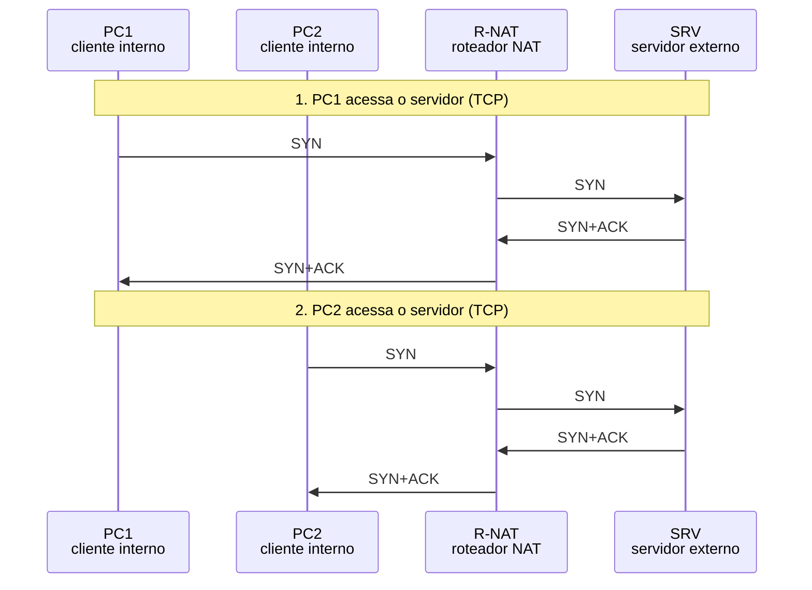

*Figura 6.1.1 (Tipo B, sequência).* Mensagens do cenário "Basic NAT estático (1:1)", na ordem do tempo, entre PC1, PC2, R-NAT, SRV: 8 mensagens (em 2 fases). Corresponde ao diagrama de sequência e à aba Captura, no modo "Saída: Basic NAT e NAPT", com a configuração aplicada acima.

**Mensagens**

| Mensagem | Significado | Origem |
| --- | --- | --- |
| Pacote original | origem privada | PC1 e PC2 |
| Pacote traduzido | origem pública fixa | R-NAT |
| Resposta | destino público vira privado pela tabela | servidor e R-NAT |

**Por que importa.** É usado quando um host precisa ser alcançado de fora por um endereço fixo. Cada host consome um endereço público inteiro, o que não escala.

#### 6.1.2 Basic NAT dinâmico (pool de 2)

*O NAT empresta um endereço do pool a quem precisa.*

**Configuração aplicada:** Tipo de tradução = dinamico; Endereços públicos no pool (dinâmico) = 2

O NAT empresta um endereço do pool quando o host começa a falar: PC1 recebe o primeiro e PC2, o segundo.

Ao contrário do estático, a tabela começa vazia e os vínculos expiram quando o tráfego cessa.

**Conceito.** No **Basic NAT dinâmico**, o NAT escolhe um endereço livre do pool quando o host começa a se comunicar e cria um vínculo. O vínculo é desfeito depois do tempo de inatividade. Só o endereço é traduzido; as portas passam sem mudança.

**O que observar**

- Na Tabela NAT: os vínculos aparecem só depois do primeiro pacote.
- O endereço público de cada host é o primeiro livre do pool: .11 e .12.
- Na aba Portas: o pool mostra 2 de 2 endereços em uso.


*Figura 6.1.2 (Tipo B, sequência).* Mensagens do cenário "Basic NAT dinâmico (pool de 2)", na ordem do tempo, entre PC1, PC2, R-NAT, SRV: 8 mensagens (em 2 fases). Corresponde ao diagrama de sequência e à aba Captura, no modo "Saída: Basic NAT e NAPT", com a configuração aplicada acima.

**Mensagens**

| Mensagem | Significado | Origem |
| --- | --- | --- |
| Primeiro pacote | cria o vínculo | host interno |
| Pacote traduzido | origem do pool | R-NAT |
| Resposta | só passa enquanto o vínculo existe | servidor |

**Por que importa.** Reaproveita endereços públicos entre hosts que não falam ao mesmo tempo, mas ainda limita os hosts simultâneos ao tamanho do pool.

#### 6.1.3 Pool esgotado (1 endereço, 2 hosts)

*Com um endereço para dois hosts, o segundo fica sem tradução.*

**Configuração aplicada:** Tipo de tradução = dinamico; Endereços públicos no pool (dinâmico) = 1

Só há um endereço público para dois hosts. O PC1 fica com ele e o PC2 não consegue sair até o vínculo do PC1 expirar.

É a limitação do Basic NAT que o NAPT resolve.

**Conceito.** O Basic NAT dinâmico traduz um endereço interno por endereço do pool. Se o pool é menor que o número de hosts ativos, os excedentes são **descartados** até algum vínculo expirar. O NAPT resolve isso ao multiplexar por porta.

**O que observar**

- O PC1 recebe 203.0.113.11 e a resposta chega.
- O pacote do PC2 é descartado: "pool de endereços públicos esgotado".
- Na aba Portas: o pool aparece com 1 de 1 em uso.

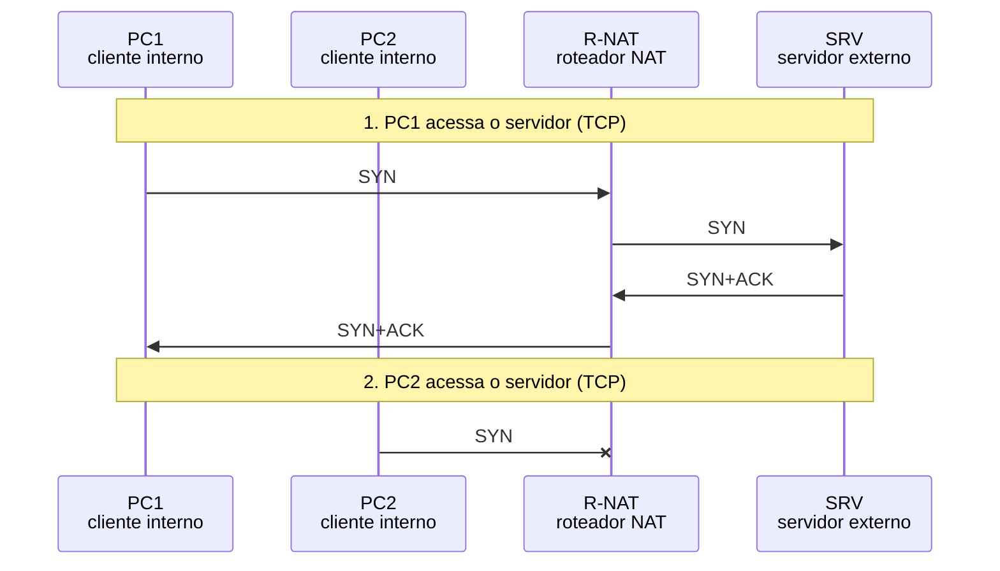

*Figura 6.1.3 (Tipo B, sequência).* Mensagens do cenário "Pool esgotado (1 endereço, 2 hosts)", na ordem do tempo, entre PC1, PC2, R-NAT, SRV: 5 mensagens (em 2 fases; 1 perdida). Corresponde ao diagrama de sequência e à aba Captura, no modo "Saída: Basic NAT e NAPT", com a configuração aplicada acima.

**Mensagens**

| Mensagem | Significado | Origem |
| --- | --- | --- |
| Pacote do PC1 | recebe o único endereço | PC1 |
| Pacote do PC2 | sem endereço livre: descartado | R-NAT |

**Por que importa.** Mostra por que o NAPT é o tipo de NAT dominante: um único endereço atende milhares de hosts.

> **Grupo:** NAPT (PAT)

Tradução de endereço e porta ([RFC 3022](https://www.rfc-editor.org/rfc/rfc3022)), o que o mercado chama de PAT. Muitos hosts compartilham um endereço público.

#### 6.1.4 NAPT (PAT): dois hosts, um endereço

*Dois hosts compartilham um endereço público, separados por porta.*

**Configuração aplicada:** Tipo de tradução = napt

PC1 e PC2 saem pelo mesmo endereço público, 203.0.113.1. O que os distingue é a porta de origem.

Observe a tabela: duas entradas com o mesmo endereço externo e portas diferentes.

**Conceito.** O **NAPT** (*Network Address Port Translation*, [RFC 3022](https://www.rfc-editor.org/rfc/rfc3022)), conhecido como PAT, traduz o endereço **e a porta** de origem. A entrada da tabela liga (endereço interno, porta interna) a (endereço externo, porta externa). A resposta chega à porta externa e a tabela devolve o pacote ao host certo. É um **SNAT** com tradução de porta; no Linux, o *masquerade* é a variante em que o endereço externo é o da interface.

**O que observar**

- Na Tabela NAT: duas entradas com o mesmo endereço externo (203.0.113.1) e portas diferentes.
- Na aba Mensagem: origem e porta de origem reescritas, com o checksum de TCP recalculado (ele cobre endereços e portas).
- Na aba Portas: duas portas consumidas no mesmo endereço.


*Figura 6.1.4 (Tipo B, sequência).* Mensagens do cenário "NAPT (PAT): dois hosts, um endereço", na ordem do tempo, entre PC1, PC2, R-NAT, SRV: 8 mensagens (em 2 fases). Corresponde ao diagrama de sequência e à aba Captura, no modo "Saída: Basic NAT e NAPT", com a configuração aplicada acima.

**Mensagens**

| Mensagem | Significado | Origem |
| --- | --- | --- |
| SYN | origem privada | PC1 e PC2 |
| SYN traduzido | origem 203.0.113.1:porta | R-NAT |
| SYN+ACK | destino é o endereço público | servidor |
| SYN+ACK revertido | destino volta a ser privado | R-NAT |

**Por que importa.** Um único endereço público atende uma rede inteira. O custo é a perda da conectividade fim a fim: ninguém de fora inicia conexões para os hosts internos sem uma regra de DNAT.

#### 6.1.5 Colisão de portas

*Duas conexões com a mesma porta de origem: uma é remapeada.*

**Configuração aplicada:** Tipo de tradução = napt; PC2 usa a mesma porta de origem do PC1 = sim

PC1 e PC2 usam a mesma porta de origem, 50000. A primeira conexão preserva a porta; a segunda colide e o NAPT escolhe outra porta externa.

O host não percebe: só o NAT conhece a porta externa.

**Conceito.** Hosts diferentes escolhem portas de origem sem coordenação, então duas conexões podem usar a mesma. O NAPT precisa garantir que a combinação (endereço externo, porta externa) seja única. A primeira conexão preserva a porta; a segunda recebe outra porta externa (o simulador usa a próxima livre; equipamentos reais variam).

**O que observar**

- Na Tabela NAT: o PC1 usa a porta externa 50000 e o PC2 usa 50001, apesar de ambos usarem 50000 internamente.
- No log: "colisão: a porta 50000 já estava em uso".
- Na aba Mensagem: a porta de origem aparece como reescrita.


*Figura 6.1.5 (Tipo B, sequência).* Mensagens do cenário "Colisão de portas", na ordem do tempo, entre PC1, PC2, R-NAT, SRV: 8 mensagens (em 2 fases). Corresponde ao diagrama de sequência e à aba Captura, no modo "Saída: Basic NAT e NAPT", com a configuração aplicada acima.

**Mensagens**

| Mensagem | Significado | Origem |
| --- | --- | --- |
| SYN do PC1 | porta 50000 preservada | PC1 |
| SYN do PC2 | porta 50000 em conflito: remapeada | R-NAT |

**Por que importa.** Sem esse remapeamento, as respostas das duas conexões chegariam ao mesmo destino. O host nunca vê a troca: ele continua usando a porta 50000.

#### 6.1.6 ICMP Echo (ping) sem portas

*No ping, o identificador faz o papel da porta.*

**Configuração aplicada:** Tipo de tradução = napt; Protocolo = icmp

O ICMP não tem portas. O NAPT usa o campo **Identifier** do Echo como se fosse a porta: ele é a chave da entrada e é a ele que a resposta se refere.

**Conceito.** O ICMP não tem portas. Para o Echo, o NAT usa o campo **Identifier** como se fosse a porta ([RFC 5508](https://www.rfc-editor.org/rfc/rfc5508)). A resposta (Echo Reply) traz o mesmo identificador, que é a chave para achar a entrada.

**O que observar**

- Na Tabela NAT: a coluna de porta mostra o identificador (4660 e 22136).
- Na aba Mensagem: o Identifier aparece sem tipo de porta, e é ele que muda se houver colisão.
- No Echo Reply, o destino é o endereço público e o identificador casa com a entrada.

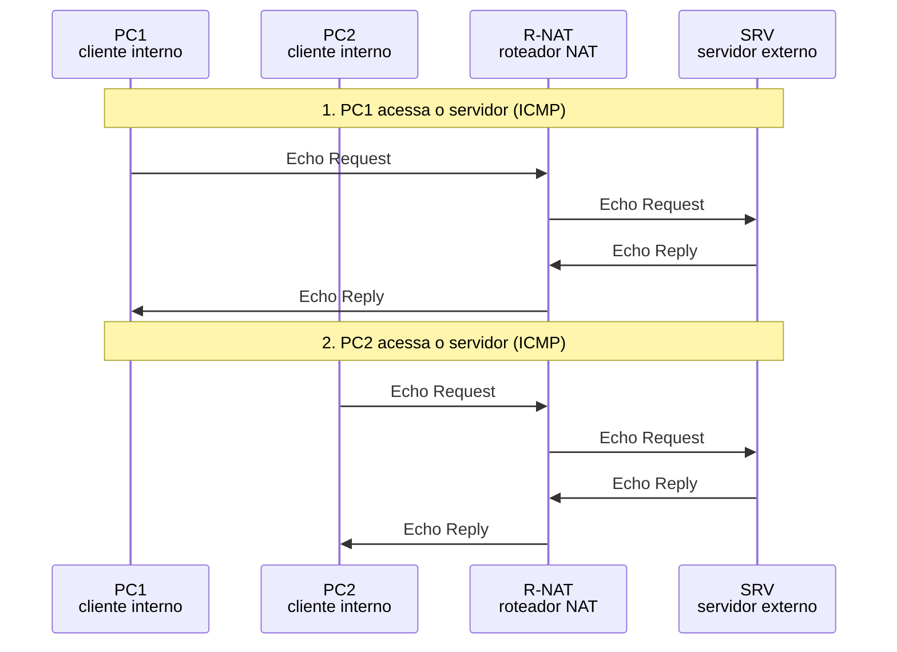

*Figura 6.1.6 (Tipo B, sequência).* Mensagens do cenário "ICMP Echo (ping) sem portas", na ordem do tempo, entre PC1, PC2, R-NAT, SRV: 8 mensagens (em 2 fases). Corresponde ao diagrama de sequência e à aba Captura, no modo "Saída: Basic NAT e NAPT", com a configuração aplicada acima.

**Mensagens**

| Mensagem | Significado | Origem |
| --- | --- | --- |
| Echo Request | Identifier do host | PC1 e PC2 |
| Echo Request traduzido | origem pública | R-NAT |
| Echo Reply | destino público e mesmo Identifier | servidor |

**Por que importa.** Sem esse tratamento, o ping de vários hosts atrás de um NAPT não funcionaria. Mensagens de erro ICMP exigem tratamento adicional (o NAT consulta o pacote embutido), que o simulador não modela.

> **Grupo:** Mapeamento

Quando o NAPT reaproveita a porta externa para o mesmo host interno ([RFC 4787](https://www.rfc-editor.org/rfc/rfc4787)).

#### 6.1.7 Mapeamento independente do destino (EIM)

*A mesma porta interna usa a mesma porta externa, qualquer que seja o destino.*

**Configuração aplicada:** Tipo de tradução = napt; Protocolo = udp; PC1 usa a mesma porta para dois destinos = sim; Comportamento de mapeamento (NAPT) = eim

O PC1 envia, da mesma porta de origem, para duas portas do servidor. Com EIM, as duas conexões compartilham a mesma porta externa.

**Conceito.** No mapeamento **independente do destino** (*endpoint-independent mapping*, [RFC 4787](https://www.rfc-editor.org/rfc/rfc4787)), a porta externa depende só do endereço e da porta internos. Assim, uma aplicação que fala com vários pares a partir da mesma porta é vista com a mesma porta externa por todos, o que ajuda protocolos ponto a ponto.

**O que observar**

- Na Tabela NAT: duas entradas com o mesmo endereço e a mesma porta externa, mas destinos diferentes.
- No log: "reaproveitou a porta externa 50000".
- Na aba Portas: só uma porta é consumida.

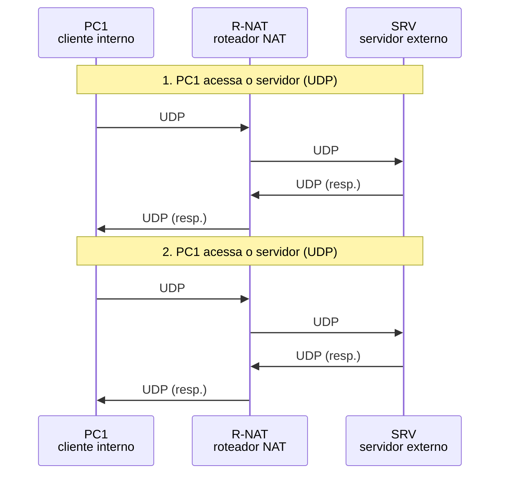

*Figura 6.1.7 (Tipo B, sequência).* Mensagens do cenário "Mapeamento independente do destino (EIM)", na ordem do tempo, entre PC1, R-NAT, SRV: 8 mensagens (em 2 fases). Corresponde ao diagrama de sequência e à aba Captura, no modo "Saída: Basic NAT e NAPT", com a configuração aplicada acima.

**Mensagens**

| Mensagem | Significado | Origem |
| --- | --- | --- |
| UDP 50000 para :53 | cria o mapeamento | PC1 |
| UDP 50000 para :123 | reaproveita a porta externa | R-NAT |

**Por que importa.** É o comportamento que a [RFC 4787](https://www.rfc-editor.org/rfc/rfc4787) exige para UDP (REQ-1). Compare com o cenário seguinte.

#### 6.1.8 Mapeamento dependente do destino (APDM)

*Cada destino distinto recebe uma porta externa própria.*

**Configuração aplicada:** Tipo de tradução = napt; Protocolo = udp; PC1 usa a mesma porta para dois destinos = sim; Comportamento de mapeamento (NAPT) = apdm

O mesmo envio, agora com mapeamento dependente de endereço e porta: cada destino distinto recebe uma porta externa própria.

É o comportamento do NAT "simétrico", que complica a conexão direta entre dois hosts atrás de NATs.

**Conceito.** No mapeamento **dependente de endereço e porta** (*address and port-dependent mapping*), a porta externa varia com o destino. Cada nova combinação de destino cria um novo mapeamento. É o comportamento do NAT "simétrico": o par de um ponto a ponto não consegue prever a porta externa que o outro lado usará.

**O que observar**

- Na Tabela NAT: duas entradas com portas externas diferentes (50000 e 50001), apesar da mesma porta interna.
- Na aba Portas: duas portas consumidas.


*Figura 6.1.8 (Tipo B, sequência).* Mensagens do cenário "Mapeamento dependente do destino (APDM)", na ordem do tempo, entre PC1, R-NAT, SRV: 8 mensagens (em 2 fases). Corresponde ao diagrama de sequência e à aba Captura, no modo "Saída: Basic NAT e NAPT", com a configuração aplicada acima.

**Mensagens**

| Mensagem | Significado | Origem |
| --- | --- | --- |
| UDP 50000 para :53 | porta externa 50000 | PC1 |
| UDP 50000 para :123 | nova porta externa 50001 | R-NAT |

**Por que importa.** Consome mais portas e dificulta aplicações ponto a ponto, como voz e vídeo. Por isso a [RFC 4787](https://www.rfc-editor.org/rfc/rfc4787) (REQ-1) exige o mapeamento independente do destino para UDP.

### 6.2 Modo: Entrada: DNAT

> **Grupo:** DNAT

Reescrita do destino: publicar serviços, hairpinning e redirecionamento transparente. A reescrita da origem é o SNAT.

#### 6.2.1 Publicar um serviço (443 para 8443)

*O NAT reescreve o destino para levar o tráfego ao servidor interno.*

**Configuração aplicada:** Situação = forward; O servidor interno usa outro gateway = não

Um cliente externo acessa 203.0.113.1:443. O R-NAT reescreve o **destino** para 192.168.1.50:8443, o servidor interno.

A resposta é revertida sem regra extra, pela tabela de conexões.

**Conceito.** O **DNAT** (*destination NAT*) reescreve o **destino** do pacote. Na prática, o termo vem do netfilter/Linux; na [RFC 2663](https://www.rfc-editor.org/rfc/rfc2663) o conceito aparece como NAT de entrada (*inbound*). Aqui, o endereço público 203.0.113.1:443 vira 192.168.1.50:8443. A regra de DNAT é aplicada **antes** da decisão de roteamento (por isso o roteamento já escolhe a interface interna). A resposta volta pela tabela de conexões, com a origem revertida; não é preciso regra de SNAT.

**O que observar**

- Na aba Mensagem: o destino é reescrito em 1 e a origem é revertida no retorno.
- Na Tabela NAT: a regra configurada no topo e a conexão ativa logo abaixo.
- Nos eventos do R-NAT: "PREROUTING: DNAT ..." antes do envio ao servidor interno.

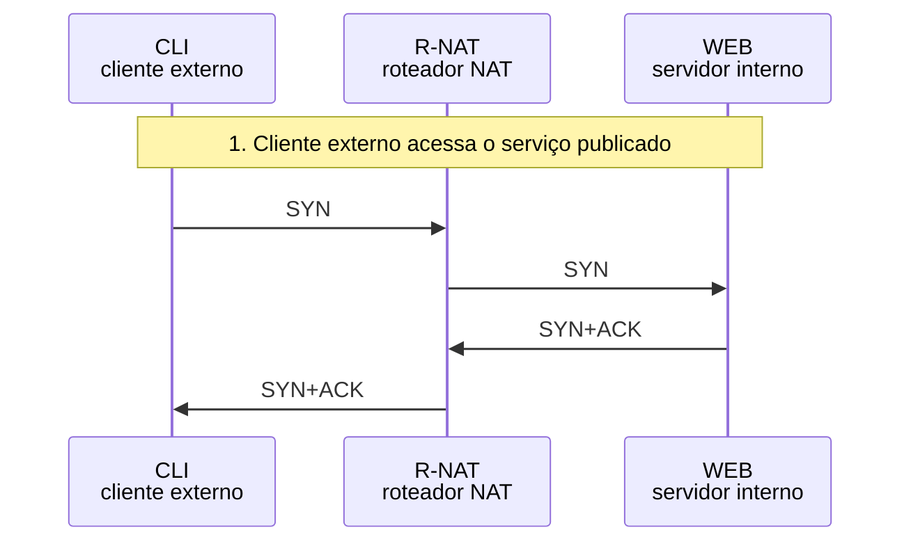

*Figura 6.2.1 (Tipo B, sequência).* Mensagens do cenário "Publicar um serviço (443 para 8443)", na ordem do tempo, entre CLI, R-NAT, WEB: 4 mensagens (em 1 fase). Corresponde ao diagrama de sequência e à aba Captura, no modo "Entrada: DNAT", com a configuração aplicada acima.

**Mensagens**

| Mensagem | Significado | Origem |
| --- | --- | --- |
| SYN para 203.0.113.1:443 | destino público | cliente externo |
| SYN para 192.168.1.50:8443 | destino reescrito (DNAT) | R-NAT |
| SYN+ACK de 192.168.1.50:8443 | origem privada | servidor interno |
| SYN+ACK de 203.0.113.1:443 | origem revertida | R-NAT |

**Por que importa.** É como serviços internos são publicados na internet atrás de um único endereço. O DNAT só redireciona: quem pode acessar é decidido pela regra de filtragem, que o simulador não modela.

#### 6.2.2 Retorno assimétrico

*A resposta sai por outro caminho, sem reversão, e a conexão falha.*

**Configuração aplicada:** Situação = forward; O servidor interno usa outro gateway = sim

O servidor interno tem outro gateway padrão. A resposta não passa pelo R-NAT, então a origem não é revertida: o cliente recebe um pacote vindo de 192.168.1.50 e o descarta.

**Conceito.** A reversão do DNAT depende de a resposta passar pelo mesmo dispositivo. Se o servidor interno usa outro gateway padrão, a resposta vai direto à internet com o **endereço privado** como origem. O cliente espera uma resposta de 203.0.113.1:443 e não reconhece a de 192.168.1.50:8443: descarta o pacote (em TCP, responde com RST).

**O que observar**

- O WEB responde por R2, não pelo R-NAT: o pacote aparece como descartado.
- A origem na resposta é 192.168.1.50:8443, não 203.0.113.1:443.
- O estado "pacotes descartados" sobe para 1.

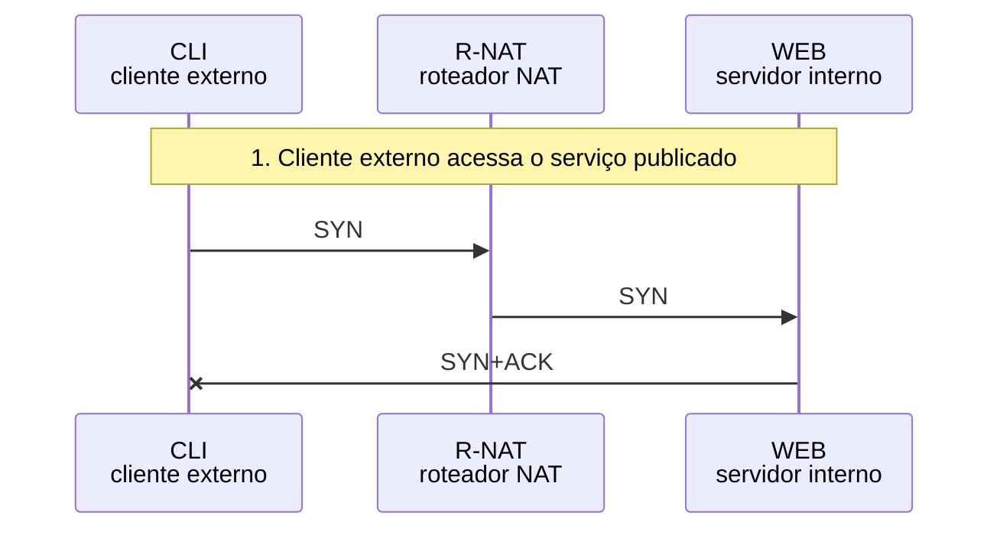

*Figura 6.2.2 (Tipo B, sequência).* Mensagens do cenário "Retorno assimétrico", na ordem do tempo, entre CLI, R-NAT, WEB: 3 mensagens (em 1 fase; 1 perdida). Corresponde ao diagrama de sequência e à aba Captura, no modo "Entrada: DNAT", com a configuração aplicada acima.

**Mensagens**

| Mensagem | Significado | Origem |
| --- | --- | --- |
| SYN para 203.0.113.1:443 | DNAT normal | cliente externo |
| SYN+ACK com origem privada | sem reversão: descartado | servidor interno |

**Por que importa.** É um erro clássico de publicação de serviços. A correção é fazer o tráfego de retorno passar pelo NAT (gateway padrão certo) ou também aplicar SNAT na origem.

#### 6.2.3 Hairpin sem suporte

*O cliente interno usa o endereço público e o roteador não o trata.*

**Configuração aplicada:** Situação = hairpin; Suporte a hairpin = nao

Um cliente interno tenta acessar o endereço público do serviço. O roteador não aplica o DNAT nesse caminho e o pacote é descartado.

**Conceito.** Um cliente interno que usa o nome público do serviço resolve para 203.0.113.1, o endereço externo do próprio roteador. Sem **hairpinning** (também chamado NAT loopback ou reflexão), o roteador não aplica o DNAT a pacotes que chegam pela interface interna com esse destino: o pacote é descartado ou tratado como destino local do roteador. A [RFC 4787](https://www.rfc-editor.org/rfc/rfc4787) (REQ-9) manda o NAT suportar o hairpinning; este cenário mostra o que ocorre quando não suporta.

**O que observar**

- O pacote do PC1 chega ao R-NAT e é descartado.
- O estado "pacotes descartados" sobe para 1.

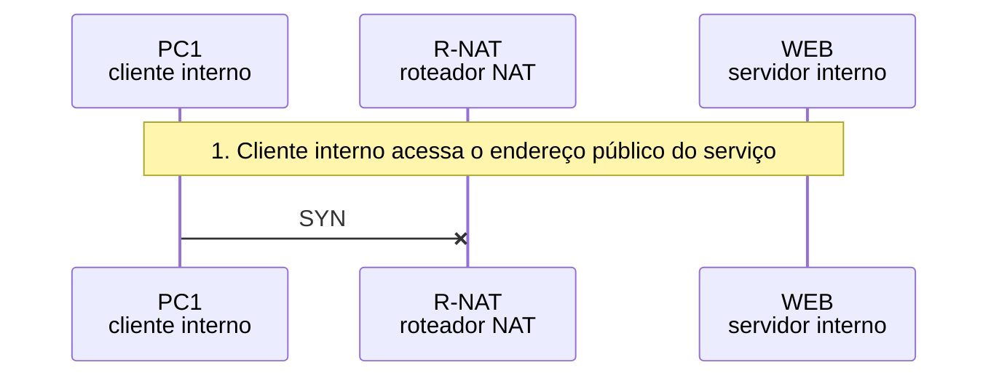

*Figura 6.2.3 (Tipo B, sequência).* Mensagens do cenário "Hairpin sem suporte", na ordem do tempo, entre PC1, R-NAT, WEB: 1 mensagem (em 1 fase; 1 perdida). Corresponde ao diagrama de sequência e à aba Captura, no modo "Entrada: DNAT", com a configuração aplicada acima.

**Mensagens**

| Mensagem | Significado | Origem |
| --- | --- | --- |
| SYN para 203.0.113.1:443 | origem interna, destino externo do roteador | PC1 |

**Por que importa.** Por isso muitas redes usam DNS interno (split DNS) para que o nome resolva para o endereço privado dentro da rede.

#### 6.2.4 Hairpin só com DNAT (quebra)

*Só o DNAT não basta: o servidor responde direto ao cliente.*

**Configuração aplicada:** Situação = hairpin; Suporte a hairpin = dnat

O DNAT leva o pedido ao servidor, mas a origem continua sendo o cliente, na mesma rede. O servidor responde direto e o cliente recusa a resposta.

**Conceito.** Com o hairpin apenas no DNAT, o servidor interno recebe o pedido com a origem do cliente, que está na mesma rede. Ele responde **direto**, sem passar pelo roteador. O cliente esperava uma resposta de 203.0.113.1:443 e recebe uma de 192.168.1.50:8443: recusa.

**O que observar**

- A resposta do WEB para o PC1 não passa pelo R-NAT.
- A origem na resposta é privada e não casa com o que o cliente espera.

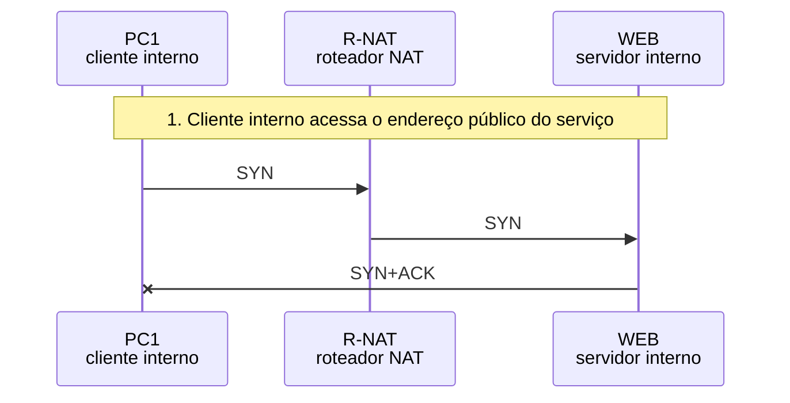

*Figura 6.2.4 (Tipo B, sequência).* Mensagens do cenário "Hairpin só com DNAT (quebra)", na ordem do tempo, entre PC1, R-NAT, WEB: 3 mensagens (em 1 fase; 1 perdida). Corresponde ao diagrama de sequência e à aba Captura, no modo "Entrada: DNAT", com a configuração aplicada acima.

**Mensagens**

| Mensagem | Significado | Origem |
| --- | --- | --- |
| SYN para 203.0.113.1:443 | destino público | PC1 |
| SYN para 192.168.1.50:8443 | DNAT, origem inalterada | R-NAT |
| SYN+ACK direto ao PC1 | não passa pelo roteador: recusado | servidor interno |

**Por que importa.** É a falha típica do hairpin mal configurado. A solução é reescrever também a origem (SNAT), no cenário a seguir.

#### 6.2.5 Hairpin com DNAT e SNAT

*DNAT no destino e SNAT na origem forçam o retorno pelo roteador.*

**Configuração aplicada:** Situação = hairpin; Suporte a hairpin = completo

O roteador reescreve o destino (DNAT) e a origem (SNAT). O servidor responde ao roteador, que reverte os dois campos. A conexão funciona.

**Conceito.** Para o hairpin funcionar, o roteador aplica **DNAT** (destino público vira o servidor interno) e **SNAT** (origem do cliente vira o endereço interno do roteador). Assim, o servidor responde ao roteador, que reverte os dois campos. Quando as duas reescritas são aplicadas ao mesmo pacote, a literatura chama de *Twice NAT* ([RFC 2663](https://www.rfc-editor.org/rfc/rfc2663)).

**O que observar**

- O pacote ao WEB tem origem 192.168.1.1:50000 (o roteador) e destino 192.168.1.50:8443.
- Na aba Tabela NAT: a observação "DNAT + SNAT".
- No retorno, o cliente vê 203.0.113.1:443 como origem.

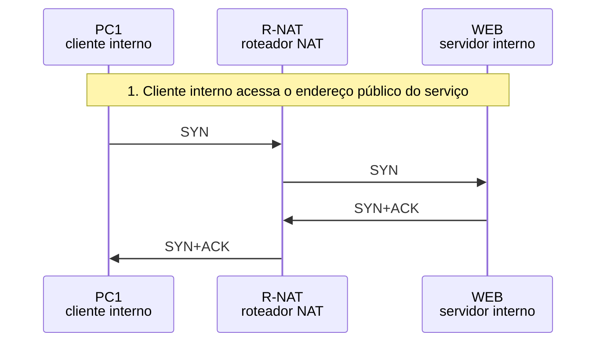

*Figura 6.2.5 (Tipo B, sequência).* Mensagens do cenário "Hairpin com DNAT e SNAT", na ordem do tempo, entre PC1, R-NAT, WEB: 4 mensagens (em 1 fase). Corresponde ao diagrama de sequência e à aba Captura, no modo "Entrada: DNAT", com a configuração aplicada acima.

**Mensagens**

| Mensagem | Significado | Origem |
| --- | --- | --- |
| SYN para 203.0.113.1:443 | destino público | PC1 |
| SYN reescrito (Twice NAT) | destino e origem reescritos | R-NAT |
| SYN+ACK | resposta ao roteador | servidor interno |
| SYN+ACK revertido | origem pública, destino do cliente | R-NAT |

**Por que importa.** O custo é que o servidor interno perde o endereço real do cliente nos registros: todos os acessos internos parecem vir do roteador.

#### 6.2.6 Redirecionamento transparente para proxy

*O NAT desvia o tráfego dos clientes para um proxy sem avisá-los.*

**Configuração aplicada:** Situação = proxy

O roteador desvia o tráfego dos clientes internos para a porta 80 de qualquer servidor para o proxy interno, na porta 3128, sem avisar o cliente.

**Conceito.** No **redirecionamento transparente**, uma regra de DNAT na interface interna desvia o tráfego de saída (por exemplo, TCP porta 80) para um proxy local. O cliente acredita falar com o servidor externo; o proxy recebe o pedido. Na volta, a origem é revertida para o servidor original.

**O que observar**

- O destino do pacote muda de 198.51.100.10:80 para 192.168.1.50:3128.
- A origem do cliente não muda.
- No retorno, a origem volta a ser 198.51.100.10:80.

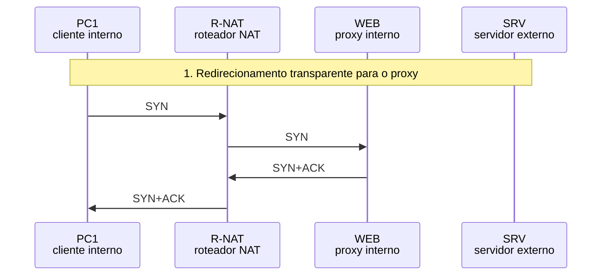

*Figura 6.2.6 (Tipo B, sequência).* Mensagens do cenário "Redirecionamento transparente para proxy", na ordem do tempo, entre PC1, R-NAT, WEB, SRV: 4 mensagens (em 1 fase). Corresponde ao diagrama de sequência e à aba Captura, no modo "Entrada: DNAT", com a configuração aplicada acima.

**Mensagens**

| Mensagem | Significado | Origem |
| --- | --- | --- |
| SYN para 198.51.100.10:80 | destino original | PC1 |
| SYN para 192.168.1.50:3128 | destino redirecionado (DNAT) | R-NAT |
| SYN+ACK do proxy | origem do proxy | proxy |
| SYN+ACK revertido | origem volta a ser o servidor | R-NAT |

**Por que importa.** É usado para filtragem e cache sem configurar cada cliente. O simulador mostra só o trecho redirecionado, não a conexão que o proxy abre ao servidor externo.

### 6.3 Modo: Limites, IPsec e CGNAT

> **Grupo:** Limites do NAT

O que acontece quando as portas acabam, quando a entrada expira e quando chega tráfego que ninguém pediu.

#### 6.3.1 Esgotamento de portas

*Só há 3 portas e 4 conexões: a última é descartada.*

**Configuração aplicada:** Faixa de portas do NAT = pequena; Conexões por host = 2

O NAT só tem 3 portas externas (50000 a 50002) e há 4 conexões. A quarta não tem porta e é descartada.

Em redes reais é o mesmo fenômeno, em escala de dezenas de milhares de portas por endereço.

**Conceito.** Cada conexão simultânea ocupa uma porta externa por endereço público e protocolo. Quando todas as portas da faixa estão em uso, **novas conexões não conseguem entrada na tabela** e são descartadas até alguma porta ser liberada por expiração. Redes de operadora controlam esse risco com limites por assinante ([RFC 6888](https://www.rfc-editor.org/rfc/rfc6888)).

**O que observar**

- O PC1 usa as portas 50000 e 50001 (preservadas).
- O PC2 usa a 50002 e a quarta conexão é descartada: "sem porta livre".
- Na aba Portas: 3 de 3 portas em uso.

```mermaid
sequenceDiagram
  participant n_pc1 as PC1<br/>cliente interno
  participant n_pc2 as PC2<br/>cliente interno
  participant n_nat as R-NAT<br/>roteador NAT
  participant n_srv as SRV<br/>servidor externo
  Note over n_pc1,n_srv: 1. PC1 acessa o servidor (TCP)
  n_pc1 ->> n_nat: SYN
  n_nat ->> n_srv: SYN
  n_srv ->> n_nat: SYN+ACK
  n_nat ->> n_pc1: SYN+ACK
  Note over n_pc1,n_srv: 2. PC1 acessa o servidor (TCP)
  n_pc1 ->> n_nat: SYN
  n_nat ->> n_srv: SYN
  n_srv ->> n_nat: SYN+ACK
  n_nat ->> n_pc1: SYN+ACK
  Note over n_pc1,n_srv: 3. PC2 acessa o servidor (TCP)
  n_pc2 ->> n_nat: SYN
  n_nat ->> n_srv: SYN
  n_srv ->> n_nat: SYN+ACK
  n_nat ->> n_pc2: SYN+ACK
  Note over n_pc1,n_srv: 4. PC2 acessa o servidor (TCP)
  n_pc2 -x n_nat: SYN
```

*Figura 6.3.1 (Tipo B, sequência).* Mensagens do cenário "Esgotamento de portas", na ordem do tempo, entre PC1, PC2, R-NAT, SRV: 13 mensagens (em 4 fases; 1 perdida). Corresponde ao diagrama de sequência e à aba Captura, no modo "Limites, IPsec e CGNAT", com a configuração aplicada acima.

**Mensagens**

| Mensagem | Significado | Origem |
| --- | --- | --- |
| Quatro SYN | três entradas e uma recusa | PC1 e PC2 |
| Descarte | sem porta livre | R-NAT |

**Por que importa.** Um único host com muitas conexões (ou um ataque) pode esgotar as portas e negar serviço aos demais. Limitar conexões por host é a defesa.

#### 6.3.2 Expiração por inatividade

*A resposta chega depois da expiração e não acha a entrada.*

**Configuração aplicada:** Resposta tardia do servidor = sim; Tempo de inatividade (timeout) = 60

O servidor responde depois do tempo de inatividade. A entrada já foi removida e o NAT não sabe a quem entregar a resposta.

**Conceito.** Entradas sem tráfego são removidas depois do tempo de inatividade, para liberar portas. Se uma resposta chega depois disso, o NAT não tem entrada para ela e a **descarta**. Para conexões longas e ociosas, as aplicações enviam *keepalives*. Os tempos são parâmetros do simulador, não padrão de fabricante.

**O que observar**

- O tempo no diagrama salta mais que o timeout configurado.
- Na Tabela NAT: a entrada desaparece no instante exato da expiração.
- A resposta tardia é descartada: "a entrada expirou por inatividade".

```mermaid
sequenceDiagram
  participant n_pc1 as PC1<br/>cliente interno
  participant n_nat as R-NAT<br/>roteador NAT
  participant n_srv as SRV<br/>servidor externo
  Note over n_pc1,n_srv: 1. PC1 acessa o servidor (TCP)
  n_pc1 ->> n_nat: SYN
  n_nat ->> n_srv: SYN
  n_srv -x n_nat: SYN+ACK
```

*Figura 6.3.2 (Tipo B, sequência).* Mensagens do cenário "Expiração por inatividade", na ordem do tempo, entre PC1, R-NAT, SRV: 3 mensagens (em 1 fase; 1 perdida). Corresponde ao diagrama de sequência e à aba Captura, no modo "Limites, IPsec e CGNAT", com a configuração aplicada acima.

**Mensagens**

| Mensagem | Significado | Origem |
| --- | --- | --- |
| SYN | cria a entrada | PC1 |
| Espera | passa o timeout | tempo |
| SYN+ACK tardio | sem entrada: descartado | servidor |

**Por que importa.** É a causa de quedas silenciosas de conexões ociosas atrás de NAT. Keepalives menores que o timeout evitam o problema.

#### 6.3.3 Entrada não solicitada no NAPT

*Sem entrada na tabela, o pacote de fora é descartado.*

**Configuração aplicada:** Pacote não solicitado de fora = sim

Depois das conexões de saída, o servidor envia um pacote para uma porta que ninguém abriu. Sem entrada na tabela, o pacote é descartado.

É um efeito colateral da tradução, não uma política de segurança.

**Conceito.** Um pacote vindo de fora para uma porta sem entrada não tem destino interno: o NAPT o descarta. Esse efeito dá a impressão de proteção, mas é **consequência da tradução, não uma política**. A [RFC 4787](https://www.rfc-editor.org/rfc/rfc4787) permite comportamentos de filtragem diferentes, e a proteção real vem de uma regra de filtragem com estado (firewall).

**O que observar**

- Depois das conexões, um pacote para 203.0.113.1:8080 é descartado.
- Motivo no log: "ninguém de dentro iniciou esta conexão".

```mermaid
sequenceDiagram
  participant n_pc1 as PC1<br/>cliente interno
  participant n_pc2 as PC2<br/>cliente interno
  participant n_nat as R-NAT<br/>roteador NAT
  participant n_srv as SRV<br/>servidor externo
  Note over n_pc1,n_srv: 1. PC1 acessa o servidor (TCP)
  n_pc1 ->> n_nat: SYN
  n_nat ->> n_srv: SYN
  n_srv ->> n_nat: SYN+ACK
  n_nat ->> n_pc1: SYN+ACK
  Note over n_pc1,n_srv: 2. PC2 acessa o servidor (TCP)
  n_pc2 ->> n_nat: SYN
  n_nat ->> n_srv: SYN
  n_srv ->> n_nat: SYN+ACK
  n_nat ->> n_pc2: SYN+ACK
  Note over n_pc1,n_srv: Pacote não solicitado de fora
  n_srv -x n_nat: SYN
```

*Figura 6.3.3 (Tipo B, sequência).* Mensagens do cenário "Entrada não solicitada no NAPT", na ordem do tempo, entre PC1, PC2, R-NAT, SRV: 9 mensagens (em 3 fases; 1 perdida). Corresponde ao diagrama de sequência e à aba Captura, no modo "Limites, IPsec e CGNAT", com a configuração aplicada acima.

**Mensagens**

| Mensagem | Significado | Origem |
| --- | --- | --- |
| Pacote não solicitado | porta sem entrada | servidor externo |
| Descarte | sem mapeamento | R-NAT |

**Por que importa.** Comparar com o cenário seguinte mostra que o resultado depende do tipo de NAT, e não de uma regra de segurança.

#### 6.3.4 Entrada não solicitada no NAT estático

*O mapeamento estático é bidirecional: o pacote de fora chega ao host.*

**Configuração aplicada:** Tipo de tradução = estatico; Pacote não solicitado de fora = sim

No Basic NAT estático, o mapeamento é permanente e vale nos dois sentidos. Um pacote de fora para 203.0.113.11 chega ao PC1 sem que ele tenha iniciado nada.

**Conceito.** No Basic NAT estático, o mapeamento é permanente e vale nos dois sentidos. Um pacote de fora para 203.0.113.11 é traduzido e entregue ao PC1 sem filtro algum. **O NAT, por si, não protege o host**: ele só expõe o endereço. A proteção exige uma regra de filtragem.

**O que observar**

- O pacote não solicitado é entregue ao PC1 com o destino reescrito para 192.168.1.10.
- O log registra a entrega como alerta.

```mermaid
sequenceDiagram
  participant n_pc1 as PC1<br/>cliente interno
  participant n_pc2 as PC2<br/>cliente interno
  participant n_nat as R-NAT<br/>roteador NAT
  participant n_srv as SRV<br/>servidor externo
  Note over n_pc1,n_srv: 1. PC1 acessa o servidor (TCP)
  n_pc1 ->> n_nat: SYN
  n_nat ->> n_srv: SYN
  n_srv ->> n_nat: SYN+ACK
  n_nat ->> n_pc1: SYN+ACK
  Note over n_pc1,n_srv: 2. PC2 acessa o servidor (TCP)
  n_pc2 ->> n_nat: SYN
  n_nat ->> n_srv: SYN
  n_srv ->> n_nat: SYN+ACK
  n_nat ->> n_pc2: SYN+ACK
  Note over n_pc1,n_srv: Pacote não solicitado de fora
  n_srv ->> n_nat: SYN
  n_nat ->> n_pc1: SYN
```

*Figura 6.3.4 (Tipo B, sequência).* Mensagens do cenário "Entrada não solicitada no NAT estático", na ordem do tempo, entre PC1, PC2, R-NAT, SRV: 10 mensagens (em 3 fases). Corresponde ao diagrama de sequência e à aba Captura, no modo "Limites, IPsec e CGNAT", com a configuração aplicada acima.

**Mensagens**

| Mensagem | Significado | Origem |
| --- | --- | --- |
| Pacote não solicitado | destino 203.0.113.11 | servidor externo |
| Pacote entregue | destino 192.168.1.10 | R-NAT |

**Por que importa.** Publicar um host por NAT estático sem filtragem equivale a expor o host à internet.

> **Grupo:** IPsec e CGNAT

Protocolos sem portas e a tradução em duas camadas nas redes de operadora.

#### 6.3.5 ESP atrás de NAPT

*Sem portas, o NAPT não separa dois hosts usando IPsec.*

**Configuração aplicada:** Protocolo = esp

O ESP não tem portas. O NAPT cria uma entrada só com endereços e não tem como distinguir um segundo host que use IPsec com o mesmo servidor.

**Conceito.** O **ESP** (IP protocolo 50) não tem portas. O NAPT só pode guardar os endereços, e o tráfego de volta não tem como indicar a qual host interno pertence. O simulador mostra o comportamento comum: um host usa a entrada e o segundo é recusado. Equipamentos reais variam (alguns usam o SPI), e há outras dificuldades (o IKE também carrega endereços). A solução geral é o NAT-T.

**O que observar**

- O ESP do PC1 passa e a Tabela NAT mostra "sem porta (só endereços)".
- O ESP do PC2 é descartado: "o ESP não tem porta".
- Na aba Mensagem: o campo Portas aparece como "nenhuma".

```mermaid
sequenceDiagram
  participant n_pc1 as PC1<br/>cliente interno
  participant n_pc2 as PC2<br/>cliente interno
  participant n_nat as R-NAT<br/>roteador NAT
  participant n_srv as SRV<br/>servidor externo
  Note over n_pc1,n_srv: 1. PC1 acessa o servidor (ESP)
  n_pc1 ->> n_nat: ESP
  n_nat ->> n_srv: ESP
  n_srv ->> n_nat: ESP
  n_nat ->> n_pc1: ESP
  Note over n_pc1,n_srv: 2. PC2 acessa o servidor (ESP)
  n_pc2 -x n_nat: ESP
```

*Figura 6.3.5 (Tipo B, sequência).* Mensagens do cenário "ESP atrás de NAPT", na ordem do tempo, entre PC1, PC2, R-NAT, SRV: 5 mensagens (em 2 fases; 1 perdida). Corresponde ao diagrama de sequência e à aba Captura, no modo "Limites, IPsec e CGNAT", com a configuração aplicada acima.

**Mensagens**

| Mensagem | Significado | Origem |
| --- | --- | --- |
| ESP do PC1 | entrada só com endereços | PC1 |
| ESP do PC2 | ambíguo: descartado | R-NAT |

**Por que importa.** É um dos motivos de o IPsec ter ganhado o NAT traversal ([RFC 3947](https://www.rfc-editor.org/rfc/rfc3947) e [RFC 3948](https://www.rfc-editor.org/rfc/rfc3948)).

#### 6.3.6 ESP atrás de Basic NAT estático

*O Basic NAT traduz só o endereço, e o ESP atravessa.*

**Configuração aplicada:** Protocolo = esp; Tipo de tradução = estatico

Como o Basic NAT traduz só o endereço do cabeçalho IP, o ESP passa sem problema, desde que não haja AH (ele protege o cabeçalho IP).

**Conceito.** O Basic NAT reescreve apenas o endereço do cabeçalho IP. O ESP não tem portas e o payload é cifrado, então nada mais precisa mudar, e a conexão passa. Isso vale em modo túnel e sem AH: o AH protege o cabeçalho IP, e trocar o endereço invalida a verificação de integridade.

**O que observar**

- O ESP dos dois hosts passa, cada um com seu endereço público fixo.
- Na aba Mensagem: só a origem e o checksum do cabeçalho IP mudam.

```mermaid
sequenceDiagram
  participant n_pc1 as PC1<br/>cliente interno
  participant n_pc2 as PC2<br/>cliente interno
  participant n_nat as R-NAT<br/>roteador NAT
  participant n_srv as SRV<br/>servidor externo
  Note over n_pc1,n_srv: 1. PC1 acessa o servidor (ESP)
  n_pc1 ->> n_nat: ESP
  n_nat ->> n_srv: ESP
  n_srv ->> n_nat: ESP
  n_nat ->> n_pc1: ESP
  Note over n_pc1,n_srv: 2. PC2 acessa o servidor (ESP)
  n_pc2 ->> n_nat: ESP
  n_nat ->> n_srv: ESP
  n_srv ->> n_nat: ESP
  n_nat ->> n_pc2: ESP
```

*Figura 6.3.6 (Tipo B, sequência).* Mensagens do cenário "ESP atrás de Basic NAT estático", na ordem do tempo, entre PC1, PC2, R-NAT, SRV: 8 mensagens (em 2 fases). Corresponde ao diagrama de sequência e à aba Captura, no modo "Limites, IPsec e CGNAT", com a configuração aplicada acima.

**Mensagens**

| Mensagem | Significado | Origem |
| --- | --- | --- |
| ESP | origem privada | PC1 e PC2 |
| ESP traduzido | origem pública fixa | R-NAT |
| ESP de resposta | destino público revertido | servidor |

**Por que importa.** Mostra por que o problema do IPsec está em compartilhar um endereço (NAPT), e não em traduzir.

#### 6.3.7 NAT-T: ESP dentro de UDP 4500

*Com ESP dentro de UDP 4500, o NAPT passa a ver portas.*

**Configuração aplicada:** Protocolo = esp; NAT-T: ESP dentro de UDP 4500 = sim

Com o ESP encapsulado em UDP, o NAPT passa a ver portas. Os dois hosts usam a porta 4500 e o NAT separa uma conexão da outra.

**Conceito.** No **NAT-T** ([RFC 3947](https://www.rfc-editor.org/rfc/rfc3947) e [RFC 3948](https://www.rfc-editor.org/rfc/rfc3948)), o ESP é encapsulado em um datagrama UDP, normalmente na porta 4500. Para o NAPT, é só mais um fluxo UDP: ele traduz endereço e porta e distingue os dois hosts. Aqui, ambos usam a porta 4500 e o segundo é remapeado.

**O que observar**

- O protocolo no IP é UDP (17), com o ESP dentro.
- Os dois hosts usam a porta 4500 e o PC2 recebe outra porta externa.
- Na Tabela NAT: entradas UDP normais.

```mermaid
sequenceDiagram
  participant n_pc1 as PC1<br/>cliente interno
  participant n_pc2 as PC2<br/>cliente interno
  participant n_nat as R-NAT<br/>roteador NAT
  participant n_srv as SRV<br/>servidor externo
  Note over n_pc1,n_srv: 1. PC1 acessa o servidor (UDP com ESP)
  n_pc1 ->> n_nat: ESP em UDP
  n_nat ->> n_srv: ESP em UDP
  n_srv ->> n_nat: ESP em UDP
  n_nat ->> n_pc1: ESP em UDP
  Note over n_pc1,n_srv: 2. PC2 acessa o servidor (UDP com ESP)
  n_pc2 ->> n_nat: ESP em UDP
  n_nat ->> n_srv: ESP em UDP
  n_srv ->> n_nat: ESP em UDP
  n_nat ->> n_pc2: ESP em UDP
```

*Figura 6.3.7 (Tipo B, sequência).* Mensagens do cenário "NAT-T: ESP dentro de UDP 4500", na ordem do tempo, entre PC1, PC2, R-NAT, SRV: 8 mensagens (em 2 fases). Corresponde ao diagrama de sequência e à aba Captura, no modo "Limites, IPsec e CGNAT", com a configuração aplicada acima.

**Mensagens**

| Mensagem | Significado | Origem |
| --- | --- | --- |
| ESP em UDP 4500 | portas 4500 para 4500 | PC1 e PC2 |
| Traduzido | porta externa preservada ou remapeada | R-NAT |

**Por que importa.** Os pontos IPsec detectam o NAT durante o IKE e passam a encapsular automaticamente.

#### 6.3.8 CGNAT: NAT em duas camadas

*Dois NATs em cascata: o endereço passa por 100.64.0.0/10.*

**Configuração aplicada:** NAT em duas camadas (CGNAT) = sim

O CPE traduz para um endereço de 100.64.0.0/10 e o CGN da operadora traduz de novo para o público, dividindo as portas com outros assinantes.

Duas tabelas, duas traduções por pacote.

**Conceito.** No **CGNAT** (*carrier-grade NAT*, [RFC 6888](https://www.rfc-editor.org/rfc/rfc6888)), a operadora traduz os endereços de muitos assinantes para poucos endereços públicos. O CPE doméstico traduz para um endereço do espaço compartilhado 100.64.0.0/10 ([RFC 6598](https://www.rfc-editor.org/rfc/rfc6598)), e o CGN traduz de novo para o público. O CGN divide as portas entre assinantes, então a porta preferida pode já estar ocupada.

**O que observar**

- O pacote do PC1 é traduzido duas vezes: 192.168.1.10 para 100.64.10.2 e depois para 203.0.113.1.
- No CGN, as portas 50000 e 50001 já estão em uso por outro assinante: o PC1 recebe a 50002.
- A resposta é revertida na ordem inversa, primeiro no CGN e depois no CPE.

```mermaid
sequenceDiagram
  participant n_pc1 as PC1<br/>cliente interno
  participant n_pc2 as PC2<br/>cliente interno
  participant n_nat as CPE<br/>roteador NAT
  participant n_cgn as CGN<br/>NAT da operadora
  participant n_srv as SRV<br/>servidor externo
  Note over n_pc1,n_srv: 1. PC1 acessa o servidor (TCP)
  n_pc1 ->> n_nat: SYN
  n_nat ->> n_cgn: SYN
  n_cgn ->> n_srv: SYN
  n_srv ->> n_cgn: SYN+ACK
  n_cgn ->> n_nat: SYN+ACK
  n_nat ->> n_pc1: SYN+ACK
  Note over n_pc1,n_srv: 2. PC2 acessa o servidor (TCP)
  n_pc2 ->> n_nat: SYN
  n_nat ->> n_cgn: SYN
  n_cgn ->> n_srv: SYN
  n_srv ->> n_cgn: SYN+ACK
  n_cgn ->> n_nat: SYN+ACK
  n_nat ->> n_pc2: SYN+ACK
```

*Figura 6.3.8 (Tipo B, sequência).* Mensagens do cenário "CGNAT: NAT em duas camadas", na ordem do tempo, entre PC1, PC2, CPE, CGN, SRV: 12 mensagens (em 2 fases). Corresponde ao diagrama de sequência e à aba Captura, no modo "Limites, IPsec e CGNAT", com a configuração aplicada acima.

**Mensagens**

| Mensagem | Significado | Origem |
| --- | --- | --- |
| SYN do host | origem 192.168.1.x | PC1 e PC2 |
| SYN do CPE ao CGN | origem 100.64.10.2 | CPE |
| SYN do CGN ao servidor | origem 203.0.113.1 | CGN |
| SYN+ACK | revertido em duas etapas | CGN e CPE |

**Por que importa.** O CGNAT consome o espaço IPv4, mas impede que o assinante receba conexões de fora e dificulta o rastreamento de quem usou uma porta (o CGN precisa registrar as traduções).

## 7. Referência

### 7.1 O que é o NAT

O **Network Address Translation** reescreve campos do cabeçalho IP (e, quando há, das portas) de pacotes que atravessam um roteador. Nasceu para poupar endereços IPv4: a rede interna usa endereços privados ([RFC 1918](https://www.rfc-editor.org/rfc/rfc1918)) e o roteador os traduz para endereços públicos. A terminologia está na [RFC 2663](https://www.rfc-editor.org/rfc/rfc2663) e a técnica tradicional, na [RFC 3022](https://www.rfc-editor.org/rfc/rfc3022). Os requisitos de comportamento estão nas RFCs 4787 (UDP), 5382 (TCP) e 5508 (ICMP), todas atualizadas pela [RFC 7857](https://www.rfc-editor.org/rfc/rfc7857). Nos exemplos, os endereços 203.0.113.0/24 e 198.51.100.0/24 são de documentação ([RFC 5737](https://www.rfc-editor.org/rfc/rfc5737)) e fazem o papel de endereços públicos.

### 7.2 Os tipos de tradução ([RFC 3022](https://www.rfc-editor.org/rfc/rfc3022))

| Termo da RFC | Termo de uso comum | O que traduz |
| --- | --- | --- |
| Basic NAT | NAT estático ou dinâmico | Só o endereço IP, 1:1, a partir de um mapeamento fixo ou de um pool |
| NAPT (*Network Address Port Translation*) | PAT, *overload* (Cisco), *masquerade* (Linux) | Endereço e porta (ou identificador ICMP); muitos hosts em um endereço |
| Traditional NAT | NAT comum | Basic NAT e NAPT, com sessões iniciadas de dentro |
| Twice NAT | SNAT e DNAT no mesmo pacote | Origem e destino reescritos (por exemplo, em hairpin e em redes com endereços sobrepostos) |

### 7.3 SNAT e DNAT

SNAT e DNAT são termos de uso consagrado na prática (netfilter/Linux e documentação de fabricantes), e não da [RFC 2663](https://www.rfc-editor.org/rfc/rfc2663) ou da [RFC 3022](https://www.rfc-editor.org/rfc/rfc3022). Descrevem **qual campo** é reescrito:

- **SNAT** (*source NAT*): reescreve a **origem**. É o caso típico de saída: um host privado acessa a internet. O NAPT é um SNAT com tradução de porta; o *masquerade* é a variante em que o endereço externo é o da interface, útil quando ele muda (DHCP, PPPoE). Corresponde ao NAT de saída (*outbound*).
- **DNAT** (*destination NAT*): reescreve o **destino**. É o caso típico de entrada: publicar um serviço interno, redirecionar o tráfego a um proxy. Corresponde ao NAT de entrada (*inbound*).
- **Twice NAT:** as duas reescritas no mesmo pacote.

O tipo (Basic NAT ou NAPT) e a direção (SNAT ou DNAT) são eixos independentes: o port forwarding, por exemplo, é um DNAT estático.

### 7.4 Ordem de processamento

No Linux (netfilter), o DNAT é aplicado na cadeia **PREROUTING**, antes da decisão de roteamento: o roteamento já enxerga o destino reescrito e escolhe a interface certa. O SNAT é aplicado na **POSTROUTING**, depois da decisão de roteamento: a interface de saída já está definida. A resposta é revertida pela tabela de conexões, sem regra adicional. Outros sistemas organizam o processamento de forma diferente, mas a lógica é a mesma.

### 7.5 A tabela de traduções

A entrada liga o par interno (endereço, porta) ao par externo, e guarda o outro extremo da conexão. É consultada na volta para reverter a tradução e removida depois de um tempo de inatividade. A [RFC 4787](https://www.rfc-editor.org/rfc/rfc4787) pede, para UDP, que o tempo não seja menor que 2 minutos; a [RFC 5382](https://www.rfc-editor.org/rfc/rfc5382) pede, para TCP estabelecido, no mínimo 2 horas e 4 minutos. Esses mínimos estão no REQ-5 de cada RFC. A [RFC 7857](https://www.rfc-editor.org/rfc/rfc7857), nas seções 2.1 e 2.2, atualiza a [RFC 5382](https://www.rfc-editor.org/rfc/rfc5382) em dois pontos: o tempo das conexões TCP transitórias (padrão mínimo recomendado de 4 minutos, que pode ser configurado abaixo disso) e o tratamento de RST (o NAT traduz o RST e, se nada mais chegar, espera 4 minutos antes de apagar a sessão). Os 2 minutos do UDP e as 2 horas e 4 minutos do TCP estabelecido continuam valendo. **O simulador usa tempos bem menores só para a visualização**, e o modelo tem um único tempo por entrada, sem os estados do TCP.

### 7.6 Comportamento de mapeamento e de filtragem ([RFC 4787](https://www.rfc-editor.org/rfc/rfc4787))

- **Mapeamento independente do destino (EIM):** a porta externa depende só do endereço e da porta internos. É o comportamento exigido pela [RFC 4787](https://www.rfc-editor.org/rfc/rfc4787) para UDP, porque permite aplicações ponto a ponto.
- **Mapeamento dependente de endereço (e porta):** cada destino distinto cria um novo mapeamento. É o NAT chamado "simétrico".
- **Filtragem:** define quem pode enviar pacotes para uma porta já mapeada (qualquer origem, só o endereço contatado, ou só o endereço e a porta contatados). O simulador usa a mais restritiva (endereço e porta), por simplicidade didática: a [RFC 4787](https://www.rfc-editor.org/rfc/rfc4787) (REQ-8) recomenda a filtragem independente do endereço ou dependente só do endereço, para não prejudicar aplicações ponto a ponto.

### 7.7 ICMP e ESP

- **ICMP:** sem portas, o NAT usa o *Identifier* do Echo como chave ([RFC 5508](https://www.rfc-editor.org/rfc/rfc5508)). Mensagens de erro ICMP carregam o cabeçalho do pacote original e exigem tradução adicional, que o simulador não modela.
- **ESP (IPsec):** não tem portas. O Basic NAT atravessa, desde que não haja AH (ele protege o cabeçalho IP). O NAPT não distingue hosts. O **NAT-T** ([RFC 3947](https://www.rfc-editor.org/rfc/rfc3947) e [RFC 3948](https://www.rfc-editor.org/rfc/rfc3948)) detecta o NAT no IKE e encapsula o ESP em UDP porta 4500 ([RFC 3715](https://www.rfc-editor.org/rfc/rfc3715) reúne os requisitos de compatibilidade entre IPsec e NAT).

### 7.8 Hairpinning

Quando um cliente interno usa o endereço público de um serviço da própria rede, o pacote volta pela mesma interface. Para funcionar, o roteador aplica DNAT e SNAT: sem o SNAT, o servidor responde direto ao cliente (mesma rede) e a resposta não casa com a conexão. Alternativas: DNS interno (split DNS) ou NAT loopback.

### 7.9 CGNAT

O *carrier-grade NAT* ([RFC 6888](https://www.rfc-editor.org/rfc/rfc6888)) traduz os endereços de muitos assinantes para poucos endereços públicos. O espaço 100.64.0.0/10 ([RFC 6598](https://www.rfc-editor.org/rfc/rfc6598)) é reservado ao trecho entre o CPE e o CGN. O CGN divide as portas entre assinantes (limites por assinante, REQ-4 da [RFC 6888](https://www.rfc-editor.org/rfc/rfc6888), e alocação por blocos de portas) e precisa registrar as traduções para identificar o responsável por uma conexão ([RFC 6888](https://www.rfc-editor.org/rfc/rfc6888), seção 4). O assinante deixa de receber conexões de fora.

### 7.10 NAT e protocolos que carregam endereços

Protocolos que escrevem endereços ou portas no payload (o FTP ativo, o SIP, o IKE) quebram quando o NAT só reescreve o cabeçalho. A solução tradicional é um **ALG** (*application layer gateway*), que inspeciona e reescreve o payload, ou o uso de protocolos que evitam o problema (FTP passivo, STUN, ICE). O simulador **não modela ALG**.

### 7.11 NAT e IPv6

O IPv6 tem endereços suficientes para dispensar o NAT como poupança de endereços. Há mecanismos de tradução para outros fins, como o NAT64 ([RFC 6146](https://www.rfc-editor.org/rfc/rfc6146)), para acessar redes IPv4 a partir de IPv6, e o NPTv6 ([RFC 6296](https://www.rfc-editor.org/rfc/rfc6296), de status Experimental). Nenhum deles é modelado aqui.

### 7.12 NAT e segurança

- **NAT não é firewall.** O descarte de pacotes sem entrada na tabela é efeito da tradução. O Basic NAT estático, o DNAT e qualquer mapeamento ativo deixam o host alcançável. A proteção vem de regras de filtragem com estado.
- **DNAT apenas redireciona.** Quem pode acessar o serviço publicado é decidido pela política de filtragem, não pela regra de tradução.
- **Esgotamento de portas:** um host com muitas conexões pode consumir o pool e negar serviço aos demais. Limites de conexões por host e por assinante ([RFC 6888](https://www.rfc-editor.org/rfc/rfc6888)) reduzem o risco.
- **Rastreabilidade:** com muitos hosts atrás de um endereço, o registro da tradução (endereço, porta e horário) é o que permite identificar quem usou aquela conexão.

### 7.13 Limitações do simulador

- Modelo didático: a primeira mensagem de cada sentido representa a conexão (SYN e SYN+ACK no TCP), sem handshake completo, sem estados do TCP (FIN, RST) e sem fragmentação.
- Um único tempo de inatividade por entrada. Os valores são parâmetros do simulador, não padrões de equipamentos.
- A alocação de portas é determinística: preserva a porta de origem quando possível e, senão, usa a próxima livre. Equipamentos reais variam (alguns sorteiam a porta).
- Sem ALG, sem IPv6, sem tradução de mensagens de erro ICMP e sem regras de filtragem. Não há comandos de equipamentos específicos.

### 7.14 Roteiro de exercícios

1. Em **NAPT: dois hosts, um endereço**, anote a origem de cada pacote antes e depois do R-NAT e a porta externa de cada conexão. Que campo o servidor enxerga?
2. Em **Colisão de portas**, explique por que a segunda conexão recebe outra porta externa e por que o host não percebe.
3. Compare **Basic NAT estático** e **NAPT** na aba Tabela NAT: o que existe antes do primeiro pacote? Qual deles limita o número de hosts pelo número de endereços?
4. Compare os cenários de **mapeamento EIM e APDM**: quantas portas externas cada um consome? Por que o APDM atrapalha aplicações ponto a ponto?
5. Em **Publicar um serviço**, localize no evento do R-NAT a ordem entre DNAT e roteamento. Depois, marque **O servidor interno usa outro gateway** e explique a falha.
6. Percorra os três cenários de **hairpin** e explique o papel do SNAT na versão que funciona.
7. No modo **Limites do NAT**, esgote as portas com a faixa pequena. Que defesa evita que um host consuma todo o pool?
8. Compare a **entrada não solicitada** no NAPT e no Basic NAT estático. A diferença de resultado vem de alguma regra de segurança? Justifique.
9. Compare **ESP atrás de NAPT** com **NAT-T**: o que muda para o NAT?
10. No **CGNAT**, acompanhe as duas traduções e a reversão em ordem inversa. Por que o CGN precisa registrar as traduções?


---

*Simul-Net é um projeto mantido pelo Prof. Dr. Laerte Peotta de Melo, com apoio de IA generativa no processo de desenvolvimento, com sua estrita supervisão, revisão técnica e responsabilidade. Uso exclusivo para fins de ensino e pesquisa. Universidade de Brasília (UnB) - Departamento de Engenharia Elétrica. Código aberto (licença MIT).*
