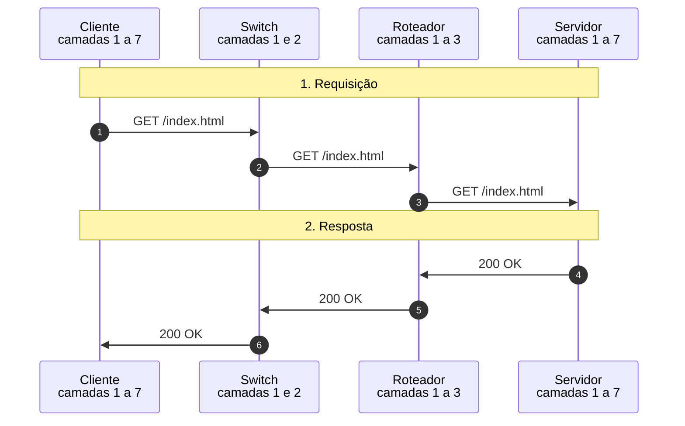

# Modelo OSI (jornada de um quadro)

Uma requisição HTTP descendo pelas sete camadas do cliente, atravessando switch e roteador e subindo no servidor, com a resposta de volta: pilhas de camadas animadas, encapsulamento aninhado, PDUs, bytes reais com checksum e FCS e etiqueta 802.1Q.

- **Categoria:** Fundamentos e modelo de camadas
- **Motor:** nativo (TypeScript puro, apresentado pela bancada genérica)
- **Código-fonte:** `src/sims/osi/`
- **RFCs e padrões:** [RFC 791](https://www.rfc-editor.org/rfc/rfc791) (IPv4), [RFC 9293](https://www.rfc-editor.org/rfc/rfc9293) (TCP), [RFC 9112](https://www.rfc-editor.org/rfc/rfc9112) (HTTP/1.1), [RFC 1812](https://www.rfc-editor.org/rfc/rfc1812) (Requisitos de roteadores)
- **Tópicos:** Pilhas de camadas animadas; Encapsulamento e desencapsulamento; Bytes reais do quadro; O que muda a cada salto

## 1. Modos

| Modo | Cenário inicial | Cenários |
| --- | --- | --- |
| Jornada de um quadro | Requisição e resposta HTTP | 5.1.1 e 5.1.2 |

## 2. Como ler os diagramas

Este documento usa até dois tipos de diagrama. Cada figura traz uma legenda com o tipo, o que mostra e a que modo ou cenário se refere.

| Tipo | O que é | Vale para | Equivale, no simulador, a |
| --- | --- | --- | --- |
| B, sequência | As mensagens na ordem do tempo, entre os participantes. É dinâmico. | Um único cenário, com a configuração indicada | Ao diagrama de sequência e à aba Captura |

### 2.1 Legenda dos diagramas

**Tipo B (sequência)**

- Cada coluna é um participante (cliente, servidor, roteador ou outro). O tempo corre de cima para baixo.
- Seta cheia: mensagem enviada. Seta com X: mensagem perdida.
- `[cifrado]` no início do rótulo: a mensagem viaja cifrada.
- Faixa horizontal com texto: início de uma fase do cenário.
- A ordem é a da aba Captura; os intervalos de tempo não são desenhados em escala.

### 2.2 Lista de figuras

**Tipo B (sequência)**

- [Figura 5.1.1](#511-requisição-e-resposta-http): sequência de "Requisição e resposta HTTP"
- [Figura 5.1.2](#512-com-etiqueta-8021q-no-tronco): sequência de "Com etiqueta 802.1Q no tronco"

## 3. Abas da bancada

Cenário, Captura, Mensagem, Bytes do quadro, Salto a salto, Experimento, Referência e Log.

## 4. Configurações (campos do painel)

### 4.1 Rede

- **RTT (ms)**. Valores: 4; 12; 40; 120. Padrão: 12. Modos: todos.
  - Tempo de ida e volta da requisição.
  - Define o tempo que cada quadro leva em cada salto. Valores altos servem para ver o diagrama mais espaçado.
  - Não muda o que cada camada faz, só os tempos mostrados.

### 4.2 Rede local

- **Enlace tronco com etiqueta 802.1Q**. Valores: caixa de seleção. Padrão: não. Modos: todos.
  - Marca o quadro com a VLAN no enlace entre o switch e o roteador.
  - Marcado, o switch acrescenta 4 bytes ao quadro (TPID 0x8100 e a VLAN 10) ao enviá-lo ao roteador pelo tronco e os retira na volta. O FCS é recalculado em cada alteração.
  - É um exemplo de como a camada 2 "marca" um quadro sem que as camadas de cima percebam.

## 5. Cenários

### 5.1 Modo: Jornada de um quadro

> **Grupo:** Jornada normal

No modelo OSI, cada camada do emissor acrescenta o seu cabeçalho (encapsulamento) e a camada correspondente do receptor o retira e o confere (desencapsulamento). A PDU muda de nome a cada camada: dados, segmento, pacote, quadro e bits.

#### 5.1.1 Requisição e resposta HTTP

*Encapsulamento no cliente, comutação, roteamento e desencapsulamento no servidor.*

**Configuração aplicada:** Enlace tronco com etiqueta 802.1Q = não

O navegador do cliente pede **GET /index.html** a um servidor em outra rede. A mensagem **desce** pelas sete camadas, cruza o switch e o roteador, **sobe** no servidor, e a resposta faz o caminho inverso.

**Conceito.** O navegador gera a mensagem HTTP (camada 7). As camadas 5 e 6 não acrescentam nada aqui, pois não há TLS. O TCP cria o segmento (camada 4), o IPv4 cria o pacote (camada 3) e a Ethernet cria o quadro e o FCS (camada 2). A camada 1 transmite os bits. O switch lê só a camada 2. O roteador sobe até a camada 3, decrementa o TTL e monta um quadro novo para o próximo enlace.

**O que observar**

- Na descida, cada camada acrescenta um cabeçalho, e o nome da PDU muda: dados, segmento, pacote, quadro, bits.
- Entre os saltos, o MAC de origem e o de destino mudam, o TTL cai de 64 para 63 e o checksum do IP e o FCS são recalculados. O IP de origem, o de destino e as portas não mudam.
- O switch aparece só nas camadas 1 e 2. O roteador, nas camadas 1 a 3.
- A aba Bytes mostra o quadro real, com cada camada em uma cor.

*Figura 5.1.1 (Tipo B, sequência).* Mensagens do cenário "Requisição e resposta HTTP", na ordem do tempo, entre Cliente, Switch, Roteador, Servidor: 6 mensagens, numeradas de 1 a 6 na ordem da comunicação (em 2 fases). Corresponde ao diagrama de sequência e à aba Captura, no modo "Jornada de um quadro", com a configuração aplicada acima.

**Mensagens**

| Mensagem | Significado | Origem |
| --- | --- | --- |
| GET /index.html | requisição HTTP, três saltos | cliente, switch, roteador, servidor |
| 200 OK | resposta HTTP, três saltos | servidor, roteador, switch, cliente |

**Por que importa.** É o modelo mental de toda a área: cada protocolo vive em uma camada, e cada nó da rede só olha até a camada de que precisa.

#### 5.1.2 Com etiqueta 802.1Q no tronco

*A camada 2 marca o quadro com a VLAN sem que a camada 3 perceba.*

**Configuração aplicada:** Enlace tronco com etiqueta 802.1Q = sim

Mesma jornada, mas o enlace entre o switch e o roteador é um **tronco 802.1Q**: o switch acrescenta uma etiqueta de 4 bytes ao quadro e a retira na volta. As camadas 3 e acima não percebem.

**Conceito.** No enlace tronco, o switch acrescenta ao quadro a etiqueta 802.1Q (4 bytes: TPID 0x8100 e o campo TCI, com a VLAN 10). O roteador retira a etiqueta ao receber e o resto do quadro segue igual. Como os bytes mudam, o FCS é recalculado.

**O que observar**

- O quadro do salto 2 tem 4 bytes a mais e os campos do 802.1Q aparecem na aba Mensagem.
- O IP, o TCP e o HTTP são idênticos aos do cenário sem VLAN.
- Na volta, o switch retira a etiqueta antes de entregar ao cliente.

*Figura 5.1.2 (Tipo B, sequência).* Mensagens do cenário "Com etiqueta 802.1Q no tronco", na ordem do tempo, entre Cliente, Switch, Roteador, Servidor: 6 mensagens, numeradas de 1 a 6 na ordem da comunicação (em 2 fases). Corresponde ao diagrama de sequência e à aba Captura, no modo "Jornada de um quadro", com a configuração aplicada acima.

**Mensagens**

| Mensagem | Significado | Origem |
| --- | --- | --- |
| GET /index.html | o salto 2 leva a etiqueta 802.1Q | switch para roteador |
| 200 OK | o salto 2 da volta leva a etiqueta | roteador para switch |

**Por que importa.** Mostra por que as VLANs são transparentes para as camadas superiores e por que uma configuração de tronco errada derruba a rede sem alterar nenhum IP.

## 6. Referência

### 6.1 O modelo OSI e a pilha TCP/IP

O modelo OSI (*Open Systems Interconnection*, ISO/IEC 7498-1) divide a comunicação em sete camadas. Na prática, a internet usa a pilha TCP/IP, que agrupa as camadas 5 a 7 em uma só (aplicação) e as camadas 1 e 2 em outra (acesso à rede). O modelo OSI é conceitual: serve para nomear funções e localizar problemas, e não descreve um software específico.

| Camada | Função | PDU | Neste simulador |
| --- | --- | --- | --- |
| 7 Aplicação | serviço visto pelo programa | dados | HTTP/1.1 ([RFC 9110](https://www.rfc-editor.org/rfc/rfc9110) e [RFC 9112](https://www.rfc-editor.org/rfc/rfc9112)) |
| 6 Apresentação | formato, codificação e cifra dos dados | dados | sem TLS: texto ASCII |
| 5 Sessão | abertura, controle e fim do diálogo | dados | conexão TCP já estabelecida |
| 4 Transporte | entrega entre processos, portas e confiabilidade | segmento | TCP ([RFC 9293](https://www.rfc-editor.org/rfc/rfc9293)) |
| 3 Rede | endereçamento lógico e roteamento | pacote | IPv4 ([RFC 791](https://www.rfc-editor.org/rfc/rfc791)) |
| 2 Enlace | entrega no mesmo enlace, por MAC, com detecção de erro | quadro | Ethernet II (IEEE 802.3) e 802.1Q |
| 1 Física | sinais no meio | bits | preâmbulo, SFD e bytes em bits |

### 6.2 Encapsulamento e desencapsulamento

- Na **descida**, cada camada trata a PDU da camada de cima como carga útil e acrescenta o seu cabeçalho (a Ethernet também acrescenta um trailer, o FCS).
- Na **subida**, cada camada confere o seu cabeçalho, o retira e entrega o conteúdo à camada de cima, pelo campo que identifica o protocolo: o tipo da Ethernet (0x0800 para IPv4), o campo Protocolo do IP (6 para TCP) e a porta do TCP.
- Um nó intermediário só sobe até a camada de que precisa: o **switch** até a 2 e o **roteador** até a 3.

### 6.3 O que cada camada acrescenta

| Camada | Campos principais | Tamanho |
| --- | --- | --- |
| Ethernet II (IEEE 802.3) | MAC de destino, MAC de origem, tipo; FCS ao final | 14 bytes de cabeçalho e 4 de FCS |
| 802.1Q (IEEE 802.1Q) | TPID 0x8100 e TCI (prioridade, DEI e VLAN), entre o MAC de origem e o tipo | 4 bytes |
| IPv4 ([RFC 791](https://www.rfc-editor.org/rfc/rfc791)) | versão, IHL, comprimento total, identificação, flags, TTL, protocolo, checksum, IPs de origem e destino | 20 bytes sem opções |
| TCP ([RFC 9293](https://www.rfc-editor.org/rfc/rfc9293), seção 3.1) | portas, sequência, confirmação, deslocamento, flags, janela, checksum | 20 bytes sem opções |
| HTTP/1.1 ([RFC 9112](https://www.rfc-editor.org/rfc/rfc9112), seção 2) | linha inicial, campos de cabeçalho, linha em branco e corpo | variável |

O simulador monta os **bytes reais** de cada quadro e calcula os três verificadores: o checksum do cabeçalho IPv4 (soma de complemento de um, [RFC 1071](https://www.rfc-editor.org/rfc/rfc1071)), o checksum do TCP com o pseudo-cabeçalho IP e o FCS (CRC-32 do IEEE 802.3). Um quadro Ethernet tem no mínimo 64 bytes com o FCS: quadros menores recebem preenchimento.

### 6.4 O que muda a cada salto

- **Muda:** MAC de origem e MAC de destino (o roteador monta um quadro novo para cada enlace), TTL (decrementado em cada roteador, [RFC 1812](https://www.rfc-editor.org/rfc/rfc1812), seção 5.3.1), checksum do IP (porque o TTL mudou) e FCS (porque os bytes mudaram).
- **Não muda:** IP de origem, IP de destino, portas, números de sequência e a mensagem HTTP.
- O endereço físico vale em um enlace e o endereço IP vale fim a fim.

### 6.5 Limitações do simulador

O percurso tem um cliente, um switch, um roteador e um servidor, em uma única requisição HTTP. A conexão TCP já está estabelecida (não há handshake, ACK puro, janela deslizante nem encerramento), as tabelas ARP e de MAC já estão preenchidas, não há TLS (as camadas 5 e 6 não acrescentam bytes), nem fragmentação, nem NAT, nem opções IP ou TCP. Os endereços são de documentação ([RFC 5737](https://www.rfc-editor.org/rfc/rfc5737) para IPv4 e [RFC 7042](https://www.rfc-editor.org/rfc/rfc7042) para MAC) e os números de sequência e as identificações são valores ilustrativos. A camada física é representada pelo preâmbulo, pelo SFD e pelos bits, sem codificação de linha real nem sinal elétrico. O FCS é calculado com o CRC-32 do IEEE 802.3, e os bytes do FCS aparecem na ordem de uma captura de pacotes. Os tempos são didáticos. O modelo OSI é conceitual e as camadas 5 e 6 não existem como software separado na pilha TCP/IP. Para o handshake, o ARP, o ICMP, o TLS, o DNS e o HTTP em detalhe, veja os simuladores específicos. Defeitos por camada não são simulados aqui.

## 7. Glossário

Significado e finalidade das siglas usadas neste documento.

| Sigla | Significado | Para que serve |
| --- | --- | --- |
| **ACK** | Acknowledgment, confirmação | flag que confirma o recebimento de dados anteriores |
| **ARP** | Address Resolution Protocol, protocolo de resolução de endereços | descobre o endereço MAC que corresponde a um endereço IPv4 na rede local |
| **CRC-32** | Cyclic Redundancy Check de 32 bits | código de 32 bits usado como FCS no fim dos frames 802.11 e Ethernet |
| **DNS** | Domain Name System, sistema de nomes de domínio | traduz nomes (www.exemplo.org) em endereços IP e guarda outros registros do domínio |
| **FCS** | Frame Check Sequence, sequência de verificação do frame | código (CRC) no fim do frame que permite ao receptor descartar frames corrompidos |
| **HTTP** | Hypertext Transfer Protocol, protocolo de transferência de hipertexto | transporta páginas e dados entre navegador e servidor web |
| **HTTP/1** | HTTP versão 1.1 | versão textual do HTTP, com uma requisição por vez em cada conexão |
| **ICMP** | Internet Control Message Protocol | leva mensagens de controle e de erro da camada IP, como o eco do ping e o aviso de destino inalcançável |
| **IEEE** | Institute of Electrical and Electronics Engineers | entidade que publica padrões de redes locais, como o 802.3 (Ethernet), o 802.1 (comutação) e o 802.11 (Wi-Fi) |
| **IP** | Internet Protocol, protocolo de internet | endereça e encaminha pacotes entre redes, de origem a destino |
| **MAC** | Media Access Control | camada de enlace que controla o acesso ao meio; também nomeia o endereço físico de 48 bits de uma interface |
| **NAT** | Network Address Translation, tradução de endereços de rede | troca endereços e portas dos pacotes, para que uma rede privada compartilhe poucos endereços públicos |
| **RTT** | Round-Trip Time, tempo de ida e volta | mede o tempo entre enviar um pacote e receber a resposta; base dos temporizadores e da latência |
| **TCP** | Transmission Control Protocol, protocolo de controle de transmissão | entrega dados de forma ordenada e confiável, com conexão, confirmação e controle de congestionamento |
| **TLS** | Transport Layer Security, segurança da camada de transporte | estabelece um canal cifrado e autenticado entre dois pontos, a base do HTTPS |
| **TTL** | Time To Live, tempo de vida | limita quantos saltos um pacote pode dar; cada roteador o reduz de 1, e ao chegar a zero o pacote é descartado |
| **VLAN** | Virtual Local Area Network, rede local virtual | separa logicamente uma rede em domínios de broadcast isolados no mesmo equipamento físico |

---

*Simul-Net é um projeto mantido pelo Prof. Dr. Laerte Peotta de Melo, com apoio de IA generativa no processo de desenvolvimento, com sua estrita supervisão, revisão técnica e responsabilidade. Uso exclusivo para fins de ensino e pesquisa. Universidade de Brasília (UnB) - Departamento de Engenharia Elétrica. Código aberto (licença MIT).*
