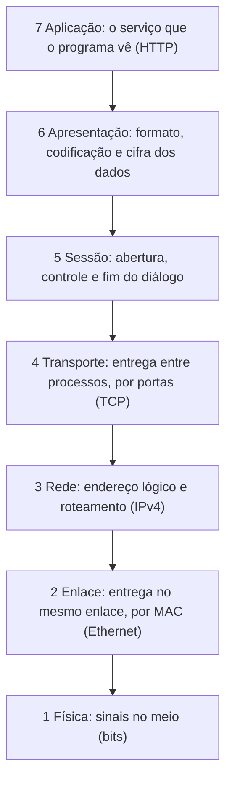
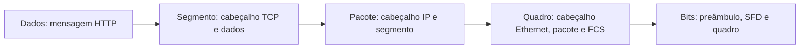
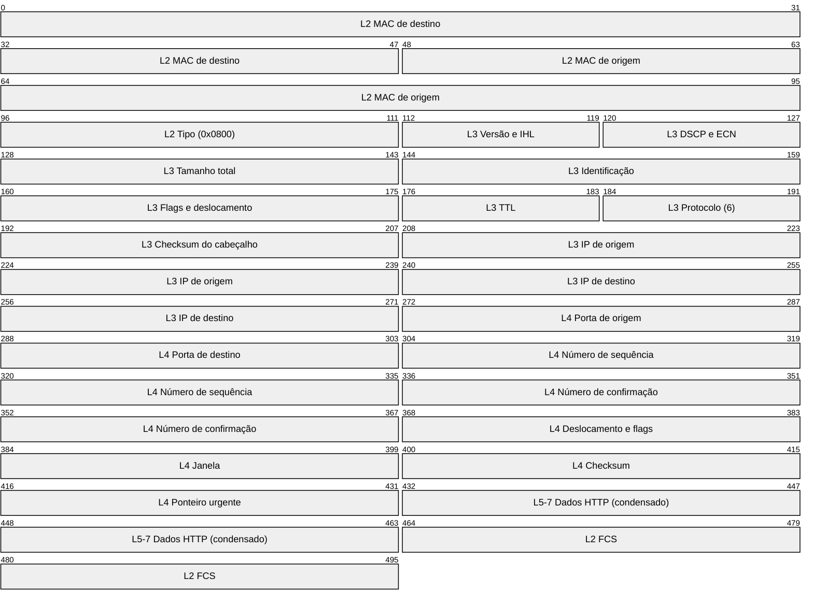
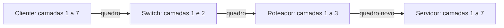
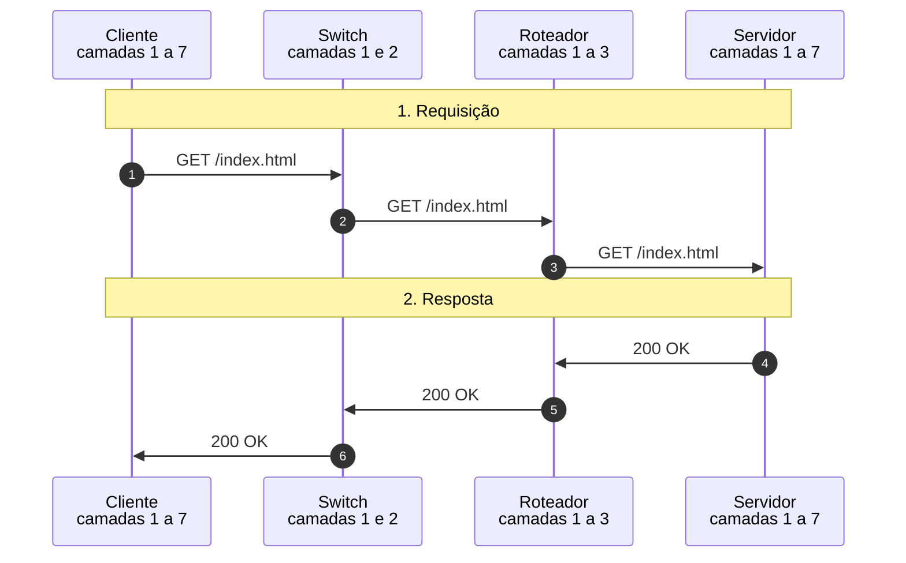

# Modelo OSI (jornada de um quadro)

Uma requisição HTTP descendo pelas sete camadas do cliente, atravessando switch e roteador e subindo no servidor, com a resposta de volta: pilhas de camadas animadas, encapsulamento aninhado, PDUs, bytes reais com checksum e FCS e etiqueta 802.1Q.

- **Categoria:** Fundamentos e modelo de camadas
- **Motor:** nativo (TypeScript puro, apresentado pela bancada genérica)
- **Código-fonte:** `src/sims/osi/`
- **RFCs e padrões:** [RFC 791](https://www.rfc-editor.org/rfc/rfc791) (IPv4), [RFC 9293](https://www.rfc-editor.org/rfc/rfc9293) (TCP), [RFC 9112](https://www.rfc-editor.org/rfc/rfc9112) (HTTP/1.1), [RFC 1812](https://www.rfc-editor.org/rfc/rfc1812) (Requisitos de roteadores)
- **Tópicos:** Pilhas de camadas animadas; Encapsulamento e desencapsulamento; Bytes reais do quadro; O que muda a cada salto

## 1. Modos

| Modo | Cenário inicial | Cenários |
| --- | --- | --- |
| Jornada de um quadro | Requisição e resposta HTTP | 6.1.1 e 6.1.2 |

## 2. Fundamentação

### 2.1 O que o modelo OSI descreve

O modelo OSI (*Open Systems Interconnection*, ISO/IEC 7498-1, também publicado como ITU-T X.200) é um **modelo de referência**: divide a comunicação entre dois sistemas em sete camadas, cada uma com uma função bem definida. Ele serve para nomear funções, comparar tecnologias e localizar problemas ("a falha está na camada 2 ou na 3?"). Não descreve um software específico: a internet usa a pilha TCP/IP, que agrupa várias camadas do OSI (veja a seção sobre o OSI e o TCP/IP, abaixo).

Três ideias sustentam o modelo:

- **Serviço:** cada camada presta um serviço à camada de cima e usa o serviço da camada de baixo, sem precisar saber como ele é feito.
- **Protocolo entre pares:** a camada N de um sistema conversa com a camada N do outro, por meio de um cabeçalho próprio que viaja junto com os dados. O cabeçalho é o "idioma" da conversa entre as duas camadas.
- **Encapsulamento:** para enviar, cada camada trata o que recebeu da camada de cima como carga útil e acrescenta o seu cabeçalho (a Ethernet também acrescenta um trailer, o FCS). Para receber, o caminho é o inverso: cada camada confere, retira o seu cabeçalho e entrega o conteúdo à camada de cima.

**O que você aprende com este simulador.**

- Nomear as sete camadas, a unidade de dados de cada uma (PDU) e o identificador que a distingue.
- Explicar o serviço, o protocolo entre pares e o encapsulamento, da aplicação até os bits.
- Localizar cada cabeçalho (Ethernet, IPv4, TCP) no quadro em trânsito e o que ele identifica na camada seguinte.
- Dizer até que camada cada dispositivo (switch, roteador, host) sobe a pilha, e o que muda a cada salto.
- Relacionar o modelo OSI à pilha TCP/IP e reconhecer os limites do modelo.

### 2.2 O diagrama das sete camadas

*Esquema 1 (pilha do modelo).* As sete camadas, da aplicação (topo) ao meio físico (base). Na transmissão, os dados descem do topo até a base; na recepção, sobem da base ao topo.

| Camada | Nome | Unidade de dados (PDU) | Função | Identificador | Neste simulador |
| --- | --- | --- | --- | --- | --- |
| 7 | Aplicação | dados (mensagem) | serviço visto pelo programa | nome e porta do serviço | HTTP/1.1 ([RFC 9112](https://www.rfc-editor.org/rfc/rfc9112)) |
| 6 | Apresentação | dados | formato, codificação e cifra | tipo de conteúdo | sem TLS: texto ASCII |
| 5 | Sessão | dados | abertura, controle e fim do diálogo | sessão ou conexão | conexão TCP já estabelecida |
| 4 | Transporte | segmento | entrega entre processos, confiabilidade e controle de fluxo | porta | TCP ([RFC 9293](https://www.rfc-editor.org/rfc/rfc9293)) |
| 3 | Rede | pacote | endereçamento lógico e roteamento entre redes | endereço IP | IPv4 ([RFC 791](https://www.rfc-editor.org/rfc/rfc791)) |
| 2 | Enlace | quadro | entrega entre vizinhos do mesmo enlace e detecção de erro | endereço MAC | Ethernet II e 802.1Q (IEEE) |
| 1 | Física | bits | transmissão dos sinais no meio | sem endereço | preâmbulo, SFD e bits |

Os livros costumam agrupar as camadas em dois blocos, o que ajuda a lembrar quem cuida de quê:

- **Camadas 5 a 7 (camadas superiores):** tratam do que o usuário e o programa enxergam. Existem **só nas pontas** (cliente e servidor).
- **Camada 4 (transporte):** é fim a fim, também só nas pontas: os equipamentos do caminho, como o switch e o roteador comuns, não leem o segmento.
- **Camadas 1 a 3 (camadas de rede):** levam os bits de um ponto a outro e existem também nos equipamentos do caminho.

### 2.3 O que cada modo e aba do simulador mostram

O palco do simulador desenha o diagrama das sete camadas **quatro vezes**, uma para cada dispositivo do caminho, e mostra a unidade de dados em movimento entre elas.

- **Quatro pilhas:** cliente, switch, roteador e servidor, da esquerda para a direita. Em cada pilha, a camada 7 fica no topo e a camada 1 na base.
- **Camadas tracejadas:** quando o dispositivo não implementa a camada, a caixa aparece tracejada e apagada. O switch só tem as camadas 1 e 2, e o roteador, as camadas 1 a 3. Só o cliente e o servidor têm as sete.
- **A PDU em movimento:** um conjunto de tiras coloridas, uma para cada cabeçalho presente. A cor identifica a camada dona: cinza, camada 1 (física); roxo, camada 2 (enlace); azul, camada 3 (rede); verde-azulado, camada 4 (transporte); âmbar, camadas 5 a 7 (dados). As tiras **crescem** quando uma camada acrescenta o seu cabeçalho (descida) e **encolhem** quando a retira (subida).
- **O nome acima da PDU:** muda conforme a camada em que ela está: dados, segmento, pacote, quadro e bits. No cabo, o nome é "bits" e aparecem o preâmbulo (`10101010`), o SFD (`10101011`) e os primeiros bits do quadro.
- **A camada em ação:** a caixa em destaque, com borda âmbar, é a camada que está trabalhando naquele passo. O botão **Passo** avança de camada em camada, e a PDU desliza até a próxima.
- **Cabos:** ligam as bases das pilhas. Entre o cliente e o switch é a LAN, entre o switch e o roteador é a LAN ou o tronco 802.1Q (quando a opção de VLAN está ligada), e entre o roteador e o servidor é a WAN.
- **Abas:** *Bytes do quadro* mostra os bytes do quadro em trânsito, e *Salto a salto* mostra o que muda e o que não muda em cada dispositivo do caminho.

O trajeto de ida segue sempre o mesmo padrão: desce a pilha do cliente (7, 6 e 5, 4, 3, 2, 1), atravessa o cabo, sobe até a camada 2 no switch e desce de novo, sobe até a camada 3 no roteador e desce de novo, atravessa o cabo e sobe a pilha inteira no servidor. A resposta faz o caminho inverso.

Para a descida e a subida pela pilha, use o cenário "Requisição e resposta HTTP". Para ver o que a etiqueta de VLAN acrescenta ao quadro e a quem ela serve, use "Com etiqueta 802.1Q no tronco".

### 2.4 Encapsulamento e desencapsulamento

*Esquema 2 (encapsulamento).* Na descida, cada camada envolve a PDU da camada de cima. Na subida, cada camada retira o seu envoltório.

A segunda vista do palco, **encapsulamento aninhado**, mostra a mesma ideia como caixas dentro de caixas: a caixa de fora é o quadro (camada 2), que contém o pacote (camada 3), que contém o segmento (camada 4), que contém os dados (camadas 5 a 7). Cada caixa lista os campos que aquela camada acrescentou, com valores reais do quadro em trânsito.

| Camada | O que acrescenta | Tamanho | Como a camada de cima é identificada |
| --- | --- | --- | --- |
| 4 | cabeçalho TCP ([RFC 9293](https://www.rfc-editor.org/rfc/rfc9293), seção 3.1) | 20 bytes sem opções | a porta de destino aponta o processo |
| 3 | cabeçalho IPv4 ([RFC 791](https://www.rfc-editor.org/rfc/rfc791)) | 20 bytes sem opções | o campo Protocolo (6 para TCP) |
| 2 | cabeçalho Ethernet II, etiqueta 802.1Q opcional e FCS (IEEE 802.3) | 14 bytes, 4 do FCS e 4 da etiqueta | o campo Tipo (0x0800 para IPv4) |
| 1 | preâmbulo e SFD | 8 bytes, fora do quadro | não há |

Cada cabeçalho carrega o **identificador da camada seguinte**. É assim que, na subida, a camada 2 sabe que o conteúdo é IPv4, a camada 3 sabe que é TCP e a camada 4 sabe a qual processo entregar.

### 2.5 O quadro completo, campo a campo

O desenho mostra o quadro que o simulador leva do cliente ao servidor: o cabeçalho Ethernet (camada 2), o cabeçalho IPv4 (camada 3), o cabeçalho TCP (camada 4) e o início dos dados HTTP (camadas 5 a 7), com o FCS no fim. Os cabeçalhos aparecem sem opções e sem a etiqueta 802.1Q, e a posição de cada campo é a real, contada a partir do primeiro bit do quadro.

*Esquema 3 (o quadro completo, camada por camada).* O prefixo de cada campo indica a camada dona (L2 enlace, L3 rede, L4 transporte, L5-7 dados). Os dados HTTP aparecem **condensados**: ocupam o tamanho da mensagem. Repare que cada cabeçalho carrega o identificador da camada seguinte: o **Tipo** (0x0800) diz que o conteúdo é IPv4, o **Protocolo** (6) diz que é TCP, e a **porta de destino** aponta o processo que recebe os dados. O preâmbulo e o SFD, de 8 bytes, vêm antes do quadro e não aparecem no desenho. Os campos desses cabeçalhos estão detalhados nos simuladores de IPv4, de TCP e de switching.

### 2.6 O que cada dispositivo faz com as camadas

*Esquema 4 (dispositivos e camadas).* Cada dispositivo só sobe a pilha até a camada de que precisa para decidir.

| Dispositivo | Camadas | O que lê | O que altera |
| --- | --- | --- | --- |
| Cliente e servidor | 1 a 7 | tudo, até a mensagem HTTP | cria e consome todos os cabeçalhos |
| Switch | 1 e 2 | MAC de destino e FCS | aprende o MAC de origem e, se for o caso, acrescenta ou retira a etiqueta 802.1Q (e recalcula o FCS) |
| Roteador | 1 a 3 | MAC de destino, FCS, IP de destino e TTL | decrementa o TTL, recalcula o checksum do IP e monta um quadro novo, com MAC e FCS novos ([RFC 1812](https://www.rfc-editor.org/rfc/rfc1812), seção 5.3.1) |

Por isso, a cada salto, **mudam** os MACs, o TTL, o checksum do IP e o FCS, e **não mudam** os IPs, as portas, os números de sequência e a mensagem HTTP. O endereço físico vale em um enlace, e o endereço IP vale fim a fim.

### 2.7 O modelo OSI e a pilha TCP/IP

| Camada OSI | Pilha TCP/IP | Exemplos |
| --- | --- | --- |
| 7 Aplicação, 6 Apresentação e 5 Sessão | Aplicação | HTTP, DNS, SSH, TLS |
| 4 Transporte | Transporte | TCP, UDP |
| 3 Rede | Internet | IPv4, IPv6, ICMP |
| 2 Enlace e 1 Física | Acesso à rede | Ethernet, Wi-Fi |

O modelo OSI é mais fino do que a prática: na pilha TCP/IP, as funções das camadas 5 e 6 ficam dentro da aplicação (por exemplo, o TLS cuida da cifra e da sessão segura). Por isso o simulador mostra as camadas 5 e 6 **sem cabeçalho próprio**: elas existem no modelo, mas não acrescentam bytes ao quadro quando não há TLS.

### 2.8 Limites do modelo e do diagrama

- O OSI é **conceitual**: protocolos reais nem sempre respeitam as fronteiras entre camadas (o TLS, por exemplo, atravessa as camadas 5 e 6, e o ARP fica entre a 2 e a 3).
- O diagrama mostra **uma** requisição HTTP em uma conexão TCP já estabelecida. O handshake, a janela deslizante e o encerramento do TCP, o ARP, o DNS e o TLS têm simuladores próprios.
- O palco do simulador mostra a PDU **inteira** descendo a pilha, mas os tempos e as proporções das tiras são didáticos: o tamanho de cada tira não é proporcional ao número de bytes.

## 3. Como ler os diagramas

Este documento usa até dois tipos de diagrama. Cada figura traz uma legenda com o tipo, o que mostra e a que modo ou cenário se refere.

| Tipo | O que é | Vale para | Equivale, no simulador, a |
| --- | --- | --- | --- |
| B, sequência | As mensagens na ordem do tempo, entre os participantes. É dinâmico. | Um único cenário, com a configuração indicada | Ao diagrama de sequência e à aba Captura |

### 3.1 Legenda dos diagramas

**Tipo B (sequência)**

- Cada coluna é um participante (cliente, servidor, roteador ou outro). O tempo corre de cima para baixo.
- Seta cheia: mensagem enviada. Seta com X: mensagem perdida.
- `[cifrado]` no início do rótulo: a mensagem viaja cifrada.
- Faixa horizontal com texto: início de uma fase do cenário.
- A ordem é a da aba Captura; os intervalos de tempo não são desenhados em escala.

### 3.2 Lista de figuras

**Tipo B (sequência)**

- [Figura 6.1.1](#611-requisição-e-resposta-http): sequência de "Requisição e resposta HTTP"
- [Figura 6.1.2](#612-com-etiqueta-8021q-no-tronco): sequência de "Com etiqueta 802.1Q no tronco"

## 4. Abas da bancada

Cenário, Captura, Mensagem, Bytes do quadro, Salto a salto, Experimento, Referência e Log.

## 5. Configurações (campos do painel)

### 5.1 Rede

- **RTT (ms)**. Valores: 4; 12; 40; 120. Padrão: 12. Modos: todos.
  - Tempo de ida e volta da requisição.
  - Define o tempo que cada quadro leva em cada salto. Valores altos servem para ver o diagrama mais espaçado.
  - Não muda o que cada camada faz, só os tempos mostrados.

### 5.2 Rede local

- **Enlace tronco com etiqueta 802.1Q**. Valores: caixa de seleção. Padrão: não. Modos: todos.
  - Marca o quadro com a VLAN no enlace entre o switch e o roteador.
  - Marcado, o switch acrescenta 4 bytes ao quadro (TPID 0x8100 e a VLAN 10) ao enviá-lo ao roteador pelo tronco e os retira na volta. O FCS é recalculado em cada alteração.
  - É um exemplo de como a camada 2 "marca" um quadro sem que as camadas de cima percebam.

## 6. Cenários

### 6.1 Modo: Jornada de um quadro

> **Grupo:** Jornada normal

No modelo OSI, cada camada do emissor acrescenta o seu cabeçalho (encapsulamento) e a camada correspondente do receptor o retira e o confere (desencapsulamento). A PDU muda de nome a cada camada: dados, segmento, pacote, quadro e bits.

#### 6.1.1 Requisição e resposta HTTP

*Encapsulamento no cliente, comutação, roteamento e desencapsulamento no servidor.*

**Configuração aplicada:** Enlace tronco com etiqueta 802.1Q = não

O navegador do cliente pede **GET /index.html** a um servidor em outra rede. A mensagem **desce** pelas sete camadas, cruza o switch e o roteador, **sobe** no servidor, e a resposta faz o caminho inverso.

**Conceito.** O navegador gera a mensagem HTTP (camada 7). As camadas 5 e 6 não acrescentam nada aqui, pois não há TLS. O TCP cria o segmento (camada 4), o IPv4 cria o pacote (camada 3) e a Ethernet cria o quadro e o FCS (camada 2). A camada 1 transmite os bits. O switch lê só a camada 2. O roteador sobe até a camada 3, decrementa o TTL e monta um quadro novo para o próximo enlace.

**O que observar**

- Na descida, cada camada acrescenta um cabeçalho, e o nome da PDU muda: dados, segmento, pacote, quadro, bits.
- Entre os saltos, o MAC de origem e o de destino mudam, o TTL cai de 64 para 63 e o checksum do IP e o FCS são recalculados. O IP de origem, o de destino e as portas não mudam.
- O switch aparece só nas camadas 1 e 2. O roteador, nas camadas 1 a 3.
- A aba Bytes mostra o quadro real, com cada camada em uma cor.

*Figura 6.1.1 (Tipo B, sequência).* Mensagens do cenário "Requisição e resposta HTTP", na ordem do tempo, entre Cliente, Switch, Roteador, Servidor: 6 mensagens, numeradas de 1 a 6 na ordem da comunicação (em 2 fases). Corresponde ao diagrama de sequência e à aba Captura, no modo "Jornada de um quadro", com a configuração aplicada acima.

**Mensagens**

| Mensagem | Significado | Origem |
| --- | --- | --- |
| GET /index.html | requisição HTTP, três saltos | cliente, switch, roteador, servidor |
| 200 OK | resposta HTTP, três saltos | servidor, roteador, switch, cliente |

**Por que importa.** É o modelo mental de toda a área: cada protocolo vive em uma camada, e cada nó da rede só olha até a camada de que precisa.

#### 6.1.2 Com etiqueta 802.1Q no tronco

*A camada 2 marca o quadro com a VLAN sem que a camada 3 perceba.*

**Configuração aplicada:** Enlace tronco com etiqueta 802.1Q = sim

Mesma jornada, mas o enlace entre o switch e o roteador é um **tronco 802.1Q**: o switch acrescenta uma etiqueta de 4 bytes ao quadro e a retira na volta. As camadas 3 e acima não percebem.

**Conceito.** No enlace tronco, o switch acrescenta ao quadro a etiqueta 802.1Q (4 bytes: TPID 0x8100 e o campo TCI, com a VLAN 10). O roteador retira a etiqueta ao receber e o resto do quadro segue igual. Como os bytes mudam, o FCS é recalculado.

**O que observar**

- O quadro do salto 2 tem 4 bytes a mais e os campos do 802.1Q aparecem na aba Mensagem.
- O IP, o TCP e o HTTP são idênticos aos do cenário sem VLAN.
- Na volta, o switch retira a etiqueta antes de entregar ao cliente.

*Figura 6.1.2 (Tipo B, sequência).* Mensagens do cenário "Com etiqueta 802.1Q no tronco", na ordem do tempo, entre Cliente, Switch, Roteador, Servidor: 6 mensagens, numeradas de 1 a 6 na ordem da comunicação (em 2 fases). Corresponde ao diagrama de sequência e à aba Captura, no modo "Jornada de um quadro", com a configuração aplicada acima.

**Mensagens**

| Mensagem | Significado | Origem |
| --- | --- | --- |
| GET /index.html | o salto 2 leva a etiqueta 802.1Q | switch para roteador |
| 200 OK | o salto 2 da volta leva a etiqueta | roteador para switch |

**Por que importa.** Mostra por que as VLANs são transparentes para as camadas superiores e por que uma configuração de tronco errada derruba a rede sem alterar nenhum IP.

## 7. Referência

### 7.1 O modelo OSI e a pilha TCP/IP

O modelo OSI (*Open Systems Interconnection*, ISO/IEC 7498-1) divide a comunicação em sete camadas. Na prática, a internet usa a pilha TCP/IP, que agrupa as camadas 5 a 7 em uma só (aplicação) e as camadas 1 e 2 em outra (acesso à rede). O modelo OSI é conceitual: serve para nomear funções e localizar problemas, e não descreve um software específico.

| Camada | Função | PDU | Neste simulador |
| --- | --- | --- | --- |
| 7 Aplicação | serviço visto pelo programa | dados | HTTP/1.1 ([RFC 9110](https://www.rfc-editor.org/rfc/rfc9110) e [RFC 9112](https://www.rfc-editor.org/rfc/rfc9112)) |
| 6 Apresentação | formato, codificação e cifra dos dados | dados | sem TLS: texto ASCII |
| 5 Sessão | abertura, controle e fim do diálogo | dados | conexão TCP já estabelecida |
| 4 Transporte | entrega entre processos, portas e confiabilidade | segmento | TCP ([RFC 9293](https://www.rfc-editor.org/rfc/rfc9293)) |
| 3 Rede | endereçamento lógico e roteamento | pacote | IPv4 ([RFC 791](https://www.rfc-editor.org/rfc/rfc791)) |
| 2 Enlace | entrega no mesmo enlace, por MAC, com detecção de erro | quadro | Ethernet II (IEEE 802.3) e 802.1Q |
| 1 Física | sinais no meio | bits | preâmbulo, SFD e bytes em bits |

### 7.2 Encapsulamento e desencapsulamento

- Na **descida**, cada camada trata a PDU da camada de cima como carga útil e acrescenta o seu cabeçalho (a Ethernet também acrescenta um trailer, o FCS).
- Na **subida**, cada camada confere o seu cabeçalho, o retira e entrega o conteúdo à camada de cima, pelo campo que identifica o protocolo: o tipo da Ethernet (0x0800 para IPv4), o campo Protocolo do IP (6 para TCP) e a porta do TCP.
- Um nó intermediário só sobe até a camada de que precisa: o **switch** até a 2 e o **roteador** até a 3.

### 7.3 O que cada camada acrescenta

| Camada | Campos principais | Tamanho |
| --- | --- | --- |
| Ethernet II (IEEE 802.3) | MAC de destino, MAC de origem, tipo; FCS ao final | 14 bytes de cabeçalho e 4 de FCS |
| 802.1Q (IEEE 802.1Q) | TPID 0x8100 e TCI (prioridade, DEI e VLAN), entre o MAC de origem e o tipo | 4 bytes |
| IPv4 ([RFC 791](https://www.rfc-editor.org/rfc/rfc791)) | versão, IHL, comprimento total, identificação, flags, TTL, protocolo, checksum, IPs de origem e destino | 20 bytes sem opções |
| TCP ([RFC 9293](https://www.rfc-editor.org/rfc/rfc9293), seção 3.1) | portas, sequência, confirmação, deslocamento, flags, janela, checksum | 20 bytes sem opções |
| HTTP/1.1 ([RFC 9112](https://www.rfc-editor.org/rfc/rfc9112), seção 2) | linha inicial, campos de cabeçalho, linha em branco e corpo | variável |

O simulador monta os **bytes reais** de cada quadro e calcula os três verificadores: o checksum do cabeçalho IPv4 (soma de complemento de um, [RFC 1071](https://www.rfc-editor.org/rfc/rfc1071)), o checksum do TCP com o pseudo-cabeçalho IP e o FCS (CRC-32 do IEEE 802.3). Um quadro Ethernet tem no mínimo 64 bytes com o FCS: quadros menores recebem preenchimento.

### 7.4 O que muda a cada salto

- **Muda:** MAC de origem e MAC de destino (o roteador monta um quadro novo para cada enlace), TTL (decrementado em cada roteador, [RFC 1812](https://www.rfc-editor.org/rfc/rfc1812), seção 5.3.1), checksum do IP (porque o TTL mudou) e FCS (porque os bytes mudaram).
- **Não muda:** IP de origem, IP de destino, portas, números de sequência e a mensagem HTTP.
- O endereço físico vale em um enlace e o endereço IP vale fim a fim.

### 7.5 Limitações do simulador

O percurso tem um cliente, um switch, um roteador e um servidor, em uma única requisição HTTP. A conexão TCP já está estabelecida (não há handshake, ACK puro, janela deslizante nem encerramento), as tabelas ARP e de MAC já estão preenchidas, não há TLS (as camadas 5 e 6 não acrescentam bytes), nem fragmentação, nem NAT, nem opções IP ou TCP. Os endereços são de documentação ([RFC 5737](https://www.rfc-editor.org/rfc/rfc5737) para IPv4 e [RFC 7042](https://www.rfc-editor.org/rfc/rfc7042) para MAC) e os números de sequência e as identificações são valores ilustrativos. A camada física é representada pelo preâmbulo, pelo SFD e pelos bits, sem codificação de linha real nem sinal elétrico. O FCS é calculado com o CRC-32 do IEEE 802.3, e os bytes do FCS aparecem na ordem de uma captura de pacotes. Os tempos são didáticos. O modelo OSI é conceitual e as camadas 5 e 6 não existem como software separado na pilha TCP/IP. Para o handshake, o ARP, o ICMP, o TLS, o DNS e o HTTP em detalhe, veja os simuladores específicos. Defeitos por camada não são simulados aqui.

## 8. Glossário

Significado e finalidade das siglas usadas neste documento.

| Sigla | Significado | Para que serve |
| --- | --- | --- |
| **ACK** | Acknowledgment, confirmação | flag que confirma o recebimento de dados anteriores |
| **ARP** | Address Resolution Protocol, protocolo de resolução de endereços | descobre o endereço MAC que corresponde a um endereço IPv4 na rede local |
| **ASCII** | American Standard Code for Information Interchange | codificação de caracteres em texto simples, usada aqui nas mensagens HTTP sem cifra |
| **CRC-32** | Cyclic Redundancy Check de 32 bits | código de 32 bits usado como FCS no fim dos frames 802.11 e Ethernet |
| **DNS** | Domain Name System, sistema de nomes de domínio | traduz nomes (www.exemplo.org) em endereços IP e guarda outros registros do domínio |
| **FCS** | Frame Check Sequence, sequência de verificação do frame | código (CRC) no fim do frame que permite ao receptor descartar frames corrompidos |
| **HTTP** | Hypertext Transfer Protocol, protocolo de transferência de hipertexto | transporta páginas e dados entre navegador e servidor web |
| **HTTP/1** | HTTP versão 1.1 | versão textual do HTTP, com uma requisição por vez em cada conexão |
| **ICMP** | Internet Control Message Protocol | leva mensagens de controle e de erro da camada IP, como o eco do ping e o aviso de destino inalcançável |
| **IEEE** | Institute of Electrical and Electronics Engineers | entidade que publica padrões de redes locais, como o 802.3 (Ethernet), o 802.1 (comutação) e o 802.11 (Wi-Fi) |
| **IHL** | Internet Header Length, comprimento do cabeçalho IP | campo do cabeçalho IPv4 com o tamanho do cabeçalho em palavras de 32 bits (mínimo 5, ou 20 bytes) |
| **IP** | Internet Protocol, protocolo de internet | endereça e encaminha pacotes entre redes, de origem a destino |
| **ITU-T** | International Telecommunication Union, Telecommunication Standardization Sector, setor de normalização de telecomunicações da UIT | publica recomendações de telecomunicações; a X.200 é o texto do modelo OSI equivalente à ISO/IEC 7498-1 |
| **L2** | Layer 2, camada 2 (enlace) | indica que o equipamento encaminha por endereço MAC, como um switch |
| **LAN** | Local Area Network, rede local | rede de alcance restrito, como a de um prédio ou laboratório, ligada por switches ou por Wi-Fi |
| **MAC** | Media Access Control | camada de enlace que controla o acesso ao meio; também nomeia o endereço físico de 48 bits de uma interface |
| **NAT** | Network Address Translation, tradução de endereços de rede | troca endereços e portas dos pacotes, para que uma rede privada compartilhe poucos endereços públicos |
| **OSI** | Open Systems Interconnection, interconexão de sistemas abertos | modelo de referência que divide a comunicação em sete camadas, usado para nomear funções e localizar problemas |
| **PDU** | Protocol Data Unit, unidade de dados de protocolo | a unidade de dados de cada camada: dados, segmento, pacote, quadro e bits |
| **RTT** | Round-Trip Time, tempo de ida e volta | mede o tempo entre enviar um pacote e receber a resposta; base dos temporizadores e da latência |
| **SFD** | Start Frame Delimiter, delimitador de início de quadro | byte que, depois do preâmbulo, marca o início do quadro Ethernet |
| **SSH** | Secure Shell | acesso remoto e transferência de arquivos por um canal cifrado, com autenticação do servidor e do usuário |
| **TCP** | Transmission Control Protocol, protocolo de controle de transmissão | entrega dados de forma ordenada e confiável, com conexão, confirmação e controle de congestionamento |
| **TCP/IP** | Transmission Control Protocol e Internet Protocol | refere-se à pilha de protocolos da Internet, nomeada pelos seus dois protocolos mais conhecidos |
| **TLS** | Transport Layer Security, segurança da camada de transporte | estabelece um canal cifrado e autenticado entre dois pontos, a base do HTTPS |
| **TTL** | Time To Live, tempo de vida | limita quantos saltos um pacote pode dar; cada roteador o reduz de 1, e ao chegar a zero o pacote é descartado |
| **UDP** | User Datagram Protocol | entrega datagramas sem conexão nem confirmação, com baixo custo; usado em consultas curtas e em tempo real |
| **VLAN** | Virtual Local Area Network, rede local virtual | separa logicamente uma rede em domínios de broadcast isolados no mesmo equipamento físico |
| **WAN** | Wide Area Network, rede de longa distância | rede que liga locais distantes, como as filiais de uma empresa, em geral por operadoras |

---

*Simul-Net é um projeto mantido pelo Prof. Dr. Laerte Peotta de Melo, com apoio de IA generativa no processo de desenvolvimento, com sua estrita supervisão, revisão técnica e responsabilidade. Uso exclusivo para fins de ensino e pesquisa. Universidade de Brasília (UnB) - Departamento de Engenharia Elétrica. Código aberto (licença MIT).*
