# OSPF (estado de enlace)

OSPF passo a passo: Hello, adjacências, inundação de LSAs, SPF e tabela de rotas, com mudança de custo, falhas de enlace e rede multiárea com Summary LSAs dos ABRs.

- **Categoria:** Roteamento e serviços de rede
- **Motor:** nativo (TypeScript puro, apresentado pela bancada genérica)
- **Código-fonte:** `src/sims/ospf/`
- **RFCs e padrões:** [RFC 2328](https://www.rfc-editor.org/rfc/rfc2328) (OSPF versão 2), [RFC 5709](https://www.rfc-editor.org/rfc/rfc5709) (Autenticação HMAC-SHA)
- **Tópicos:** Hello e adjacências; LSAs e SPF; Custo e falhas de enlace; Multiárea e Summary LSAs

## 1. Modos

| Modo | Cenário inicial | Cenários |
| --- | --- | --- |
| Convergência | Convergência em área única | 6.1.1 |
| Custo e falha | Custo 50 em R2 / R3 | 6.2.1 a 6.2.3 |
| Multiárea | Três áreas e Summary LSAs | 6.3.1 e 6.3.2 |

## 2. Como ler os diagramas

Este documento usa até dois tipos de diagrama. Cada figura traz uma legenda com o tipo, o que mostra e a que modo ou cenário se refere.

| Tipo | O que é | Vale para | Equivale, no simulador, a |
| --- | --- | --- | --- |
| A, topologia | Os elementos da rede e os enlaces que os ligam. É estático. | Um modo inteiro | A visão "Topologia" do painel principal |
| B, sequência | As mensagens na ordem do tempo, entre os participantes. É dinâmico. | Um único cenário, com a configuração indicada | Ao diagrama de sequência e à aba Captura |

### 2.1 Legenda dos diagramas

**Tipo A (topologia)**

- Retângulo: host (computador ou servidor final).
- Hexágono: switch.
- Retângulo arredondado: roteador, ou dispositivo que encaminha ou traduz.
- Estádio (cantos bem arredondados): servidor ou rede externa.
- Retângulo vermelho: atacante (quando existe no modo).
- Linha contínua: enlace. Linha tracejada: enlace alternativo, forjado ou caído, ou ainda relação de peering (no BGP), conforme o rótulo e o cenário.
- O Mermaid posiciona os elementos automaticamente: o layout difere do simulador, as ligações não.

**Tipo B (sequência)**

- Cada coluna é um participante (cliente, servidor, roteador ou outro). O tempo corre de cima para baixo.
- Seta cheia: mensagem enviada. Seta com X: mensagem perdida.
- `[cifrado]` no início do rótulo: a mensagem viaja cifrada.
- Faixa horizontal com texto: início de uma fase do cenário.
- A ordem é a da aba Captura; os intervalos de tempo não são desenhados em escala.

### 2.2 Lista de figuras

**Tipo A (topologia)**

- [Figura 3.1](#31-convergência): topologia do modo "Convergência"
- [Figura 3.2a](#32-custo-e-falha): topologia do modo "Custo e falha", variante a
- [Figura 3.2b](#32-custo-e-falha): topologia do modo "Custo e falha", variante b
- [Figura 3.2c](#32-custo-e-falha): topologia do modo "Custo e falha", variante c
- [Figura 3.3a](#33-multiárea): topologia do modo "Multiárea", variante a
- [Figura 3.3b](#33-multiárea): topologia do modo "Multiárea", variante b

**Tipo B (sequência)**

- [Figura 6.1.1](#611-convergência-em-área-única): sequência de "Convergência em área única"
- [Figura 6.2.1](#621-custo-50-em-r2--r3): sequência de "Custo 50 em R2 / R3"
- [Figura 6.2.2](#622-queda-do-enlace-r2--r3): sequência de "Queda do enlace R2 / R3"
- [Figura 6.2.3](#623-isolamento-do-pc-b): sequência de "Isolamento do PC-B"
- [Figura 6.3.1](#631-três-áreas-e-summary-lsas): sequência de "Três áreas e Summary LSAs"
- [Figura 6.3.2](#632-enlace-r4--r8-fora-de-serviço): sequência de "Enlace R4 / R8 fora de serviço"

## 3. Topologia

Figuras do Tipo A, uma por modo (e uma por variante do desenho, quando a rede muda entre cenários). Foram geradas a partir da mesma definição de topologia que a bancada usa.

### 3.1 Convergência

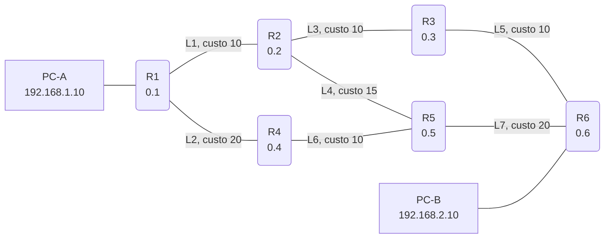

*Figura 3.1 (Tipo A, topologia).* Elementos do modo "Convergência": R1 (0.1); R2 (0.2); R3 (0.3); R4 (0.4); R5 (0.5); R6 (0.6); PC-A (192.168.1.10); PC-B (192.168.2.10). Vale para todos os cenários do modo (6.1.1).

### 3.2 Custo e falha

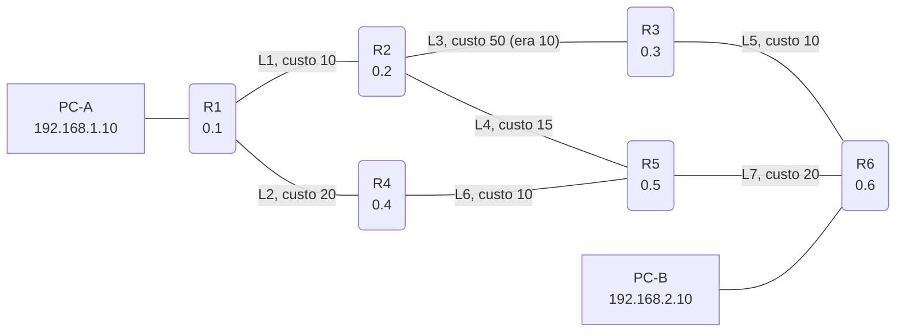

*Figura 3.2a (Tipo A, topologia).* Elementos do modo "Custo e falha": R1 (0.1); R2 (0.2); R3 (0.3); R4 (0.4); R5 (0.5); R6 (0.6); PC-A (192.168.1.10); PC-B (192.168.2.10). Vale para os cenários (6.2.1).

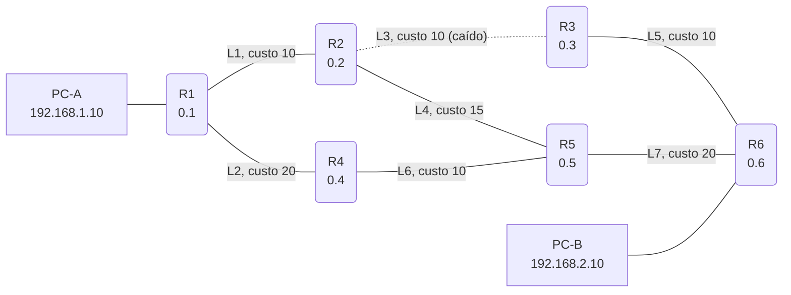

*Figura 3.2b (Tipo A, topologia).* Elementos do modo "Custo e falha": R1 (0.1); R2 (0.2); R3 (0.3); R4 (0.4); R5 (0.5); R6 (0.6); PC-A (192.168.1.10); PC-B (192.168.2.10). Linhas tracejadas: enlaces alternativos, forjados ou caídos. Vale para os cenários (6.2.2).

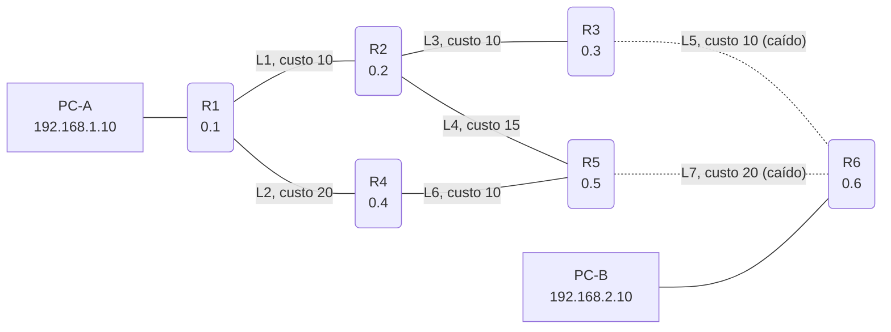

*Figura 3.2c (Tipo A, topologia).* Elementos do modo "Custo e falha": R1 (0.1); R2 (0.2); R3 (0.3); R4 (0.4); R5 (0.5); R6 (0.6); PC-A (192.168.1.10); PC-B (192.168.2.10). Linhas tracejadas: enlaces alternativos, forjados ou caídos. Vale para os cenários (6.2.3).

### 3.3 Multiárea

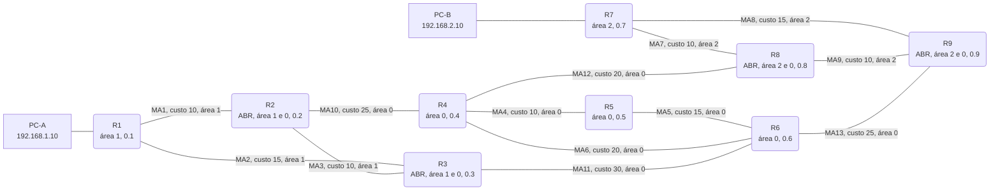

*Figura 3.3a (Tipo A, topologia).* Elementos do modo "Multiárea": R1 (área 1, 0.1); R2 (ABR, área 1 e 0, 0.2); R3 (ABR, área 1 e 0, 0.3); R4 (área 0, 0.4); R5 (área 0, 0.5); R6 (área 0, 0.6); R7 (área 2, 0.7); R8 (ABR, área 2 e 0, 0.8); R9 (ABR, área 2 e 0, 0.9); PC-A (192.168.1.10); PC-B (192.168.2.10). Vale para os cenários (6.3.1).

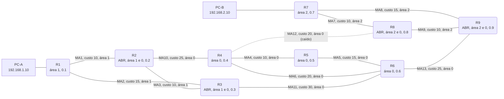

*Figura 3.3b (Tipo A, topologia).* Elementos do modo "Multiárea": R1 (área 1, 0.1); R2 (ABR, área 1 e 0, 0.2); R3 (ABR, área 1 e 0, 0.3); R4 (área 0, 0.4); R5 (área 0, 0.5); R6 (área 0, 0.6); R7 (área 2, 0.7); R8 (ABR, área 2 e 0, 0.8); R9 (ABR, área 2 e 0, 0.9); PC-A (192.168.1.10); PC-B (192.168.2.10). Linhas tracejadas: enlaces alternativos, forjados ou caídos. Vale para os cenários (6.3.2).

## 4. Abas da bancada

Cenário, Captura, Mensagem, LSDB, Tabela de roteamento, Experimento, Referência e Log.

## 5. Configurações (campos do painel)

### 5.1 Teste

- **Sentido do tráfego**. Valores: PC-A (192.168.1.10) → PC-B; PC-B (192.168.2.10) → PC-A. Padrão: PC-A (192.168.1.10) → PC-B. Modos: todos.
  - Quem envia o pacote de teste ao final da simulação.
  - Escolhe se o pacote sai do PC-A para o PC-B ou do PC-B para o PC-A.
  - Como o custo é o mesmo nos dois sentidos, o caminho de volta é o inverso da ida. Em redes reais, custos diferentes por interface podem tornar o caminho assimétrico.

### 5.2 Evento

- **Tipo de evento**. Valores: Mudança de custo de um enlace; Queda de enlace. Padrão: Mudança de custo de um enlace. Modos: Custo e falha.
  - O que acontece depois que a rede converge.
  - **Mudança de custo:** o administrador altera o custo da interface nas duas pontas do enlace. A topologia continua a mesma, mas o SPF pode escolher outro caminho.
  - **Queda de enlace:** o enlace deixa de funcionar e as duas pontas perdem a adjacência.
- **Enlace afetado**. Valores: L1: R1 / R2 (custo 10); L2: R1 / R4 (custo 20); L3: R2 / R3 (custo 10); L4: R2 / R5 (custo 15); L5: R3 / R6 (custo 10); L6: R4 / R5 (custo 10); L7: R5 / R6 (custo 20). Padrão: L3: R2 / R3 (custo 10). Modos: Custo e falha.
  - O enlace que muda de custo ou cai.
  - O caminho de menor custo inicial é R1, R2, R3, R6. Se o enlace escolhido não faz parte dele, o tráfego pode continuar pelo mesmo caminho, e ainda assim os dois roteadores do enlace originam novos LSAs.
- **Novo custo (só na mudança de custo)**. Valores: 1; 10 (igual ao de L1, L3 e L5); 20; 30; 50; 100. Padrão: 50. Modos: Custo e falha.
  - Custo OSPF configurado na interface.
  - A [RFC 2328](https://www.rfc-editor.org/rfc/rfc2328) trata o custo como um parâmetro configurável: quanto menor, mais preferido. A fórmula "largura de banda de referência dividida pela do enlace" é prática dos fabricantes.
  - Usado só quando o evento é mudança de custo. Se o valor for igual ao atual, nada muda.
- **Segundo enlace que cai (opcional)**. Valores: Nenhum; L1: R1 / R2 (custo 10); L2: R1 / R4 (custo 20); L3: R2 / R3 (custo 10); L4: R2 / R5 (custo 15); L5: R3 / R6 (custo 10); L6: R4 / R5 (custo 10); L7: R5 / R6 (custo 20). Padrão: Nenhum. Modos: Custo e falha.
  - Derruba um segundo enlace junto com o primeiro.
  - Usado só na queda de enlace. Para isolar o PC-B, derrube L5 (R3 / R6) e L7 (R5 / R6): R6 fica sem nenhum vizinho e o pacote é descartado.

### 5.3 Falha

- **Enlace fora de serviço**. Valores: Nenhum (rede íntegra); MA1: R1 / R2 (área 1); MA2: R1 / R3 (área 1); MA3: R2 / R3 (área 1); MA4: R4 / R5 (área 0); MA5: R5 / R6 (área 0); MA6: R4 / R6 (área 0); MA7: R7 / R8 (área 2); MA8: R7 / R9 (área 2); MA9: R8 / R9 (área 2); MA10: R2 / R4 (área 0); MA11: R3 / R6 (área 0); MA12: R4 / R8 (área 0); MA13: R6 / R9 (área 0). Padrão: Nenhum (rede íntegra). Modos: Multiárea.
  - Um enlace que já está caído quando a rede converge.
  - Com o enlace MA12 (R4 / R8) fora de serviço, o caminho do backbone para a área 2 passa por R6 e R9.
  - Dentro de uma área a falha altera o Router-LSA; entre áreas, o ABR muda o custo dos Summary LSAs.

### 5.4 Tabelas

- **Ver a LSDB e a tabela do roteador**. Valores: R1; R2; R3; R4; R5; R6. Padrão: R1. Modos: Convergência; Custo e falha.
  - Escolhe o roteador cujas tabelas aparecem nas abas LSDB e Tabela de roteamento.
  - Em área única, todas as LSDBs convergem para o mesmo conteúdo; a tabela de rotas, não: cada roteador tem a raiz do SPF em si mesmo.
  - Não muda o resultado da simulação.
- **Ver a LSDB e a tabela do roteador**. Valores: R1 (área 1); R2 (ABR 1 e 0); R3 (ABR 1 e 0); R4 (área 0); R5 (área 0); R6 (área 0); R7 (área 2); R8 (ABR 2 e 0); R9 (ABR 2 e 0). Padrão: R1 (área 1). Modos: Multiárea.
  - Escolhe o roteador cujas tabelas aparecem nas abas.
  - Compare R1 (só a área 1 e Summary LSAs) com R2 (ABR: duas LSDBs, uma por área) e com R4 (só o backbone).
  - Não muda o resultado da simulação.

## 6. Cenários

### 6.1 Modo: Convergência

> **Grupo:** Convergência

Como roteadores sem nenhuma rota chegam a um mapa comum da rede e calculam o melhor caminho.

#### 6.1.1 Convergência em área única

*Todos os roteadores obtêm a mesma LSDB e calculam o caminho de menor custo.*

**Configuração aplicada:** Sentido do tráfego = PC-A; Ver a LSDB e a tabela do roteador = R1

Acompanhe as quatro fases: **Hello** (vizinhos em 2-Way), **adjacência** (DBD, LSR, LSU e LSAck até Full), **inundação** dos Router-LSAs e **SPF**. Em seguida o PC-A envia um pacote ao PC-B.

O caminho escolhido é R1, R2, R3 e R6, com custo 30. Todos os caminhos entre R1 e R6 têm 3 saltos; o R1, R4, R5, R6, por exemplo, custa 50. O OSPF escolhe pelo **custo**, não pelo número de saltos.

**Conceito.** O **OSPF** ([RFC 2328](https://www.rfc-editor.org/rfc/rfc2328)) é um protocolo de **estado de enlace**: cada roteador descreve os próprios enlaces em um **Router-LSA**, e a inundação entrega todos os LSAs a todos os roteadores da área. Com a mesma **LSDB**, cada um executa o **SPF** (Dijkstra, seção 16.1) com raiz em si mesmo e instala o próximo salto de cada destino.

**O que observar**

- No diagrama: Hello, adjacência, inundação e SPF, uma fase depois da outra.
- Na aba LSDB: o conteúdo do roteador escolhido cresce com as rodadas de inundação.
- Na aba Tabela de roteamento: custo e próximo salto de cada destino, calculados pelo SPF.

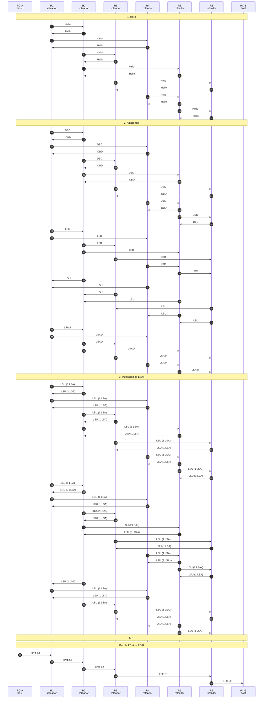

*Figura 6.1.1 (Tipo B, sequência).* Mensagens do cenário "Convergência em área única", na ordem do tempo, entre PC-A, R1, R2, R3, R4, R5, R6, PC-B: 90 mensagens, numeradas de 1 a 90 na ordem da comunicação (em 6 fases). Corresponde ao diagrama de sequência e à aba Captura, no modo "Convergência", com a configuração aplicada acima.

**Mensagens**

| Mensagem | Significado | Origem |
| --- | --- | --- |
| Hello | descobre vizinhos e mantém a adjacência | todos os roteadores |
| DBD, LSR, LSU e LSAck | sincronizam a LSDB entre vizinhos | cada par de vizinhos |
| LSU com Router-LSA | inunda o estado dos enlaces | todos os roteadores |

**Por que importa.** Como todos enxergam o mesmo mapa, o resultado é um caminho sem laços e a convergência é rápida. O custo, e não o número de saltos, define a escolha.

### 6.2 Modo: Custo e falha

> **Grupo:** Custo e falha

Como o OSPF reage depois de convergir: um novo LSA é inundado e cada roteador refaz o SPF.

#### 6.2.1 Custo 50 em R2 / R3

*Uma mudança de custo gera novos LSAs e um novo SPF.*

**Configuração aplicada:** Sentido do tráfego = PC-A; Tipo de evento = custo; Enlace afetado = L3; Novo custo (só na mudança de custo) = 50; Segundo enlace que cai (opcional) = none; Ver a LSDB e a tabela do roteador = R1

A rede já convergiu. O custo do enlace **L3 (R2 / R3)** passa de 10 para 50. Só **R2 e R3** originam novos Router-LSAs (sequência maior), que são inundados; depois todos recalculam o SPF.

O novo caminho é R1, R2, R5, R6 com custo 45. Na aba Tabela de roteamento, o roteador escolhido mostra a tabela antes e depois do SPF.

**Conceito.** Quando o custo de um enlace muda, os **dois** roteadores do enlace originam um novo Router-LSA com **número de sequência maior**. Os demais aceitam o LSA mais novo, descartam o antigo e refazem o SPF. A topologia não mudou, mas os custos sim, e o caminho de menor custo pode ser outro.

**O que observar**

- Só R2 e R3 originam LSAs novos (sequência 0x80000002).
- Na aba LSDB: o LSA de R2 e R3 com o custo novo, depois da inundação.
- Na aba Tabela de roteamento: antes e depois do SPF.

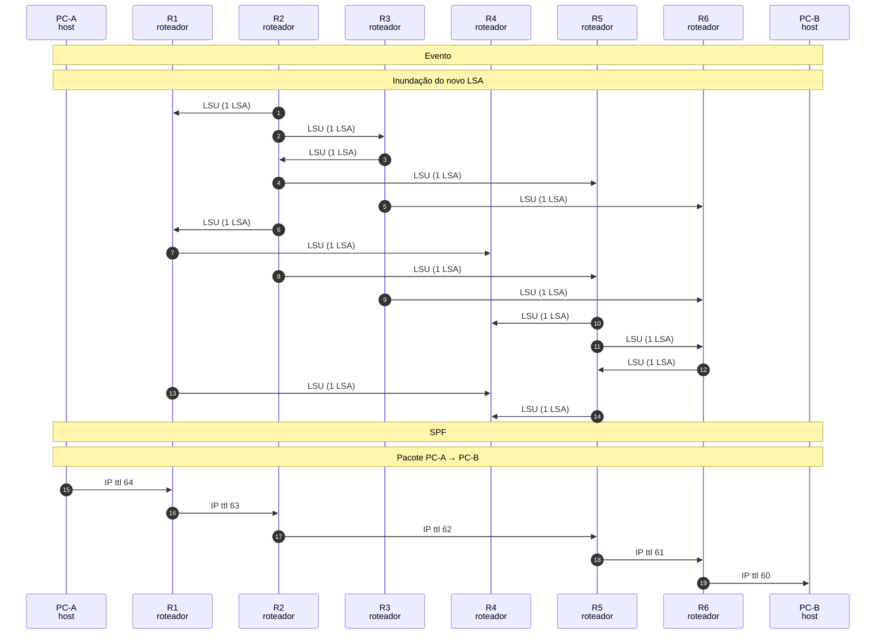

*Figura 6.2.1 (Tipo B, sequência).* Mensagens do cenário "Custo 50 em R2 / R3", na ordem do tempo, entre PC-A, R1, R2, R3, R4, R5, R6, PC-B: 19 mensagens, numeradas de 1 a 19 na ordem da comunicação (em 5 fases). Corresponde ao diagrama de sequência e à aba Captura, no modo "Custo e falha", com a configuração aplicada acima.

**Mensagens**

| Mensagem | Significado | Origem |
| --- | --- | --- |
| LSU | leva o Router-LSA novo | R2 e R3, depois todos |
| SPF | recalcula a árvore de menor custo | todos os roteadores |

**Por que importa.** Mostra por que o administrador usa o custo para fazer engenharia de tráfego: o caminho muda sem mexer na topologia.

#### 6.2.2 Queda do enlace R2 / R3

*A falha é detectada e o enlace sai dos Router-LSAs.*

**Configuração aplicada:** Sentido do tráfego = PC-A; Tipo de evento = queda; Enlace afetado = L3; Novo custo (só na mudança de custo) = 10; Segundo enlace que cai (opcional) = none; Ver a LSDB e a tabela do roteador = R1

O enlace **L3** cai. R2 e R3 perdem a adjacência (por falha da interface ou por RouterDeadInterval) e originam novos LSAs sem o enlace. O destino continua alcançável por outro caminho.

**Conceito.** A falha é detectada porque a interface cai ou porque o **RouterDeadInterval** (40 s por padrão) expira sem Hello. As duas pontas originam um novo Router-LSA sem o enlace, o LSA é inundado e todos refazem o SPF. Detecção mais rápida usa BFD, que está fora do escopo do simulador.

**O que observar**

- O Hello sem resposta, em vermelho, no enlace caído.
- Os dois roteadores originam novos LSAs.
- O pacote segue por outro caminho, com custo maior.

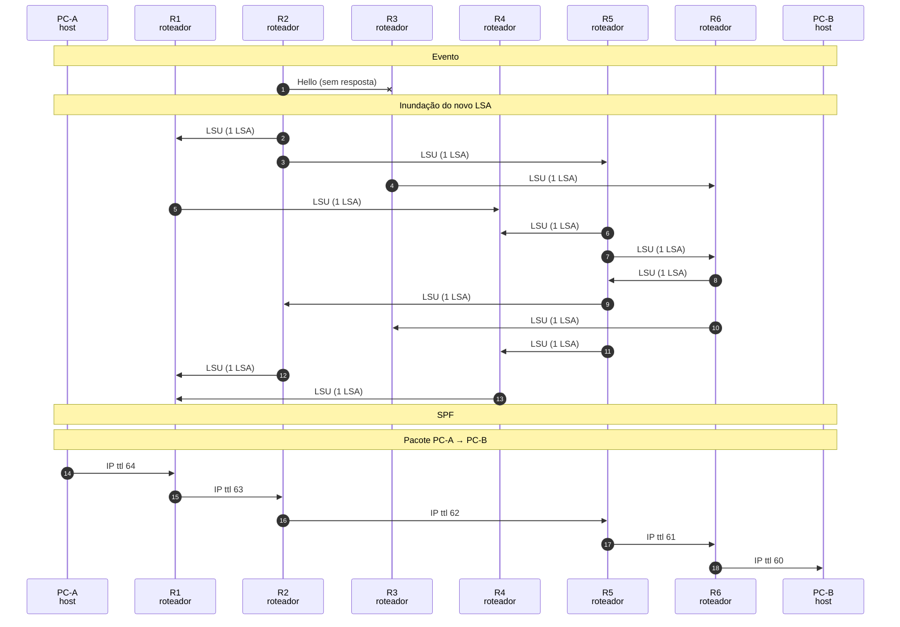

*Figura 6.2.2 (Tipo B, sequência).* Mensagens do cenário "Queda do enlace R2 / R3", na ordem do tempo, entre PC-A, R1, R2, R3, R4, R5, R6, PC-B: 18 mensagens, numeradas de 1 a 18 na ordem da comunicação (em 5 fases; 1 perdida). Corresponde ao diagrama de sequência e à aba Captura, no modo "Custo e falha", com a configuração aplicada acima.

**Mensagens**

| Mensagem | Significado | Origem |
| --- | --- | --- |
| Hello (sem resposta) | indica que o vizinho não responde | as duas pontas do enlace |
| LSU | leva o Router-LSA sem o enlace | as duas pontas, depois todos |

**Por que importa.** A rapidez da reconvergência depende da detecção da falha e do tempo de inundação e de SPF. Em produção, esses temporizadores são ajustados.

#### 6.2.3 Isolamento do PC-B

*Sem nenhum caminho, o destino sai da tabela e o pacote é descartado.*

**Configuração aplicada:** Sentido do tráfego = PC-A; Tipo de evento = queda; Enlace afetado = L5; Novo custo (só na mudança de custo) = 10; Segundo enlace que cai (opcional) = L7; Ver a LSDB e a tabela do roteador = R1

Caem **L5 (R3 / R6)** e **L7 (R5 / R6)**: o R6 fica sem vizinhos e o PC-B deixa de ser alcançável. Os outros roteadores removem R6 da LSDB e da tabela; o pacote é descartado ao chegar ao último roteador que tinha rota.

**Conceito.** Se a falha divide a rede em duas partes, cada parte passa a ter uma LSDB sem a outra. O SPF não encontra mais o destino, que sai da tabela de rotas. O pacote é encaminhado até o último roteador que ainda tinha rota e descartado ali.

**O que observar**

- R6 fica sem adjacências.
- Na aba Tabela de roteamento: R6 aparece sem rota.
- O último evento é o descarte do pacote.

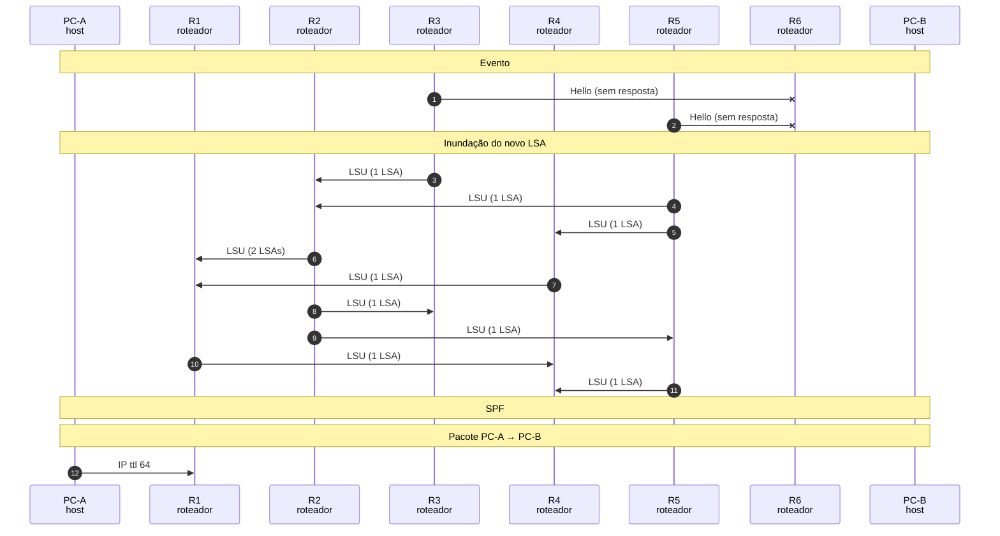

*Figura 6.2.3 (Tipo B, sequência).* Mensagens do cenário "Isolamento do PC-B", na ordem do tempo, entre PC-A, R1, R2, R3, R4, R5, R6, PC-B: 12 mensagens, numeradas de 1 a 12 na ordem da comunicação (em 5 fases; 2 perdidas). Corresponde ao diagrama de sequência e à aba Captura, no modo "Custo e falha", com a configuração aplicada acima.

**Mensagens**

| Mensagem | Significado | Origem |
| --- | --- | --- |
| Hello (sem resposta) | detecta a perda dos vizinhos de R6 | R3, R5 e R6 |
| LSU | leva os Router-LSAs sem os enlaces | R3 e R5, na parte conectada |

**Por que importa.** Mostra que o roteamento dinâmico só encontra caminhos que existem: a redundância física precisa ser projetada.

### 6.3 Modo: Multiárea

> **Grupo:** Multiárea

Como as áreas limitam a inundação e como os ABRs resumem uma área para as outras.

#### 6.3.1 Três áreas e Summary LSAs

*Cada área inunda os próprios LSAs e os ABRs resumem as outras áreas.*

**Configuração aplicada:** Sentido do tráfego = PC-A; Enlace fora de serviço = none; Ver a LSDB e a tabela do roteador = R1

Nove roteadores em três áreas: 1, 0 (backbone) e 2. Os **ABRs** R2, R3, R8 e R9 pertencem a duas áreas. Cada área inunda só os próprios LSAs, e depois os ABRs anunciam as outras áreas por **Summary LSAs** (tipo 3).

Escolha R1 em **Ver a LSDB**: ele não tem o Router-LSA de R7, só um Summary LSA com o custo até R7.

**Conceito.** Em redes grandes, o OSPF divide a rede em **áreas** ligadas à **área 0** (backbone). Os Router-LSAs ficam dentro da própria área, o que reduz a LSDB e o custo do SPF. Os **ABRs** (Area Border Routers) pertencem a duas áreas e anunciam cada área às outras por **Summary LSAs** (tipo 3, [RFC 2328](https://www.rfc-editor.org/rfc/rfc2328) seção 12.4.3), que carregam só o destino e o custo.

**O que observar**

- As LSDBs são diferentes entre áreas: R1 não tem o Router-LSA de R7.
- Os ABRs têm uma LSDB para cada área.
- Na aba Tabela de roteamento: rotas intra-área e inter-área (via ABR).

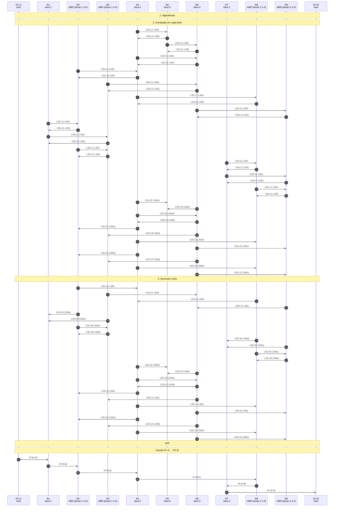

*Figura 6.3.1 (Tipo B, sequência).* Mensagens do cenário "Três áreas e Summary LSAs", na ordem do tempo, entre PC-A, R1, R2, R3, R4, R5, R6, R7, R8, R9, PC-B: 68 mensagens, numeradas de 1 a 68 na ordem da comunicação (em 6 fases). Corresponde ao diagrama de sequência e à aba Captura, no modo "Multiárea", com a configuração aplicada acima.

**Mensagens**

| Mensagem | Significado | Origem |
| --- | --- | --- |
| LSU com Router-LSA | inunda os enlaces dentro de uma área | os roteadores da área |
| LSU com Summary LSA | anuncia um destino de outra área e o custo | R2, R3, R8 e R9 (ABRs) |

**Por que importa.** O resumo esconde a topologia interna de cada área: uma falha dentro de uma área não obriga as outras a refazer o SPF, só a atualizar um custo.

#### 6.3.2 Enlace R4 / R8 fora de serviço

*A falha no backbone muda o custo dos Summary LSAs.*

**Configuração aplicada:** Sentido do tráfego = PC-A; Enlace fora de serviço = MA12; Ver a LSDB e a tabela do roteador = R1

Com **MA12 (R4 / R8)** fora de serviço, o tráfego do backbone para a área 2 passa por **R6 e R9**. O custo anunciado nos Summary LSAs cresce, e o caminho do PC-A ao PC-B muda sem que R1 saiba por onde.

**Conceito.** O custo que um ABR anuncia no Summary LSA inclui o caminho dentro do backbone. Quando o enlace MA12 cai, o caminho de R4 até a área 2 passa por R6 e R9, e os custos anunciados aumentam. Os roteadores da área 1 só enxergam esse custo maior.

**O que observar**

- O caminho do pacote passa por R9.
- Na aba Tabela de roteamento de R1: o custo até R7 é maior.
- R1 não sabe quais enlaces foram usados dentro do backbone.

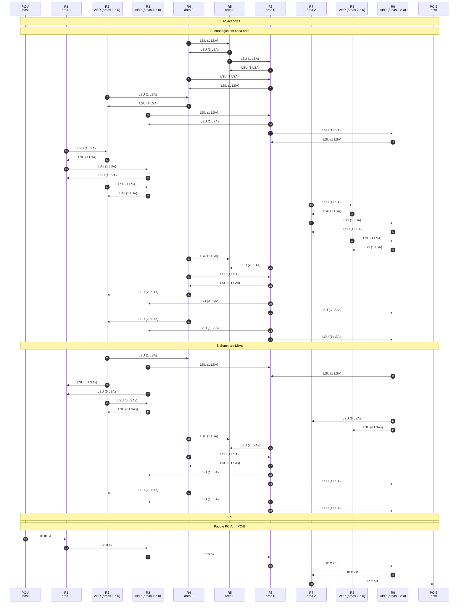

*Figura 6.3.2 (Tipo B, sequência).* Mensagens do cenário "Enlace R4 / R8 fora de serviço", na ordem do tempo, entre PC-A, R1, R2, R3, R4, R5, R6, R7, R8, R9, PC-B: 58 mensagens, numeradas de 1 a 58 na ordem da comunicação (em 6 fases). Corresponde ao diagrama de sequência e à aba Captura, no modo "Multiárea", com a configuração aplicada acima.

**Mensagens**

| Mensagem | Significado | Origem |
| --- | --- | --- |
| LSU com Summary LSA | leva o custo atualizado até as outras áreas | os ABRs |

**Por que importa.** É a vantagem e o preço do resumo: a rede escala, mas o roteador interno não vê o caminho completo.

## 7. Referência

### 7.1 Roteamento por estado de enlace

No **OSPF** (Open Shortest Path First, versão 2, [RFC 2328](https://www.rfc-editor.org/rfc/rfc2328)), cada roteador descreve os próprios enlaces e os custos em um **LSA** (Link State Advertisement) e o inunda por toda a área. Quando todos têm a mesma **LSDB** (base de estado de enlace), cada um calcula sozinho a árvore de menor custo, com raiz em si mesmo, pelo algoritmo de **Dijkstra** (**SPF**, seção 16.1). O OSPF é um IGP (Interior Gateway Protocol) e transporta seus pacotes direto sobre o IP, protocolo 89.

### 7.2 Do Hello à tabela de rotas

- **Hello:** descobre vizinhos, em 224.0.0.5 (AllSPFRouters). Quando um roteador vê o próprio Router ID na lista de vizinhos do Hello recebido, o estado passa a **2-Way** (seção 10.5). Os padrões são HelloInterval de 10 s e RouterDeadInterval de 40 s em redes ponto a ponto e broadcast.
- **Adjacência:** os vizinhos trocam **DBD** (cabeçalhos dos LSAs), **LSR** (pedido dos LSAs que faltam), **LSU** (entrega dos LSAs) e **LSAck** (confirmação) até o estado **Full** (seção 10.1 e seção 7.2).
- **Inundação:** cada roteador origina o Router-LSA com os enlaces ativos e os custos. Quem recebe um LSA novo ou mais recente o guarda e o reenvia aos demais vizinhos (seção 13). O **número de sequência** decide qual LSA é o mais novo.
- **SPF:** cada roteador executa o Dijkstra sobre a LSDB e instala o próximo salto de cada destino.
- **Custo:** a RFC trata o custo da interface apenas como parâmetro configurável (quanto menor, mais preferido); vence o menor custo total. A fórmula "largura de banda de referência dividida pela do enlace" é prática de fabricantes, como o Cisco IOS, e não faz parte da RFC.

### 7.3 Multiárea

A **área 0** é o backbone, e toda área precisa se ligar a ela. Um **ABR** (Area Border Router) tem interfaces em mais de uma área e mantém uma LSDB por área. Os Router-LSAs não saem da própria área. Para que as áreas se alcancem, o ABR origina **Summary LSAs** (tipo 3, seção 12.4.3): cada um carrega só o destino e o custo, sem a topologia. O roteador interno soma o custo até o ABR ao custo anunciado e obtém uma rota **inter-área**. Uma falha dentro de uma área não obriga as outras a refazer o SPF, apenas a atualizar um custo.

### 7.4 Comparação com o RIP

| Aspecto | OSPF | RIPv2 |
| --- | --- | --- |
| Tipo | Estado de enlace | Vetor de distância |
| Algoritmo | Dijkstra (SPF) | Bellman-Ford |
| Métrica | Custo configurável | Saltos (máximo 15) |
| Visão da rede | Mapa completo da área | Só o que os vizinhos anunciam |
| Transporte | IP protocolo 89, 224.0.0.5 e 224.0.0.6 | UDP 520, 224.0.0.9 |
| Escala | Grande, com áreas | Pequena |

### 7.5 OSPF e segurança

- **Injeção de LSAs e de rotas:** um atacante na mesma rede pode anunciar LSAs falsos para desviar tráfego (homem no meio) ou criar um buraco negro. A defesa é a **autenticação**: no OSPFv2, o HMAC-SHA da [RFC 5709](https://www.rfc-editor.org/rfc/rfc5709) (a autenticação simples e o MD5 original são fracos).
- **Interfaces passivas:** desativar o Hello nas interfaces voltadas para usuários impede que um host participe do roteamento.
- **Filtragem e resumo de rotas:** reduzem o efeito de anúncios indevidos e da instabilidade de enlaces (flapping).
- **Proteção do plano de controle:** limitar quem pode enviar OSPF aos roteadores vizinhos conhecidos e usar o TTL de segurança (GTSM, [RFC 5082](https://www.rfc-editor.org/rfc/rfc5082)) quando aplicável.

### 7.6 O que o simulador simplifica

- Todos os enlaces são ponto a ponto: não há eleição de **DR** e **BDR** (redes de acesso múltiplo), e o endereço 224.0.0.6 (AllDRouters) aparece só nesta referência.
- Cada roteador anuncia um destino: o próprio Router ID. As redes dos PCs não entram em LSAs próprios (não há Network-LSA, Type 5 nem áreas stub).
- A inundação mostra um LSU por enlace e sentido, por rodada, com atraso fixo, e **não mostra o LSAck** da fase de inundação (só o da adjacência). A ordem real depende de temporizadores.
- Os Summary LSAs são calculados sobre a topologia verdadeira, que é o que a LSDB teria depois de convergir; o simulador não mostra o cálculo de cada ABR passo a passo.
- O custo de cada enlace é fixo no cenário, sem cálculo por largura de banda de referência. OSPFv3 e IPv6 estão fora do escopo.
- A detecção da falha é instantânea no desenho; em redes reais depende do RouterDeadInterval (40 s) ou de BFD.

### 7.7 Roteiro de exercícios

1. No modo **Convergência**, anote o caminho de PC-A a PC-B. Todos os caminhos de R1 a R6 têm 3 saltos; por que o OSPF escolheu R1, R2, R3, R6?
2. Na aba **LSDB**, escolha R1 e compare com R6 depois da inundação. O que mudou entre os dois? E na **Tabela de roteamento**?
3. No modo **Evento**, aumente o custo de **L3 (R2 / R3)** para 50. Quais roteadores originam novos LSAs, e qual é o novo caminho?
4. Derrube o enlace **L3** e depois **L1**. Em qual caso o tráfego deixa de passar por R2? Troque o custo de um enlace fora do caminho: o tráfego muda?
5. Isole o PC-B derrubando **L5** e **L7**. O que acontece com a tabela dos outros roteadores?
6. No modo **Multiárea**, identifique os ABRs. Compare a LSDB de R1, R2 e R4. Por que R1 não tem o Router-LSA de R7?
7. Ponha o enlace **MA12** fora de serviço. O que muda no custo até R7 que R1 enxerga?
8. **Segurança:** um host na rede do PC-A passa a enviar LSAs falsos. Que configurações impediriam a injeção?

## 8. Glossário

Significado e finalidade das siglas usadas neste documento.

| Sigla | Significado | Para que serve |
| --- | --- | --- |
| **ABR** | Area Border Router, roteador de borda de área | roteador OSPF ligado a mais de uma área, que resume as rotas entre elas |
| **BDR** | Backup Designated Router, roteador designado de reserva | assume no lugar do DR se ele falhar |
| **BFD** | Bidirectional Forwarding Detection | detecta em milissegundos a falha de um enlace ou vizinho, para o roteamento reagir depressa |
| **BGP** | Border Gateway Protocol, protocolo de roteador de borda | troca rotas entre sistemas autônomos e sustenta o roteamento entre operadoras na Internet |
| **DBD** | Database Description, descrição de base de dados | mensagem OSPF que resume a LSDB na sincronização entre vizinhos |
| **DR** | Designated Router, roteador designado | roteador eleito num segmento multiacesso para trocar LSAs com todos os demais |
| **GTSM** | Generalized TTL Security Mechanism, mecanismo generalizado de segurança por TTL | faz o roteador aceitar pacotes BGP só com TTL 255, o que protege sessões entre vizinhos diretamente ligados ([RFC 5082](https://www.rfc-editor.org/rfc/rfc5082)) |
| **HMAC-SHA** | keyed-Hash Message Authentication Code com SHA | autentica as mensagens de roteamento com uma chave compartilhada, como no OSPF ([RFC 5709](https://www.rfc-editor.org/rfc/rfc5709)) |
| **ID** | Identifier, identificador | valor que distingue uma entidade ou uma consulta, como o router ID do BGP e o ID da consulta DNS |
| **IGP** | Interior Gateway Protocol, protocolo de roteamento interno | roteamento dentro de um sistema autônomo, como o OSPF; contrasta com o BGP, que liga sistemas autônomos |
| **IOS** | Internetwork Operating System | sistema operacional dos equipamentos Cisco; os valores padrão citados nos exemplos vêm dele |
| **IP** | Internet Protocol, protocolo de internet | endereça e encaminha pacotes entre redes, de origem a destino |
| **L2** | Layer 2, camada 2 (enlace) | indica que o equipamento encaminha por endereço MAC, como um switch |
| **LSA** | Link State Advertisement, anúncio de estado de enlace | anúncio do estado dos enlaces trocado no OSPF |
| **LSDB** | Link-State Database, base de estado de enlaces | base com o mapa da topologia que cada roteador OSPF mantém |
| **LSR** | Label Switching Router, roteador de comutação por rótulos | roteador MPLS que encaminha pacotes pelo rótulo, sem consultar o endereço IP de destino |
| **LSU** | Link State Update, atualização de estado de enlace | mensagem OSPF que leva os LSAs |
| **MD5** | Message Digest 5 | função de hash antiga, considerada insegura para assinaturas; ainda aparece em protocolos legados |
| **OSPF** | Open Shortest Path First | protocolo de roteamento interno que calcula o menor caminho a partir do mapa completo da rede |
| **RFC** | Request for Comments, pedido de comentários | documento numerado do IETF que define ou descreve um protocolo da Internet; cada documento do projeto cita as RFCs com link para o RFC Editor |
| **RIP** | Routing Information Protocol, protocolo de informação de roteamento | protocolo de vetor de distância que usa a contagem de saltos (máximo de 15) |
| **SPF** | Sender Policy Framework | registro DNS que lista os servidores autorizados a enviar e-mail por um domínio |
| **TTL** | Time To Live, tempo de vida | limita quantos saltos um pacote pode dar; cada roteador o reduz de 1, e ao chegar a zero o pacote é descartado |
| **UDP** | User Datagram Protocol | entrega datagramas sem conexão nem confirmação, com baixo custo; usado em consultas curtas e em tempo real |

---

*Simul-Net é um projeto mantido pelo Prof. Dr. Laerte Peotta de Melo, com apoio de IA generativa no processo de desenvolvimento, com sua estrita supervisão, revisão técnica e responsabilidade. Uso exclusivo para fins de ensino e pesquisa. Universidade de Brasília (UnB) - Departamento de Engenharia Elétrica. Código aberto (licença MIT).*
