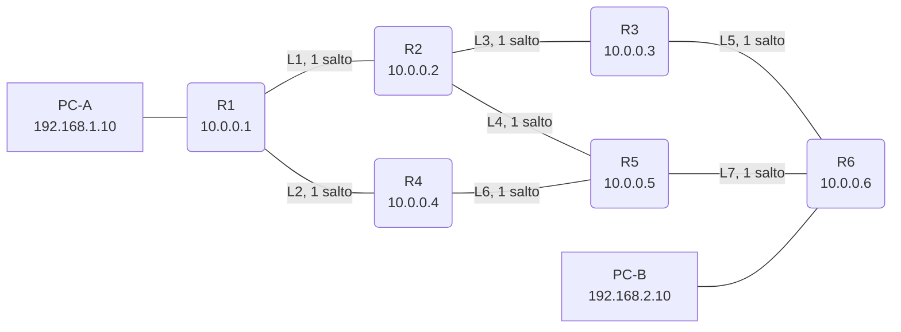
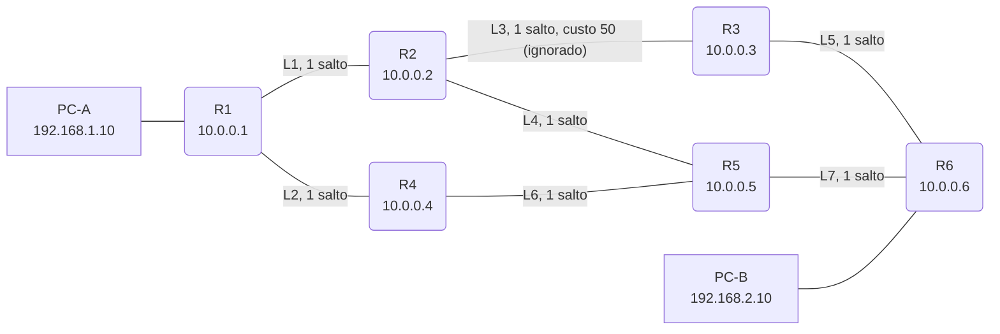
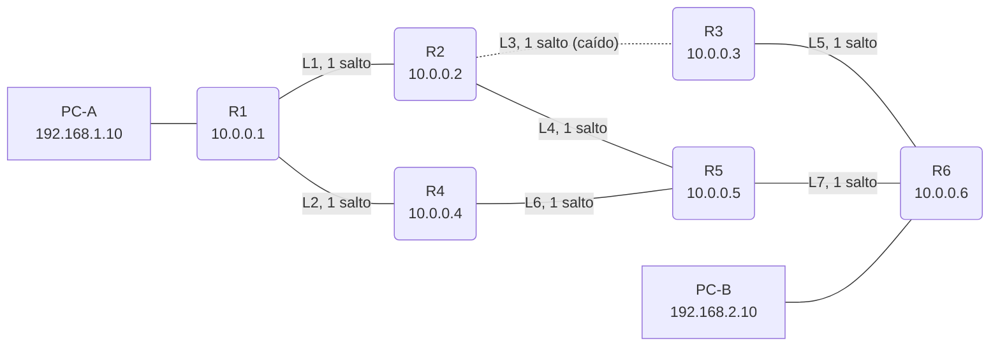
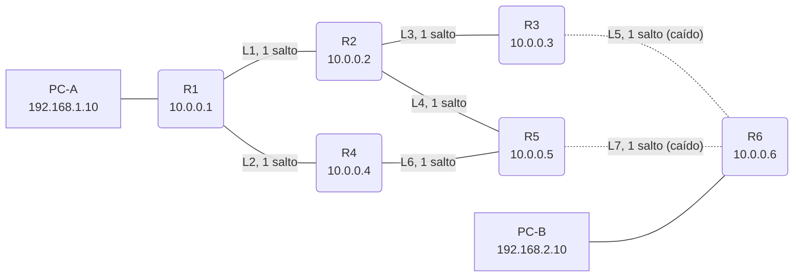
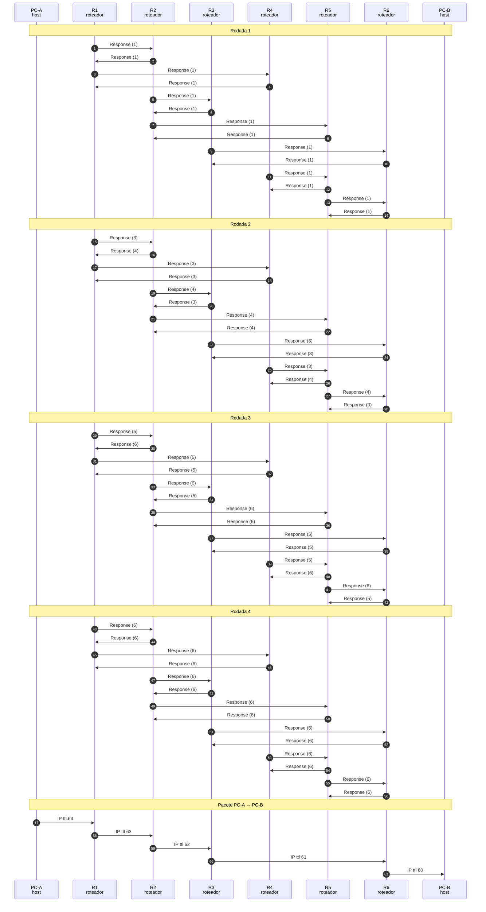
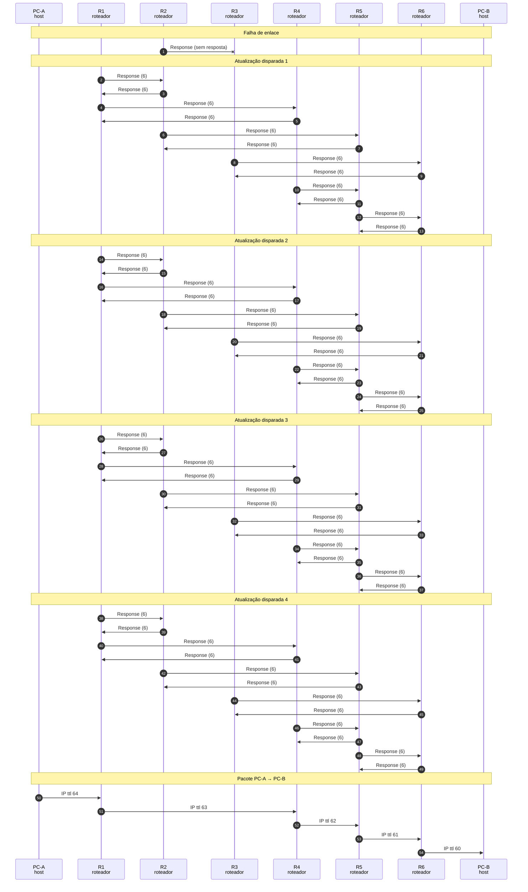

# RIP (vetor de distância)

RIPv2 passo a passo: rodadas de Response (Bellman-Ford), métrica em saltos que ignora o custo, split horizon com poison reverse, atualização disparada e contagem ao infinito.

- **Categoria:** Roteamento e serviços de rede
- **Motor:** nativo (TypeScript puro, apresentado pela bancada genérica)
- **Código-fonte:** `src/sims/rip/`
- **RFCs e padrões:** [RFC 2453](https://www.rfc-editor.org/rfc/rfc2453) (RIP versão 2), [RFC 4822](https://www.rfc-editor.org/rfc/rfc4822) (Autenticação criptográfica)
- **Tópicos:** Vetores de distância; Split horizon e poison reverse; Falhas e contagem ao infinito

## 1. Modos

| Modo | Cenário inicial | Cenários |
| --- | --- | --- |
| Convergência | Convergência do RIPv2 | 6.1.1 e 6.1.2 |
| Falha e contagem ao infinito | Queda do enlace R2 / R3 | 6.2.1 a 6.2.3 |

## 2. Como ler os diagramas

Este documento usa até dois tipos de diagrama. Cada figura traz uma legenda com o tipo, o que mostra e a que modo ou cenário se refere.

| Tipo | O que é | Vale para | Equivale, no simulador, a |
| --- | --- | --- | --- |
| A, topologia | Os elementos da rede e os enlaces que os ligam. É estático. | Um modo inteiro | A visão "Topologia" do painel principal |
| B, sequência | As mensagens na ordem do tempo, entre os participantes. É dinâmico. | Um único cenário, com a configuração indicada | Ao diagrama de sequência e à aba Captura |

### 2.1 Legenda dos diagramas

**Tipo A (topologia)**

- Retângulo: host (computador ou servidor final).
- Hexágono: switch.
- Retângulo arredondado: roteador, ou dispositivo que encaminha ou traduz.
- Estádio (cantos bem arredondados): servidor ou rede externa.
- Retângulo vermelho: atacante (quando existe no modo).
- Linha contínua: enlace. Linha tracejada: enlace alternativo, forjado ou caído, ou ainda relação de peering (no BGP), conforme o rótulo e o cenário.
- O Mermaid posiciona os elementos automaticamente: o layout difere do simulador, as ligações não.

**Tipo B (sequência)**

- Cada coluna é um participante (cliente, servidor, roteador ou outro). O tempo corre de cima para baixo.
- Seta cheia: mensagem enviada. Seta com X: mensagem perdida.
- `[cifrado]` no início do rótulo: a mensagem viaja cifrada.
- Faixa horizontal com texto: início de uma fase do cenário.
- A ordem é a da aba Captura; os intervalos de tempo não são desenhados em escala.

### 2.2 Lista de figuras

**Tipo A (topologia)**

- [Figura 3.1a](#31-convergência): topologia do modo "Convergência", variante a
- [Figura 3.1b](#31-convergência): topologia do modo "Convergência", variante b
- [Figura 3.2a](#32-falha-e-contagem-ao-infinito): topologia do modo "Falha e contagem ao infinito", variante a
- [Figura 3.2b](#32-falha-e-contagem-ao-infinito): topologia do modo "Falha e contagem ao infinito", variante b

**Tipo B (sequência)**

- [Figura 6.1.1](#611-convergência-do-ripv2): sequência de "Convergência do RIPv2"
- [Figura 6.1.2](#612-o-rip-ignora-o-custo): sequência de "O RIP ignora o custo"
- [Figura 6.2.1](#621-queda-do-enlace-r2--r3): sequência de "Queda do enlace R2 / R3"
- [Figura 6.2.2](#622-contagem-ao-infinito-sem-split-horizon): sequência de "Contagem ao infinito (sem split horizon)"
- [Figura 6.2.3](#623-isolamento-com-split-horizon): sequência de "Isolamento com split horizon"

## 3. Topologia

Figuras do Tipo A, uma por modo (e uma por variante do desenho, quando a rede muda entre cenários). Foram geradas a partir da mesma definição de topologia que a bancada usa.

### 3.1 Convergência

*Figura 3.1a (Tipo A, topologia).* Elementos do modo "Convergência": R1 (10.0.0.1); R2 (10.0.0.2); R3 (10.0.0.3); R4 (10.0.0.4); R5 (10.0.0.5); R6 (10.0.0.6); PC-A (192.168.1.10); PC-B (192.168.2.10). Vale para os cenários (6.1.1).

*Figura 3.1b (Tipo A, topologia).* Elementos do modo "Convergência": R1 (10.0.0.1); R2 (10.0.0.2); R3 (10.0.0.3); R4 (10.0.0.4); R5 (10.0.0.5); R6 (10.0.0.6); PC-A (192.168.1.10); PC-B (192.168.2.10). Vale para os cenários (6.1.2).

### 3.2 Falha e contagem ao infinito

*Figura 3.2a (Tipo A, topologia).* Elementos do modo "Falha e contagem ao infinito": R1 (10.0.0.1); R2 (10.0.0.2); R3 (10.0.0.3); R4 (10.0.0.4); R5 (10.0.0.5); R6 (10.0.0.6); PC-A (192.168.1.10); PC-B (192.168.2.10). Linhas tracejadas: enlaces alternativos, forjados ou caídos. Vale para os cenários (6.2.1).

*Figura 3.2b (Tipo A, topologia).* Elementos do modo "Falha e contagem ao infinito": R1 (10.0.0.1); R2 (10.0.0.2); R3 (10.0.0.3); R4 (10.0.0.4); R5 (10.0.0.5); R6 (10.0.0.6); PC-A (192.168.1.10); PC-B (192.168.2.10). Linhas tracejadas: enlaces alternativos, forjados ou caídos. Vale para os cenários (6.2.2 e 6.2.3).

## 4. Abas da bancada

Cenário, Captura, Mensagem, Tabela de roteamento, Vetores, Experimento, Referência e Log.

## 5. Configurações (campos do painel)

### 5.1 Teste

- **Sentido do tráfego**. Valores: PC-A (192.168.1.10) → PC-B; PC-B (192.168.2.10) → PC-A. Padrão: PC-A (192.168.1.10) → PC-B. Modos: todos.
  - Quem envia o pacote de teste ao final da simulação.
  - Escolhe se o pacote sai do PC-A para o PC-B ou do PC-B para o PC-A.
- **Custo OSPF do enlace R2 / R3**. Valores: 10 (padrão); 50; 100. Padrão: 10 (padrão). Modos: Convergência.
  - Um parâmetro que o RIP ignora.
  - O RIP usa só o número de saltos. Aumente o custo e veja que o caminho escolhido não muda, mesmo ficando bem mais caro.
  - O resultado mostra, para comparação, o caminho que um protocolo de estado de enlace (OSPF) escolheria com esse custo.

### 5.2 Protocolo

- **Split horizon com poison reverse**. Valores: caixa de seleção. Padrão: sim. Modos: todos.
  - Anuncia de volta, com métrica 16, a rota aprendida de um vizinho.
  - **Marcado:** o roteador diz ao vizinho de quem aprendeu a rota que ela é inalcançável (métrica 16), o que evita o laço entre dois vizinhos ([RFC 2453](https://www.rfc-editor.org/rfc/rfc2453), seção 3.4.3).
  - **Desmarcado:** o vetor é anunciado igual a todos os vizinhos, e a contagem ao infinito aparece mais cedo.

### 5.3 Falha

- **Enlace que cai**. Valores: L1: R1 / R2; L2: R1 / R4; L3: R2 / R3; L4: R2 / R5; L5: R3 / R6; L6: R4 / R5; L7: R5 / R6. Padrão: L3: R2 / R3. Modos: Falha e contagem ao infinito.
  - O enlace que falha depois que a rede converge.
  - O caminho inicial é R1, R2, R3, R6 (3 saltos). Se o enlace não faz parte dele, o caminho não muda, mas pode haver mudanças de tabela em outros roteadores.
- **Segundo enlace que cai (opcional)**. Valores: Nenhum; L1: R1 / R2; L2: R1 / R4; L3: R2 / R3; L4: R2 / R5; L5: R3 / R6; L6: R4 / R5; L7: R5 / R6. Padrão: Nenhum. Modos: Falha e contagem ao infinito.
  - Derruba um segundo enlace junto com o primeiro.
  - Para isolar o PC-B, derrube L5 (R3 / R6) e L7 (R5 / R6). Como a rede fica dividida, as rotas para R6 só terminam em 16 depois de várias rodadas: é a **contagem ao infinito**.

### 5.4 Tabelas

- **Ver as tabelas do roteador**. Valores: R1; R2; R3; R4; R5; R6. Padrão: R1. Modos: todos.
  - Escolhe o roteador cujas tabelas aparecem nas abas Vetores e Tabela de roteamento.
  - A tabela acompanha o relógio: ela muda a cada rodada de Response.
  - Não muda o resultado da simulação.

## 6. Cenários

### 6.1 Modo: Convergência

> **Grupo:** Convergência

Como os roteadores aprendem as rotas só com o que os vizinhos anunciam, e por que a métrica é o número de saltos.

#### 6.1.1 Convergência do RIPv2

*Vetores de distância trocados em rodadas até as tabelas estabilizarem.*

**Configuração aplicada:** Sentido do tráfego = PC-A; Split horizon com poison reverse = sim; Ver as tabelas do roteador = R1; Custo OSPF do enlace R2 / R3 = 10

Cada roteador começa conhecendo só a si mesmo. A cada rodada, todos enviam o **vetor de distância** aos vizinhos, que somam 1 e adotam a rota se ela for melhor. Na aba **Tabela de roteamento**, veja a tabela do roteador escolhido crescer rodada a rodada.

O caminho do PC-A ao PC-B é R1, R2, R3, R6, com 3 saltos.

**Conceito.** O **RIPv2** ([RFC 2453](https://www.rfc-editor.org/rfc/rfc2453)) é um protocolo de **vetor de distância**: cada roteador anuncia aos vizinhos a lista de destinos que alcança e a métrica (número de saltos). Quem recebe soma 1 e adota a rota se ela for melhor ou se vier do próximo salto atual (**Bellman-Ford**, seção 3.9.2). O roteador nunca vê o mapa, só o que os vizinhos dizem.

**O que observar**

- No diagrama: uma Response por enlace e sentido em cada rodada.
- Na aba Tabela de roteamento: o roteador escolhido aprende os vizinhos na rodada 1, os vizinhos dos vizinhos na 2, e assim por diante.
- A última rodada não muda nada: é assim que se sabe que convergiu.

*Figura 6.1.1 (Tipo B, sequência).* Mensagens do cenário "Convergência do RIPv2", na ordem do tempo, entre PC-A, R1, R2, R3, R4, R5, R6, PC-B: 61 mensagens, numeradas de 1 a 61 na ordem da comunicação (em 6 fases). Corresponde ao diagrama de sequência e à aba Captura, no modo "Convergência", com a configuração aplicada acima.

**Mensagens**

| Mensagem | Significado | Origem |
| --- | --- | --- |
| Response | anuncia o vetor de distância (UDP 520, 224.0.0.9) | todos os roteadores, a cada rodada |

**Por que importa.** A informação viaja um salto por rodada. Em redes reais, as rodadas são de 30 s, e é por isso que o RIP converge devagar.

#### 6.1.2 O RIP ignora o custo

*O RIP escolhe por saltos, mesmo com um enlace caro no caminho.*

**Configuração aplicada:** Sentido do tráfego = PC-A; Split horizon com poison reverse = sim; Ver as tabelas do roteador = R1; Custo OSPF do enlace R2 / R3 = 50

O custo do enlace **R2 / R3** sobe para 50, mas o RIP conta só saltos: o caminho continua R1, R2, R3, R6, que agora custa 70. O resultado mostra, para comparação, o caminho que o OSPF escolheria (R1, R2, R5, R6, custo 45).

**Conceito.** A métrica do RIP é o número de saltos (de 1 a 15; 16 é infinito). O custo, a largura de banda ou a latência dos enlaces não entram na conta. Um caminho curto e lento ganha de um caminho um pouco mais longo e rápido.

**O que observar**

- O caminho continua R1, R2, R3, R6, igual ao do cenário anterior.
- No resultado: o custo do caminho do RIP (70) contra o do caminho de menor custo (45).

*Figura 6.1.2 (Tipo B, sequência).* Mensagens do cenário "O RIP ignora o custo", na ordem do tempo, entre PC-A, R1, R2, R3, R4, R5, R6, PC-B: 61 mensagens, numeradas de 1 a 61 na ordem da comunicação (em 6 fases). Corresponde ao diagrama de sequência e à aba Captura, no modo "Convergência", com a configuração aplicada acima.

**Mensagens**

| Mensagem | Significado | Origem |
| --- | --- | --- |
| Response | só leva a métrica em saltos, sem custo | todos os roteadores |

**Por que importa.** É a razão principal de o RIP ter dado lugar ao OSPF e ao EIGRP em redes com enlaces de velocidades diferentes.

### 6.2 Modo: Falha e contagem ao infinito

> **Grupo:** Falhas

Como o RIP reage a uma falha, e por que a convergência é lenta quando a rede se divide.

#### 6.2.1 Queda do enlace R2 / R3

*A atualização disparada propaga a falha sem esperar os 30 s.*

**Configuração aplicada:** Sentido do tráfego = PC-A; Split horizon com poison reverse = sim; Ver as tabelas do roteador = R1; Enlace que cai = L3; Segundo enlace que cai (opcional) = none

A rede já convergiu. O enlace **L3 (R2 / R3)** cai: R2 e R3 marcam com métrica 16 as rotas que passavam por ele e anunciam a mudança na hora (**atualização disparada**). Em poucas rodadas as tabelas se ajustam e o tráfego passa por R4 e R5.

**Conceito.** Quando um enlace cai, as duas pontas marcam com métrica 16 as rotas que passavam por ele e enviam uma **atualização disparada** (**triggered update**, seção 3.4.4), sem esperar o próximo ciclo de 30 s. Os vizinhos aceitam o 16, e as rotas alternativas, quando existem, são aprendidas nas rodadas seguintes.

**O que observar**

- O Response sem resposta, em vermelho, no enlace caído.
- Na aba Tabela de roteamento: rotas em 16 logo após a falha e a rota nova nas rodadas seguintes.
- O pacote segue por outro caminho, também de 3 saltos.

*Figura 6.2.1 (Tipo B, sequência).* Mensagens do cenário "Queda do enlace R2 / R3", na ordem do tempo, entre PC-A, R1, R2, R3, R4, R5, R6, PC-B: 54 mensagens, numeradas de 1 a 54 na ordem da comunicação (em 7 fases; 1 perdida). Corresponde ao diagrama de sequência e à aba Captura, no modo "Falha e contagem ao infinito", com a configuração aplicada acima.

**Mensagens**

| Mensagem | Significado | Origem |
| --- | --- | --- |
| Response (sem resposta) | indica que o vizinho deixou de anunciar | as duas pontas do enlace |
| Response disparado | anuncia a mudança de imediato | quem teve a tabela alterada |

**Por que importa.** Sem o triggered update, a falha só seria percebida depois do timeout de 180 s (seção 3.8) e propagada de 30 em 30 segundos.

#### 6.2.2 Contagem ao infinito (sem split horizon)

*Sem split horizon, as métricas sobem até 16, uma por rodada.*

**Configuração aplicada:** Sentido do tráfego = PC-A; Split horizon com poison reverse = não; Ver as tabelas do roteador = R1; Enlace que cai = L5; Segundo enlace que cai (opcional) = L7

Caem **L5 (R3 / R6)** e **L7 (R5 / R6)** e o R6, com o PC-B, fica isolado. Sem split horizon, os roteadores continuam anunciando uns aos outros caminhos para R6 que já não existem, e a métrica sobe de 1 em 1 até 16. Veja a métrica de R6 crescer a cada rodada na aba Tabela de roteamento.

**Conceito.** Quando um destino some, os roteadores que ainda têm uma rota para ele via um vizinho confundem o anúncio desse vizinho com um caminho novo. Cada um anuncia ao outro uma rota um salto mais longa, e a métrica sobe a cada rodada até chegar ao **infinito** (16). É a **contagem ao infinito** ([RFC 2453](https://www.rfc-editor.org/rfc/rfc2453), seção 3.4.2), e é por isso que o RIP limita a rede a 15 saltos.

**O que observar**

- Na aba Tabela de roteamento de R5 ou R2: a métrica de R6 sobe de rodada em rodada.
- Durante a contagem, os roteadores ainda encaminhariam pacotes para R6 por rotas que já não existem; o pacote de teste só é enviado depois que tudo estabiliza.
- O número de rodadas até estabilizar, no resumo do Experimento.

```mermaid
sequenceDiagram
  autonumber
  participant n_PC_A as PC-A<br/>host
  participant n_R1 as R1<br/>roteador
  participant n_R2 as R2<br/>roteador
  participant n_R3 as R3<br/>roteador
  participant n_R4 as R4<br/>roteador
  participant n_R5 as R5<br/>roteador
  participant n_R6 as R6<br/>roteador
  participant n_PC_B as PC-B<br/>host
  Note over n_PC_A,n_PC_B: Falha de enlace
  n_R3 -x n_R6: Response (sem resposta)
  n_R5 -x n_R6: Response (sem resposta)
  Note over n_PC_A,n_PC_B: Atualização disparada 1
  n_R1 ->> n_R2: Response (6)
  n_R2 ->> n_R1: Response (6)
  n_R1 ->> n_R4: Response (6)
  n_R4 ->> n_R1: Response (6)
  n_R2 ->> n_R3: Response (6)
  n_R3 ->> n_R2: Response (6)
  n_R2 ->> n_R5: Response (6)
  n_R5 ->> n_R2: Response (6)
  n_R4 ->> n_R5: Response (6)
  n_R5 ->> n_R4: Response (6)
  Note over n_PC_A,n_PC_B: Atualização disparada 2
  n_R1 ->> n_R2: Response (6)
  n_R2 ->> n_R1: Response (6)
  n_R1 ->> n_R4: Response (6)
  n_R4 ->> n_R1: Response (6)
  n_R2 ->> n_R3: Response (6)
  n_R3 ->> n_R2: Response (6)
  n_R2 ->> n_R5: Response (6)
  n_R5 ->> n_R2: Response (6)
  n_R4 ->> n_R5: Response (6)
  n_R5 ->> n_R4: Response (6)
  Note over n_PC_A,n_PC_B: Atualização disparada 3
  n_R1 ->> n_R2: Response (6)
  n_R2 ->> n_R1: Response (6)
  n_R1 ->> n_R4: Response (6)
  n_R4 ->> n_R1: Response (6)
  n_R2 ->> n_R3: Response (6)
  n_R3 ->> n_R2: Response (6)
  n_R2 ->> n_R5: Response (6)
  n_R5 ->> n_R2: Response (6)
  n_R4 ->> n_R5: Response (6)
  n_R5 ->> n_R4: Response (6)
  Note over n_PC_A,n_PC_B: Atualização disparada 4
  n_R1 ->> n_R2: Response (6)
  n_R2 ->> n_R1: Response (6)
  n_R1 ->> n_R4: Response (6)
  n_R4 ->> n_R1: Response (6)
  n_R2 ->> n_R3: Response (6)
  n_R3 ->> n_R2: Response (6)
  n_R2 ->> n_R5: Response (6)
  n_R5 ->> n_R2: Response (6)
  n_R4 ->> n_R5: Response (6)
  n_R5 ->> n_R4: Response (6)
  Note over n_PC_A,n_PC_B: Atualização disparada 5
  n_R1 ->> n_R2: Response (6)
  n_R2 ->> n_R1: Response (6)
  n_R1 ->> n_R4: Response (6)
  n_R4 ->> n_R1: Response (6)
  n_R2 ->> n_R3: Response (6)
  n_R3 ->> n_R2: Response (6)
  n_R2 ->> n_R5: Response (6)
  n_R5 ->> n_R2: Response (6)
  n_R4 ->> n_R5: Response (6)
  n_R5 ->> n_R4: Response (6)
  Note over n_PC_A,n_PC_B: Atualização disparada 6
  n_R1 ->> n_R2: Response (6)
  n_R2 ->> n_R1: Response (6)
  n_R1 ->> n_R4: Response (6)
  n_R4 ->> n_R1: Response (6)
  n_R2 ->> n_R3: Response (6)
  n_R3 ->> n_R2: Response (6)
  n_R2 ->> n_R5: Response (6)
  n_R5 ->> n_R2: Response (6)
  n_R4 ->> n_R5: Response (6)
  n_R5 ->> n_R4: Response (6)
  Note over n_PC_A,n_PC_B: Atualização disparada 7
  n_R1 ->> n_R2: Response (6)
  n_R2 ->> n_R1: Response (6)
  n_R1 ->> n_R4: Response (6)
  n_R4 ->> n_R1: Response (6)
  n_R2 ->> n_R3: Response (6)
  n_R3 ->> n_R2: Response (6)
  n_R2 ->> n_R5: Response (6)
  n_R5 ->> n_R2: Response (6)
  n_R4 ->> n_R5: Response (6)
  n_R5 ->> n_R4: Response (6)
  Note over n_PC_A,n_PC_B: Atualização disparada 8
  n_R1 ->> n_R2: Response (6)
  n_R2 ->> n_R1: Response (6)
  n_R1 ->> n_R4: Response (6)
  n_R4 ->> n_R1: Response (6)
  n_R2 ->> n_R3: Response (6)
  n_R3 ->> n_R2: Response (6)
  n_R2 ->> n_R5: Response (6)
  n_R5 ->> n_R2: Response (6)
  n_R4 ->> n_R5: Response (6)
  n_R5 ->> n_R4: Response (6)
  Note over n_PC_A,n_PC_B: Atualização disparada 9
  n_R1 ->> n_R2: Response (6)
  n_R2 ->> n_R1: Response (6)
  n_R1 ->> n_R4: Response (6)
  n_R4 ->> n_R1: Response (6)
  n_R2 ->> n_R3: Response (6)
  n_R3 ->> n_R2: Response (6)
  n_R2 ->> n_R5: Response (6)
  n_R5 ->> n_R2: Response (6)
  n_R4 ->> n_R5: Response (6)
  n_R5 ->> n_R4: Response (6)
  Note over n_PC_A,n_PC_B: Atualização disparada 10
  n_R1 ->> n_R2: Response (6)
  n_R2 ->> n_R1: Response (6)
  n_R1 ->> n_R4: Response (6)
  n_R4 ->> n_R1: Response (6)
  n_R2 ->> n_R3: Response (6)
  n_R3 ->> n_R2: Response (6)
  n_R2 ->> n_R5: Response (6)
  n_R5 ->> n_R2: Response (6)
  n_R4 ->> n_R5: Response (6)
  n_R5 ->> n_R4: Response (6)
  Note over n_PC_A,n_PC_B: Atualização disparada 11
  n_R1 ->> n_R2: Response (6)
  n_R2 ->> n_R1: Response (6)
  n_R1 ->> n_R4: Response (6)
  n_R4 ->> n_R1: Response (6)
  n_R2 ->> n_R3: Response (6)
  n_R3 ->> n_R2: Response (6)
  n_R2 ->> n_R5: Response (6)
  n_R5 ->> n_R2: Response (6)
  n_R4 ->> n_R5: Response (6)
  n_R5 ->> n_R4: Response (6)
  Note over n_PC_A,n_PC_B: Atualização disparada 12
  n_R1 ->> n_R2: Response (6)
  n_R2 ->> n_R1: Response (6)
  n_R1 ->> n_R4: Response (6)
  n_R4 ->> n_R1: Response (6)
  n_R2 ->> n_R3: Response (6)
  n_R3 ->> n_R2: Response (6)
  n_R2 ->> n_R5: Response (6)
  n_R5 ->> n_R2: Response (6)
  n_R4 ->> n_R5: Response (6)
  n_R5 ->> n_R4: Response (6)
  Note over n_PC_A,n_PC_B: Atualização disparada 13
  n_R1 ->> n_R2: Response (6)
  n_R2 ->> n_R1: Response (6)
  n_R1 ->> n_R4: Response (6)
  n_R4 ->> n_R1: Response (6)
  n_R2 ->> n_R3: Response (6)
  n_R3 ->> n_R2: Response (6)
  n_R2 ->> n_R5: Response (6)
  n_R5 ->> n_R2: Response (6)
  n_R4 ->> n_R5: Response (6)
  n_R5 ->> n_R4: Response (6)
  Note over n_PC_A,n_PC_B: Atualização disparada 14
  n_R1 ->> n_R2: Response (6)
  n_R2 ->> n_R1: Response (6)
  n_R1 ->> n_R4: Response (6)
  n_R4 ->> n_R1: Response (6)
  n_R2 ->> n_R3: Response (6)
  n_R3 ->> n_R2: Response (6)
  n_R2 ->> n_R5: Response (6)
  n_R5 ->> n_R2: Response (6)
  n_R4 ->> n_R5: Response (6)
  n_R5 ->> n_R4: Response (6)
  Note over n_PC_A,n_PC_B: Atualização disparada 15
  n_R1 ->> n_R2: Response (6)
  n_R2 ->> n_R1: Response (6)
  n_R1 ->> n_R4: Response (6)
  n_R4 ->> n_R1: Response (6)
  n_R2 ->> n_R3: Response (6)
  n_R3 ->> n_R2: Response (6)
  n_R2 ->> n_R5: Response (6)
  n_R5 ->> n_R2: Response (6)
  n_R4 ->> n_R5: Response (6)
  n_R5 ->> n_R4: Response (6)
  Note over n_PC_A,n_PC_B: Pacote PC-A → PC-B
  n_PC_A ->> n_R1: IP ttl 64
```

*Figura 6.2.2 (Tipo B, sequência).* Mensagens do cenário "Contagem ao infinito (sem split horizon)", na ordem do tempo, entre PC-A, R1, R2, R3, R4, R5, R6, PC-B: 153 mensagens, numeradas de 1 a 153 na ordem da comunicação (em 18 fases; 2 perdidas). Corresponde ao diagrama de sequência e à aba Captura, no modo "Falha e contagem ao infinito", com a configuração aplicada acima.

**Mensagens**

| Mensagem | Significado | Origem |
| --- | --- | --- |
| Response | leva a rota para R6 com métrica cada vez maior | R2, R3, R4 e R5 |

**Por que importa.** Durante a contagem a rede perde pacotes. Este é um dos motivos de o RIP ser indicado só para redes pequenas.

#### 6.2.3 Isolamento com split horizon

*O split horizon não resolve laços de três ou mais roteadores.*

**Configuração aplicada:** Sentido do tráfego = PC-A; Split horizon com poison reverse = sim; Ver as tabelas do roteador = R1; Enlace que cai = L5; Segundo enlace que cai (opcional) = L7

A mesma falha, agora com split horizon e poison reverse. Ele evita o laço entre dois vizinhos, mas a topologia tem laços de três ou mais roteadores, e a contagem ao infinito acontece do mesmo jeito: **o split horizon não elimina o problema**.

**Conceito.** O **split horizon com poison reverse** (seção 3.4.3) faz o roteador devolver a rota ao vizinho de quem a aprendeu com métrica 16. Isso rompe o laço entre **dois** vizinhos. Nesta topologia, porém, os laços passam por três ou mais roteadores (por exemplo R1, R2, R5 e R4), e o split horizon não os enxerga: a contagem ao infinito continua.

**O que observar**

- Compare o número de rodadas com o do cenário sem split horizon: é o mesmo.
- O poison reverse aparece nos campos do Response: rotas aprendidas de um vizinho voltam a ele com 16.

*Figura 6.2.3 (Tipo B, sequência).* Mensagens do cenário "Isolamento com split horizon", na ordem do tempo, entre PC-A, R1, R2, R3, R4, R5, R6, PC-B: 153 mensagens, numeradas de 1 a 153 na ordem da comunicação (em 18 fases; 2 perdidas). Corresponde ao diagrama de sequência e à aba Captura, no modo "Falha e contagem ao infinito", com a configuração aplicada acima.

**Mensagens**

| Mensagem | Significado | Origem |
| --- | --- | --- |
| Response | com poison reverse para o vizinho de quem a rota foi aprendida | todos os roteadores |

**Por que importa.** Mecanismos como o holddown e o route poisoning (com triggered update) reduzem o problema, mas a solução de fundo é usar outro tipo de protocolo (estado de enlace) em redes maiores.

## 7. Referência

### 7.1 Roteamento por vetor de distância

No **RIP** (Routing Information Protocol, versão 2, [RFC 2453](https://www.rfc-editor.org/rfc/rfc2453)), cada roteador conhece só o que os vizinhos anunciam: uma lista de destinos com a distância até cada um. Não há mapa da rede. O roteador soma a distância até o vizinho à que ele anuncia e adota o melhor resultado, pelo algoritmo de **Bellman-Ford** distribuído. O RIP é um IGP (Interior Gateway Protocol), e a versão 2 acrescenta máscara de sub-rede, próximo salto, etiqueta de rota e autenticação à versão 1.

### 7.2 Como funciona

- **Métrica:** número de saltos. O valor 16 significa inalcançável, o que limita a rede a 15 saltos (seção 3.1).
- **Mensagens:** Request e **Response**, em UDP porta 520. O RIPv2 envia por multicast 224.0.0.9 (seção 4.5). Cada mensagem leva até 25 rotas (seção 3.6).
- **Atualização periódica:** a cada 30 s, cada roteador envia a tabela inteira aos vizinhos. Uma rota sem atualização por 180 s expira, e é removida depois de mais 120 s (seção 3.8).
- **Regra de atualização:** o roteador soma 1 à métrica recebida e adota a rota se ela for melhor que a atual ou se vier do próximo salto atual, o que permite aceitar também notícias ruins (seção 3.9.2).
- **Atualização disparada:** depois de uma mudança, o roteador anuncia a alteração imediatamente (seção 3.4.4).

### 7.3 Contagem ao infinito e split horizon

Se um destino some, roteadores que ainda têm uma rota para ele via o vizinho podem aceitar do próprio vizinho um caminho que depende deles. Cada um anuncia ao outro uma rota mais longa, e a métrica sobe a cada rodada até 16: é a **contagem ao infinito** (seção 3.4.2), e é por ela que o infinito é tão pequeno. Enquanto isso o tráfego é perdido.

O **split horizon** não anuncia a um vizinho as rotas aprendidas dele. Com **poison reverse**, as anuncia com métrica 16 (seção 3.4.3). Isso evita o laço entre dois vizinhos, mas não os laços com três ou mais roteadores, que a topologia deste simulador contém: por isso a contagem ao infinito ainda acontece mesmo com ele ligado. Outras técnicas, como o *holddown*, são práticas de fabricantes e não são simuladas.

### 7.4 Comparação com o OSPF

| Aspecto | RIPv2 | OSPF |
| --- | --- | --- |
| Tipo | Vetor de distância | Estado de enlace |
| Algoritmo | Bellman-Ford | Dijkstra (SPF) |
| Métrica | Saltos (máximo 15) | Custo configurável |
| Visão da rede | Só o que os vizinhos anunciam | Mapa completo da área |
| Convergência | Lenta, em rodadas | Rápida |
| Transporte | UDP 520, 224.0.0.9 | IP protocolo 89, 224.0.0.5 e 224.0.0.6 |
| Escala | Pequena | Grande, com áreas |

### 7.5 RIP e segurança

- **Injeção de rotas:** qualquer host na rede pode enviar Response e anunciar rotas falsas para desviar tráfego ou criar um buraco negro. A defesa é a **autenticação** do RIPv2: a senha simples (seção 4.1) é fraca; o MD5 e o HMAC-SHA da [RFC 4822](https://www.rfc-editor.org/rfc/rfc4822) são os indicados.
- **Interfaces passivas:** desativar o envio e a recepção de atualizações nas interfaces voltadas para usuários impede que um host participe do roteamento.
- **Filtragem de rotas:** aceitar só os prefixos esperados reduz o efeito de anúncios indevidos.
- **Limite de saltos:** o infinito em 16 impede que uma rota falsa viaje indefinidamente.

### 7.6 O que o simulador simplifica

- As rodadas são síncronas: todos enviam e recebem ao mesmo tempo. Em uma rede real, cada roteador tem seu relógio de 30 s, e a atualização disparada tem atraso aleatório de 1 a 5 s (seção 3.10.1).
- Não há timeout de 180 s nem garbage collection de 120 s: a falha é detectada de imediato, e as rotas inalcançáveis ficam na tabela com métrica 16.
- Cada roteador anuncia um destino: o próprio Router ID, e não as redes dos PCs. Não há Request, etiqueta de rota, rotas externas nem autenticação.
- Os atrasos dos enlaces são fixos e iguais. RIPng e IPv6 estão fora do escopo.

### 7.7 Roteiro de exercícios

1. No modo **Convergência**, escolha R1 e acompanhe a tabela rodada a rodada. Em que rodada R1 aprende R6? Por quê?
2. Aumente o custo de **R2 / R3** para 50. O caminho muda? Compare o custo dele com o do caminho de menor custo.
3. No modo **Falha**, derrube **L3**. Quantas rodadas até estabilizar? Qual é o novo caminho?
4. Isole o PC-B derrubando **L5** e **L7**, sem split horizon. Veja a métrica de R6 em R2 crescer. Por que ela para em 16?
5. Repita com split horizon. O número de rodadas muda? Por que a contagem ao infinito acontece mesmo assim nesta topologia?
6. **Segurança:** um host na rede do PC-A passa a enviar Response com rotas falsas. Que configurações impediriam a injeção?

## 8. Glossário

Significado e finalidade das siglas usadas neste documento.

| Sigla | Significado | Para que serve |
| --- | --- | --- |
| **BGP** | Border Gateway Protocol, protocolo de roteador de borda | troca rotas entre sistemas autônomos e sustenta o roteamento entre operadoras na Internet |
| **HMAC-SHA** | keyed-Hash Message Authentication Code com SHA | autentica as mensagens de roteamento com uma chave compartilhada, como no OSPF ([RFC 5709](https://www.rfc-editor.org/rfc/rfc5709)) |
| **ID** | Identifier, identificador | valor que distingue uma entidade ou uma consulta, como o router ID do BGP e o ID da consulta DNS |
| **IGP** | Interior Gateway Protocol, protocolo de roteamento interno | roteamento dentro de um sistema autônomo, como o OSPF; contrasta com o BGP, que liga sistemas autônomos |
| **IP** | Internet Protocol, protocolo de internet | endereça e encaminha pacotes entre redes, de origem a destino |
| **L2** | Layer 2, camada 2 (enlace) | indica que o equipamento encaminha por endereço MAC, como um switch |
| **MD5** | Message Digest 5 | função de hash antiga, considerada insegura para assinaturas; ainda aparece em protocolos legados |
| **OSPF** | Open Shortest Path First | protocolo de roteamento interno que calcula o menor caminho a partir do mapa completo da rede |
| **RIP** | Routing Information Protocol, protocolo de informação de roteamento | protocolo de vetor de distância que usa a contagem de saltos (máximo de 15) |
| **SPF** | Sender Policy Framework | registro DNS que lista os servidores autorizados a enviar e-mail por um domínio |
| **UDP** | User Datagram Protocol | entrega datagramas sem conexão nem confirmação, com baixo custo; usado em consultas curtas e em tempo real |

---

*Simul-Net é um projeto mantido pelo Prof. Dr. Laerte Peotta de Melo, com apoio de IA generativa no processo de desenvolvimento, com sua estrita supervisão, revisão técnica e responsabilidade. Uso exclusivo para fins de ensino e pesquisa. Universidade de Brasília (UnB) - Departamento de Engenharia Elétrica. Código aberto (licença MIT).*
