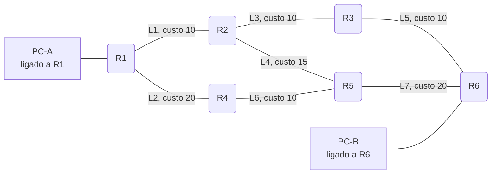
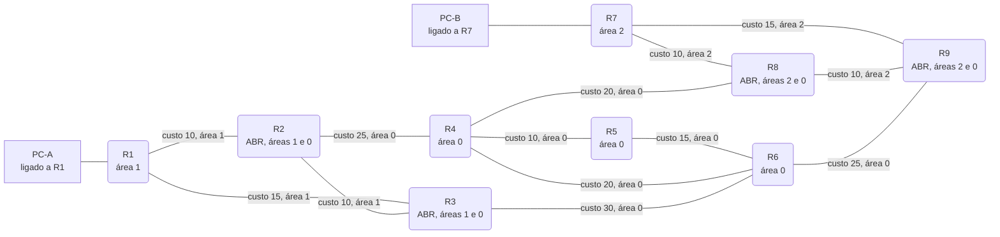

# Roteamento (OSPF e RIPv2)

Roteamento dinâmico passo a passo: OSPF em área única e multiárea (Hello, adjacências, LSAs e SPF) e RIPv2 com Bellman-Ford e split horizon, com falhas de enlace e custos editáveis.

- **Categoria:** Roteamento e serviços de rede
- **Motor:** legado (página autônoma em `public/sims/router-simulator.html`, incorporada por `iframe`)
- **RFCs e padrões:** [RFC 2328](https://www.rfc-editor.org/rfc/rfc2328), [RFC 2453](https://www.rfc-editor.org/rfc/rfc2453)
- **Tópicos:** Hello e adjacências; LSAs e SPF; Bellman-Ford e split horizon; Falhas de enlace

## 1. Como ler os diagramas

Este documento usa até dois tipos de diagrama. Cada figura traz uma legenda com o tipo, o que mostra e a que modo ou cenário se refere.

| Tipo | O que é | Vale para | Equivale, no simulador, a |
| --- | --- | --- | --- |
| A, topologia | Os elementos da rede e os enlaces que os ligam. É estático. | Um modo inteiro | A visão "Topologia" do quadro principal |

### 1.1 Legenda dos diagramas

**Tipo A (topologia)**

- Retângulo: host (computador ou servidor final).
- Hexágono: switch.
- Retângulo arredondado: roteador, ou dispositivo que encaminha ou traduz.
- Estádio (cantos bem arredondados): servidor ou rede externa.
- Retângulo vermelho: atacante (quando existe no modo).
- Linha contínua: enlace. Linha tracejada: enlace alternativo, forjado ou caído, conforme o rótulo e o cenário.
- O Mermaid posiciona os elementos automaticamente: o layout difere do simulador, as ligações não.

### 1.2 Lista de figuras

**Tipo A (topologia)**

- [Figura 2.1](#21-rede-de-6-roteadores-ospf-em-área-única-e-ripv2): rede de seis roteadores, OSPF em área única e RIPv2
- [Figura 2.2](#22-rede-de-9-roteadores-em-três-áreas-ospf-multi-área): rede de nove roteadores em três áreas

## 2. Topologia

Figuras do Tipo A, geradas a partir da mesma definição que a página usa para desenhar a rede.

### 2.1 Rede de 6 roteadores (OSPF em área única e RIPv2)

*Figura 2.1 (Tipo A, topologia).* 6 roteadores, 7 enlaces com custo OSPF e dois hosts. É a rede dos cenários de OSPF em área única e de RIPv2; o RIPv2 ignora os custos, porque a métrica dele é o número de saltos.

### 2.2 Rede de 9 roteadores em três áreas (OSPF multi-área)

*Figura 2.2 (Tipo A, topologia).* 9 roteadores em três áreas: 1, 0 (backbone) e 2. Os roteadores de borda de área (ABR) pertencem a duas áreas e ligam cada área ao backbone. Cada enlace traz o custo e a área a que pertence. Vale para o cenário de OSPF multi-área.

## 3. Abas

Cenário, Vetores / LSDB, Tabela de roteamento, Experimento, Referência, Log de eventos.

## 4. Configurações (campos do painel)

- **Protocolo**. Valores: OSPF (estado de enlace); RIPv2 (vetor de distância). Padrão: OSPF (estado de enlace).
  - **OSPF:** estado de enlace. Cada roteador recebe a descrição de todos os enlaces (LSDB) e calcula o caminho de menor custo com Dijkstra.
  - **RIPv2:** vetor de distância. Cada roteador só conhece o que os vizinhos anunciam e escolhe o caminho com menos saltos.
  - Trocar o protocolo reinicia a simulação.
- **Raiz da tabela SPF**. Valores: R1; R2; R3; R4; R5; R6. Padrão: R1.
  - No OSPF, define a raiz do cálculo SPF: a árvore e a tabela são vistas a partir deste roteador.
  - No RIPv2, mostra a tabela e os vetores anunciados por este roteador.
  - Clicar em um roteador no desenho tem o mesmo efeito.
- **Modo de área (OSPF)**. Valores: Área única; Multi-área (9 roteadores). Padrão: Área única.
  - **Área única:** seis roteadores, todos na área 0.
  - **Multi-área:** nove roteadores nas áreas 1, 0 e 2, ligadas ao backbone pelos ABRs R2, R3, R8 e R9.
  - Trocar o modo reinicia a simulação.
- **Split horizon com poison reverse**. Valores: caixa de seleção. Padrão: sim.
  - Com split horizon, o roteador não devolve ao vizinho a rota que aprendeu dele; com poison reverse, devolve com métrica 16 (inalcançável).
  - Evita o laço entre dois vizinhos, mas não laços de três ou mais roteadores: nesses, a contagem ao infinito acontece mesmo com ele ligado.
  - Vale para as próximas rodadas de Response.
- **Velocidade da animação**. Valores: Lenta; Normal; Rápida. Padrão: Normal.
  - Muda só a velocidade de exibição; rotas, custos e rodadas são os mesmos.
  - Use Avançar fase para acompanhar a convergência passo a passo.

## 5. Cenários

> **Grupo:** OSPF

Estado de enlace: cada roteador conhece o mapa inteiro da rede e calcula sozinho o caminho de menor custo, com Dijkstra.

### 5.1 Convergência OSPF

Configuração do cenário: OSPF, área única

**O que é.**

O **OSPF** ([RFC 2328](https://www.rfc-editor.org/rfc/rfc2328)) é um protocolo de **estado de enlace**. Os roteadores formam adjacências com Hello, sincronizam um banco de dados com a descrição de todos os enlaces (**LSDB**) e, com esse mapa completo, cada um calcula sozinho a árvore de menor custo (**SPF**, algoritmo de Dijkstra).

**Neste cenário.**

Clique em **Avançar fase** quatro vezes: Hello (2-Way), Adjacência Full, Inundação de LSA e SPF. Depois clique em **Simular PC-A → PC-B**.

O caminho escolhido é R1 → R2 → R3 → R6, com custo total 30.

**O que observar.**

- No trilho de fases: Hello / 2-Way, Adjacência Full, Inundação de LSA e SPF.
- Na aba Vetores / LSDB: a mesma LSDB em todos os roteadores.
- Na aba Tabela de roteamento: o custo e o próximo salto de cada destino a partir da raiz.

**Mensagens envolvidas.**

| Mensagem | Função | Quem envia |
| --- | --- | --- |
| Hello | descobre vizinhos e confirma o 2-Way | todos os roteadores |
| DBD, LSR, LSU e LSAck | sincronizam a LSDB até Full | cada par de vizinhos |
| Router-LSA | descreve os enlaces e custos do roteador | cada roteador |

**Por que importa.**

Converge rápido e sem laços, porque todos calculam sobre o mesmo mapa. O custo, ligado à banda, permite preferir enlaces rápidos.

### 5.2 Custo e melhor caminho

Configuração do cenário: OSPF, área única

**O que é.**

O OSPF escolhe o caminho de **menor custo total**, não o de menos saltos. O custo de cada interface costuma ser inversamente proporcional à banda. Ao mudar um custo, os roteadores do enlace originam novos LSAs e todos recalculam o SPF.

**Neste cenário.**

Converja e simule a comunicação. Depois clique no enlace **R2 / R3**, mude o custo para 50 e clique em **Aplicar custo**.

Simule de novo: o tráfego passa a ir por R2 → R5 → R6.

**O que observar.**

- Antes: R1 → R2 → R3 → R6, custo 30.
- Depois do custo 50 em R2 / R3: R1 → R2 → R5 → R6, custo 45.
- No log: novos LSAs de R2 e R3, com número de sequência maior.

**Mensagens envolvidas.**

| Caminho | Custo total | Situação |
| --- | --- | --- |
| R1 → R2 → R3 → R6 | 30 | antes da mudança |
| R1 → R2 → R5 → R6 | 45 | com custo 50 em R2 / R3 |

**Por que importa.**

É assim que o administrador faz engenharia de tráfego com o OSPF: ajusta custos para preferir ou evitar enlaces.

### 5.3 Falha de enlace

Configuração do cenário: OSPF, área única

**O que é.**

Quando um enlace cai, só os dois roteadores ligados a ele percebem. Eles originam novos **Router-LSAs** com número de sequência maior, que invalidam os anteriores, e a inundação leva a mudança a todos. Cada roteador recalcula o SPF sobre a LSDB atualizada.

**Neste cenário.**

Converja e simule a comunicação. Depois clique no enlace **R2 / R3** e use **Derrubar enlace**.

Só R2 e R3 originam novos LSAs; todos recalculam o SPF e a comunicação segue por outro caminho.

**O que observar.**

- No log: os LSAs de R2 e R3 com sequência nova e a reconvergência.
- Na aba Tabela de roteamento: destinos que mudam de próximo salto.
- Simule a comunicação: o pacote segue pelo caminho alternativo.

**Mensagens envolvidas.**

| Mensagem | Função | Quem envia |
| --- | --- | --- |
| Router-LSA | nova sequência, sem o enlace caído | R2 e R3 |
| LSAck | confirma o recebimento de cada LSA | vizinhos |

**Por que importa.**

A convergência rápida limita o tempo em que o tráfego se perde. Em produção, o BFD detecta a falha em milissegundos.

### 5.4 OSPF multi-área

Configuração do cenário: OSPF, multi-área

**O que é.**

Em redes grandes, o OSPF divide os roteadores em **áreas**. Toda área se liga ao **backbone** (área 0) por um **ABR** (Area Border Router), que participa das duas. Isso limita o tamanho da LSDB e o alcance das inundações.

**Neste cenário.**

Nove roteadores em três áreas. Converja e simule a comunicação de PC-A (área 1) até PC-B (área 2).

O caminho atravessa o backbone pelos ABRs.

**O que observar.**

- No desenho: as áreas 1, 0 e 2 e os ABRs R2, R3, R8 e R9.
- Simule a comunicação: R1 → R2 → R4 → R8 → R7, atravessando o backbone.
- Simplificação do simulador: o SPF roda sobre a topologia inteira; no OSPF real, os ABRs resumem as outras áreas em LSAs tipo 3.

**Mensagens envolvidas.**

| Papel | Função | Roteadores |
| --- | --- | --- |
| Interno | fica em uma só área | R1, R4, R5, R6 e R7 |
| ABR | liga uma área ao backbone | R2, R3, R8 e R9 |
| Backbone | área 0, por onde passa o tráfego entre áreas | R4, R5, R6 e os ABRs |

**Por que importa.**

A hierarquia permite ao OSPF escalar: uma falha dentro de uma área não obriga as outras a recalcular tudo.

> **Grupo:** RIPv2

Vetor de distância: cada roteador só conhece o que os vizinhos anunciam e escolhe o caminho com menos saltos.

### 5.5 Convergência RIPv2

Configuração do cenário: RIPv2, split horizon ligado

**O que é.**

O **RIPv2** ([RFC 2453](https://www.rfc-editor.org/rfc/rfc2453)) é um protocolo de **vetor de distância**. Cada roteador envia aos vizinhos a lista de destinos que conhece e a distância até cada um, em **saltos**. Quem recebe soma 1 e guarda o menor valor (Bellman-Ford). Ninguém conhece o mapa completo da rede.

**Neste cenário.**

Avance as fases: vetores iniciais, 1ª troca e as rodadas até as tabelas estabilizarem. Depois simule a comunicação.

O caminho é R1 → R2 → R3 → R6, com 3 saltos.

**O que observar.**

- No trilho de fases: vetores iniciais, 1ª troca e as rodadas até estabilizar.
- Na aba Vetores / LSDB: o vetor que cada roteador anuncia a cada vizinho.
- Na aba Tabela de roteamento: a métrica em saltos e o próximo salto.

**Mensagens envolvidas.**

| Mensagem | Função | Quem envia |
| --- | --- | --- |
| Response | vetor de distância (UDP 520, 224.0.0.9) | cada roteador, a cada rodada |

**Por que importa.**

É simples e leve, mas lento para convergir e limitado a 15 saltos. Ainda aparece em redes pequenas e em equipamentos antigos.

### 5.6 Saltos, não custo

Configuração do cenário: RIPv2, split horizon ligado

**O que é.**

A métrica do RIP é apenas o **número de saltos**. Um enlace lento e um rápido valem o mesmo: 1 salto. Por isso mudar o custo de um enlace não altera nenhuma rota.

**Neste cenário.**

Converja e mude o custo de um enlace do caminho, por exemplo **R2 / R3** para 50.

Nada muda nas tabelas: o RIP só conta saltos.

**O que observar.**

- No log: o RIP ignora a mudança de custo.
- A tabela de roteamento continua igual.
- Compare com o cenário Custo e melhor caminho, no OSPF.

**Mensagens envolvidas.**

| Protocolo | Métrica | Efeito do custo 50 em R2 / R3 |
| --- | --- | --- |
| OSPF | soma dos custos | desvia por R5 (custo 45) |
| RIPv2 | número de saltos | nada muda (3 saltos) |

**Por que importa.**

Contar saltos pode levar o tráfego por enlaces lentos. É uma das razões para o RIP ter dado lugar ao OSPF em redes maiores.

### 5.7 Contagem ao infinito

Configuração do cenário: RIPv2, split horizon desligado

**O que é.**

Sem **split horizon**, um roteador anuncia de volta ao vizinho a rota que aprendeu dele. Quando um destino fica inalcançável, os vizinhos passam a acreditar um no outro e aumentam a métrica de 1 em 1, rodada após rodada, até chegar a 16 (infinito): é a **contagem ao infinito**. O split horizon evita esse laço entre dois vizinhos, mas não em ciclos de três ou mais roteadores.

**Neste cenário.**

O split horizon está **desligado**. Converja e derrube os enlaces **R5 / R6** e **R3 / R6**: o PC-B fica isolado.

Conte no log as rodadas até a rede perceber. Depois repita no cenário Convergência RIPv2, com split horizon: a contagem acontece de novo, porque esta topologia tem laços de três ou mais roteadores.

**O que observar.**

- No log: o número de rodadas até reconvergir depois de isolar o PC-B.
- Na aba Vetores / LSDB: vizinhos anunciando de volta a rota perdida.
- Repita no cenário Convergência RIPv2, com split horizon: o número de rodadas é o mesmo, porque os laços desta rede têm três ou mais roteadores.

**Mensagens envolvidas.**

| Mensagem | Função | Quem envia |
| --- | --- | --- |
| Response | reanuncia a rota perdida com métrica + 1 | vizinhos, rodada após rodada |
| Métrica 16 | destino inalcançável | ao fim da contagem |

**Por que importa.**

Enquanto a contagem não termina, os pacotes ficam em laço e se perdem. Split horizon, poison reverse e triggered updates reduzem o problema, mas não o eliminam em topologias com ciclos; o limite de 16 garante que ele termina. Essa é uma das razões para protocolos de estado de enlace, como o OSPF, que não têm contagem ao infinito.

## 6. Referência

### 6.1 Roteamento dinâmico

          

Com roteamento dinâmico, os roteadores trocam informações para montar a tabela de roteamento sozinhos e reagir a falhas. Há duas famílias: no **vetor de distância** (RIP), cada roteador só conhece o que os vizinhos anunciam; no **estado de enlace** (OSPF), todos recebem o mapa completo da área e calculam o melhor caminho por conta própria.

          

### 6.2 OSPF ([RFC 2328](https://www.rfc-editor.org/rfc/rfc2328))

          

- **Hello:** descobre vizinhos (a cada 10 s em redes broadcast). Quando um roteador vê o próprio Router ID no Hello do vizinho, o estado passa a **2-Way**.
- **Adjacência:** os vizinhos trocam DBD, LSR, LSU e LSAck até sincronizar as bases. O estado final é **Full**.
- **Inundação de LSAs:** cada roteador origina um Router-LSA com seus enlaces e custos. As LSAs se propagam por toda a área até que todas as LSDBs fiquem idênticas.
- **SPF:** cada roteador executa Dijkstra sobre a LSDB, tendo a si mesmo como raiz, e instala o próximo salto de cada destino.
- **Custo:** por padrão, é a largura de banda de referência dividida pela largura de banda do enlace. Vence o menor custo total.
- **Multiárea:** a Área 0 é o backbone. Os ABRs (roteadores de borda de área) resumem cada área para as demais com Summary LSAs (tipo 3), o que reduz a LSDB e o custo do SPF.

          

### 6.3 RIPv2 ([RFC 2453](https://www.rfc-editor.org/rfc/rfc2453))

          

- **Métrica:** número de saltos. O valor 16 significa inalcançável, o que limita a rede a 15 saltos.
- **Atualizações:** a cada 30 s, cada roteador envia sua tabela (vetor de distância) aos vizinhos, por multicast 224.0.0.9 na porta UDP 520.
- **Bellman-Ford:** o roteador soma 1 à métrica anunciada pelo vizinho e adota a rota se ela for melhor ou se vier do próximo salto atual.
- **Split horizon com poison reverse:** a rota volta ao vizinho de quem foi aprendida com métrica 16. Isso evita o laço entre dois vizinhos; em laços de três ou mais roteadores, a contagem ao infinito ainda acontece e só termina pelo limite de 16.
- **Triggered update:** depois de uma falha, o roteador anuncia a mudança imediatamente, sem esperar os 30 s.

          

### 6.4 Comparação

          

| Aspecto | OSPF | RIPv2 |
| --- | --- | --- |
| Tipo | Estado de enlace | Vetor de distância |
| Algoritmo | Dijkstra (SPF) | Bellman-Ford |
| Métrica | Custo (largura de banda) | Saltos (máx. 15) |
| Visão da rede | Mapa completo da área | Só o que os vizinhos anunciam |
| Convergência | Rápida | Lenta (rodadas de 30 s) |
| Transporte | IP protocolo 89, 224.0.0.5 e 224.0.0.6 | UDP 520, 224.0.0.9 |
| Escala | Grande, com hierarquia de áreas | Pequena |

          

### 6.5 Roteamento e segurança

          

- **Injeção de rotas:** um atacante na mesma rede pode anunciar rotas falsas para desviar tráfego (man-in-the-middle) ou criar um buraco negro. A defesa é a **autenticação**: no OSPF, HMAC-SHA ([RFC 5709](https://www.rfc-editor.org/rfc/rfc5709)); no RIPv2, MD5 ou HMAC-SHA ([RFC 4822](https://www.rfc-editor.org/rfc/rfc4822)).
- **Interfaces passivas:** desativar o envio de Hello e de atualizações nas interfaces voltadas para usuários impede que um host participe do roteamento.
- **Filtragem e resumo de rotas:** filtrar o que se aceita e resumir rotas reduz o efeito de anúncios indevidos e da instabilidade de enlaces (flapping).

          

### 6.6 Roteiro de exercícios

          

1. **OSPF, área única:** avance até a convergência e anote o caminho de PC-A a PC-B. Existe caminho com menos saltos? Por que o OSPF não o escolheu?
2. Aumente o custo do enlace **R2 / R3** para 50 e simule a comunicação de novo. Quais roteadores originam novos LSAs, e qual é o novo caminho?
3. Troque para **RIPv2**, converja e compare o caminho com o do OSPF. Altere o custo de um enlace: o que muda?
4. No RIPv2, derrube o enlace **R2 / R3** e conte as rodadas até reconvergir (o destino continua alcançável). Depois isole o PC-B derrubando **R5 / R6** e **R3 / R6**, com e sem split horizon. Por que a contagem ao infinito acontece mesmo com split horizon nesta topologia?
5. Ative o modo **multi-área** e identifique os ABRs. Por que toda área precisa se ligar à área 0?
6. **Segurança:** um host na rede do PC-A passa a enviar anúncios OSPF falsos. Que configurações impediriam a injeção de rotas?

---

*Simul-Net é um projeto mantido pelo Prof. Dr. Laerte Peotta de Melo, com apoio de IA generativa no processo de desenvolvimento, com sua estrita supervisão, revisão técnica e responsabilidade. Uso exclusivo para fins de ensino e pesquisa. Universidade de Brasília (UnB) - Departamento de Engenharia Elétrica. Código aberto (licença MIT).*
