# SSH

SSH-2 por dentro: negociação de versão e algoritmos, troca de chaves, known_hosts, autenticação (senha, chave pública e TOTP), canais, SFTP e túneis (-L, -R, -D e ProxyJump), com nota de hardening.

- **Categoria:** Protocolos de rede seguros
- **Motor:** nativo (TypeScript puro, apresentado pela bancada genérica)
- **Código-fonte:** `src/sims/ssh/`
- **RFCs e padrões:** [RFC 4251](https://www.rfc-editor.org/rfc/rfc4251) (arquitetura), [RFC 4253](https://www.rfc-editor.org/rfc/rfc4253) (transporte), [RFC 4252](https://www.rfc-editor.org/rfc/rfc4252) (autenticação), [RFC 4254](https://www.rfc-editor.org/rfc/rfc4254) (conexão), [RFC 4256](https://www.rfc-editor.org/rfc/rfc4256) (keyboard-interactive), [RFC 8332](https://www.rfc-editor.org/rfc/rfc8332) (rsa-sha2), [RFC 8709](https://www.rfc-editor.org/rfc/rfc8709) (Ed25519)
- **Tópicos:** Negociação e troca de chaves; known_hosts e autenticação; Canais e SFTP; Túneis e encaminhamento

## 1. Modos

| Modo | Cenário inicial | Cenários |
| --- | --- | --- |
| Sessão e autenticação | Conexão moderna com chave | 5.1.1 a 5.1.13 |
| Túneis e encaminhamento | Túnel local (-L) | 5.2.1 a 5.2.6 |

## 2. Como ler os diagramas

Este documento usa até dois tipos de diagrama. Cada figura traz uma legenda com o tipo, o que mostra e a que modo ou cenário se refere.

| Tipo | O que é | Vale para | Equivale, no simulador, a |
| --- | --- | --- | --- |
| B, sequência | As mensagens na ordem do tempo, entre os participantes. É dinâmico. | Um único cenário, com a configuração indicada | Ao diagrama de sequência e à aba Captura |

### 2.1 Legenda dos diagramas

**Tipo B (sequência)**

- Cada coluna é um participante (cliente, servidor, roteador ou outro). O tempo corre de cima para baixo.
- Seta cheia: mensagem enviada. Seta com X: mensagem perdida.
- `[cifrado]` no início do rótulo: a mensagem viaja cifrada.
- Faixa horizontal com texto: início de uma fase do cenário.
- A ordem é a da aba Captura; os intervalos de tempo não são desenhados em escala.

### 2.2 Lista de figuras

**Tipo B (sequência)**

- [Figura 5.1.1](#511-conexão-moderna-com-chave): sequência de "Conexão moderna com chave"
- [Figura 5.1.2](#512-primeira-conexão-tofu): sequência de "Primeira conexão (TOFU)"
- [Figura 5.1.3](#513-chave-do-servidor-mudou): sequência de "Chave do servidor mudou"
- [Figura 5.1.4](#514-sem-algoritmo-em-comum): sequência de "Sem algoritmo em comum"
- [Figura 5.1.5](#515-algoritmos-fracos-aceitos): sequência de "Algoritmos fracos aceitos"
- [Figura 5.1.6](#516-login-por-senha): sequência de "Login por senha"
- [Figura 5.1.7](#517-senha-desativada-no-servidor): sequência de "Senha desativada no servidor"
- [Figura 5.1.8](#518-muitas-tentativas-de-senha): sequência de "Muitas tentativas de senha"
- [Figura 5.1.9](#519-chave--totp-2-fatores): sequência de "Chave + TOTP (2 fatores)"
- [Figura 5.1.10](#5110-login-de-root-bloqueado): sequência de "Login de root bloqueado"
- [Figura 5.1.11](#5111-comando-remoto): sequência de "Comando remoto"
- [Figura 5.1.12](#5112-transferência-sftp): sequência de "Transferência SFTP"
- [Figura 5.1.13](#5113-forwardagent-e-seus-riscos): sequência de "ForwardAgent e seus riscos"
- [Figura 5.2.1](#521-túnel-local--l): sequência de "Túnel local (-L)"
- [Figura 5.2.2](#522-túnel-remoto--r): sequência de "Túnel remoto (-R)"
- [Figura 5.2.3](#523-túnel-remoto-sem-gatewayports): sequência de "Túnel remoto sem GatewayPorts"
- [Figura 5.2.4](#524-proxy-socks--d): sequência de "Proxy SOCKS (-D)"
- [Figura 5.2.5](#525-proxyjump-bastion): sequência de "ProxyJump (bastion)"
- [Figura 5.2.6](#526-encaminhamento-bloqueado): sequência de "Encaminhamento bloqueado"

## 3. Abas da bancada

Cenário, Captura, Mensagem, Chaves e sessão, Configuração, Experimento, Referência e Log.

## 4. Configurações (campos do painel)

### 4.1 Rede

- **RTT (ms)**. Valores: 5; 20; 50; 100; 200. Padrão: 20. Modos: todos.
  - Tempo de ida e volta entre cliente e servidor.
  - Cada mensagem do SSH que espera resposta custa meia ida e volta. O handshake do SSH leva vários RTTs antes do primeiro comando.

### 4.2 Cliente

- **Perfil do cliente**. Valores: Moderno (OpenSSH 9.x); Intermediário (OpenSSH 7.x); Legado (OpenSSH 5.x). Padrão: Moderno (OpenSSH 9.x). Modos: todos.
  - Conjunto de algoritmos que o cliente oferece.
  - **Moderno:** curve25519, ed25519, chacha20 e AES-GCM.
  - **Intermediário:** OpenSSH 7.x, ainda aceita RSA com SHA-1, CBC e MACs antigos.
  - **Legado:** OpenSSH 5.x, só DH com SHA-1, DSA, 3DES e CBC. Vários servidores atuais recusam.
- **Chave do servidor no known_hosts**. Valores: Conhecida (confere); Primeira conexão (não consta); Diferente da registrada. Padrão: Conhecida (confere). Modos: todos.
  - O que o cliente já sabe sobre a chave deste servidor.
  - **Conhecida:** o fingerprint recebido é igual ao guardado em ~/.ssh/known_hosts.
  - **Primeira conexão:** o cliente nunca viu este servidor. É o momento de confiar no primeiro uso (TOFU) e conferir o fingerprint por outro canal.
  - **Diferente:** o servidor apresenta outra chave. Pode ser reinstalação ou interceptação (MITM).
- **Método de autenticação**. Valores: Chave pública (ed25519); Senha; Senha + código TOTP (keyboard-interactive). Padrão: Chave pública (ed25519). Modos: Sessão e autenticação.
  - Como o cliente prova quem é.
  - **Chave pública:** o cliente assina um desafio com a chave privada. A senha nunca viaja.
  - **Senha:** viaja dentro do canal cifrado, mas pode ser adivinhada por tentativas repetidas.
  - **Senha + TOTP:** o servidor pergunta a senha e depois um código temporário (keyboard-interactive).
- **Credencial correta**. Valores: caixa de seleção. Padrão: sim. Modos: Sessão e autenticação.
  - Se a chave, a senha ou o código estão certos.
  - Desmarcado, a chave não consta em authorized_keys, ou a senha e o código estão errados. Serve para ver a falha e as tentativas.
- **Usuário**. Valores: aluno; root. Padrão: aluno. Modos: Sessão e autenticação.
  - Conta usada no login.
  - **root** costuma ser recusado pela configuração PermitRootLogin, mesmo com a credencial certa.
- **StrictHostKeyChecking** (ajuste avançado). Valores: ask (pergunta ao usuário); accept-new; yes (só hosts conhecidos); no (não verifica, inseguro). Padrão: ask (pergunta ao usuário). Modos: todos.
  - Política do cliente para chaves de servidor.
  - **ask:** pergunta na primeira conexão e recusa chave alterada.
  - **accept-new:** grava chaves novas sem perguntar e recusa as alteradas.
  - **yes:** recusa qualquer servidor ausente do known_hosts.
  - **no:** aceita tudo. Desliga a proteção contra interceptação.
- **ForwardAgent** (ajuste avançado). Valores: caixa de seleção. Padrão: não. Modos: Sessão e autenticação.
  - Encaminhar o agente SSH ao servidor.
  - Permite usar suas chaves a partir do servidor, sem copiá-las. Quem tiver privilégio no servidor pode usar o agente enquanto a sessão durar. Prefira ProxyJump.

### 4.3 Sessão

- **Uso da sessão**. Valores: Shell interativo; Comando remoto; Transferência SFTP. Padrão: Shell interativo. Modos: Sessão e autenticação.
  - O que o cliente pede depois de autenticado.
  - **Shell:** terminal interativo (pty + shell).
  - **Comando:** executa um comando e encerra.
  - **SFTP:** subsistema de transferência de arquivos sobre o mesmo canal SSH.

### 4.4 Túnel

- **Tipo de túnel**. Valores: Local (-L): acessar um serviço interno; Remoto (-R): expor um serviço local; Dinâmico (-D): proxy SOCKS; ProxyJump (-J): salto por bastion. Padrão: Local (-L): acessar um serviço interno. Modos: Túneis e encaminhamento.
  - Direção do encaminhamento de porta.
  - **-L:** uma porta local leva ao serviço interno, passando pelo servidor SSH.
  - **-R:** uma porta do servidor leva a um serviço da máquina do cliente.
  - **-D:** o cliente vira um proxy SOCKS5 e cada destino abre um canal.
  - **-J:** o cliente chega a um alvo interno passando por um bastion, com SSH de ponta a ponta.

### 4.5 Servidor

- **Perfil do servidor**. Valores: Moderno (OpenSSH 9.x); Intermediário (OpenSSH 7.x); Legado (OpenSSH 5.x); Endurecido (só algoritmos modernos). Padrão: Moderno (OpenSSH 9.x). Modos: todos.
  - Algoritmos que o sshd aceita.
  - Se não houver algoritmo em comum com o cliente, a conexão falha antes da troca de chaves.
  - **Endurecido:** só curve25519, ed25519, chacha20/AES-GCM e HMAC-SHA2-512-ETM.
- **PasswordAuthentication**. Valores: caixa de seleção. Padrão: sim. Modos: Sessão e autenticação.
  - Aceitar login por senha.
  - Desligar a senha e exigir chave pública elimina a adivinhação de senhas.
- **Exigir 2º fator (chave + TOTP)**. Valores: caixa de seleção. Padrão: não. Modos: Sessão e autenticação.
  - AuthenticationMethods publickey,keyboard-interactive.
  - O servidor só libera o acesso depois de duas etapas: chave pública e um código TOTP.
  - A primeira etapa termina com "sucesso parcial" (partial success).
- **AllowTcpForwarding**. Valores: caixa de seleção. Padrão: sim. Modos: Túneis e encaminhamento.
  - Permitir túneis pelo servidor.
  - Desligado, o servidor recusa os canais direct-tcpip e o tcpip-forward (administratively prohibited).
  - Em bastions, restringir o encaminhamento reduz o risco de pivoteamento.
- **PermitRootLogin** (ajuste avançado). Valores: prohibit-password (só chave); no; yes. Padrão: prohibit-password (só chave). Modos: Sessão e autenticação.
  - Se o root pode entrar por SSH.
  - **no:** nunca. **prohibit-password:** só por chave. **yes:** também por senha (arriscado).
- **MaxAuthTries** (ajuste avançado). Valores: 3; 6 (padrão). Padrão: 6 (padrão). Modos: Sessão e autenticação.
  - Falhas de autenticação antes de o servidor desconectar.
  - O cliente OpenSSH tenta no máximo 3 senhas por conexão. Com MaxAuthTries = 3 é o servidor que encerra a conexão.
- **GatewayPorts** (ajuste avançado). Valores: caixa de seleção. Padrão: não. Modos: Túneis e encaminhamento.
  - Porta remota aberta para toda a rede.
  - Em túneis -R, o padrão é abrir a porta só no loopback do servidor. Com GatewayPorts ligado, qualquer host que alcance o servidor usa o túnel.

## 5. Cenários

### 5.1 Modo: Sessão e autenticação

> **Grupo:** Conexão

Abertura da sessão: banner, negociação, troca de chaves e a verificação da chave do servidor.

#### 5.1.1 Conexão moderna com chave

*Do banner ao shell, tudo cifrado depois do NEWKEYS.*

Cliente e servidor modernos, chave do servidor já no known_hosts e login por chave pública. É o caminho ideal: negociação, troca de chaves com curve25519, autenticação sem senha e um shell.

Acompanhe como tudo passa a ser cifrado depois do NEWKEYS.

**Conceito.** O **SSH-2** tem três camadas: **transporte** ([RFC 4253](https://www.rfc-editor.org/rfc/rfc4253): versões, algoritmos, troca de chaves, cifragem), **autenticação** ([RFC 4252](https://www.rfc-editor.org/rfc/rfc4252)) e **conexão** ([RFC 4254](https://www.rfc-editor.org/rfc/rfc4254): canais). A troca de chaves usa Diffie-Hellman efêmero: as duas pontas obtêm o mesmo segredo sem enviá-lo, e o servidor prova quem é assinando o hash da troca com a chave de host.

**O que observar**

- No diagrama: setas âmbar (em claro) até o NEWKEYS e setas verdes com cadeado (cifradas) depois.
- Na aba Chaves e sessão: K, H e as seis chaves derivadas.
- Na aba Captura: depois do NEWKEYS só aparecem "Encrypted packet".

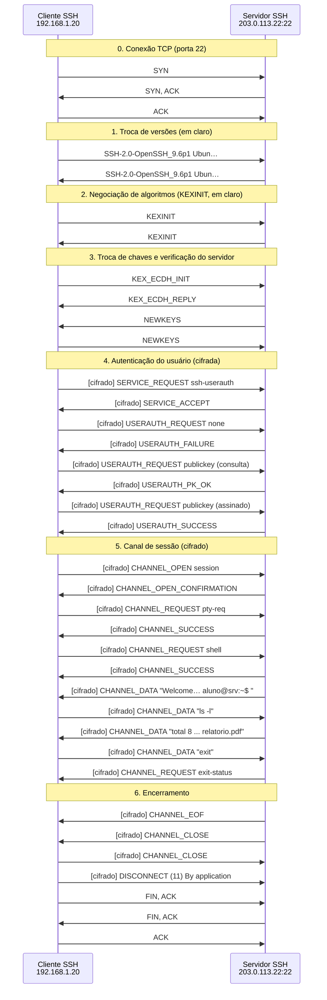

*Figura 5.1.1 (Tipo B, sequência).* Mensagens do cenário "Conexão moderna com chave", na ordem do tempo, entre Cliente SSH, Servidor SSH: 37 mensagens (em 7 fases; 23 cifradas). Corresponde ao diagrama de sequência e à aba Captura, no modo "Sessão e autenticação", com a configuração padrão.

**Mensagens**

| Mensagem | Significado | Origem |
| --- | --- | --- |
| SSH-2.0-... (banner) | versão do protocolo e do software | os dois |
| KEXINIT | listas de algoritmos | os dois |
| KEX_ECDH_INIT e REPLY | troca de chaves e assinatura do servidor | cliente e servidor |
| NEWKEYS | liga a cifragem | os dois |
| USERAUTH_* | autenticação do usuário | cliente e servidor |
| CHANNEL_* | sessão, dados e encerramento | cliente e servidor |

**Por que importa.** O SSH protege confidencialidade, integridade e autenticidade do servidor (e do cliente), em uma só conexão. É a base da administração remota segura, de rsync, git e do túnel de outros protocolos.

#### 5.1.2 Primeira conexão (TOFU)

*O cliente nunca viu o servidor: o fingerprint precisa ser conferido.*

**Configuração aplicada:** Chave do servidor no known_hosts = new

O cliente nunca viu este servidor. Com StrictHostKeyChecking=ask, o ssh mostra o fingerprint e pergunta se deve continuar. A resposta "yes" grava a chave em known_hosts.

É a confiança no primeiro uso (TOFU): só é segura se o fingerprint for conferido por outro canal.

**Conceito.** No **known_hosts**, o cliente guarda o fingerprint da chave de cada servidor. Na primeira conexão não há o que comparar: o ssh mostra o fingerprint e pergunta. É o modelo **TOFU** (trust on first use): confia-se no primeiro contato e passa-se a detectar mudanças.

**O que observar**

- O evento do cliente mostra a pergunta e a resposta "yes".
- Depois disso, a conexão segue como no cenário moderno.
- Teste StrictHostKeyChecking = yes (Ajustes avançados): o cliente recusa o servidor desconhecido.

*Figura 5.1.2 (Tipo B, sequência).* Mensagens do cenário "Primeira conexão (TOFU)", na ordem do tempo, entre Cliente SSH, Servidor SSH: 37 mensagens (em 7 fases; 23 cifradas). Corresponde ao diagrama de sequência e à aba Captura, no modo "Sessão e autenticação", com a configuração aplicada acima.

**Mensagens**

| Mensagem | Significado | Origem |
| --- | --- | --- |
| KEX_ECDH_REPLY | traz a chave pública de host | servidor |
| Pergunta ao usuário | mostra o fingerprint | cliente (local) |

**Por que importa.** Quem aceita o fingerprint sem conferir fica exposto a um intermediário na primeira conexão. Publicar os fingerprints (ou usar certificados de host e SSHFP no DNS) elimina o risco do TOFU.

#### 5.1.3 Chave do servidor mudou

*A chave do servidor não confere: pode ser interceptação.*

**Configuração aplicada:** Chave do servidor no known_hosts = changed

O servidor apresenta uma chave diferente da registrada. O cliente recusa e aborta antes de enviar qualquer credencial.

Pode ser uma reinstalação legítima ou uma interceptação (MITM). A resposta correta é confirmar com o administrador por outro meio, nunca apagar a linha e seguir.

**Conceito.** Quando a chave apresentada difere da registrada, o ssh imprime **WARNING: REMOTE HOST IDENTIFICATION HAS CHANGED!** e aborta. Um atacante no caminho (MITM) apresentaria outra chave, pois não tem a chave privada do servidor verdadeiro.

**O que observar**

- O cliente aborta logo após o KEX_ECDH_REPLY, antes do NEWKEYS e de qualquer credencial.
- Na aba Experimento: o fingerprint esperado e o recebido.
- Ajustes avançados: com StrictHostKeyChecking = no o cliente segue, e a senha é desativada.

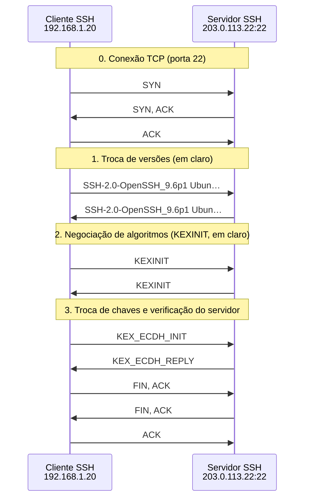

*Figura 5.1.3 (Tipo B, sequência).* Mensagens do cenário "Chave do servidor mudou", na ordem do tempo, entre Cliente SSH, Servidor SSH: 12 mensagens (em 4 fases). Corresponde ao diagrama de sequência e à aba Captura, no modo "Sessão e autenticação", com a configuração aplicada acima.

**Mensagens**

| Mensagem | Significado | Origem |
| --- | --- | --- |
| KEX_ECDH_REPLY | chave de host diferente da registrada | servidor (ou intermediário) |
| FIN | o cliente encerra a conexão | cliente |

**Por que importa.** É o principal alerta do SSH contra interceptação. A cultura de "apagar a linha do known_hosts e seguir" derruba a proteção. Confirme a mudança por outro canal.

> **Grupo:** Algoritmos

O que acontece quando cliente e servidor não concordam, ou concordam em algo fraco.

#### 5.1.4 Sem algoritmo em comum

*Sem algoritmo em comum: a conexão cai no KEXINIT.*

**Configuração aplicada:** Perfil do cliente = legado; Perfil do servidor = endurecido

Um cliente antigo (OpenSSH 5.x) tenta falar com um servidor endurecido. Eles não têm nenhum algoritmo de troca de chaves em comum, e a conexão cai no KEXINIT, antes de qualquer cifragem ou credencial.

Veja a mensagem "no matching key exchange method found".

**Conceito.** Em cada categoria (troca de chaves, chave de host, cifra, MAC), vale o primeiro algoritmo da lista do **cliente** que o servidor também aceita. Se não houver nenhum, o resultado é **no matching ... found** e o DISCONNECT 3 (KEY_EXCHANGE_FAILED).

**O que observar**

- No KEXINIT do cliente: algoritmos fracos aparecem destacados na aba Mensagem.
- Nada foi cifrado nem enviado como credencial.
- Troque o cliente para Intermediário: a conexão volta a funcionar.

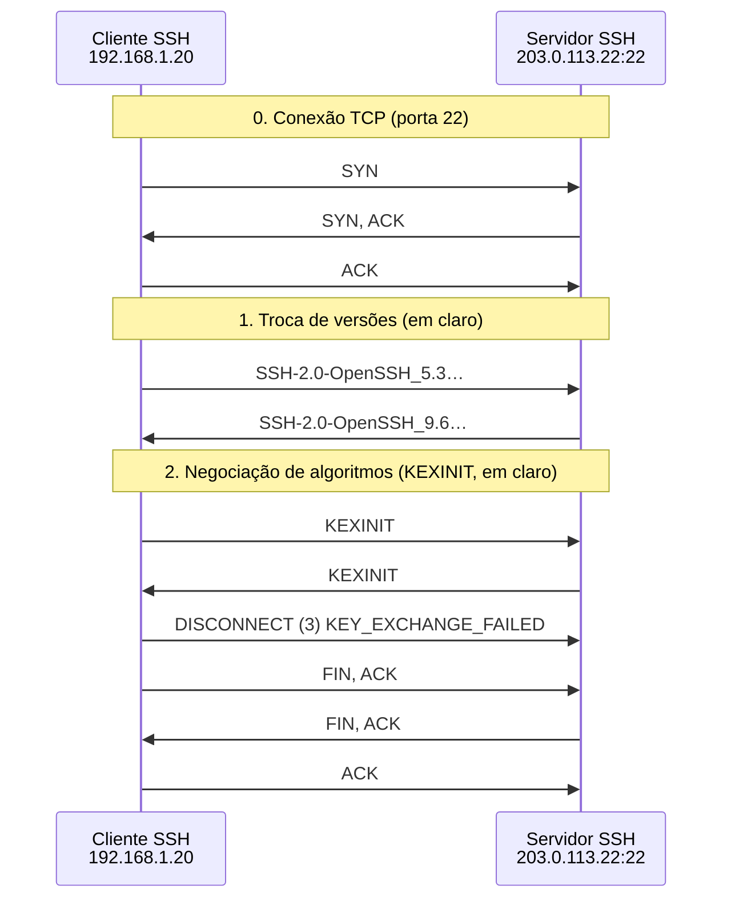

*Figura 5.1.4 (Tipo B, sequência).* Mensagens do cenário "Sem algoritmo em comum", na ordem do tempo, entre Cliente SSH, Servidor SSH: 11 mensagens (em 3 fases). Corresponde ao diagrama de sequência e à aba Captura, no modo "Sessão e autenticação", com a configuração aplicada acima.

**Mensagens**

| Mensagem | Significado | Origem |
| --- | --- | --- |
| KEXINIT | listas dos dois lados | cliente e servidor |
| DISCONNECT (3) | falha na troca de chaves | cliente |

**Por que importa.** Endurecer o servidor tem custo de compatibilidade: dispositivos e clientes antigos deixam de conectar. Faça a transição planejada e atualize os clientes.

#### 5.1.5 Algoritmos fracos aceitos

*Funciona, mas com SHA-1, DSA/RSA e CBC ou 3DES.*

**Configuração aplicada:** Perfil do cliente = legado; Perfil do servidor = legado

Cliente e servidor legados negociam com sucesso, mas com SHA-1, RSA/DSA e CBC ou 3DES. Funciona, e é justamente o problema: a conexão aceita proteção fraca sem avisar o usuário.

Compare a nota na aba Configuração com a do cenário moderno.

**Conceito.** Algoritmos **fracos** continuam sendo negociados quando os dois lados os aceitam. O servidor não os recusa e o cliente não avisa. SHA-1 em assinaturas, DSA de 1024 bits, 3DES e CBC são considerados inadequados.

**O que observar**

- Veja o evento "algoritmo fraco escolhido".
- Aba Configuração: a nota de hardening cai.
- Os marcadores da aba Mensagem destacam os algoritmos fracos oferecidos.

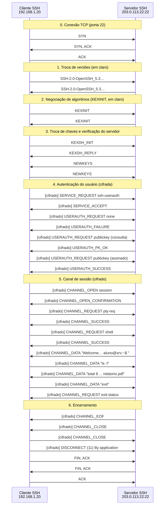

*Figura 5.1.5 (Tipo B, sequência).* Mensagens do cenário "Algoritmos fracos aceitos", na ordem do tempo, entre Cliente SSH, Servidor SSH: 37 mensagens (em 7 fases; 23 cifradas). Corresponde ao diagrama de sequência e à aba Captura, no modo "Sessão e autenticação", com a configuração aplicada acima.

**Mensagens**

| Mensagem | Significado | Origem |
| --- | --- | --- |
| KEXINIT | oferece algoritmos fracos | cliente e servidor |

**Por que importa.** A conexão cifrada não é necessariamente segura: depende dos algoritmos. Ferramentas como o ssh-audit apontam esses problemas.

> **Grupo:** Autenticação

Chave, senha, 2 fatores e as defesas contra tentativas repetidas.

#### 5.1.6 Login por senha

*A senha viaja cifrada, mas continua sendo um segredo reutilizável.*

**Configuração aplicada:** Método de autenticação = password

O cliente autentica com senha. Ela viaja cifrada dentro do canal, então ninguém na rede a vê, mas o servidor a recebe em claro e ela pode ser adivinhada por tentativas repetidas.

**Conceito.** No método **password**, o cliente envia a senha dentro do canal cifrado. Ninguém na rede a lê, mas o **servidor** a recebe: um servidor falso ou comprometido a captura, e senhas fracas são adivinhadas por tentativas.

**O que observar**

- USERAUTH_REQUEST password: o conteúdo só existe nas pontas.
- Compare com a chave pública: nenhum segredo reutilizável viaja.
- Aba Configuração: PasswordAuthentication yes reduz a nota.

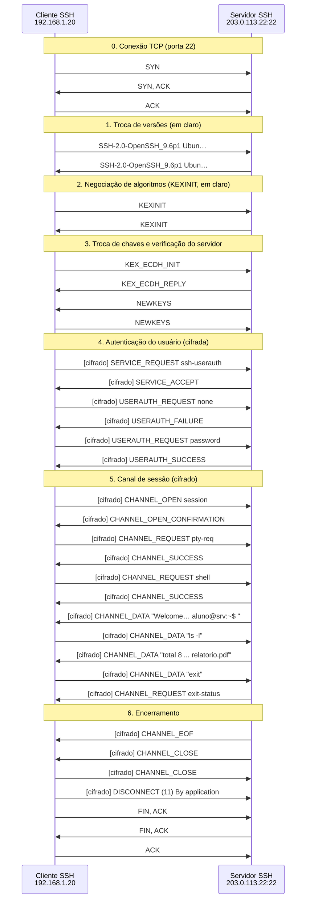

*Figura 5.1.6 (Tipo B, sequência).* Mensagens do cenário "Login por senha", na ordem do tempo, entre Cliente SSH, Servidor SSH: 35 mensagens (em 7 fases; 21 cifradas). Corresponde ao diagrama de sequência e à aba Captura, no modo "Sessão e autenticação", com a configuração aplicada acima.

**Mensagens**

| Mensagem | Significado | Origem |
| --- | --- | --- |
| USERAUTH_REQUEST none | pergunta os métodos aceitos | cliente |
| USERAUTH_REQUEST password | envia a senha cifrada | cliente |
| USERAUTH_SUCCESS | aceita o login | servidor |

**Por que importa.** Senhas são alvo de força bruta e de reutilização de credenciais vazadas. Chaves públicas e segundo fator são a prática recomendada.

#### 5.1.7 Senha desativada no servidor

*Sem senha no servidor, a força bruta de senhas perde o alvo.*

**Configuração aplicada:** Método de autenticação = password; PasswordAuthentication = não

O servidor está com PasswordAuthentication no. A lista de métodos devolvida ao método "none" só traz publickey, e o cliente que só tem senha não consegue nem tentar.

**Conceito.** Com **PasswordAuthentication no**, o servidor só lista **publickey** como método. O cliente que só tem senha recebe "Permission denied (publickey)" sem poder tentar nada.

**O que observar**

- A lista de métodos do USERAUTH_FAILURE ao método "none".
- O cliente não envia nenhum USERAUTH_REQUEST password.
- Aba Configuração: a nota sobe.

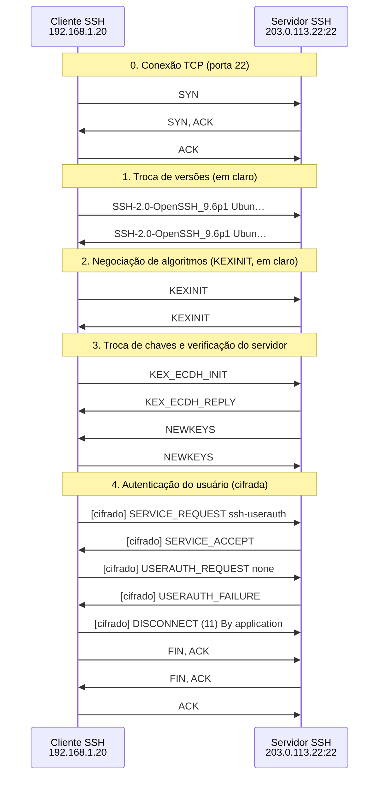

*Figura 5.1.7 (Tipo B, sequência).* Mensagens do cenário "Senha desativada no servidor", na ordem do tempo, entre Cliente SSH, Servidor SSH: 19 mensagens (em 5 fases; 5 cifradas). Corresponde ao diagrama de sequência e à aba Captura, no modo "Sessão e autenticação", com a configuração aplicada acima.

**Mensagens**

| Mensagem | Significado | Origem |
| --- | --- | --- |
| USERAUTH_FAILURE | lista só publickey | servidor |

**Por que importa.** Desativar a senha é uma das medidas de maior efeito: o ataque de adivinhação deixa de existir, restando proteger as chaves privadas.

#### 5.1.8 Muitas tentativas de senha

*Falhas repetidas: o servidor desconecta e registra cada uma.*

**Configuração aplicada:** Método de autenticação = password; Credencial correta = não; MaxAuthTries = 3

Senha errada repetidas vezes. Com MaxAuthTries = 3, o servidor derruba a conexão na terceira falha. Cada falha fica registrada em auth.log.

Isso só limita tentativas por conexão: o atacante pode reconectar. A defesa real é desativar a senha, usar chaves e ferramentas como fail2ban.

**Conceito.** O sshd conta as falhas de autenticação por conexão. Ao atingir **MaxAuthTries**, desconecta com "Too many authentication failures". Cada falha vai para o auth.log, base para detecção e para o bloqueio automático por ferramentas como o fail2ban.

**O que observar**

- Contador "Falhas de login" no painel lateral.
- O DISCONNECT do servidor na 3ª falha (MaxAuthTries = 3).
- Aba Configuração: as linhas do auth.log geradas.

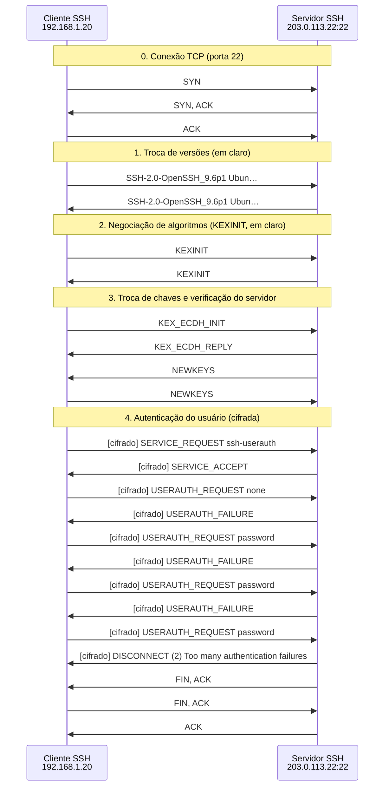

*Figura 5.1.8 (Tipo B, sequência).* Mensagens do cenário "Muitas tentativas de senha", na ordem do tempo, entre Cliente SSH, Servidor SSH: 24 mensagens (em 5 fases; 10 cifradas). Corresponde ao diagrama de sequência e à aba Captura, no modo "Sessão e autenticação", com a configuração aplicada acima.

**Mensagens**

| Mensagem | Significado | Origem |
| --- | --- | --- |
| USERAUTH_REQUEST password | tentativa com senha incorreta | cliente |
| USERAUTH_FAILURE | recusa e continua | servidor |
| DISCONNECT (2) | Too many authentication failures | servidor |

**Por que importa.** Limitar tentativas por conexão não basta: o atacante reconecta. Defesas em camadas: sem senha, chaves, 2 fatores, fail2ban, restrição de origem por firewall e portas não padrão como complemento.

#### 5.1.9 Chave + TOTP (2 fatores)

*Duas etapas: chave e código TOTP.*

**Configuração aplicada:** Exigir 2º fator (chave + TOTP) = sim

O servidor exige duas etapas: chave pública e depois um código TOTP. A primeira etapa termina em "sucesso parcial" (USERAUTH_FAILURE com partial success), e o cliente passa ao keyboard-interactive.

**Conceito.** Com **AuthenticationMethods publickey,keyboard-interactive**, o servidor exige os dois métodos em sequência. A chave termina com **sucesso parcial**; o servidor então envia um prompt (keyboard-interactive) pedindo o código **TOTP**, válido por cerca de 30 s.

**O que observar**

- USERAUTH_FAILURE com "partial success" depois da chave.
- O prompt do código e a resposta, ambos cifrados.
- Desmarque "Credencial correta" para ver a falha do 2º fator.

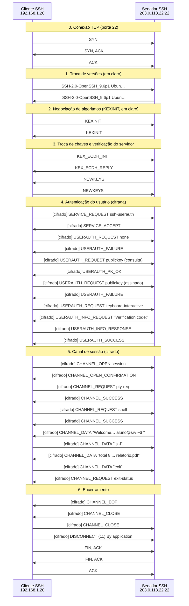

*Figura 5.1.9 (Tipo B, sequência).* Mensagens do cenário "Chave + TOTP (2 fatores)", na ordem do tempo, entre Cliente SSH, Servidor SSH: 41 mensagens (em 7 fases; 27 cifradas). Corresponde ao diagrama de sequência e à aba Captura, no modo "Sessão e autenticação", com a configuração aplicada acima.

**Mensagens**

| Mensagem | Significado | Origem |
| --- | --- | --- |
| USERAUTH_REQUEST publickey | 1º fator | cliente |
| USERAUTH_FAILURE (parcial) | falta o 2º fator | servidor |
| INFO_REQUEST e RESPONSE | código TOTP | servidor e cliente |
| USERAUTH_SUCCESS | acesso liberado | servidor |

**Por que importa.** Um segundo fator impede que uma chave privada roubada ou uma senha vazada dê acesso sozinha.

#### 5.1.10 Login de root bloqueado

*Root recusado, mesmo com a credencial certa.*

**Configuração aplicada:** Usuário = root; Método de autenticação = password

O usuário root tenta entrar por senha, mesmo com a credencial correta. PermitRootLogin = prohibit-password só aceita root com chave, então o servidor recusa e registra "ROOT LOGIN REFUSED".

**Conceito.** O **PermitRootLogin** controla o acesso direto do root. Com **prohibit-password**, só chave é aceita; com **no**, nunca. Mesmo com a senha correta, o sshd recusa e registra "ROOT LOGIN REFUSED".

**O que observar**

- A senha correta é recusada, e o evento do servidor explica o motivo.
- Troque PermitRootLogin para yes (Ajustes avançados) e veja a diferença.
- O contador de falhas aumenta.

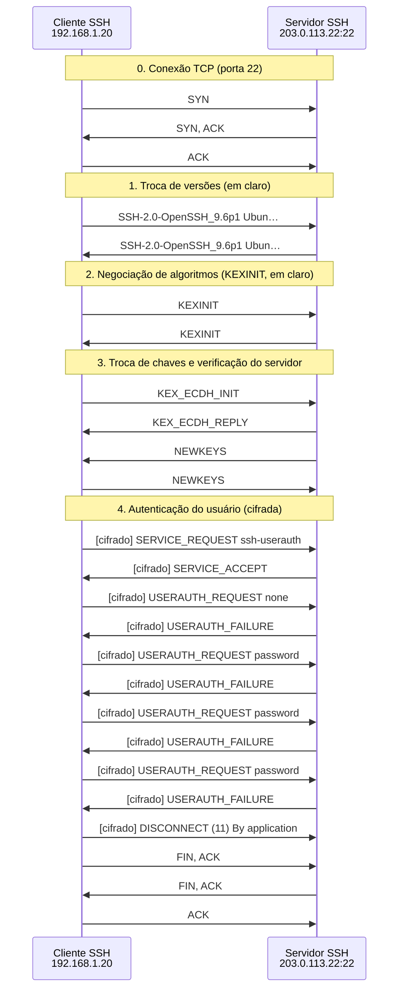

*Figura 5.1.10 (Tipo B, sequência).* Mensagens do cenário "Login de root bloqueado", na ordem do tempo, entre Cliente SSH, Servidor SSH: 25 mensagens (em 5 fases; 11 cifradas). Corresponde ao diagrama de sequência e à aba Captura, no modo "Sessão e autenticação", com a configuração aplicada acima.

**Mensagens**

| Mensagem | Significado | Origem |
| --- | --- | --- |
| USERAUTH_REQUEST password | senha do root | cliente |
| USERAUTH_FAILURE | recusa por política | servidor |

**Por que importa.** Contas nominais e sudo deixam rastro de quem fez o quê. O root direto por SSH concentra risco e apaga a responsabilização individual.

> **Grupo:** Canais

O que o cliente faz depois de autenticado: shell, comando e arquivos.

#### 5.1.11 Comando remoto

*Um canal, um comando, um código de saída.*

**Configuração aplicada:** Uso da sessão = exec

Em vez de um shell, o cliente executa um único comando (`ssh servidor uname -a`). É o modo de scripts, rsync e git sobre SSH: um canal, um pedido exec, a saída e o código de saída.

**Conceito.** O pedido **exec** roda um comando sem terminal interativo. Scripts, rsync e git usam esse modo. O resultado chega em CHANNEL_DATA e o código de saída em **exit-status**.

**O que observar**

- CHANNEL_REQUEST exec com o comando.
- CHANNEL_DATA com a saída, depois exit-status.
- Não há pty-req: não é uma sessão interativa.

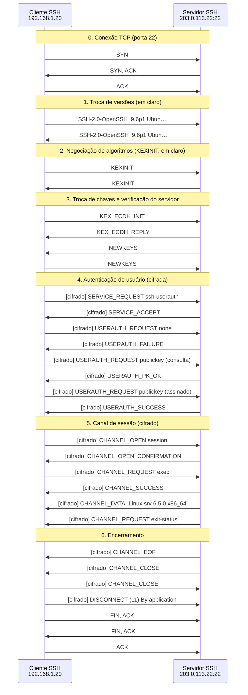

*Figura 5.1.11 (Tipo B, sequência).* Mensagens do cenário "Comando remoto", na ordem do tempo, entre Cliente SSH, Servidor SSH: 32 mensagens (em 7 fases; 18 cifradas). Corresponde ao diagrama de sequência e à aba Captura, no modo "Sessão e autenticação", com a configuração aplicada acima.

**Mensagens**

| Mensagem | Significado | Origem |
| --- | --- | --- |
| CHANNEL_OPEN session | abre o canal | cliente |
| CHANNEL_REQUEST exec | define o comando | cliente |
| CHANNEL_DATA | saída do comando | servidor |
| exit-status | código de retorno | servidor |

**Por que importa.** O comando executa com os privilégios do usuário. Chaves com "command=" em authorized_keys limitam o que cada chave pode executar.

#### 5.1.12 Transferência SFTP

*Arquivos sobre o canal SSH, com controle de fluxo.*

**Configuração aplicada:** Uso da sessão = sftp

O SFTP é um subsistema do SSH: abre um canal, pede o subsistema e troca pacotes SFTP (INIT, OPEN, READ, DATA) dentro do canal cifrado. A janela do canal (WINDOW_ADJUST) controla o fluxo.

**Conceito.** O **SFTP** é um subsistema do SSH (não é FTP sobre SSL). O cliente pede **subsystem sftp** e passa a trocar pacotes SFTP (INIT, OPEN, READ, DATA, CLOSE) em CHANNEL_DATA. A janela do canal limita quanto pode ser enviado; **WINDOW_ADJUST** a repõe.

**O que observar**

- Os pacotes SFTP aparecem dentro de CHANNEL_DATA (cifrados).
- CHANNEL_WINDOW_ADJUST libera mais envio.
- Na captura, nada indica que é uma transferência de arquivo.

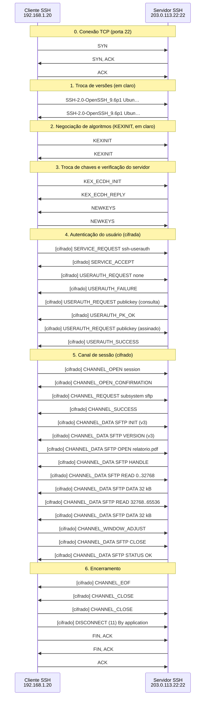

*Figura 5.1.12 (Tipo B, sequência).* Mensagens do cenário "Transferência SFTP", na ordem do tempo, entre Cliente SSH, Servidor SSH: 41 mensagens (em 7 fases; 27 cifradas). Corresponde ao diagrama de sequência e à aba Captura, no modo "Sessão e autenticação", com a configuração aplicada acima.

**Mensagens**

| Mensagem | Significado | Origem |
| --- | --- | --- |
| subsystem sftp | pede o subsistema | cliente |
| SFTP READ / DATA | lê o arquivo em blocos | cliente e servidor |
| WINDOW_ADJUST | controle de fluxo do canal | cliente |

**Por que importa.** Substitui o FTP e o scp clássico com autenticação e cifragem. O servidor pode restringir o usuário a um diretório (ChrootDirectory).

#### 5.1.13 ForwardAgent e seus riscos

*O agente encaminhado dá acesso às suas chaves enquanto a sessão durar.*

**Configuração aplicada:** ForwardAgent = sim

Com ForwardAgent, o servidor recebe um socket que fala com o agente SSH do cliente. Cômodo para saltar entre máquinas, mas quem controla o servidor (root) pode usar suas chaves enquanto a sessão estiver aberta.

Prefira ProxyJump, que não expõe o agente.

**Conceito.** O **ssh-agent** guarda as chaves privadas e assina desafios. Com **ForwardAgent**, o servidor ganha um socket para o agente do cliente: não vê a chave, mas pede assinaturas. Quem tem privilégio no servidor pode se autenticar como você em outras máquinas.

**O que observar**

- CHANNEL_REQUEST auth-agent-req no início da sessão.
- O evento do servidor avisa do risco.
- Alternativa: ProxyJump, que nunca expõe o agente.

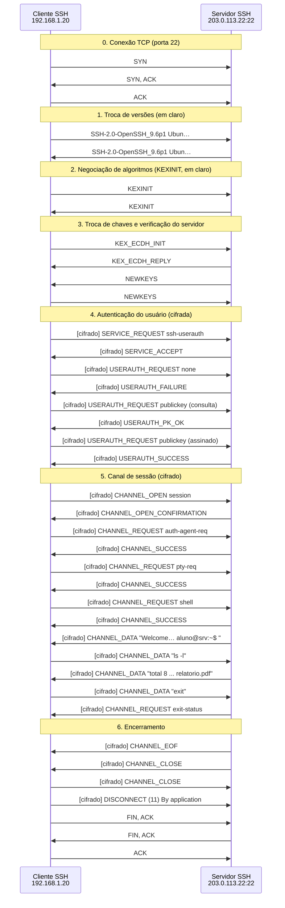

*Figura 5.1.13 (Tipo B, sequência).* Mensagens do cenário "ForwardAgent e seus riscos", na ordem do tempo, entre Cliente SSH, Servidor SSH: 39 mensagens (em 7 fases; 25 cifradas). Corresponde ao diagrama de sequência e à aba Captura, no modo "Sessão e autenticação", com a configuração aplicada acima.

**Mensagens**

| Mensagem | Significado | Origem |
| --- | --- | --- |
| auth-agent-req | pede o encaminhamento do agente | cliente |
| CHANNEL_SUCCESS | servidor aceita | servidor |

**Por que importa.** Em máquinas compartilhadas ou comprometidas, o agente encaminhado vira trampolim para o resto da infraestrutura. Use ProxyJump e chaves por máquina.

### 5.2 Modo: Túneis e encaminhamento

> **Grupo:** Túneis

Encaminhamento de portas e salto por bastion, dentro do canal cifrado.

#### 5.2.1 Túnel local (-L)

*Porta local até um serviço interno, passando pelo servidor SSH.*

**Configuração aplicada:** Tipo de túnel = local

Uma porta do cliente (5433) leva ao banco interno, passando pelo servidor SSH. O trecho entre cliente e servidor vai cifrado; o trecho do servidor até o banco segue em claro, a menos que o banco use TLS.

**Conceito.** Com **-L**, o cliente escuta numa porta local. Cada conexão vira um canal **direct-tcpip**: o servidor abre uma conexão TCP até o destino e repassa os bytes. O trecho cliente-servidor é cifrado; o trecho do servidor ao destino não faz parte do SSH.

**O que observar**

- Três trechos no painel lateral: local, cifrado pelo SSH e em claro na rede interna.
- CHANNEL_OPEN direct-tcpip com host e porta de destino.
- O destino vê a origem como o servidor SSH.

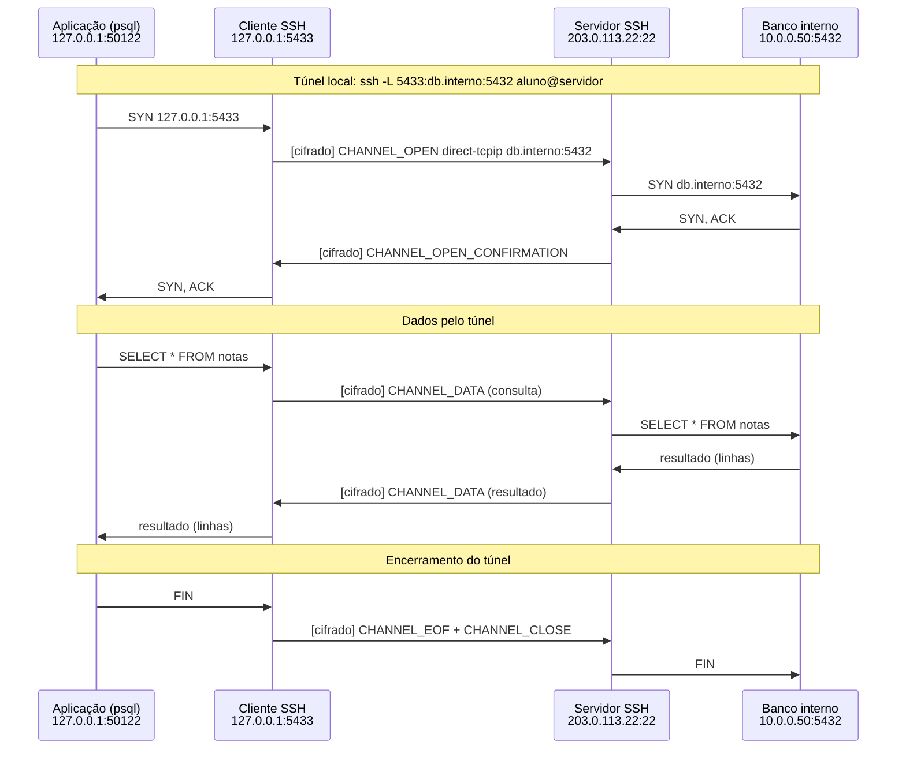

*Figura 5.2.1 (Tipo B, sequência).* Mensagens do cenário "Túnel local (-L)", na ordem do tempo, entre Aplicação (psql), Cliente SSH, Servidor SSH, Banco interno: 15 mensagens (em 3 fases; 5 cifradas). Corresponde ao diagrama de sequência e à aba Captura, no modo "Túneis e encaminhamento", com a configuração aplicada acima.

**Mensagens**

| Mensagem | Significado | Origem |
| --- | --- | --- |
| CHANNEL_OPEN direct-tcpip | pede a conexão ao destino | cliente |
| CHANNEL_OPEN_CONFIRMATION | canal pronto | servidor |
| CHANNEL_DATA | bytes da aplicação | os dois |

**Por que importa.** Permite acessar serviços internos sem expô-los. Também pode servir de pivô: restrinja o encaminhamento e use bastions com política clara.

#### 5.2.2 Túnel remoto (-R)

*O servidor abre uma porta e leva as conexões até o cliente.*

**Configuração aplicada:** Tipo de túnel = remote; GatewayPorts = sim

O servidor abre a porta 9000 e encaminha as conexões de volta ao serviço local do cliente. Aqui GatewayPorts está ligado, então um usuário externo consegue usar o túnel: o serviço local fica exposto na internet.

**Conceito.** Com **-R**, o cliente pede ao servidor (GLOBAL_REQUEST **tcpip-forward**) que escute numa porta. Cada conexão recebida vira um canal **forwarded-tcpip** de volta ao cliente. Com **GatewayPorts** ligado, a porta fica aberta a toda a rede.

**O que observar**

- GLOBAL_REQUEST tcpip-forward e REQUEST_SUCCESS.
- O usuário externo chega ao serviço local pelo servidor.
- Evento de aviso: o serviço local ficou exposto.

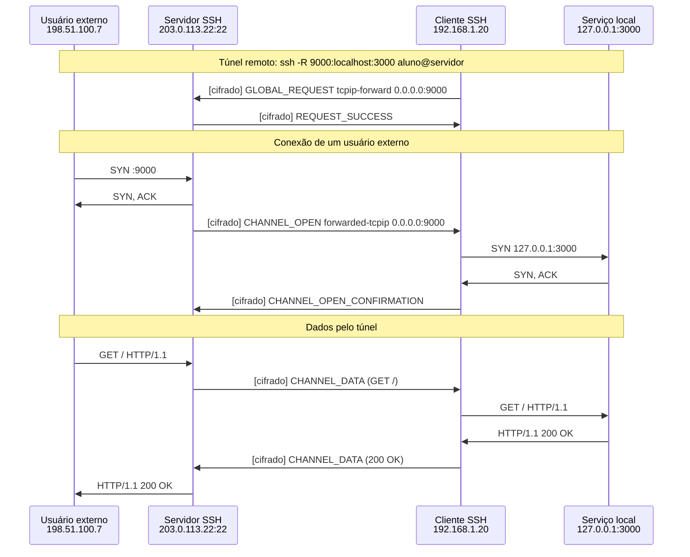

*Figura 5.2.2 (Tipo B, sequência).* Mensagens do cenário "Túnel remoto (-R)", na ordem do tempo, entre Usuário externo, Servidor SSH, Cliente SSH, Serviço local: 14 mensagens (em 3 fases; 6 cifradas). Corresponde ao diagrama de sequência e à aba Captura, no modo "Túneis e encaminhamento", com a configuração aplicada acima.

**Mensagens**

| Mensagem | Significado | Origem |
| --- | --- | --- |
| tcpip-forward | pede escuta no servidor | cliente |
| forwarded-tcpip | canal de volta ao cliente | servidor |
| CHANNEL_DATA | requisição e resposta | os dois |

**Por que importa.** É a técnica usada para expor serviços atrás de NAT, e também para contornar firewalls. Monitore e restrinja túneis reversos.

#### 5.2.3 Túnel remoto sem GatewayPorts

*Sem GatewayPorts, a porta remota só aceita conexões locais.*

**Configuração aplicada:** Tipo de túnel = remote; GatewayPorts = não

Com o padrão (GatewayPorts no), a porta remota só existe no loopback do servidor. O usuário externo recebe RST. Só quem já está no servidor usa o túnel.

**Conceito.** O padrão do sshd (**GatewayPorts no**) abre a porta do túnel reverso só no **loopback** do servidor. Quem vem de outro host recebe RST. É uma proteção padrão contra exposição acidental.

**O que observar**

- RST ao usuário externo.
- Compare com o cenário com GatewayPorts ligado.
- O túnel em si foi aberto: só está restrito ao próprio servidor.

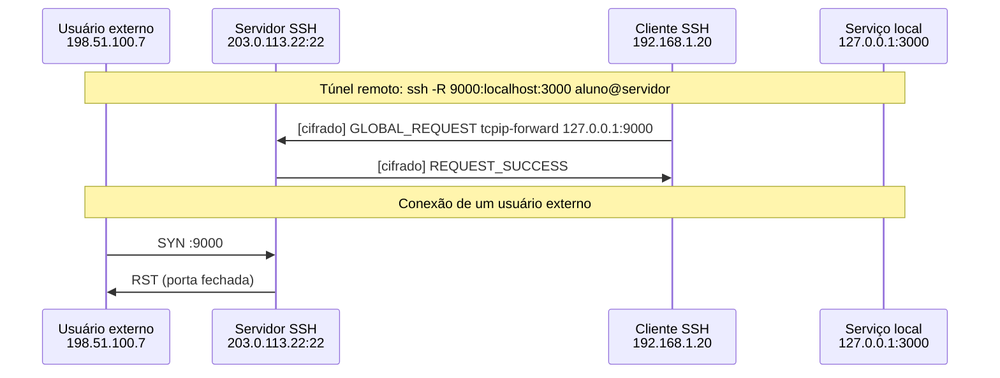

*Figura 5.2.3 (Tipo B, sequência).* Mensagens do cenário "Túnel remoto sem GatewayPorts", na ordem do tempo, entre Usuário externo, Servidor SSH, Cliente SSH, Serviço local: 4 mensagens (em 2 fases; 2 cifradas). Corresponde ao diagrama de sequência e à aba Captura, no modo "Túneis e encaminhamento", com a configuração aplicada acima.

**Mensagens**

| Mensagem | Significado | Origem |
| --- | --- | --- |
| tcpip-forward 127.0.0.1:9000 | escuta só no loopback | cliente |
| SYN :9000 | tentativa externa | usuário externo |
| RST | recusado | servidor |

**Por que importa.** Boas práticas: manter GatewayPorts no e expor serviços por proxy reverso controlado, com autenticação e TLS.

#### 5.2.4 Proxy SOCKS (-D)

*O cliente SSH vira um proxy SOCKS5.*

**Configuração aplicada:** Tipo de túnel = dynamic

O cliente SSH vira um proxy SOCKS5. Cada destino pedido pelo navegador abre um canal direct-tcpip, e o servidor SSH resolve o nome e conecta. O HTTPS continua de ponta a ponta entre o navegador e o site.

**Conceito.** Com **-D**, o navegador envia pedidos SOCKS5 ao cliente SSH. Cada destino abre um canal direct-tcpip, e o servidor SSH resolve o nome (DNS) e conecta. O HTTPS segue de ponta a ponta entre o navegador e o site.

**O que observar**

- SOCKS5 CONNECT com o nome do site.
- O ClientHello do TLS passa em CHANNEL_DATA.
- Evento: o servidor SSH não vê o conteúdo do HTTPS.

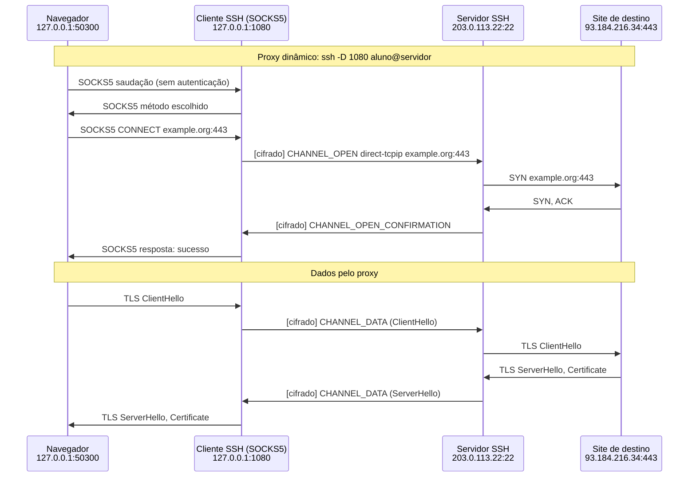

*Figura 5.2.4 (Tipo B, sequência).* Mensagens do cenário "Proxy SOCKS (-D)", na ordem do tempo, entre Navegador, Cliente SSH (SOCKS5), Servidor SSH, Site de destino: 14 mensagens (em 2 fases; 4 cifradas). Corresponde ao diagrama de sequência e à aba Captura, no modo "Túneis e encaminhamento", com a configuração aplicada acima.

**Mensagens**

| Mensagem | Significado | Origem |
| --- | --- | --- |
| SOCKS5 CONNECT | pede o destino | navegador |
| direct-tcpip | canal até o destino | cliente |
| CHANNEL_DATA | TLS do navegador ao site | os dois |

**Por que importa.** Protege o trecho até o servidor SSH em redes não confiáveis, mas o servidor passa a ver os destinos acessados (nomes e IPs).

#### 5.2.5 ProxyJump (bastion)

*Salto por bastion com SSH de ponta a ponta até o alvo.*

**Configuração aplicada:** Tipo de túnel = jump

O cliente chega a um alvo interno passando por um bastion. Dentro do canal aberto pelo bastion corre uma sessão SSH completa e independente com o alvo: a chave de host verificada é a do alvo, e o bastion só enxerga bytes cifrados.

**Conceito.** No **ProxyJump**, o cliente abre um canal direct-tcpip até a porta 22 do alvo e roda **uma segunda sessão SSH** dentro dele. O bastion só repassa bytes cifrados. A chave de host verificada é a do **alvo**, e a autenticação ocorre direto no alvo.

**O que observar**

- Duas camadas de cifragem: sessão interna e sessão externa.
- O KEX_ECDH_REPLY interno traz a chave do alvo.
- Mude "Chave do servidor" para Diferente: o cliente recusa o alvo, mesmo pelo bastion.

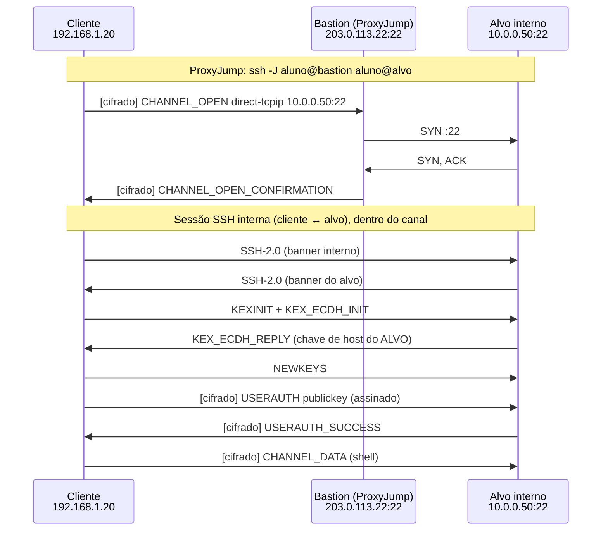

*Figura 5.2.5 (Tipo B, sequência).* Mensagens do cenário "ProxyJump (bastion)", na ordem do tempo, entre Cliente, Bastion (ProxyJump), Alvo interno: 12 mensagens (em 2 fases; 5 cifradas). Corresponde ao diagrama de sequência e à aba Captura, no modo "Túneis e encaminhamento", com a configuração aplicada acima.

**Mensagens**

| Mensagem | Significado | Origem |
| --- | --- | --- |
| direct-tcpip 10.0.0.50:22 | canal até o alvo | cliente |
| SSH interno | sessão completa com o alvo | cliente e alvo |

**Por que importa.** Melhor que o ForwardAgent: o bastion não vê credenciais nem tem acesso ao agente, e continua sendo um ponto único de entrada auditável.

#### 5.2.6 Encaminhamento bloqueado

*AllowTcpForwarding no: o pedido de túnel é recusado.*

**Configuração aplicada:** Tipo de túnel = local; AllowTcpForwarding = não

O servidor está com AllowTcpForwarding no. O pedido direct-tcpip recebe CHANNEL_OPEN_FAILURE (administratively prohibited) e a aplicação local é desconectada.

**Conceito.** O servidor pode proibir o encaminhamento (**AllowTcpForwarding no**). O pedido direct-tcpip recebe **CHANNEL_OPEN_FAILURE** com o motivo "administratively prohibited" (código 1).

**O que observar**

- A recusa vem do servidor, depois do pedido do cliente.
- O cliente fecha a conexão local.
- Aba Configuração: a regra aparece no sshd_config.

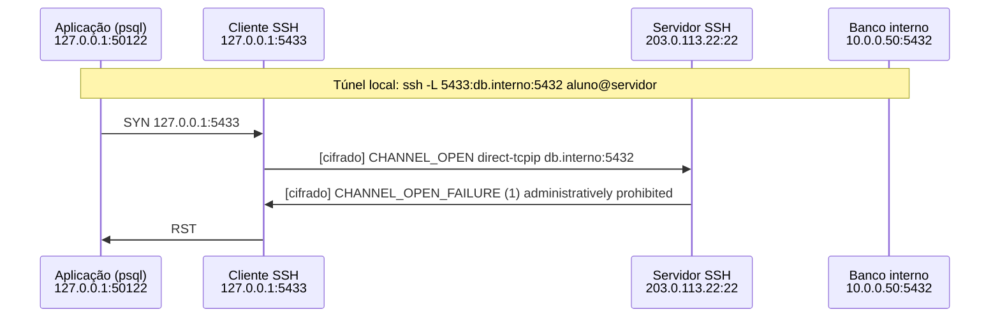

*Figura 5.2.6 (Tipo B, sequência).* Mensagens do cenário "Encaminhamento bloqueado", na ordem do tempo, entre Aplicação (psql), Cliente SSH, Servidor SSH, Banco interno: 4 mensagens (em 1 fase; 2 cifradas). Corresponde ao diagrama de sequência e à aba Captura, no modo "Túneis e encaminhamento", com a configuração aplicada acima.

**Mensagens**

| Mensagem | Significado | Origem |
| --- | --- | --- |
| direct-tcpip | pede o túnel | cliente |
| CHANNEL_OPEN_FAILURE | recusa por política | servidor |

**Por que importa.** Em servidores que só precisam de shell, desativar o encaminhamento reduz o risco de usar a máquina como pivô.

## 6. Referência

### 6.1 O SSH em três camadas

O **SSH-2** ([RFC 4251](https://www.rfc-editor.org/rfc/rfc4251)) protege o acesso remoto a sistemas com três camadas sobre uma conexão TCP, normalmente na porta 22. A **camada de transporte** ([RFC 4253](https://www.rfc-editor.org/rfc/rfc4253)) negocia algoritmos, troca chaves, autentica o servidor e cifra os pacotes. A **camada de autenticação** ([RFC 4252](https://www.rfc-editor.org/rfc/rfc4252)) identifica o usuário. A **camada de conexão** ([RFC 4254](https://www.rfc-editor.org/rfc/rfc4254)) multiplexa canais (sessões, SFTP, túneis) sobre a mesma conexão cifrada.

### 6.2 Fases e o que cada uma protege

| Fase | Mensagens | Em claro? | Objetivo |
| --- | --- | --- | --- |
| Versões | SSH-2.0-software | sim | combinar a versão do protocolo |
| Negociação | KEXINIT (20) | sim | listas de algoritmos; vale o primeiro do cliente que o servidor aceita |
| Troca de chaves | KEX_ECDH_INIT (30), REPLY (31), NEWKEYS (21) | sim | segredo K efêmero, assinatura de H pela chave de host, chaves da sessão |
| Autenticação | SERVICE_REQUEST (5), USERAUTH_* (50 a 61) | não | identificar o usuário (chave, senha, 2 fatores) |
| Canais | CHANNEL_* (90 a 100) | não | shell, comando, SFTP, túneis, com janela de fluxo por canal |

### 6.3 Troca de chaves e sigilo futuro

- Cada lado gera um par **efêmero** e envia só a parte pública. O segredo **K** é calculado nas pontas e nunca trafega.
- O servidor assina o hash **H** da troca com a chave de host. Isso prova que ele possui a chave e amarra a troca à identidade: um intermediário não consegue forjar.
- Como o par é descartado, o comprometimento futuro da chave de host não decifra sessões antigas (**forward secrecy**).
- As seis chaves da sessão (IVs, cifra e integridade nos dois sentidos) saem de `HASH(K || H || letra || session_id)` ([RFC 4253](https://www.rfc-editor.org/rfc/rfc4253), seção 7.2).

### 6.4 Algoritmos recomendados e legados

| Categoria | Preferir | Evitar |
| --- | --- | --- |
| Troca de chaves | curve25519-sha256 ([RFC 8731](https://www.rfc-editor.org/rfc/rfc8731)), ecdh-sha2-nistp256 ([RFC 5656](https://www.rfc-editor.org/rfc/rfc5656)), DH group 16 ([RFC 9142](https://www.rfc-editor.org/rfc/rfc9142) atualiza as recomendações de troca de chaves) | diffie-hellman-group1-sha1, group14-sha1, group-exchange-sha1 |
| Chave de host | ssh-ed25519 ([RFC 8709](https://www.rfc-editor.org/rfc/rfc8709)), rsa-sha2-256/512 | ssh-dss, ssh-rsa (RSA com SHA-1) |
| Cifra | chacha20-poly1305, aes256-gcm, aes-ctr | 3des-cbc, aes-cbc |
| MAC | hmac-sha2-512-etm, hmac-sha2-256-etm (ou AEAD) | hmac-md5, hmac-sha1 |

### 6.5 known_hosts e confiança no primeiro uso (TOFU)

- O cliente guarda o **fingerprint** de cada servidor em ~/.ssh/known_hosts e compara nas conexões seguintes.
- Na primeira conexão não há o que comparar: o usuário decide (**TOFU**). Conferir o fingerprint por outro canal fecha essa janela.
- Chave diferente gera **WARNING: REMOTE HOST IDENTIFICATION HAS CHANGED**. Pode ser reinstalação ou interceptação (MITM).
- Alternativas: certificados de host (CA SSH) e registros SSHFP no DNS (com DNSSEC).

### 6.6 Autenticação do usuário

- **Chave pública:** o cliente assina o session_id com a chave privada. Não trafega segredo reutilizável.
- **Senha:** viaja dentro do canal cifrado, mas o servidor a recebe. Vulnerável a adivinhação e a reutilização de credenciais vazadas.
- **keyboard-interactive:** o servidor define os prompts; é a base do segundo fator (TOTP, PAM).
- **AuthenticationMethods publickey,keyboard-interactive:** exige as duas etapas. A primeira termina em sucesso parcial.
- **MaxAuthTries** limita falhas por conexão; **fail2ban** e firewall limitam por origem.

### 6.7 Canais, SFTP e túneis

- Cada canal tem número e janela de fluxo (WINDOW_ADJUST). Sessão, SFTP e túneis compartilham a mesma conexão cifrada.
- **SFTP** é um subsistema do SSH, não é FTP sobre SSL. Não tem RFC publicada (só drafts do IETF, o mais usado é o draft-ietf-secsh-filexfer-02, versão 3). O encaminhamento de agente (auth-agent-req@openssh.com) também é extensão do OpenSSH, sem RFC.
- **-L** (direct-tcpip): porta local até um destino alcançado pelo servidor. **-R** (tcpip-forward e forwarded-tcpip): porta no servidor até o cliente. **-D**: proxy SOCKS5. **-J**: salto por bastion com SSH de ponta a ponta.
- O trecho entre o servidor SSH e o destino final **não é protegido pelo SSH**.
- **ForwardAgent** expõe o agente a quem tem privilégio no servidor; prefira ProxyJump.

### 6.8 Boas práticas de hardening

- Desativar a senha e usar chaves (com passphrase) ou, melhor, certificados de usuário.
- PermitRootLogin no ou prohibit-password; contas nominais com sudo.
- Exigir segundo fator em acessos privilegiados.
- Restringir algoritmos a conjuntos modernos e revisar com o ssh-audit.
- MaxAuthTries baixo, fail2ban e restrição de origem no firewall.
- AllowTcpForwarding no (ou restrito com PermitOpen) nos servidores que não precisam de túneis.
- Manter o OpenSSH atualizado e monitorar o auth.log.

### 6.9 Terrapin (CVE-2023-48795)

O ataque **Terrapin** permite a um intermediário no caminho remover mensagens logo após o NEWKEYS e assim degradar a conexão. Afeta o chacha20-poly1305 e as cifras CBC com EtM. A mitigação é o **strict KEX**, uma extensão negociada nos dois lados (presente a partir do OpenSSH 9.6), descrita em um draft do IETF (draft-ietf-sshm-strict-kex) que ainda não é RFC. O simulador não reproduz o ataque. A defesa prática é atualizar cliente e servidor.

### 6.10 O que este simulador simplifica

Não há criptografia real: chaves, fingerprints e hashes são valores determinísticos e ilustrativos. O SSH-1, o group-exchange, a compressão, o rekeying, o X11 forwarding e os certificados SSH não são simulados. As sequências seguem o OpenSSH, mas os tamanhos de pacote são aproximados.

### 6.11 Segurança

- Um canal cifrado não protege contra um servidor **malicioso** nem contra o uso de algoritmos fracos negociados.
- Banners e versões expostos facilitam o inventário por atacantes: mantenha o software atualizado em vez de depender de esconder a versão.
- Para praticar a defesa dos serviços que usam TCP, use o Simulador de Ataques e Defesas TCP/UDP.

### 6.12 Roteiro de exercícios

1. **Conexão moderna com chave:** identifique na aba Captura quais mensagens estão em claro e a partir de qual aparecem só "Encrypted packet". O que o NEWKEYS faz?
2. **Primeira conexão (TOFU):** o que o usuário precisa conferir antes de digitar "yes"? Por que isso é uma fraqueza?
3. **Chave do servidor mudou:** por que o cliente aborta antes de enviar credenciais? Como um intermediário falharia?
4. **Sem algoritmo em comum** e **Algoritmos fracos aceitos:** compare as notas de hardening e explique o custo de compatibilidade.
5. **Muitas tentativas de senha:** o que o MaxAuthTries resolve e o que não resolve? Que defesas completam?
6. **Chave + TOTP:** explique o sucesso parcial e por que o segundo fator protege de uma chave roubada.
7. **Túnel local** e **Túnel remoto:** quais trechos estão cifrados? O que o destino enxerga como origem? Qual o risco do GatewayPorts?
8. **ProxyJump:** por que é melhor que o ForwardAgent? Quem verifica a chave de host do alvo?

---

*Simul-Net é um projeto mantido pelo Prof. Dr. Laerte Peotta de Melo, com apoio de IA generativa no processo de desenvolvimento, com sua estrita supervisão, revisão técnica e responsabilidade. Uso exclusivo para fins de ensino e pesquisa. Universidade de Brasília (UnB) - Departamento de Engenharia Elétrica. Código aberto (licença MIT).*
