# STP, RSTP e MSTP

Spanning tree em um triângulo de switches: eleição da ponte raiz, papéis e estados das portas, falhas e reconvergência no STP (30 s) e no RSTP (proposta e acordo), instâncias e balanceamento por VLAN no MSTP, tempestade de broadcast sem STP e as proteções BPDU Guard e Root Guard.

- **Categoria:** Camada de enlace e redes locais
- **Motor:** nativo (TypeScript puro, apresentado pela bancada genérica)
- **Código-fonte:** `src/sims/stp/`
- **RFCs e padrões:** IEEE 802.1Q-2022 (inclui 802.1D, 802.1w e 802.1s), [RFC 4188](https://www.rfc-editor.org/rfc/rfc4188), [RFC 4318](https://www.rfc-editor.org/rfc/rfc4318)
- **Tópicos:** Eleição da raiz e papéis das portas; Estados, falhas e reconvergência; RSTP: proposta e acordo; MSTP: instâncias por VLAN; Laço e tempestade de broadcast; BPDU Guard e Root Guard

## 1. Modos

| Modo | Cenário inicial | Cenários |
| --- | --- | --- |
| STP clássico | Eleição pelo menor MAC | 6.1.1 a 6.1.6 |
| RSTP | Proposta e acordo | 6.2.1 a 6.2.4 |
| MSTP | Duas instâncias: balanceamento por VLAN | 6.3.1 e 6.3.2 |
| Laço e tempestade | Sem STP: tempestade de broadcast | 6.4.1 e 6.4.2 |
| Proteções | Intruso sem proteção vira a raiz | 6.5.1 a 6.5.3 |

## 2. Como ler os diagramas

Este documento usa até dois tipos de diagrama. Cada figura traz uma legenda com o tipo, o que mostra e a que modo ou cenário se refere.

| Tipo | O que é | Vale para | Equivale, no simulador, a |
| --- | --- | --- | --- |
| A, topologia | Os elementos da rede e os enlaces que os ligam. É estático. | Um modo inteiro | A visão "Topologia" do quadro principal |
| B, sequência | As mensagens na ordem do tempo, entre os participantes. É dinâmico. | Um único cenário, com a configuração indicada | Ao diagrama de sequência e à aba Captura |

### 2.1 Legenda dos diagramas

**Tipo A (topologia)**

- Retângulo: host (computador ou servidor final).
- Hexágono: switch.
- Retângulo arredondado: roteador, ou dispositivo que encaminha ou traduz.
- Estádio (cantos bem arredondados): servidor ou rede externa.
- Retângulo vermelho: atacante (quando existe no modo).
- Linha contínua: enlace. Linha tracejada: enlace alternativo, forjado ou caído, ou ainda relação de peering (no BGP), conforme o rótulo e o cenário.
- O Mermaid posiciona os elementos automaticamente: o layout difere do simulador, as ligações não.

**Tipo B (sequência)**

- Cada coluna é um participante (cliente, servidor, roteador ou outro). O tempo corre de cima para baixo.
- Seta cheia: mensagem enviada. Seta com X: mensagem perdida.
- `[cifrado]` no início do rótulo: a mensagem viaja cifrada.
- Faixa horizontal com texto: início de uma fase do cenário.
- A ordem é a da aba Captura; os intervalos de tempo não são desenhados em escala.

### 2.2 Lista de figuras

**Tipo A (topologia)**

- [Figura 3.1a](#31-stp-clássico): topologia do modo "STP clássico", variante a
- [Figura 3.1b](#31-stp-clássico): topologia do modo "STP clássico", variante b
- [Figura 3.1c](#31-stp-clássico): topologia do modo "STP clássico", variante c
- [Figura 3.1d](#31-stp-clássico): topologia do modo "STP clássico", variante d
- [Figura 3.1e](#31-stp-clássico): topologia do modo "STP clássico", variante e
- [Figura 3.1f](#31-stp-clássico): topologia do modo "STP clássico", variante f
- [Figura 3.2a](#32-rstp): topologia do modo "RSTP", variante a
- [Figura 3.2b](#32-rstp): topologia do modo "RSTP", variante b
- [Figura 3.2c](#32-rstp): topologia do modo "RSTP", variante c
- [Figura 3.3a](#33-mstp): topologia do modo "MSTP", variante a
- [Figura 3.3b](#33-mstp): topologia do modo "MSTP", variante b
- [Figura 3.4a](#34-laço-e-tempestade): topologia do modo "Laço e tempestade", variante a
- [Figura 3.4b](#34-laço-e-tempestade): topologia do modo "Laço e tempestade", variante b
- [Figura 3.5](#35-proteções): topologia do modo "Proteções"

**Tipo B (sequência)**

- [Figura 6.1.1](#611-eleição-pelo-menor-mac): sequência de "Eleição pelo menor MAC"
- [Figura 6.1.2](#612-raiz-escolhida-pela-prioridade): sequência de "Raiz escolhida pela prioridade"
- [Figura 6.1.3](#613-custo-do-enlace-decide-a-porta-raiz): sequência de "Custo do enlace decide a porta raiz"
- [Figura 6.1.4](#614-falha-do-enlace-da-porta-raiz): sequência de "Falha do enlace da porta raiz"
- [Figura 6.1.5](#615-falha-da-ponte-raiz): sequência de "Falha da ponte raiz"
- [Figura 6.1.6](#616-falha-de-um-enlace-bloqueado): sequência de "Falha de um enlace bloqueado"
- [Figura 6.2.1](#621-proposta-e-acordo): sequência de "Proposta e acordo"
- [Figura 6.2.2](#622-falha-de-enlace-a-alternativa-assume): sequência de "Falha de enlace: a alternativa assume"
- [Figura 6.2.3](#623-falha-da-ponte-raiz): sequência de "Falha da ponte raiz"
- [Figura 6.2.4](#624-uma-ponte-só-fala-stp): sequência de "Uma ponte só fala STP"
- [Figura 6.3.1](#631-todas-as-vlans-numa-árvore): sequência de "Todas as VLANs numa árvore"
- [Figura 6.3.2](#632-duas-instâncias-balanceamento-por-vlan): sequência de "Duas instâncias: balanceamento por VLAN"
- [Figura 6.4.1](#641-sem-stp-tempestade-de-broadcast): sequência de "Sem STP: tempestade de broadcast"
- [Figura 6.4.2](#642-com-stp-o-laço-é-cortado): sequência de "Com STP: o laço é cortado"
- [Figura 6.5.1](#651-intruso-sem-proteção-vira-a-raiz): sequência de "Intruso sem proteção vira a raiz"
- [Figura 6.5.2](#652-bpdu-guard-isola-o-intruso): sequência de "BPDU Guard isola o intruso"
- [Figura 6.5.3](#653-root-guard-ignora-a-bpdu-superior): sequência de "Root Guard ignora a BPDU superior"

## 3. Topologia

Figuras do Tipo A, uma por modo (e uma por variante do desenho, quando a rede muda entre cenários). Foram geradas a partir da mesma definição de topologia que a bancada usa.

### 3.1 STP clássico

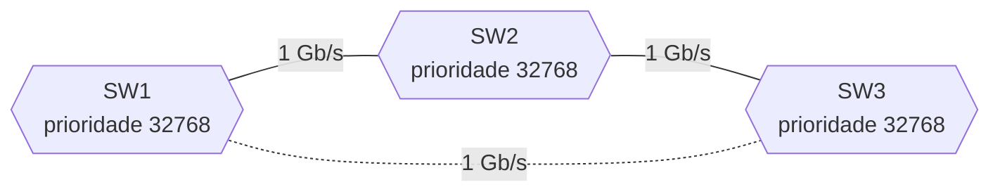

*Figura 3.1a (Tipo A, topologia).* Elementos do modo "STP clássico": SW1 (prioridade 32768); SW2 (prioridade 32768); SW3 (prioridade 32768). Linhas tracejadas: enlaces alternativos, forjados ou caídos. Vale para os cenários (6.1.1).

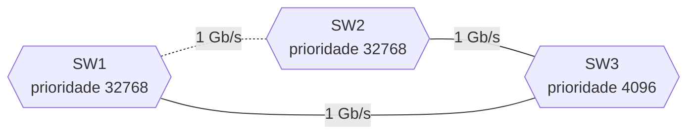

*Figura 3.1b (Tipo A, topologia).* Elementos do modo "STP clássico": SW1 (prioridade 32768); SW2 (prioridade 32768); SW3 (prioridade 4096). Linhas tracejadas: enlaces alternativos, forjados ou caídos. Vale para os cenários (6.1.2).

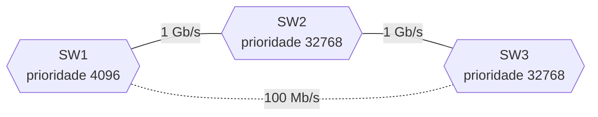

*Figura 3.1c (Tipo A, topologia).* Elementos do modo "STP clássico": SW1 (prioridade 4096); SW2 (prioridade 32768); SW3 (prioridade 32768). Linhas tracejadas: enlaces alternativos, forjados ou caídos. Vale para os cenários (6.1.3).

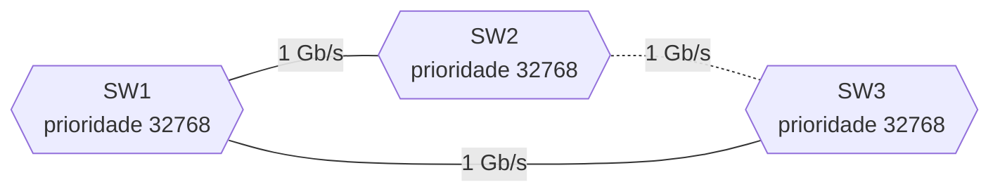

*Figura 3.1d (Tipo A, topologia).* Elementos do modo "STP clássico": SW1 (prioridade 32768); SW2 (prioridade 32768); SW3 (prioridade 32768). Linhas tracejadas: enlaces alternativos, forjados ou caídos. Vale para os cenários (6.1.4).

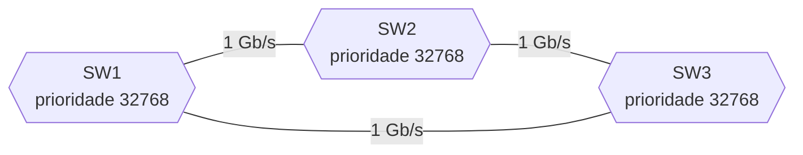

*Figura 3.1e (Tipo A, topologia).* Elementos do modo "STP clássico": SW1 (prioridade 32768); SW2 (prioridade 32768); SW3 (prioridade 32768). Vale para os cenários (6.1.5).

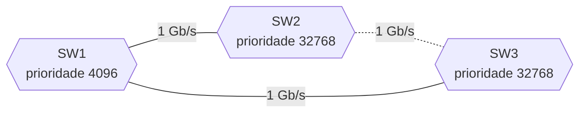

*Figura 3.1f (Tipo A, topologia).* Elementos do modo "STP clássico": SW1 (prioridade 4096); SW2 (prioridade 32768); SW3 (prioridade 32768). Linhas tracejadas: enlaces alternativos, forjados ou caídos. Vale para os cenários (6.1.6).

### 3.2 RSTP


*Figura 3.2a (Tipo A, topologia).* Elementos do modo "RSTP": SW1 (prioridade 32768); SW2 (prioridade 32768); SW3 (prioridade 32768). Linhas tracejadas: enlaces alternativos, forjados ou caídos. Vale para os cenários (6.2.1; 6.2.4).


*Figura 3.2b (Tipo A, topologia).* Elementos do modo "RSTP": SW1 (prioridade 32768); SW2 (prioridade 32768); SW3 (prioridade 32768). Linhas tracejadas: enlaces alternativos, forjados ou caídos. Vale para os cenários (6.2.2).


*Figura 3.2c (Tipo A, topologia).* Elementos do modo "RSTP": SW1 (prioridade 32768); SW2 (prioridade 32768); SW3 (prioridade 32768). Vale para os cenários (6.2.3).

### 3.3 MSTP


*Figura 3.3a (Tipo A, topologia).* Elementos do modo "MSTP": SW1 (prioridade 32768); SW2 (prioridade 32768); SW3 (prioridade 32768). Linhas tracejadas: enlaces alternativos, forjados ou caídos. Vale para os cenários (6.3.1).


*Figura 3.3b (Tipo A, topologia).* Elementos do modo "MSTP": SW1 (prioridade 32768); SW2 (prioridade 32768); SW3 (prioridade 32768). Vale para os cenários (6.3.2).

### 3.4 Laço e tempestade

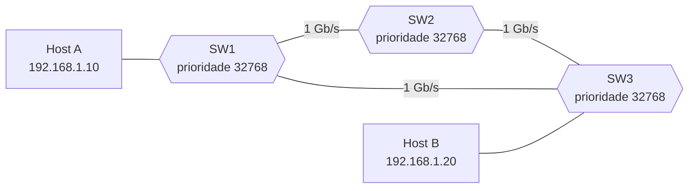

*Figura 3.4a (Tipo A, topologia).* Elementos do modo "Laço e tempestade": SW1 (prioridade 32768); SW2 (prioridade 32768); SW3 (prioridade 32768); Host A (192.168.1.10); Host B (192.168.1.20). Vale para os cenários (6.4.1).


*Figura 3.4b (Tipo A, topologia).* Elementos do modo "Laço e tempestade": SW1 (prioridade 32768); SW2 (prioridade 32768); SW3 (prioridade 32768); Host A (192.168.1.10); Host B (192.168.1.20). Linhas tracejadas: enlaces alternativos, forjados ou caídos. Vale para os cenários (6.4.2).

### 3.5 Proteções

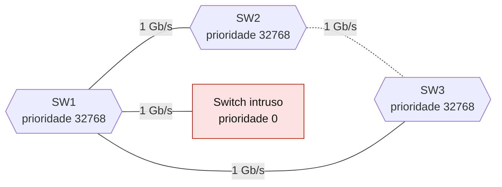

*Figura 3.5 (Tipo A, topologia).* Elementos do modo "Proteções": SW1 (prioridade 32768); SW2 (prioridade 32768); SW3 (prioridade 32768); Switch intruso (prioridade 0). Linhas tracejadas: enlaces alternativos, forjados ou caídos. Vale para todos os cenários do modo (6.5.1 a 6.5.3).

## 4. Abas da bancada

Cenário, Captura, Mensagem, Portas, Instâncias (modos: MSTP), Experimento, Referência e Log.

## 5. Configurações (campos do painel)

### 5.1 Rede

- **RTT (ms)**. Valores: 1; 2; 5; 20; 100. Padrão: 2. Modos: todos.
  - Tempo de ida e volta entre duas pontes vizinhas.
  - Num enlace Ethernet o atraso é de microssegundos a poucos milissegundos. Valores altos servem para ver o diagrama mais espaçado.
  - Não muda o que o spanning tree faz. Os temporizadores do protocolo (Hello, Max Age e Forward Delay) são fixos.

### 5.2 Prioridades

- **Quem tem a menor prioridade**. Valores: Ninguém (todas em 32768; vence o menor MAC); SW1 (prioridade 4096); SW3 (prioridade 4096). Padrão: Ninguém (todas em 32768; vence o menor MAC). Modos: STP clássico; RSTP; Laço e tempestade.
  - A ponte de menor identificador (prioridade e depois MAC) é a raiz.
  - **Ninguém:** todas usam a prioridade padrão (32768). O desempate é o MAC, e vence o SW2, que tem o menor: um switch velho do armário vira a raiz por acaso.
  - **SW1 ou SW3:** o administrador escolhe a raiz baixando a prioridade (valores múltiplos de 4096). É a prática recomendada: a raiz deve ser um switch central e potente.

### 5.3 Enlaces

- **Taxa do enlace SW1-SW3**. Valores: 1 Gb/s (custo 20000); 100 Mb/s (custo 200000). Padrão: 1 Gb/s (custo 20000). Modos: STP clássico; RSTP.
  - O custo de cada porta depende da velocidade (tabela longa do IEEE 802.1D-2004).
  - 10 Mb/s: 2000000; 100 Mb/s: 200000; 1 Gb/s: 20000; 10 Gb/s: 2000. Os outros dois enlaces do triângulo são sempre de 1 Gb/s.
  - A porta raiz de cada ponte é a de menor custo acumulado até a raiz. Um enlace mais lento só é usado como caminho se não houver outro melhor.

### 5.4 Falhas

- **Falha depois da convergência**. Valores: Nenhuma; O enlace SW2-SW3 cai; A ponte raiz é desligada. Padrão: Nenhuma. Modos: STP clássico; RSTP.
  - O que quebra depois que a rede convergiu.
  - **Enlace SW2-SW3:** se ele estava em uso, a porta alternativa assume. Se estava bloqueado, nada muda.
  - **Ponte raiz:** as pontes restantes elegem uma raiz nova.
  - No STP clássico, uma porta que sai do bloqueio leva 30 s para encaminhar (15 s em Escuta e 15 s em Aprendizado). No RSTP, a reação é quase imediata.

### 5.5 Compatibilidade

- **O SW3 só fala STP clássico**. Valores: caixa de seleção. Padrão: não. Modos: RSTP.
  - O RSTP convive com pontes do 802.1D antigo.
  - Uma ponte STP não entende proposta e acordo. Nos enlaces com ela, as pontes RSTP usam o STP clássico (BPDUs de configuração e os temporizadores de 15 s).
  - O resto da rede continua rápido, mas aqueles enlaces voltam a levar 30 s.

### 5.6 Instâncias

- **Mapa de VLANs**. Valores: Todas as VLANs no CIST (uma só árvore); VLAN 10 na MSTI 1 e VLAN 20 na MSTI 2. Padrão: VLAN 10 na MSTI 1 e VLAN 20 na MSTI 2. Modos: MSTP.
  - Qual árvore cada VLAN segue.
  - **Uma árvore:** o mesmo que o RSTP. O enlace bloqueado fica ocioso para todas as VLANs.
  - **Duas instâncias:** a MSTI 1 tem a raiz no SW1, e a MSTI 2, no SW3. Cada árvore bloqueia um enlace diferente, e o tráfego das duas VLANs usa mais enlaces ao mesmo tempo.
  - Todas as pontes da região precisam ter o mesmo nome, a mesma revisão e o mesmo mapa; senão, formam regiões separadas.

### 5.7 Situação

- **Spanning tree**. Valores: Desligado (laço físico ativo); Ligado (uma porta bloqueada). Padrão: Desligado (laço físico ativo). Modos: Laço e tempestade.
  - Compara a rede com e sem o protocolo.
  - **Desligado:** cada switch inunda o broadcast por todas as portas, e o quadro dá voltas no triângulo sem parar.
  - **Ligado:** uma porta bloqueada quebra o laço, e o quadro chega uma só vez a cada host.

### 5.8 Defesa

- **Proteção na porta de acesso do SW1**. Valores: Nenhuma; BPDU Guard (desativa a porta); Root Guard (bloqueia a porta). Padrão: Nenhuma. Modos: Proteções.
  - Como a porta reage a uma BPDU que não devia receber.
  - **BPDU Guard:** em portas de acesso (de borda), qualquer BPDU é suspeita. A porta é desativada na hora e só volta com intervenção ou temporizador.
  - **Root Guard:** em portas voltadas para fora do domínio confiável, a porta ignora BPDUs que tentem mudar a raiz e fica bloqueada enquanto elas chegarem; volta sozinha quando param.
  - São recursos de fabricantes, não do IEEE.

## 6. Cenários

### 6.1 Modo: STP clássico

> **Grupo:** Eleição e papéis

O STP elege uma raiz e deixa ativo só um caminho de menor custo até ela. As portas que sobrariam em laço ficam em Bloqueio. Quem manda é o identificador da ponte: a prioridade e, no empate, o MAC.

#### 6.1.1 Eleição pelo menor MAC

*A ponte de menor MAC vira a raiz.*

**Configuração aplicada:** Quem tem a menor prioridade = mac; Taxa do enlace SW1-SW3 = 1g; Falha depois da convergência = none; O SW3 só fala STP clássico = não

Todas as pontes têm a prioridade padrão. O **menor MAC** (SW2) vira a raiz. O SW3 bloqueia a porta do enlace com o SW1 e, depois de 30 s, a rede encaminha.

**Conceito.** Cada ponte tem um identificador de 8 bytes: prioridade (padrão 32768) e MAC. Todas começam anunciando "a raiz sou eu"; ao ver um identificador menor, adotam esse como raiz e repassam o anúncio. Cada ponte escolhe como porta raiz a de menor custo até a raiz, e em cada enlace uma só ponte fica com a porta designada. A porta que não é nem raiz nem designada fica alternativa, em Bloqueio.

**O que observar**

- Todas as pontes anunciam a si mesmas na primeira rodada.
- SW2 tem o menor MAC e vira a raiz.
- No enlace SW1-SW3, empatam no custo; vence a ponte de menor identificador (SW1), e o SW3 bloqueia.
- As portas passam por Escuta e Aprendizado antes de encaminhar (30 s).

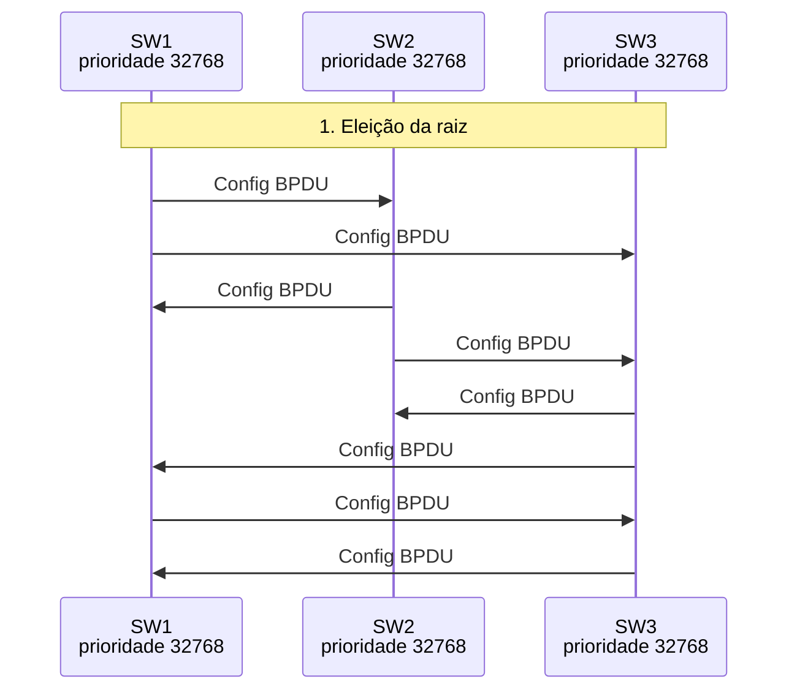

*Figura 6.1.1 (Tipo B, sequência).* Mensagens do cenário "Eleição pelo menor MAC", na ordem do tempo, entre SW1, SW2, SW3: 8 mensagens (em 4 fases). Corresponde ao diagrama de sequência e à aba Captura, no modo "STP clássico", com a configuração aplicada acima.

**Mensagens**

| Mensagem | Significado | Origem |
| --- | --- | --- |
| Config BPDU | cada ponte anuncia a si mesma | todas, em todas as portas |
| Config BPDU | SW1 e SW3 repassam a raiz SW2 | enlace SW1-SW3 |

**Por que importa.** A raiz escolhida pelo MAC é um acidente comum: o switch mais velho da rede pode virar o centro dela.

#### 6.1.2 Raiz escolhida pela prioridade

*A prioridade vale mais que o MAC.*

**Configuração aplicada:** Quem tem a menor prioridade = sw3; Taxa do enlace SW1-SW3 = 1g; Falha depois da convergência = none; O SW3 só fala STP clássico = não

O administrador baixa a prioridade do SW3 para 4096 e ele vira a raiz, **sem importar o MAC**. O bloqueio muda de lugar: agora é o SW1 que bloqueia a porta para o SW2.

**Conceito.** O identificador compara primeiro a prioridade e só depois o MAC. Baixar a prioridade de uma ponte (4096) a faz vencer a eleição. Isso permite escolher uma raiz central e potente e prever quais enlaces serão bloqueados.

**O que observar**

- SW3 é a raiz, mesmo com o MAC maior.
- SW1 e SW2 chegam a SW3 pelo enlace direto.
- O enlace SW1-SW2 empata no custo; vence o SW2 (menor identificador) e o SW1 bloqueia a porta.

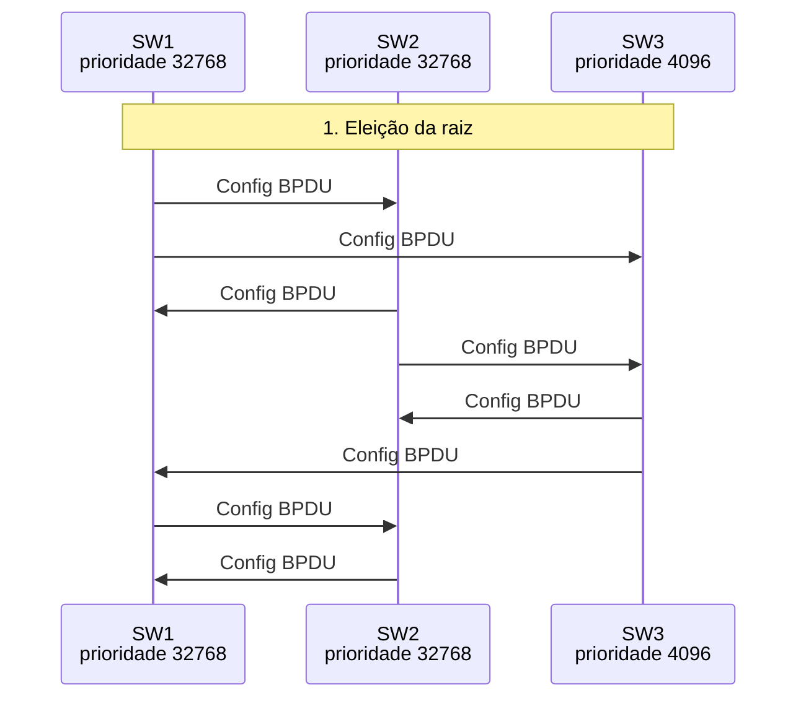

*Figura 6.1.2 (Tipo B, sequência).* Mensagens do cenário "Raiz escolhida pela prioridade", na ordem do tempo, entre SW1, SW2, SW3: 8 mensagens (em 4 fases). Corresponde ao diagrama de sequência e à aba Captura, no modo "STP clássico", com a configuração aplicada acima.

**Mensagens**

| Mensagem | Significado | Origem |
| --- | --- | --- |
| Config BPDU | SW3 anuncia a raiz (prioridade 4096) | SW3 para SW1 e SW2 |

**Por que importa.** Em redes reais, a raiz deve ser configurada e, de preferência, ter uma ponte de reserva com a segunda menor prioridade.

#### 6.1.3 Custo do enlace decide a porta raiz

*O custo acumulado escolhe a porta raiz.*

**Configuração aplicada:** Quem tem a menor prioridade = sw1; Taxa do enlace SW1-SW3 = 100m; Falha depois da convergência = none; O SW3 só fala STP clássico = não

A raiz é o SW1, mas o enlace direto com o SW3 é de 100 Mb/s. O SW3 prefere o caminho de dois saltos em **1 Gb/s** (custo 40000) ao direto (custo 200000), e bloqueia o enlace lento.

**Conceito.** A porta raiz é a de menor custo acumulado até a raiz, e o custo de cada enlace vem da velocidade. Com um enlace de 100 Mb/s (200000) e dois de 1 Gb/s (20000 cada), o caminho de dois saltos em 1 Gb/s (40000) vence o direto.

**O que observar**

- O custo anunciado pelo SW2 ao SW3 é 20000; somado ao enlace, dá 40000.
- O enlace SW1-SW3 fica bloqueado do lado do SW3.

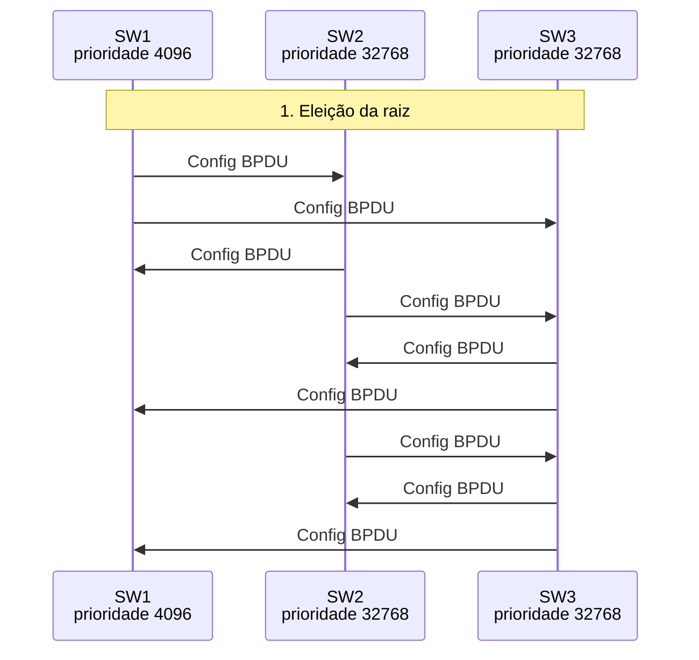

*Figura 6.1.3 (Tipo B, sequência).* Mensagens do cenário "Custo do enlace decide a porta raiz", na ordem do tempo, entre SW1, SW2, SW3: 9 mensagens (em 4 fases). Corresponde ao diagrama de sequência e à aba Captura, no modo "STP clássico", com a configuração aplicada acima.

**Mensagens**

| Mensagem | Significado | Origem |
| --- | --- | --- |
| Config BPDU | custo até a raiz em cada anúncio | SW1, SW2 e SW3 |

**Por que importa.** O STP não escolhe "o caminho mais curto" em saltos, mas o de menor custo. Um enlace lento no meio pode ficar ocioso.

> **Grupo:** Falhas e reconvergência

Quando um enlace ou a raiz cai, as portas bloqueadas podem ser reabertas. No STP clássico, uma porta que sai do Bloqueio passa por Escuta e Aprendizado, 15 s cada, antes de encaminhar.

#### 6.1.4 Falha do enlace da porta raiz

*A porta bloqueada assume, mas leva 30 s.*

**Configuração aplicada:** Quem tem a menor prioridade = mac; Taxa do enlace SW1-SW3 = 1g; Falha depois da convergência = link; O SW3 só fala STP clássico = não

O enlace SW2-SW3 cai. A porta bloqueada do SW3 assume como porta raiz, mas leva **30 s** (Escuta e Aprendizado) para voltar a encaminhar. Nesse tempo, o SW3 fica sem rede.

**Conceito.** Quando o enlace da porta raiz cai, a ponte perde o caminho até a raiz. A porta que estava em Bloqueio é promovida a porta raiz, mas ainda precisa passar por Escuta (15 s) e Aprendizado (15 s) antes de encaminhar. A mudança é avisada à raiz por um TCN, e a raiz sinaliza TC para as pontes encurtarem o envelhecimento da tabela MAC.

**O que observar**

- O SW3 fica sem porta raiz até a alternativa assumir.
- A porta passa de Bloqueio a Escuta, Aprendizado e Encaminhamento.
- O TCN sobe até a raiz, e a flag TC desce de volta.

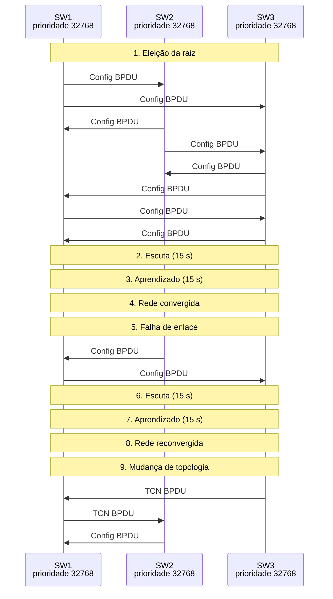

*Figura 6.1.4 (Tipo B, sequência).* Mensagens do cenário "Falha do enlace da porta raiz", na ordem do tempo, entre SW1, SW2, SW3: 13 mensagens (em 9 fases). Corresponde ao diagrama de sequência e à aba Captura, no modo "STP clássico", com a configuração aplicada acima.

**Mensagens**

| Mensagem | Significado | Origem |
| --- | --- | --- |
| Config BPDU | a raiz chega ao SW3 pela porta nova | SW2, SW1 e SW3 |
| TCN BPDU | mudança de topologia | SW3 para SW1, SW1 para SW2 |
| Config BPDU (TC) | a raiz sinaliza a mudança | SW2 para os vizinhos |

**Por que importa.** 30 s sem rede é muito tempo; é a principal razão da migração para o RSTP.

#### 6.1.5 Falha da ponte raiz

*Sem a raiz, as pontes elegem outra.*

**Configuração aplicada:** Quem tem a menor prioridade = mac; Taxa do enlace SW1-SW3 = 1g; Falha depois da convergência = root; O SW3 só fala STP clássico = não

A raiz (SW2) é desligada. SW1 e SW3 **elegem uma raiz nova** (SW1, de menor MAC), e o SW3 reabre o enlace que estava bloqueado, também em 30 s.

**Conceito.** Quando a raiz desaparece, as pontes restantes não recebem mais seus anúncios e elegem a de menor identificador entre elas. Nesse modelo, o enlace que levava à raiz antiga cai, e o que estava bloqueado vira o caminho novo, também após os 30 s dos temporizadores.

**O que observar**

- SW1 e SW3 voltam a anunciar-se como raiz.
- SW1, de menor MAC, é a raiz nova.
- A porta bloqueada do SW3 vira porta raiz e passa por Escuta e Aprendizado.

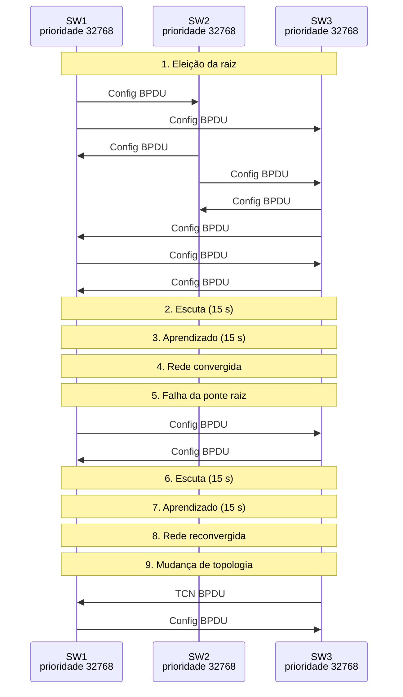

*Figura 6.1.5 (Tipo B, sequência).* Mensagens do cenário "Falha da ponte raiz", na ordem do tempo, entre SW1, SW2, SW3: 12 mensagens (em 9 fases). Corresponde ao diagrama de sequência e à aba Captura, no modo "STP clássico", com a configuração aplicada acima.

**Mensagens**

| Mensagem | Significado | Origem |
| --- | --- | --- |
| Config BPDU | nova eleição entre SW1 e SW3 | SW1 e SW3 |

**Por que importa.** Sem uma ponte de reserva bem planejada, a nova raiz pode ser um switch ruim de borda.

#### 6.1.6 Falha de um enlace bloqueado

*Perder um enlace bloqueado não muda nada.*

**Configuração aplicada:** Quem tem a menor prioridade = sw1; Taxa do enlace SW1-SW3 = 1g; Falha depois da convergência = link; O SW3 só fala STP clássico = não

Aqui o enlace SW2-SW3 é justamente o que estava **bloqueado**. Quando ele cai, nenhuma porta muda de papel e o tráfego não é interrompido.

**Conceito.** Um enlace bloqueado não carrega tráfego de dados, só BPDUs. Perdê-lo reduz a redundância, mas não afeta o encaminhamento: nenhuma porta muda de papel.

**O que observar**

- Nenhuma porta muda de papel.
- Nenhum temporizador é disparado.

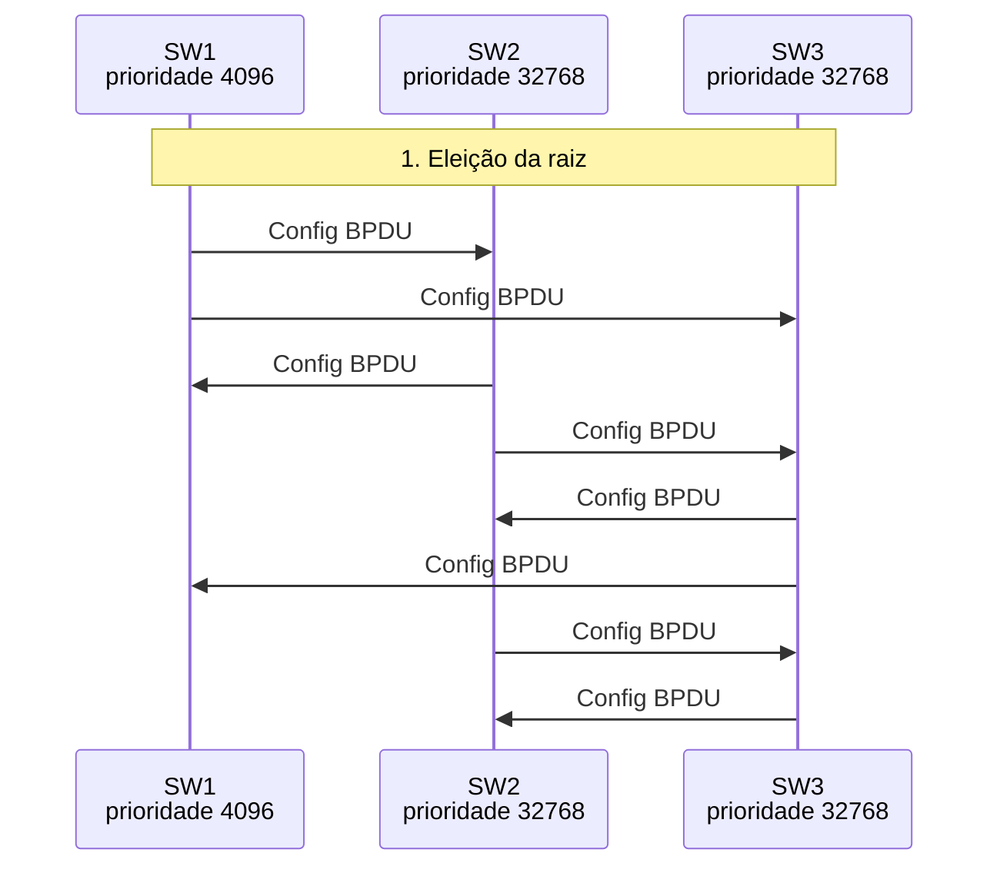

*Figura 6.1.6 (Tipo B, sequência).* Mensagens do cenário "Falha de um enlace bloqueado", na ordem do tempo, entre SW1, SW2, SW3: 8 mensagens (em 5 fases). Corresponde ao diagrama de sequência e à aba Captura, no modo "STP clássico", com a configuração aplicada acima.

**Mensagens**

| Mensagem | Significado | Origem |
| --- | --- | --- |
| (nenhuma) | só a redundância diminuiu | - |

**Por que importa.** Convém monitorar enlaces bloqueados: a rede segue funcionando, mas a próxima falha será sem reserva.

### 6.2 Modo: RSTP

> **Grupo:** Convergência rápida

O RSTP substitui os temporizadores por um acordo entre vizinhos: a porta designada propõe, o vizinho garante que não há laço e a porta encaminha.

#### 6.2.1 Proposta e acordo

*Proposta e acordo no lugar de 30 s.*

**Configuração aplicada:** Quem tem a menor prioridade = mac; Taxa do enlace SW1-SW3 = 1g; Falha depois da convergência = none; O SW3 só fala STP clássico = não

Mesma eleição do STP, mas as portas passam a encaminhar por **proposta e acordo** entre vizinhos, em poucos RTT, e não em 30 s.

**Conceito.** No RSTP, a porta designada em descarte envia uma BPDU com a flag de proposta. O vizinho coloca as outras portas dele em descarte (sincroniza) e responde com o acordo; a porta raiz dele encaminha na hora, e a designada encaminha ao receber o acordo. O processo desce da raiz, onda a onda, e termina em poucos RTT.

**O que observar**

- A proposta vai da raiz às pontes vizinhas.
- O acordo volta e as portas passam a encaminhar.
- O SW1 propõe ao SW3 no enlace que será bloqueado; a porta alternativa concorda.

```mermaid
sequenceDiagram
  participant n_sw1 as SW1<br/>prioridade 32768
  participant n_sw2 as SW2<br/>prioridade 32768
  participant n_sw3 as SW3<br/>prioridade 32768
  Note over n_sw1,n_sw3: 1. Eleição da raiz
  n_sw1 ->> n_sw2: RST BPDU
  n_sw1 ->> n_sw3: RST BPDU
  n_sw2 ->> n_sw1: RST BPDU
  n_sw2 ->> n_sw3: RST BPDU
  n_sw3 ->> n_sw2: RST BPDU
  n_sw3 ->> n_sw1: RST BPDU
  n_sw1 ->> n_sw3: RST BPDU
  n_sw3 ->> n_sw1: RST BPDU
  Note over n_sw1,n_sw3: 2. Proposta e acordo
  n_sw2 ->> n_sw1: RST BPDU (proposta)
  n_sw2 ->> n_sw3: RST BPDU (proposta)
  n_sw1 ->> n_sw2: RST BPDU (acordo)
  n_sw3 ->> n_sw2: RST BPDU (acordo)
  n_sw1 ->> n_sw3: RST BPDU (proposta)
  n_sw3 ->> n_sw1: RST BPDU (acordo)
```

*Figura 6.2.1 (Tipo B, sequência).* Mensagens do cenário "Proposta e acordo", na ordem do tempo, entre SW1, SW2, SW3: 14 mensagens (em 3 fases). Corresponde ao diagrama de sequência e à aba Captura, no modo "RSTP", com a configuração aplicada acima.

**Mensagens**

| Mensagem | Significado | Origem |
| --- | --- | --- |
| RST BPDU (proposta) | a porta designada pergunta | raiz para os vizinhos |
| RST BPDU (acordo) | o vizinho concorda | vizinhos para a raiz |

**Por que importa.** O mesmo resultado do STP, em milissegundos: as aplicações nem percebem a convergência.

> **Grupo:** Falhas

No RSTP, a porta alternativa já é um caminho de reserva pronto: se a porta raiz falha, ela assume na hora.

#### 6.2.2 Falha de enlace: a alternativa assume

*A alternativa assume na hora.*

**Configuração aplicada:** Quem tem a menor prioridade = mac; Taxa do enlace SW1-SW3 = 1g; Falha depois da convergência = link; O SW3 só fala STP clássico = não

O enlace SW2-SW3 cai. A porta **alternativa** do SW3 vira porta raiz e encaminha na hora, sem temporizador.

**Conceito.** No RSTP, a porta alternativa é um reserva da porta raiz, já com as informações da raiz. Quando a porta raiz falha, a alternativa vira porta raiz e encaminha imediatamente, sem passar por Escuta e Aprendizado.

**O que observar**

- A porta alternativa passa a raiz em um instante.
- Não há temporizador de 15 s.

```mermaid
sequenceDiagram
  participant n_sw1 as SW1<br/>prioridade 32768
  participant n_sw2 as SW2<br/>prioridade 32768
  participant n_sw3 as SW3<br/>prioridade 32768
  Note over n_sw1,n_sw3: 1. Eleição da raiz
  n_sw1 ->> n_sw2: RST BPDU
  n_sw1 ->> n_sw3: RST BPDU
  n_sw2 ->> n_sw1: RST BPDU
  n_sw2 ->> n_sw3: RST BPDU
  n_sw3 ->> n_sw2: RST BPDU
  n_sw3 ->> n_sw1: RST BPDU
  n_sw1 ->> n_sw3: RST BPDU
  n_sw3 ->> n_sw1: RST BPDU
  Note over n_sw1,n_sw3: 2. Proposta e acordo
  n_sw2 ->> n_sw1: RST BPDU (proposta)
  n_sw2 ->> n_sw3: RST BPDU (proposta)
  n_sw1 ->> n_sw2: RST BPDU (acordo)
  n_sw3 ->> n_sw2: RST BPDU (acordo)
  n_sw1 ->> n_sw3: RST BPDU (proposta)
  n_sw3 ->> n_sw1: RST BPDU (acordo)
  Note over n_sw1,n_sw3: 4. Rede convergida
  Note over n_sw1,n_sw3: 5. Falha de enlace
  n_sw2 ->> n_sw1: RST BPDU
  n_sw1 ->> n_sw3: RST BPDU
```

*Figura 6.2.2 (Tipo B, sequência).* Mensagens do cenário "Falha de enlace: a alternativa assume", na ordem do tempo, entre SW1, SW2, SW3: 16 mensagens (em 5 fases). Corresponde ao diagrama de sequência e à aba Captura, no modo "RSTP", com a configuração aplicada acima.

**Mensagens**

| Mensagem | Significado | Origem |
| --- | --- | --- |
| RST BPDU | informação da raiz pela porta nova | raiz e vizinhos |

**Por que importa.** É o que reduz a interrupção de 30 s para menos de 1 s na maioria das falhas de enlace.

#### 6.2.3 Falha da ponte raiz

*A nova raiz é eleita e as portas acordam rápido.*

**Configuração aplicada:** Quem tem a menor prioridade = mac; Taxa do enlace SW1-SW3 = 1g; Falha depois da convergência = root; O SW3 só fala STP clássico = não

A raiz é desligada. A nova eleição e a abertura do enlace bloqueado acontecem por proposta e acordo, em **milissegundos** no modelo.

**Conceito.** Sem a raiz, as pontes elegem outra e as portas novas se sincronizam por proposta e acordo, como na convergência inicial. Se todas falam RSTP, o processo é rápido.

**O que observar**

- Nova eleição entre SW1 e SW3.
- Proposta e acordo na porta que estava em descarte.

```mermaid
sequenceDiagram
  participant n_sw1 as SW1<br/>prioridade 32768
  participant n_sw2 as SW2<br/>prioridade 32768
  participant n_sw3 as SW3<br/>prioridade 32768
  Note over n_sw1,n_sw3: 1. Eleição da raiz
  n_sw1 ->> n_sw2: RST BPDU
  n_sw1 ->> n_sw3: RST BPDU
  n_sw2 ->> n_sw1: RST BPDU
  n_sw2 ->> n_sw3: RST BPDU
  n_sw3 ->> n_sw2: RST BPDU
  n_sw3 ->> n_sw1: RST BPDU
  n_sw1 ->> n_sw3: RST BPDU
  n_sw3 ->> n_sw1: RST BPDU
  Note over n_sw1,n_sw3: 2. Proposta e acordo
  n_sw2 ->> n_sw1: RST BPDU (proposta)
  n_sw2 ->> n_sw3: RST BPDU (proposta)
  n_sw1 ->> n_sw2: RST BPDU (acordo)
  n_sw3 ->> n_sw2: RST BPDU (acordo)
  n_sw1 ->> n_sw3: RST BPDU (proposta)
  n_sw3 ->> n_sw1: RST BPDU (acordo)
  Note over n_sw1,n_sw3: 4. Rede convergida
  Note over n_sw1,n_sw3: 5. Falha da ponte raiz
  n_sw1 ->> n_sw3: RST BPDU
  n_sw3 ->> n_sw1: RST BPDU
```

*Figura 6.2.3 (Tipo B, sequência).* Mensagens do cenário "Falha da ponte raiz", na ordem do tempo, entre SW1, SW2, SW3: 16 mensagens (em 5 fases). Corresponde ao diagrama de sequência e à aba Captura, no modo "RSTP", com a configuração aplicada acima.

**Mensagens**

| Mensagem | Significado | Origem |
| --- | --- | --- |
| RST BPDU | nova eleição | SW1 e SW3 |
| RST BPDU (proposta e acordo) | abre o enlace | SW1 e SW3 |

**Por que importa.** A reconvergência segue rápida mesmo quando a raiz inteira cai.

> **Grupo:** Compatibilidade

O RSTP convive com pontes do STP clássico, mas nos enlaces com elas perde a velocidade.

#### 6.2.4 Uma ponte só fala STP

*Uma ponte STP desacelera os enlaces dela.*

**Configuração aplicada:** Quem tem a menor prioridade = mac; Taxa do enlace SW1-SW3 = 1g; Falha depois da convergência = none; O SW3 só fala STP clássico = sim

O SW3 só entende o STP clássico. Os enlaces com ele não podem usar proposta e acordo e levam **30 s**, enquanto o resto da rede continua rápido.

**Conceito.** Uma ponte do 802.1D antigo não entende proposta e acordo. A ponte RSTP detecta BPDUs de versão 0 na porta e passa a usar os temporizadores nos enlaces com ela. O resto da rede continua com o handshake.

**O que observar**

- Os enlaces do SW3 usam Config BPDU e passam por Escuta e Aprendizado.
- O enlace SW1-SW2 converge em milissegundos.

```mermaid
sequenceDiagram
  participant n_sw1 as SW1<br/>prioridade 32768
  participant n_sw2 as SW2<br/>prioridade 32768
  participant n_sw3 as SW3<br/>prioridade 32768
  Note over n_sw1,n_sw3: 1. Eleição da raiz
  n_sw1 ->> n_sw2: RST BPDU
  n_sw1 ->> n_sw3: Config BPDU
  n_sw2 ->> n_sw1: RST BPDU
  n_sw2 ->> n_sw3: Config BPDU
  n_sw3 ->> n_sw2: Config BPDU
  n_sw3 ->> n_sw1: Config BPDU
  n_sw1 ->> n_sw3: Config BPDU
  n_sw3 ->> n_sw1: Config BPDU
  Note over n_sw1,n_sw3: 2. Proposta e acordo
  n_sw2 ->> n_sw1: RST BPDU (proposta)
  n_sw1 ->> n_sw2: RST BPDU (acordo)
```

*Figura 6.2.4 (Tipo B, sequência).* Mensagens do cenário "Uma ponte só fala STP", na ordem do tempo, entre SW1, SW2, SW3: 10 mensagens (em 4 fases). Corresponde ao diagrama de sequência e à aba Captura, no modo "RSTP", com a configuração aplicada acima.

**Mensagens**

| Mensagem | Significado | Origem |
| --- | --- | --- |
| Config BPDU | nos enlaces com o SW3 | SW3 e vizinhos |
| RST BPDU | nos demais | SW1 e SW2 |

**Por que importa.** Uma única ponte antiga pode manter 30 s de convergência numa parte da rede. Convém atualizar tudo.

### 6.3 Modo: MSTP

> **Grupo:** Instâncias

O MSTP agrupa VLANs em instâncias, cada uma com a própria árvore. Dá para bloquear enlaces diferentes em cada instância e usar a capacidade de todos.

#### 6.3.1 Todas as VLANs numa árvore

*Sem instâncias, é um RSTP.*

**Configuração aplicada:** Mapa de VLANs = one

Todas as VLANs seguem o CIST, como no RSTP. O enlace SW1-SW3 fica **ocioso para todas**.

**Conceito.** Com todas as VLANs no CIST, o MSTP se comporta como o RSTP: uma só árvore, um enlace bloqueado e ocioso para todas as VLANs. A região é identificada por nome, revisão e um digest do mapa de VLANs.

**O que observar**

- Uma só árvore, com raiz no SW2.
- O enlace SW1-SW3 fica bloqueado em um lado.
- Cada BPDU leva nome, revisão e digest da região.

```mermaid
sequenceDiagram
  participant n_sw1 as SW1<br/>prioridade 32768
  participant n_sw2 as SW2<br/>prioridade 32768
  participant n_sw3 as SW3<br/>prioridade 32768
  Note over n_sw1,n_sw3: 1. Eleição da raiz do CIST
  n_sw1 ->> n_sw2: MST BPDU
  n_sw1 ->> n_sw3: MST BPDU
  n_sw2 ->> n_sw1: MST BPDU
  n_sw2 ->> n_sw3: MST BPDU
  n_sw3 ->> n_sw2: MST BPDU
  n_sw3 ->> n_sw1: MST BPDU
  n_sw1 ->> n_sw3: MST BPDU
  n_sw3 ->> n_sw1: MST BPDU
  Note over n_sw1,n_sw3: 2. Sincronização rápida (proposta e acordo, como no RSTP)
  n_sw2 ->> n_sw1: MST BPDU
  n_sw2 ->> n_sw3: MST BPDU
  n_sw1 ->> n_sw3: MST BPDU
```

*Figura 6.3.1 (Tipo B, sequência).* Mensagens do cenário "Todas as VLANs numa árvore", na ordem do tempo, entre SW1, SW2, SW3: 11 mensagens (em 3 fases). Corresponde ao diagrama de sequência e à aba Captura, no modo "MSTP", com a configuração aplicada acima.

**Mensagens**

| Mensagem | Significado | Origem |
| --- | --- | --- |
| MST BPDU | CIST e configuração da região | todas as pontes |

**Por que importa.** Sem mais de uma instância, o MSTP não traz ganho de capacidade: o ganho vem de usar o mapa de VLANs.

#### 6.3.2 Duas instâncias: balanceamento por VLAN

*Cada instância bloqueia um enlace diferente.*

**Configuração aplicada:** Mapa de VLANs = two

A VLAN 10 usa a árvore da MSTI 1 (raiz SW1) e a VLAN 20, a da MSTI 2 (raiz SW3). Cada árvore bloqueia um enlace diferente, e o **tráfego se divide** entre os enlaces.

**Conceito.** O MSTP agrupa VLANs em instâncias (MSTIs), cada uma com raiz e árvore próprias. Aqui, a VLAN 10 está na MSTI 1 (raiz SW1) e a VLAN 20, na MSTI 2 (raiz SW3). Uma só BPDU por enlace leva os registros de todas as instâncias. O tráfego de cada VLAN usa a árvore da sua instância, e os dois enlaces ociosos são diferentes.

**O que observar**

- A BPDU traz um registro por MSTI.
- Na MSTI 1 o enlace SW2-SW3 fica bloqueado; na MSTI 2, o SW1-SW2.
- Cada enlace carrega tráfego de pelo menos uma VLAN.

```mermaid
sequenceDiagram
  participant n_sw1 as SW1<br/>prioridade 32768
  participant n_sw2 as SW2<br/>prioridade 32768
  participant n_sw3 as SW3<br/>prioridade 32768
  Note over n_sw1,n_sw3: 1. Eleição da raiz do CIST
  n_sw1 ->> n_sw2: MST BPDU
  n_sw1 ->> n_sw3: MST BPDU
  n_sw2 ->> n_sw1: MST BPDU
  n_sw2 ->> n_sw3: MST BPDU
  n_sw3 ->> n_sw2: MST BPDU
  n_sw3 ->> n_sw1: MST BPDU
  n_sw1 ->> n_sw3: MST BPDU
  n_sw3 ->> n_sw1: MST BPDU
  Note over n_sw1,n_sw3: 2. Sincronização rápida (proposta e acordo, como no RSTP)
  n_sw2 ->> n_sw1: MST BPDU
  n_sw2 ->> n_sw3: MST BPDU
  n_sw1 ->> n_sw3: MST BPDU
```

*Figura 6.3.2 (Tipo B, sequência).* Mensagens do cenário "Duas instâncias: balanceamento por VLAN", na ordem do tempo, entre SW1, SW2, SW3: 11 mensagens (em 3 fases). Corresponde ao diagrama de sequência e à aba Captura, no modo "MSTP", com a configuração aplicada acima.

**Mensagens**

| Mensagem | Significado | Origem |
| --- | --- | --- |
| MST BPDU | CIST e registros das MSTIs 1 e 2 | todas as pontes |

**Por que importa.** É a forma de usar a capacidade dos enlaces redundantes sem laços: balanceamento por VLAN.

### 6.4 Modo: Laço e tempestade

> **Grupo:** Laço físico

Um quadro Ethernet não tem TTL. Em um laço de pontes, um broadcast circula para sempre, e o spanning tree existe para impedir isso.

#### 6.4.1 Sem STP: tempestade de broadcast

*O broadcast circula para sempre.*

**Configuração aplicada:** Spanning tree = nostp; Quem tem a menor prioridade = mac

Um único broadcast de A entra no triângulo. Cada switch o **inunda** pelas outras portas, e duas cópias circulam para sempre, em sentidos opostos.

**Conceito.** Sem spanning tree, cada ponte inunda o broadcast por todas as portas menos a de entrada. No triângulo, duas cópias saem do SW1 em sentidos opostos e dão voltas sem parar; o quadro Ethernet não tem TTL. Cada volta entrega mais cópias aos hosts e faz a tabela MAC dos switches mudar de porta.

**O que observar**

- Duas cópias circulam em sentidos opostos.
- B recebe cópias repetidas, e A recebe cópias do próprio quadro.
- O MAC de A passa a chegar ao SW1 por portas diferentes.

```mermaid
sequenceDiagram
  participant n_a as Host A<br/>porta de acesso do SW1
  participant n_sw1 as SW1<br/>switch
  participant n_sw2 as SW2<br/>switch
  participant n_sw3 as SW3<br/>switch
  participant n_b as Host B<br/>porta de acesso do SW3
  Note over n_a,n_b: 1. Um broadcast entra na rede
  n_a ->> n_sw1: ARP Request
  n_sw1 ->> n_sw2: ARP Request
  n_sw1 ->> n_sw3: ARP Request
  Note over n_a,n_b: 2. O quadro dá voltas no laço
  n_sw2 ->> n_sw3: ARP Request
  n_sw3 ->> n_sw2: ARP Request
  n_sw3 ->> n_b: ARP Request
  n_sw3 ->> n_sw1: ARP Request
  n_sw3 ->> n_b: ARP Request
  n_sw2 ->> n_sw1: ARP Request
  n_sw1 ->> n_sw2: ARP Request
  n_sw1 ->> n_a: ARP Request
  n_sw1 ->> n_sw3: ARP Request
  n_sw1 ->> n_a: ARP Request
  n_sw2 ->> n_sw3: ARP Request
  n_sw3 ->> n_sw2: ARP Request
  n_sw3 ->> n_b: ARP Request
  n_sw3 ->> n_sw1: ARP Request
  n_sw3 ->> n_b: ARP Request
  n_sw2 ->> n_sw1: ARP Request
```

*Figura 6.4.1 (Tipo B, sequência).* Mensagens do cenário "Sem STP: tempestade de broadcast", na ordem do tempo, entre Host A, SW1, SW2, SW3, Host B: 19 mensagens (em 3 fases). Corresponde ao diagrama de sequência e à aba Captura, no modo "Laço e tempestade", com a configuração aplicada acima.

**Mensagens**

| Mensagem | Significado | Origem |
| --- | --- | --- |
| ARP Request | broadcast do host A | inundado em todas as portas |
| ARP Request | cópias circulando | SW1, SW2 e SW3 |

**Por que importa.** Em redes com mais enlaces, o número de cópias cresce de forma exponencial e a rede para em segundos.

#### 6.4.2 Com STP: o laço é cortado

*A porta bloqueada corta o laço.*

**Configuração aplicada:** Spanning tree = stp; Quem tem a menor prioridade = mac

O mesmo broadcast, com o spanning tree ligado. Uma porta em **Bloqueio** descarta o quadro, e cada host o recebe uma só vez.

**Conceito.** Com o spanning tree, um dos enlaces do triângulo fica bloqueado. O broadcast se espalha só pela árvore, e a cópia que chega à porta em Bloqueio é descartada.

**O que observar**

- Uma cópia chega à porta em Bloqueio e é descartada.
- Cada host recebe o broadcast uma única vez.

```mermaid
sequenceDiagram
  participant n_a as Host A<br/>porta de acesso do SW1
  participant n_sw1 as SW1<br/>switch
  participant n_sw2 as SW2<br/>switch
  participant n_sw3 as SW3<br/>switch
  participant n_b as Host B<br/>porta de acesso do SW3
  Note over n_a,n_b: 1. Um broadcast entra na rede
  n_a ->> n_sw1: ARP Request
  n_sw1 ->> n_sw2: ARP Request
  n_sw1 -x n_sw3: ARP Request
  Note over n_a,n_b: 2. O quadro segue pela árvore
  n_sw2 ->> n_sw3: ARP Request
  n_sw3 ->> n_b: ARP Request
```

*Figura 6.4.2 (Tipo B, sequência).* Mensagens do cenário "Com STP: o laço é cortado", na ordem do tempo, entre Host A, SW1, SW2, SW3, Host B: 5 mensagens (em 3 fases; 1 perdida). Corresponde ao diagrama de sequência e à aba Captura, no modo "Laço e tempestade", com a configuração aplicada acima.

**Mensagens**

| Mensagem | Significado | Origem |
| --- | --- | --- |
| ARP Request | broadcast do host A | só pela árvore |

**Por que importa.** É para isso que existe o spanning tree: permitir enlaces redundantes sem criar laços.

### 6.5 Modo: Proteções

> **Grupo:** O problema

O spanning tree confia em qualquer BPDU. Quem se anuncia com a melhor prioridade passa a ser a raiz, e a rede inteira se reorganiza ao redor dele.

#### 6.5.1 Intruso sem proteção vira a raiz

*Uma BPDU de prioridade 0 toma a raiz.*

**Configuração aplicada:** Proteção na porta de acesso do SW1 = none

Um switch de prioridade 0 é ligado a uma porta de acesso. Sem proteção, o SW1 o aceita como **raiz**, a rede reconverge ao redor dele e o SW3 fica 30 s sem encaminhar.

**Conceito.** O STP não autentica as BPDUs. Um switch ligado a uma porta de acesso e anunciando prioridade 0 é aceito como raiz pelas pontes vizinhas. A rede reconverge ao redor dele: as portas mudam de papel, o SW3 fica 30 s sem encaminhar, e o tráfego passa a ser desviado para o caminho que leva ao intruso.

**O que observar**

- A BPDU do intruso é a melhor que o SW1 já viu.
- A nova raiz é anunciada a todas as pontes.
- O SW3 reabre o enlace com o SW1 e bloqueia o que tinha com o SW2.

```mermaid
sequenceDiagram
  participant n_sw1 as SW1<br/>prioridade 32768
  participant n_sw2 as SW2<br/>prioridade 32768
  participant n_sw3 as SW3<br/>prioridade 32768
  participant n_x as Switch intruso<br/>prioridade 0
  Note over n_sw1,n_x: 1. Rede estável
  Note over n_sw1,n_x: 2. Um switch não autorizado é ligado à porta de acesso do SW1
  n_x ->> n_sw1: Config BPDU
  Note over n_sw1,n_x: 3. A rede reconverge ao redor do intruso
  n_sw1 ->> n_sw2: Config BPDU
  n_sw1 ->> n_sw3: Config BPDU
  n_sw2 ->> n_sw3: Config BPDU
```

*Figura 6.5.1 (Tipo B, sequência).* Mensagens do cenário "Intruso sem proteção vira a raiz", na ordem do tempo, entre SW1, SW2, SW3, Switch intruso: 4 mensagens (em 5 fases). Corresponde ao diagrama de sequência e à aba Captura, no modo "Proteções", com a configuração aplicada acima.

**Mensagens**

| Mensagem | Significado | Origem |
| --- | --- | --- |
| Config BPDU | o intruso se anuncia como raiz | intruso para SW1 |
| Config BPDU | a nova raiz é repassada | SW1, SW2 e SW3 |

**Por que importa.** Quem controla a raiz controla o caminho do tráfego, e uma BPDU forjada derruba o serviço por 30 s.

> **Grupo:** Defesas

As defesas ficam nas portas: as de acesso não devem receber BPDUs, e as de borda não devem aceitar uma raiz nova.

#### 6.5.2 BPDU Guard isola o intruso

*Porta de acesso que recebe BPDU é desativada.*

**Configuração aplicada:** Proteção na porta de acesso do SW1 = bpdu

A porta de acesso recebe uma BPDU, que ali não deveria existir, e é **desativada**. A raiz continua a mesma.

**Conceito.** Uma porta de acesso (de borda) liga um computador, não uma ponte, e não deveria receber BPDUs. O BPDU Guard desativa a porta na primeira BPDU. É a defesa recomendada para todas as portas de acesso, com ou sem um ataque.

**O que observar**

- A porta 3 do SW1 vai a desativada.
- A raiz continua a mesma.

```mermaid
sequenceDiagram
  participant n_sw1 as SW1<br/>prioridade 32768
  participant n_sw2 as SW2<br/>prioridade 32768
  participant n_sw3 as SW3<br/>prioridade 32768
  participant n_x as Switch intruso<br/>prioridade 0
  Note over n_sw1,n_x: 1. Rede estável
  Note over n_sw1,n_x: 2. Um switch não autorizado é ligado à porta de acesso do SW1
  n_x ->> n_sw1: Config BPDU
```

*Figura 6.5.2 (Tipo B, sequência).* Mensagens do cenário "BPDU Guard isola o intruso", na ordem do tempo, entre SW1, SW2, SW3, Switch intruso: 1 mensagem (em 2 fases). Corresponde ao diagrama de sequência e à aba Captura, no modo "Proteções", com a configuração aplicada acima.

**Mensagens**

| Mensagem | Significado | Origem |
| --- | --- | --- |
| Config BPDU | o intruso se anuncia como raiz | intruso para SW1 |

**Por que importa.** Também evita laços acidentais, como um switch doméstico ligado em duas portas.

#### 6.5.3 Root Guard ignora a BPDU superior

*A porta bloqueia quem tenta mudar a raiz.*

**Configuração aplicada:** Proteção na porta de acesso do SW1 = root

A porta recebe uma BPDU que tentaria trocar a raiz. Ela vai a **root-inconsistente** (bloqueio) e ignora o anúncio. A raiz não muda.

**Conceito.** O Root Guard fica em portas que não devem aceitar a raiz do outro lado. Se chega uma BPDU superior à da raiz atual, a porta passa a root-inconsistent (bloqueio) e ignora o anúncio, voltando ao normal sozinha quando as BPDUs param.

**O que observar**

- A porta fica em root-inconsistente.
- A raiz não muda.

```mermaid
sequenceDiagram
  participant n_sw1 as SW1<br/>prioridade 32768
  participant n_sw2 as SW2<br/>prioridade 32768
  participant n_sw3 as SW3<br/>prioridade 32768
  participant n_x as Switch intruso<br/>prioridade 0
  Note over n_sw1,n_x: 1. Rede estável
  Note over n_sw1,n_x: 2. Um switch não autorizado é ligado à porta de acesso do SW1
  n_x ->> n_sw1: Config BPDU
```

*Figura 6.5.3 (Tipo B, sequência).* Mensagens do cenário "Root Guard ignora a BPDU superior", na ordem do tempo, entre SW1, SW2, SW3, Switch intruso: 1 mensagem (em 2 fases). Corresponde ao diagrama de sequência e à aba Captura, no modo "Proteções", com a configuração aplicada acima.

**Mensagens**

| Mensagem | Significado | Origem |
| --- | --- | --- |
| Config BPDU | o intruso se anuncia como raiz | intruso para SW1 |

**Por que importa.** É a defesa para ligações com redes de terceiros ou da borda do domínio, onde há bridges legítimas, mas que nunca devem ser a raiz.

## 7. Referência

### 7.1 Para que serve

Uma rede local com enlaces redundantes forma **laços**. Como o quadro Ethernet não tem TTL, um broadcast preso num laço circula para sempre, e as tabelas MAC dos switches perdem a estabilidade. O **spanning tree** escolhe, entre as pontes, uma árvore sem laços e deixa em **Bloqueio** as portas que a formariam. Se um enlace da árvore falha, uma porta bloqueada é reaberta.

As versões são três: o **STP** (IEEE 802.1D), o **RSTP** (IEEE 802.1w, hoje parte do 802.1D-2004) e o **MSTP** (IEEE 802.1s). Os três foram incorporados ao IEEE 802.1Q, que é a referência vigente. Fabricantes oferecem ainda versões por VLAN (como o PVST+ e o Rapid PVST+), que não são tratadas aqui.

### 7.2 Identificador da ponte e eleição da raiz

- O **identificador da ponte** tem 8 bytes: prioridade (padrão 32768) e MAC. No 802.1D-2004 e no 802.1Q, a prioridade usa os 4 bits mais altos, em múltiplos de 4096, e os 12 bits restantes formam a extensão de identificador de sistema (o número da VLAN ou da instância).
- Todas as pontes começam achando que são a **raiz**. A de menor identificador vence; o desempate é o MAC.
- Cada ponte escolhe a **porta raiz**: a de menor **custo acumulado** até a raiz (desempate: identificador da ponte vizinha e depois o número da porta).
- Em cada enlace, a ponte com o melhor vetor (custo até a raiz e, no empate, identificador) fica com a **porta designada**. A porta que não é raiz nem designada vira **alternativa** (bloqueada).

### 7.3 Custo de porta

| Velocidade | Custo (tabela longa, 802.1D-2004) | Custo (tabela curta, 802.1D-1998) |
| --- | --- | --- |
| 10 Mb/s | 2000000 | 100 |
| 100 Mb/s | 200000 | 19 |
| 1 Gb/s | 20000 | 4 |
| 10 Gb/s | 2000 | 2 |

O simulador usa a tabela longa. Pontes que usam tabelas diferentes na mesma rede podem escolher caminhos inesperados.

### 7.4 A BPDU

| Campo | Valor ou função |
| --- | --- |
| Destino | 01:80:c2:00:00:00, endereço de grupo reservado: a ponte não o encaminha |
| LLC | DSAP e SSAP 0x42, controle 0x03 |
| Versão e tipo | 0 e 0x00 (STP); 2 e 0x02 (RSTP); 3 e 0x02 (MSTP); 0x80 é o TCN |
| ID da raiz, custo, ID da ponte e ID da porta | o vetor de prioridade que as pontes comparam |
| Message Age, Max Age, Hello Time, Forward Delay | idade da informação e os temporizadores da raiz (padrões 0, 20 s, 2 s e 15 s) |
| Flags | STP: TC e TCA. RSTP: proposta, papel da porta, aprendizado, encaminhamento e acordo |

### 7.5 Estados e tempos do STP

| Estado | Aprende MACs | Encaminha dados |
| --- | --- | --- |
| Bloqueio | não | não |
| Escuta (Forward Delay, 15 s) | não | não |
| Aprendizado (Forward Delay, 15 s) | sim | não |
| Encaminhamento | sim | sim |

Uma porta que sai do Bloqueio leva **30 s** para encaminhar. Se as BPDUs deixam de chegar sem que o enlace caia (por exemplo, por um conversor de mídia no meio ou um enlace unidirecional), a informação só expira em **Max Age (20 s)**, e o total chega a 50 s. Em uma mudança de topologia, um **TCN** sobe até a raiz, que sinaliza a flag TC por Max Age mais Forward Delay (35 s): as pontes reduzem o envelhecimento da tabela MAC para o Forward Delay.

### 7.6 RSTP

- Os estados viram **Descarte**, **Aprendizado** e **Encaminhamento**. Os papéis incluem a porta **alternativa** (reserva da porta raiz) e a **de backup** (reserva de uma porta designada na mesma ponte).
- **Proposta e acordo:** a porta designada em descarte envia uma BPDU com a flag de proposta. O vizinho sincroniza (põe as outras portas dele em descarte) e responde com o acordo. A porta raiz do vizinho encaminha na hora, e a designada encaminha ao receber o acordo. O simulador considera que uma porta alternativa, já em descarte, concorda com a proposta.
- Quando a **porta raiz falha**, a alternativa vira porta raiz e encaminha imediatamente. As portas de borda (de acesso, ligadas a computadores) encaminham sem esperar nada.
- Uma ponte que só fala STP obriga os enlaces com ela a usar o STP clássico e os temporizadores.

### 7.7 MSTP

- Uma **região** é um conjunto de pontes com o mesmo **nome**, a mesma **revisão** e o mesmo **mapa VLAN-instância** (resumido num digest de 16 bytes na BPDU). Se um deles difere, a ponte fica em outra região.
- O **CIST** (instância 0) liga todas as pontes e regiões; as **MSTIs** existem só dentro da região, cada uma com a própria raiz e árvore. Uma só BPDU por enlace leva o CIST e os registros de todas as MSTIs (16 bytes cada).
- O ganho é de capacidade: cada instância bloqueia enlaces diferentes e o tráfego das VLANs se distribui entre os enlaces.

### 7.8 Proteções e segurança (nível defensivo)

- **Por que é possível atacar:** o spanning tree **não autentica as BPDUs**. Quem se anuncia com a melhor prioridade passa a ser a raiz, e a rede se reorganiza ao redor dele. O tráfego pode passar a atravessar o equipamento do intruso e há interrupção durante a reconvergência.
- **Alcance:** só dentro do domínio de camada 2 (a rede local ou a VLAN). As BPDUs não atravessam roteadores.
- **Aviso:** este modo explica o mecanismo para fins de defesa. Interferir na rede de terceiros pode configurar crime; pratique apenas em laboratório isolado, com autorização.

### 7.9 Defesas

| Defesa | Onde atua | Observação |
| --- | --- | --- |
| BPDU Guard | em portas de acesso (de borda) | desativa a porta que recebe qualquer BPDU; recurso de fabricantes |
| Root Guard | em portas voltadas para fora do domínio confiável | bloqueia a porta que receberia uma raiz melhor; recurso de fabricantes |
| Prioridade configurada e raiz de reserva | nas pontes do núcleo | torna a raiz previsível e a troca de raiz menos abrupta |
| Detecção de enlace unidirecional e Loop Guard | nos enlaces entre pontes | evitam laços quando as BPDUs param de chegar sem queda do enlace; recursos de fabricantes, fora do simulador |
| Limite de broadcast (storm control) | nas portas | reduz o estrago de uma tempestade, sem impedir o laço |

### 7.10 Gerência por SNMP

O funcionamento do spanning tree é definido pelo IEEE, e não por uma RFC. A **[RFC 4188](https://www.rfc-editor.org/rfc/rfc4188)** (Standards Track, setembro de 2005, substitui a [RFC 1493](https://www.rfc-editor.org/rfc/rfc1493)) define o **BRIDGE-MIB**, o módulo SNMP para pontes IEEE 802.1D, que inclui objetos do spanning tree e da ponte transparente. Os objetos específicos do RSTP estão na **[RFC 4318](https://www.rfc-editor.org/rfc/rfc4318)** (Standards Track, dezembro de 2005); os do MSTP e as edições mais recentes da gerência ficam com o IEEE. Serve para consultar uma ponte real (a raiz, o custo e o estado das portas, por exemplo). O simulador não implementa SNMP.

### 7.11 Limitações do simulador

O simulador mostra um triângulo de três switches (quatro pontes, no modo de proteções). Os endereços são de documentação ([RFC 7042](https://www.rfc-editor.org/rfc/rfc7042) e [RFC 9542](https://www.rfc-editor.org/rfc/rfc9542)), os tempos de trânsito são didáticos, e os temporizadores do protocolo (Hello 2 s, Max Age 20 s e Forward Delay 15 s) são os padrões. A eleição é simulada por rodadas de BPDUs, sem os temporizadores de Hello nem o envelhecimento da informação (Max Age). Na falha da raiz, o simulador refaz a eleição entre as pontes que sobraram. Uma porta que já encaminha e muda de papel continua encaminhando. A topologia usa a tabela longa de custos e uma só instância de STP. No RSTP, os papéis de backup e as portas de borda não aparecem, e o MSTP mostra a sincronização só do CIST (as instâncias seguem a mesma lógica). Não foram citadas cláusulas do IEEE 802.1Q-2022 (que incorpora o 802.1D, o 802.1w e o 802.1s) por falta de um texto aberto para conferência. Fora do escopo: PVST+, Rapid PVST+, agregação de enlaces e o spanning tree de camada 3.


---

*Simul-Net é um projeto mantido pelo Prof. Dr. Laerte Peotta de Melo, com apoio de IA generativa no processo de desenvolvimento, com sua estrita supervisão, revisão técnica e responsabilidade. Uso exclusivo para fins de ensino e pesquisa. Universidade de Brasília (UnB) - Departamento de Engenharia Elétrica. Código aberto (licença MIT).*
