# Switching e aprendizado de MAC

Encaminhamento de quadros em switches Ethernet: aprendizado do MAC de origem, tabela de endereços e envelhecimento, inundação, filtragem, mudança de porta, broadcast, multicast com IGMP snooping, endereços reservados e a inundação de MAC com a segurança de porta.

- **Categoria:** Camada de enlace e redes locais
- **Motor:** nativo (TypeScript puro, apresentado pela bancada genérica)
- **Código-fonte:** `src/sims/switching/`
- **RFCs e padrões:** [RFC 1112](https://www.rfc-editor.org/rfc/rfc1112) (Multicast IP), [RFC 4541](https://www.rfc-editor.org/rfc/rfc4541) (IGMP snooping), [RFC 9776](https://www.rfc-editor.org/rfc/rfc9776) (IGMPv3)
- **Tópicos:** Aprendizado e tabela de endereços; Inundação, filtragem e envelhecimento; Broadcast, multicast e IGMP snooping; Inundação de MAC e segurança de porta

## 1. Modos

| Modo | Cenário inicial | Cenários |
| --- | --- | --- |
| Aprendizado e encaminhamento | Primeiro quadro: inundação e aprendizado | 6.1.1 a 6.1.7 |
| Inundação de MAC e segurança de porta | Sem ataque | 6.2.1 a 6.2.6 |
| Broadcast, multicast e reservados | Broadcast é inundado | 6.3.1 a 6.3.5 |

## 2. Como ler os diagramas

Este documento usa até dois tipos de diagrama. Cada figura traz uma legenda com o tipo, o que mostra e a que modo ou cenário se refere.

| Tipo | O que é | Vale para | Equivale, no simulador, a |
| --- | --- | --- | --- |
| A, topologia | Os elementos da rede e os enlaces que os ligam. É estático. | Um modo inteiro | A visão "Topologia" do quadro principal |
| B, sequência | As mensagens na ordem do tempo, entre os participantes. É dinâmico. | Um único cenário, com a configuração indicada | Ao diagrama de sequência e à aba Captura |

### 2.1 Legenda dos diagramas

**Tipo A (topologia)**

- Retângulo: host (computador ou servidor final).
- Hexágono: switch.
- Retângulo arredondado: roteador, ou dispositivo que encaminha ou traduz.
- Estádio (cantos bem arredondados): servidor ou rede externa.
- Retângulo vermelho: atacante (quando existe no modo).
- Linha contínua: enlace. Linha tracejada: enlace alternativo, forjado ou caído, ou ainda relação de peering (no BGP), conforme o rótulo e o cenário.
- O Mermaid posiciona os elementos automaticamente: o layout difere do simulador, as ligações não.

**Tipo B (sequência)**

- Cada coluna é um participante (cliente, servidor, roteador ou outro). O tempo corre de cima para baixo.
- Seta cheia: mensagem enviada. Seta com X: mensagem perdida.
- `[cifrado]` no início do rótulo: a mensagem viaja cifrada.
- Faixa horizontal com texto: início de uma fase do cenário.
- A ordem é a da aba Captura; os intervalos de tempo não são desenhados em escala.

### 2.2 Lista de figuras

**Tipo A (topologia)**

- [Figura 3.1a](#31-aprendizado-e-encaminhamento): topologia do modo "Aprendizado e encaminhamento", variante a
- [Figura 3.1b](#31-aprendizado-e-encaminhamento): topologia do modo "Aprendizado e encaminhamento", variante b
- [Figura 3.2](#32-inundação-de-mac-e-segurança-de-porta): topologia do modo "Inundação de MAC e segurança de porta"
- [Figura 3.3](#33-broadcast-multicast-e-reservados): topologia do modo "Broadcast, multicast e reservados"

**Tipo B (sequência)**

- [Figura 6.1.1](#611-primeiro-quadro-inundação-e-aprendizado): sequência de "Primeiro quadro: inundação e aprendizado"
- [Figura 6.1.2](#612-destino-que-não-responde): sequência de "Destino que não responde"
- [Figura 6.1.3](#613-broadcast-arp-request): sequência de "Broadcast (ARP Request)"
- [Figura 6.1.4](#614-destinos-já-conhecidos): sequência de "Destinos já conhecidos"
- [Figura 6.1.5](#615-origem-e-destino-na-mesma-porta): sequência de "Origem e destino na mesma porta"
- [Figura 6.1.6](#616-host-que-muda-de-porta): sequência de "Host que muda de porta"
- [Figura 6.1.7](#617-envelhecimento-da-entrada): sequência de "Envelhecimento da entrada"
- [Figura 6.2.1](#621-sem-ataque): sequência de "Sem ataque"
- [Figura 6.2.2](#622-tabela-cheia-a-e-b-ficam-expostos): sequência de "Tabela cheia: A e B ficam expostos"
- [Figura 6.2.3](#623-a-e-b-já-estavam-na-tabela): sequência de "A e B já estavam na tabela"
- [Figura 6.2.4](#624-segurança-de-porta-protect): sequência de "Segurança de porta: protect"
- [Figura 6.2.5](#625-segurança-de-porta-restrict): sequência de "Segurança de porta: restrict"
- [Figura 6.2.6](#626-segurança-de-porta-shutdown): sequência de "Segurança de porta: shutdown"
- [Figura 6.3.1](#631-broadcast-é-inundado): sequência de "Broadcast é inundado"
- [Figura 6.3.2](#632-multicast-sem-snooping): sequência de "Multicast sem snooping"
- [Figura 6.3.3](#633-multicast-com-igmp-snooping): sequência de "Multicast com IGMP snooping"
- [Figura 6.3.4](#634-grupo-sem-assinantes): sequência de "Grupo sem assinantes"
- [Figura 6.3.5](#635-bpdu-e-lldp-não-são-encaminhados): sequência de "BPDU e LLDP não são encaminhados"

## 3. Topologia

Figuras do Tipo A, uma por modo (e uma por variante do desenho, quando a rede muda entre cenários). Foram geradas a partir da mesma definição de topologia que a bancada usa.

### 3.1 Aprendizado e encaminhamento


*Figura 3.1a (Tipo A, topologia).* Elementos do modo "Aprendizado e encaminhamento": Host A (192.168.1.10); Host B (192.168.1.20); Switch (camada 2); Hub (repetidor); Host C (192.168.1.30); Host D (192.168.1.40). Vale para os cenários (6.1.1 a 6.1.5; 6.1.7).

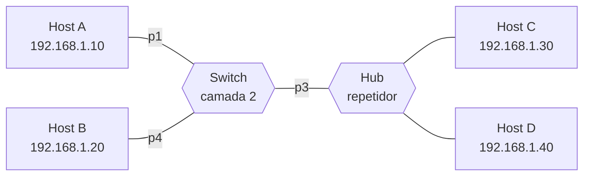

*Figura 3.1b (Tipo A, topologia).* Elementos do modo "Aprendizado e encaminhamento": Host A (192.168.1.10); Host B (192.168.1.20); Switch (camada 2); Hub (repetidor); Host C (192.168.1.30); Host D (192.168.1.40). Vale para os cenários (6.1.6).

### 3.2 Inundação de MAC e segurança de porta

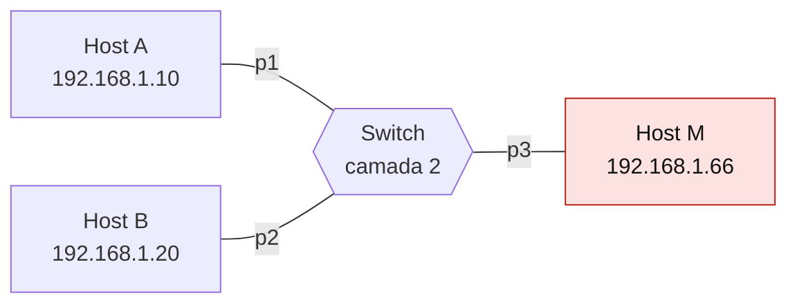

*Figura 3.2 (Tipo A, topologia).* Elementos do modo "Inundação de MAC e segurança de porta": Host A (192.168.1.10); Host B (192.168.1.20); Switch (camada 2); Host M (192.168.1.66). Vale para todos os cenários do modo (6.2.1 a 6.2.6).

### 3.3 Broadcast, multicast e reservados


*Figura 3.3 (Tipo A, topologia).* Elementos do modo "Broadcast, multicast e reservados": Host A (192.168.1.10); Host B (192.168.1.20); Switch (camada 2); Hub (repetidor); Host C (192.168.1.30); Host D (192.168.1.40). Vale para todos os cenários do modo (6.3.1 a 6.3.5).

## 4. Abas da bancada

Cenário, Captura, Mensagem, Tabela de endereços, Decisões, Experimento, Referência e Log.

## 5. Configurações (campos do painel)

### 5.1 Rede

- **RTT (ms)**. Valores: 1; 2; 5; 20; 100. Padrão: 2. Modos: todos.
  - Tempo de ida e volta na rede local.
  - Numa rede local Ethernet o RTT costuma ser de poucos milissegundos. Valores altos servem para ver o diagrama mais espaçado.
  - Não muda o que o switch faz, só os tempos mostrados.

### 5.2 Situação

- **O que acontece**. Valores: Primeiro quadro: tabela vazia; Destinos já conhecidos; Broadcast (ARP Request); Origem e destino na mesma porta; Host que muda de porta; Envelhecimento da entrada. Padrão: Primeiro quadro: tabela vazia. Modos: Aprendizado e encaminhamento.
  - Qual das seis histórias do aprendizado será simulada.
  - **Tabela vazia:** o destino é desconhecido, o switch inunda e aprende a origem. A resposta revela a porta de B.
  - **Destinos conhecidos:** a tabela já tem os hosts, e o quadro sai só pela porta certa.
  - **Broadcast:** nunca consta da tabela, é sempre inundado.
  - **Mesma porta:** C e D estão atrás de um hub; o quadro de C para D não precisa sair pelo switch.
  - **Mudança de porta:** o cabo de B vai para outra porta e a tabela fica desatualizada até B transmitir.
  - **Envelhecimento:** sem tráfego, a entrada expira e o destino volta a ser desconhecido.
- **O que acontece**. Valores: Broadcast (ARP Request); Multicast IP (grupo 239.1.1.1); Endereços de grupo reservados. Padrão: Broadcast (ARP Request). Modos: Broadcast, multicast e reservados.
  - Que tipo de endereço de destino é enviado.
  - **Broadcast:** todos os hosts do domínio de broadcast recebem.
  - **Multicast:** só os hosts que assinaram o grupo deveriam receber; o que o switch faz depende do IGMP snooping.
  - **Reservados:** endereços de 01-80-C2-00-00-00 a 0F são consumidos pela ponte, nunca encaminhados.

### 5.3 Tabela

- **Tempo de envelhecimento (s)** (ajuste avançado). Valores: 60; 300 (padrão do IEEE 802.1D); 600. Padrão: 300 (padrão do IEEE 802.1D). Modos: Aprendizado e encaminhamento.
  - Quanto tempo uma entrada dinâmica sobrevive sem receber tráfego.
  - Cada quadro recebido de uma origem renova o relógio da entrada dela. Passado o tempo sem tráfego, a entrada é removida.
  - O padrão recomendado pelo IEEE 802.1D é de 300 s. Tempos curtos liberam espaço na tabela, mas aumentam a inundação.
- **A e B antes do ataque**. Valores: Fora da tabela (nunca falaram ou expiraram); Já na tabela. Padrão: Fora da tabela (nunca falaram ou expiraram). Modos: Inundação de MAC e segurança de porta.
  - Se o switch já conhecia A e B quando o ataque começou.
  - **Já na tabela:** o ataque não remove entradas. A e B continuam sendo encontrados enquanto as entradas não expirarem.
  - **Fora da tabela:** A e B não podem mais ser aprendidos, e o tráfego entre eles é inundado.
  - Na prática, o ataque mantido por tempo suficiente expõe até quem já estava na tabela: as entradas expiram em 300 s sem tráfego e não podem ser recriadas.
- **Capacidade da tabela (entradas)** (ajuste avançado). Valores: 4; 6. Padrão: 4. Modos: Inundação de MAC e segurança de porta.
  - Quantos endereços a tabela comporta.
  - Um switch real guarda de milhares a centenas de milhares de endereços. O simulador usa valores pequenos para que a tabela encha dentro do diagrama.
  - Não muda a lógica, só o número de quadros forjados necessários.

### 5.4 Falhas

- **B responde**. Valores: caixa de seleção. Padrão: sim. Modos: Aprendizado e encaminhamento.
  - Vale para os cenários em que B recebe uma pergunta.
  - Desmarcado, B não responde. O switch só aprende um host quando recebe um quadro **vindo dele**, então B continua desconhecido e os quadros para B continuam inundados.

### 5.5 Ataque

- **M inunda a tabela com MACs forjados**. Valores: caixa de seleção. Padrão: sim. Modos: Inundação de MAC e segurança de porta.
  - Liga ou desliga a inundação de MAC, para comparar.
  - M envia quadros com um endereço de origem diferente a cada vez. O switch tenta aprender todos e gasta uma entrada da tabela por quadro.
  - O ataque só funciona na porta em que M está ligado, mas afeta o switch inteiro.

### 5.6 Defesa

- **Segurança de porta na porta 3**. Valores: Nenhuma; Máximo de 1 MAC: protect (descarta em silêncio); Máximo de 1 MAC: restrict (descarta e alerta); Máximo de 1 MAC: shutdown (desativa a porta). Padrão: Nenhuma. Modos: Inundação de MAC e segurança de porta.
  - Recurso de fabricantes que limita os MACs aceitos em cada porta.
  - **protect:** descarta os quadros de MACs em excesso, sem registrar.
  - **restrict:** descarta, conta as violações e gera alerta.
  - **shutdown:** desativa a porta na primeira violação (err-disable); é preciso reativá-la.
  - Os nomes dos modos seguem os de um fabricante muito comum; outros usam termos diferentes. Não é um recurso do IEEE.

### 5.7 Multicast

- **IGMP snooping ligado**. Valores: caixa de seleção. Padrão: não. Modos: Broadcast, multicast e reservados.
  - O switch lê os relatórios IGMP para saber quem assinou cada grupo ([RFC 4541](https://www.rfc-editor.org/rfc/rfc4541)).
  - Desligado, o switch trata o multicast como broadcast e o inunda por todas as portas.
  - Ligado, encaminha o grupo só às portas com assinantes. Numa rede real é preciso também um **consultor** (querier) IGMP, para que as assinaturas sejam renovadas.
- **O host B assinou o grupo**. Valores: caixa de seleção. Padrão: sim. Modos: Broadcast, multicast e reservados.
  - Se existe algum receptor do grupo.
  - Marcado, B envia um relatório IGMP e passa a ser assinante.
  - Desmarcado, ninguém quer o grupo. Com snooping, o tráfego não sai por nenhuma porta de host (o comportamento para grupos sem assinante varia entre equipamentos); sem snooping, é inundado do mesmo jeito.

## 6. Cenários

### 6.1 Modo: Aprendizado e encaminhamento

> **Grupo:** Aprendizado

Um switch começa sem saber onde estão os hosts. Ele aprende olhando a origem de cada quadro que chega e associa o endereço MAC à porta de entrada.

#### 6.1.1 Primeiro quadro: inundação e aprendizado

*Inunda, aprende a origem e, na resposta, aprende o destino.*

**Configuração aplicada:** O que acontece = first; Tempo de envelhecimento (s) = 300; B responde = sim

A tabela está vazia. O switch **não sabe onde B está** e inunda o quadro por todas as portas, mas já aprende A. A resposta de B revela a porta 2, e o quadro seguinte sai só por ela.

**Conceito.** O switch aprende pela origem: cada quadro que chega associa o MAC de origem à porta de entrada. Como o MAC de B ainda é desconhecido, o primeiro quadro é inundado por todas as portas, menos a de entrada. Quando B responde, o switch aprende B, e os quadros seguintes vão só à porta 2.

**O que observar**

- O primeiro quadro chega a B, ao hub (C e D) e é descartado por quem não é o destino.
- Depois da resposta, a tabela tem A (porta 1) e B (porta 2).
- O terceiro quadro sai só pela porta 2.

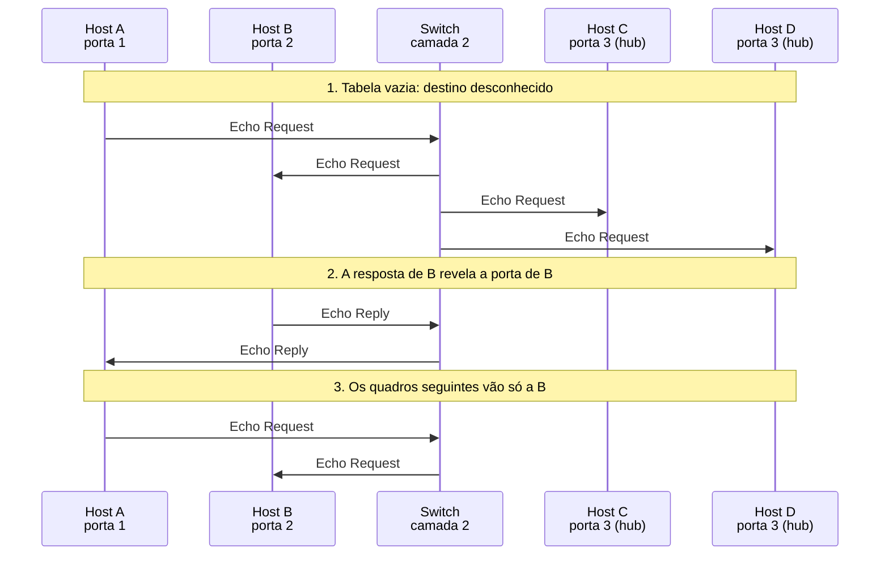

*Figura 6.1.1 (Tipo B, sequência).* Mensagens do cenário "Primeiro quadro: inundação e aprendizado", na ordem do tempo, entre Host A, Host B, Switch, Host C, Host D: 8 mensagens (em 3 fases). Corresponde ao diagrama de sequência e à aba Captura, no modo "Aprendizado e encaminhamento", com a configuração aplicada acima.

**Mensagens**

| Mensagem | Significado | Origem |
| --- | --- | --- |
| Echo Request | A para B, destino desconhecido | inundado |
| Echo Reply | B para A, destino conhecido | só porta 1 |
| Echo Request | A para B, destino conhecido | só porta 2 |

**Por que importa.** É o mecanismo que torna o switch melhor que o hub: depois de aprender, cada quadro ocupa apenas o enlace do destino.

#### 6.1.2 Destino que não responde

*Sem quadro vindo de B, ele continua desconhecido.*

**Configuração aplicada:** O que acontece = first; Tempo de envelhecimento (s) = 300; B responde = não

B não responde. O switch só aprende quem **transmite**, então B continua desconhecido e todo quadro para B é inundado.

**Conceito.** O switch só aprende o endereço de quem transmite. Se B nunca envia nada, o switch não sabe onde ele está, e todo quadro para B é inundado.

**O que observar**

- A tabela tem só A.
- Os dois quadros para B são inundados.

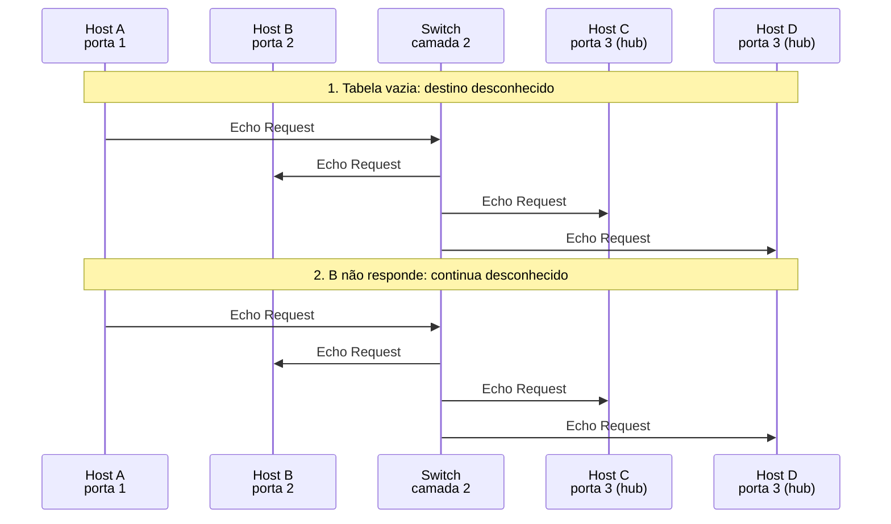

*Figura 6.1.2 (Tipo B, sequência).* Mensagens do cenário "Destino que não responde", na ordem do tempo, entre Host A, Host B, Switch, Host C, Host D: 8 mensagens (em 2 fases). Corresponde ao diagrama de sequência e à aba Captura, no modo "Aprendizado e encaminhamento", com a configuração aplicada acima.

**Mensagens**

| Mensagem | Significado | Origem |
| --- | --- | --- |
| Echo Request | A para B | inundado |
| Echo Request | A para B | inundado outra vez |

**Por que importa.** Hosts que só recebem (um servidor de captura, uma impressora desligada) fazem o switch inundar tráfego para eles.

#### 6.1.3 Broadcast (ARP Request)

*Broadcast nunca consta da tabela: sempre é inundado.*

**Configuração aplicada:** O que acontece = bcast; Tempo de envelhecimento (s) = 300; B responde = sim

O ARP Request vai a **ff:ff:ff:ff:ff:ff**, que nunca consta da tabela: é sempre inundado. A resposta, em unicast, já segue só para a porta de A.

**Conceito.** O destino ff:ff:ff:ff:ff:ff é recebido por todos. O switch não o procura na tabela e o inunda por todas as portas, menos a de entrada. A resposta ARP, em unicast, usa a tabela normalmente.

**O que observar**

- A requisição chega a B, C e D.
- A resposta vai só à porta 1.
- A tabela termina com A e B.

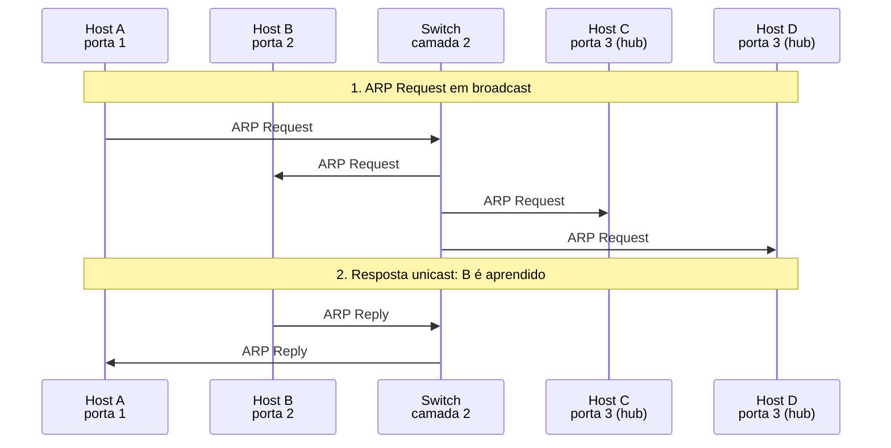

*Figura 6.1.3 (Tipo B, sequência).* Mensagens do cenário "Broadcast (ARP Request)", na ordem do tempo, entre Host A, Host B, Switch, Host C, Host D: 6 mensagens (em 2 fases). Corresponde ao diagrama de sequência e à aba Captura, no modo "Aprendizado e encaminhamento", com a configuração aplicada acima.

**Mensagens**

| Mensagem | Significado | Origem |
| --- | --- | --- |
| ARP Request | quem tem 192.168.1.20? | broadcast |
| ARP Reply | 192.168.1.20 está em 00:00:5e:00:53:14 | só porta 1 |

**Por que importa.** O domínio de broadcast é o conjunto de portas que recebe esses quadros. Redes locais grandes demais têm broadcast demais.

> **Grupo:** Encaminhamento

Com a tabela preenchida, o switch decide pelo MAC de destino: encaminha para uma porta, ou filtra quando o destino está do mesmo lado de onde o quadro veio.

#### 6.1.4 Destinos já conhecidos

*Cada quadro sai só pela porta do destino.*

**Configuração aplicada:** O que acontece = known; Tempo de envelhecimento (s) = 300; B responde = sim

A tabela já tem os quatro hosts. O quadro para B sai **só pela porta 2**. O quadro para C sai pela porta 3, onde o hub o repete também a D.

**Conceito.** Com a tabela preenchida, o switch encaminha por unicast. Atrás de um hub, porém, todos os hosts do segmento ouvem o quadro, porque o hub repete para todas as suas portas.

**O que observar**

- O quadro para B sai só pela porta 2.
- O quadro para C sai pela porta 3 e o hub o repete a D, que o descarta.

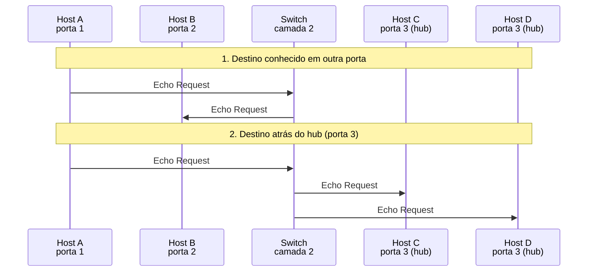

*Figura 6.1.4 (Tipo B, sequência).* Mensagens do cenário "Destinos já conhecidos", na ordem do tempo, entre Host A, Host B, Switch, Host C, Host D: 5 mensagens (em 2 fases). Corresponde ao diagrama de sequência e à aba Captura, no modo "Aprendizado e encaminhamento", com a configuração aplicada acima.

**Mensagens**

| Mensagem | Significado | Origem |
| --- | --- | --- |
| Echo Request | A para B | só porta 2 |
| Echo Request | A para C | só porta 3, repetido pelo hub |

**Por que importa.** Um switch isola o tráfego por porta. Um hub não isola nada dentro do próprio segmento.

#### 6.1.5 Origem e destino na mesma porta

*O switch não devolve o quadro pela porta de onde veio.*

**Configuração aplicada:** O que acontece = filter; Tempo de envelhecimento (s) = 300; B responde = sim

C e D estão atrás do mesmo hub. O quadro de C para D **é filtrado**: o destino está na porta de entrada, e A e B não são incomodados.

**Conceito.** Se o destino está na mesma porta por onde o quadro entrou, o switch o filtra: o destino já o recebeu direto pelo segmento. Encaminhar seria desperdício e duplicaria o quadro.

**O que observar**

- O quadro de C para D foi ouvido por D através do hub.
- A e B não receberam nada.
- O quadro de C para A sai só pela porta 1.

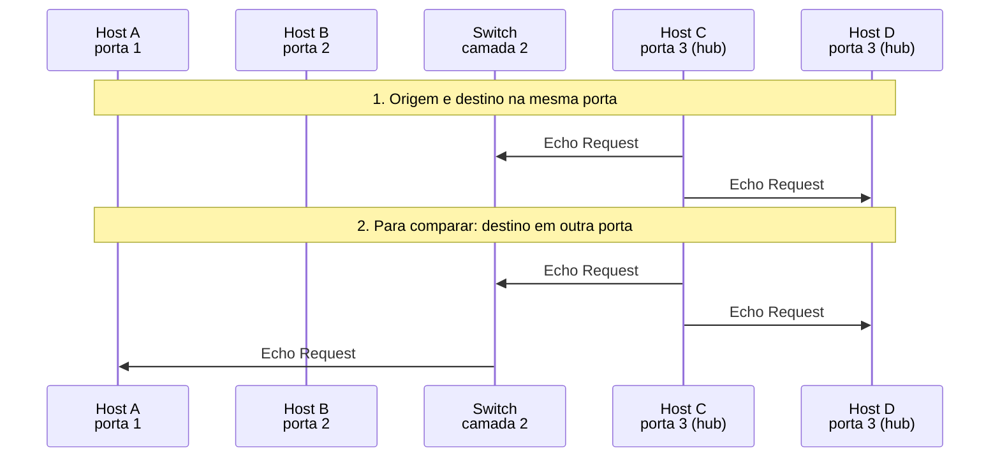

*Figura 6.1.5 (Tipo B, sequência).* Mensagens do cenário "Origem e destino na mesma porta", na ordem do tempo, entre Host A, Host B, Switch, Host C, Host D: 5 mensagens (em 2 fases). Corresponde ao diagrama de sequência e à aba Captura, no modo "Aprendizado e encaminhamento", com a configuração aplicada acima.

**Mensagens**

| Mensagem | Significado | Origem |
| --- | --- | --- |
| Echo Request | C para D | filtrado |
| Echo Request | C para A | só porta 1 |

**Por que importa.** A filtragem preserva a largura de banda dos outros segmentos.

> **Grupo:** Mudanças na tabela

A tabela não é permanente. Muda quando um host troca de porta e expira quando o host fica em silêncio.

#### 6.1.6 Host que muda de porta

*Depois da mudança, a tabela mente até B transmitir.*

**Configuração aplicada:** O que acontece = move; Tempo de envelhecimento (s) = 300; B responde = sim

O cabo de B vai da porta 2 para a 4. A tabela **continua apontando para a porta 2** e os quadros para B se perdem, até B transmitir e o switch atualizar a entrada.

**Conceito.** A tabela associa o MAC de B à porta 2. Quando o cabo vai para a porta 4, o switch continua enviando à porta 2, onde não há mais ninguém. Assim que B transmite, o switch vê o MAC dele na porta 4 e corrige a entrada.

**O que observar**

- O quadro enviado depois da mudança se perde.
- A entrada de B muda da porta 2 para a 4 quando B transmite.
- O quadro seguinte chega.

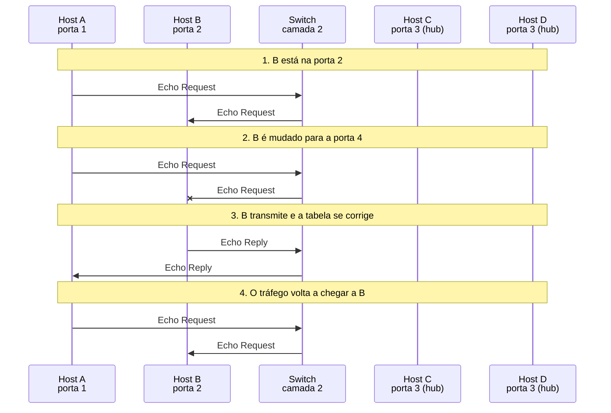

*Figura 6.1.6 (Tipo B, sequência).* Mensagens do cenário "Host que muda de porta", na ordem do tempo, entre Host A, Host B, Switch, Host C, Host D: 8 mensagens (em 4 fases; 1 perdida). Corresponde ao diagrama de sequência e à aba Captura, no modo "Aprendizado e encaminhamento", com a configuração aplicada acima.

**Mensagens**

| Mensagem | Significado | Origem |
| --- | --- | --- |
| Echo Request | A para B, na porta antiga | perdido |
| Echo Reply | B para A, da porta nova | atualiza a tabela |
| Echo Request | A para B | só porta 4 |

**Por que importa.** Por isso hosts móveis e servidores que trocam de porta costumam enviar um ARP gratuito: ele faz o switch aprender a porta nova na hora.

#### 6.1.7 Envelhecimento da entrada

*Sem tráfego, a entrada expira e o destino volta a ser desconhecido.*

**Configuração aplicada:** O que acontece = aging; Tempo de envelhecimento (s) = 300; B responde = sim

Passam-se 300 s sem tráfego. As entradas **expiram**, o destino volta a ser desconhecido e o quadro seguinte é inundado outra vez.

**Conceito.** Cada entrada dinâmica tem um relógio, renovado quando o host transmite. Passado o tempo de envelhecimento (padrão de 300 s no IEEE 802.1D), a entrada é removida. O próximo quadro para esse destino é inundado outra vez.

**O que observar**

- As duas entradas expiram durante o silêncio.
- O quadro depois do silêncio é inundado.
- A resposta recria a entrada de B.

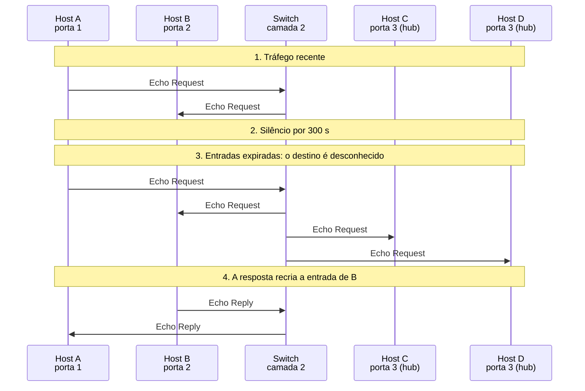

*Figura 6.1.7 (Tipo B, sequência).* Mensagens do cenário "Envelhecimento da entrada", na ordem do tempo, entre Host A, Host B, Switch, Host C, Host D: 8 mensagens (em 4 fases). Corresponde ao diagrama de sequência e à aba Captura, no modo "Aprendizado e encaminhamento", com a configuração aplicada acima.

**Mensagens**

| Mensagem | Significado | Origem |
| --- | --- | --- |
| Echo Request | A para B, antes do silêncio | só porta 2 |
| Echo Request | A para B, depois do silêncio | inundado |
| Echo Reply | B para A | recria a entrada de B |

**Por que importa.** O envelhecimento mantém a tabela pequena e correta, ao custo de inundações ocasionais.

### 6.2 Modo: Inundação de MAC e segurança de porta

> **Grupo:** Referência

Antes de olhar o ataque, convém ver o comportamento normal da tabela de endereços.

#### 6.2.1 Sem ataque

*Sem ataque, só o primeiro quadro é inundado.*

**Configuração aplicada:** M inunda a tabela com MACs forjados = não; A e B antes do ataque = absent; Capacidade da tabela (entradas) = 4; Segurança de porta na porta 3 = none

Sem ataque, a tabela vazia faz o **primeiro** quadro ser inundado (e M o recebe), mas depois o switch aprende A e B e M não vê mais nada.

**Conceito.** Com a tabela vazia, o primeiro quadro de A para B é inundado, e M também o recebe. A resposta de B ensina a porta de B ao switch, e dali em diante o tráfego é unicast.

**O que observar**

- M recebe um único quadro de A e B.
- A tabela termina com A e B.

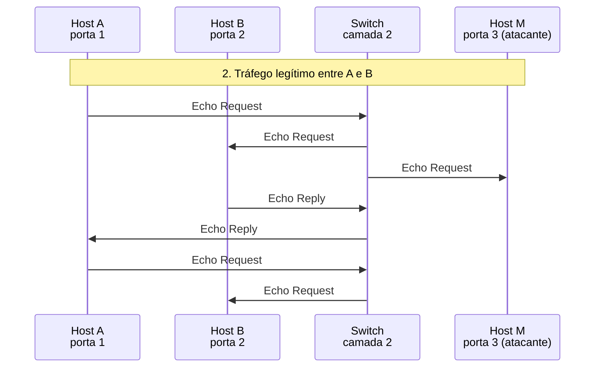

*Figura 6.2.1 (Tipo B, sequência).* Mensagens do cenário "Sem ataque", na ordem do tempo, entre Host A, Host B, Switch, Host M: 7 mensagens (em 1 fase). Corresponde ao diagrama de sequência e à aba Captura, no modo "Inundação de MAC e segurança de porta", com a configuração aplicada acima.

**Mensagens**

| Mensagem | Significado | Origem |
| --- | --- | --- |
| Echo Request | A para B | inundado, M recebe uma cópia |
| Echo Reply | B para A | só porta 1 |
| Echo Request | A para B | só porta 2 |

**Por que importa.** É a referência: mesmo em condições normais o switch inunda o que não conhece.

> **Grupo:** O ataque e seu efeito

A tabela de endereços tem tamanho limitado. Quando ela enche, o switch deixa de aprender e passa a inundar o que não conhece, o que expõe o tráfego a quem está na rede local.

#### 6.2.2 Tabela cheia: A e B ficam expostos

*Com a tabela cheia, o tráfego de A e B vira inundação.*

**Configuração aplicada:** M inunda a tabela com MACs forjados = sim; A e B antes do ataque = absent; Capacidade da tabela (entradas) = 4; Segurança de porta na porta 3 = none

M enche a tabela com origens forjadas. A e B **não podem mais ser aprendidos**, e todo o tráfego entre eles é inundado, inclusive para M.

**Conceito.** Cada quadro forjado consome uma entrada. Quando a tabela enche, o switch não aprende mais ninguém. Como A e B não podem ser aprendidos, todo quadro entre eles tem destino desconhecido e é inundado, e M o recebe.

**O que observar**

- A tabela termina cheia de endereços forjados.
- A tabela marca "não é aprendido" para A e B.
- M recebe os três quadros legítimos.

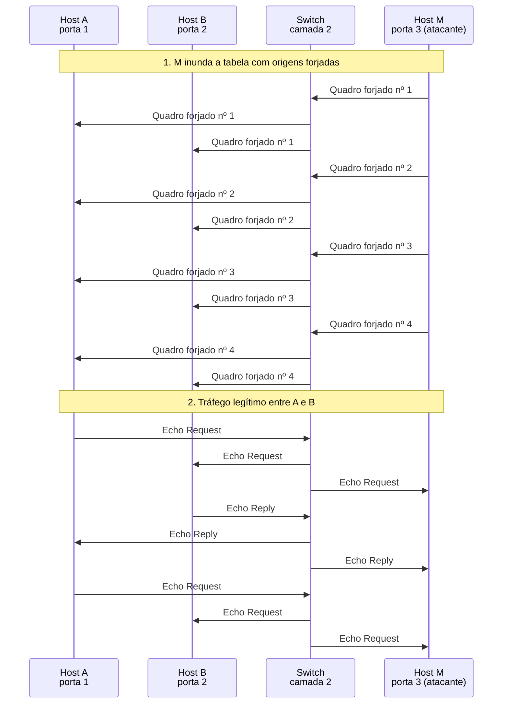

*Figura 6.2.2 (Tipo B, sequência).* Mensagens do cenário "Tabela cheia: A e B ficam expostos", na ordem do tempo, entre Host A, Host B, Switch, Host M: 21 mensagens (em 2 fases). Corresponde ao diagrama de sequência e à aba Captura, no modo "Inundação de MAC e segurança de porta", com a configuração aplicada acima.

**Mensagens**

| Mensagem | Significado | Origem |
| --- | --- | --- |
| Quadros forjados | um por entrada da tabela | M para todos |
| Echo Request e Reply | A e B | inundados, M recebe cópia |

**Por que importa.** Quem está na mesma rede local passa a ver tráfego que não era dele, e o switch passa a se comportar como um hub. Redes de acesso são o alvo típico.

#### 6.2.3 A e B já estavam na tabela

*Entradas existentes não são apagadas pelo ataque.*

**Configuração aplicada:** M inunda a tabela com MACs forjados = sim; A e B antes do ataque = present; Capacidade da tabela (entradas) = 4; Segurança de porta na porta 3 = none

A tabela enche, mas as entradas de A e B **já existiam** e continuam valendo. O tráfego segue unicast. O risco volta quando elas expiram.

**Conceito.** O ataque ocupa as vagas livres, mas não remove as entradas de A e B, que continuam valendo. O tráfego entre eles segue unicast. O risco volta quando as entradas expiram e não podem mais ser recriadas.

**O que observar**

- A tabela enche com as entradas de A e B mais as forjadas.
- M não recebe nenhum quadro legítimo.

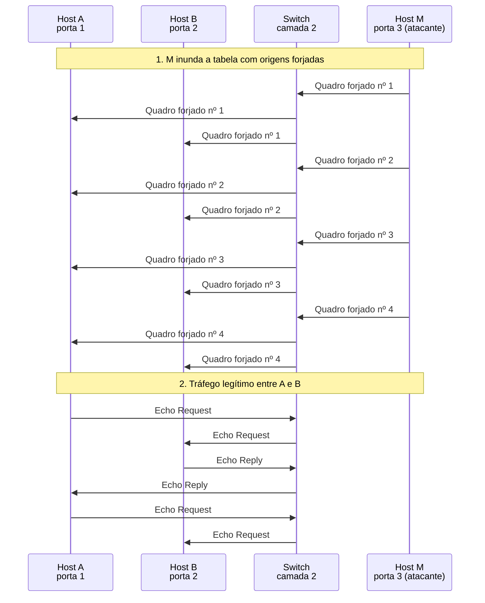

*Figura 6.2.3 (Tipo B, sequência).* Mensagens do cenário "A e B já estavam na tabela", na ordem do tempo, entre Host A, Host B, Switch, Host M: 18 mensagens (em 2 fases). Corresponde ao diagrama de sequência e à aba Captura, no modo "Inundação de MAC e segurança de porta", com a configuração aplicada acima.

**Mensagens**

| Mensagem | Significado | Origem |
| --- | --- | --- |
| Quadros forjados | ocupam as vagas livres | M para todos |
| Echo Request e Reply | A e B | só nas portas deles |

**Por que importa.** Um ataque contínuo vence o envelhecimento: quem fica em silêncio por 300 s perde a entrada, e o primeiro quadro seguinte já é inundado.

> **Grupo:** Defesas

A defesa limita o que cada porta pode ensinar ao switch. Nenhuma substitui a cifra de ponta a ponta.

#### 6.2.4 Segurança de porta: protect

*A porta aceita um só MAC; o resto é descartado.*

**Configuração aplicada:** M inunda a tabela com MACs forjados = sim; A e B antes do ataque = absent; Capacidade da tabela (entradas) = 4; Segurança de porta na porta 3 = protect

A porta 3 aceita **um só MAC**. Os demais quadros são descartados em silêncio, a tabela não enche e M não vê o tráfego de A e B.

**Conceito.** Na segurança de porta, a porta guarda no máximo um MAC. Quadros de outros endereços são descartados antes de chegar à tabela. No modo protect isso é silencioso: ninguém é avisado.

**O que observar**

- O primeiro quadro forjado é aceito e os outros são descartados.
- A tabela não enche.
- M só recebe o primeiro quadro de A para B, como em qualquer rede.

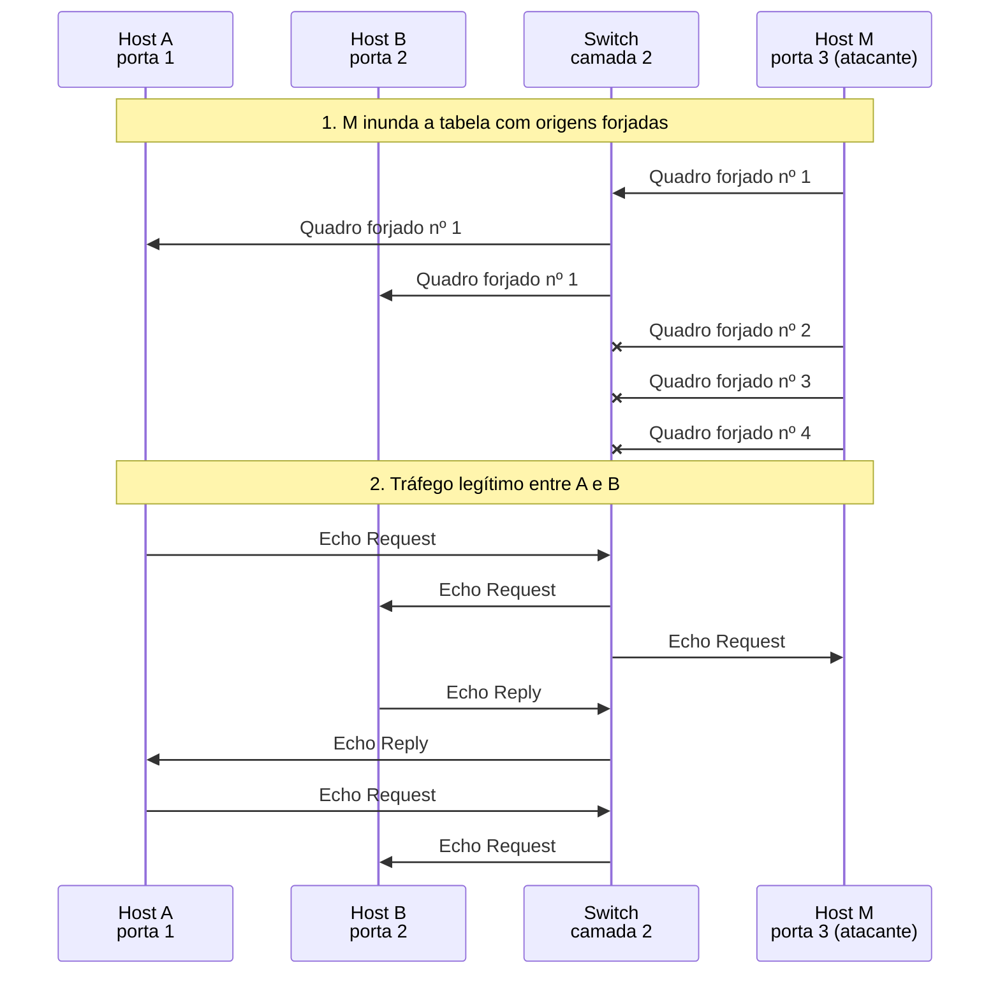

*Figura 6.2.4 (Tipo B, sequência).* Mensagens do cenário "Segurança de porta: protect", na ordem do tempo, entre Host A, Host B, Switch, Host M: 13 mensagens (em 2 fases; 3 perdidas). Corresponde ao diagrama de sequência e à aba Captura, no modo "Inundação de MAC e segurança de porta", com a configuração aplicada acima.

**Mensagens**

| Mensagem | Significado | Origem |
| --- | --- | --- |
| Quadros forjados | descartados a partir do segundo | M |

**Por que importa.** A defesa impede a inundação, mas sem alerta o ataque passa despercebido.

#### 6.2.5 Segurança de porta: restrict

*Descarta e avisa.*

**Configuração aplicada:** M inunda a tabela com MACs forjados = sim; A e B antes do ataque = absent; Capacidade da tabela (entradas) = 4; Segurança de porta na porta 3 = restrict

Igual ao protect, mas cada violação é **contada e gera alerta**: a equipe fica sabendo do ataque.

**Conceito.** O modo restrict descarta os quadros em excesso, como o protect, e incrementa um contador de violações e emite alerta (por exemplo, uma mensagem de log ou um trap SNMP).

**O que observar**

- O estado da porta 3 mostra o número de violações.
- O log registra cada descarte.


*Figura 6.2.5 (Tipo B, sequência).* Mensagens do cenário "Segurança de porta: restrict", na ordem do tempo, entre Host A, Host B, Switch, Host M: 13 mensagens (em 2 fases; 3 perdidas). Corresponde ao diagrama de sequência e à aba Captura, no modo "Inundação de MAC e segurança de porta", com a configuração aplicada acima.

**Mensagens**

| Mensagem | Significado | Origem |
| --- | --- | --- |
| Quadros forjados | descartados com alerta | M |

**Por que importa.** A equipe de rede é avisada e pode investigar o host da porta.

#### 6.2.6 Segurança de porta: shutdown

*A porta é desativada na primeira violação.*

**Configuração aplicada:** M inunda a tabela com MACs forjados = sim; A e B antes do ataque = absent; Capacidade da tabela (entradas) = 4; Segurança de porta na porta 3 = shutdown

Na primeira violação, a porta 3 é **desativada** (err-disable) e as entradas dela são removidas. É preciso reativá-la.

**Conceito.** O modo shutdown coloca a porta em err-disable ao primeiro quadro em excesso: o enlace cai, as entradas da porta saem da tabela e M deixa de enviar e de receber. É a reação mais forte e exige reativação manual (ou um temporizador de recuperação).

**O que observar**

- A porta 3 vai a "desativada".
- M não recebe mais nenhum quadro.
- A tabela volta a ter vagas.

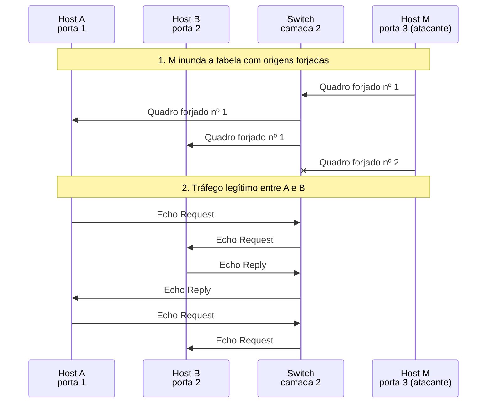

*Figura 6.2.6 (Tipo B, sequência).* Mensagens do cenário "Segurança de porta: shutdown", na ordem do tempo, entre Host A, Host B, Switch, Host M: 10 mensagens (em 2 fases; 1 perdida). Corresponde ao diagrama de sequência e à aba Captura, no modo "Inundação de MAC e segurança de porta", com a configuração aplicada acima.

**Mensagens**

| Mensagem | Significado | Origem |
| --- | --- | --- |
| Quadros forjados | o segundo causa a violação | M |

**Por que importa.** Interrompe o ataque, mas um erro de configuração ou um segundo equipamento legítimo na porta derruba o serviço do usuário.

### 6.3 Modo: Broadcast, multicast e reservados

> **Grupo:** Broadcast

O endereço de broadcast nunca consta da tabela. Todo quadro enviado a ele vai a todos os hosts do mesmo domínio de broadcast.

#### 6.3.1 Broadcast é inundado

*Broadcast sai por todas as portas, menos a de entrada.*

**Configuração aplicada:** O que acontece = bcast; IGMP snooping ligado = não; O host B assinou o grupo = sim

O ARP Request em broadcast sai por **todas as portas**, menos a de entrada. Todos os hosts da rede local o recebem.

**Conceito.** O endereço ff:ff:ff:ff:ff:ff é aceito por todas as placas. O switch o inunda por todas as portas, menos a de entrada. A resposta ARP volta em unicast.

**O que observar**

- B, C e D recebem a requisição.
- A resposta vai só à porta 1.

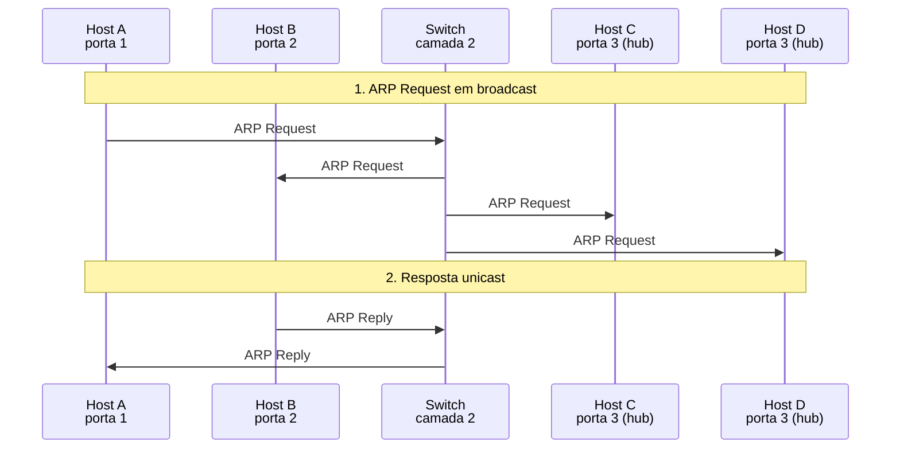

*Figura 6.3.1 (Tipo B, sequência).* Mensagens do cenário "Broadcast é inundado", na ordem do tempo, entre Host A, Host B, Switch, Host C, Host D: 6 mensagens (em 2 fases). Corresponde ao diagrama de sequência e à aba Captura, no modo "Broadcast, multicast e reservados", com a configuração aplicada acima.

**Mensagens**

| Mensagem | Significado | Origem |
| --- | --- | --- |
| ARP Request | quem tem 192.168.1.20? | broadcast |
| ARP Reply | resposta de B | unicast |

**Por que importa.** Um switch não segmenta o domínio de broadcast. Para isso é preciso VLANs ou um roteador.

> **Grupo:** Multicast

O multicast IP usa endereços MAC de grupo. Sem ajuda, o switch não sabe quem pertence ao grupo e os trata como broadcast.

#### 6.3.2 Multicast sem snooping

*Sem snooping, o multicast é tratado como broadcast.*

**Configuração aplicada:** O que acontece = mcast; IGMP snooping ligado = não; O host B assinou o grupo = sim

Só B assinou o grupo, mas o switch **não sabe disso** e inunda o fluxo. A, C e D recebem tráfego que não pediram (a placa o descarta, mas o enlace carrega).

**Conceito.** O endereço MAC de grupo 01:00:5e:01:01:01 vem do IP 239.1.1.1 ([RFC 1112](https://www.rfc-editor.org/rfc/rfc1112), seção 6.4). Sem snooping, o switch não sabe quem assinou e inunda o fluxo. As placas dos hosts que não assinaram o descartam, mas os enlaces carregam o tráfego à toa.

**O que observar**

- O relatório IGMP de B também é inundado.
- O fluxo chega a A, C e D, que o descartam.
- O fluxo é inundado duas vezes.

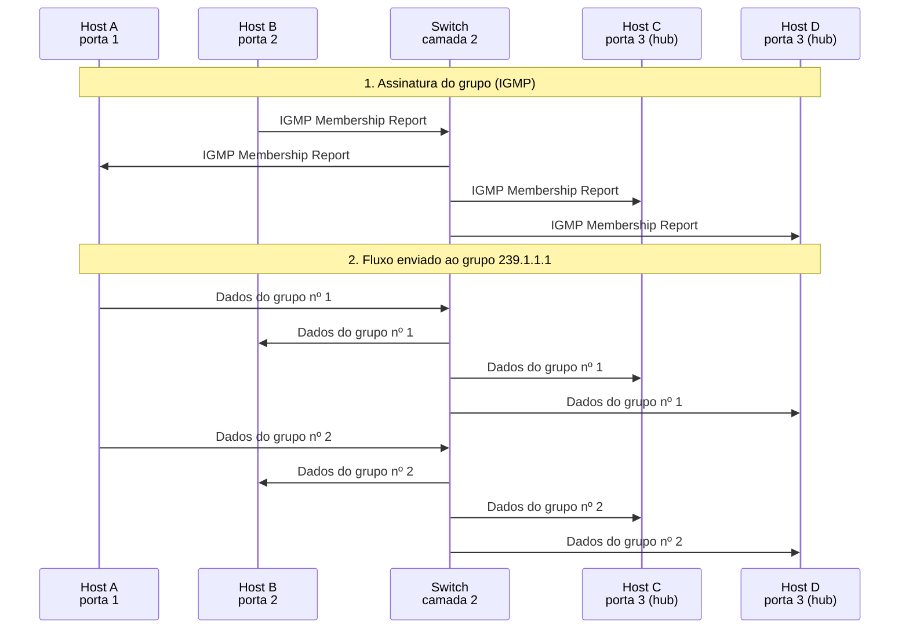

*Figura 6.3.2 (Tipo B, sequência).* Mensagens do cenário "Multicast sem snooping", na ordem do tempo, entre Host A, Host B, Switch, Host C, Host D: 12 mensagens (em 2 fases). Corresponde ao diagrama de sequência e à aba Captura, no modo "Broadcast, multicast e reservados", com a configuração aplicada acima.

**Mensagens**

| Mensagem | Significado | Origem |
| --- | --- | --- |
| IGMP Membership Report | B entra no grupo | inundado |
| Dados do grupo | fluxo para 239.1.1.1 | inundado |

**Por que importa.** Um fluxo de vídeo multicast inundado sobrecarrega todos os enlaces da rede local.

#### 6.3.3 Multicast com IGMP snooping

*Com snooping, o grupo só sai pela porta de B.*

**Configuração aplicada:** O que acontece = mcast; IGMP snooping ligado = sim; O host B assinou o grupo = sim

O switch lê o relatório IGMP de B e envia o grupo **só pela porta 2**.

**Conceito.** O IGMP snooping ([RFC 4541](https://www.rfc-editor.org/rfc/rfc4541)) lê os relatórios IGMP para saber que portas têm assinantes. O fluxo para 239.1.1.1 passa a sair só pela porta 2.

**O que observar**

- O relatório IGMP é consumido pelo switch.
- O estado "Grupo" mostra a porta 2.
- O fluxo chega só a B.

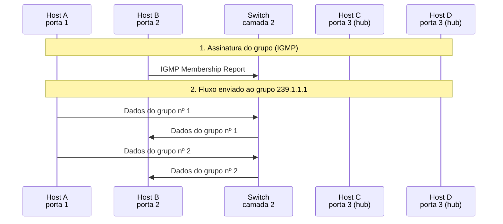

*Figura 6.3.3 (Tipo B, sequência).* Mensagens do cenário "Multicast com IGMP snooping", na ordem do tempo, entre Host A, Host B, Switch, Host C, Host D: 5 mensagens (em 2 fases). Corresponde ao diagrama de sequência e à aba Captura, no modo "Broadcast, multicast e reservados", com a configuração aplicada acima.

**Mensagens**

| Mensagem | Significado | Origem |
| --- | --- | --- |
| IGMP Membership Report | B entra no grupo | lido pelo switch |
| Dados do grupo | fluxo para 239.1.1.1 | só porta 2 |

**Por que importa.** O snooping evita que o multicast ocupe enlaces sem receptores.

#### 6.3.4 Grupo sem assinantes

*Sem assinantes, o fluxo não sai por nenhuma porta de host.*

**Configuração aplicada:** O que acontece = mcast; IGMP snooping ligado = sim; O host B assinou o grupo = não

Ninguém assinou o grupo. Com snooping, o fluxo **não sai por nenhuma porta de host**.

**Conceito.** Com o snooping ligado e nenhuma porta de assinante, o switch não tem para onde enviar o grupo. A [RFC 4541](https://www.rfc-editor.org/rfc/rfc4541) menciona o envio às portas de roteador multicast; esse caso não está no simulador, que não tem roteador.

**O que observar**

- Nenhuma mensagem sai do switch.
- O estado do grupo é "sem assinantes".

```mermaid
sequenceDiagram
  participant n_a as Host A<br/>porta 1
  participant n_b as Host B<br/>porta 2
  participant n_sw as Switch<br/>camada 2
  participant n_c as Host C<br/>porta 3 (hub)
  participant n_d as Host D<br/>porta 3 (hub)
  Note over n_a,n_d: 1. Assinatura do grupo (IGMP)
  Note over n_a,n_d: 2. Fluxo enviado ao grupo 239.1.1.1
  n_a ->> n_sw: Dados do grupo nº 1
  n_a ->> n_sw: Dados do grupo nº 2
```

*Figura 6.3.4 (Tipo B, sequência).* Mensagens do cenário "Grupo sem assinantes", na ordem do tempo, entre Host A, Host B, Switch, Host C, Host D: 2 mensagens (em 2 fases). Corresponde ao diagrama de sequência e à aba Captura, no modo "Broadcast, multicast e reservados", com a configuração aplicada acima.

**Mensagens**

| Mensagem | Significado | Origem |
| --- | --- | --- |
| Dados do grupo | fluxo para 239.1.1.1 | sem portas de saída |

**Por que importa.** Mostra o ganho do snooping: o tráfego que ninguém quer não ocupa nenhum enlace de host.

> **Grupo:** Endereços reservados

Alguns endereços de grupo servem aos protocolos da própria ponte e nunca atravessam um switch.

#### 6.3.5 BPDU e LLDP não são encaminhados

*BPDU e LLDP são consumidos; um quadro comum é inundado.*

**Configuração aplicada:** O que acontece = reserved; IGMP snooping ligado = não; O host B assinou o grupo = sim

Quadros para **01-80-C2-00-00-00** e **01-80-C2-00-00-0E** são consumidos pela ponte. Um quadro comum, em seguida, é inundado normalmente.

**Conceito.** O IEEE reserva os endereços de grupo de 01-80-C2-00-00-00 a 0F para protocolos que valem só entre vizinhos diretos, como o spanning tree e o LLDP. Uma ponte não encaminha quadros para esses endereços. O quadro comum do fim mostra o contraste.

**O que observar**

- O BPDU e o LLDP não saem do switch.
- A origem desses quadros não entra na tabela.
- O Echo Request é inundado.

```mermaid
sequenceDiagram
  participant n_a as Host A<br/>porta 1
  participant n_b as Host B<br/>porta 2
  participant n_sw as Switch<br/>camada 2
  participant n_c as Host C<br/>porta 3 (hub)
  participant n_d as Host D<br/>porta 3 (hub)
  Note over n_a,n_d: 1. Quadros para endereços de grupo reservados
  n_a ->> n_sw: BPDU
  n_a ->> n_sw: LLDP
  Note over n_a,n_d: 2. Para comparar: unicast desconhecido
  n_a ->> n_sw: Echo Request
  n_sw ->> n_b: Echo Request
  n_sw ->> n_c: Echo Request
  n_sw ->> n_d: Echo Request
```

*Figura 6.3.5 (Tipo B, sequência).* Mensagens do cenário "BPDU e LLDP não são encaminhados", na ordem do tempo, entre Host A, Host B, Switch, Host C, Host D: 6 mensagens (em 2 fases). Corresponde ao diagrama de sequência e à aba Captura, no modo "Broadcast, multicast e reservados", com a configuração aplicada acima.

**Mensagens**

| Mensagem | Significado | Origem |
| --- | --- | --- |
| BPDU | spanning tree | não encaminhado |
| LLDP | anúncio de vizinho | não encaminhado |
| Echo Request | A para B, desconhecido | inundado |

**Por que importa.** Se um switch repassasse BPDUs, o spanning tree não conseguiria enxergar a topologia salto a salto. Alguns equipamentos simples não respeitam isso.

## 7. Referência

### 7.1 O que um switch faz

Um **switch** Ethernet é uma ponte multiporta (*MAC bridge*, IEEE 802.1D): recebe quadros em cada porta e decide, **só pelo endereço MAC**, por onde enviá-los. Ele não olha o endereço IP. A especificação de pontes do 802.1D foi incorporada ao IEEE 802.1Q, que hoje é a referência vigente; o simulador usa os dois nomes como os livros-texto. A Ethernet em si é definida pelo IEEE 802.3.

### 7.2 Os três passos para cada quadro

1. **Aprendizado:** o MAC de **origem** é associado à porta de entrada, ou o relógio da entrada é renovado. Endereços de grupo e de broadcast nunca são aprendidos como origem.
2. **Decisão:** o switch procura o MAC de **destino** na tabela. Destino conhecido em outra porta: **encaminha**. Destino conhecido na própria porta de entrada: **filtra**. Destino desconhecido, broadcast ou multicast: **inunda** (todas as portas, menos a de entrada).
3. **Envelhecimento:** sem tráfego da origem, a entrada expira. O valor recomendado é de 300 s e é configurável.

### 7.3 Quadro Ethernet II

| Campo | Tamanho | Observação |
| --- | --- | --- |
| Destino | 6 bytes | o primeiro bit transmitido, o menos significativo do primeiro byte, indica endereço de grupo |
| Origem | 6 bytes | sempre unicast |
| Tipo | 2 bytes | 0x0800 IPv4, 0x0806 ARP, 0x88cc LLDP |
| Dados | 46 a 1500 bytes | preenchidos até o mínimo |
| FCS | 4 bytes | verificação do quadro; o simulador não a mostra |

O menor quadro tem 64 bytes (do destino ao FCS). Os tamanhos mostrados no simulador (42 para o ARP, 98 para o ping) são os do cabeçalho e dos dados, sem o preenchimento e sem o FCS.

### 7.4 Hub, switch e domínios

- Um **hub** (repetidor) repete cada bit para todas as portas: todos os hosts atrás dele formam um único **domínio de colisão** e ouvem tudo. É o segmento da porta 3 do simulador.
- Um **switch** isola o tráfego por porta: cada porta é um domínio de colisão à parte, e em full-duplex nem há colisão. O **domínio de broadcast**, porém, continua sendo a rede local inteira.
- Para dividir o domínio de broadcast é preciso VLANs ou um roteador (outros simuladores do projeto).

### 7.5 Multicast e IGMP snooping

- O endereço MAC de um grupo IP é derivado do IP: os 23 bits de baixa ordem do IP entram em `01:00:5e:00:00:00` ([RFC 1112](https://www.rfc-editor.org/rfc/rfc1112), seção 6.4). Como o IP tem 28 bits de grupo, 32 grupos IP diferentes compartilham o mesmo MAC.
- Sem ajuda, o switch trata o multicast como broadcast. O **IGMP snooping** lê os relatórios dos hosts e encaminha cada grupo só às portas com assinantes. O simulador usa o relatório do IGMPv3 ([RFC 9776](https://www.rfc-editor.org/rfc/rfc9776)), enviado a 224.0.0.22.
- A [RFC 4541](https://www.rfc-editor.org/rfc/rfc4541) (informativa, não normativa) descreve as regras de encaminhamento de um switch com snooping, entre elas a de que os grupos 224.0.0.x (de controle local) continuam sendo inundados. Um switch real precisa também de um consultor IGMP (*querier*) para renovar as assinaturas, e envia o fluxo às portas de roteador multicast; o simulador não tem nenhum dos dois.

### 7.6 Endereços de grupo reservados

Os endereços de `01-80-C2-00-00-00` a `01-80-C2-00-00-0F` são reservados pelo IEEE a protocolos que valem só entre vizinhos diretos, como o spanning tree (00) e o LLDP (0E). Uma ponte processa esses quadros e **não os encaminha**. Alguns equipamentos simples não respeitam isso e os inundam.

### 7.7 Inundação de MAC e segurança de porta (nível defensivo)

- **Por que é possível:** a tabela de endereços é finita e o switch aprende qualquer origem, sem autenticá-la. Um host que envia quadros com origens inventadas ocupa as vagas.
- **Efeito:** com a tabela cheia, hosts novos (e os que expiraram) não são aprendidos. O tráfego para eles é inundado e chega a todas as portas, inclusive à do atacante. O switch passa a se comportar como um hub.
- **Alcance:** só dentro da rede local (e da VLAN) do atacante. A inundação não atravessa roteadores.
- **Impacto:** em tráfego sem cifra, o conteúdo é lido. Com TLS ou SSH, o conteúdo segue protegido, mas há perda de desempenho, pelo tráfego a mais.
- **Aviso:** este modo explica o mecanismo para fins de defesa. Atacar a rede de terceiros pode configurar crime; pratique apenas em laboratório isolado, com autorização.

### 7.8 Defesas

| Defesa | Onde atua | Observação |
| --- | --- | --- |
| Segurança de porta (limite de MACs) | na porta do switch | recurso de fabricantes; os modos protect, restrict e shutdown variam por equipamento |
| IEEE 802.1X | na porta do switch | autentica o dispositivo antes de liberar a porta; é o padrão do IEEE |
| Tabelas maiores e envelhecimento ajustado | no switch | reduzem o impacto, mas não eliminam o ataque |
| Monitoramento de alertas e de MACs por porta | na rede | detecta o ataque e permite isolar a porta |
| Cifra de ponta a ponta (TLS, SSH, VPN) | nas aplicações | protege o conteúdo mesmo com a rede local comprometida |

### 7.9 Segurança

O aprendizado de endereços **não tem autenticação**: o switch confia no MAC de origem de qualquer quadro. É a base de ataques de camada 2 como a inundação de MAC e o envenenamento de ARP (outro simulador do projeto). A proteção vem de limites por porta, de autenticação de acesso (802.1X) e da cifra de ponta a ponta.

### 7.10 Limitações do simulador

O simulador mostra um único switch com quatro portas, sem VLANs, sem spanning tree e sem agregação de enlaces. Os endereços são de documentação ([RFC 5737](https://www.rfc-editor.org/rfc/rfc5737) para IPv4; [RFC 7042](https://www.rfc-editor.org/rfc/rfc7042) e [RFC 9542](https://www.rfc-editor.org/rfc/rfc9542) para MAC). A tabela do modo de inundação tem 4 ou 6 entradas, enquanto a de um switch real guarda de milhares a centenas de milhares. Quando a tabela enche, o simulador não aprende o endereço novo e inunda o destino desconhecido, mas o comportamento de um equipamento real varia (alguns removem entradas antigas, outros descartam o quadro). Os tempos de trânsito são didáticos e o simulador não representa colisões, modos de encaminhamento (*store-and-forward* e *cut-through*), velocidade das portas nem a negociação automática. Os modos da segurança de porta seguem a terminologia de um fabricante comum. Não foram citadas subcláusulas do IEEE 802.1D e do 802.1Q por falta de um texto aberto para conferência; as RFCs citadas foram conferidas no rfc-editor.org. Fora do escopo: IPv6 (MLD snooping), VLANs, STP, QoS e as funções de camada 3 do switch.


---

*Simul-Net é um projeto mantido pelo Prof. Dr. Laerte Peotta de Melo, com apoio de IA generativa no processo de desenvolvimento, com sua estrita supervisão, revisão técnica e responsabilidade. Uso exclusivo para fins de ensino e pesquisa. Universidade de Brasília (UnB) - Departamento de Engenharia Elétrica. Código aberto (licença MIT).*
