# TCP e UDP

Camada de transporte em diagrama de sequência: handshake e estados do TCP, ACKs, RTO, fast retransmit, SACK, slow start e gráfico da cwnd, UDP com perdas e DNS, comparação TCP x UDP, download de arquivo por TCP e vídeo em streaming por UDP.

- **Categoria:** Camada de transporte e segurança
- **Motor:** legado (página autônoma em `public/sims/tcp-udp-simulator.html`, incorporada por `iframe`)
- **RFCs e padrões:** [RFC 9293](https://www.rfc-editor.org/rfc/rfc9293), [RFC 768](https://www.rfc-editor.org/rfc/rfc768), [RFC 5681](https://www.rfc-editor.org/rfc/rfc5681), [RFC 2018](https://www.rfc-editor.org/rfc/rfc2018)
- **Tópicos:** Handshake e estados; Controle de congestionamento e SACK; Download TCP e vídeo UDP; Comparação TCP x UDP

## 1. Como ler os diagramas

Este documento usa até dois tipos de diagrama. Cada figura traz uma legenda com o tipo, o que mostra e a que modo ou cenário se refere.

| Tipo | O que é | Vale para | Equivale, no simulador, a |
| --- | --- | --- | --- |
| B, sequência | As mensagens na ordem do tempo, entre os participantes. É dinâmico. | Um único cenário, com a configuração indicada | Ao diagrama de sequência e à aba Captura |

### 1.1 Legenda dos diagramas

**Tipo B (sequência)**

- Cada coluna é um participante (cliente, servidor, roteador ou outro). O tempo corre de cima para baixo.
- Seta cheia: mensagem enviada. Seta com X: mensagem perdida.
- `[cifrado]` no início do rótulo: a mensagem viaja cifrada.
- Faixa horizontal com texto: início de uma fase do cenário.
- A ordem é a da aba Captura; os intervalos de tempo não são desenhados em escala.

### 1.2 Lista de figuras

**Tipo B (sequência)**

- [Figura 4.1.1](#411-handshake-e-encerramento): sequência de "Handshake e encerramento"
- [Figura 4.1.2](#412-slow-start): sequência de "Slow start"
- [Figura 4.1.3](#413-fast-retransmit): sequência de "Fast retransmit"
- [Figura 4.1.4](#414-timeout-rto): sequência de "Timeout (RTO)"
- [Figura 4.1.5](#415-janela-do-receptor): sequência de "Janela do receptor"
- [Figura 4.1.6](#416-perdas-aleatórias): sequência de "Perdas aleatórias"
- [Figura 4.1.7](#417-várias-perdas-sem-sack): sequência de "Várias perdas sem SACK"
- [Figura 4.1.8](#418-várias-perdas-com-sack): sequência de "Várias perdas com SACK"
- [Figura 4.2.1](#421-download-de-arquivo): sequência de "Download de arquivo"
- [Figura 4.2.2](#422-download-com-perdas): sequência de "Download com perdas"
- [Figura 4.2.3](#423-download-limitado-pela-janela): sequência de "Download limitado pela janela"
- [Figura 4.2.4](#424-download-com-rtt-alto): sequência de "Download com RTT alto"
- [Figura 4.3.1](#431-fluxo-com-perdas): sequência de "Fluxo com perdas"
- [Figura 4.3.2](#432-dns-com-repetição): sequência de "DNS com repetição"
- [Figura 4.4.1](#441-vídeo-em-streaming): sequência de "Vídeo em streaming"
- [Figura 4.4.2](#442-vídeo-com-perdas): sequência de "Vídeo com perdas"
- [Figura 4.4.3](#443-vídeo-acima-da-capacidade): sequência de "Vídeo acima da capacidade"
- [Figura 4.4.4](#444-jitter-e-buffer-do-player): sequência de "Jitter e buffer do player"
- [Figura 4.5.1](#451-tcp-x-udp-10-de-perda): sequência de "TCP x UDP: 10% de perda"
- [Figura 4.5.2](#452-tcp-x-udp-reordenação): sequência de "TCP x UDP: reordenação"

## 2. Abas

Cenário, Captura, Segmento, Janela (cwnd), Resultados, Experimento, Referência, Log de eventos.

## 3. Configurações (campos do painel)

- **Velocidade**. Valores: Super lenta; Lenta; Normal; Rápida; Muito rápida. Padrão: Super lenta.
  - Muda só a velocidade de exibição. O tempo simulado, as perdas e as métricas são os mesmos.
  - Na Super lenta, com RTT de 15 ms, um RTT dura cerca de 4 s na tela.
  - Use o botão Passo para avançar evento por evento.
- **Segmentos**. Valores: caixa de seleção. Padrão: não.
  - Cada segmento carrega 1000 bytes de dados (o MSS). 20 segmentos equivalem a um arquivo de 20 kB.
  - Com mais segmentos, o crescimento da janela de congestionamento fica mais visível.
- **RTT (ms)**. Valores: 5; 10; 15; 20; 50; 100; 200. Padrão: 15.
  - Metade do RTT é o atraso de propagação em cada sentido.
  - Ele define o custo do handshake (1 RTT antes do primeiro dado), o ritmo do slow start (a janela dobra a cada RTT) e o valor do RTO.
  - Referências: cerca de 1 ms em rede local, 15 ms em uma rede metropolitana e de 100 a 200 ms entre continentes.
- **Banda (Mbps)**. Valores: 1; 2; 5; 10; 20; 50. Padrão: 1.
  - Define o tempo de transmissão de cada segmento: 1000 bytes levam 8 ms a 1 Mbps e 1,6 ms a 5 Mbps. Por isso as setas saem espaçadas no diagrama. Os valores de 10 a 50 Mbps servem ao download e ao vídeo.
  - O produto banda × RTT indica quantos dados precisam estar em voo para ocupar o enlace inteiro.
- **Perda (%)**. Valores: caixa de seleção. Padrão: não.
  - O sorteio vale para cada transmissão, inclusive as retransmissões, e é definido pela semente.
  - No DNS, vale para a consulta e para a resposta.
  - Exemplo: 1% já é uma perda alta em redes cabeadas; redes sem fio congestionadas podem passar de 5%.
- **Semente**. Valores: caixa de seleção. Padrão: não.
  - A mesma semente gera sempre as mesmas perdas: a simulação se repete igual em aula.
  - No modo Comparação, TCP e UDP sofrem exatamente as mesmas perdas.
  - Troque o valor para ver outra sequência de perdas com a mesma taxa.
- **Tamanho do arquivo**. Valores: 1 MB; 5 MB; 20 MB. Padrão: 5 MB.
  - Cada 1 MB equivale a 1000 segmentos de 1000 bytes.
  - Arquivos grandes mostram o regime estável (dente de serra da cwnd). Arquivos pequenos são dominados pelo handshake e pelo slow start.
- **Taxa do vídeo**. Valores: 500 kbit/s; 1000 kbit/s; 2500 kbit/s; 4000 kbit/s. Padrão: 2500 kbit/s.
  - O vídeo tem 25 quadros por segundo. O quadro I (um por segundo) carrega cerca de 6 vezes mais dados que um quadro P.
  - Se a taxa passar da banda do enlace, o UDP não reduz o envio e o excesso é descartado na fila.
- **Duração**. Valores: 2 s; 5 s; 10 s. Padrão: 5 s.
  - Cada segundo tem 25 quadros: 5 s equivalem a 125 quadros.
  - Durações maiores mostram mais ciclos de quadros I.
- **Jitter da rede**. Valores: 0 ms; 10 ms; 20 ms; 40 ms; 80 ms. Padrão: 20 ms.
  - Cada pacote recebe um atraso extra sorteado entre 0 e o valor escolhido, somado ao atraso da fila.
  - O buffer do player precisa cobrir essa variação. Se não cobrir, os pacotes chegam depois do prazo e são descartados.
- **Buffer do player**. Valores: 20 ms; 60 ms; 100 ms; 200 ms; 400 ms. Padrão: 100 ms.
  - É o buffer de jitter. Cada quadro é exibido no instante do envio + 40 ms (duração do quadro) + atraso de propagação + buffer.
  - O pacote que chega depois desse prazo é descartado. Buffer maior perde menos pacotes, mas aumenta o atraso entre a captura e a imagem.
- **SACK (confirmação seletiva)**. Valores: caixa de seleção. Padrão: não.
  - Os dois lados negociam a opção no handshake (SACK_PERM). Nos ACKs duplicados, o receptor informa os blocos de bytes que já chegaram além da lacuna (SLE e SRE).
  - Ligado, o emissor repõe todos os buracos de uma janela em cerca de 1 RTT. Desligado, vale o NewReno: uma lacuna por RTT, descoberta pelos ACKs parciais.
  - Faz diferença quando há várias perdas na mesma janela. Com uma só perda, os dois se comportam quase igual.
- **Reordenação (%)**. Valores: caixa de seleção. Padrão: não.
  - Simula pacotes que seguem caminhos diferentes ou ficam mais tempo em uma fila.
  - No TCP, o receptor guarda o pacote adiantado e repete o ACK do que falta (ACK duplicado). Se a desordem gerar 3 ACKs duplicados, o emissor retransmite sem necessidade.
  - No UDP, a aplicação recebe os datagramas fora de ordem.
- **Janela inicial**. Valores: 1 seg.; 4 seg.; 10 seg.. Padrão: 1 seg..
  - É quantos segmentos o emissor pode enviar antes do primeiro ACK.
  - O valor original era 1; a [RFC 5681](https://www.rfc-editor.org/rfc/rfc5681) permite de 2 a 4 e o Linux usa 10 ([RFC 6928](https://www.rfc-editor.org/rfc/rfc6928), de status Experimental).
  - Com 1, o slow start fica bem visível: 1, 2, 4, 8 segmentos por RTT.
- **rwnd (seg.)**. Valores: 4; 8; 16; 32; 64; 256; 1024. Padrão: 16.
  - É o controle de fluxo: protege o receptor de receber mais do que consegue guardar. O valor aparece no campo Janela dos ACKs (16 segmentos = 16000 bytes).
  - O emissor nunca tem mais que o mínimo entre cwnd e rwnd em voo. Com rwnd = 4, a cwnd pode crescer, mas o envio fica limitado a 4 segmentos.
- **ssthresh inicial**. Valores: 64 seg.; 8 seg.; sem limite. Padrão: 64 seg..
  - Abaixo do ssthresh, a cwnd cresce exponencialmente (slow start). Acima, cresce cerca de 1 segmento por RTT (congestion avoidance).
  - Com 64, o slow start vai até a primeira perda ou até o limite da rwnd. Com 8, a mudança de fase aparece cedo. Com "sem limite", só a primeira perda encerra o slow start (útil no download).
  - Depois de uma perda, o TCP recalcula o ssthresh como metade do que estava em voo.
- **Descartar na 1ª transmissão (nº)**. Valores: caixa de seleção. Padrão: não.
  - Separe os números por vírgula, por exemplo "8, 15". A retransmissão desses segmentos não é descartada, a não ser pela perda aleatória.
  - Permite criar situações exatas: perder um segmento do meio provoca fast retransmit; perder o último provoca timeout.
  - No DNS, "1" descarta a primeira consulta.
- **Perda também nos ACKs**. Valores: caixa de seleção. Padrão: não.
  - Como o ACK do TCP é cumulativo, o ACK seguinte confirma também o que o ACK perdido confirmaria.
  - Por isso a perda de ACKs raramente causa retransmissão; na maioria das vezes, só atrasa um pouco o crescimento da janela.

## 4. Cenários

### 4.1 Modo: TCP: conexão

> **Grupo:** TCP

Conexão confiável: abertura e encerramento, controle de congestionamento, controle de fluxo e recuperação de perdas.

#### 4.1.1 Handshake e encerramento

Configuração do cenário: TCP; 3 segmentos de 1000 bytes; sem perda aleatória; janela inicial 1, rwnd 16, ssthresh 64, SACK desligado

**O que é.**

O TCP é orientado a conexão. Antes de enviar dados, cliente e servidor trocam **SYN**, **SYN-ACK** e **ACK** (three-way handshake), combinando os números de sequência iniciais (ISN). No fim, cada lado fecha o próprio sentido com **FIN** e recebe um ACK; o lado que fecha primeiro espera em **TIME_WAIT** antes de liberar a conexão.

**Neste cenário.**

Três segmentos na abertura (SYN, SYN-ACK, ACK), três de dados e quatro no encerramento (FIN e ACK em cada sentido).

Acompanhe os estados no painel. O primeiro byte de dados só sai depois de 1 RTT, e o cliente termina em TIME_WAIT.

**O que observar.**

- No diagrama: o primeiro byte de dados só sai depois de 1 RTT, o custo do handshake.
- Na aba Segmento: os números de sequência e de confirmação; o SYN e o FIN consomem um número de sequência cada.
- No painel lateral: a troca de estados do cliente e do servidor até TIME_WAIT.

**Mensagens envolvidas.**

| Segmento | Função | Quem envia |
| --- | --- | --- |
| SYN | pede a abertura e anuncia o ISN do cliente | cliente |
| SYN-ACK | aceita e anuncia o ISN do servidor | servidor |
| ACK | confirma; a conexão fica estabelecida | cliente |
| FIN e ACK | encerram cada sentido da conexão | os dois lados |

**Por que importa.**

O handshake garante que os dois lados estão prontos e sincronizados, mas custa 1 RTT antes do primeiro byte. Também é o alvo do SYN flood, que deixa conexões presas na metade (veja o simulador de Ataques e defesas TCP/UDP).

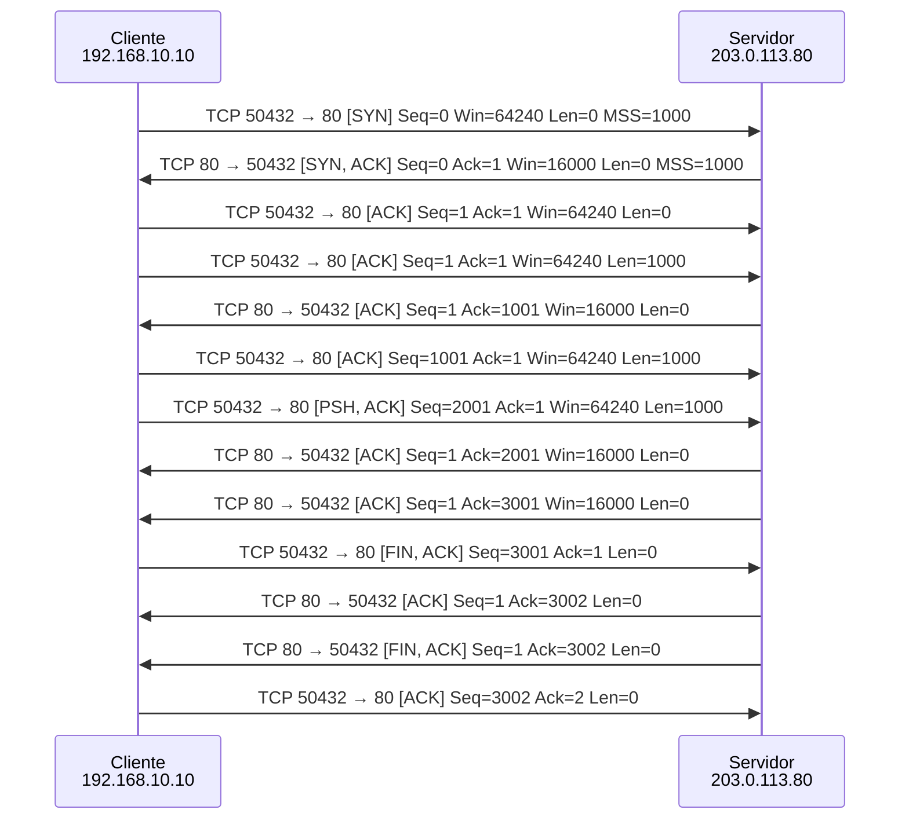

*Figura 4.1.1 (Tipo B, sequência).* Mensagens do cenário "Handshake e encerramento", na ordem do tempo, entre Cliente 192.168.10.10, Servidor 203.0.113.80: 13 mensagens. Corresponde à aba Captura, no modo "TCP: conexão", na ordem em que os pacotes aparecem; os intervalos de tempo não estão em escala.

#### 4.1.2 Slow start

Configuração do cenário: TCP; 30 segmentos de 1000 bytes; sem perda aleatória; janela inicial 1, rwnd 32, ssthresh 8, SACK desligado

**O que é.**

O **slow start** é como o TCP descobre quanto a rede aguenta. A janela de congestionamento (**cwnd**) começa pequena e cresce 1 segmento a cada ACK, o que a dobra a cada RTT. Ao alcançar o limiar **ssthresh**, o TCP passa para o **congestion avoidance** e cresce só cerca de 1 segmento por RTT.

**Neste cenário.**

A cwnd começa em 1 e cresce 1 segmento por ACK: as rajadas dobram a cada RTT (1, 2, 4, 8). Ao atingir o ssthresh (8), passa a crescer cerca de 1 segmento por RTT.

Veja a aba Janela (cwnd). Repare também que os ACKs voltam espaçados e cadenciam os próximos envios (ACK clocking).

**O que observar.**

- Na aba Janela (cwnd): o crescimento 1, 2, 4, 8 e a mudança de inclinação no ssthresh (8).
- No diagrama: rajadas cada vez maiores, cadenciadas pelos ACKs (ACK clocking).
- Na aba Resultados: o tempo total da transferência.

**Mensagens envolvidas.**

| Segmento | Função | Quem envia |
| --- | --- | --- |
| Dados | segmentos de 1000 bytes | cliente |
| ACK | confirma e libera novos envios | servidor |

**Por que importa.**

Evita que um emissor recém-chegado inunde a rede ([RFC 5681](https://www.rfc-editor.org/rfc/rfc5681)). O Linux começa com janela 10 ([RFC 6928](https://www.rfc-editor.org/rfc/rfc6928), de status Experimental) para acelerar transferências curtas.

```mermaid
sequenceDiagram
  participant h_192_168_10_10 as Cliente<br/>192.168.10.10
  participant h_203_0_113_80 as Servidor<br/>203.0.113.80
  h_192_168_10_10 ->> h_203_0_113_80: TCP 50432 → 80 [SYN] Seq=0 Win=64240 Len=0 MSS=1000
  h_203_0_113_80 ->> h_192_168_10_10: TCP 80 → 50432 [SYN, ACK] Seq=0 Ack=1 Win=32000 Len=0 MSS=1000
  h_192_168_10_10 ->> h_203_0_113_80: TCP 50432 → 80 [ACK] Seq=1 Ack=1 Win=64240 Len=0
  h_192_168_10_10 ->> h_203_0_113_80: TCP 50432 → 80 [ACK] Seq=1 Ack=1 Win=64240 Len=1000
  h_203_0_113_80 ->> h_192_168_10_10: TCP 80 → 50432 [ACK] Seq=1 Ack=1001 Win=32000 Len=0
  h_192_168_10_10 ->> h_203_0_113_80: TCP 50432 → 80 [ACK] Seq=1001 Ack=1 Win=64240 Len=1000
  h_192_168_10_10 ->> h_203_0_113_80: TCP 50432 → 80 [ACK] Seq=2001 Ack=1 Win=64240 Len=1000
  h_203_0_113_80 ->> h_192_168_10_10: TCP 80 → 50432 [ACK] Seq=1 Ack=2001 Win=32000 Len=0
  h_192_168_10_10 ->> h_203_0_113_80: TCP 50432 → 80 [ACK] Seq=3001 Ack=1 Win=64240 Len=1000
  h_203_0_113_80 ->> h_192_168_10_10: TCP 80 → 50432 [ACK] Seq=1 Ack=3001 Win=32000 Len=0
  h_192_168_10_10 ->> h_203_0_113_80: TCP 50432 → 80 [ACK] Seq=4001 Ack=1 Win=64240 Len=1000
  h_203_0_113_80 ->> h_192_168_10_10: TCP 80 → 50432 [ACK] Seq=1 Ack=4001 Win=32000 Len=0
  h_192_168_10_10 ->> h_203_0_113_80: TCP 50432 → 80 [ACK] Seq=5001 Ack=1 Win=64240 Len=1000
  h_203_0_113_80 ->> h_192_168_10_10: TCP 80 → 50432 [ACK] Seq=1 Ack=5001 Win=32000 Len=0
  h_192_168_10_10 ->> h_203_0_113_80: TCP 50432 → 80 [ACK] Seq=6001 Ack=1 Win=64240 Len=1000
  h_203_0_113_80 ->> h_192_168_10_10: TCP 80 → 50432 [ACK] Seq=1 Ack=6001 Win=32000 Len=0
  h_192_168_10_10 ->> h_203_0_113_80: TCP 50432 → 80 [ACK] Seq=7001 Ack=1 Win=64240 Len=1000
  h_203_0_113_80 ->> h_192_168_10_10: TCP 80 → 50432 [ACK] Seq=1 Ack=7001 Win=32000 Len=0
  h_192_168_10_10 ->> h_203_0_113_80: TCP 50432 → 80 [ACK] Seq=8001 Ack=1 Win=64240 Len=1000
  h_203_0_113_80 ->> h_192_168_10_10: TCP 80 → 50432 [ACK] Seq=1 Ack=8001 Win=32000 Len=0
  h_192_168_10_10 ->> h_203_0_113_80: TCP 50432 → 80 [ACK] Seq=9001 Ack=1 Win=64240 Len=1000
  h_203_0_113_80 ->> h_192_168_10_10: TCP 80 → 50432 [ACK] Seq=1 Ack=9001 Win=32000 Len=0
  h_192_168_10_10 ->> h_203_0_113_80: TCP 50432 → 80 [ACK] Seq=10001 Ack=1 Win=64240 Len=1000
  h_203_0_113_80 ->> h_192_168_10_10: TCP 80 → 50432 [ACK] Seq=1 Ack=10001 Win=32000 Len=0
  h_192_168_10_10 ->> h_203_0_113_80: TCP 50432 → 80 [ACK] Seq=11001 Ack=1 Win=64240 Len=1000
  h_203_0_113_80 ->> h_192_168_10_10: TCP 80 → 50432 [ACK] Seq=1 Ack=11001 Win=32000 Len=0
  h_192_168_10_10 ->> h_203_0_113_80: TCP 50432 → 80 [ACK] Seq=12001 Ack=1 Win=64240 Len=1000
  h_203_0_113_80 ->> h_192_168_10_10: TCP 80 → 50432 [ACK] Seq=1 Ack=12001 Win=32000 Len=0
  h_192_168_10_10 ->> h_203_0_113_80: TCP 50432 → 80 [ACK] Seq=13001 Ack=1 Win=64240 Len=1000
  h_203_0_113_80 ->> h_192_168_10_10: TCP 80 → 50432 [ACK] Seq=1 Ack=13001 Win=32000 Len=0
  h_192_168_10_10 ->> h_203_0_113_80: TCP 50432 → 80 [ACK] Seq=14001 Ack=1 Win=64240 Len=1000
  h_203_0_113_80 ->> h_192_168_10_10: TCP 80 → 50432 [ACK] Seq=1 Ack=14001 Win=32000 Len=0
  h_192_168_10_10 ->> h_203_0_113_80: TCP 50432 → 80 [ACK] Seq=15001 Ack=1 Win=64240 Len=1000
  h_203_0_113_80 ->> h_192_168_10_10: TCP 80 → 50432 [ACK] Seq=1 Ack=15001 Win=32000 Len=0
  h_192_168_10_10 ->> h_203_0_113_80: TCP 50432 → 80 [ACK] Seq=16001 Ack=1 Win=64240 Len=1000
  h_203_0_113_80 ->> h_192_168_10_10: TCP 80 → 50432 [ACK] Seq=1 Ack=16001 Win=32000 Len=0
  h_192_168_10_10 ->> h_203_0_113_80: TCP 50432 → 80 [ACK] Seq=17001 Ack=1 Win=64240 Len=1000
  h_203_0_113_80 ->> h_192_168_10_10: TCP 80 → 50432 [ACK] Seq=1 Ack=17001 Win=32000 Len=0
  h_192_168_10_10 ->> h_203_0_113_80: TCP 50432 → 80 [ACK] Seq=18001 Ack=1 Win=64240 Len=1000
  h_203_0_113_80 ->> h_192_168_10_10: TCP 80 → 50432 [ACK] Seq=1 Ack=18001 Win=32000 Len=0
  h_192_168_10_10 ->> h_203_0_113_80: TCP 50432 → 80 [ACK] Seq=19001 Ack=1 Win=64240 Len=1000
  h_203_0_113_80 ->> h_192_168_10_10: TCP 80 → 50432 [ACK] Seq=1 Ack=19001 Win=32000 Len=0
  h_192_168_10_10 ->> h_203_0_113_80: TCP 50432 → 80 [ACK] Seq=20001 Ack=1 Win=64240 Len=1000
  h_203_0_113_80 ->> h_192_168_10_10: TCP 80 → 50432 [ACK] Seq=1 Ack=20001 Win=32000 Len=0
  h_192_168_10_10 ->> h_203_0_113_80: TCP 50432 → 80 [ACK] Seq=21001 Ack=1 Win=64240 Len=1000
  h_203_0_113_80 ->> h_192_168_10_10: TCP 80 → 50432 [ACK] Seq=1 Ack=21001 Win=32000 Len=0
  h_192_168_10_10 ->> h_203_0_113_80: TCP 50432 → 80 [ACK] Seq=22001 Ack=1 Win=64240 Len=1000
  h_203_0_113_80 ->> h_192_168_10_10: TCP 80 → 50432 [ACK] Seq=1 Ack=22001 Win=32000 Len=0
  h_192_168_10_10 ->> h_203_0_113_80: TCP 50432 → 80 [ACK] Seq=23001 Ack=1 Win=64240 Len=1000
  h_203_0_113_80 ->> h_192_168_10_10: TCP 80 → 50432 [ACK] Seq=1 Ack=23001 Win=32000 Len=0
  h_192_168_10_10 ->> h_203_0_113_80: TCP 50432 → 80 [ACK] Seq=24001 Ack=1 Win=64240 Len=1000
  h_203_0_113_80 ->> h_192_168_10_10: TCP 80 → 50432 [ACK] Seq=1 Ack=24001 Win=32000 Len=0
  h_192_168_10_10 ->> h_203_0_113_80: TCP 50432 → 80 [ACK] Seq=25001 Ack=1 Win=64240 Len=1000
  h_203_0_113_80 ->> h_192_168_10_10: TCP 80 → 50432 [ACK] Seq=1 Ack=25001 Win=32000 Len=0
  h_192_168_10_10 ->> h_203_0_113_80: TCP 50432 → 80 [ACK] Seq=26001 Ack=1 Win=64240 Len=1000
  h_203_0_113_80 ->> h_192_168_10_10: TCP 80 → 50432 [ACK] Seq=1 Ack=26001 Win=32000 Len=0
  h_192_168_10_10 ->> h_203_0_113_80: TCP 50432 → 80 [ACK] Seq=27001 Ack=1 Win=64240 Len=1000
  h_203_0_113_80 ->> h_192_168_10_10: TCP 80 → 50432 [ACK] Seq=1 Ack=27001 Win=32000 Len=0
  h_192_168_10_10 ->> h_203_0_113_80: TCP 50432 → 80 [ACK] Seq=28001 Ack=1 Win=64240 Len=1000
  h_203_0_113_80 ->> h_192_168_10_10: TCP 80 → 50432 [ACK] Seq=1 Ack=28001 Win=32000 Len=0
  h_192_168_10_10 ->> h_203_0_113_80: TCP 50432 → 80 [PSH, ACK] Seq=29001 Ack=1 Win=64240 Len=1000
  h_203_0_113_80 ->> h_192_168_10_10: TCP 80 → 50432 [ACK] Seq=1 Ack=29001 Win=32000 Len=0
  h_203_0_113_80 ->> h_192_168_10_10: TCP 80 → 50432 [ACK] Seq=1 Ack=30001 Win=32000 Len=0
  h_192_168_10_10 ->> h_203_0_113_80: TCP 50432 → 80 [FIN, ACK] Seq=30001 Ack=1 Len=0
  h_203_0_113_80 ->> h_192_168_10_10: TCP 80 → 50432 [ACK] Seq=1 Ack=30002 Len=0
  h_203_0_113_80 ->> h_192_168_10_10: TCP 80 → 50432 [FIN, ACK] Seq=1 Ack=30002 Len=0
  h_192_168_10_10 ->> h_203_0_113_80: TCP 50432 → 80 [ACK] Seq=30002 Ack=2 Len=0
```

*Figura 4.1.2 (Tipo B, sequência).* Mensagens do cenário "Slow start", na ordem do tempo, entre Cliente 192.168.10.10, Servidor 203.0.113.80: 67 mensagens. Corresponde à aba Captura, no modo "TCP: conexão", na ordem em que os pacotes aparecem; os intervalos de tempo não estão em escala.

#### 4.1.3 Fast retransmit

Configuração do cenário: TCP; 20 segmentos de 1000 bytes; sem perda aleatória; descarte forçado do #8; janela inicial 4, rwnd 16, ssthresh 64, SACK desligado

**O que é.**

Quando um segmento se perde e os seguintes chegam, o receptor repete o ACK do primeiro byte que falta (**ACK duplicado**). Três ACKs duplicados indicam uma perda isolada: o emissor faz o **fast retransmit**, retransmite na hora e entra em **fast recovery**, cortando a janela à metade em vez de voltar a 1.

**Neste cenário.**

O segmento #8 se perde. Os seguintes chegam fora de ordem e o receptor repete o ACK do que falta. No terceiro ACK duplicado, o emissor retransmite sem esperar o timeout e reduz a janela à metade (fast recovery).

No gráfico, a cwnd cai à metade em vez de voltar a 1.

**O que observar.**

- No diagrama: o #8 se perde e os ACKs seguintes repetem o mesmo número.
- No terceiro ACK duplicado, a retransmissão do #8 sai sem esperar o RTO.
- Na aba Janela (cwnd): a queda à metade, não a 1.

**Mensagens envolvidas.**

| Segmento | Função | Quem envia |
| --- | --- | --- |
| Dados #8 | perdido na rede | cliente |
| ACK duplicado | pede de novo o #8 | servidor |
| Retransmissão | reenvia o #8 | cliente |

**Por que importa.**

Recupera perdas isoladas em cerca de 1 RTT e preserva boa parte da vazão. É o caso mais comum de perda em redes congestionadas.

```mermaid
sequenceDiagram
  participant h_192_168_10_10 as Cliente<br/>192.168.10.10
  participant h_203_0_113_80 as Servidor<br/>203.0.113.80
  h_192_168_10_10 ->> h_203_0_113_80: TCP 50432 → 80 [SYN] Seq=0 Win=64240 Len=0 MSS=1000
  h_203_0_113_80 ->> h_192_168_10_10: TCP 80 → 50432 [SYN, ACK] Seq=0 Ack=1 Win=16000 Len=0 MSS=1000
  h_192_168_10_10 ->> h_203_0_113_80: TCP 50432 → 80 [ACK] Seq=1 Ack=1 Win=64240 Len=0
  h_192_168_10_10 ->> h_203_0_113_80: TCP 50432 → 80 [ACK] Seq=1 Ack=1 Win=64240 Len=1000
  h_192_168_10_10 ->> h_203_0_113_80: TCP 50432 → 80 [ACK] Seq=1001 Ack=1 Win=64240 Len=1000
  h_203_0_113_80 ->> h_192_168_10_10: TCP 80 → 50432 [ACK] Seq=1 Ack=1001 Win=16000 Len=0
  h_192_168_10_10 ->> h_203_0_113_80: TCP 50432 → 80 [ACK] Seq=2001 Ack=1 Win=64240 Len=1000
  h_203_0_113_80 ->> h_192_168_10_10: TCP 80 → 50432 [ACK] Seq=1 Ack=2001 Win=16000 Len=0
  h_192_168_10_10 ->> h_203_0_113_80: TCP 50432 → 80 [ACK] Seq=3001 Ack=1 Win=64240 Len=1000
  h_203_0_113_80 ->> h_192_168_10_10: TCP 80 → 50432 [ACK] Seq=1 Ack=3001 Win=16000 Len=0
  h_192_168_10_10 ->> h_203_0_113_80: TCP 50432 → 80 [ACK] Seq=4001 Ack=1 Win=64240 Len=1000
  h_203_0_113_80 ->> h_192_168_10_10: TCP 80 → 50432 [ACK] Seq=1 Ack=4001 Win=16000 Len=0
  h_192_168_10_10 ->> h_203_0_113_80: TCP 50432 → 80 [ACK] Seq=5001 Ack=1 Win=64240 Len=1000
  h_203_0_113_80 ->> h_192_168_10_10: TCP 80 → 50432 [ACK] Seq=1 Ack=5001 Win=16000 Len=0
  h_192_168_10_10 ->> h_203_0_113_80: TCP 50432 → 80 [ACK] Seq=6001 Ack=1 Win=64240 Len=1000
  h_203_0_113_80 ->> h_192_168_10_10: TCP 80 → 50432 [ACK] Seq=1 Ack=6001 Win=16000 Len=0
  h_192_168_10_10 -x h_203_0_113_80: TCP 50432 → 80 [ACK] Seq=7001 Ack=1 Win=64240 Len=1000 (perdido na rede)
  h_203_0_113_80 ->> h_192_168_10_10: TCP 80 → 50432 [ACK] Seq=1 Ack=7001 Win=16000 Len=0
  h_192_168_10_10 ->> h_203_0_113_80: TCP [TCP Out-Of-Order] 50432 → 80 [ACK] Seq=8001 Ack=1 Win=64240 Len=1000
  h_192_168_10_10 ->> h_203_0_113_80: TCP [TCP Out-Of-Order] 50432 → 80 [ACK] Seq=9001 Ack=1 Win=64240 Len=1000
  h_203_0_113_80 ->> h_192_168_10_10: TCP [TCP Dup ACK nº 1] 80 → 50432 [ACK] Seq=1 Ack=7001 Win=16000 Len=0
  h_192_168_10_10 ->> h_203_0_113_80: TCP [TCP Out-Of-Order] 50432 → 80 [ACK] Seq=10001 Ack=1 Win=64240 Len=1000
  h_203_0_113_80 ->> h_192_168_10_10: TCP [TCP Dup ACK nº 2] 80 → 50432 [ACK] Seq=1 Ack=7001 Win=16000 Len=0
  h_192_168_10_10 ->> h_203_0_113_80: TCP [TCP Out-Of-Order] 50432 → 80 [ACK] Seq=11001 Ack=1 Win=64240 Len=1000
  h_203_0_113_80 ->> h_192_168_10_10: TCP [TCP Dup ACK nº 3] 80 → 50432 [ACK] Seq=1 Ack=7001 Win=16000 Len=0
  h_192_168_10_10 ->> h_203_0_113_80: TCP [TCP Out-Of-Order] 50432 → 80 [ACK] Seq=12001 Ack=1 Win=64240 Len=1000
  h_203_0_113_80 ->> h_192_168_10_10: TCP [TCP Dup ACK nº 4] 80 → 50432 [ACK] Seq=1 Ack=7001 Win=16000 Len=0
  h_192_168_10_10 ->> h_203_0_113_80: TCP [TCP Out-Of-Order] 50432 → 80 [ACK] Seq=13001 Ack=1 Win=64240 Len=1000
  h_203_0_113_80 ->> h_192_168_10_10: TCP [TCP Dup ACK nº 5] 80 → 50432 [ACK] Seq=1 Ack=7001 Win=16000 Len=0
  h_192_168_10_10 ->> h_203_0_113_80: TCP [TCP Out-Of-Order] 50432 → 80 [ACK] Seq=14001 Ack=1 Win=64240 Len=1000
  h_203_0_113_80 ->> h_192_168_10_10: TCP [TCP Dup ACK nº 6] 80 → 50432 [ACK] Seq=1 Ack=7001 Win=16000 Len=0
  h_192_168_10_10 ->> h_203_0_113_80: TCP [TCP Out-Of-Order] 50432 → 80 [ACK] Seq=15001 Ack=1 Win=64240 Len=1000
  h_203_0_113_80 ->> h_192_168_10_10: TCP [TCP Dup ACK nº 7] 80 → 50432 [ACK] Seq=1 Ack=7001 Win=16000 Len=0
  h_192_168_10_10 ->> h_203_0_113_80: TCP [TCP Out-Of-Order] 50432 → 80 [ACK] Seq=16001 Ack=1 Win=64240 Len=1000
  h_203_0_113_80 ->> h_192_168_10_10: TCP [TCP Dup ACK nº 8] 80 → 50432 [ACK] Seq=1 Ack=7001 Win=16000 Len=0
  h_192_168_10_10 ->> h_203_0_113_80: TCP [TCP Out-Of-Order] 50432 → 80 [ACK] Seq=17001 Ack=1 Win=64240 Len=1000
  h_203_0_113_80 ->> h_192_168_10_10: TCP [TCP Dup ACK nº 9] 80 → 50432 [ACK] Seq=1 Ack=7001 Win=16000 Len=0
  h_192_168_10_10 ->> h_203_0_113_80: TCP [TCP Fast Retransmission] 50432 → 80 [ACK] Seq=7001 Ack=1 Win=64240 Len=1000
  h_203_0_113_80 ->> h_192_168_10_10: TCP [TCP Dup ACK nº 10] 80 → 50432 [ACK] Seq=1 Ack=7001 Win=16000 Len=0
  h_192_168_10_10 ->> h_203_0_113_80: TCP 50432 → 80 [ACK] Seq=18001 Ack=1 Win=64240 Len=1000
  h_203_0_113_80 ->> h_192_168_10_10: TCP 80 → 50432 [ACK] Seq=1 Ack=18001 Win=16000 Len=0
  h_192_168_10_10 ->> h_203_0_113_80: TCP 50432 → 80 [PSH, ACK] Seq=19001 Ack=1 Win=64240 Len=1000
  h_203_0_113_80 ->> h_192_168_10_10: TCP 80 → 50432 [ACK] Seq=1 Ack=19001 Win=16000 Len=0
  h_203_0_113_80 ->> h_192_168_10_10: TCP 80 → 50432 [ACK] Seq=1 Ack=20001 Win=16000 Len=0
  h_192_168_10_10 ->> h_203_0_113_80: TCP 50432 → 80 [FIN, ACK] Seq=20001 Ack=1 Len=0
  h_203_0_113_80 ->> h_192_168_10_10: TCP 80 → 50432 [ACK] Seq=1 Ack=20002 Len=0
  h_203_0_113_80 ->> h_192_168_10_10: TCP 80 → 50432 [FIN, ACK] Seq=1 Ack=20002 Len=0
  h_192_168_10_10 ->> h_203_0_113_80: TCP 50432 → 80 [ACK] Seq=20002 Ack=2 Len=0
```

*Figura 4.1.3 (Tipo B, sequência).* Mensagens do cenário "Fast retransmit", na ordem do tempo, entre Cliente 192.168.10.10, Servidor 203.0.113.80: 48 mensagens (1 perdida). Corresponde à aba Captura, no modo "TCP: conexão", na ordem em que os pacotes aparecem; os intervalos de tempo não estão em escala.

#### 4.1.4 Timeout (RTO)

Configuração do cenário: TCP; 6 segmentos de 1000 bytes; sem perda aleatória; descarte forçado do #6; janela inicial 4, rwnd 16, ssthresh 64, SACK desligado

**O que é.**

O **RTO** (Retransmission Timeout) é quanto o emissor espera por um ACK antes de concluir que o segmento se perdeu. Ele é calculado a partir do RTT medido ([RFC 6298](https://www.rfc-editor.org/rfc/rfc6298)) e dobra a cada timeout seguido. Depois de um timeout, o TCP trata a rede como muito congestionada: a cwnd volta a 1 e o slow start recomeça.

**Neste cenário.**

O último segmento (#6) se perde. Sem segmentos depois dele, não surgem ACKs duplicados: só o temporizador RTO percebe a perda.

Depois do timeout, a cwnd volta a 1 e o RTO dobra. Compare o tempo gasto com o do fast retransmit.

**O que observar.**

- O #6 é o último segmento: não há segmentos depois dele para gerar ACKs duplicados.
- No diagrama: a espera longa até o temporizador estourar.
- Na aba Janela (cwnd): a queda para 1. Compare o tempo total com o cenário Fast retransmit.

**Mensagens envolvidas.**

| Segmento | Função | Quem envia |
| --- | --- | --- |
| Dados #6 | perdido na rede | cliente |
| Retransmissão | sai depois do RTO | cliente |
| ACK | confirma tudo | servidor |

**Por que importa.**

Timeouts custam caro: a conexão fica parada e a janela recomeça do zero. Por isso perdas no fim de transferências curtas pesam tanto no carregamento de páginas web.

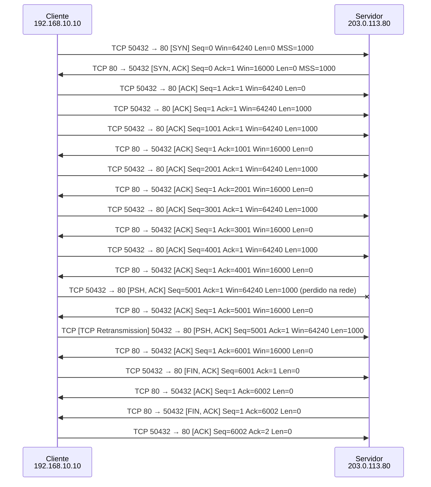

*Figura 4.1.4 (Tipo B, sequência).* Mensagens do cenário "Timeout (RTO)", na ordem do tempo, entre Cliente 192.168.10.10, Servidor 203.0.113.80: 20 mensagens (1 perdida). Corresponde à aba Captura, no modo "TCP: conexão", na ordem em que os pacotes aparecem; os intervalos de tempo não estão em escala.

#### 4.1.5 Janela do receptor

Configuração do cenário: TCP; 20 segmentos de 1000 bytes; sem perda aleatória; janela inicial 10, rwnd 4, ssthresh 64, SACK desligado

**O que é.**

O **controle de fluxo** protege o receptor: em cada ACK, ele anuncia no campo Janela quanto espaço livre tem no buffer (**rwnd**). O emissor nunca mantém em voo mais que o mínimo entre a cwnd (limite da rede) e a rwnd (limite do receptor).

**Neste cenário.**

A cwnd começa em 10, mas o receptor anuncia rwnd = 4 segmentos. O emissor nunca tem mais de 4 segmentos em voo: é o controle de fluxo, que protege o buffer do receptor.

Compare com rwnd = 16 e veja a diferença no tempo total.

**O que observar.**

- A cwnd começa em 10, mas nunca há mais de 4 segmentos em voo.
- Na aba Segmento: o campo Janela dos ACKs (4 segmentos = 4000 bytes).
- Na aba Janela (cwnd): a cwnd cresce, mas o envio fica preso à rwnd.

**Mensagens envolvidas.**

| Segmento | Função | Quem envia |
| --- | --- | --- |
| ACK | anuncia rwnd = 4 segmentos | servidor |
| Dados | no máximo 4 em voo | cliente |

**Por que importa.**

Controle de fluxo (receptor) e controle de congestionamento (rede) são mecanismos diferentes. Uma janela anunciada pequena limita a vazão mesmo em uma rede rápida.

```mermaid
sequenceDiagram
  participant h_192_168_10_10 as Cliente<br/>192.168.10.10
  participant h_203_0_113_80 as Servidor<br/>203.0.113.80
  h_192_168_10_10 ->> h_203_0_113_80: TCP 50432 → 80 [SYN] Seq=0 Win=64240 Len=0 MSS=1000
  h_203_0_113_80 ->> h_192_168_10_10: TCP 80 → 50432 [SYN, ACK] Seq=0 Ack=1 Win=4000 Len=0 MSS=1000
  h_192_168_10_10 ->> h_203_0_113_80: TCP 50432 → 80 [ACK] Seq=1 Ack=1 Win=64240 Len=0
  h_192_168_10_10 ->> h_203_0_113_80: TCP 50432 → 80 [ACK] Seq=1 Ack=1 Win=64240 Len=1000
  h_192_168_10_10 ->> h_203_0_113_80: TCP 50432 → 80 [ACK] Seq=1001 Ack=1 Win=64240 Len=1000
  h_203_0_113_80 ->> h_192_168_10_10: TCP 80 → 50432 [ACK] Seq=1 Ack=1001 Win=4000 Len=0
  h_192_168_10_10 ->> h_203_0_113_80: TCP 50432 → 80 [ACK] Seq=2001 Ack=1 Win=64240 Len=1000
  h_203_0_113_80 ->> h_192_168_10_10: TCP 80 → 50432 [ACK] Seq=1 Ack=2001 Win=4000 Len=0
  h_192_168_10_10 ->> h_203_0_113_80: TCP 50432 → 80 [ACK] Seq=3001 Ack=1 Win=64240 Len=1000
  h_203_0_113_80 ->> h_192_168_10_10: TCP 80 → 50432 [ACK] Seq=1 Ack=3001 Win=4000 Len=0
  h_192_168_10_10 ->> h_203_0_113_80: TCP 50432 → 80 [ACK] Seq=4001 Ack=1 Win=64240 Len=1000
  h_203_0_113_80 ->> h_192_168_10_10: TCP 80 → 50432 [ACK] Seq=1 Ack=4001 Win=4000 Len=0
  h_192_168_10_10 ->> h_203_0_113_80: TCP 50432 → 80 [ACK] Seq=5001 Ack=1 Win=64240 Len=1000
  h_203_0_113_80 ->> h_192_168_10_10: TCP 80 → 50432 [ACK] Seq=1 Ack=5001 Win=4000 Len=0
  h_192_168_10_10 ->> h_203_0_113_80: TCP 50432 → 80 [ACK] Seq=6001 Ack=1 Win=64240 Len=1000
  h_203_0_113_80 ->> h_192_168_10_10: TCP 80 → 50432 [ACK] Seq=1 Ack=6001 Win=4000 Len=0
  h_192_168_10_10 ->> h_203_0_113_80: TCP 50432 → 80 [ACK] Seq=7001 Ack=1 Win=64240 Len=1000
  h_203_0_113_80 ->> h_192_168_10_10: TCP 80 → 50432 [ACK] Seq=1 Ack=7001 Win=4000 Len=0
  h_192_168_10_10 ->> h_203_0_113_80: TCP 50432 → 80 [ACK] Seq=8001 Ack=1 Win=64240 Len=1000
  h_203_0_113_80 ->> h_192_168_10_10: TCP 80 → 50432 [ACK] Seq=1 Ack=8001 Win=4000 Len=0
  h_192_168_10_10 ->> h_203_0_113_80: TCP 50432 → 80 [ACK] Seq=9001 Ack=1 Win=64240 Len=1000
  h_203_0_113_80 ->> h_192_168_10_10: TCP 80 → 50432 [ACK] Seq=1 Ack=9001 Win=4000 Len=0
  h_192_168_10_10 ->> h_203_0_113_80: TCP 50432 → 80 [ACK] Seq=10001 Ack=1 Win=64240 Len=1000
  h_203_0_113_80 ->> h_192_168_10_10: TCP 80 → 50432 [ACK] Seq=1 Ack=10001 Win=4000 Len=0
  h_192_168_10_10 ->> h_203_0_113_80: TCP 50432 → 80 [ACK] Seq=11001 Ack=1 Win=64240 Len=1000
  h_203_0_113_80 ->> h_192_168_10_10: TCP 80 → 50432 [ACK] Seq=1 Ack=11001 Win=4000 Len=0
  h_192_168_10_10 ->> h_203_0_113_80: TCP 50432 → 80 [ACK] Seq=12001 Ack=1 Win=64240 Len=1000
  h_203_0_113_80 ->> h_192_168_10_10: TCP 80 → 50432 [ACK] Seq=1 Ack=12001 Win=4000 Len=0
  h_192_168_10_10 ->> h_203_0_113_80: TCP 50432 → 80 [ACK] Seq=13001 Ack=1 Win=64240 Len=1000
  h_203_0_113_80 ->> h_192_168_10_10: TCP 80 → 50432 [ACK] Seq=1 Ack=13001 Win=4000 Len=0
  h_192_168_10_10 ->> h_203_0_113_80: TCP 50432 → 80 [ACK] Seq=14001 Ack=1 Win=64240 Len=1000
  h_203_0_113_80 ->> h_192_168_10_10: TCP 80 → 50432 [ACK] Seq=1 Ack=14001 Win=4000 Len=0
  h_192_168_10_10 ->> h_203_0_113_80: TCP 50432 → 80 [ACK] Seq=15001 Ack=1 Win=64240 Len=1000
  h_203_0_113_80 ->> h_192_168_10_10: TCP 80 → 50432 [ACK] Seq=1 Ack=15001 Win=4000 Len=0
  h_192_168_10_10 ->> h_203_0_113_80: TCP 50432 → 80 [ACK] Seq=16001 Ack=1 Win=64240 Len=1000
  h_203_0_113_80 ->> h_192_168_10_10: TCP 80 → 50432 [ACK] Seq=1 Ack=16001 Win=4000 Len=0
  h_192_168_10_10 ->> h_203_0_113_80: TCP 50432 → 80 [ACK] Seq=17001 Ack=1 Win=64240 Len=1000
  h_203_0_113_80 ->> h_192_168_10_10: TCP 80 → 50432 [ACK] Seq=1 Ack=17001 Win=4000 Len=0
  h_192_168_10_10 ->> h_203_0_113_80: TCP 50432 → 80 [ACK] Seq=18001 Ack=1 Win=64240 Len=1000
  h_203_0_113_80 ->> h_192_168_10_10: TCP 80 → 50432 [ACK] Seq=1 Ack=18001 Win=4000 Len=0
  h_192_168_10_10 ->> h_203_0_113_80: TCP 50432 → 80 [PSH, ACK] Seq=19001 Ack=1 Win=64240 Len=1000
  h_203_0_113_80 ->> h_192_168_10_10: TCP 80 → 50432 [ACK] Seq=1 Ack=19001 Win=4000 Len=0
  h_203_0_113_80 ->> h_192_168_10_10: TCP 80 → 50432 [ACK] Seq=1 Ack=20001 Win=4000 Len=0
  h_192_168_10_10 ->> h_203_0_113_80: TCP 50432 → 80 [FIN, ACK] Seq=20001 Ack=1 Len=0
  h_203_0_113_80 ->> h_192_168_10_10: TCP 80 → 50432 [ACK] Seq=1 Ack=20002 Len=0
  h_203_0_113_80 ->> h_192_168_10_10: TCP 80 → 50432 [FIN, ACK] Seq=1 Ack=20002 Len=0
  h_192_168_10_10 ->> h_203_0_113_80: TCP 50432 → 80 [ACK] Seq=20002 Ack=2 Len=0
```

*Figura 4.1.5 (Tipo B, sequência).* Mensagens do cenário "Janela do receptor", na ordem do tempo, entre Cliente 192.168.10.10, Servidor 203.0.113.80: 47 mensagens. Corresponde à aba Captura, no modo "TCP: conexão", na ordem em que os pacotes aparecem; os intervalos de tempo não estão em escala.

#### 4.1.6 Perdas aleatórias

Configuração do cenário: TCP; 30 segmentos de 1000 bytes; 8% de perda; janela inicial 4, rwnd 16, ssthresh 64, SACK desligado

**O que é.**

Com **8% de perda aleatória**, aparecem ao mesmo tempo perdas isoladas (fast retransmit), várias perdas na mesma janela (ACKs parciais do NewReno, [RFC 6582](https://www.rfc-editor.org/rfc/rfc6582)) e, às vezes, timeouts. A **semente** define o sorteio: a mesma semente repete exatamente as mesmas perdas.

**Neste cenário.**

8% de perda nos dados, sorteada pela semente. O TCP combina fast retransmit, ACKs parciais e, às vezes, timeouts.

Troque a semente para ver outras sequências de perdas com a mesma taxa.

**O que observar.**

- No diagrama: quais segmentos se perderam e como cada um foi recuperado.
- Na aba Janela (cwnd): o formato em dente de serra, típico do TCP sob perda.
- Troque a semente e compare o tempo total com a mesma taxa de perda.

**Mensagens envolvidas.**

| Segmento | Função | Quem envia |
| --- | --- | --- |
| Dados | 8% se perdem | cliente |
| ACK duplicado ou parcial | indica o que falta | servidor |
| Retransmissão | por fast retransmit ou depois do RTO | cliente |

**Por que importa.**

Mostra por que a vazão do TCP cai rápido com a perda: cada perda corta a janela. Em redes sem fio, perdas que não vêm de congestionamento também reduzem a janela.

```mermaid
sequenceDiagram
  participant h_192_168_10_10 as Cliente<br/>192.168.10.10
  participant h_203_0_113_80 as Servidor<br/>203.0.113.80
  h_192_168_10_10 ->> h_203_0_113_80: TCP 50432 → 80 [SYN] Seq=0 Win=64240 Len=0 MSS=1000
  h_203_0_113_80 ->> h_192_168_10_10: TCP 80 → 50432 [SYN, ACK] Seq=0 Ack=1 Win=16000 Len=0 MSS=1000
  h_192_168_10_10 ->> h_203_0_113_80: TCP 50432 → 80 [ACK] Seq=1 Ack=1 Win=64240 Len=0
  h_192_168_10_10 ->> h_203_0_113_80: TCP 50432 → 80 [ACK] Seq=1 Ack=1 Win=64240 Len=1000
  h_192_168_10_10 ->> h_203_0_113_80: TCP 50432 → 80 [ACK] Seq=1001 Ack=1 Win=64240 Len=1000
  h_203_0_113_80 ->> h_192_168_10_10: TCP 80 → 50432 [ACK] Seq=1 Ack=1001 Win=16000 Len=0
  h_192_168_10_10 ->> h_203_0_113_80: TCP 50432 → 80 [ACK] Seq=2001 Ack=1 Win=64240 Len=1000
  h_203_0_113_80 ->> h_192_168_10_10: TCP 80 → 50432 [ACK] Seq=1 Ack=2001 Win=16000 Len=0
  h_192_168_10_10 ->> h_203_0_113_80: TCP 50432 → 80 [ACK] Seq=3001 Ack=1 Win=64240 Len=1000
  h_203_0_113_80 ->> h_192_168_10_10: TCP 80 → 50432 [ACK] Seq=1 Ack=3001 Win=16000 Len=0
  h_192_168_10_10 -x h_203_0_113_80: TCP 50432 → 80 [ACK] Seq=4001 Ack=1 Win=64240 Len=1000 (perdido na rede)
  h_203_0_113_80 ->> h_192_168_10_10: TCP 80 → 50432 [ACK] Seq=1 Ack=4001 Win=16000 Len=0
  h_192_168_10_10 ->> h_203_0_113_80: TCP [TCP Out-Of-Order] 50432 → 80 [ACK] Seq=5001 Ack=1 Win=64240 Len=1000
  h_192_168_10_10 ->> h_203_0_113_80: TCP [TCP Out-Of-Order] 50432 → 80 [ACK] Seq=6001 Ack=1 Win=64240 Len=1000
  h_203_0_113_80 ->> h_192_168_10_10: TCP [TCP Dup ACK nº 1] 80 → 50432 [ACK] Seq=1 Ack=4001 Win=16000 Len=0
  h_192_168_10_10 ->> h_203_0_113_80: TCP [TCP Out-Of-Order] 50432 → 80 [ACK] Seq=7001 Ack=1 Win=64240 Len=1000
  h_203_0_113_80 ->> h_192_168_10_10: TCP [TCP Dup ACK nº 2] 80 → 50432 [ACK] Seq=1 Ack=4001 Win=16000 Len=0
  h_192_168_10_10 -x h_203_0_113_80: TCP 50432 → 80 [ACK] Seq=8001 Ack=1 Win=64240 Len=1000 (perdido na rede)
  h_203_0_113_80 ->> h_192_168_10_10: TCP [TCP Dup ACK nº 3] 80 → 50432 [ACK] Seq=1 Ack=4001 Win=16000 Len=0
  h_192_168_10_10 ->> h_203_0_113_80: TCP [TCP Out-Of-Order] 50432 → 80 [ACK] Seq=9001 Ack=1 Win=64240 Len=1000
  h_192_168_10_10 -x h_203_0_113_80: TCP 50432 → 80 [ACK] Seq=10001 Ack=1 Win=64240 Len=1000 (perdido na rede)
  h_203_0_113_80 ->> h_192_168_10_10: TCP [TCP Dup ACK nº 4] 80 → 50432 [ACK] Seq=1 Ack=4001 Win=16000 Len=0
  h_192_168_10_10 ->> h_203_0_113_80: TCP [TCP Out-Of-Order] 50432 → 80 [ACK] Seq=11001 Ack=1 Win=64240 Len=1000
  h_192_168_10_10 ->> h_203_0_113_80: TCP [TCP Fast Retransmission] 50432 → 80 [ACK] Seq=4001 Ack=1 Win=64240 Len=1000
  h_203_0_113_80 ->> h_192_168_10_10: TCP [TCP Dup ACK nº 5] 80 → 50432 [ACK] Seq=1 Ack=4001 Win=16000 Len=0
  h_192_168_10_10 ->> h_203_0_113_80: TCP [TCP Out-Of-Order] 50432 → 80 [ACK] Seq=12001 Ack=1 Win=64240 Len=1000
  h_203_0_113_80 ->> h_192_168_10_10: TCP 80 → 50432 [ACK] Seq=1 Ack=8001 Win=16000 Len=0
  h_192_168_10_10 ->> h_203_0_113_80: TCP [TCP Fast Retransmission] 50432 → 80 [ACK] Seq=8001 Ack=1 Win=64240 Len=1000
  h_203_0_113_80 ->> h_192_168_10_10: TCP [TCP Dup ACK nº 1] 80 → 50432 [ACK] Seq=1 Ack=8001 Win=16000 Len=0
  h_192_168_10_10 ->> h_203_0_113_80: TCP [TCP Out-Of-Order] 50432 → 80 [ACK] Seq=13001 Ack=1 Win=64240 Len=1000
  h_203_0_113_80 ->> h_192_168_10_10: TCP 80 → 50432 [ACK] Seq=1 Ack=10001 Win=16000 Len=0
  h_192_168_10_10 ->> h_203_0_113_80: TCP [TCP Out-Of-Order] 50432 → 80 [ACK] Seq=14001 Ack=1 Win=64240 Len=1000
  h_203_0_113_80 ->> h_192_168_10_10: TCP [TCP Dup ACK nº 1] 80 → 50432 [ACK] Seq=1 Ack=10001 Win=16000 Len=0
  h_192_168_10_10 ->> h_203_0_113_80: TCP [TCP Fast Retransmission] 50432 → 80 [ACK] Seq=10001 Ack=1 Win=64240 Len=1000
  h_203_0_113_80 ->> h_192_168_10_10: TCP [TCP Dup ACK nº 2] 80 → 50432 [ACK] Seq=1 Ack=10001 Win=16000 Len=0
  h_192_168_10_10 ->> h_203_0_113_80: TCP 50432 → 80 [ACK] Seq=15001 Ack=1 Win=64240 Len=1000
  h_203_0_113_80 ->> h_192_168_10_10: TCP 80 → 50432 [ACK] Seq=1 Ack=15001 Win=16000 Len=0
  h_192_168_10_10 ->> h_203_0_113_80: TCP 50432 → 80 [ACK] Seq=16001 Ack=1 Win=64240 Len=1000
  h_203_0_113_80 ->> h_192_168_10_10: TCP 80 → 50432 [ACK] Seq=1 Ack=16001 Win=16000 Len=0
  h_192_168_10_10 ->> h_203_0_113_80: TCP 50432 → 80 [ACK] Seq=17001 Ack=1 Win=64240 Len=1000
  h_203_0_113_80 ->> h_192_168_10_10: TCP 80 → 50432 [ACK] Seq=1 Ack=17001 Win=16000 Len=0
  h_192_168_10_10 ->> h_203_0_113_80: TCP 50432 → 80 [ACK] Seq=18001 Ack=1 Win=64240 Len=1000
  h_203_0_113_80 ->> h_192_168_10_10: TCP 80 → 50432 [ACK] Seq=1 Ack=18001 Win=16000 Len=0
  h_192_168_10_10 ->> h_203_0_113_80: TCP 50432 → 80 [ACK] Seq=19001 Ack=1 Win=64240 Len=1000
  h_203_0_113_80 ->> h_192_168_10_10: TCP 80 → 50432 [ACK] Seq=1 Ack=19001 Win=16000 Len=0
  h_192_168_10_10 ->> h_203_0_113_80: TCP 50432 → 80 [ACK] Seq=20001 Ack=1 Win=64240 Len=1000
  h_203_0_113_80 ->> h_192_168_10_10: TCP 80 → 50432 [ACK] Seq=1 Ack=20001 Win=16000 Len=0
  h_192_168_10_10 ->> h_203_0_113_80: TCP 50432 → 80 [ACK] Seq=21001 Ack=1 Win=64240 Len=1000
  h_203_0_113_80 ->> h_192_168_10_10: TCP 80 → 50432 [ACK] Seq=1 Ack=21001 Win=16000 Len=0
  h_192_168_10_10 ->> h_203_0_113_80: TCP 50432 → 80 [ACK] Seq=22001 Ack=1 Win=64240 Len=1000
  h_203_0_113_80 ->> h_192_168_10_10: TCP 80 → 50432 [ACK] Seq=1 Ack=22001 Win=16000 Len=0
  h_192_168_10_10 -x h_203_0_113_80: TCP 50432 → 80 [ACK] Seq=23001 Ack=1 Win=64240 Len=1000 (perdido na rede)
  h_203_0_113_80 ->> h_192_168_10_10: TCP 80 → 50432 [ACK] Seq=1 Ack=23001 Win=16000 Len=0
  h_192_168_10_10 ->> h_203_0_113_80: TCP [TCP Out-Of-Order] 50432 → 80 [ACK] Seq=24001 Ack=1 Win=64240 Len=1000
  h_192_168_10_10 ->> h_203_0_113_80: TCP [TCP Out-Of-Order] 50432 → 80 [ACK] Seq=25001 Ack=1 Win=64240 Len=1000
  h_203_0_113_80 ->> h_192_168_10_10: TCP [TCP Dup ACK nº 1] 80 → 50432 [ACK] Seq=1 Ack=23001 Win=16000 Len=0
  h_192_168_10_10 ->> h_203_0_113_80: TCP [TCP Out-Of-Order] 50432 → 80 [ACK] Seq=26001 Ack=1 Win=64240 Len=1000
  h_203_0_113_80 ->> h_192_168_10_10: TCP [TCP Dup ACK nº 2] 80 → 50432 [ACK] Seq=1 Ack=23001 Win=16000 Len=0
  h_192_168_10_10 ->> h_203_0_113_80: TCP [TCP Out-Of-Order] 50432 → 80 [ACK] Seq=27001 Ack=1 Win=64240 Len=1000
  h_203_0_113_80 ->> h_192_168_10_10: TCP [TCP Dup ACK nº 3] 80 → 50432 [ACK] Seq=1 Ack=23001 Win=16000 Len=0
  h_192_168_10_10 ->> h_203_0_113_80: TCP [TCP Fast Retransmission] 50432 → 80 [ACK] Seq=23001 Ack=1 Win=64240 Len=1000
  h_203_0_113_80 ->> h_192_168_10_10: TCP [TCP Dup ACK nº 4] 80 → 50432 [ACK] Seq=1 Ack=23001 Win=16000 Len=0
  h_192_168_10_10 ->> h_203_0_113_80: TCP 50432 → 80 [ACK] Seq=28001 Ack=1 Win=64240 Len=1000
  h_203_0_113_80 ->> h_192_168_10_10: TCP 80 → 50432 [ACK] Seq=1 Ack=28001 Win=16000 Len=0
  h_192_168_10_10 ->> h_203_0_113_80: TCP 50432 → 80 [PSH, ACK] Seq=29001 Ack=1 Win=64240 Len=1000
  h_203_0_113_80 ->> h_192_168_10_10: TCP 80 → 50432 [ACK] Seq=1 Ack=29001 Win=16000 Len=0
  h_203_0_113_80 ->> h_192_168_10_10: TCP 80 → 50432 [ACK] Seq=1 Ack=30001 Win=16000 Len=0
  h_192_168_10_10 ->> h_203_0_113_80: TCP 50432 → 80 [FIN, ACK] Seq=30001 Ack=1 Len=0
  h_203_0_113_80 ->> h_192_168_10_10: TCP 80 → 50432 [ACK] Seq=1 Ack=30002 Len=0
  h_203_0_113_80 ->> h_192_168_10_10: TCP 80 → 50432 [FIN, ACK] Seq=1 Ack=30002 Len=0
  h_192_168_10_10 ->> h_203_0_113_80: TCP 50432 → 80 [ACK] Seq=30002 Ack=2 Len=0
```

*Figura 4.1.6 (Tipo B, sequência).* Mensagens do cenário "Perdas aleatórias", na ordem do tempo, entre Cliente 192.168.10.10, Servidor 203.0.113.80: 71 mensagens (4 perdidas). Corresponde à aba Captura, no modo "TCP: conexão", na ordem em que os pacotes aparecem; os intervalos de tempo não estão em escala.

#### 4.1.7 Várias perdas sem SACK

Configuração do cenário: TCP; 20 segmentos de 1000 bytes; sem perda aleatória; descarte forçado do #5, #7, #9; RTT de 100 ms, enlace de 5 Mbps; janela inicial 10, rwnd 16, ssthresh 64, SACK desligado

**O que é.**

O ACK do TCP é **cumulativo**: informa só até onde os dados chegaram em ordem. Quando várias perdas ocorrem na mesma janela, o emissor só descobre uma lacuna de cada vez. O **NewReno** ([RFC 6582](https://www.rfc-editor.org/rfc/rfc6582)) usa o **ACK parcial**, que avança até o próximo buraco, para retransmitir um segmento por RTT, ainda dentro do fast recovery.

**Neste cenário.**

Os segmentos #5, #7 e #9 da primeira janela se perdem. Sem SACK, o emissor só enxerga o ACK cumulativo: descobre uma lacuna por vez.

O fast retransmit repõe o #5; o ACK parcial revela o #7, que leva mais um RTT; depois o #9. Três perdas custam três RTTs de recuperação (NewReno).

**O que observar.**

- No diagrama: a retransmissão do #5 e, um RTT depois, a do #7, e depois a do #9.
- Os ACKs duplicados repetem sempre o mesmo número (5001), sem dizer o que já chegou.
- Na aba Resultados: o tempo total, para comparar com o cenário com SACK.

**Mensagens envolvidas.**

| Segmento | Função | Quem envia |
| --- | --- | --- |
| Dados #5, #7, #9 | perdidos na rede | cliente |
| ACK duplicado | repete o ACK do primeiro buraco | servidor |
| ACK parcial | confirma até o buraco seguinte | servidor |
| Retransmissões | uma por RTT | cliente |

**Por que importa.**

Com perdas em rajada (comuns em filas cheias e em redes sem fio), a recuperação sem SACK é lenta: a conexão passa vários RTTs presa na recuperação, com a janela reduzida.

```mermaid
sequenceDiagram
  participant h_192_168_10_10 as Cliente<br/>192.168.10.10
  participant h_203_0_113_80 as Servidor<br/>203.0.113.80
  h_192_168_10_10 ->> h_203_0_113_80: TCP 50432 → 80 [SYN] Seq=0 Win=64240 Len=0 MSS=1000
  h_203_0_113_80 ->> h_192_168_10_10: TCP 80 → 50432 [SYN, ACK] Seq=0 Ack=1 Win=16000 Len=0 MSS=1000
  h_192_168_10_10 ->> h_203_0_113_80: TCP 50432 → 80 [ACK] Seq=1 Ack=1 Win=64240 Len=0
  h_192_168_10_10 ->> h_203_0_113_80: TCP 50432 → 80 [ACK] Seq=1 Ack=1 Win=64240 Len=1000
  h_192_168_10_10 ->> h_203_0_113_80: TCP 50432 → 80 [ACK] Seq=1001 Ack=1 Win=64240 Len=1000
  h_192_168_10_10 ->> h_203_0_113_80: TCP 50432 → 80 [ACK] Seq=2001 Ack=1 Win=64240 Len=1000
  h_192_168_10_10 ->> h_203_0_113_80: TCP 50432 → 80 [ACK] Seq=3001 Ack=1 Win=64240 Len=1000
  h_192_168_10_10 -x h_203_0_113_80: TCP 50432 → 80 [ACK] Seq=4001 Ack=1 Win=64240 Len=1000 (perdido na rede)
  h_192_168_10_10 ->> h_203_0_113_80: TCP [TCP Out-Of-Order] 50432 → 80 [ACK] Seq=5001 Ack=1 Win=64240 Len=1000
  h_192_168_10_10 -x h_203_0_113_80: TCP 50432 → 80 [ACK] Seq=6001 Ack=1 Win=64240 Len=1000 (perdido na rede)
  h_192_168_10_10 ->> h_203_0_113_80: TCP [TCP Out-Of-Order] 50432 → 80 [ACK] Seq=7001 Ack=1 Win=64240 Len=1000
  h_192_168_10_10 -x h_203_0_113_80: TCP 50432 → 80 [ACK] Seq=8001 Ack=1 Win=64240 Len=1000 (perdido na rede)
  h_192_168_10_10 ->> h_203_0_113_80: TCP [TCP Out-Of-Order] 50432 → 80 [ACK] Seq=9001 Ack=1 Win=64240 Len=1000
  h_203_0_113_80 ->> h_192_168_10_10: TCP 80 → 50432 [ACK] Seq=1 Ack=1001 Win=16000 Len=0
  h_203_0_113_80 ->> h_192_168_10_10: TCP 80 → 50432 [ACK] Seq=1 Ack=2001 Win=16000 Len=0
  h_203_0_113_80 ->> h_192_168_10_10: TCP 80 → 50432 [ACK] Seq=1 Ack=3001 Win=16000 Len=0
  h_203_0_113_80 ->> h_192_168_10_10: TCP 80 → 50432 [ACK] Seq=1 Ack=4001 Win=16000 Len=0
  h_203_0_113_80 ->> h_192_168_10_10: TCP [TCP Dup ACK nº 1] 80 → 50432 [ACK] Seq=1 Ack=4001 Win=16000 Len=0
  h_203_0_113_80 ->> h_192_168_10_10: TCP [TCP Dup ACK nº 2] 80 → 50432 [ACK] Seq=1 Ack=4001 Win=16000 Len=0
  h_203_0_113_80 ->> h_192_168_10_10: TCP [TCP Dup ACK nº 3] 80 → 50432 [ACK] Seq=1 Ack=4001 Win=16000 Len=0
  h_192_168_10_10 ->> h_203_0_113_80: TCP [TCP Out-Of-Order] 50432 → 80 [ACK] Seq=10001 Ack=1 Win=64240 Len=1000
  h_192_168_10_10 ->> h_203_0_113_80: TCP [TCP Out-Of-Order] 50432 → 80 [ACK] Seq=11001 Ack=1 Win=64240 Len=1000
  h_192_168_10_10 ->> h_203_0_113_80: TCP [TCP Out-Of-Order] 50432 → 80 [ACK] Seq=12001 Ack=1 Win=64240 Len=1000
  h_192_168_10_10 ->> h_203_0_113_80: TCP [TCP Out-Of-Order] 50432 → 80 [ACK] Seq=13001 Ack=1 Win=64240 Len=1000
  h_192_168_10_10 ->> h_203_0_113_80: TCP [TCP Out-Of-Order] 50432 → 80 [ACK] Seq=14001 Ack=1 Win=64240 Len=1000
  h_192_168_10_10 ->> h_203_0_113_80: TCP [TCP Out-Of-Order] 50432 → 80 [ACK] Seq=15001 Ack=1 Win=64240 Len=1000
  h_192_168_10_10 ->> h_203_0_113_80: TCP [TCP Out-Of-Order] 50432 → 80 [ACK] Seq=16001 Ack=1 Win=64240 Len=1000
  h_192_168_10_10 ->> h_203_0_113_80: TCP [TCP Out-Of-Order] 50432 → 80 [ACK] Seq=17001 Ack=1 Win=64240 Len=1000
  h_192_168_10_10 ->> h_203_0_113_80: TCP [TCP Fast Retransmission] 50432 → 80 [ACK] Seq=4001 Ack=1 Win=64240 Len=1000
  h_203_0_113_80 ->> h_192_168_10_10: TCP [TCP Dup ACK nº 4] 80 → 50432 [ACK] Seq=1 Ack=4001 Win=16000 Len=0
  h_203_0_113_80 ->> h_192_168_10_10: TCP [TCP Dup ACK nº 5] 80 → 50432 [ACK] Seq=1 Ack=4001 Win=16000 Len=0
  h_203_0_113_80 ->> h_192_168_10_10: TCP [TCP Dup ACK nº 6] 80 → 50432 [ACK] Seq=1 Ack=4001 Win=16000 Len=0
  h_203_0_113_80 ->> h_192_168_10_10: TCP [TCP Dup ACK nº 7] 80 → 50432 [ACK] Seq=1 Ack=4001 Win=16000 Len=0
  h_203_0_113_80 ->> h_192_168_10_10: TCP [TCP Dup ACK nº 8] 80 → 50432 [ACK] Seq=1 Ack=4001 Win=16000 Len=0
  h_203_0_113_80 ->> h_192_168_10_10: TCP [TCP Dup ACK nº 9] 80 → 50432 [ACK] Seq=1 Ack=4001 Win=16000 Len=0
  h_203_0_113_80 ->> h_192_168_10_10: TCP [TCP Dup ACK nº 10] 80 → 50432 [ACK] Seq=1 Ack=4001 Win=16000 Len=0
  h_203_0_113_80 ->> h_192_168_10_10: TCP [TCP Dup ACK nº 11] 80 → 50432 [ACK] Seq=1 Ack=4001 Win=16000 Len=0
  h_203_0_113_80 ->> h_192_168_10_10: TCP 80 → 50432 [ACK] Seq=1 Ack=6001 Win=16000 Len=0
  h_192_168_10_10 ->> h_203_0_113_80: TCP [TCP Out-Of-Order] 50432 → 80 [ACK] Seq=18001 Ack=1 Win=64240 Len=1000
  h_192_168_10_10 ->> h_203_0_113_80: TCP [TCP Out-Of-Order] 50432 → 80 [PSH, ACK] Seq=19001 Ack=1 Win=64240 Len=1000
  h_192_168_10_10 ->> h_203_0_113_80: TCP [TCP Fast Retransmission] 50432 → 80 [ACK] Seq=6001 Ack=1 Win=64240 Len=1000
  h_203_0_113_80 ->> h_192_168_10_10: TCP [TCP Dup ACK nº 1] 80 → 50432 [ACK] Seq=1 Ack=6001 Win=16000 Len=0
  h_203_0_113_80 ->> h_192_168_10_10: TCP [TCP Dup ACK nº 2] 80 → 50432 [ACK] Seq=1 Ack=6001 Win=16000 Len=0
  h_203_0_113_80 ->> h_192_168_10_10: TCP 80 → 50432 [ACK] Seq=1 Ack=8001 Win=16000 Len=0
  h_192_168_10_10 ->> h_203_0_113_80: TCP [TCP Fast Retransmission] 50432 → 80 [ACK] Seq=8001 Ack=1 Win=64240 Len=1000
  h_203_0_113_80 ->> h_192_168_10_10: TCP 80 → 50432 [ACK] Seq=1 Ack=20001 Win=16000 Len=0
  h_192_168_10_10 ->> h_203_0_113_80: TCP 50432 → 80 [FIN, ACK] Seq=20001 Ack=1 Len=0
  h_203_0_113_80 ->> h_192_168_10_10: TCP 80 → 50432 [ACK] Seq=1 Ack=20002 Len=0
  h_203_0_113_80 ->> h_192_168_10_10: TCP 80 → 50432 [FIN, ACK] Seq=1 Ack=20002 Len=0
  h_192_168_10_10 ->> h_203_0_113_80: TCP 50432 → 80 [ACK] Seq=20002 Ack=2 Len=0
```

*Figura 4.1.7 (Tipo B, sequência).* Mensagens do cenário "Várias perdas sem SACK", na ordem do tempo, entre Cliente 192.168.10.10, Servidor 203.0.113.80: 50 mensagens (3 perdidas). Corresponde à aba Captura, no modo "TCP: conexão", na ordem em que os pacotes aparecem; os intervalos de tempo não estão em escala.

#### 4.1.8 Várias perdas com SACK

Configuração do cenário: TCP; 20 segmentos de 1000 bytes; sem perda aleatória; descarte forçado do #5, #7, #9; RTT de 100 ms, enlace de 5 Mbps; janela inicial 10, rwnd 16, ssthresh 64, SACK ligado

**O que é.**

O **SACK** ([RFC 2018](https://www.rfc-editor.org/rfc/rfc2018)) é uma opção TCP negociada no handshake (**SACK_PERM**). Nos ACKs duplicados, o receptor acrescenta até 3 **blocos** com os intervalos de bytes que já chegaram além da lacuna (**SLE**, borda esquerda, e **SRE**, borda direita). O emissor monta um placar do que o receptor tem e repõe só os buracos, todos de uma vez, sem retransmitir o que já chegou.

**Neste cenário.**

As mesmas três perdas (#5, #7 e #9), agora com SACK negociado no handshake. Cada ACK duplicado informa os blocos que já chegaram (SLE e SRE).

O emissor sabe exatamente o que falta e repõe os três buracos juntos, em cerca de 1 RTT. Compare o tempo total e a cwnd com o cenário sem SACK.

**O que observar.**

- No handshake: a opção SACK_PERM no SYN e no SYN-ACK (aba Segmento).
- Nos ACKs duplicados: os blocos SLE e SRE, com os segmentos recebidos além dos buracos (aba Segmento).
- No diagrama: #5, #7 e #9 retransmitidos juntos, em cerca de 1 RTT; compare o tempo com o cenário sem SACK.

**Mensagens envolvidas.**

| Segmento | Função | Quem envia |
| --- | --- | --- |
| SYN e SYN-ACK com SACK_PERM | negociam o uso do SACK | os dois lados |
| ACK duplicado com SACK | informa os blocos recebidos além da lacuna | servidor |
| Retransmissões | só os buracos, em paralelo | cliente |

**Por que importa.**

O SACK é padrão em todos os sistemas atuais. Ele faz o TCP recuperar várias perdas por janela em cerca de 1 RTT e é a base de técnicas como o RACK e a sonda de cauda (TLP).

```mermaid
sequenceDiagram
  participant h_192_168_10_10 as Cliente<br/>192.168.10.10
  participant h_203_0_113_80 as Servidor<br/>203.0.113.80
  h_192_168_10_10 ->> h_203_0_113_80: TCP 50432 → 80 [SYN] Seq=0 Win=64240 Len=0 MSS=1000 SACK_PERM
  h_203_0_113_80 ->> h_192_168_10_10: TCP 80 → 50432 [SYN, ACK] Seq=0 Ack=1 Win=16000 Len=0 MSS=1000 SACK_PERM
  h_192_168_10_10 ->> h_203_0_113_80: TCP 50432 → 80 [ACK] Seq=1 Ack=1 Win=64240 Len=0
  h_192_168_10_10 ->> h_203_0_113_80: TCP 50432 → 80 [ACK] Seq=1 Ack=1 Win=64240 Len=1000
  h_192_168_10_10 ->> h_203_0_113_80: TCP 50432 → 80 [ACK] Seq=1001 Ack=1 Win=64240 Len=1000
  h_192_168_10_10 ->> h_203_0_113_80: TCP 50432 → 80 [ACK] Seq=2001 Ack=1 Win=64240 Len=1000
  h_192_168_10_10 ->> h_203_0_113_80: TCP 50432 → 80 [ACK] Seq=3001 Ack=1 Win=64240 Len=1000
  h_192_168_10_10 -x h_203_0_113_80: TCP 50432 → 80 [ACK] Seq=4001 Ack=1 Win=64240 Len=1000 (perdido na rede)
  h_192_168_10_10 ->> h_203_0_113_80: TCP [TCP Out-Of-Order] 50432 → 80 [ACK] Seq=5001 Ack=1 Win=64240 Len=1000
  h_192_168_10_10 -x h_203_0_113_80: TCP 50432 → 80 [ACK] Seq=6001 Ack=1 Win=64240 Len=1000 (perdido na rede)
  h_192_168_10_10 ->> h_203_0_113_80: TCP [TCP Out-Of-Order] 50432 → 80 [ACK] Seq=7001 Ack=1 Win=64240 Len=1000
  h_192_168_10_10 -x h_203_0_113_80: TCP 50432 → 80 [ACK] Seq=8001 Ack=1 Win=64240 Len=1000 (perdido na rede)
  h_192_168_10_10 ->> h_203_0_113_80: TCP [TCP Out-Of-Order] 50432 → 80 [ACK] Seq=9001 Ack=1 Win=64240 Len=1000
  h_203_0_113_80 ->> h_192_168_10_10: TCP 80 → 50432 [ACK] Seq=1 Ack=1001 Win=16000 Len=0
  h_203_0_113_80 ->> h_192_168_10_10: TCP 80 → 50432 [ACK] Seq=1 Ack=2001 Win=16000 Len=0
  h_203_0_113_80 ->> h_192_168_10_10: TCP 80 → 50432 [ACK] Seq=1 Ack=3001 Win=16000 Len=0
  h_203_0_113_80 ->> h_192_168_10_10: TCP 80 → 50432 [ACK] Seq=1 Ack=4001 Win=16000 Len=0
  h_203_0_113_80 ->> h_192_168_10_10: TCP [TCP Dup ACK nº 1] 80 → 50432 [ACK] Seq=1 Ack=4001 Win=16000 Len=0 SLE=5001 SRE=6001
  h_203_0_113_80 ->> h_192_168_10_10: TCP [TCP Dup ACK nº 2] 80 → 50432 [ACK] Seq=1 Ack=4001 Win=16000 Len=0 SLE=7001 SRE=8001 S
  h_203_0_113_80 ->> h_192_168_10_10: TCP [TCP Dup ACK nº 3] 80 → 50432 [ACK] Seq=1 Ack=4001 Win=16000 Len=0 SLE=9001 SRE=10001 
  h_192_168_10_10 ->> h_203_0_113_80: TCP [TCP Out-Of-Order] 50432 → 80 [ACK] Seq=10001 Ack=1 Win=64240 Len=1000
  h_192_168_10_10 ->> h_203_0_113_80: TCP [TCP Out-Of-Order] 50432 → 80 [ACK] Seq=11001 Ack=1 Win=64240 Len=1000
  h_192_168_10_10 ->> h_203_0_113_80: TCP [TCP Out-Of-Order] 50432 → 80 [ACK] Seq=12001 Ack=1 Win=64240 Len=1000
  h_192_168_10_10 ->> h_203_0_113_80: TCP [TCP Out-Of-Order] 50432 → 80 [ACK] Seq=13001 Ack=1 Win=64240 Len=1000
  h_192_168_10_10 ->> h_203_0_113_80: TCP [TCP Out-Of-Order] 50432 → 80 [ACK] Seq=14001 Ack=1 Win=64240 Len=1000
  h_192_168_10_10 ->> h_203_0_113_80: TCP [TCP Out-Of-Order] 50432 → 80 [ACK] Seq=15001 Ack=1 Win=64240 Len=1000
  h_192_168_10_10 ->> h_203_0_113_80: TCP [TCP Out-Of-Order] 50432 → 80 [ACK] Seq=16001 Ack=1 Win=64240 Len=1000
  h_192_168_10_10 ->> h_203_0_113_80: TCP [TCP Out-Of-Order] 50432 → 80 [ACK] Seq=17001 Ack=1 Win=64240 Len=1000
  h_192_168_10_10 ->> h_203_0_113_80: TCP [TCP Fast Retransmission] 50432 → 80 [ACK] Seq=4001 Ack=1 Win=64240 Len=1000
  h_203_0_113_80 ->> h_192_168_10_10: TCP [TCP Dup ACK nº 4] 80 → 50432 [ACK] Seq=1 Ack=4001 Win=16000 Len=0 SLE=9001 SRE=11001 
  h_203_0_113_80 ->> h_192_168_10_10: TCP [TCP Dup ACK nº 5] 80 → 50432 [ACK] Seq=1 Ack=4001 Win=16000 Len=0 SLE=9001 SRE=12001 
  h_203_0_113_80 ->> h_192_168_10_10: TCP [TCP Dup ACK nº 6] 80 → 50432 [ACK] Seq=1 Ack=4001 Win=16000 Len=0 SLE=9001 SRE=13001 
  h_203_0_113_80 ->> h_192_168_10_10: TCP [TCP Dup ACK nº 7] 80 → 50432 [ACK] Seq=1 Ack=4001 Win=16000 Len=0 SLE=9001 SRE=14001 
  h_203_0_113_80 ->> h_192_168_10_10: TCP [TCP Dup ACK nº 8] 80 → 50432 [ACK] Seq=1 Ack=4001 Win=16000 Len=0 SLE=9001 SRE=15001 
  h_203_0_113_80 ->> h_192_168_10_10: TCP [TCP Dup ACK nº 9] 80 → 50432 [ACK] Seq=1 Ack=4001 Win=16000 Len=0 SLE=9001 SRE=16001 
  h_203_0_113_80 ->> h_192_168_10_10: TCP [TCP Dup ACK nº 10] 80 → 50432 [ACK] Seq=1 Ack=4001 Win=16000 Len=0 SLE=9001 SRE=17001
  h_203_0_113_80 ->> h_192_168_10_10: TCP [TCP Dup ACK nº 11] 80 → 50432 [ACK] Seq=1 Ack=4001 Win=16000 Len=0 SLE=9001 SRE=18001
  h_203_0_113_80 ->> h_192_168_10_10: TCP 80 → 50432 [ACK] Seq=1 Ack=6001 Win=16000 Len=0 SLE=9001 SRE=18001 SLE=7001 SRE=8001
  h_192_168_10_10 ->> h_203_0_113_80: TCP [TCP Fast Retransmission] 50432 → 80 [ACK] Seq=6001 Ack=1 Win=64240 Len=1000
  h_192_168_10_10 ->> h_203_0_113_80: TCP [TCP Fast Retransmission] 50432 → 80 [ACK] Seq=8001 Ack=1 Win=64240 Len=1000
  h_192_168_10_10 ->> h_203_0_113_80: TCP 50432 → 80 [ACK] Seq=18001 Ack=1 Win=64240 Len=1000
  h_192_168_10_10 ->> h_203_0_113_80: TCP 50432 → 80 [PSH, ACK] Seq=19001 Ack=1 Win=64240 Len=1000
  h_203_0_113_80 ->> h_192_168_10_10: TCP 80 → 50432 [ACK] Seq=1 Ack=8001 Win=16000 Len=0 SLE=9001 SRE=18001
  h_203_0_113_80 ->> h_192_168_10_10: TCP 80 → 50432 [ACK] Seq=1 Ack=18001 Win=16000 Len=0
  h_203_0_113_80 ->> h_192_168_10_10: TCP 80 → 50432 [ACK] Seq=1 Ack=19001 Win=16000 Len=0
  h_203_0_113_80 ->> h_192_168_10_10: TCP 80 → 50432 [ACK] Seq=1 Ack=20001 Win=16000 Len=0
  h_192_168_10_10 ->> h_203_0_113_80: TCP 50432 → 80 [FIN, ACK] Seq=20001 Ack=1 Len=0
  h_203_0_113_80 ->> h_192_168_10_10: TCP 80 → 50432 [ACK] Seq=1 Ack=20002 Len=0
  h_203_0_113_80 ->> h_192_168_10_10: TCP 80 → 50432 [FIN, ACK] Seq=1 Ack=20002 Len=0
  h_192_168_10_10 ->> h_203_0_113_80: TCP 50432 → 80 [ACK] Seq=20002 Ack=2 Len=0
```

*Figura 4.1.8 (Tipo B, sequência).* Mensagens do cenário "Várias perdas com SACK", na ordem do tempo, entre Cliente 192.168.10.10, Servidor 203.0.113.80: 50 mensagens (3 perdidas). Corresponde à aba Captura, no modo "TCP: conexão", na ordem em que os pacotes aparecem; os intervalos de tempo não estão em escala.

### 4.2 Modo: TCP: download de arquivo

> **Grupo:** Download

Um arquivo grande por TCP: abertura, crescimento da janela, fila do roteador, perdas e limites de vazão.

#### 4.2.1 Download de arquivo

Configuração do cenário: Download de 5 MB por TCP; RTT de 20 ms; enlace de 10 Mbps; sem perda aleatória; janela inicial 10, rwnd 1024; SACK ligado

**O que é.**

Num **download**, o servidor envia o arquivo e o cliente só confirma. O TCP começa com a janela pequena e a **dobra a cada RTT** (slow start) até a rede perder um segmento. Como não enxerga a fila do roteador, só percebe que passou do limite quando a fila enche e o excesso é descartado. Então reduz a janela à metade e passa a crescer devagar, até estourar de novo: o **dente de serra** da cwnd. O limite é o **produto banda × RTT** (o que cabe no enlace) mais a fila do roteador.

**Neste cenário.**

Um arquivo de 5 MB é baixado por um enlace de 10 Mbps com RTT de 20 ms. A janela começa em 10 segmentos e dobra a cada RTT (slow start).

Não há perda aleatória: a perda vem da própria rede. Quando a janela passa do que o enlace e a fila do roteador comportam, o excesso é descartado, o TCP corta a janela e o ciclo recomeça (dente de serra).

**O que observar.**

- No diagrama: cada seta é uma rodada (uma janela inteira por RTT). Veja as rajadas dobrando: 10, 20, 40, 80.
- Na aba Janela (cwnd): a primeira queda, quando a fila enche, e depois o dente de serra.
- Na aba Resultados: a vazão útil perto da capacidade do enlace e o tempo ideal para comparar.

**Mensagens envolvidas.**

| Seta | Função | Quem envia |
| --- | --- | --- |
| SYN, SYN-ACK, ACK + GET | abertura e pedido do arquivo (2 RTT até o primeiro byte) | os dois lados |
| Rajada de dados | uma janela de segmentos por rodada | servidor |
| ACK ou ACKs duplicados (SACK) | confirmam e informam lacunas | cliente |
| FIN e ACK | encerramento da conexão | os dois lados |

**Por que importa.**

É o comportamento de qualquer download ou envio de arquivo: a vazão do TCP se ajusta sozinha à capacidade do caminho, mas só descobre o limite perdendo pacotes. Por isso o tamanho da fila do roteador (bufferbloat) e o RTT pesam tanto na experiência.

```mermaid
sequenceDiagram
  participant h_192_168_10_10 as Cliente<br/>192.168.10.10
  participant h_203_0_113_80 as Servidor<br/>203.0.113.80
  h_192_168_10_10 ->> h_203_0_113_80: TCP 50432 → 80 [SYN] Seq=0 Win=64240 Len=0 MSS=1000 SACK_PERM
  h_203_0_113_80 ->> h_192_168_10_10: TCP 80 → 50432 [SYN, ACK] Seq=0 Ack=1 Win=65535 Len=0 MSS=1000 SACK_PERM
  h_192_168_10_10 ->> h_203_0_113_80: TCP 50432 → 80 [PSH, ACK] Seq=1 Ack=1 Len=120 GET /arquivo.bin HTTP/1.1
  h_203_0_113_80 ->> h_192_168_10_10: TCP 80 → 50432 [ACK] Seq=1 Ack=121 Win=64240 Len=10000 (rodada 1, 10 segmentos)
  h_192_168_10_10 ->> h_203_0_113_80: TCP 50432 → 80 [ACK] Seq=121 Ack=10001 Win=65535 Len=0 (resume a rodada 1)
  h_203_0_113_80 ->> h_192_168_10_10: TCP 80 → 50432 [ACK] Seq=10001 Ack=121 Win=64240 Len=20000 (rodada 2, 20 segmentos)
  h_203_0_113_80 ->> h_192_168_10_10: TCP 80 → 50432 [ACK] Seq=30001 Ack=121 Win=64240 Len=40000 (rodada 3, 40 segmentos)
  h_192_168_10_10 ->> h_203_0_113_80: TCP 50432 → 80 [ACK] Seq=121 Ack=30001 Win=65535 Len=0 (resume a rodada 2)
  h_203_0_113_80 ->> h_192_168_10_10: TCP 80 → 50432 [ACK] Seq=70001 Ack=121 Win=64240 Len=50000 (rodada 4, 50 segmentos)
  h_203_0_113_80 -x h_192_168_10_10: TCP 80 → 50432 [ACK] Seq=70001 Len=30000 (rodada 4: 30 segmentos perdidos) (perdido na red
  h_192_168_10_10 ->> h_203_0_113_80: TCP 50432 → 80 [ACK] Seq=121 Ack=70001 Win=65535 Len=0 (resume a rodada 3)
  h_192_168_10_10 ->> h_203_0_113_80: TCP [TCP Dup ACK] 50432 → 80 [ACK] Seq=121 Ack=120001 Win=65535 Len=0 SACK (blocos recebid
  h_203_0_113_80 ->> h_192_168_10_10: TCP 80 → 50432 [ACK] Seq=120001 Ack=121 Win=64240 Len=40000 (rodada 5, 40 segmentos)
  h_203_0_113_80 ->> h_192_168_10_10: TCP 80 → 50432 [ACK] Seq=160001 Ack=121 Win=64240 Len=41000 (rodada 6, 41 segmentos)
  h_192_168_10_10 ->> h_203_0_113_80: TCP 50432 → 80 [ACK] Seq=121 Ack=160001 Win=65535 Len=0 (resume a rodada 5)
  h_203_0_113_80 ->> h_192_168_10_10: TCP 80 → 50432 [ACK] Seq=201001 Ack=121 Win=64240 Len=42000 (rodada 7, 42 segmentos)
  h_192_168_10_10 ->> h_203_0_113_80: TCP 50432 → 80 [ACK] Seq=121 Ack=201001 Win=65535 Len=0 (resume a rodada 6)
  h_203_0_113_80 ->> h_192_168_10_10: TCP 80 → 50432 [ACK] Seq=243001 Ack=121 Win=64240 Len=43000 (rodada 8, 43 segmentos)
  h_192_168_10_10 ->> h_203_0_113_80: TCP 50432 → 80 [ACK] Seq=121 Ack=243001 Win=65535 Len=0 (resume a rodada 7)
  h_203_0_113_80 ->> h_192_168_10_10: TCP 80 → 50432 [ACK] Seq=286001 Ack=121 Win=64240 Len=44000 (rodada 9, 44 segmentos)
  h_192_168_10_10 ->> h_203_0_113_80: TCP 50432 → 80 [ACK] Seq=121 Ack=286001 Win=65535 Len=0 (resume a rodada 8)
  h_203_0_113_80 ->> h_192_168_10_10: TCP 80 → 50432 [ACK] Seq=330001 Ack=121 Win=64240 Len=45000 (rodada 10, 45 segmentos)
  h_192_168_10_10 ->> h_203_0_113_80: TCP 50432 → 80 [ACK] Seq=121 Ack=330001 Win=65535 Len=0 (resume a rodada 9)
  h_203_0_113_80 ->> h_192_168_10_10: TCP 80 → 50432 [ACK] Seq=375001 Ack=121 Win=64240 Len=46000 (rodada 11, 46 segmentos)
  h_192_168_10_10 ->> h_203_0_113_80: TCP 50432 → 80 [ACK] Seq=121 Ack=375001 Win=65535 Len=0 (resume a rodada 10)
  h_203_0_113_80 ->> h_192_168_10_10: TCP 80 → 50432 [ACK] Seq=421001 Ack=121 Win=64240 Len=47000 (rodada 12, 47 segmentos)
  h_192_168_10_10 ->> h_203_0_113_80: TCP 50432 → 80 [ACK] Seq=121 Ack=421001 Win=65535 Len=0 (resume a rodada 11)
  h_203_0_113_80 ->> h_192_168_10_10: TCP 80 → 50432 [ACK] Seq=468001 Ack=121 Win=64240 Len=48000 (rodada 13, 48 segmentos)
  h_192_168_10_10 ->> h_203_0_113_80: TCP 50432 → 80 [ACK] Seq=121 Ack=468001 Win=65535 Len=0 (resume a rodada 12)
  h_192_168_10_10 ->> h_203_0_113_80: TCP 50432 → 80 [ACK] Seq=121 Ack=516001 Win=65535 Len=0 (resume a rodada 13)
  h_203_0_113_80 ->> h_192_168_10_10: TCP 80 → 50432 [ACK] Seq=615001 Ack=121 Win=64240 Len=50000 (rodada 16, 50 segmentos)
  h_203_0_113_80 -x h_192_168_10_10: TCP 80 → 50432 [ACK] Seq=615001 Len=1000 (rodada 16: 1 segmentos perdidos) (perdido na red
  h_192_168_10_10 ->> h_203_0_113_80: TCP [TCP Dup ACK] 50432 → 80 [ACK] Seq=121 Ack=665001 Win=65535 Len=0 SACK (blocos recebid
  h_203_0_113_80 ->> h_192_168_10_10: TCP 80 → 50432 [ACK] Seq=665001 Ack=121 Win=64240 Len=25000 (rodada 17, 25 segmentos)
  h_192_168_10_10 ->> h_203_0_113_80: TCP 50432 → 80 [ACK] Seq=121 Ack=690001 Win=65535 Len=0 (resume a rodada 17)
  h_203_0_113_80 ->> h_192_168_10_10: TCP 80 → 50432 [ACK] Seq=743001 Ack=121 Win=64240 Len=28000 (rodada 20, 28 segmentos)
  h_192_168_10_10 ->> h_203_0_113_80: TCP 50432 → 80 [ACK] Seq=121 Ack=771001 Win=65535 Len=0 (resume a rodada 20)
  h_203_0_113_80 ->> h_192_168_10_10: TCP 80 → 50432 [ACK] Seq=830001 Ack=121 Win=64240 Len=31000 (rodada 23, 31 segmentos)
  h_192_168_10_10 ->> h_203_0_113_80: TCP 50432 → 80 [ACK] Seq=121 Ack=861001 Win=65535 Len=0 (resume a rodada 23)
  h_203_0_113_80 ->> h_192_168_10_10: TCP 80 → 50432 [ACK] Seq=926001 Ack=121 Win=64240 Len=34000 (rodada 26, 34 segmentos)
  h_192_168_10_10 ->> h_203_0_113_80: TCP 50432 → 80 [ACK] Seq=121 Ack=960001 Win=65535 Len=0 (resume a rodada 26)
  h_203_0_113_80 ->> h_192_168_10_10: TCP 80 → 50432 [ACK] Seq=1031001 Ack=121 Win=64240 Len=37000 (rodada 29, 37 segmentos)
  h_192_168_10_10 ->> h_203_0_113_80: TCP 50432 → 80 [ACK] Seq=121 Ack=1068001 Win=65535 Len=0 (resume a rodada 29)
  h_203_0_113_80 ->> h_192_168_10_10: TCP 80 → 50432 [ACK] Seq=1145001 Ack=121 Win=64240 Len=40000 (rodada 32, 40 segmentos)
  h_192_168_10_10 ->> h_203_0_113_80: TCP 50432 → 80 [ACK] Seq=121 Ack=1185001 Win=65535 Len=0 (resume a rodada 32)
  h_203_0_113_80 ->> h_192_168_10_10: TCP 80 → 50432 [ACK] Seq=1268001 Ack=121 Win=64240 Len=43000 (rodada 35, 43 segmentos)
  h_192_168_10_10 ->> h_203_0_113_80: TCP 50432 → 80 [ACK] Seq=121 Ack=1311001 Win=65535 Len=0 (resume a rodada 35)
  h_203_0_113_80 ->> h_192_168_10_10: TCP 80 → 50432 [ACK] Seq=1400001 Ack=121 Win=64240 Len=46000 (rodada 38, 46 segmentos)
  h_192_168_10_10 ->> h_203_0_113_80: TCP 50432 → 80 [ACK] Seq=121 Ack=1446001 Win=65535 Len=0 (resume a rodada 38)
  h_203_0_113_80 ->> h_192_168_10_10: TCP 80 → 50432 [ACK] Seq=1541001 Ack=121 Win=64240 Len=49000 (rodada 41, 49 segmentos)
  h_192_168_10_10 ->> h_203_0_113_80: TCP 50432 → 80 [ACK] Seq=121 Ack=1590001 Win=65535 Len=0 (resume a rodada 41)
  h_203_0_113_80 ->> h_192_168_10_10: TCP 80 → 50432 [ACK] Seq=1640001 Ack=121 Win=64240 Len=50000 (rodada 43, 50 segmentos)
  h_203_0_113_80 -x h_192_168_10_10: TCP 80 → 50432 [ACK] Seq=1640001 Len=1000 (rodada 43: 1 segmentos perdidos) (perdido na re
  h_192_168_10_10 ->> h_203_0_113_80: TCP [TCP Dup ACK] 50432 → 80 [ACK] Seq=121 Ack=1690001 Win=65535 Len=0 SACK (blocos recebi
  h_203_0_113_80 ->> h_192_168_10_10: TCP 80 → 50432 [ACK] Seq=1690001 Ack=121 Win=64240 Len=25000 (rodada 44, 25 segmentos)
  h_203_0_113_80 ->> h_192_168_10_10: TCP 80 → 50432 [ACK] Seq=1715001 Ack=121 Win=64240 Len=26000 (rodada 45, 26 segmentos)
  h_192_168_10_10 ->> h_203_0_113_80: TCP 50432 → 80 [ACK] Seq=121 Ack=1715001 Win=65535 Len=0 (resume a rodada 44)
  h_192_168_10_10 ->> h_203_0_113_80: TCP 50432 → 80 [ACK] Seq=121 Ack=1741001 Win=65535 Len=0 (resume a rodada 45)
  h_203_0_113_80 ->> h_192_168_10_10: TCP 80 → 50432 [ACK] Seq=1796001 Ack=121 Win=64240 Len=29000 (rodada 48, 29 segmentos)
  h_192_168_10_10 ->> h_203_0_113_80: TCP 50432 → 80 [ACK] Seq=121 Ack=1825001 Win=65535 Len=0 (resume a rodada 48)
  h_203_0_113_80 ->> h_192_168_10_10: TCP 80 → 50432 [ACK] Seq=1886001 Ack=121 Win=64240 Len=32000 (rodada 51, 32 segmentos)
  h_192_168_10_10 ->> h_203_0_113_80: TCP 50432 → 80 [ACK] Seq=121 Ack=1918001 Win=65535 Len=0 (resume a rodada 51)
  h_203_0_113_80 ->> h_192_168_10_10: TCP 80 → 50432 [ACK] Seq=1985001 Ack=121 Win=64240 Len=35000 (rodada 54, 35 segmentos)
  h_192_168_10_10 ->> h_203_0_113_80: TCP 50432 → 80 [ACK] Seq=121 Ack=2020001 Win=65535 Len=0 (resume a rodada 54)
  h_203_0_113_80 ->> h_192_168_10_10: TCP 80 → 50432 [ACK] Seq=2093001 Ack=121 Win=64240 Len=38000 (rodada 57, 38 segmentos)
  h_192_168_10_10 ->> h_203_0_113_80: TCP 50432 → 80 [ACK] Seq=121 Ack=2131001 Win=65535 Len=0 (resume a rodada 57)
  h_203_0_113_80 ->> h_192_168_10_10: TCP 80 → 50432 [ACK] Seq=2210001 Ack=121 Win=64240 Len=41000 (rodada 60, 41 segmentos)
  h_192_168_10_10 ->> h_203_0_113_80: TCP 50432 → 80 [ACK] Seq=121 Ack=2251001 Win=65535 Len=0 (resume a rodada 60)
  h_203_0_113_80 ->> h_192_168_10_10: TCP 80 → 50432 [ACK] Seq=2336001 Ack=121 Win=64240 Len=44000 (rodada 63, 44 segmentos)
  h_192_168_10_10 ->> h_203_0_113_80: TCP 50432 → 80 [ACK] Seq=121 Ack=2380001 Win=65535 Len=0 (resume a rodada 63)
  h_203_0_113_80 ->> h_192_168_10_10: TCP 80 → 50432 [ACK] Seq=2471001 Ack=121 Win=64240 Len=47000 (rodada 66, 47 segmentos)
  h_192_168_10_10 ->> h_203_0_113_80: TCP 50432 → 80 [ACK] Seq=121 Ack=2518001 Win=65535 Len=0 (resume a rodada 66)
  h_203_0_113_80 ->> h_192_168_10_10: TCP 80 → 50432 [ACK] Seq=2615001 Ack=121 Win=64240 Len=50000 (rodada 69, 50 segmentos)
  h_203_0_113_80 ->> h_192_168_10_10: TCP 80 → 50432 [ACK] Seq=2665001 Ack=121 Win=64240 Len=50000 (rodada 70, 50 segmentos)
  h_203_0_113_80 -x h_192_168_10_10: TCP 80 → 50432 [ACK] Seq=2665001 Len=1000 (rodada 70: 1 segmentos perdidos) (perdido na re
  h_192_168_10_10 ->> h_203_0_113_80: TCP 50432 → 80 [ACK] Seq=121 Ack=2665001 Win=65535 Len=0 (resume a rodada 69)
  h_192_168_10_10 ->> h_203_0_113_80: TCP [TCP Dup ACK] 50432 → 80 [ACK] Seq=121 Ack=2715001 Win=65535 Len=0 SACK (blocos recebi
  h_203_0_113_80 ->> h_192_168_10_10: TCP 80 → 50432 [ACK] Seq=2715001 Ack=121 Win=64240 Len=25000 (rodada 71, 25 segmentos)
  h_192_168_10_10 ->> h_203_0_113_80: TCP 50432 → 80 [ACK] Seq=121 Ack=2740001 Win=65535 Len=0 (resume a rodada 71)
  h_203_0_113_80 ->> h_192_168_10_10: TCP 80 → 50432 [ACK] Seq=2766001 Ack=121 Win=64240 Len=27000 (rodada 73, 27 segmentos)
  h_192_168_10_10 ->> h_203_0_113_80: TCP 50432 → 80 [ACK] Seq=121 Ack=2793001 Win=65535 Len=0 (resume a rodada 73)
  h_203_0_113_80 ->> h_192_168_10_10: TCP 80 → 50432 [ACK] Seq=2850001 Ack=121 Win=64240 Len=30000 (rodada 76, 30 segmentos)
  h_192_168_10_10 ->> h_203_0_113_80: TCP 50432 → 80 [ACK] Seq=121 Ack=2880001 Win=65535 Len=0 (resume a rodada 76)
  h_203_0_113_80 ->> h_192_168_10_10: TCP 80 → 50432 [ACK] Seq=2943001 Ack=121 Win=64240 Len=33000 (rodada 79, 33 segmentos)
  h_192_168_10_10 ->> h_203_0_113_80: TCP 50432 → 80 [ACK] Seq=121 Ack=2976001 Win=65535 Len=0 (resume a rodada 79)
  h_203_0_113_80 ->> h_192_168_10_10: TCP 80 → 50432 [ACK] Seq=3045001 Ack=121 Win=64240 Len=36000 (rodada 82, 36 segmentos)
  h_192_168_10_10 ->> h_203_0_113_80: TCP 50432 → 80 [ACK] Seq=121 Ack=3081001 Win=65535 Len=0 (resume a rodada 82)
  h_203_0_113_80 ->> h_192_168_10_10: TCP 80 → 50432 [ACK] Seq=3156001 Ack=121 Win=64240 Len=39000 (rodada 85, 39 segmentos)
  h_192_168_10_10 ->> h_203_0_113_80: TCP 50432 → 80 [ACK] Seq=121 Ack=3195001 Win=65535 Len=0 (resume a rodada 85)
  h_203_0_113_80 ->> h_192_168_10_10: TCP 80 → 50432 [ACK] Seq=3276001 Ack=121 Win=64240 Len=42000 (rodada 88, 42 segmentos)
  h_192_168_10_10 ->> h_203_0_113_80: TCP 50432 → 80 [ACK] Seq=121 Ack=3318001 Win=65535 Len=0 (resume a rodada 88)
  h_203_0_113_80 ->> h_192_168_10_10: TCP 80 → 50432 [ACK] Seq=3405001 Ack=121 Win=64240 Len=45000 (rodada 91, 45 segmentos)
  h_192_168_10_10 ->> h_203_0_113_80: TCP 50432 → 80 [ACK] Seq=121 Ack=3450001 Win=65535 Len=0 (resume a rodada 91)
  h_203_0_113_80 ->> h_192_168_10_10: TCP 80 → 50432 [ACK] Seq=3543001 Ack=121 Win=64240 Len=48000 (rodada 94, 48 segmentos)
  h_192_168_10_10 ->> h_203_0_113_80: TCP 50432 → 80 [ACK] Seq=121 Ack=3591001 Win=65535 Len=0 (resume a rodada 94)
  h_203_0_113_80 ->> h_192_168_10_10: TCP 80 → 50432 [ACK] Seq=3690001 Ack=121 Win=64240 Len=50000 (rodada 97, 50 segmentos)
  h_203_0_113_80 -x h_192_168_10_10: TCP 80 → 50432 [ACK] Seq=3690001 Len=1000 (rodada 97: 1 segmentos perdidos) (perdido na re
  h_192_168_10_10 ->> h_203_0_113_80: TCP [TCP Dup ACK] 50432 → 80 [ACK] Seq=121 Ack=3740001 Win=65535 Len=0 SACK (blocos recebi
  h_203_0_113_80 ->> h_192_168_10_10: TCP 80 → 50432 [ACK] Seq=3740001 Ack=121 Win=64240 Len=25000 (rodada 98, 25 segmentos)
  h_192_168_10_10 ->> h_203_0_113_80: TCP 50432 → 80 [ACK] Seq=121 Ack=3765001 Win=65535 Len=0 (resume a rodada 98)
  h_203_0_113_80 ->> h_192_168_10_10: TCP 80 → 50432 [ACK] Seq=3818001 Ack=121 Win=64240 Len=28000 (rodada 101, 28 segmentos)
  h_192_168_10_10 ->> h_203_0_113_80: TCP 50432 → 80 [ACK] Seq=121 Ack=3846001 Win=65535 Len=0 (resume a rodada 101)
  h_203_0_113_80 ->> h_192_168_10_10: TCP 80 → 50432 [ACK] Seq=3905001 Ack=121 Win=64240 Len=31000 (rodada 104, 31 segmentos)
  h_192_168_10_10 ->> h_203_0_113_80: TCP 50432 → 80 [ACK] Seq=121 Ack=3936001 Win=65535 Len=0 (resume a rodada 104)
  h_203_0_113_80 ->> h_192_168_10_10: TCP 80 → 50432 [ACK] Seq=4001001 Ack=121 Win=64240 Len=34000 (rodada 107, 34 segmentos)
  h_192_168_10_10 ->> h_203_0_113_80: TCP 50432 → 80 [ACK] Seq=121 Ack=4035001 Win=65535 Len=0 (resume a rodada 107)
  h_203_0_113_80 ->> h_192_168_10_10: TCP 80 → 50432 [ACK] Seq=4106001 Ack=121 Win=64240 Len=37000 (rodada 110, 37 segmentos)
  h_192_168_10_10 ->> h_203_0_113_80: TCP 50432 → 80 [ACK] Seq=121 Ack=4143001 Win=65535 Len=0 (resume a rodada 110)
  h_203_0_113_80 ->> h_192_168_10_10: TCP 80 → 50432 [ACK] Seq=4220001 Ack=121 Win=64240 Len=40000 (rodada 113, 40 segmentos)
  h_192_168_10_10 ->> h_203_0_113_80: TCP 50432 → 80 [ACK] Seq=121 Ack=4260001 Win=65535 Len=0 (resume a rodada 113)
  h_203_0_113_80 ->> h_192_168_10_10: TCP 80 → 50432 [ACK] Seq=4343001 Ack=121 Win=64240 Len=43000 (rodada 116, 43 segmentos)
  h_192_168_10_10 ->> h_203_0_113_80: TCP 50432 → 80 [ACK] Seq=121 Ack=4386001 Win=65535 Len=0 (resume a rodada 116)
  h_203_0_113_80 ->> h_192_168_10_10: TCP 80 → 50432 [ACK] Seq=4475001 Ack=121 Win=64240 Len=46000 (rodada 119, 46 segmentos)
  h_192_168_10_10 ->> h_203_0_113_80: TCP 50432 → 80 [ACK] Seq=121 Ack=4521001 Win=65535 Len=0 (resume a rodada 119)
  h_203_0_113_80 ->> h_192_168_10_10: TCP 80 → 50432 [ACK] Seq=4616001 Ack=121 Win=64240 Len=49000 (rodada 122, 49 segmentos)
  h_192_168_10_10 ->> h_203_0_113_80: TCP 50432 → 80 [ACK] Seq=121 Ack=4665001 Win=65535 Len=0 (resume a rodada 122)
  h_203_0_113_80 ->> h_192_168_10_10: TCP 80 → 50432 [ACK] Seq=4715001 Ack=121 Win=64240 Len=50000 (rodada 124, 50 segmentos)
  h_203_0_113_80 -x h_192_168_10_10: TCP 80 → 50432 [ACK] Seq=4715001 Len=1000 (rodada 124: 1 segmentos perdidos) (perdido na r
  h_192_168_10_10 ->> h_203_0_113_80: TCP [TCP Dup ACK] 50432 → 80 [ACK] Seq=121 Ack=4765001 Win=65535 Len=0 SACK (blocos recebi
  h_203_0_113_80 ->> h_192_168_10_10: TCP 80 → 50432 [ACK] Seq=4765001 Ack=121 Win=64240 Len=25000 (rodada 125, 25 segmentos)
  h_203_0_113_80 ->> h_192_168_10_10: TCP 80 → 50432 [ACK] Seq=4790001 Ack=121 Win=64240 Len=26000 (rodada 126, 26 segmentos)
  h_192_168_10_10 ->> h_203_0_113_80: TCP 50432 → 80 [ACK] Seq=121 Ack=4790001 Win=65535 Len=0 (resume a rodada 125)
  h_192_168_10_10 ->> h_203_0_113_80: TCP 50432 → 80 [ACK] Seq=121 Ack=4816001 Win=65535 Len=0 (resume a rodada 126)
  h_203_0_113_80 ->> h_192_168_10_10: TCP 80 → 50432 [ACK] Seq=4871001 Ack=121 Win=64240 Len=29000 (rodada 129, 29 segmentos)
  h_192_168_10_10 ->> h_203_0_113_80: TCP 50432 → 80 [ACK] Seq=121 Ack=4900001 Win=65535 Len=0 (resume a rodada 129)
  h_203_0_113_80 ->> h_192_168_10_10: TCP 80 → 50432 [ACK] Seq=4961001 Ack=121 Win=64240 Len=32000 (rodada 132, 32 segmentos)
  h_203_0_113_80 ->> h_192_168_10_10: TCP 80 → 50432 [ACK] Seq=4993001 Ack=121 Win=64240 Len=7000 (rodada 133, 7 segmentos)
  h_192_168_10_10 ->> h_203_0_113_80: TCP 50432 → 80 [ACK] Seq=121 Ack=4993001 Win=65535 Len=0 (resume a rodada 132)
  h_192_168_10_10 ->> h_203_0_113_80: TCP 50432 → 80 [ACK] Seq=121 Ack=5000001 Win=65535 Len=0 (resume a rodada 133)
  h_203_0_113_80 ->> h_192_168_10_10: TCP 80 → 50432 [FIN, ACK] Seq=5000001 Ack=121 Len=0
  h_192_168_10_10 ->> h_203_0_113_80: TCP 50432 → 80 [ACK] Seq=121 Ack=5000002 Len=0
  h_192_168_10_10 ->> h_203_0_113_80: TCP 50432 → 80 [FIN, ACK] Seq=121 Ack=5000002 Len=0
  h_203_0_113_80 ->> h_192_168_10_10: TCP 80 → 50432 [ACK] Seq=5000002 Ack=122 Len=0
```

*Figura 4.2.1 (Tipo B, sequência).* Mensagens do cenário "Download de arquivo", na ordem do tempo, entre Cliente 192.168.10.10, Servidor 203.0.113.80: 133 mensagens (6 perdidas). Corresponde à aba Captura, no modo "TCP: download de arquivo", na ordem em que os pacotes aparecem; os intervalos de tempo não estão em escala.

#### 4.2.2 Download com perdas

Configuração do cenário: Download de 5 MB por TCP; RTT de 50 ms; enlace de 20 Mbps; 1% de perda; janela inicial 10, rwnd 1024; SACK ligado

**O que é.**

O TCP trata cada perda como sinal de congestionamento e corta a janela à metade. Com perda aleatória (por exemplo, em um enlace sem fio), a janela nunca chega a encher o enlace. A vazão média fica perto de **MSS / (RTT × √perda)** (aproximação de Mathis), qualquer que seja a banda disponível.

**Neste cenário.**

O mesmo tipo de download, agora com 1% de perda aleatória, RTT de 50 ms e enlace de 20 Mbps.

Cada perda corta a janela, que nunca chega a encher o enlace. A vazão fica muito abaixo dos 20 Mbps, e trocar a semente muda as perdas, mas não a ordem de grandeza.

**O que observar.**

- Na aba Janela (cwnd): a janela fica baixa e irregular, com muitos cortes.
- Na aba Resultados: a vazão útil muito abaixo dos 20 Mbps do enlace.
- Aumente a banda para 50 Mbps e veja que quase nada muda: a perda é o fator limitante.

**Mensagens envolvidas.**

| Seta | Função | Quem envia |
| --- | --- | --- |
| Rajada de dados | uma janela por rodada, com perdas | servidor |
| ACKs duplicados (SACK) | indicam quais segmentos faltam | cliente |
| Retransmissões | repõem os segmentos perdidos | servidor |

**Por que importa.**

Explica por que enlaces com perda que não vem de congestionamento (Wi-Fi fraco, rádio, satélite) rendem pouco com o TCP clássico, e por que algoritmos como CUBIC e BBR reagem de formas diferentes à perda.

```mermaid
sequenceDiagram
  participant h_192_168_10_10 as Cliente<br/>192.168.10.10
  participant h_203_0_113_80 as Servidor<br/>203.0.113.80
  h_192_168_10_10 ->> h_203_0_113_80: TCP 50432 → 80 [SYN] Seq=0 Win=64240 Len=0 MSS=1000 SACK_PERM
  h_203_0_113_80 ->> h_192_168_10_10: TCP 80 → 50432 [SYN, ACK] Seq=0 Ack=1 Win=65535 Len=0 MSS=1000 SACK_PERM
  h_192_168_10_10 ->> h_203_0_113_80: TCP 50432 → 80 [PSH, ACK] Seq=1 Ack=1 Len=120 GET /arquivo.bin HTTP/1.1
  h_203_0_113_80 ->> h_192_168_10_10: TCP 80 → 50432 [ACK] Seq=1 Ack=121 Win=64240 Len=9000 (rodada 1, 9 segmentos)
  h_203_0_113_80 -x h_192_168_10_10: TCP 80 → 50432 [ACK] Seq=1 Len=1000 (rodada 1: 1 segmentos perdidos) (perdido na rede)
  h_192_168_10_10 ->> h_203_0_113_80: TCP [TCP Dup ACK] 50432 → 80 [ACK] Seq=121 Ack=4001 Win=65535 Len=0 SACK (blocos recebidos
  h_203_0_113_80 ->> h_192_168_10_10: TCP 80 → 50432 [ACK] Seq=4001 Ack=121 Win=64240 Len=5000 (rodada 2, 5 segmentos)
  h_192_168_10_10 ->> h_203_0_113_80: TCP 50432 → 80 [ACK] Seq=121 Ack=14001 Win=65535 Len=0 (resume a rodada 2)
  h_203_0_113_80 ->> h_192_168_10_10: TCP 80 → 50432 [ACK] Seq=14001 Ack=121 Win=64240 Len=6000 (rodada 3, 6 segmentos)
  h_192_168_10_10 ->> h_203_0_113_80: TCP 50432 → 80 [ACK] Seq=121 Ack=20001 Win=65535 Len=0 (resume a rodada 3)
  h_203_0_113_80 ->> h_192_168_10_10: TCP 80 → 50432 [ACK] Seq=20001 Ack=121 Win=64240 Len=7000 (rodada 4, 7 segmentos)
  h_192_168_10_10 ->> h_203_0_113_80: TCP 50432 → 80 [ACK] Seq=121 Ack=27001 Win=65535 Len=0 (resume a rodada 4)
  h_203_0_113_80 ->> h_192_168_10_10: TCP 80 → 50432 [ACK] Seq=27001 Ack=121 Win=64240 Len=8000 (rodada 5, 8 segmentos)
  h_192_168_10_10 ->> h_203_0_113_80: TCP 50432 → 80 [ACK] Seq=121 Ack=35001 Win=65535 Len=0 (resume a rodada 5)
  h_203_0_113_80 ->> h_192_168_10_10: TCP 80 → 50432 [ACK] Seq=35001 Ack=121 Win=64240 Len=9000 (rodada 6, 9 segmentos)
  h_192_168_10_10 ->> h_203_0_113_80: TCP 50432 → 80 [ACK] Seq=121 Ack=44001 Win=65535 Len=0 (resume a rodada 6)
  h_203_0_113_80 ->> h_192_168_10_10: TCP 80 → 50432 [ACK] Seq=44001 Ack=121 Win=64240 Len=10000 (rodada 7, 10 segmentos)
  h_192_168_10_10 ->> h_203_0_113_80: TCP 50432 → 80 [ACK] Seq=121 Ack=54001 Win=65535 Len=0 (resume a rodada 7)
  h_203_0_113_80 ->> h_192_168_10_10: TCP 80 → 50432 [ACK] Seq=54001 Ack=121 Win=64240 Len=11000 (rodada 8, 11 segmentos)
  h_192_168_10_10 ->> h_203_0_113_80: TCP 50432 → 80 [ACK] Seq=121 Ack=65001 Win=65535 Len=0 (resume a rodada 8)
  h_203_0_113_80 ->> h_192_168_10_10: TCP 80 → 50432 [ACK] Seq=65001 Ack=121 Win=64240 Len=12000 (rodada 9, 12 segmentos)
  h_192_168_10_10 ->> h_203_0_113_80: TCP 50432 → 80 [ACK] Seq=121 Ack=77001 Win=65535 Len=0 (resume a rodada 9)
  h_203_0_113_80 ->> h_192_168_10_10: TCP 80 → 50432 [ACK] Seq=77001 Ack=121 Win=64240 Len=13000 (rodada 10, 13 segmentos)
  h_192_168_10_10 ->> h_203_0_113_80: TCP 50432 → 80 [ACK] Seq=121 Ack=90001 Win=65535 Len=0 (resume a rodada 10)
  h_203_0_113_80 ->> h_192_168_10_10: TCP 80 → 50432 [ACK] Seq=90001 Ack=121 Win=64240 Len=13000 (rodada 11, 13 segmentos)
  h_203_0_113_80 -x h_192_168_10_10: TCP 80 → 50432 [ACK] Seq=90001 Len=1000 (rodada 11: 1 segmentos perdidos) (perdido na rede
  h_192_168_10_10 ->> h_203_0_113_80: TCP [TCP Dup ACK] 50432 → 80 [ACK] Seq=121 Ack=100001 Win=65535 Len=0 SACK (blocos recebid
  h_203_0_113_80 ->> h_192_168_10_10: TCP 80 → 50432 [ACK] Seq=100001 Ack=121 Win=64240 Len=7000 (rodada 12, 7 segmentos)
  h_192_168_10_10 ->> h_203_0_113_80: TCP 50432 → 80 [ACK] Seq=121 Ack=110001 Win=65535 Len=0 (resume a rodada 12)
  h_203_0_113_80 ->> h_192_168_10_10: TCP 80 → 50432 [ACK] Seq=110001 Ack=121 Win=64240 Len=8000 (rodada 13, 8 segmentos)
  h_192_168_10_10 ->> h_203_0_113_80: TCP 50432 → 80 [ACK] Seq=121 Ack=118001 Win=65535 Len=0 (resume a rodada 13)
  h_203_0_113_80 ->> h_192_168_10_10: TCP 80 → 50432 [ACK] Seq=218001 Ack=121 Win=64240 Len=16000 (rodada 22, 16 segmentos)
  h_203_0_113_80 -x h_192_168_10_10: TCP 80 → 50432 [ACK] Seq=218001 Len=1000 (rodada 22: 1 segmentos perdidos) (perdido na red
  h_192_168_10_10 ->> h_203_0_113_80: TCP [TCP Dup ACK] 50432 → 80 [ACK] Seq=121 Ack=222001 Win=65535 Len=0 SACK (blocos recebid
  h_203_0_113_80 ->> h_192_168_10_10: TCP 80 → 50432 [ACK] Seq=222001 Ack=121 Win=64240 Len=8000 (rodada 23, 8 segmentos)
  h_192_168_10_10 ->> h_203_0_113_80: TCP 50432 → 80 [ACK] Seq=121 Ack=242001 Win=65535 Len=0 (resume a rodada 23)
  h_203_0_113_80 ->> h_192_168_10_10: TCP 80 → 50432 [ACK] Seq=251001 Ack=121 Win=64240 Len=9000 (rodada 25, 9 segmentos)
  h_203_0_113_80 -x h_192_168_10_10: TCP 80 → 50432 [ACK] Seq=251001 Len=1000 (rodada 25: 1 segmentos perdidos) (perdido na red
  h_192_168_10_10 ->> h_203_0_113_80: TCP [TCP Dup ACK] 50432 → 80 [ACK] Seq=121 Ack=258001 Win=65535 Len=0 SACK (blocos recebid
  h_203_0_113_80 ->> h_192_168_10_10: TCP 80 → 50432 [ACK] Seq=258001 Ack=121 Win=64240 Len=5000 (rodada 26, 5 segmentos)
  h_192_168_10_10 ->> h_203_0_113_80: TCP 50432 → 80 [ACK] Seq=121 Ack=265001 Win=65535 Len=0 (resume a rodada 26)
  h_203_0_113_80 ->> h_192_168_10_10: TCP 80 → 50432 [ACK] Seq=328001 Ack=121 Win=64240 Len=12000 (rodada 34, 12 segmentos)
  h_203_0_113_80 -x h_192_168_10_10: TCP 80 → 50432 [ACK] Seq=328001 Len=1000 (rodada 34: 1 segmentos perdidos) (perdido na red
  h_192_168_10_10 ->> h_203_0_113_80: TCP [TCP Dup ACK] 50432 → 80 [ACK] Seq=121 Ack=333001 Win=65535 Len=0 SACK (blocos recebid
  h_203_0_113_80 ->> h_192_168_10_10: TCP 80 → 50432 [ACK] Seq=333001 Ack=121 Win=64240 Len=6000 (rodada 35, 6 segmentos)
  h_192_168_10_10 ->> h_203_0_113_80: TCP 50432 → 80 [ACK] Seq=121 Ack=346001 Win=65535 Len=0 (resume a rodada 35)
  h_203_0_113_80 ->> h_192_168_10_10: TCP 80 → 50432 [ACK] Seq=731001 Ack=121 Win=64240 Len=27000 (rodada 58, 27 segmentos)
  h_203_0_113_80 -x h_192_168_10_10: TCP 80 → 50432 [ACK] Seq=731001 Len=2000 (rodada 58: 2 segmentos perdidos) (perdido na red
  h_192_168_10_10 ->> h_203_0_113_80: TCP [TCP Dup ACK] 50432 → 80 [ACK] Seq=121 Ack=740001 Win=65535 Len=0 SACK (blocos recebid
  h_203_0_113_80 ->> h_192_168_10_10: TCP 80 → 50432 [ACK] Seq=740001 Ack=121 Win=64240 Len=14000 (rodada 59, 14 segmentos)
  h_192_168_10_10 ->> h_203_0_113_80: TCP 50432 → 80 [ACK] Seq=121 Ack=772001 Win=65535 Len=0 (resume a rodada 59)
  h_203_0_113_80 ->> h_192_168_10_10: TCP 80 → 50432 [ACK] Seq=857001 Ack=121 Win=64240 Len=19000 (rodada 65, 19 segmentos)
  h_203_0_113_80 -x h_192_168_10_10: TCP 80 → 50432 [ACK] Seq=857001 Len=1000 (rodada 65: 1 segmentos perdidos) (perdido na red
  h_192_168_10_10 ->> h_203_0_113_80: TCP [TCP Dup ACK] 50432 → 80 [ACK] Seq=121 Ack=866001 Win=65535 Len=0 SACK (blocos recebid
  h_203_0_113_80 ->> h_192_168_10_10: TCP 80 → 50432 [ACK] Seq=866001 Ack=121 Win=64240 Len=10000 (rodada 66, 10 segmentos)
  h_192_168_10_10 ->> h_203_0_113_80: TCP 50432 → 80 [ACK] Seq=121 Ack=886001 Win=65535 Len=0 (resume a rodada 66)
  h_203_0_113_80 ->> h_192_168_10_10: TCP 80 → 50432 [ACK] Seq=886001 Ack=121 Win=64240 Len=10000 (rodada 67, 10 segmentos)
  h_203_0_113_80 -x h_192_168_10_10: TCP 80 → 50432 [ACK] Seq=886001 Len=1000 (rodada 67: 1 segmentos perdidos) (perdido na red
  h_192_168_10_10 ->> h_203_0_113_80: TCP [TCP Dup ACK] 50432 → 80 [ACK] Seq=121 Ack=896001 Win=65535 Len=0 SACK (blocos recebid
  h_203_0_113_80 ->> h_192_168_10_10: TCP 80 → 50432 [ACK] Seq=896001 Ack=121 Win=64240 Len=5000 (rodada 68, 5 segmentos)
  h_192_168_10_10 ->> h_203_0_113_80: TCP 50432 → 80 [ACK] Seq=121 Ack=901001 Win=65535 Len=0 (resume a rodada 68)
  h_203_0_113_80 ->> h_192_168_10_10: TCP 80 → 50432 [ACK] Seq=931001 Ack=121 Win=64240 Len=9000 (rodada 73, 9 segmentos)
  h_203_0_113_80 -x h_192_168_10_10: TCP 80 → 50432 [ACK] Seq=931001 Len=1000 (rodada 73: 1 segmentos perdidos) (perdido na red
  h_192_168_10_10 ->> h_203_0_113_80: TCP [TCP Dup ACK] 50432 → 80 [ACK] Seq=121 Ack=934001 Win=65535 Len=0 SACK (blocos recebid
  h_203_0_113_80 ->> h_192_168_10_10: TCP 80 → 50432 [ACK] Seq=934001 Ack=121 Win=64240 Len=5000 (rodada 74, 5 segmentos)
  h_192_168_10_10 ->> h_203_0_113_80: TCP 50432 → 80 [ACK] Seq=121 Ack=945001 Win=65535 Len=0 (resume a rodada 74)
  h_203_0_113_80 ->> h_192_168_10_10: TCP 80 → 50432 [ACK] Seq=958001 Ack=121 Win=64240 Len=7000 (rodada 77, 7 segmentos)
  h_203_0_113_80 -x h_192_168_10_10: TCP 80 → 50432 [ACK] Seq=958001 Len=1000 (rodada 77: 1 segmentos perdidos) (perdido na red
  h_192_168_10_10 ->> h_203_0_113_80: TCP [TCP Dup ACK] 50432 → 80 [ACK] Seq=121 Ack=958001 Win=65535 Len=0 SACK (blocos recebid
  h_203_0_113_80 ->> h_192_168_10_10: TCP 80 → 50432 [ACK] Seq=958001 Ack=121 Win=64240 Len=4000 (rodada 78, 4 segmentos)
  h_192_168_10_10 ->> h_203_0_113_80: TCP 50432 → 80 [ACK] Seq=121 Ack=969001 Win=65535 Len=0 (resume a rodada 78)
  h_203_0_113_80 ->> h_192_168_10_10: TCP 80 → 50432 [ACK] Seq=1004001 Ack=121 Win=64240 Len=9000 (rodada 84, 9 segmentos)
  h_203_0_113_80 -x h_192_168_10_10: TCP 80 → 50432 [ACK] Seq=1004001 Len=1000 (rodada 84: 1 segmentos perdidos) (perdido na re
  h_192_168_10_10 ->> h_203_0_113_80: TCP [TCP Dup ACK] 50432 → 80 [ACK] Seq=121 Ack=1012001 Win=65535 Len=0 SACK (blocos recebi
  h_203_0_113_80 ->> h_192_168_10_10: TCP 80 → 50432 [ACK] Seq=1012001 Ack=121 Win=64240 Len=5000 (rodada 85, 5 segmentos)
  h_192_168_10_10 ->> h_203_0_113_80: TCP 50432 → 80 [ACK] Seq=121 Ack=1018001 Win=65535 Len=0 (resume a rodada 85)
  h_203_0_113_80 ->> h_192_168_10_10: TCP 80 → 50432 [ACK] Seq=1058001 Ack=121 Win=64240 Len=10000 (rodada 91, 10 segmentos)
  h_203_0_113_80 -x h_192_168_10_10: TCP 80 → 50432 [ACK] Seq=1058001 Len=1000 (rodada 91: 1 segmentos perdidos) (perdido na re
  h_192_168_10_10 ->> h_203_0_113_80: TCP [TCP Dup ACK] 50432 → 80 [ACK] Seq=121 Ack=1065001 Win=65535 Len=0 SACK (blocos recebi
  h_203_0_113_80 ->> h_192_168_10_10: TCP 80 → 50432 [ACK] Seq=1065001 Ack=121 Win=64240 Len=5000 (rodada 92, 5 segmentos)
  h_192_168_10_10 ->> h_203_0_113_80: TCP 50432 → 80 [ACK] Seq=121 Ack=1073001 Win=65535 Len=0 (resume a rodada 92)
  h_203_0_113_80 ->> h_192_168_10_10: TCP 80 → 50432 [ACK] Seq=1094001 Ack=121 Win=64240 Len=8000 (rodada 96, 8 segmentos)
  h_203_0_113_80 -x h_192_168_10_10: TCP 80 → 50432 [ACK] Seq=1094001 Len=1000 (rodada 96: 1 segmentos perdidos) (perdido na re
  h_192_168_10_10 ->> h_203_0_113_80: TCP [TCP Dup ACK] 50432 → 80 [ACK] Seq=121 Ack=1098001 Win=65535 Len=0 SACK (blocos recebi
  h_203_0_113_80 ->> h_192_168_10_10: TCP 80 → 50432 [ACK] Seq=1098001 Ack=121 Win=64240 Len=4000 (rodada 97, 4 segmentos)
  h_192_168_10_10 ->> h_203_0_113_80: TCP 50432 → 80 [ACK] Seq=121 Ack=1106001 Win=65535 Len=0 (resume a rodada 97)
  h_203_0_113_80 ->> h_192_168_10_10: TCP 80 → 50432 [ACK] Seq=1286001 Ack=121 Win=64240 Len=20000 (rodada 113, 20 segmentos)
  h_192_168_10_10 ->> h_203_0_113_80: TCP 50432 → 80 [ACK] Seq=121 Ack=1306001 Win=65535 Len=0 (resume a rodada 113)
  h_203_0_113_80 ->> h_192_168_10_10: TCP 80 → 50432 [ACK] Seq=1327001 Ack=121 Win=64240 Len=21000 (rodada 115, 21 segmentos)
  h_203_0_113_80 -x h_192_168_10_10: TCP 80 → 50432 [ACK] Seq=1327001 Len=1000 (rodada 115: 1 segmentos perdidos) (perdido na r
  h_192_168_10_10 ->> h_203_0_113_80: TCP [TCP Dup ACK] 50432 → 80 [ACK] Seq=121 Ack=1340001 Win=65535 Len=0 SACK (blocos recebi
  h_203_0_113_80 ->> h_192_168_10_10: TCP 80 → 50432 [ACK] Seq=1340001 Ack=121 Win=64240 Len=10000 (rodada 116, 10 segmentos)
  h_203_0_113_80 -x h_192_168_10_10: TCP 80 → 50432 [ACK] Seq=1340001 Len=1000 (rodada 116: 1 segmentos perdidos) (perdido na r
  h_192_168_10_10 ->> h_203_0_113_80: TCP [TCP Dup ACK] 50432 → 80 [ACK] Seq=121 Ack=1349001 Win=65535 Len=0 SACK (blocos recebi
  h_203_0_113_80 ->> h_192_168_10_10: TCP 80 → 50432 [ACK] Seq=1349001 Ack=121 Win=64240 Len=5000 (rodada 117, 5 segmentos)
  h_192_168_10_10 ->> h_203_0_113_80: TCP 50432 → 80 [ACK] Seq=121 Ack=1363001 Win=65535 Len=0 (resume a rodada 117)
  h_203_0_113_80 ->> h_192_168_10_10: TCP 80 → 50432 [ACK] Seq=1501001 Ack=121 Win=64240 Len=17000 (rodada 130, 17 segmentos)
  h_203_0_113_80 -x h_192_168_10_10: TCP 80 → 50432 [ACK] Seq=1501001 Len=1000 (rodada 130: 1 segmentos perdidos) (perdido na r
  h_192_168_10_10 ->> h_203_0_113_80: TCP [TCP Dup ACK] 50432 → 80 [ACK] Seq=121 Ack=1503001 Win=65535 Len=0 SACK (blocos recebi
  h_203_0_113_80 ->> h_192_168_10_10: TCP 80 → 50432 [ACK] Seq=1503001 Ack=121 Win=64240 Len=9000 (rodada 131, 9 segmentos)
  h_192_168_10_10 ->> h_203_0_113_80: TCP 50432 → 80 [ACK] Seq=121 Ack=1527001 Win=65535 Len=0 (resume a rodada 131)
  h_203_0_113_80 ->> h_192_168_10_10: TCP 80 → 50432 [ACK] Seq=1602001 Ack=121 Win=64240 Len=15000 (rodada 138, 15 segmentos)
  h_203_0_113_80 -x h_192_168_10_10: TCP 80 → 50432 [ACK] Seq=1602001 Len=1000 (rodada 138: 1 segmentos perdidos) (perdido na r
  h_192_168_10_10 ->> h_203_0_113_80: TCP [TCP Dup ACK] 50432 → 80 [ACK] Seq=121 Ack=1610001 Win=65535 Len=0 SACK (blocos recebi
  h_203_0_113_80 ->> h_192_168_10_10: TCP 80 → 50432 [ACK] Seq=1610001 Ack=121 Win=64240 Len=8000 (rodada 139, 8 segmentos)
  h_192_168_10_10 ->> h_203_0_113_80: TCP 50432 → 80 [ACK] Seq=121 Ack=1625001 Win=65535 Len=0 (resume a rodada 139)
  h_203_0_113_80 ->> h_192_168_10_10: TCP 80 → 50432 [ACK] Seq=1625001 Ack=121 Win=64240 Len=8000 (rodada 140, 8 segmentos)
  h_203_0_113_80 -x h_192_168_10_10: TCP 80 → 50432 [ACK] Seq=1625001 Len=1000 (rodada 140: 1 segmentos perdidos) (perdido na r
  h_192_168_10_10 ->> h_203_0_113_80: TCP [TCP Dup ACK] 50432 → 80 [ACK] Seq=121 Ack=1629001 Win=65535 Len=0 SACK (blocos recebi
  h_203_0_113_80 ->> h_192_168_10_10: TCP 80 → 50432 [ACK] Seq=1629001 Ack=121 Win=64240 Len=4000 (rodada 141, 4 segmentos)
  h_192_168_10_10 ->> h_203_0_113_80: TCP 50432 → 80 [ACK] Seq=121 Ack=1637001 Win=65535 Len=0 (resume a rodada 141)
  h_203_0_113_80 ->> h_192_168_10_10: TCP 80 → 50432 [ACK] Seq=1648001 Ack=121 Win=64240 Len=6000 (rodada 144, 6 segmentos)
  h_203_0_113_80 -x h_192_168_10_10: TCP 80 → 50432 [ACK] Seq=1648001 Len=1000 (rodada 144: 1 segmentos perdidos) (perdido na r
  h_192_168_10_10 ->> h_203_0_113_80: TCP [TCP Dup ACK] 50432 → 80 [ACK] Seq=121 Ack=1648001 Win=65535 Len=0 SACK (blocos recebi
  h_203_0_113_80 ->> h_192_168_10_10: TCP 80 → 50432 [ACK] Seq=1648001 Ack=121 Win=64240 Len=3000 (rodada 145, 3 segmentos)
  h_192_168_10_10 ->> h_203_0_113_80: TCP 50432 → 80 [ACK] Seq=121 Ack=1657001 Win=65535 Len=0 (resume a rodada 145)
  h_203_0_113_80 ->> h_192_168_10_10: TCP 80 → 50432 [ACK] Seq=1687001 Ack=121 Win=64240 Len=8000 (rodada 151, 8 segmentos)
  h_203_0_113_80 -x h_192_168_10_10: TCP 80 → 50432 [ACK] Seq=1687001 Len=1000 (rodada 151: 1 segmentos perdidos) (perdido na r
  h_192_168_10_10 ->> h_203_0_113_80: TCP [TCP Dup ACK] 50432 → 80 [ACK] Seq=121 Ack=1692001 Win=65535 Len=0 SACK (blocos recebi
  h_203_0_113_80 ->> h_192_168_10_10: TCP 80 → 50432 [ACK] Seq=1692001 Ack=121 Win=64240 Len=4000 (rodada 152, 4 segmentos)
  h_192_168_10_10 ->> h_203_0_113_80: TCP 50432 → 80 [ACK] Seq=121 Ack=1699001 Win=65535 Len=0 (resume a rodada 152)
  h_203_0_113_80 ->> h_192_168_10_10: TCP 80 → 50432 [ACK] Seq=1734001 Ack=121 Win=64240 Len=9000 (rodada 158, 9 segmentos)
  h_203_0_113_80 -x h_192_168_10_10: TCP 80 → 50432 [ACK] Seq=1734001 Len=1000 (rodada 158: 1 segmentos perdidos) (perdido na r
  h_192_168_10_10 ->> h_203_0_113_80: TCP [TCP Dup ACK] 50432 → 80 [ACK] Seq=121 Ack=1738001 Win=65535 Len=0 SACK (blocos recebi
  h_203_0_113_80 ->> h_192_168_10_10: TCP 80 → 50432 [ACK] Seq=1738001 Ack=121 Win=64240 Len=5000 (rodada 159, 5 segmentos)
  h_192_168_10_10 ->> h_203_0_113_80: TCP 50432 → 80 [ACK] Seq=121 Ack=1748001 Win=65535 Len=0 (resume a rodada 159)
  h_203_0_113_80 ->> h_192_168_10_10: TCP 80 → 50432 [ACK] Seq=1869001 Ack=121 Win=64240 Len=16000 (rodada 171, 16 segmentos)
  h_203_0_113_80 -x h_192_168_10_10: TCP 80 → 50432 [ACK] Seq=1869001 Len=1000 (rodada 171: 1 segmentos perdidos) (perdido na r
  h_192_168_10_10 ->> h_203_0_113_80: TCP [TCP Dup ACK] 50432 → 80 [ACK] Seq=121 Ack=1871001 Win=65535 Len=0 SACK (blocos recebi
  h_203_0_113_80 ->> h_192_168_10_10: TCP 80 → 50432 [ACK] Seq=1871001 Ack=121 Win=64240 Len=8000 (rodada 172, 8 segmentos)
  h_192_168_10_10 ->> h_203_0_113_80: TCP 50432 → 80 [ACK] Seq=121 Ack=1893001 Win=65535 Len=0 (resume a rodada 172)
  h_203_0_113_80 ->> h_192_168_10_10: TCP 80 → 50432 [ACK] Seq=2157001 Ack=121 Win=64240 Len=24000 (rodada 189, 24 segmentos)
  h_203_0_113_80 -x h_192_168_10_10: TCP 80 → 50432 [ACK] Seq=2157001 Len=1000 (rodada 189: 1 segmentos perdidos) (perdido na r
  h_192_168_10_10 ->> h_203_0_113_80: TCP [TCP Dup ACK] 50432 → 80 [ACK] Seq=121 Ack=2162001 Win=65535 Len=0 SACK (blocos recebi
  h_203_0_113_80 ->> h_192_168_10_10: TCP 80 → 50432 [ACK] Seq=2162001 Ack=121 Win=64240 Len=12000 (rodada 190, 12 segmentos)
  h_192_168_10_10 ->> h_203_0_113_80: TCP 50432 → 80 [ACK] Seq=121 Ack=2193001 Win=65535 Len=0 (resume a rodada 190)
  h_203_0_113_80 ->> h_192_168_10_10: TCP 80 → 50432 [ACK] Seq=2466001 Ack=121 Win=64240 Len=26000 (rodada 205, 26 segmentos)
  h_203_0_113_80 -x h_192_168_10_10: TCP 80 → 50432 [ACK] Seq=2466001 Len=1000 (rodada 205: 1 segmentos perdidos) (perdido na r
  h_192_168_10_10 ->> h_203_0_113_80: TCP [TCP Dup ACK] 50432 → 80 [ACK] Seq=121 Ack=2481001 Win=65535 Len=0 SACK (blocos recebi
  h_203_0_113_80 ->> h_192_168_10_10: TCP 80 → 50432 [ACK] Seq=2481001 Ack=121 Win=64240 Len=13000 (rodada 206, 13 segmentos)
  h_192_168_10_10 ->> h_203_0_113_80: TCP 50432 → 80 [ACK] Seq=121 Ack=2505001 Win=65535 Len=0 (resume a rodada 206)
  h_203_0_113_80 ->> h_192_168_10_10: TCP 80 → 50432 [ACK] Seq=2585001 Ack=121 Win=64240 Len=18000 (rodada 212, 18 segmentos)
  h_203_0_113_80 -x h_192_168_10_10: TCP 80 → 50432 [ACK] Seq=2585001 Len=1000 (rodada 212: 1 segmentos perdidos) (perdido na r
  h_192_168_10_10 ->> h_203_0_113_80: TCP [TCP Dup ACK] 50432 → 80 [ACK] Seq=121 Ack=2585001 Win=65535 Len=0 SACK (blocos recebi
  h_203_0_113_80 ->> h_192_168_10_10: TCP 80 → 50432 [ACK] Seq=2585001 Ack=121 Win=64240 Len=9000 (rodada 213, 9 segmentos)
  h_192_168_10_10 ->> h_203_0_113_80: TCP 50432 → 80 [ACK] Seq=121 Ack=2612001 Win=65535 Len=0 (resume a rodada 213)
  h_203_0_113_80 ->> h_192_168_10_10: TCP 80 → 50432 [ACK] Seq=2612001 Ack=121 Win=64240 Len=10000 (rodada 214, 10 segmentos)
  h_192_168_10_10 ->> h_203_0_113_80: TCP 50432 → 80 [ACK] Seq=121 Ack=2622001 Win=65535 Len=0 (resume a rodada 214)
  h_203_0_113_80 ->> h_192_168_10_10: TCP 80 → 50432 [ACK] Seq=2757001 Ack=121 Win=64240 Len=19000 (rodada 224, 19 segmentos)
  h_203_0_113_80 -x h_192_168_10_10: TCP 80 → 50432 [ACK] Seq=2757001 Len=1000 (rodada 224: 1 segmentos perdidos) (perdido na r
  h_192_168_10_10 ->> h_203_0_113_80: TCP [TCP Dup ACK] 50432 → 80 [ACK] Seq=121 Ack=2762001 Win=65535 Len=0 SACK (blocos recebi
  h_203_0_113_80 ->> h_192_168_10_10: TCP 80 → 50432 [ACK] Seq=2762001 Ack=121 Win=64240 Len=9000 (rodada 225, 9 segmentos)
  h_203_0_113_80 -x h_192_168_10_10: TCP 80 → 50432 [ACK] Seq=2762001 Len=1000 (rodada 225: 1 segmentos perdidos) (perdido na r
  h_192_168_10_10 ->> h_203_0_113_80: TCP [TCP Dup ACK] 50432 → 80 [ACK] Seq=121 Ack=2782001 Win=65535 Len=0 SACK (blocos recebi
  h_203_0_113_80 ->> h_192_168_10_10: TCP 80 → 50432 [ACK] Seq=3692001 Ack=121 Win=64240 Len=5000 (rodada 318, 5 segmentos)
  h_192_168_10_10 ->> h_203_0_113_80: TCP 50432 → 80 [ACK] Seq=121 Ack=3706001 Win=65535 Len=0 (resume a rodada 318)
  h_203_0_113_80 ->> h_192_168_10_10: TCP 80 → 50432 [ACK] Seq=4997001 Ack=121 Win=64240 Len=3000 (rodada 413, 3 segmentos)
  h_192_168_10_10 ->> h_203_0_113_80: TCP 50432 → 80 [ACK] Seq=121 Ack=5000001 Win=65535 Len=0 (resume a rodada 413)
  h_203_0_113_80 ->> h_192_168_10_10: TCP 80 → 50432 [FIN, ACK] Seq=5000001 Ack=121 Len=0
  h_192_168_10_10 ->> h_203_0_113_80: TCP 50432 → 80 [ACK] Seq=121 Ack=5000002 Len=0
  h_192_168_10_10 ->> h_203_0_113_80: TCP 50432 → 80 [FIN, ACK] Seq=121 Ack=5000002 Len=0
  h_203_0_113_80 ->> h_192_168_10_10: TCP 80 → 50432 [ACK] Seq=5000002 Ack=122 Len=0
```

*Figura 4.2.2 (Tipo B, sequência).* Mensagens do cenário "Download com perdas", na ordem do tempo, entre Cliente 192.168.10.10, Servidor 203.0.113.80: 162 mensagens (27 perdidas). Corresponde à aba Captura, no modo "TCP: download de arquivo", na ordem em que os pacotes aparecem; os intervalos de tempo não estão em escala.

#### 4.2.3 Download limitado pela janela

Configuração do cenário: Download de 1 MB por TCP; RTT de 100 ms; enlace de 20 Mbps; sem perda aleatória; janela inicial 10, rwnd 16; SACK ligado

**O que é.**

O emissor nunca mantém em voo mais que o mínimo entre a cwnd e a **rwnd**. Com rwnd = 16 segmentos (16 kB) e RTT de 100 ms, no máximo 16 kB chegam por RTT: **rwnd / RTT**, cerca de 1,3 Mbps, num enlace de 20 Mbps. O limite não vem da rede, e sim do buffer do receptor.

**Neste cenário.**

Um arquivo de 1 MB por um enlace livre de 20 Mbps, mas o receptor anuncia só 16 segmentos (16 kB) de janela e o RTT é de 100 ms.

No máximo 16 kB chegam por RTT: cerca de 1,3 Mbps. A rede está quase ociosa, e o limite é o buffer do receptor.

**O que observar.**

- No diagrama: toda rodada tem 16 segmentos e a janela não cresce mais.
- Na aba Resultados: a vazão útil perto de 1,3 Mbps, com o enlace quase ocioso.
- Troque a rwnd para 256 e compare o tempo total.

**Mensagens envolvidas.**

| Seta | Função | Quem envia |
| --- | --- | --- |
| ACK | anuncia a janela do receptor (rwnd) | cliente |
| Rajada de dados | no máximo rwnd segmentos por rodada | servidor |

**Por que importa.**

Por isso existe a escala de janela (window scale, [RFC 7323](https://www.rfc-editor.org/rfc/rfc7323)): sem ela, a janela máxima de 64 kB limita a vazão em caminhos de RTT alto.

```mermaid
sequenceDiagram
  participant h_192_168_10_10 as Cliente<br/>192.168.10.10
  participant h_203_0_113_80 as Servidor<br/>203.0.113.80
  h_192_168_10_10 ->> h_203_0_113_80: TCP 50432 → 80 [SYN] Seq=0 Win=64240 Len=0 MSS=1000 SACK_PERM
  h_203_0_113_80 ->> h_192_168_10_10: TCP 80 → 50432 [SYN, ACK] Seq=0 Ack=1 Win=16000 Len=0 MSS=1000 SACK_PERM
  h_192_168_10_10 ->> h_203_0_113_80: TCP 50432 → 80 [PSH, ACK] Seq=1 Ack=1 Len=120 GET /arquivo.bin HTTP/1.1
  h_203_0_113_80 ->> h_192_168_10_10: TCP 80 → 50432 [ACK] Seq=1 Ack=121 Win=64240 Len=10000 (rodada 1, 10 segmentos)
  h_192_168_10_10 ->> h_203_0_113_80: TCP 50432 → 80 [ACK] Seq=121 Ack=10001 Win=16000 Len=0 (resume a rodada 1)
  h_203_0_113_80 ->> h_192_168_10_10: TCP 80 → 50432 [ACK] Seq=10001 Ack=121 Win=64240 Len=16000 (rodada 2, 16 segmentos)
  h_192_168_10_10 ->> h_203_0_113_80: TCP 50432 → 80 [ACK] Seq=121 Ack=26001 Win=16000 Len=0 (resume a rodada 2)
  h_203_0_113_80 ->> h_192_168_10_10: TCP 80 → 50432 [ACK] Seq=26001 Ack=121 Win=64240 Len=16000 (rodada 3, 16 segmentos)
  h_192_168_10_10 ->> h_203_0_113_80: TCP 50432 → 80 [ACK] Seq=121 Ack=42001 Win=16000 Len=0 (resume a rodada 3)
  h_203_0_113_80 ->> h_192_168_10_10: TCP 80 → 50432 [ACK] Seq=42001 Ack=121 Win=64240 Len=16000 (rodada 4, 16 segmentos)
  h_192_168_10_10 ->> h_203_0_113_80: TCP 50432 → 80 [ACK] Seq=121 Ack=58001 Win=16000 Len=0 (resume a rodada 4)
  h_203_0_113_80 ->> h_192_168_10_10: TCP 80 → 50432 [ACK] Seq=58001 Ack=121 Win=64240 Len=16000 (rodada 5, 16 segmentos)
  h_192_168_10_10 ->> h_203_0_113_80: TCP 50432 → 80 [ACK] Seq=121 Ack=74001 Win=16000 Len=0 (resume a rodada 5)
  h_203_0_113_80 ->> h_192_168_10_10: TCP 80 → 50432 [ACK] Seq=74001 Ack=121 Win=64240 Len=16000 (rodada 6, 16 segmentos)
  h_192_168_10_10 ->> h_203_0_113_80: TCP 50432 → 80 [ACK] Seq=121 Ack=90001 Win=16000 Len=0 (resume a rodada 6)
  h_203_0_113_80 ->> h_192_168_10_10: TCP 80 → 50432 [ACK] Seq=90001 Ack=121 Win=64240 Len=16000 (rodada 7, 16 segmentos)
  h_192_168_10_10 ->> h_203_0_113_80: TCP 50432 → 80 [ACK] Seq=121 Ack=106001 Win=16000 Len=0 (resume a rodada 7)
  h_203_0_113_80 ->> h_192_168_10_10: TCP 80 → 50432 [ACK] Seq=106001 Ack=121 Win=64240 Len=16000 (rodada 8, 16 segmentos)
  h_192_168_10_10 ->> h_203_0_113_80: TCP 50432 → 80 [ACK] Seq=121 Ack=122001 Win=16000 Len=0 (resume a rodada 8)
  h_203_0_113_80 ->> h_192_168_10_10: TCP 80 → 50432 [ACK] Seq=122001 Ack=121 Win=64240 Len=16000 (rodada 9, 16 segmentos)
  h_192_168_10_10 ->> h_203_0_113_80: TCP 50432 → 80 [ACK] Seq=121 Ack=138001 Win=16000 Len=0 (resume a rodada 9)
  h_203_0_113_80 ->> h_192_168_10_10: TCP 80 → 50432 [ACK] Seq=138001 Ack=121 Win=64240 Len=16000 (rodada 10, 16 segmentos)
  h_192_168_10_10 ->> h_203_0_113_80: TCP 50432 → 80 [ACK] Seq=121 Ack=154001 Win=16000 Len=0 (resume a rodada 10)
  h_203_0_113_80 ->> h_192_168_10_10: TCP 80 → 50432 [ACK] Seq=154001 Ack=121 Win=64240 Len=16000 (rodada 11, 16 segmentos)
  h_192_168_10_10 ->> h_203_0_113_80: TCP 50432 → 80 [ACK] Seq=121 Ack=170001 Win=16000 Len=0 (resume a rodada 11)
  h_203_0_113_80 ->> h_192_168_10_10: TCP 80 → 50432 [ACK] Seq=170001 Ack=121 Win=64240 Len=16000 (rodada 12, 16 segmentos)
  h_192_168_10_10 ->> h_203_0_113_80: TCP 50432 → 80 [ACK] Seq=121 Ack=186001 Win=16000 Len=0 (resume a rodada 12)
  h_203_0_113_80 ->> h_192_168_10_10: TCP 80 → 50432 [ACK] Seq=186001 Ack=121 Win=64240 Len=16000 (rodada 13, 16 segmentos)
  h_192_168_10_10 ->> h_203_0_113_80: TCP 50432 → 80 [ACK] Seq=121 Ack=202001 Win=16000 Len=0 (resume a rodada 13)
  h_203_0_113_80 ->> h_192_168_10_10: TCP 80 → 50432 [ACK] Seq=202001 Ack=121 Win=64240 Len=16000 (rodada 14, 16 segmentos)
  h_192_168_10_10 ->> h_203_0_113_80: TCP 50432 → 80 [ACK] Seq=121 Ack=218001 Win=16000 Len=0 (resume a rodada 14)
  h_203_0_113_80 ->> h_192_168_10_10: TCP 80 → 50432 [ACK] Seq=218001 Ack=121 Win=64240 Len=16000 (rodada 15, 16 segmentos)
  h_192_168_10_10 ->> h_203_0_113_80: TCP 50432 → 80 [ACK] Seq=121 Ack=234001 Win=16000 Len=0 (resume a rodada 15)
  h_203_0_113_80 ->> h_192_168_10_10: TCP 80 → 50432 [ACK] Seq=234001 Ack=121 Win=64240 Len=16000 (rodada 16, 16 segmentos)
  h_192_168_10_10 ->> h_203_0_113_80: TCP 50432 → 80 [ACK] Seq=121 Ack=250001 Win=16000 Len=0 (resume a rodada 16)
  h_203_0_113_80 ->> h_192_168_10_10: TCP 80 → 50432 [ACK] Seq=250001 Ack=121 Win=64240 Len=16000 (rodada 17, 16 segmentos)
  h_192_168_10_10 ->> h_203_0_113_80: TCP 50432 → 80 [ACK] Seq=121 Ack=266001 Win=16000 Len=0 (resume a rodada 17)
  h_203_0_113_80 ->> h_192_168_10_10: TCP 80 → 50432 [ACK] Seq=266001 Ack=121 Win=64240 Len=16000 (rodada 18, 16 segmentos)
  h_192_168_10_10 ->> h_203_0_113_80: TCP 50432 → 80 [ACK] Seq=121 Ack=282001 Win=16000 Len=0 (resume a rodada 18)
  h_203_0_113_80 ->> h_192_168_10_10: TCP 80 → 50432 [ACK] Seq=282001 Ack=121 Win=64240 Len=16000 (rodada 19, 16 segmentos)
  h_192_168_10_10 ->> h_203_0_113_80: TCP 50432 → 80 [ACK] Seq=121 Ack=298001 Win=16000 Len=0 (resume a rodada 19)
  h_203_0_113_80 ->> h_192_168_10_10: TCP 80 → 50432 [ACK] Seq=298001 Ack=121 Win=64240 Len=16000 (rodada 20, 16 segmentos)
  h_192_168_10_10 ->> h_203_0_113_80: TCP 50432 → 80 [ACK] Seq=121 Ack=314001 Win=16000 Len=0 (resume a rodada 20)
  h_203_0_113_80 ->> h_192_168_10_10: TCP 80 → 50432 [ACK] Seq=314001 Ack=121 Win=64240 Len=16000 (rodada 21, 16 segmentos)
  h_192_168_10_10 ->> h_203_0_113_80: TCP 50432 → 80 [ACK] Seq=121 Ack=330001 Win=16000 Len=0 (resume a rodada 21)
  h_203_0_113_80 ->> h_192_168_10_10: TCP 80 → 50432 [ACK] Seq=330001 Ack=121 Win=64240 Len=16000 (rodada 22, 16 segmentos)
  h_192_168_10_10 ->> h_203_0_113_80: TCP 50432 → 80 [ACK] Seq=121 Ack=346001 Win=16000 Len=0 (resume a rodada 22)
  h_203_0_113_80 ->> h_192_168_10_10: TCP 80 → 50432 [ACK] Seq=346001 Ack=121 Win=64240 Len=16000 (rodada 23, 16 segmentos)
  h_192_168_10_10 ->> h_203_0_113_80: TCP 50432 → 80 [ACK] Seq=121 Ack=362001 Win=16000 Len=0 (resume a rodada 23)
  h_203_0_113_80 ->> h_192_168_10_10: TCP 80 → 50432 [ACK] Seq=362001 Ack=121 Win=64240 Len=16000 (rodada 24, 16 segmentos)
  h_192_168_10_10 ->> h_203_0_113_80: TCP 50432 → 80 [ACK] Seq=121 Ack=378001 Win=16000 Len=0 (resume a rodada 24)
  h_203_0_113_80 ->> h_192_168_10_10: TCP 80 → 50432 [ACK] Seq=378001 Ack=121 Win=64240 Len=16000 (rodada 25, 16 segmentos)
  h_192_168_10_10 ->> h_203_0_113_80: TCP 50432 → 80 [ACK] Seq=121 Ack=394001 Win=16000 Len=0 (resume a rodada 25)
  h_203_0_113_80 ->> h_192_168_10_10: TCP 80 → 50432 [ACK] Seq=394001 Ack=121 Win=64240 Len=16000 (rodada 26, 16 segmentos)
  h_192_168_10_10 ->> h_203_0_113_80: TCP 50432 → 80 [ACK] Seq=121 Ack=410001 Win=16000 Len=0 (resume a rodada 26)
  h_203_0_113_80 ->> h_192_168_10_10: TCP 80 → 50432 [ACK] Seq=410001 Ack=121 Win=64240 Len=16000 (rodada 27, 16 segmentos)
  h_192_168_10_10 ->> h_203_0_113_80: TCP 50432 → 80 [ACK] Seq=121 Ack=426001 Win=16000 Len=0 (resume a rodada 27)
  h_203_0_113_80 ->> h_192_168_10_10: TCP 80 → 50432 [ACK] Seq=426001 Ack=121 Win=64240 Len=16000 (rodada 28, 16 segmentos)
  h_192_168_10_10 ->> h_203_0_113_80: TCP 50432 → 80 [ACK] Seq=121 Ack=442001 Win=16000 Len=0 (resume a rodada 28)
  h_203_0_113_80 ->> h_192_168_10_10: TCP 80 → 50432 [ACK] Seq=442001 Ack=121 Win=64240 Len=16000 (rodada 29, 16 segmentos)
  h_192_168_10_10 ->> h_203_0_113_80: TCP 50432 → 80 [ACK] Seq=121 Ack=458001 Win=16000 Len=0 (resume a rodada 29)
  h_203_0_113_80 ->> h_192_168_10_10: TCP 80 → 50432 [ACK] Seq=458001 Ack=121 Win=64240 Len=16000 (rodada 30, 16 segmentos)
  h_192_168_10_10 ->> h_203_0_113_80: TCP 50432 → 80 [ACK] Seq=121 Ack=474001 Win=16000 Len=0 (resume a rodada 30)
  h_203_0_113_80 ->> h_192_168_10_10: TCP 80 → 50432 [ACK] Seq=474001 Ack=121 Win=64240 Len=16000 (rodada 31, 16 segmentos)
  h_192_168_10_10 ->> h_203_0_113_80: TCP 50432 → 80 [ACK] Seq=121 Ack=490001 Win=16000 Len=0 (resume a rodada 31)
  h_203_0_113_80 ->> h_192_168_10_10: TCP 80 → 50432 [ACK] Seq=490001 Ack=121 Win=64240 Len=16000 (rodada 32, 16 segmentos)
  h_192_168_10_10 ->> h_203_0_113_80: TCP 50432 → 80 [ACK] Seq=121 Ack=506001 Win=16000 Len=0 (resume a rodada 32)
  h_203_0_113_80 ->> h_192_168_10_10: TCP 80 → 50432 [ACK] Seq=506001 Ack=121 Win=64240 Len=16000 (rodada 33, 16 segmentos)
  h_192_168_10_10 ->> h_203_0_113_80: TCP 50432 → 80 [ACK] Seq=121 Ack=522001 Win=16000 Len=0 (resume a rodada 33)
  h_203_0_113_80 ->> h_192_168_10_10: TCP 80 → 50432 [ACK] Seq=522001 Ack=121 Win=64240 Len=16000 (rodada 34, 16 segmentos)
  h_192_168_10_10 ->> h_203_0_113_80: TCP 50432 → 80 [ACK] Seq=121 Ack=538001 Win=16000 Len=0 (resume a rodada 34)
  h_203_0_113_80 ->> h_192_168_10_10: TCP 80 → 50432 [ACK] Seq=538001 Ack=121 Win=64240 Len=16000 (rodada 35, 16 segmentos)
  h_192_168_10_10 ->> h_203_0_113_80: TCP 50432 → 80 [ACK] Seq=121 Ack=554001 Win=16000 Len=0 (resume a rodada 35)
  h_203_0_113_80 ->> h_192_168_10_10: TCP 80 → 50432 [ACK] Seq=554001 Ack=121 Win=64240 Len=16000 (rodada 36, 16 segmentos)
  h_192_168_10_10 ->> h_203_0_113_80: TCP 50432 → 80 [ACK] Seq=121 Ack=570001 Win=16000 Len=0 (resume a rodada 36)
  h_203_0_113_80 ->> h_192_168_10_10: TCP 80 → 50432 [ACK] Seq=570001 Ack=121 Win=64240 Len=16000 (rodada 37, 16 segmentos)
  h_192_168_10_10 ->> h_203_0_113_80: TCP 50432 → 80 [ACK] Seq=121 Ack=586001 Win=16000 Len=0 (resume a rodada 37)
  h_203_0_113_80 ->> h_192_168_10_10: TCP 80 → 50432 [ACK] Seq=586001 Ack=121 Win=64240 Len=16000 (rodada 38, 16 segmentos)
  h_192_168_10_10 ->> h_203_0_113_80: TCP 50432 → 80 [ACK] Seq=121 Ack=602001 Win=16000 Len=0 (resume a rodada 38)
  h_203_0_113_80 ->> h_192_168_10_10: TCP 80 → 50432 [ACK] Seq=602001 Ack=121 Win=64240 Len=16000 (rodada 39, 16 segmentos)
  h_192_168_10_10 ->> h_203_0_113_80: TCP 50432 → 80 [ACK] Seq=121 Ack=618001 Win=16000 Len=0 (resume a rodada 39)
  h_203_0_113_80 ->> h_192_168_10_10: TCP 80 → 50432 [ACK] Seq=618001 Ack=121 Win=64240 Len=16000 (rodada 40, 16 segmentos)
  h_192_168_10_10 ->> h_203_0_113_80: TCP 50432 → 80 [ACK] Seq=121 Ack=634001 Win=16000 Len=0 (resume a rodada 40)
  h_203_0_113_80 ->> h_192_168_10_10: TCP 80 → 50432 [ACK] Seq=634001 Ack=121 Win=64240 Len=16000 (rodada 41, 16 segmentos)
  h_192_168_10_10 ->> h_203_0_113_80: TCP 50432 → 80 [ACK] Seq=121 Ack=650001 Win=16000 Len=0 (resume a rodada 41)
  h_203_0_113_80 ->> h_192_168_10_10: TCP 80 → 50432 [ACK] Seq=650001 Ack=121 Win=64240 Len=16000 (rodada 42, 16 segmentos)
  h_192_168_10_10 ->> h_203_0_113_80: TCP 50432 → 80 [ACK] Seq=121 Ack=666001 Win=16000 Len=0 (resume a rodada 42)
  h_203_0_113_80 ->> h_192_168_10_10: TCP 80 → 50432 [ACK] Seq=666001 Ack=121 Win=64240 Len=16000 (rodada 43, 16 segmentos)
  h_192_168_10_10 ->> h_203_0_113_80: TCP 50432 → 80 [ACK] Seq=121 Ack=682001 Win=16000 Len=0 (resume a rodada 43)
  h_203_0_113_80 ->> h_192_168_10_10: TCP 80 → 50432 [ACK] Seq=682001 Ack=121 Win=64240 Len=16000 (rodada 44, 16 segmentos)
  h_192_168_10_10 ->> h_203_0_113_80: TCP 50432 → 80 [ACK] Seq=121 Ack=698001 Win=16000 Len=0 (resume a rodada 44)
  h_203_0_113_80 ->> h_192_168_10_10: TCP 80 → 50432 [ACK] Seq=698001 Ack=121 Win=64240 Len=16000 (rodada 45, 16 segmentos)
  h_192_168_10_10 ->> h_203_0_113_80: TCP 50432 → 80 [ACK] Seq=121 Ack=714001 Win=16000 Len=0 (resume a rodada 45)
  h_203_0_113_80 ->> h_192_168_10_10: TCP 80 → 50432 [ACK] Seq=714001 Ack=121 Win=64240 Len=16000 (rodada 46, 16 segmentos)
  h_192_168_10_10 ->> h_203_0_113_80: TCP 50432 → 80 [ACK] Seq=121 Ack=730001 Win=16000 Len=0 (resume a rodada 46)
  h_203_0_113_80 ->> h_192_168_10_10: TCP 80 → 50432 [ACK] Seq=730001 Ack=121 Win=64240 Len=16000 (rodada 47, 16 segmentos)
  h_192_168_10_10 ->> h_203_0_113_80: TCP 50432 → 80 [ACK] Seq=121 Ack=746001 Win=16000 Len=0 (resume a rodada 47)
  h_203_0_113_80 ->> h_192_168_10_10: TCP 80 → 50432 [ACK] Seq=746001 Ack=121 Win=64240 Len=16000 (rodada 48, 16 segmentos)
  h_192_168_10_10 ->> h_203_0_113_80: TCP 50432 → 80 [ACK] Seq=121 Ack=762001 Win=16000 Len=0 (resume a rodada 48)
  h_203_0_113_80 ->> h_192_168_10_10: TCP 80 → 50432 [ACK] Seq=762001 Ack=121 Win=64240 Len=16000 (rodada 49, 16 segmentos)
  h_192_168_10_10 ->> h_203_0_113_80: TCP 50432 → 80 [ACK] Seq=121 Ack=778001 Win=16000 Len=0 (resume a rodada 49)
  h_203_0_113_80 ->> h_192_168_10_10: TCP 80 → 50432 [ACK] Seq=778001 Ack=121 Win=64240 Len=16000 (rodada 50, 16 segmentos)
  h_192_168_10_10 ->> h_203_0_113_80: TCP 50432 → 80 [ACK] Seq=121 Ack=794001 Win=16000 Len=0 (resume a rodada 50)
  h_203_0_113_80 ->> h_192_168_10_10: TCP 80 → 50432 [ACK] Seq=794001 Ack=121 Win=64240 Len=16000 (rodada 51, 16 segmentos)
  h_192_168_10_10 ->> h_203_0_113_80: TCP 50432 → 80 [ACK] Seq=121 Ack=810001 Win=16000 Len=0 (resume a rodada 51)
  h_203_0_113_80 ->> h_192_168_10_10: TCP 80 → 50432 [ACK] Seq=810001 Ack=121 Win=64240 Len=16000 (rodada 52, 16 segmentos)
  h_192_168_10_10 ->> h_203_0_113_80: TCP 50432 → 80 [ACK] Seq=121 Ack=826001 Win=16000 Len=0 (resume a rodada 52)
  h_203_0_113_80 ->> h_192_168_10_10: TCP 80 → 50432 [ACK] Seq=826001 Ack=121 Win=64240 Len=16000 (rodada 53, 16 segmentos)
  h_192_168_10_10 ->> h_203_0_113_80: TCP 50432 → 80 [ACK] Seq=121 Ack=842001 Win=16000 Len=0 (resume a rodada 53)
  h_203_0_113_80 ->> h_192_168_10_10: TCP 80 → 50432 [ACK] Seq=842001 Ack=121 Win=64240 Len=16000 (rodada 54, 16 segmentos)
  h_192_168_10_10 ->> h_203_0_113_80: TCP 50432 → 80 [ACK] Seq=121 Ack=858001 Win=16000 Len=0 (resume a rodada 54)
  h_203_0_113_80 ->> h_192_168_10_10: TCP 80 → 50432 [ACK] Seq=858001 Ack=121 Win=64240 Len=16000 (rodada 55, 16 segmentos)
  h_192_168_10_10 ->> h_203_0_113_80: TCP 50432 → 80 [ACK] Seq=121 Ack=874001 Win=16000 Len=0 (resume a rodada 55)
  h_203_0_113_80 ->> h_192_168_10_10: TCP 80 → 50432 [ACK] Seq=874001 Ack=121 Win=64240 Len=16000 (rodada 56, 16 segmentos)
  h_192_168_10_10 ->> h_203_0_113_80: TCP 50432 → 80 [ACK] Seq=121 Ack=890001 Win=16000 Len=0 (resume a rodada 56)
  h_203_0_113_80 ->> h_192_168_10_10: TCP 80 → 50432 [ACK] Seq=890001 Ack=121 Win=64240 Len=16000 (rodada 57, 16 segmentos)
  h_192_168_10_10 ->> h_203_0_113_80: TCP 50432 → 80 [ACK] Seq=121 Ack=906001 Win=16000 Len=0 (resume a rodada 57)
  h_203_0_113_80 ->> h_192_168_10_10: TCP 80 → 50432 [ACK] Seq=906001 Ack=121 Win=64240 Len=16000 (rodada 58, 16 segmentos)
  h_192_168_10_10 ->> h_203_0_113_80: TCP 50432 → 80 [ACK] Seq=121 Ack=922001 Win=16000 Len=0 (resume a rodada 58)
  h_203_0_113_80 ->> h_192_168_10_10: TCP 80 → 50432 [ACK] Seq=922001 Ack=121 Win=64240 Len=16000 (rodada 59, 16 segmentos)
  h_192_168_10_10 ->> h_203_0_113_80: TCP 50432 → 80 [ACK] Seq=121 Ack=938001 Win=16000 Len=0 (resume a rodada 59)
  h_203_0_113_80 ->> h_192_168_10_10: TCP 80 → 50432 [ACK] Seq=938001 Ack=121 Win=64240 Len=16000 (rodada 60, 16 segmentos)
  h_192_168_10_10 ->> h_203_0_113_80: TCP 50432 → 80 [ACK] Seq=121 Ack=954001 Win=16000 Len=0 (resume a rodada 60)
  h_203_0_113_80 ->> h_192_168_10_10: TCP 80 → 50432 [ACK] Seq=954001 Ack=121 Win=64240 Len=16000 (rodada 61, 16 segmentos)
  h_192_168_10_10 ->> h_203_0_113_80: TCP 50432 → 80 [ACK] Seq=121 Ack=970001 Win=16000 Len=0 (resume a rodada 61)
  h_203_0_113_80 ->> h_192_168_10_10: TCP 80 → 50432 [ACK] Seq=970001 Ack=121 Win=64240 Len=16000 (rodada 62, 16 segmentos)
  h_192_168_10_10 ->> h_203_0_113_80: TCP 50432 → 80 [ACK] Seq=121 Ack=986001 Win=16000 Len=0 (resume a rodada 62)
  h_203_0_113_80 ->> h_192_168_10_10: TCP 80 → 50432 [ACK] Seq=986001 Ack=121 Win=64240 Len=14000 (rodada 63, 14 segmentos)
  h_192_168_10_10 ->> h_203_0_113_80: TCP 50432 → 80 [ACK] Seq=121 Ack=1000001 Win=16000 Len=0 (resume a rodada 63)
  h_203_0_113_80 ->> h_192_168_10_10: TCP 80 → 50432 [FIN, ACK] Seq=1000001 Ack=121 Len=0
  h_192_168_10_10 ->> h_203_0_113_80: TCP 50432 → 80 [ACK] Seq=121 Ack=1000002 Len=0
  h_192_168_10_10 ->> h_203_0_113_80: TCP 50432 → 80 [FIN, ACK] Seq=121 Ack=1000002 Len=0
  h_203_0_113_80 ->> h_192_168_10_10: TCP 80 → 50432 [ACK] Seq=1000002 Ack=122 Len=0
```

*Figura 4.2.3 (Tipo B, sequência).* Mensagens do cenário "Download limitado pela janela", na ordem do tempo, entre Cliente 192.168.10.10, Servidor 203.0.113.80: 133 mensagens. Corresponde à aba Captura, no modo "TCP: download de arquivo", na ordem em que os pacotes aparecem; os intervalos de tempo não estão em escala.

#### 4.2.4 Download com RTT alto

Configuração do cenário: Download de 1 MB por TCP; RTT de 200 ms; enlace de 10 Mbps; sem perda aleatória; janela inicial 10, rwnd 1024; SACK ligado

**O que é.**

Com RTT de 200 ms, cada passo do TCP custa caro: o primeiro byte só chega depois de 2 RTT (400 ms) e o slow start ainda leva vários RTTs para encher o enlace. Para um arquivo de 1 MB, a maior parte do tempo é espera, e não transmissão.

**Neste cenário.**

Um arquivo de 1 MB por um enlace de longa distância (RTT de 200 ms, 10 Mbps).

O primeiro byte só chega 400 ms depois do início, e o slow start ainda precisa de vários RTTs para encher o enlace. A maior parte do tempo é espera, não transmissão.

**O que observar.**

- No diagrama: o handshake e o pedido ocupam boa parte da linha do tempo.
- Na aba Resultados: compare o tempo ideal (enlace cheio desde o início) com o tempo real.
- Reduza o RTT para 20 ms e compare a eficiência.

**Mensagens envolvidas.**

| Seta | Função | Quem envia |
| --- | --- | --- |
| SYN, SYN-ACK, ACK + GET | 2 RTT até o primeiro byte | os dois lados |
| Rajadas de dados | crescem a cada RTT | servidor |

**Por que importa.**

É a razão de HTTP/2, conexões persistentes, TLS 1.3, TCP Fast Open e QUIC: evitar pagar novos RTTs de handshake e partir de uma janela maior.

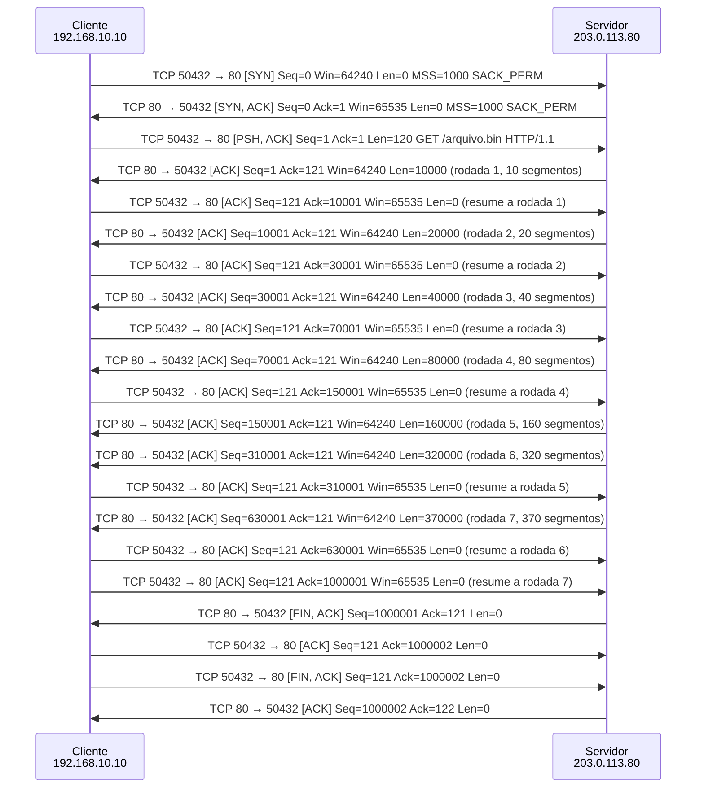

*Figura 4.2.4 (Tipo B, sequência).* Mensagens do cenário "Download com RTT alto", na ordem do tempo, entre Cliente 192.168.10.10, Servidor 203.0.113.80: 21 mensagens. Corresponde à aba Captura, no modo "TCP: download de arquivo", na ordem em que os pacotes aparecem; os intervalos de tempo não estão em escala.

### 4.3 Modo: UDP: fluxo de datagramas e DNS

> **Grupo:** UDP

Datagramas sem conexão: o que a aplicação ganha em rapidez e o que precisa fazer por conta própria.

#### 4.3.1 Fluxo com perdas

Configuração do cenário: UDP (fluxo de mídia); 20 segmentos de 1000 bytes; 10% de perda; 10% de reordenação

**O que é.**

O **UDP** não tem conexão, confirmação nem retransmissão: cada datagrama é independente. O que se perde não volta, e o que atrasa chega fora de ordem. Para mídia em tempo real (RTP sobre UDP), isso é melhor do que esperar: um áudio atrasado já não serve.

**Neste cenário.**

Vinte datagramas de mídia saem sem handshake e sem esperar confirmação. Os perdidos não são recuperados e os atrasados chegam fora de ordem.

Para voz e vídeo, isso é aceitável: um áudio atrasado já não serve.

**O que observar.**

- No diagrama: nenhum handshake e nenhum ACK; o envio segue no ritmo do enlace.
- Os datagramas perdidos não são reenviados.
- Na aba Resultados: quantos chegaram e quantos chegaram fora de ordem.

**Mensagens envolvidas.**

| Datagrama | Função | Quem envia |
| --- | --- | --- |
| UDP | mídia para a porta 5004 (RTP) | cliente |

**Por que importa.**

Como não confirma nada, o UDP também não verifica a origem: é a base da falsificação, da reflexão e da amplificação (veja o simulador de Ataques e defesas TCP/UDP).

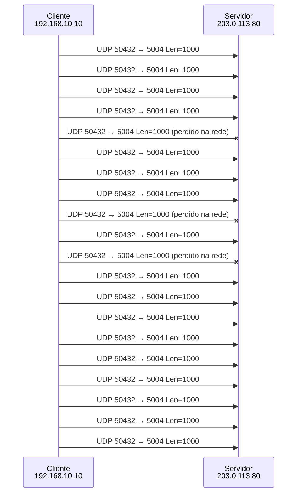

*Figura 4.3.1 (Tipo B, sequência).* Mensagens do cenário "Fluxo com perdas", na ordem do tempo, entre Cliente 192.168.10.10, Servidor 203.0.113.80: 20 mensagens (3 perdidas). Corresponde à aba Captura, no modo "UDP: fluxo de datagramas e DNS", na ordem em que os pacotes aparecem; os intervalos de tempo não estão em escala.

#### 4.3.2 DNS com repetição

Configuração do cenário: UDP (DNS); sem perda aleatória; descarte forçado do #1

**O que é.**

O **DNS** usa UDP na porta 53, com uma consulta e uma resposta. Se a resposta não chega no tempo limite, o UDP não faz nada: é o **resolvedor** (a aplicação) que repete a consulta.

**Neste cenário.**

A primeira consulta se perde. O UDP não percebe; quem percebe é o resolvedor, que espera 1 s (valor didático; a [RFC 1035](https://www.rfc-editor.org/rfc/rfc1035), seção 7.2, sugere intervalo mínimo de 2 a 5 s) e repete a consulta.

É o padrão de quem usa UDP: a confiabilidade, quando necessária, fica com a aplicação.

**O que observar.**

- No diagrama: a primeira consulta se perde e nada volta.
- Depois de 1 s, a aplicação envia a mesma consulta de novo.
- O tempo total inclui essa espera.

**Mensagens envolvidas.**

| Datagrama | Função | Quem envia |
| --- | --- | --- |
| Consulta DNS | UDP para a porta 53 | cliente |
| Resposta DNS | UDP a partir da porta 53 | servidor |

**Por que importa.**

Quem usa UDP assume a confiabilidade de que precisa. O DNS sobre UDP também é alvo de amplificação e de respostas forjadas; o identificador da consulta e a porta de origem aleatória dificultam o envenenamento de cache.

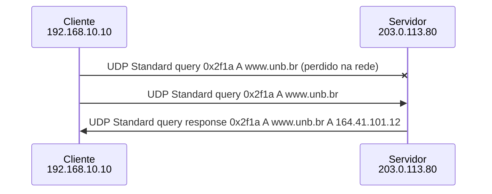

*Figura 4.3.2 (Tipo B, sequência).* Mensagens do cenário "DNS com repetição", na ordem do tempo, entre Cliente 192.168.10.10, Servidor 203.0.113.80: 3 mensagens (1 perdida). Corresponde à aba Captura, no modo "UDP: fluxo de datagramas e DNS", na ordem em que os pacotes aparecem; os intervalos de tempo não estão em escala.

### 4.4 Modo: UDP: vídeo em streaming

> **Grupo:** Vídeo

Vídeo ao vivo por UDP (RTP): quadros I e P, perdas sem retransmissão, jitter e buffer do player.

#### 4.4.1 Vídeo em streaming

Configuração do cenário: Vídeo de 5 s a 2500 kbit/s por UDP; RTT de 50 ms; enlace de 5 Mbps; sem perda aleatória; jitter de até 20 ms; buffer do player de 100 ms

**O que é.**

O **streaming de vídeo ao vivo** envia os quadros em pacotes **RTP** sobre UDP. Há um quadro **I** por segundo (completo e grande) e quadros **P** (só a diferença para o anterior). O servidor espaça os pacotes ao longo de cada quadro, e o **player** mantém um pequeno buffer (aqui, 100 ms) para absorver as variações de atraso (jitter).

**Neste cenário.**

Cinco segundos de vídeo a 2500 kbit/s, 25 quadros por segundo, num enlace de 5 Mbps com jitter de até 20 ms e buffer de 100 ms no player.

O quadro I, bem maior, cria um pico de envio a cada segundo e uma fila momentânea, mas o buffer absorve a variação e todos os quadros saem sem defeito.

**O que observar.**

- No diagrama: uma seta por quadro. Os quadros I (rotulados) são maiores e demoram mais para chegar.
- Na aba Vazão e qualidade: o pico de envio a cada segundo (quadro I) e a faixa de quadros toda verde.
- Na aba Resultados: jitter, atraso até a exibição e nenhum quadro com defeito.

**Mensagens envolvidas.**

| Unidade | Função | Quem envia |
| --- | --- | --- |
| Quadro I | imagem completa, a cada 25 quadros (1 s) | servidor |
| Quadro P | diferença em relação ao quadro anterior | servidor |
| Pacote RTP (UDP) | até 1200 bytes, com sequência e marca de tempo | servidor |

**Por que importa.**

Em vídeo ao vivo, é melhor perder um pacote do que esperar a retransmissão: o quadro atrasado já não pode ser exibido. Por isso voz, vídeo e videoconferência preferem o UDP.

```mermaid
sequenceDiagram
  participant h_203_0_113_80 as Servidor<br/>203.0.113.80
  participant h_192_168_10_10 as Cliente<br/>192.168.10.10
  h_203_0_113_80 ->> h_192_168_10_10: UDP 5004 → 50432 RTP quadro I nº 1: 53 pacotes, 62500 bytes
  h_203_0_113_80 ->> h_192_168_10_10: UDP 5004 → 50432 RTP quadro P nº 2: 9 pacotes, 10417 bytes
  h_203_0_113_80 ->> h_192_168_10_10: UDP 5004 → 50432 RTP quadro P nº 3: 9 pacotes, 10417 bytes
  h_203_0_113_80 ->> h_192_168_10_10: UDP 5004 → 50432 RTP quadro P nº 4: 9 pacotes, 10417 bytes
  h_203_0_113_80 ->> h_192_168_10_10: UDP 5004 → 50432 RTP quadro P nº 5: 9 pacotes, 10417 bytes
  h_203_0_113_80 ->> h_192_168_10_10: UDP 5004 → 50432 RTP quadro P nº 6: 9 pacotes, 10417 bytes
  h_203_0_113_80 ->> h_192_168_10_10: UDP 5004 → 50432 RTP quadro P nº 7: 9 pacotes, 10417 bytes
  h_203_0_113_80 ->> h_192_168_10_10: UDP 5004 → 50432 RTP quadro P nº 8: 9 pacotes, 10417 bytes
  h_203_0_113_80 ->> h_192_168_10_10: UDP 5004 → 50432 RTP quadro P nº 9: 9 pacotes, 10417 bytes
  h_203_0_113_80 ->> h_192_168_10_10: UDP 5004 → 50432 RTP quadro P nº 10: 9 pacotes, 10417 bytes
  h_203_0_113_80 ->> h_192_168_10_10: UDP 5004 → 50432 RTP quadro P nº 11: 9 pacotes, 10417 bytes
  h_203_0_113_80 ->> h_192_168_10_10: UDP 5004 → 50432 RTP quadro P nº 12: 9 pacotes, 10417 bytes
  h_203_0_113_80 ->> h_192_168_10_10: UDP 5004 → 50432 RTP quadro P nº 13: 9 pacotes, 10417 bytes
  h_203_0_113_80 ->> h_192_168_10_10: UDP 5004 → 50432 RTP quadro P nº 14: 9 pacotes, 10417 bytes
  h_203_0_113_80 ->> h_192_168_10_10: UDP 5004 → 50432 RTP quadro P nº 15: 9 pacotes, 10417 bytes
  h_203_0_113_80 ->> h_192_168_10_10: UDP 5004 → 50432 RTP quadro P nº 16: 9 pacotes, 10417 bytes
  h_203_0_113_80 ->> h_192_168_10_10: UDP 5004 → 50432 RTP quadro P nº 17: 9 pacotes, 10417 bytes
  h_203_0_113_80 ->> h_192_168_10_10: UDP 5004 → 50432 RTP quadro P nº 18: 9 pacotes, 10417 bytes
  h_203_0_113_80 ->> h_192_168_10_10: UDP 5004 → 50432 RTP quadro P nº 19: 9 pacotes, 10417 bytes
  h_203_0_113_80 ->> h_192_168_10_10: UDP 5004 → 50432 RTP quadro P nº 20: 9 pacotes, 10417 bytes
  h_203_0_113_80 ->> h_192_168_10_10: UDP 5004 → 50432 RTP quadro P nº 21: 9 pacotes, 10417 bytes
  h_203_0_113_80 ->> h_192_168_10_10: UDP 5004 → 50432 RTP quadro P nº 22: 9 pacotes, 10417 bytes
  h_203_0_113_80 ->> h_192_168_10_10: UDP 5004 → 50432 RTP quadro P nº 23: 9 pacotes, 10417 bytes
  h_203_0_113_80 ->> h_192_168_10_10: UDP 5004 → 50432 RTP quadro P nº 24: 9 pacotes, 10417 bytes
  h_203_0_113_80 ->> h_192_168_10_10: UDP 5004 → 50432 RTP quadro P nº 25: 9 pacotes, 10417 bytes
  h_203_0_113_80 ->> h_192_168_10_10: UDP 5004 → 50432 RTP quadro I nº 26: 53 pacotes, 62500 bytes
  h_203_0_113_80 ->> h_192_168_10_10: UDP 5004 → 50432 RTP quadro P nº 27: 9 pacotes, 10417 bytes
  h_203_0_113_80 ->> h_192_168_10_10: UDP 5004 → 50432 RTP quadro P nº 28: 9 pacotes, 10417 bytes
  h_203_0_113_80 ->> h_192_168_10_10: UDP 5004 → 50432 RTP quadro P nº 29: 9 pacotes, 10417 bytes
  h_203_0_113_80 ->> h_192_168_10_10: UDP 5004 → 50432 RTP quadro P nº 30: 9 pacotes, 10417 bytes
  h_203_0_113_80 ->> h_192_168_10_10: UDP 5004 → 50432 RTP quadro P nº 31: 9 pacotes, 10417 bytes
  h_203_0_113_80 ->> h_192_168_10_10: UDP 5004 → 50432 RTP quadro P nº 32: 9 pacotes, 10417 bytes
  h_203_0_113_80 ->> h_192_168_10_10: UDP 5004 → 50432 RTP quadro P nº 33: 9 pacotes, 10417 bytes
  h_203_0_113_80 ->> h_192_168_10_10: UDP 5004 → 50432 RTP quadro P nº 34: 9 pacotes, 10417 bytes
  h_203_0_113_80 ->> h_192_168_10_10: UDP 5004 → 50432 RTP quadro P nº 35: 9 pacotes, 10417 bytes
  h_203_0_113_80 ->> h_192_168_10_10: UDP 5004 → 50432 RTP quadro P nº 36: 9 pacotes, 10417 bytes
  h_203_0_113_80 ->> h_192_168_10_10: UDP 5004 → 50432 RTP quadro P nº 37: 9 pacotes, 10417 bytes
  h_203_0_113_80 ->> h_192_168_10_10: UDP 5004 → 50432 RTP quadro P nº 38: 9 pacotes, 10417 bytes
  h_203_0_113_80 ->> h_192_168_10_10: UDP 5004 → 50432 RTP quadro P nº 39: 9 pacotes, 10417 bytes
  h_203_0_113_80 ->> h_192_168_10_10: UDP 5004 → 50432 RTP quadro P nº 40: 9 pacotes, 10417 bytes
  h_203_0_113_80 ->> h_192_168_10_10: UDP 5004 → 50432 RTP quadro P nº 41: 9 pacotes, 10417 bytes
  h_203_0_113_80 ->> h_192_168_10_10: UDP 5004 → 50432 RTP quadro P nº 42: 9 pacotes, 10417 bytes
  h_203_0_113_80 ->> h_192_168_10_10: UDP 5004 → 50432 RTP quadro P nº 43: 9 pacotes, 10417 bytes
  h_203_0_113_80 ->> h_192_168_10_10: UDP 5004 → 50432 RTP quadro P nº 44: 9 pacotes, 10417 bytes
  h_203_0_113_80 ->> h_192_168_10_10: UDP 5004 → 50432 RTP quadro P nº 45: 9 pacotes, 10417 bytes
  h_203_0_113_80 ->> h_192_168_10_10: UDP 5004 → 50432 RTP quadro P nº 46: 9 pacotes, 10417 bytes
  h_203_0_113_80 ->> h_192_168_10_10: UDP 5004 → 50432 RTP quadro P nº 47: 9 pacotes, 10417 bytes
  h_203_0_113_80 ->> h_192_168_10_10: UDP 5004 → 50432 RTP quadro P nº 48: 9 pacotes, 10417 bytes
  h_203_0_113_80 ->> h_192_168_10_10: UDP 5004 → 50432 RTP quadro P nº 49: 9 pacotes, 10417 bytes
  h_203_0_113_80 ->> h_192_168_10_10: UDP 5004 → 50432 RTP quadro P nº 50: 9 pacotes, 10417 bytes
  h_203_0_113_80 ->> h_192_168_10_10: UDP 5004 → 50432 RTP quadro I nº 51: 53 pacotes, 62500 bytes
  h_203_0_113_80 ->> h_192_168_10_10: UDP 5004 → 50432 RTP quadro P nº 52: 9 pacotes, 10417 bytes
  h_203_0_113_80 ->> h_192_168_10_10: UDP 5004 → 50432 RTP quadro P nº 53: 9 pacotes, 10417 bytes
  h_203_0_113_80 ->> h_192_168_10_10: UDP 5004 → 50432 RTP quadro P nº 54: 9 pacotes, 10417 bytes
  h_203_0_113_80 ->> h_192_168_10_10: UDP 5004 → 50432 RTP quadro P nº 55: 9 pacotes, 10417 bytes
  h_203_0_113_80 ->> h_192_168_10_10: UDP 5004 → 50432 RTP quadro P nº 56: 9 pacotes, 10417 bytes
  h_203_0_113_80 ->> h_192_168_10_10: UDP 5004 → 50432 RTP quadro P nº 57: 9 pacotes, 10417 bytes
  h_203_0_113_80 ->> h_192_168_10_10: UDP 5004 → 50432 RTP quadro P nº 58: 9 pacotes, 10417 bytes
  h_203_0_113_80 ->> h_192_168_10_10: UDP 5004 → 50432 RTP quadro P nº 59: 9 pacotes, 10417 bytes
  h_203_0_113_80 ->> h_192_168_10_10: UDP 5004 → 50432 RTP quadro P nº 60: 9 pacotes, 10417 bytes
  h_203_0_113_80 ->> h_192_168_10_10: UDP 5004 → 50432 RTP quadro P nº 61: 9 pacotes, 10417 bytes
  h_203_0_113_80 ->> h_192_168_10_10: UDP 5004 → 50432 RTP quadro P nº 62: 9 pacotes, 10417 bytes
  h_203_0_113_80 ->> h_192_168_10_10: UDP 5004 → 50432 RTP quadro P nº 63: 9 pacotes, 10417 bytes
  h_203_0_113_80 ->> h_192_168_10_10: UDP 5004 → 50432 RTP quadro P nº 64: 9 pacotes, 10417 bytes
  h_203_0_113_80 ->> h_192_168_10_10: UDP 5004 → 50432 RTP quadro P nº 65: 9 pacotes, 10417 bytes
  h_203_0_113_80 ->> h_192_168_10_10: UDP 5004 → 50432 RTP quadro P nº 66: 9 pacotes, 10417 bytes
  h_203_0_113_80 ->> h_192_168_10_10: UDP 5004 → 50432 RTP quadro P nº 67: 9 pacotes, 10417 bytes
  h_203_0_113_80 ->> h_192_168_10_10: UDP 5004 → 50432 RTP quadro P nº 68: 9 pacotes, 10417 bytes
  h_203_0_113_80 ->> h_192_168_10_10: UDP 5004 → 50432 RTP quadro P nº 69: 9 pacotes, 10417 bytes
  h_203_0_113_80 ->> h_192_168_10_10: UDP 5004 → 50432 RTP quadro P nº 70: 9 pacotes, 10417 bytes
  h_203_0_113_80 ->> h_192_168_10_10: UDP 5004 → 50432 RTP quadro P nº 71: 9 pacotes, 10417 bytes
  h_203_0_113_80 ->> h_192_168_10_10: UDP 5004 → 50432 RTP quadro P nº 72: 9 pacotes, 10417 bytes
  h_203_0_113_80 ->> h_192_168_10_10: UDP 5004 → 50432 RTP quadro P nº 73: 9 pacotes, 10417 bytes
  h_203_0_113_80 ->> h_192_168_10_10: UDP 5004 → 50432 RTP quadro P nº 74: 9 pacotes, 10417 bytes
  h_203_0_113_80 ->> h_192_168_10_10: UDP 5004 → 50432 RTP quadro P nº 75: 9 pacotes, 10417 bytes
  h_203_0_113_80 ->> h_192_168_10_10: UDP 5004 → 50432 RTP quadro I nº 76: 53 pacotes, 62500 bytes
  h_203_0_113_80 ->> h_192_168_10_10: UDP 5004 → 50432 RTP quadro P nº 77: 9 pacotes, 10417 bytes
  h_203_0_113_80 ->> h_192_168_10_10: UDP 5004 → 50432 RTP quadro P nº 78: 9 pacotes, 10417 bytes
  h_203_0_113_80 ->> h_192_168_10_10: UDP 5004 → 50432 RTP quadro P nº 79: 9 pacotes, 10417 bytes
  h_203_0_113_80 ->> h_192_168_10_10: UDP 5004 → 50432 RTP quadro P nº 80: 9 pacotes, 10417 bytes
  h_203_0_113_80 ->> h_192_168_10_10: UDP 5004 → 50432 RTP quadro P nº 81: 9 pacotes, 10417 bytes
  h_203_0_113_80 ->> h_192_168_10_10: UDP 5004 → 50432 RTP quadro P nº 82: 9 pacotes, 10417 bytes
  h_203_0_113_80 ->> h_192_168_10_10: UDP 5004 → 50432 RTP quadro P nº 83: 9 pacotes, 10417 bytes
  h_203_0_113_80 ->> h_192_168_10_10: UDP 5004 → 50432 RTP quadro P nº 84: 9 pacotes, 10417 bytes
  h_203_0_113_80 ->> h_192_168_10_10: UDP 5004 → 50432 RTP quadro P nº 85: 9 pacotes, 10417 bytes
  h_203_0_113_80 ->> h_192_168_10_10: UDP 5004 → 50432 RTP quadro P nº 86: 9 pacotes, 10417 bytes
  h_203_0_113_80 ->> h_192_168_10_10: UDP 5004 → 50432 RTP quadro P nº 87: 9 pacotes, 10417 bytes
  h_203_0_113_80 ->> h_192_168_10_10: UDP 5004 → 50432 RTP quadro P nº 88: 9 pacotes, 10417 bytes
  h_203_0_113_80 ->> h_192_168_10_10: UDP 5004 → 50432 RTP quadro P nº 89: 9 pacotes, 10417 bytes
  h_203_0_113_80 ->> h_192_168_10_10: UDP 5004 → 50432 RTP quadro P nº 90: 9 pacotes, 10417 bytes
  h_203_0_113_80 ->> h_192_168_10_10: UDP 5004 → 50432 RTP quadro P nº 91: 9 pacotes, 10417 bytes
  h_203_0_113_80 ->> h_192_168_10_10: UDP 5004 → 50432 RTP quadro P nº 92: 9 pacotes, 10417 bytes
  h_203_0_113_80 ->> h_192_168_10_10: UDP 5004 → 50432 RTP quadro P nº 93: 9 pacotes, 10417 bytes
  h_203_0_113_80 ->> h_192_168_10_10: UDP 5004 → 50432 RTP quadro P nº 94: 9 pacotes, 10417 bytes
  h_203_0_113_80 ->> h_192_168_10_10: UDP 5004 → 50432 RTP quadro P nº 95: 9 pacotes, 10417 bytes
  h_203_0_113_80 ->> h_192_168_10_10: UDP 5004 → 50432 RTP quadro P nº 96: 9 pacotes, 10417 bytes
  h_203_0_113_80 ->> h_192_168_10_10: UDP 5004 → 50432 RTP quadro P nº 97: 9 pacotes, 10417 bytes
  h_203_0_113_80 ->> h_192_168_10_10: UDP 5004 → 50432 RTP quadro P nº 98: 9 pacotes, 10417 bytes
  h_203_0_113_80 ->> h_192_168_10_10: UDP 5004 → 50432 RTP quadro P nº 99: 9 pacotes, 10417 bytes
  h_203_0_113_80 ->> h_192_168_10_10: UDP 5004 → 50432 RTP quadro P nº 100: 9 pacotes, 10417 bytes
  h_203_0_113_80 ->> h_192_168_10_10: UDP 5004 → 50432 RTP quadro I nº 101: 53 pacotes, 62500 bytes
  h_203_0_113_80 ->> h_192_168_10_10: UDP 5004 → 50432 RTP quadro P nº 102: 9 pacotes, 10417 bytes
  h_203_0_113_80 ->> h_192_168_10_10: UDP 5004 → 50432 RTP quadro P nº 103: 9 pacotes, 10417 bytes
  h_203_0_113_80 ->> h_192_168_10_10: UDP 5004 → 50432 RTP quadro P nº 104: 9 pacotes, 10417 bytes
  h_203_0_113_80 ->> h_192_168_10_10: UDP 5004 → 50432 RTP quadro P nº 105: 9 pacotes, 10417 bytes
  h_203_0_113_80 ->> h_192_168_10_10: UDP 5004 → 50432 RTP quadro P nº 106: 9 pacotes, 10417 bytes
  h_203_0_113_80 ->> h_192_168_10_10: UDP 5004 → 50432 RTP quadro P nº 107: 9 pacotes, 10417 bytes
  h_203_0_113_80 ->> h_192_168_10_10: UDP 5004 → 50432 RTP quadro P nº 108: 9 pacotes, 10417 bytes
  h_203_0_113_80 ->> h_192_168_10_10: UDP 5004 → 50432 RTP quadro P nº 109: 9 pacotes, 10417 bytes
  h_203_0_113_80 ->> h_192_168_10_10: UDP 5004 → 50432 RTP quadro P nº 110: 9 pacotes, 10417 bytes
  h_203_0_113_80 ->> h_192_168_10_10: UDP 5004 → 50432 RTP quadro P nº 111: 9 pacotes, 10417 bytes
  h_203_0_113_80 ->> h_192_168_10_10: UDP 5004 → 50432 RTP quadro P nº 112: 9 pacotes, 10417 bytes
  h_203_0_113_80 ->> h_192_168_10_10: UDP 5004 → 50432 RTP quadro P nº 113: 9 pacotes, 10417 bytes
  h_203_0_113_80 ->> h_192_168_10_10: UDP 5004 → 50432 RTP quadro P nº 114: 9 pacotes, 10417 bytes
  h_203_0_113_80 ->> h_192_168_10_10: UDP 5004 → 50432 RTP quadro P nº 115: 9 pacotes, 10417 bytes
  h_203_0_113_80 ->> h_192_168_10_10: UDP 5004 → 50432 RTP quadro P nº 116: 9 pacotes, 10417 bytes
  h_203_0_113_80 ->> h_192_168_10_10: UDP 5004 → 50432 RTP quadro P nº 117: 9 pacotes, 10417 bytes
  h_203_0_113_80 ->> h_192_168_10_10: UDP 5004 → 50432 RTP quadro P nº 118: 9 pacotes, 10417 bytes
  h_203_0_113_80 ->> h_192_168_10_10: UDP 5004 → 50432 RTP quadro P nº 119: 9 pacotes, 10417 bytes
  h_203_0_113_80 ->> h_192_168_10_10: UDP 5004 → 50432 RTP quadro P nº 120: 9 pacotes, 10417 bytes
  h_203_0_113_80 ->> h_192_168_10_10: UDP 5004 → 50432 RTP quadro P nº 121: 9 pacotes, 10417 bytes
  h_203_0_113_80 ->> h_192_168_10_10: UDP 5004 → 50432 RTP quadro P nº 122: 9 pacotes, 10417 bytes
  h_203_0_113_80 ->> h_192_168_10_10: UDP 5004 → 50432 RTP quadro P nº 123: 9 pacotes, 10417 bytes
  h_203_0_113_80 ->> h_192_168_10_10: UDP 5004 → 50432 RTP quadro P nº 124: 9 pacotes, 10417 bytes
  h_203_0_113_80 ->> h_192_168_10_10: UDP 5004 → 50432 RTP quadro P nº 125: 9 pacotes, 10417 bytes
```

*Figura 4.4.1 (Tipo B, sequência).* Mensagens do cenário "Vídeo em streaming", na ordem do tempo, entre Servidor 203.0.113.80, Cliente 192.168.10.10: 125 mensagens. Corresponde à aba Captura, no modo "UDP: vídeo em streaming", na ordem em que os pacotes aparecem; os intervalos de tempo não estão em escala.

#### 4.4.2 Vídeo com perdas

Configuração do cenário: Vídeo de 5 s a 2500 kbit/s por UDP; RTT de 50 ms; enlace de 5 Mbps; 3% de perda; jitter de até 20 ms; buffer do player de 100 ms

**O que é.**

Com 3% de perda aleatória, alguns pacotes não chegam e **ninguém os repõe**. Se faltar pacote de um quadro P, o player o exibe com artefatos e os quadros seguintes herdam o erro até o próximo I. Se faltar pacote de um quadro I, a imagem congela até o próximo I (até 1 s). Os quadros I pesam mais porque têm mais pacotes (maior chance de perder algum) e porque os outros dependem deles.

**Neste cenário.**

O mesmo vídeo, agora com 3% de perda aleatória. Nada é retransmitido.

Pacotes perdidos deixam quadros incompletos: os P viram artefatos que se propagam até o próximo I, e um I incompleto congela a imagem. Troque a semente para ver onde caem as perdas.

**O que observar.**

- No diagrama: setas vermelhas nos quadros com problema.
- Na aba Vazão e qualidade: trechos âmbar (artefatos) e vermelhos (congelados) na faixa inferior.
- Na aba Resultados: quantos quadros ficaram sem defeito apesar de poucos pacotes perdidos.

**Mensagens envolvidas.**

| Unidade | Função | Quem envia |
| --- | --- | --- |
| Quadro I | perdas aqui congelam a imagem até o próximo I | servidor |
| Quadro P | perdas aqui geram artefatos que se propagam | servidor |

**Por que importa.**

Mostra por que redes de vídeo usam FEC (redundância), retransmissão seletiva e quadros I mais frequentes, e por que 3% de perda já degrada muito a experiência.

```mermaid
sequenceDiagram
  participant h_203_0_113_80 as Servidor<br/>203.0.113.80
  participant h_192_168_10_10 as Cliente<br/>192.168.10.10
  h_203_0_113_80 ->> h_192_168_10_10: UDP 5004 → 50432 RTP quadro I nº 1: 53 pacotes, 62500 bytes
  h_203_0_113_80 ->> h_192_168_10_10: UDP 5004 → 50432 RTP quadro P nº 2: 9 pacotes, 10417 bytes
  h_203_0_113_80 ->> h_192_168_10_10: UDP 5004 → 50432 RTP quadro P nº 3: 9 pacotes, 10417 bytes
  h_203_0_113_80 ->> h_192_168_10_10: UDP 5004 → 50432 RTP quadro P nº 4: 9 pacotes, 10417 bytes
  h_203_0_113_80 ->> h_192_168_10_10: UDP 5004 → 50432 RTP quadro P nº 5: 9 pacotes, 10417 bytes
  h_203_0_113_80 -x h_192_168_10_10: UDP 5004 → 50432 RTP quadro P nº 6: 9 pacotes, 10417 bytes (1 pacote(s) perdido(s) na rede
  h_203_0_113_80 -x h_192_168_10_10: UDP 5004 → 50432 RTP quadro P nº 7: 9 pacotes, 10417 bytes (1 pacote(s) perdido(s) na rede
  h_203_0_113_80 -x h_192_168_10_10: UDP 5004 → 50432 RTP quadro P nº 8: 9 pacotes, 10417 bytes (3 pacote(s) perdido(s) na rede
  h_203_0_113_80 -x h_192_168_10_10: UDP 5004 → 50432 RTP quadro P nº 9: 9 pacotes, 10417 bytes (1 pacote(s) perdido(s) na rede
  h_203_0_113_80 ->> h_192_168_10_10: UDP 5004 → 50432 RTP quadro P nº 10: 9 pacotes, 10417 bytes
  h_203_0_113_80 ->> h_192_168_10_10: UDP 5004 → 50432 RTP quadro P nº 11: 9 pacotes, 10417 bytes
  h_203_0_113_80 ->> h_192_168_10_10: UDP 5004 → 50432 RTP quadro P nº 12: 9 pacotes, 10417 bytes
  h_203_0_113_80 ->> h_192_168_10_10: UDP 5004 → 50432 RTP quadro P nº 13: 9 pacotes, 10417 bytes
  h_203_0_113_80 ->> h_192_168_10_10: UDP 5004 → 50432 RTP quadro P nº 14: 9 pacotes, 10417 bytes
  h_203_0_113_80 ->> h_192_168_10_10: UDP 5004 → 50432 RTP quadro P nº 15: 9 pacotes, 10417 bytes
  h_203_0_113_80 ->> h_192_168_10_10: UDP 5004 → 50432 RTP quadro P nº 16: 9 pacotes, 10417 bytes
  h_203_0_113_80 ->> h_192_168_10_10: UDP 5004 → 50432 RTP quadro P nº 17: 9 pacotes, 10417 bytes
  h_203_0_113_80 -x h_192_168_10_10: UDP 5004 → 50432 RTP quadro P nº 18: 9 pacotes, 10417 bytes (1 pacote(s) perdido(s) na red
  h_203_0_113_80 ->> h_192_168_10_10: UDP 5004 → 50432 RTP quadro P nº 19: 9 pacotes, 10417 bytes
  h_203_0_113_80 -x h_192_168_10_10: UDP 5004 → 50432 RTP quadro P nº 20: 9 pacotes, 10417 bytes (1 pacote(s) perdido(s) na red
  h_203_0_113_80 ->> h_192_168_10_10: UDP 5004 → 50432 RTP quadro P nº 21: 9 pacotes, 10417 bytes
  h_203_0_113_80 ->> h_192_168_10_10: UDP 5004 → 50432 RTP quadro P nº 22: 9 pacotes, 10417 bytes
  h_203_0_113_80 -x h_192_168_10_10: UDP 5004 → 50432 RTP quadro P nº 23: 9 pacotes, 10417 bytes (2 pacote(s) perdido(s) na red
  h_203_0_113_80 -x h_192_168_10_10: UDP 5004 → 50432 RTP quadro P nº 24: 9 pacotes, 10417 bytes (2 pacote(s) perdido(s) na red
  h_203_0_113_80 -x h_192_168_10_10: UDP 5004 → 50432 RTP quadro P nº 25: 9 pacotes, 10417 bytes (1 pacote(s) perdido(s) na red
  h_203_0_113_80 ->> h_192_168_10_10: UDP 5004 → 50432 RTP quadro I nº 26: 53 pacotes, 62500 bytes
  h_203_0_113_80 ->> h_192_168_10_10: UDP 5004 → 50432 RTP quadro P nº 27: 9 pacotes, 10417 bytes
  h_203_0_113_80 ->> h_192_168_10_10: UDP 5004 → 50432 RTP quadro P nº 28: 9 pacotes, 10417 bytes
  h_203_0_113_80 ->> h_192_168_10_10: UDP 5004 → 50432 RTP quadro P nº 29: 9 pacotes, 10417 bytes
  h_203_0_113_80 ->> h_192_168_10_10: UDP 5004 → 50432 RTP quadro P nº 30: 9 pacotes, 10417 bytes
  h_203_0_113_80 -x h_192_168_10_10: UDP 5004 → 50432 RTP quadro P nº 31: 9 pacotes, 10417 bytes (2 pacote(s) perdido(s) na red
  h_203_0_113_80 ->> h_192_168_10_10: UDP 5004 → 50432 RTP quadro P nº 32: 9 pacotes, 10417 bytes
  h_203_0_113_80 -x h_192_168_10_10: UDP 5004 → 50432 RTP quadro P nº 33: 9 pacotes, 10417 bytes (1 pacote(s) perdido(s) na red
  h_203_0_113_80 ->> h_192_168_10_10: UDP 5004 → 50432 RTP quadro P nº 34: 9 pacotes, 10417 bytes
  h_203_0_113_80 ->> h_192_168_10_10: UDP 5004 → 50432 RTP quadro P nº 35: 9 pacotes, 10417 bytes
  h_203_0_113_80 ->> h_192_168_10_10: UDP 5004 → 50432 RTP quadro P nº 36: 9 pacotes, 10417 bytes
  h_203_0_113_80 ->> h_192_168_10_10: UDP 5004 → 50432 RTP quadro P nº 37: 9 pacotes, 10417 bytes
  h_203_0_113_80 ->> h_192_168_10_10: UDP 5004 → 50432 RTP quadro P nº 38: 9 pacotes, 10417 bytes
  h_203_0_113_80 ->> h_192_168_10_10: UDP 5004 → 50432 RTP quadro P nº 39: 9 pacotes, 10417 bytes
  h_203_0_113_80 ->> h_192_168_10_10: UDP 5004 → 50432 RTP quadro P nº 40: 9 pacotes, 10417 bytes
  h_203_0_113_80 -x h_192_168_10_10: UDP 5004 → 50432 RTP quadro P nº 41: 9 pacotes, 10417 bytes (2 pacote(s) perdido(s) na red
  h_203_0_113_80 ->> h_192_168_10_10: UDP 5004 → 50432 RTP quadro P nº 42: 9 pacotes, 10417 bytes
  h_203_0_113_80 ->> h_192_168_10_10: UDP 5004 → 50432 RTP quadro P nº 43: 9 pacotes, 10417 bytes
  h_203_0_113_80 ->> h_192_168_10_10: UDP 5004 → 50432 RTP quadro P nº 44: 9 pacotes, 10417 bytes
  h_203_0_113_80 ->> h_192_168_10_10: UDP 5004 → 50432 RTP quadro P nº 45: 9 pacotes, 10417 bytes
  h_203_0_113_80 ->> h_192_168_10_10: UDP 5004 → 50432 RTP quadro P nº 46: 9 pacotes, 10417 bytes
  h_203_0_113_80 ->> h_192_168_10_10: UDP 5004 → 50432 RTP quadro P nº 47: 9 pacotes, 10417 bytes
  h_203_0_113_80 ->> h_192_168_10_10: UDP 5004 → 50432 RTP quadro P nº 48: 9 pacotes, 10417 bytes
  h_203_0_113_80 ->> h_192_168_10_10: UDP 5004 → 50432 RTP quadro P nº 49: 9 pacotes, 10417 bytes
  h_203_0_113_80 -x h_192_168_10_10: UDP 5004 → 50432 RTP quadro P nº 50: 9 pacotes, 10417 bytes (1 pacote(s) perdido(s) na red
  h_203_0_113_80 -x h_192_168_10_10: UDP 5004 → 50432 RTP quadro I nº 51: 53 pacotes, 62500 bytes (1 pacote(s) perdido(s) na re
  h_203_0_113_80 ->> h_192_168_10_10: UDP 5004 → 50432 RTP quadro P nº 52: 9 pacotes, 10417 bytes
  h_203_0_113_80 ->> h_192_168_10_10: UDP 5004 → 50432 RTP quadro P nº 53: 9 pacotes, 10417 bytes
  h_203_0_113_80 -x h_192_168_10_10: UDP 5004 → 50432 RTP quadro P nº 54: 9 pacotes, 10417 bytes (1 pacote(s) perdido(s) na red
  h_203_0_113_80 ->> h_192_168_10_10: UDP 5004 → 50432 RTP quadro P nº 55: 9 pacotes, 10417 bytes
  h_203_0_113_80 -x h_192_168_10_10: UDP 5004 → 50432 RTP quadro P nº 56: 9 pacotes, 10417 bytes (1 pacote(s) perdido(s) na red
  h_203_0_113_80 ->> h_192_168_10_10: UDP 5004 → 50432 RTP quadro P nº 57: 9 pacotes, 10417 bytes
  h_203_0_113_80 -x h_192_168_10_10: UDP 5004 → 50432 RTP quadro P nº 58: 9 pacotes, 10417 bytes (1 pacote(s) perdido(s) na red
  h_203_0_113_80 ->> h_192_168_10_10: UDP 5004 → 50432 RTP quadro P nº 59: 9 pacotes, 10417 bytes
  h_203_0_113_80 ->> h_192_168_10_10: UDP 5004 → 50432 RTP quadro P nº 60: 9 pacotes, 10417 bytes
  h_203_0_113_80 ->> h_192_168_10_10: UDP 5004 → 50432 RTP quadro P nº 61: 9 pacotes, 10417 bytes
  h_203_0_113_80 -x h_192_168_10_10: UDP 5004 → 50432 RTP quadro P nº 62: 9 pacotes, 10417 bytes (1 pacote(s) perdido(s) na red
  h_203_0_113_80 -x h_192_168_10_10: UDP 5004 → 50432 RTP quadro P nº 63: 9 pacotes, 10417 bytes (1 pacote(s) perdido(s) na red
  h_203_0_113_80 ->> h_192_168_10_10: UDP 5004 → 50432 RTP quadro P nº 64: 9 pacotes, 10417 bytes
  h_203_0_113_80 -x h_192_168_10_10: UDP 5004 → 50432 RTP quadro P nº 65: 9 pacotes, 10417 bytes (1 pacote(s) perdido(s) na red
  h_203_0_113_80 -x h_192_168_10_10: UDP 5004 → 50432 RTP quadro P nº 66: 9 pacotes, 10417 bytes (1 pacote(s) perdido(s) na red
  h_203_0_113_80 ->> h_192_168_10_10: UDP 5004 → 50432 RTP quadro P nº 67: 9 pacotes, 10417 bytes
  h_203_0_113_80 ->> h_192_168_10_10: UDP 5004 → 50432 RTP quadro P nº 68: 9 pacotes, 10417 bytes
  h_203_0_113_80 ->> h_192_168_10_10: UDP 5004 → 50432 RTP quadro P nº 69: 9 pacotes, 10417 bytes
  h_203_0_113_80 ->> h_192_168_10_10: UDP 5004 → 50432 RTP quadro P nº 70: 9 pacotes, 10417 bytes
  h_203_0_113_80 -x h_192_168_10_10: UDP 5004 → 50432 RTP quadro P nº 71: 9 pacotes, 10417 bytes (1 pacote(s) perdido(s) na red
  h_203_0_113_80 ->> h_192_168_10_10: UDP 5004 → 50432 RTP quadro P nº 72: 9 pacotes, 10417 bytes
  h_203_0_113_80 ->> h_192_168_10_10: UDP 5004 → 50432 RTP quadro P nº 73: 9 pacotes, 10417 bytes
  h_203_0_113_80 -x h_192_168_10_10: UDP 5004 → 50432 RTP quadro P nº 74: 9 pacotes, 10417 bytes (1 pacote(s) perdido(s) na red
  h_203_0_113_80 ->> h_192_168_10_10: UDP 5004 → 50432 RTP quadro P nº 75: 9 pacotes, 10417 bytes
  h_203_0_113_80 ->> h_192_168_10_10: UDP 5004 → 50432 RTP quadro I nº 76: 53 pacotes, 62500 bytes
  h_203_0_113_80 -x h_192_168_10_10: UDP 5004 → 50432 RTP quadro P nº 77: 9 pacotes, 10417 bytes (1 pacote(s) perdido(s) na red
  h_203_0_113_80 ->> h_192_168_10_10: UDP 5004 → 50432 RTP quadro P nº 78: 9 pacotes, 10417 bytes
  h_203_0_113_80 ->> h_192_168_10_10: UDP 5004 → 50432 RTP quadro P nº 79: 9 pacotes, 10417 bytes
  h_203_0_113_80 ->> h_192_168_10_10: UDP 5004 → 50432 RTP quadro P nº 80: 9 pacotes, 10417 bytes
  h_203_0_113_80 -x h_192_168_10_10: UDP 5004 → 50432 RTP quadro P nº 81: 9 pacotes, 10417 bytes (1 pacote(s) perdido(s) na red
  h_203_0_113_80 ->> h_192_168_10_10: UDP 5004 → 50432 RTP quadro P nº 82: 9 pacotes, 10417 bytes
  h_203_0_113_80 -x h_192_168_10_10: UDP 5004 → 50432 RTP quadro P nº 83: 9 pacotes, 10417 bytes (1 pacote(s) perdido(s) na red
  h_203_0_113_80 -x h_192_168_10_10: UDP 5004 → 50432 RTP quadro P nº 84: 9 pacotes, 10417 bytes (1 pacote(s) perdido(s) na red
  h_203_0_113_80 ->> h_192_168_10_10: UDP 5004 → 50432 RTP quadro P nº 85: 9 pacotes, 10417 bytes
  h_203_0_113_80 ->> h_192_168_10_10: UDP 5004 → 50432 RTP quadro P nº 86: 9 pacotes, 10417 bytes
  h_203_0_113_80 -x h_192_168_10_10: UDP 5004 → 50432 RTP quadro P nº 87: 9 pacotes, 10417 bytes (1 pacote(s) perdido(s) na red
  h_203_0_113_80 ->> h_192_168_10_10: UDP 5004 → 50432 RTP quadro P nº 88: 9 pacotes, 10417 bytes
  h_203_0_113_80 ->> h_192_168_10_10: UDP 5004 → 50432 RTP quadro P nº 89: 9 pacotes, 10417 bytes
  h_203_0_113_80 ->> h_192_168_10_10: UDP 5004 → 50432 RTP quadro P nº 90: 9 pacotes, 10417 bytes
  h_203_0_113_80 ->> h_192_168_10_10: UDP 5004 → 50432 RTP quadro P nº 91: 9 pacotes, 10417 bytes
  h_203_0_113_80 -x h_192_168_10_10: UDP 5004 → 50432 RTP quadro P nº 92: 9 pacotes, 10417 bytes (1 pacote(s) perdido(s) na red
  h_203_0_113_80 -x h_192_168_10_10: UDP 5004 → 50432 RTP quadro P nº 93: 9 pacotes, 10417 bytes (1 pacote(s) perdido(s) na red
  h_203_0_113_80 -x h_192_168_10_10: UDP 5004 → 50432 RTP quadro P nº 94: 9 pacotes, 10417 bytes (1 pacote(s) perdido(s) na red
  h_203_0_113_80 ->> h_192_168_10_10: UDP 5004 → 50432 RTP quadro P nº 95: 9 pacotes, 10417 bytes
  h_203_0_113_80 ->> h_192_168_10_10: UDP 5004 → 50432 RTP quadro P nº 96: 9 pacotes, 10417 bytes
  h_203_0_113_80 ->> h_192_168_10_10: UDP 5004 → 50432 RTP quadro P nº 97: 9 pacotes, 10417 bytes
  h_203_0_113_80 ->> h_192_168_10_10: UDP 5004 → 50432 RTP quadro P nº 98: 9 pacotes, 10417 bytes
  h_203_0_113_80 ->> h_192_168_10_10: UDP 5004 → 50432 RTP quadro P nº 99: 9 pacotes, 10417 bytes
  h_203_0_113_80 ->> h_192_168_10_10: UDP 5004 → 50432 RTP quadro P nº 100: 9 pacotes, 10417 bytes
  h_203_0_113_80 ->> h_192_168_10_10: UDP 5004 → 50432 RTP quadro I nº 101: 53 pacotes, 62500 bytes
  h_203_0_113_80 ->> h_192_168_10_10: UDP 5004 → 50432 RTP quadro P nº 102: 9 pacotes, 10417 bytes
  h_203_0_113_80 ->> h_192_168_10_10: UDP 5004 → 50432 RTP quadro P nº 103: 9 pacotes, 10417 bytes
  h_203_0_113_80 ->> h_192_168_10_10: UDP 5004 → 50432 RTP quadro P nº 104: 9 pacotes, 10417 bytes
  h_203_0_113_80 ->> h_192_168_10_10: UDP 5004 → 50432 RTP quadro P nº 105: 9 pacotes, 10417 bytes
  h_203_0_113_80 ->> h_192_168_10_10: UDP 5004 → 50432 RTP quadro P nº 106: 9 pacotes, 10417 bytes
  h_203_0_113_80 ->> h_192_168_10_10: UDP 5004 → 50432 RTP quadro P nº 107: 9 pacotes, 10417 bytes
  h_203_0_113_80 ->> h_192_168_10_10: UDP 5004 → 50432 RTP quadro P nº 108: 9 pacotes, 10417 bytes
  h_203_0_113_80 ->> h_192_168_10_10: UDP 5004 → 50432 RTP quadro P nº 109: 9 pacotes, 10417 bytes
  h_203_0_113_80 ->> h_192_168_10_10: UDP 5004 → 50432 RTP quadro P nº 110: 9 pacotes, 10417 bytes
  h_203_0_113_80 -x h_192_168_10_10: UDP 5004 → 50432 RTP quadro P nº 111: 9 pacotes, 10417 bytes (1 pacote(s) perdido(s) na re
  h_203_0_113_80 -x h_192_168_10_10: UDP 5004 → 50432 RTP quadro P nº 112: 9 pacotes, 10417 bytes (1 pacote(s) perdido(s) na re
  h_203_0_113_80 ->> h_192_168_10_10: UDP 5004 → 50432 RTP quadro P nº 113: 9 pacotes, 10417 bytes
  h_203_0_113_80 ->> h_192_168_10_10: UDP 5004 → 50432 RTP quadro P nº 114: 9 pacotes, 10417 bytes
  h_203_0_113_80 ->> h_192_168_10_10: UDP 5004 → 50432 RTP quadro P nº 115: 9 pacotes, 10417 bytes
  h_203_0_113_80 ->> h_192_168_10_10: UDP 5004 → 50432 RTP quadro P nº 116: 9 pacotes, 10417 bytes
  h_203_0_113_80 ->> h_192_168_10_10: UDP 5004 → 50432 RTP quadro P nº 117: 9 pacotes, 10417 bytes
  h_203_0_113_80 ->> h_192_168_10_10: UDP 5004 → 50432 RTP quadro P nº 118: 9 pacotes, 10417 bytes
  h_203_0_113_80 -x h_192_168_10_10: UDP 5004 → 50432 RTP quadro P nº 119: 9 pacotes, 10417 bytes (1 pacote(s) perdido(s) na re
  h_203_0_113_80 ->> h_192_168_10_10: UDP 5004 → 50432 RTP quadro P nº 120: 9 pacotes, 10417 bytes
  h_203_0_113_80 -x h_192_168_10_10: UDP 5004 → 50432 RTP quadro P nº 121: 9 pacotes, 10417 bytes (1 pacote(s) perdido(s) na re
  h_203_0_113_80 ->> h_192_168_10_10: UDP 5004 → 50432 RTP quadro P nº 122: 9 pacotes, 10417 bytes
  h_203_0_113_80 ->> h_192_168_10_10: UDP 5004 → 50432 RTP quadro P nº 123: 9 pacotes, 10417 bytes
  h_203_0_113_80 ->> h_192_168_10_10: UDP 5004 → 50432 RTP quadro P nº 124: 9 pacotes, 10417 bytes
  h_203_0_113_80 -x h_192_168_10_10: UDP 5004 → 50432 RTP quadro P nº 125: 9 pacotes, 10417 bytes (1 pacote(s) perdido(s) na re
```

*Figura 4.4.2 (Tipo B, sequência).* Mensagens do cenário "Vídeo com perdas", na ordem do tempo, entre Servidor 203.0.113.80, Cliente 192.168.10.10: 125 mensagens (36 perdidas). Corresponde à aba Captura, no modo "UDP: vídeo em streaming", na ordem em que os pacotes aparecem; os intervalos de tempo não estão em escala.

#### 4.4.3 Vídeo acima da capacidade

Configuração do cenário: Vídeo de 5 s a 4000 kbit/s por UDP; RTT de 50 ms; enlace de 2 Mbps; sem perda aleatória; jitter de até 20 ms; buffer do player de 100 ms

**O que é.**

O vídeo precisa de 4000 kbit/s, mas o enlace entrega 2000. O UDP não tem **controle de congestionamento** e continua enviando na mesma taxa. A fila do roteador enche, passa de 100 ms e os pacotes excedentes são descartados em todos os quadros, inclusive nos I. A imagem fica quase sempre congelada ou com artefatos.

**Neste cenário.**

O vídeo precisa de 4000 kbit/s, mas o enlace entrega 2 Mbps. O UDP não reduz o envio.

A fila do roteador enche, passa de 100 ms e o excesso é descartado em todos os quadros. O resultado é uma imagem quase sempre congelada ou com artefatos.

**O que observar.**

- Na aba Resultados: os pacotes descartados na fila e a taxa entregue, limitada a cerca de 2000 kbit/s.
- Na aba Vazão e qualidade: a taxa enviada acima da linha tracejada (capacidade do enlace).
- Compare com o download: o TCP reduziria a janela e dividiria o enlace; o UDP não.

**Mensagens envolvidas.**

| Unidade | Função | Quem envia |
| --- | --- | --- |
| Quadros I e P | enviados na taxa do vídeo, sem adaptação | servidor |
| Pacotes excedentes | descartados na fila do roteador | rede |

**Por que importa.**

Aplicações de mídia sobre UDP precisam implementar a própria adaptação (taxa adaptativa, RTCP, controle de congestionamento do WebRTC). Sem isso, um fluxo UDP pode sufocar os fluxos TCP que dividem o enlace.

```mermaid
sequenceDiagram
  participant h_203_0_113_80 as Servidor<br/>203.0.113.80
  participant h_192_168_10_10 as Cliente<br/>192.168.10.10
  h_203_0_113_80 ->> h_192_168_10_10: UDP 5004 → 50432 RTP quadro I nº 1: 84 pacotes, 100000 bytes (54 descartado(s) na fila do 
  h_203_0_113_80 ->> h_192_168_10_10: UDP 5004 → 50432 RTP quadro P nº 2: 14 pacotes, 16667 bytes (6 descartado(s) na fila do en
  h_203_0_113_80 ->> h_192_168_10_10: UDP 5004 → 50432 RTP quadro P nº 3: 14 pacotes, 16667 bytes (5 descartado(s) na fila do en
  h_203_0_113_80 ->> h_192_168_10_10: UDP 5004 → 50432 RTP quadro P nº 4: 14 pacotes, 16667 bytes (6 descartado(s) na fila do en
  h_203_0_113_80 ->> h_192_168_10_10: UDP 5004 → 50432 RTP quadro P nº 5: 14 pacotes, 16667 bytes (6 descartado(s) na fila do en
  h_203_0_113_80 ->> h_192_168_10_10: UDP 5004 → 50432 RTP quadro P nº 6: 14 pacotes, 16667 bytes (5 descartado(s) na fila do en
  h_203_0_113_80 ->> h_192_168_10_10: UDP 5004 → 50432 RTP quadro P nº 7: 14 pacotes, 16667 bytes (6 descartado(s) na fila do en
  h_203_0_113_80 ->> h_192_168_10_10: UDP 5004 → 50432 RTP quadro P nº 8: 14 pacotes, 16667 bytes (5 descartado(s) na fila do en
  h_203_0_113_80 ->> h_192_168_10_10: UDP 5004 → 50432 RTP quadro P nº 9: 14 pacotes, 16667 bytes (6 descartado(s) na fila do en
  h_203_0_113_80 ->> h_192_168_10_10: UDP 5004 → 50432 RTP quadro P nº 10: 14 pacotes, 16667 bytes (6 descartado(s) na fila do e
  h_203_0_113_80 ->> h_192_168_10_10: UDP 5004 → 50432 RTP quadro P nº 11: 14 pacotes, 16667 bytes (5 descartado(s) na fila do e
  h_203_0_113_80 ->> h_192_168_10_10: UDP 5004 → 50432 RTP quadro P nº 12: 14 pacotes, 16667 bytes (6 descartado(s) na fila do e
  h_203_0_113_80 ->> h_192_168_10_10: UDP 5004 → 50432 RTP quadro P nº 13: 14 pacotes, 16667 bytes (5 descartado(s) na fila do e
  h_203_0_113_80 ->> h_192_168_10_10: UDP 5004 → 50432 RTP quadro P nº 14: 14 pacotes, 16667 bytes (6 descartado(s) na fila do e
  h_203_0_113_80 ->> h_192_168_10_10: UDP 5004 → 50432 RTP quadro P nº 15: 14 pacotes, 16667 bytes (6 descartado(s) na fila do e
  h_203_0_113_80 ->> h_192_168_10_10: UDP 5004 → 50432 RTP quadro P nº 16: 14 pacotes, 16667 bytes (5 descartado(s) na fila do e
  h_203_0_113_80 ->> h_192_168_10_10: UDP 5004 → 50432 RTP quadro P nº 17: 14 pacotes, 16667 bytes (6 descartado(s) na fila do e
  h_203_0_113_80 ->> h_192_168_10_10: UDP 5004 → 50432 RTP quadro P nº 18: 14 pacotes, 16667 bytes (5 descartado(s) na fila do e
  h_203_0_113_80 ->> h_192_168_10_10: UDP 5004 → 50432 RTP quadro P nº 19: 14 pacotes, 16667 bytes (6 descartado(s) na fila do e
  h_203_0_113_80 ->> h_192_168_10_10: UDP 5004 → 50432 RTP quadro P nº 20: 14 pacotes, 16667 bytes (6 descartado(s) na fila do e
  h_203_0_113_80 ->> h_192_168_10_10: UDP 5004 → 50432 RTP quadro P nº 21: 14 pacotes, 16667 bytes (5 descartado(s) na fila do e
  h_203_0_113_80 ->> h_192_168_10_10: UDP 5004 → 50432 RTP quadro P nº 22: 14 pacotes, 16667 bytes (6 descartado(s) na fila do e
  h_203_0_113_80 ->> h_192_168_10_10: UDP 5004 → 50432 RTP quadro P nº 23: 14 pacotes, 16667 bytes (5 descartado(s) na fila do e
  h_203_0_113_80 ->> h_192_168_10_10: UDP 5004 → 50432 RTP quadro P nº 24: 14 pacotes, 16667 bytes (6 descartado(s) na fila do e
  h_203_0_113_80 ->> h_192_168_10_10: UDP 5004 → 50432 RTP quadro P nº 25: 14 pacotes, 16667 bytes (6 descartado(s) na fila do e
  h_203_0_113_80 ->> h_192_168_10_10: UDP 5004 → 50432 RTP quadro I nº 26: 84 pacotes, 100000 bytes (75 descartado(s) na fila do
  h_203_0_113_80 ->> h_192_168_10_10: UDP 5004 → 50432 RTP quadro P nº 27: 14 pacotes, 16667 bytes (6 descartado(s) na fila do e
  h_203_0_113_80 ->> h_192_168_10_10: UDP 5004 → 50432 RTP quadro P nº 28: 14 pacotes, 16667 bytes (5 descartado(s) na fila do e
  h_203_0_113_80 ->> h_192_168_10_10: UDP 5004 → 50432 RTP quadro P nº 29: 14 pacotes, 16667 bytes (6 descartado(s) na fila do e
  h_203_0_113_80 ->> h_192_168_10_10: UDP 5004 → 50432 RTP quadro P nº 30: 14 pacotes, 16667 bytes (6 descartado(s) na fila do e
  h_203_0_113_80 ->> h_192_168_10_10: UDP 5004 → 50432 RTP quadro P nº 31: 14 pacotes, 16667 bytes (5 descartado(s) na fila do e
  h_203_0_113_80 ->> h_192_168_10_10: UDP 5004 → 50432 RTP quadro P nº 32: 14 pacotes, 16667 bytes (6 descartado(s) na fila do e
  h_203_0_113_80 ->> h_192_168_10_10: UDP 5004 → 50432 RTP quadro P nº 33: 14 pacotes, 16667 bytes (5 descartado(s) na fila do e
  h_203_0_113_80 ->> h_192_168_10_10: UDP 5004 → 50432 RTP quadro P nº 34: 14 pacotes, 16667 bytes (6 descartado(s) na fila do e
  h_203_0_113_80 ->> h_192_168_10_10: UDP 5004 → 50432 RTP quadro P nº 35: 14 pacotes, 16667 bytes (6 descartado(s) na fila do e
  h_203_0_113_80 ->> h_192_168_10_10: UDP 5004 → 50432 RTP quadro P nº 36: 14 pacotes, 16667 bytes (5 descartado(s) na fila do e
  h_203_0_113_80 ->> h_192_168_10_10: UDP 5004 → 50432 RTP quadro P nº 37: 14 pacotes, 16667 bytes (6 descartado(s) na fila do e
  h_203_0_113_80 ->> h_192_168_10_10: UDP 5004 → 50432 RTP quadro P nº 38: 14 pacotes, 16667 bytes (5 descartado(s) na fila do e
  h_203_0_113_80 ->> h_192_168_10_10: UDP 5004 → 50432 RTP quadro P nº 39: 14 pacotes, 16667 bytes (6 descartado(s) na fila do e
  h_203_0_113_80 ->> h_192_168_10_10: UDP 5004 → 50432 RTP quadro P nº 40: 14 pacotes, 16667 bytes (6 descartado(s) na fila do e
  h_203_0_113_80 ->> h_192_168_10_10: UDP 5004 → 50432 RTP quadro P nº 41: 14 pacotes, 16667 bytes (5 descartado(s) na fila do e
  h_203_0_113_80 ->> h_192_168_10_10: UDP 5004 → 50432 RTP quadro P nº 42: 14 pacotes, 16667 bytes (6 descartado(s) na fila do e
  h_203_0_113_80 ->> h_192_168_10_10: UDP 5004 → 50432 RTP quadro P nº 43: 14 pacotes, 16667 bytes (5 descartado(s) na fila do e
  h_203_0_113_80 ->> h_192_168_10_10: UDP 5004 → 50432 RTP quadro P nº 44: 14 pacotes, 16667 bytes (6 descartado(s) na fila do e
  h_203_0_113_80 ->> h_192_168_10_10: UDP 5004 → 50432 RTP quadro P nº 45: 14 pacotes, 16667 bytes (6 descartado(s) na fila do e
  h_203_0_113_80 ->> h_192_168_10_10: UDP 5004 → 50432 RTP quadro P nº 46: 14 pacotes, 16667 bytes (5 descartado(s) na fila do e
  h_203_0_113_80 ->> h_192_168_10_10: UDP 5004 → 50432 RTP quadro P nº 47: 14 pacotes, 16667 bytes (6 descartado(s) na fila do e
  h_203_0_113_80 ->> h_192_168_10_10: UDP 5004 → 50432 RTP quadro P nº 48: 14 pacotes, 16667 bytes (5 descartado(s) na fila do e
  h_203_0_113_80 ->> h_192_168_10_10: UDP 5004 → 50432 RTP quadro P nº 49: 14 pacotes, 16667 bytes (6 descartado(s) na fila do e
  h_203_0_113_80 ->> h_192_168_10_10: UDP 5004 → 50432 RTP quadro P nº 50: 14 pacotes, 16667 bytes (6 descartado(s) na fila do e
  h_203_0_113_80 ->> h_192_168_10_10: UDP 5004 → 50432 RTP quadro I nº 51: 84 pacotes, 100000 bytes (75 descartado(s) na fila do
  h_203_0_113_80 ->> h_192_168_10_10: UDP 5004 → 50432 RTP quadro P nº 52: 14 pacotes, 16667 bytes (6 descartado(s) na fila do e
  h_203_0_113_80 ->> h_192_168_10_10: UDP 5004 → 50432 RTP quadro P nº 53: 14 pacotes, 16667 bytes (5 descartado(s) na fila do e
  h_203_0_113_80 ->> h_192_168_10_10: UDP 5004 → 50432 RTP quadro P nº 54: 14 pacotes, 16667 bytes (6 descartado(s) na fila do e
  h_203_0_113_80 ->> h_192_168_10_10: UDP 5004 → 50432 RTP quadro P nº 55: 14 pacotes, 16667 bytes (6 descartado(s) na fila do e
  h_203_0_113_80 ->> h_192_168_10_10: UDP 5004 → 50432 RTP quadro P nº 56: 14 pacotes, 16667 bytes (5 descartado(s) na fila do e
  h_203_0_113_80 ->> h_192_168_10_10: UDP 5004 → 50432 RTP quadro P nº 57: 14 pacotes, 16667 bytes (6 descartado(s) na fila do e
  h_203_0_113_80 ->> h_192_168_10_10: UDP 5004 → 50432 RTP quadro P nº 58: 14 pacotes, 16667 bytes (5 descartado(s) na fila do e
  h_203_0_113_80 ->> h_192_168_10_10: UDP 5004 → 50432 RTP quadro P nº 59: 14 pacotes, 16667 bytes (6 descartado(s) na fila do e
  h_203_0_113_80 ->> h_192_168_10_10: UDP 5004 → 50432 RTP quadro P nº 60: 14 pacotes, 16667 bytes (6 descartado(s) na fila do e
  h_203_0_113_80 ->> h_192_168_10_10: UDP 5004 → 50432 RTP quadro P nº 61: 14 pacotes, 16667 bytes (5 descartado(s) na fila do e
  h_203_0_113_80 ->> h_192_168_10_10: UDP 5004 → 50432 RTP quadro P nº 62: 14 pacotes, 16667 bytes (6 descartado(s) na fila do e
  h_203_0_113_80 ->> h_192_168_10_10: UDP 5004 → 50432 RTP quadro P nº 63: 14 pacotes, 16667 bytes (5 descartado(s) na fila do e
  h_203_0_113_80 ->> h_192_168_10_10: UDP 5004 → 50432 RTP quadro P nº 64: 14 pacotes, 16667 bytes (6 descartado(s) na fila do e
  h_203_0_113_80 ->> h_192_168_10_10: UDP 5004 → 50432 RTP quadro P nº 65: 14 pacotes, 16667 bytes (6 descartado(s) na fila do e
  h_203_0_113_80 ->> h_192_168_10_10: UDP 5004 → 50432 RTP quadro P nº 66: 14 pacotes, 16667 bytes (5 descartado(s) na fila do e
  h_203_0_113_80 ->> h_192_168_10_10: UDP 5004 → 50432 RTP quadro P nº 67: 14 pacotes, 16667 bytes (6 descartado(s) na fila do e
  h_203_0_113_80 ->> h_192_168_10_10: UDP 5004 → 50432 RTP quadro P nº 68: 14 pacotes, 16667 bytes (5 descartado(s) na fila do e
  h_203_0_113_80 ->> h_192_168_10_10: UDP 5004 → 50432 RTP quadro P nº 69: 14 pacotes, 16667 bytes (6 descartado(s) na fila do e
  h_203_0_113_80 ->> h_192_168_10_10: UDP 5004 → 50432 RTP quadro P nº 70: 14 pacotes, 16667 bytes (6 descartado(s) na fila do e
  h_203_0_113_80 ->> h_192_168_10_10: UDP 5004 → 50432 RTP quadro P nº 71: 14 pacotes, 16667 bytes (5 descartado(s) na fila do e
  h_203_0_113_80 ->> h_192_168_10_10: UDP 5004 → 50432 RTP quadro P nº 72: 14 pacotes, 16667 bytes (6 descartado(s) na fila do e
  h_203_0_113_80 ->> h_192_168_10_10: UDP 5004 → 50432 RTP quadro P nº 73: 14 pacotes, 16667 bytes (5 descartado(s) na fila do e
  h_203_0_113_80 ->> h_192_168_10_10: UDP 5004 → 50432 RTP quadro P nº 74: 14 pacotes, 16667 bytes (6 descartado(s) na fila do e
  h_203_0_113_80 ->> h_192_168_10_10: UDP 5004 → 50432 RTP quadro P nº 75: 14 pacotes, 16667 bytes (6 descartado(s) na fila do e
  h_203_0_113_80 ->> h_192_168_10_10: UDP 5004 → 50432 RTP quadro I nº 76: 84 pacotes, 100000 bytes (75 descartado(s) na fila do
  h_203_0_113_80 ->> h_192_168_10_10: UDP 5004 → 50432 RTP quadro P nº 77: 14 pacotes, 16667 bytes (6 descartado(s) na fila do e
  h_203_0_113_80 ->> h_192_168_10_10: UDP 5004 → 50432 RTP quadro P nº 78: 14 pacotes, 16667 bytes (5 descartado(s) na fila do e
  h_203_0_113_80 ->> h_192_168_10_10: UDP 5004 → 50432 RTP quadro P nº 79: 14 pacotes, 16667 bytes (6 descartado(s) na fila do e
  h_203_0_113_80 ->> h_192_168_10_10: UDP 5004 → 50432 RTP quadro P nº 80: 14 pacotes, 16667 bytes (6 descartado(s) na fila do e
  h_203_0_113_80 ->> h_192_168_10_10: UDP 5004 → 50432 RTP quadro P nº 81: 14 pacotes, 16667 bytes (5 descartado(s) na fila do e
  h_203_0_113_80 ->> h_192_168_10_10: UDP 5004 → 50432 RTP quadro P nº 82: 14 pacotes, 16667 bytes (6 descartado(s) na fila do e
  h_203_0_113_80 ->> h_192_168_10_10: UDP 5004 → 50432 RTP quadro P nº 83: 14 pacotes, 16667 bytes (5 descartado(s) na fila do e
  h_203_0_113_80 ->> h_192_168_10_10: UDP 5004 → 50432 RTP quadro P nº 84: 14 pacotes, 16667 bytes (6 descartado(s) na fila do e
  h_203_0_113_80 ->> h_192_168_10_10: UDP 5004 → 50432 RTP quadro P nº 85: 14 pacotes, 16667 bytes (6 descartado(s) na fila do e
  h_203_0_113_80 ->> h_192_168_10_10: UDP 5004 → 50432 RTP quadro P nº 86: 14 pacotes, 16667 bytes (5 descartado(s) na fila do e
  h_203_0_113_80 ->> h_192_168_10_10: UDP 5004 → 50432 RTP quadro P nº 87: 14 pacotes, 16667 bytes (6 descartado(s) na fila do e
  h_203_0_113_80 ->> h_192_168_10_10: UDP 5004 → 50432 RTP quadro P nº 88: 14 pacotes, 16667 bytes (5 descartado(s) na fila do e
  h_203_0_113_80 ->> h_192_168_10_10: UDP 5004 → 50432 RTP quadro P nº 89: 14 pacotes, 16667 bytes (6 descartado(s) na fila do e
  h_203_0_113_80 ->> h_192_168_10_10: UDP 5004 → 50432 RTP quadro P nº 90: 14 pacotes, 16667 bytes (6 descartado(s) na fila do e
  h_203_0_113_80 ->> h_192_168_10_10: UDP 5004 → 50432 RTP quadro P nº 91: 14 pacotes, 16667 bytes (5 descartado(s) na fila do e
  h_203_0_113_80 ->> h_192_168_10_10: UDP 5004 → 50432 RTP quadro P nº 92: 14 pacotes, 16667 bytes (6 descartado(s) na fila do e
  h_203_0_113_80 ->> h_192_168_10_10: UDP 5004 → 50432 RTP quadro P nº 93: 14 pacotes, 16667 bytes (5 descartado(s) na fila do e
  h_203_0_113_80 ->> h_192_168_10_10: UDP 5004 → 50432 RTP quadro P nº 94: 14 pacotes, 16667 bytes (6 descartado(s) na fila do e
  h_203_0_113_80 ->> h_192_168_10_10: UDP 5004 → 50432 RTP quadro P nº 95: 14 pacotes, 16667 bytes (6 descartado(s) na fila do e
  h_203_0_113_80 ->> h_192_168_10_10: UDP 5004 → 50432 RTP quadro P nº 96: 14 pacotes, 16667 bytes (5 descartado(s) na fila do e
  h_203_0_113_80 ->> h_192_168_10_10: UDP 5004 → 50432 RTP quadro P nº 97: 14 pacotes, 16667 bytes (6 descartado(s) na fila do e
  h_203_0_113_80 ->> h_192_168_10_10: UDP 5004 → 50432 RTP quadro P nº 98: 14 pacotes, 16667 bytes (6 descartado(s) na fila do e
  h_203_0_113_80 ->> h_192_168_10_10: UDP 5004 → 50432 RTP quadro P nº 99: 14 pacotes, 16667 bytes (5 descartado(s) na fila do e
  h_203_0_113_80 ->> h_192_168_10_10: UDP 5004 → 50432 RTP quadro P nº 100: 14 pacotes, 16667 bytes (6 descartado(s) na fila do 
  h_203_0_113_80 ->> h_192_168_10_10: UDP 5004 → 50432 RTP quadro I nº 101: 84 pacotes, 100000 bytes (75 descartado(s) na fila d
  h_203_0_113_80 ->> h_192_168_10_10: UDP 5004 → 50432 RTP quadro P nº 102: 14 pacotes, 16667 bytes (6 descartado(s) na fila do 
  h_203_0_113_80 ->> h_192_168_10_10: UDP 5004 → 50432 RTP quadro P nº 103: 14 pacotes, 16667 bytes (6 descartado(s) na fila do 
  h_203_0_113_80 ->> h_192_168_10_10: UDP 5004 → 50432 RTP quadro P nº 104: 14 pacotes, 16667 bytes (5 descartado(s) na fila do 
  h_203_0_113_80 ->> h_192_168_10_10: UDP 5004 → 50432 RTP quadro P nº 105: 14 pacotes, 16667 bytes (6 descartado(s) na fila do 
  h_203_0_113_80 ->> h_192_168_10_10: UDP 5004 → 50432 RTP quadro P nº 106: 14 pacotes, 16667 bytes (6 descartado(s) na fila do 
  h_203_0_113_80 ->> h_192_168_10_10: UDP 5004 → 50432 RTP quadro P nº 107: 14 pacotes, 16667 bytes (5 descartado(s) na fila do 
  h_203_0_113_80 ->> h_192_168_10_10: UDP 5004 → 50432 RTP quadro P nº 108: 14 pacotes, 16667 bytes (6 descartado(s) na fila do 
  h_203_0_113_80 ->> h_192_168_10_10: UDP 5004 → 50432 RTP quadro P nº 109: 14 pacotes, 16667 bytes (5 descartado(s) na fila do 
  h_203_0_113_80 ->> h_192_168_10_10: UDP 5004 → 50432 RTP quadro P nº 110: 14 pacotes, 16667 bytes (6 descartado(s) na fila do 
  h_203_0_113_80 ->> h_192_168_10_10: UDP 5004 → 50432 RTP quadro P nº 111: 14 pacotes, 16667 bytes (6 descartado(s) na fila do 
  h_203_0_113_80 ->> h_192_168_10_10: UDP 5004 → 50432 RTP quadro P nº 112: 14 pacotes, 16667 bytes (5 descartado(s) na fila do 
  h_203_0_113_80 ->> h_192_168_10_10: UDP 5004 → 50432 RTP quadro P nº 113: 14 pacotes, 16667 bytes (6 descartado(s) na fila do 
  h_203_0_113_80 ->> h_192_168_10_10: UDP 5004 → 50432 RTP quadro P nº 114: 14 pacotes, 16667 bytes (5 descartado(s) na fila do 
  h_203_0_113_80 ->> h_192_168_10_10: UDP 5004 → 50432 RTP quadro P nº 115: 14 pacotes, 16667 bytes (6 descartado(s) na fila do 
  h_203_0_113_80 ->> h_192_168_10_10: UDP 5004 → 50432 RTP quadro P nº 116: 14 pacotes, 16667 bytes (6 descartado(s) na fila do 
  h_203_0_113_80 ->> h_192_168_10_10: UDP 5004 → 50432 RTP quadro P nº 117: 14 pacotes, 16667 bytes (5 descartado(s) na fila do 
  h_203_0_113_80 ->> h_192_168_10_10: UDP 5004 → 50432 RTP quadro P nº 118: 14 pacotes, 16667 bytes (6 descartado(s) na fila do 
  h_203_0_113_80 ->> h_192_168_10_10: UDP 5004 → 50432 RTP quadro P nº 119: 14 pacotes, 16667 bytes (5 descartado(s) na fila do 
  h_203_0_113_80 ->> h_192_168_10_10: UDP 5004 → 50432 RTP quadro P nº 120: 14 pacotes, 16667 bytes (6 descartado(s) na fila do 
  h_203_0_113_80 ->> h_192_168_10_10: UDP 5004 → 50432 RTP quadro P nº 121: 14 pacotes, 16667 bytes (6 descartado(s) na fila do 
  h_203_0_113_80 ->> h_192_168_10_10: UDP 5004 → 50432 RTP quadro P nº 122: 14 pacotes, 16667 bytes (5 descartado(s) na fila do 
  h_203_0_113_80 ->> h_192_168_10_10: UDP 5004 → 50432 RTP quadro P nº 123: 14 pacotes, 16667 bytes (6 descartado(s) na fila do 
  h_203_0_113_80 ->> h_192_168_10_10: UDP 5004 → 50432 RTP quadro P nº 124: 14 pacotes, 16667 bytes (5 descartado(s) na fila do 
  h_203_0_113_80 ->> h_192_168_10_10: UDP 5004 → 50432 RTP quadro P nº 125: 14 pacotes, 16667 bytes (6 descartado(s) na fila do 
```

*Figura 4.4.3 (Tipo B, sequência).* Mensagens do cenário "Vídeo acima da capacidade", na ordem do tempo, entre Servidor 203.0.113.80, Cliente 192.168.10.10: 125 mensagens. Corresponde à aba Captura, no modo "UDP: vídeo em streaming", na ordem em que os pacotes aparecem; os intervalos de tempo não estão em escala.

#### 4.4.4 Jitter e buffer do player

Configuração do cenário: Vídeo de 5 s a 2500 kbit/s por UDP; RTT de 50 ms; enlace de 5 Mbps; sem perda aleatória; jitter de até 80 ms; buffer do player de 20 ms

**O que é.**

**Jitter** é a variação do atraso entre pacotes. O player compensa com um **buffer de reprodução**: cada quadro só é exibido depois de um intervalo fixo, esperando os pacotes atrasados. Um pacote que chega depois do seu prazo é descartado. Aqui o jitter da rede chega a 80 ms e o buffer é de apenas 20 ms, então muitos pacotes chegam tarde.

**Neste cenário.**

A rede agora acrescenta até 80 ms de jitter a cada pacote, mas o buffer do player tem só 20 ms.

Muitos pacotes chegam depois do prazo de exibição e são descartados. Aumente o buffer para 200 ms e compare: menos defeitos, porém mais atraso até a imagem.

**O que observar.**

- Na aba Resultados: os pacotes fora do prazo e o jitter medido ([RFC 3550](https://www.rfc-editor.org/rfc/rfc3550)).
- Aumente o buffer para 200 ms e veja os atrasos deixarem de causar defeitos.
- Compare o atraso até a exibição nos dois casos: o buffer maior custa tempo.

**Mensagens envolvidas.**

| Unidade | Função | Quem envia |
| --- | --- | --- |
| Pacote RTP | chega com atraso variável | servidor |
| Buffer do player | segura os quadros até o prazo de exibição | cliente |

**Por que importa.**

Em vídeo ao vivo e em chamadas, o tamanho do buffer é um compromisso entre fluidez e latência. Chamadas de voz toleram poucos milissegundos; transmissões gravadas toleram segundos.

```mermaid
sequenceDiagram
  participant h_203_0_113_80 as Servidor<br/>203.0.113.80
  participant h_192_168_10_10 as Cliente<br/>192.168.10.10
  h_203_0_113_80 ->> h_192_168_10_10: UDP 5004 → 50432 RTP quadro I nº 1: 53 pacotes, 62500 bytes (43 fora do prazo (descartado(
  h_203_0_113_80 ->> h_192_168_10_10: UDP 5004 → 50432 RTP quadro P nº 2: 9 pacotes, 10417 bytes (9 fora do prazo (descartado(s)
  h_203_0_113_80 ->> h_192_168_10_10: UDP 5004 → 50432 RTP quadro P nº 3: 9 pacotes, 10417 bytes (9 fora do prazo (descartado(s)
  h_203_0_113_80 ->> h_192_168_10_10: UDP 5004 → 50432 RTP quadro P nº 4: 9 pacotes, 10417 bytes (5 fora do prazo (descartado(s)
  h_203_0_113_80 ->> h_192_168_10_10: UDP 5004 → 50432 RTP quadro P nº 5: 9 pacotes, 10417 bytes (2 fora do prazo (descartado(s)
  h_203_0_113_80 ->> h_192_168_10_10: UDP 5004 → 50432 RTP quadro P nº 6: 9 pacotes, 10417 bytes (6 fora do prazo (descartado(s)
  h_203_0_113_80 ->> h_192_168_10_10: UDP 5004 → 50432 RTP quadro P nº 7: 9 pacotes, 10417 bytes (4 fora do prazo (descartado(s)
  h_203_0_113_80 ->> h_192_168_10_10: UDP 5004 → 50432 RTP quadro P nº 8: 9 pacotes, 10417 bytes (5 fora do prazo (descartado(s)
  h_203_0_113_80 ->> h_192_168_10_10: UDP 5004 → 50432 RTP quadro P nº 9: 9 pacotes, 10417 bytes (4 fora do prazo (descartado(s)
  h_203_0_113_80 ->> h_192_168_10_10: UDP 5004 → 50432 RTP quadro P nº 10: 9 pacotes, 10417 bytes (1 fora do prazo (descartado(s
  h_203_0_113_80 ->> h_192_168_10_10: UDP 5004 → 50432 RTP quadro P nº 11: 9 pacotes, 10417 bytes (4 fora do prazo (descartado(s
  h_203_0_113_80 ->> h_192_168_10_10: UDP 5004 → 50432 RTP quadro P nº 12: 9 pacotes, 10417 bytes (6 fora do prazo (descartado(s
  h_203_0_113_80 ->> h_192_168_10_10: UDP 5004 → 50432 RTP quadro P nº 13: 9 pacotes, 10417 bytes (5 fora do prazo (descartado(s
  h_203_0_113_80 ->> h_192_168_10_10: UDP 5004 → 50432 RTP quadro P nº 14: 9 pacotes, 10417 bytes (3 fora do prazo (descartado(s
  h_203_0_113_80 ->> h_192_168_10_10: UDP 5004 → 50432 RTP quadro P nº 15: 9 pacotes, 10417 bytes (6 fora do prazo (descartado(s
  h_203_0_113_80 ->> h_192_168_10_10: UDP 5004 → 50432 RTP quadro P nº 16: 9 pacotes, 10417 bytes (4 fora do prazo (descartado(s
  h_203_0_113_80 ->> h_192_168_10_10: UDP 5004 → 50432 RTP quadro P nº 17: 9 pacotes, 10417 bytes (4 fora do prazo (descartado(s
  h_203_0_113_80 ->> h_192_168_10_10: UDP 5004 → 50432 RTP quadro P nº 18: 9 pacotes, 10417 bytes (3 fora do prazo (descartado(s
  h_203_0_113_80 ->> h_192_168_10_10: UDP 5004 → 50432 RTP quadro P nº 19: 9 pacotes, 10417 bytes (4 fora do prazo (descartado(s
  h_203_0_113_80 ->> h_192_168_10_10: UDP 5004 → 50432 RTP quadro P nº 20: 9 pacotes, 10417 bytes (5 fora do prazo (descartado(s
  h_203_0_113_80 ->> h_192_168_10_10: UDP 5004 → 50432 RTP quadro P nº 21: 9 pacotes, 10417 bytes (6 fora do prazo (descartado(s
  h_203_0_113_80 ->> h_192_168_10_10: UDP 5004 → 50432 RTP quadro P nº 22: 9 pacotes, 10417 bytes (7 fora do prazo (descartado(s
  h_203_0_113_80 ->> h_192_168_10_10: UDP 5004 → 50432 RTP quadro P nº 23: 9 pacotes, 10417 bytes (5 fora do prazo (descartado(s
  h_203_0_113_80 ->> h_192_168_10_10: UDP 5004 → 50432 RTP quadro P nº 24: 9 pacotes, 10417 bytes (3 fora do prazo (descartado(s
  h_203_0_113_80 ->> h_192_168_10_10: UDP 5004 → 50432 RTP quadro P nº 25: 9 pacotes, 10417 bytes (6 fora do prazo (descartado(s
  h_203_0_113_80 ->> h_192_168_10_10: UDP 5004 → 50432 RTP quadro I nº 26: 53 pacotes, 62500 bytes (43 fora do prazo (descartado
  h_203_0_113_80 ->> h_192_168_10_10: UDP 5004 → 50432 RTP quadro P nº 27: 9 pacotes, 10417 bytes (9 fora do prazo (descartado(s
  h_203_0_113_80 ->> h_192_168_10_10: UDP 5004 → 50432 RTP quadro P nº 28: 9 pacotes, 10417 bytes (5 fora do prazo (descartado(s
  h_203_0_113_80 ->> h_192_168_10_10: UDP 5004 → 50432 RTP quadro P nº 29: 9 pacotes, 10417 bytes (5 fora do prazo (descartado(s
  h_203_0_113_80 ->> h_192_168_10_10: UDP 5004 → 50432 RTP quadro P nº 30: 9 pacotes, 10417 bytes (4 fora do prazo (descartado(s
  h_203_0_113_80 ->> h_192_168_10_10: UDP 5004 → 50432 RTP quadro P nº 31: 9 pacotes, 10417 bytes (5 fora do prazo (descartado(s
  h_203_0_113_80 ->> h_192_168_10_10: UDP 5004 → 50432 RTP quadro P nº 32: 9 pacotes, 10417 bytes (5 fora do prazo (descartado(s
  h_203_0_113_80 ->> h_192_168_10_10: UDP 5004 → 50432 RTP quadro P nº 33: 9 pacotes, 10417 bytes (4 fora do prazo (descartado(s
  h_203_0_113_80 ->> h_192_168_10_10: UDP 5004 → 50432 RTP quadro P nº 34: 9 pacotes, 10417 bytes (6 fora do prazo (descartado(s
  h_203_0_113_80 ->> h_192_168_10_10: UDP 5004 → 50432 RTP quadro P nº 35: 9 pacotes, 10417 bytes (4 fora do prazo (descartado(s
  h_203_0_113_80 ->> h_192_168_10_10: UDP 5004 → 50432 RTP quadro P nº 36: 9 pacotes, 10417 bytes (5 fora do prazo (descartado(s
  h_203_0_113_80 ->> h_192_168_10_10: UDP 5004 → 50432 RTP quadro P nº 37: 9 pacotes, 10417 bytes (5 fora do prazo (descartado(s
  h_203_0_113_80 ->> h_192_168_10_10: UDP 5004 → 50432 RTP quadro P nº 38: 9 pacotes, 10417 bytes (1 fora do prazo (descartado(s
  h_203_0_113_80 ->> h_192_168_10_10: UDP 5004 → 50432 RTP quadro P nº 39: 9 pacotes, 10417 bytes (4 fora do prazo (descartado(s
  h_203_0_113_80 ->> h_192_168_10_10: UDP 5004 → 50432 RTP quadro P nº 40: 9 pacotes, 10417 bytes (5 fora do prazo (descartado(s
  h_203_0_113_80 ->> h_192_168_10_10: UDP 5004 → 50432 RTP quadro P nº 41: 9 pacotes, 10417 bytes (3 fora do prazo (descartado(s
  h_203_0_113_80 ->> h_192_168_10_10: UDP 5004 → 50432 RTP quadro P nº 42: 9 pacotes, 10417 bytes (8 fora do prazo (descartado(s
  h_203_0_113_80 ->> h_192_168_10_10: UDP 5004 → 50432 RTP quadro P nº 43: 9 pacotes, 10417 bytes (5 fora do prazo (descartado(s
  h_203_0_113_80 ->> h_192_168_10_10: UDP 5004 → 50432 RTP quadro P nº 44: 9 pacotes, 10417 bytes (5 fora do prazo (descartado(s
  h_203_0_113_80 ->> h_192_168_10_10: UDP 5004 → 50432 RTP quadro P nº 45: 9 pacotes, 10417 bytes (3 fora do prazo (descartado(s
  h_203_0_113_80 ->> h_192_168_10_10: UDP 5004 → 50432 RTP quadro P nº 46: 9 pacotes, 10417 bytes (6 fora do prazo (descartado(s
  h_203_0_113_80 ->> h_192_168_10_10: UDP 5004 → 50432 RTP quadro P nº 47: 9 pacotes, 10417 bytes (2 fora do prazo (descartado(s
  h_203_0_113_80 ->> h_192_168_10_10: UDP 5004 → 50432 RTP quadro P nº 48: 9 pacotes, 10417 bytes (5 fora do prazo (descartado(s
  h_203_0_113_80 ->> h_192_168_10_10: UDP 5004 → 50432 RTP quadro P nº 49: 9 pacotes, 10417 bytes (4 fora do prazo (descartado(s
  h_203_0_113_80 ->> h_192_168_10_10: UDP 5004 → 50432 RTP quadro P nº 50: 9 pacotes, 10417 bytes (5 fora do prazo (descartado(s
  h_203_0_113_80 ->> h_192_168_10_10: UDP 5004 → 50432 RTP quadro I nº 51: 53 pacotes, 62500 bytes (42 fora do prazo (descartado
  h_203_0_113_80 ->> h_192_168_10_10: UDP 5004 → 50432 RTP quadro P nº 52: 9 pacotes, 10417 bytes (9 fora do prazo (descartado(s
  h_203_0_113_80 ->> h_192_168_10_10: UDP 5004 → 50432 RTP quadro P nº 53: 9 pacotes, 10417 bytes (5 fora do prazo (descartado(s
  h_203_0_113_80 ->> h_192_168_10_10: UDP 5004 → 50432 RTP quadro P nº 54: 9 pacotes, 10417 bytes (5 fora do prazo (descartado(s
  h_203_0_113_80 ->> h_192_168_10_10: UDP 5004 → 50432 RTP quadro P nº 55: 9 pacotes, 10417 bytes (7 fora do prazo (descartado(s
  h_203_0_113_80 ->> h_192_168_10_10: UDP 5004 → 50432 RTP quadro P nº 56: 9 pacotes, 10417 bytes (7 fora do prazo (descartado(s
  h_203_0_113_80 ->> h_192_168_10_10: UDP 5004 → 50432 RTP quadro P nº 57: 9 pacotes, 10417 bytes (3 fora do prazo (descartado(s
  h_203_0_113_80 ->> h_192_168_10_10: UDP 5004 → 50432 RTP quadro P nº 58: 9 pacotes, 10417 bytes (5 fora do prazo (descartado(s
  h_203_0_113_80 ->> h_192_168_10_10: UDP 5004 → 50432 RTP quadro P nº 59: 9 pacotes, 10417 bytes (6 fora do prazo (descartado(s
  h_203_0_113_80 ->> h_192_168_10_10: UDP 5004 → 50432 RTP quadro P nº 60: 9 pacotes, 10417 bytes (7 fora do prazo (descartado(s
  h_203_0_113_80 ->> h_192_168_10_10: UDP 5004 → 50432 RTP quadro P nº 61: 9 pacotes, 10417 bytes (4 fora do prazo (descartado(s
  h_203_0_113_80 ->> h_192_168_10_10: UDP 5004 → 50432 RTP quadro P nº 62: 9 pacotes, 10417 bytes (5 fora do prazo (descartado(s
  h_203_0_113_80 ->> h_192_168_10_10: UDP 5004 → 50432 RTP quadro P nº 63: 9 pacotes, 10417 bytes (2 fora do prazo (descartado(s
  h_203_0_113_80 ->> h_192_168_10_10: UDP 5004 → 50432 RTP quadro P nº 64: 9 pacotes, 10417 bytes (3 fora do prazo (descartado(s
  h_203_0_113_80 ->> h_192_168_10_10: UDP 5004 → 50432 RTP quadro P nº 65: 9 pacotes, 10417 bytes (4 fora do prazo (descartado(s
  h_203_0_113_80 ->> h_192_168_10_10: UDP 5004 → 50432 RTP quadro P nº 66: 9 pacotes, 10417 bytes (3 fora do prazo (descartado(s
  h_203_0_113_80 ->> h_192_168_10_10: UDP 5004 → 50432 RTP quadro P nº 67: 9 pacotes, 10417 bytes (4 fora do prazo (descartado(s
  h_203_0_113_80 ->> h_192_168_10_10: UDP 5004 → 50432 RTP quadro P nº 68: 9 pacotes, 10417 bytes (3 fora do prazo (descartado(s
  h_203_0_113_80 ->> h_192_168_10_10: UDP 5004 → 50432 RTP quadro P nº 69: 9 pacotes, 10417 bytes (4 fora do prazo (descartado(s
  h_203_0_113_80 ->> h_192_168_10_10: UDP 5004 → 50432 RTP quadro P nº 70: 9 pacotes, 10417 bytes (5 fora do prazo (descartado(s
  h_203_0_113_80 ->> h_192_168_10_10: UDP 5004 → 50432 RTP quadro P nº 71: 9 pacotes, 10417 bytes (5 fora do prazo (descartado(s
  h_203_0_113_80 ->> h_192_168_10_10: UDP 5004 → 50432 RTP quadro P nº 72: 9 pacotes, 10417 bytes (4 fora do prazo (descartado(s
  h_203_0_113_80 ->> h_192_168_10_10: UDP 5004 → 50432 RTP quadro P nº 73: 9 pacotes, 10417 bytes (4 fora do prazo (descartado(s
  h_203_0_113_80 ->> h_192_168_10_10: UDP 5004 → 50432 RTP quadro P nº 74: 9 pacotes, 10417 bytes (2 fora do prazo (descartado(s
  h_203_0_113_80 ->> h_192_168_10_10: UDP 5004 → 50432 RTP quadro P nº 75: 9 pacotes, 10417 bytes (3 fora do prazo (descartado(s
  h_203_0_113_80 ->> h_192_168_10_10: UDP 5004 → 50432 RTP quadro I nº 76: 53 pacotes, 62500 bytes (41 fora do prazo (descartado
  h_203_0_113_80 ->> h_192_168_10_10: UDP 5004 → 50432 RTP quadro P nº 77: 9 pacotes, 10417 bytes (9 fora do prazo (descartado(s
  h_203_0_113_80 ->> h_192_168_10_10: UDP 5004 → 50432 RTP quadro P nº 78: 9 pacotes, 10417 bytes (7 fora do prazo (descartado(s
  h_203_0_113_80 ->> h_192_168_10_10: UDP 5004 → 50432 RTP quadro P nº 79: 9 pacotes, 10417 bytes (6 fora do prazo (descartado(s
  h_203_0_113_80 ->> h_192_168_10_10: UDP 5004 → 50432 RTP quadro P nº 80: 9 pacotes, 10417 bytes (6 fora do prazo (descartado(s
  h_203_0_113_80 ->> h_192_168_10_10: UDP 5004 → 50432 RTP quadro P nº 81: 9 pacotes, 10417 bytes (5 fora do prazo (descartado(s
  h_203_0_113_80 ->> h_192_168_10_10: UDP 5004 → 50432 RTP quadro P nº 82: 9 pacotes, 10417 bytes (5 fora do prazo (descartado(s
  h_203_0_113_80 ->> h_192_168_10_10: UDP 5004 → 50432 RTP quadro P nº 83: 9 pacotes, 10417 bytes (5 fora do prazo (descartado(s
  h_203_0_113_80 ->> h_192_168_10_10: UDP 5004 → 50432 RTP quadro P nº 84: 9 pacotes, 10417 bytes (7 fora do prazo (descartado(s
  h_203_0_113_80 ->> h_192_168_10_10: UDP 5004 → 50432 RTP quadro P nº 85: 9 pacotes, 10417 bytes (4 fora do prazo (descartado(s
  h_203_0_113_80 ->> h_192_168_10_10: UDP 5004 → 50432 RTP quadro P nº 86: 9 pacotes, 10417 bytes (6 fora do prazo (descartado(s
  h_203_0_113_80 ->> h_192_168_10_10: UDP 5004 → 50432 RTP quadro P nº 87: 9 pacotes, 10417 bytes (6 fora do prazo (descartado(s
  h_203_0_113_80 ->> h_192_168_10_10: UDP 5004 → 50432 RTP quadro P nº 88: 9 pacotes, 10417 bytes (4 fora do prazo (descartado(s
  h_203_0_113_80 ->> h_192_168_10_10: UDP 5004 → 50432 RTP quadro P nº 89: 9 pacotes, 10417 bytes (6 fora do prazo (descartado(s
  h_203_0_113_80 ->> h_192_168_10_10: UDP 5004 → 50432 RTP quadro P nº 90: 9 pacotes, 10417 bytes (6 fora do prazo (descartado(s
  h_203_0_113_80 ->> h_192_168_10_10: UDP 5004 → 50432 RTP quadro P nº 91: 9 pacotes, 10417 bytes (7 fora do prazo (descartado(s
  h_203_0_113_80 ->> h_192_168_10_10: UDP 5004 → 50432 RTP quadro P nº 92: 9 pacotes, 10417 bytes (5 fora do prazo (descartado(s
  h_203_0_113_80 ->> h_192_168_10_10: UDP 5004 → 50432 RTP quadro P nº 93: 9 pacotes, 10417 bytes (3 fora do prazo (descartado(s
  h_203_0_113_80 ->> h_192_168_10_10: UDP 5004 → 50432 RTP quadro P nº 94: 9 pacotes, 10417 bytes (5 fora do prazo (descartado(s
  h_203_0_113_80 ->> h_192_168_10_10: UDP 5004 → 50432 RTP quadro P nº 95: 9 pacotes, 10417 bytes (3 fora do prazo (descartado(s
  h_203_0_113_80 ->> h_192_168_10_10: UDP 5004 → 50432 RTP quadro P nº 96: 9 pacotes, 10417 bytes (4 fora do prazo (descartado(s
  h_203_0_113_80 ->> h_192_168_10_10: UDP 5004 → 50432 RTP quadro P nº 97: 9 pacotes, 10417 bytes (4 fora do prazo (descartado(s
  h_203_0_113_80 ->> h_192_168_10_10: UDP 5004 → 50432 RTP quadro P nº 98: 9 pacotes, 10417 bytes (2 fora do prazo (descartado(s
  h_203_0_113_80 ->> h_192_168_10_10: UDP 5004 → 50432 RTP quadro P nº 99: 9 pacotes, 10417 bytes (3 fora do prazo (descartado(s
  h_203_0_113_80 ->> h_192_168_10_10: UDP 5004 → 50432 RTP quadro P nº 100: 9 pacotes, 10417 bytes (7 fora do prazo (descartado(
  h_203_0_113_80 ->> h_192_168_10_10: UDP 5004 → 50432 RTP quadro I nº 101: 53 pacotes, 62500 bytes (41 fora do prazo (descartad
  h_203_0_113_80 ->> h_192_168_10_10: UDP 5004 → 50432 RTP quadro P nº 102: 9 pacotes, 10417 bytes (9 fora do prazo (descartado(
  h_203_0_113_80 ->> h_192_168_10_10: UDP 5004 → 50432 RTP quadro P nº 103: 9 pacotes, 10417 bytes (5 fora do prazo (descartado(
  h_203_0_113_80 ->> h_192_168_10_10: UDP 5004 → 50432 RTP quadro P nº 104: 9 pacotes, 10417 bytes (4 fora do prazo (descartado(
  h_203_0_113_80 ->> h_192_168_10_10: UDP 5004 → 50432 RTP quadro P nº 105: 9 pacotes, 10417 bytes (6 fora do prazo (descartado(
  h_203_0_113_80 ->> h_192_168_10_10: UDP 5004 → 50432 RTP quadro P nº 106: 9 pacotes, 10417 bytes (2 fora do prazo (descartado(
  h_203_0_113_80 ->> h_192_168_10_10: UDP 5004 → 50432 RTP quadro P nº 107: 9 pacotes, 10417 bytes (5 fora do prazo (descartado(
  h_203_0_113_80 ->> h_192_168_10_10: UDP 5004 → 50432 RTP quadro P nº 108: 9 pacotes, 10417 bytes (4 fora do prazo (descartado(
  h_203_0_113_80 ->> h_192_168_10_10: UDP 5004 → 50432 RTP quadro P nº 109: 9 pacotes, 10417 bytes (5 fora do prazo (descartado(
  h_203_0_113_80 ->> h_192_168_10_10: UDP 5004 → 50432 RTP quadro P nº 110: 9 pacotes, 10417 bytes (6 fora do prazo (descartado(
  h_203_0_113_80 ->> h_192_168_10_10: UDP 5004 → 50432 RTP quadro P nº 111: 9 pacotes, 10417 bytes (4 fora do prazo (descartado(
  h_203_0_113_80 ->> h_192_168_10_10: UDP 5004 → 50432 RTP quadro P nº 112: 9 pacotes, 10417 bytes (2 fora do prazo (descartado(
  h_203_0_113_80 ->> h_192_168_10_10: UDP 5004 → 50432 RTP quadro P nº 113: 9 pacotes, 10417 bytes (4 fora do prazo (descartado(
  h_203_0_113_80 ->> h_192_168_10_10: UDP 5004 → 50432 RTP quadro P nº 114: 9 pacotes, 10417 bytes (7 fora do prazo (descartado(
  h_203_0_113_80 ->> h_192_168_10_10: UDP 5004 → 50432 RTP quadro P nº 115: 9 pacotes, 10417 bytes (3 fora do prazo (descartado(
  h_203_0_113_80 ->> h_192_168_10_10: UDP 5004 → 50432 RTP quadro P nº 116: 9 pacotes, 10417 bytes (4 fora do prazo (descartado(
  h_203_0_113_80 ->> h_192_168_10_10: UDP 5004 → 50432 RTP quadro P nº 117: 9 pacotes, 10417 bytes (2 fora do prazo (descartado(
  h_203_0_113_80 ->> h_192_168_10_10: UDP 5004 → 50432 RTP quadro P nº 118: 9 pacotes, 10417 bytes (5 fora do prazo (descartado(
  h_203_0_113_80 ->> h_192_168_10_10: UDP 5004 → 50432 RTP quadro P nº 119: 9 pacotes, 10417 bytes (2 fora do prazo (descartado(
  h_203_0_113_80 ->> h_192_168_10_10: UDP 5004 → 50432 RTP quadro P nº 120: 9 pacotes, 10417 bytes (4 fora do prazo (descartado(
  h_203_0_113_80 ->> h_192_168_10_10: UDP 5004 → 50432 RTP quadro P nº 121: 9 pacotes, 10417 bytes (7 fora do prazo (descartado(
  h_203_0_113_80 ->> h_192_168_10_10: UDP 5004 → 50432 RTP quadro P nº 122: 9 pacotes, 10417 bytes (5 fora do prazo (descartado(
  h_203_0_113_80 ->> h_192_168_10_10: UDP 5004 → 50432 RTP quadro P nº 123: 9 pacotes, 10417 bytes (4 fora do prazo (descartado(
  h_203_0_113_80 ->> h_192_168_10_10: UDP 5004 → 50432 RTP quadro P nº 124: 9 pacotes, 10417 bytes (4 fora do prazo (descartado(
  h_203_0_113_80 ->> h_192_168_10_10: UDP 5004 → 50432 RTP quadro P nº 125: 9 pacotes, 10417 bytes (4 fora do prazo (descartado(
```

*Figura 4.4.4 (Tipo B, sequência).* Mensagens do cenário "Jitter e buffer do player", na ordem do tempo, entre Servidor 203.0.113.80, Cliente 192.168.10.10: 125 mensagens. Corresponde à aba Captura, no modo "UDP: vídeo em streaming", na ordem em que os pacotes aparecem; os intervalos de tempo não estão em escala.

### 4.5 Modo: Comparação TCP x UDP

> **Grupo:** Comparação

Os dois protocolos lado a lado, na mesma rede e com as mesmas perdas.

#### 4.5.1 TCP x UDP: 10% de perda

Configuração do cenário: Comparação TCP x UDP; 20 segmentos de 1000 bytes; 10% de perda; janela inicial 4, rwnd 16, ssthresh 64, SACK desligado

**O que é.**

No modo **Comparação**, TCP e UDP enviam o mesmo volume pela mesma rede, com **as mesmas perdas** (mesma semente). O UDP termina antes e entrega o que chegou; o TCP demora mais, mas entrega tudo, em ordem.

**Neste cenário.**

Os dois protocolos enviam 20 segmentos pela mesma rede, com as mesmas perdas. O UDP termina antes e entrega o que chegou; o TCP leva mais tempo e entrega tudo, em ordem.

Veja a aba Resultados.

**O que observar.**

- Na aba Resultados: tempo total e quantidade entregue por cada protocolo.
- No diagrama: as retransmissões do TCP e as lacunas do UDP.
- Na aba Experimento: a comparação explicada a partir da execução.

**Mensagens envolvidas.**

| Unidade | Função | Quem envia |
| --- | --- | --- |
| Segmento TCP | com ACK e retransmissão | cliente |
| Datagrama UDP | sem confirmação | cliente |

**Por que importa.**

Não existe protocolo melhor em geral: transferência de arquivos precisa do TCP; voz e vídeo em tempo real preferem o UDP.

```mermaid
sequenceDiagram
  participant h_192_168_10_10 as Cliente<br/>192.168.10.10
  participant h_203_0_113_80 as Servidor<br/>203.0.113.80
  h_192_168_10_10 ->> h_203_0_113_80: TCP 50432 → 80 [SYN] Seq=0 Win=64240 Len=0 MSS=1000
  h_192_168_10_10 ->> h_203_0_113_80: UDP 50432 → 5004 Len=1000
  h_203_0_113_80 ->> h_192_168_10_10: TCP 80 → 50432 [SYN, ACK] Seq=0 Ack=1 Win=16000 Len=0 MSS=1000
  h_192_168_10_10 ->> h_203_0_113_80: UDP 50432 → 5004 Len=1000
  h_192_168_10_10 ->> h_203_0_113_80: TCP 50432 → 80 [ACK] Seq=1 Ack=1 Win=64240 Len=0
  h_192_168_10_10 ->> h_203_0_113_80: TCP 50432 → 80 [ACK] Seq=1 Ack=1 Win=64240 Len=1000
  h_192_168_10_10 ->> h_203_0_113_80: UDP 50432 → 5004 Len=1000
  h_192_168_10_10 ->> h_203_0_113_80: TCP 50432 → 80 [ACK] Seq=1001 Ack=1 Win=64240 Len=1000
  h_192_168_10_10 ->> h_203_0_113_80: UDP 50432 → 5004 Len=1000
  h_203_0_113_80 ->> h_192_168_10_10: TCP 80 → 50432 [ACK] Seq=1 Ack=1001 Win=16000 Len=0
  h_192_168_10_10 ->> h_203_0_113_80: TCP 50432 → 80 [ACK] Seq=2001 Ack=1 Win=64240 Len=1000
  h_192_168_10_10 -x h_203_0_113_80: UDP 50432 → 5004 Len=1000 (perdido na rede)
  h_203_0_113_80 ->> h_192_168_10_10: TCP 80 → 50432 [ACK] Seq=1 Ack=2001 Win=16000 Len=0
  h_192_168_10_10 ->> h_203_0_113_80: TCP 50432 → 80 [ACK] Seq=3001 Ack=1 Win=64240 Len=1000
  h_192_168_10_10 ->> h_203_0_113_80: UDP 50432 → 5004 Len=1000
  h_203_0_113_80 ->> h_192_168_10_10: TCP 80 → 50432 [ACK] Seq=1 Ack=3001 Win=16000 Len=0
  h_192_168_10_10 -x h_203_0_113_80: TCP 50432 → 80 [ACK] Seq=4001 Ack=1 Win=64240 Len=1000 (perdido na rede)
  h_192_168_10_10 ->> h_203_0_113_80: UDP 50432 → 5004 Len=1000
  h_203_0_113_80 ->> h_192_168_10_10: TCP 80 → 50432 [ACK] Seq=1 Ack=4001 Win=16000 Len=0
  h_192_168_10_10 ->> h_203_0_113_80: TCP [TCP Out-Of-Order] 50432 → 80 [ACK] Seq=5001 Ack=1 Win=64240 Len=1000
  h_192_168_10_10 ->> h_203_0_113_80: UDP 50432 → 5004 Len=1000
  h_192_168_10_10 ->> h_203_0_113_80: TCP [TCP Out-Of-Order] 50432 → 80 [ACK] Seq=6001 Ack=1 Win=64240 Len=1000
  h_192_168_10_10 -x h_203_0_113_80: UDP 50432 → 5004 Len=1000 (perdido na rede)
  h_203_0_113_80 ->> h_192_168_10_10: TCP [TCP Dup ACK nº 1] 80 → 50432 [ACK] Seq=1 Ack=4001 Win=16000 Len=0
  h_192_168_10_10 ->> h_203_0_113_80: TCP [TCP Out-Of-Order] 50432 → 80 [ACK] Seq=7001 Ack=1 Win=64240 Len=1000
  h_192_168_10_10 ->> h_203_0_113_80: UDP 50432 → 5004 Len=1000
  h_203_0_113_80 ->> h_192_168_10_10: TCP [TCP Dup ACK nº 2] 80 → 50432 [ACK] Seq=1 Ack=4001 Win=16000 Len=0
  h_192_168_10_10 -x h_203_0_113_80: TCP 50432 → 80 [ACK] Seq=8001 Ack=1 Win=64240 Len=1000 (perdido na rede)
  h_192_168_10_10 -x h_203_0_113_80: UDP 50432 → 5004 Len=1000 (perdido na rede)
  h_203_0_113_80 ->> h_192_168_10_10: TCP [TCP Dup ACK nº 3] 80 → 50432 [ACK] Seq=1 Ack=4001 Win=16000 Len=0
  h_192_168_10_10 ->> h_203_0_113_80: TCP [TCP Out-Of-Order] 50432 → 80 [ACK] Seq=9001 Ack=1 Win=64240 Len=1000
  h_192_168_10_10 ->> h_203_0_113_80: UDP 50432 → 5004 Len=1000
  h_192_168_10_10 -x h_203_0_113_80: TCP 50432 → 80 [ACK] Seq=10001 Ack=1 Win=64240 Len=1000 (perdido na rede)
  h_192_168_10_10 ->> h_203_0_113_80: UDP 50432 → 5004 Len=1000
  h_203_0_113_80 ->> h_192_168_10_10: TCP [TCP Dup ACK nº 4] 80 → 50432 [ACK] Seq=1 Ack=4001 Win=16000 Len=0
  h_192_168_10_10 ->> h_203_0_113_80: TCP [TCP Out-Of-Order] 50432 → 80 [ACK] Seq=11001 Ack=1 Win=64240 Len=1000
  h_192_168_10_10 ->> h_203_0_113_80: UDP 50432 → 5004 Len=1000
  h_192_168_10_10 ->> h_203_0_113_80: TCP [TCP Fast Retransmission] 50432 → 80 [ACK] Seq=4001 Ack=1 Win=64240 Len=1000
  h_192_168_10_10 ->> h_203_0_113_80: UDP 50432 → 5004 Len=1000
  h_203_0_113_80 ->> h_192_168_10_10: TCP [TCP Dup ACK nº 5] 80 → 50432 [ACK] Seq=1 Ack=4001 Win=16000 Len=0
  h_192_168_10_10 ->> h_203_0_113_80: UDP 50432 → 5004 Len=1000
  h_192_168_10_10 ->> h_203_0_113_80: TCP [TCP Out-Of-Order] 50432 → 80 [ACK] Seq=12001 Ack=1 Win=64240 Len=1000
  h_203_0_113_80 ->> h_192_168_10_10: TCP 80 → 50432 [ACK] Seq=1 Ack=8001 Win=16000 Len=0
  h_192_168_10_10 ->> h_203_0_113_80: UDP 50432 → 5004 Len=1000
  h_192_168_10_10 ->> h_203_0_113_80: TCP [TCP Fast Retransmission] 50432 → 80 [ACK] Seq=8001 Ack=1 Win=64240 Len=1000
  h_192_168_10_10 ->> h_203_0_113_80: UDP 50432 → 5004 Len=1000
  h_203_0_113_80 ->> h_192_168_10_10: TCP [TCP Dup ACK nº 1] 80 → 50432 [ACK] Seq=1 Ack=8001 Win=16000 Len=0
  h_192_168_10_10 ->> h_203_0_113_80: TCP [TCP Out-Of-Order] 50432 → 80 [ACK] Seq=13001 Ack=1 Win=64240 Len=1000
  h_192_168_10_10 ->> h_203_0_113_80: UDP 50432 → 5004 Len=1000
  h_203_0_113_80 ->> h_192_168_10_10: TCP 80 → 50432 [ACK] Seq=1 Ack=10001 Win=16000 Len=0
  h_192_168_10_10 ->> h_203_0_113_80: TCP [TCP Out-Of-Order] 50432 → 80 [ACK] Seq=14001 Ack=1 Win=64240 Len=1000
  h_192_168_10_10 ->> h_203_0_113_80: UDP 50432 → 5004 Len=1000
  h_203_0_113_80 ->> h_192_168_10_10: TCP [TCP Dup ACK nº 1] 80 → 50432 [ACK] Seq=1 Ack=10001 Win=16000 Len=0
  h_192_168_10_10 ->> h_203_0_113_80: TCP [TCP Fast Retransmission] 50432 → 80 [ACK] Seq=10001 Ack=1 Win=64240 Len=1000
  h_203_0_113_80 ->> h_192_168_10_10: TCP [TCP Dup ACK nº 2] 80 → 50432 [ACK] Seq=1 Ack=10001 Win=16000 Len=0
  h_192_168_10_10 ->> h_203_0_113_80: TCP 50432 → 80 [ACK] Seq=15001 Ack=1 Win=64240 Len=1000
  h_203_0_113_80 ->> h_192_168_10_10: TCP 80 → 50432 [ACK] Seq=1 Ack=15001 Win=16000 Len=0
  h_192_168_10_10 ->> h_203_0_113_80: TCP 50432 → 80 [ACK] Seq=16001 Ack=1 Win=64240 Len=1000
  h_203_0_113_80 ->> h_192_168_10_10: TCP 80 → 50432 [ACK] Seq=1 Ack=16001 Win=16000 Len=0
  h_192_168_10_10 ->> h_203_0_113_80: TCP 50432 → 80 [ACK] Seq=17001 Ack=1 Win=64240 Len=1000
  h_203_0_113_80 ->> h_192_168_10_10: TCP 80 → 50432 [ACK] Seq=1 Ack=17001 Win=16000 Len=0
  h_192_168_10_10 ->> h_203_0_113_80: TCP 50432 → 80 [ACK] Seq=18001 Ack=1 Win=64240 Len=1000
  h_203_0_113_80 ->> h_192_168_10_10: TCP 80 → 50432 [ACK] Seq=1 Ack=18001 Win=16000 Len=0
  h_192_168_10_10 ->> h_203_0_113_80: TCP 50432 → 80 [PSH, ACK] Seq=19001 Ack=1 Win=64240 Len=1000
  h_203_0_113_80 ->> h_192_168_10_10: TCP 80 → 50432 [ACK] Seq=1 Ack=19001 Win=16000 Len=0
  h_203_0_113_80 ->> h_192_168_10_10: TCP 80 → 50432 [ACK] Seq=1 Ack=20001 Win=16000 Len=0
  h_192_168_10_10 ->> h_203_0_113_80: TCP 50432 → 80 [FIN, ACK] Seq=20001 Ack=1 Len=0
  h_203_0_113_80 ->> h_192_168_10_10: TCP 80 → 50432 [ACK] Seq=1 Ack=20002 Len=0
  h_203_0_113_80 ->> h_192_168_10_10: TCP 80 → 50432 [FIN, ACK] Seq=1 Ack=20002 Len=0
  h_192_168_10_10 ->> h_203_0_113_80: TCP 50432 → 80 [ACK] Seq=20002 Ack=2 Len=0
```

*Figura 4.5.1 (Tipo B, sequência).* Mensagens do cenário "TCP x UDP: 10% de perda", na ordem do tempo, entre Cliente 192.168.10.10, Servidor 203.0.113.80: 70 mensagens (6 perdidas). Corresponde à aba Captura, no modo "Comparação TCP x UDP", na ordem em que os pacotes aparecem; os intervalos de tempo não estão em escala.

#### 4.5.2 TCP x UDP: reordenação

Configuração do cenário: Comparação TCP x UDP; 20 segmentos de 1000 bytes; sem perda aleatória; 15% de reordenação; janela inicial 4, rwnd 16, ssthresh 64, SACK desligado

**O que é.**

A **reordenação** acontece quando pacotes seguem caminhos diferentes ou esperam mais em alguma fila. O TCP guarda no buffer o que chega adiantado e entrega à aplicação na ordem certa; o UDP entrega na ordem em que os datagramas chegaram.

**Neste cenário.**

Sem perdas, mas com 15% dos pacotes atrasados na rede. O UDP entrega fora de ordem. O TCP reordena no buffer do receptor e pode até retransmitir sem necessidade, se a desordem gerar três ACKs duplicados.

**O que observar.**

- Na aba Resultados: quantos datagramas UDP chegaram fora de ordem.
- No TCP: ACKs duplicados causados só pela desordem, sem nenhuma perda.
- Se surgirem três ACKs duplicados, o TCP retransmite sem necessidade (retransmissão espúria).

**Mensagens envolvidas.**

| Evento | Função | Origem |
| --- | --- | --- |
| Segmento atrasado | chega depois dos seguintes | rede |
| ACK duplicado | causado pela desordem | servidor |

**Por que importa.**

Mostra que ACK duplicado nem sempre significa perda. Pilhas modernas detectam retransmissões espúrias e desfazem a redução da janela.

```mermaid
sequenceDiagram
  participant h_192_168_10_10 as Cliente<br/>192.168.10.10
  participant h_203_0_113_80 as Servidor<br/>203.0.113.80
  h_192_168_10_10 ->> h_203_0_113_80: TCP 50432 → 80 [SYN] Seq=0 Win=64240 Len=0 MSS=1000
  h_192_168_10_10 ->> h_203_0_113_80: UDP 50432 → 5004 Len=1000
  h_203_0_113_80 ->> h_192_168_10_10: TCP 80 → 50432 [SYN, ACK] Seq=0 Ack=1 Win=16000 Len=0 MSS=1000
  h_192_168_10_10 ->> h_203_0_113_80: UDP 50432 → 5004 Len=1000
  h_192_168_10_10 ->> h_203_0_113_80: TCP 50432 → 80 [ACK] Seq=1 Ack=1 Win=64240 Len=0
  h_192_168_10_10 ->> h_203_0_113_80: TCP 50432 → 80 [ACK] Seq=1 Ack=1 Win=64240 Len=1000
  h_192_168_10_10 ->> h_203_0_113_80: UDP 50432 → 5004 Len=1000
  h_192_168_10_10 ->> h_203_0_113_80: TCP 50432 → 80 [ACK] Seq=1001 Ack=1 Win=64240 Len=1000
  h_192_168_10_10 ->> h_203_0_113_80: UDP 50432 → 5004 Len=1000
  h_203_0_113_80 ->> h_192_168_10_10: TCP 80 → 50432 [ACK] Seq=1 Ack=1001 Win=16000 Len=0
  h_192_168_10_10 ->> h_203_0_113_80: TCP 50432 → 80 [ACK] Seq=2001 Ack=1 Win=64240 Len=1000
  h_192_168_10_10 ->> h_203_0_113_80: UDP 50432 → 5004 Len=1000
  h_203_0_113_80 ->> h_192_168_10_10: TCP 80 → 50432 [ACK] Seq=1 Ack=2001 Win=16000 Len=0
  h_192_168_10_10 ->> h_203_0_113_80: TCP 50432 → 80 [ACK] Seq=3001 Ack=1 Win=64240 Len=1000
  h_192_168_10_10 ->> h_203_0_113_80: UDP 50432 → 5004 Len=1000
  h_203_0_113_80 ->> h_192_168_10_10: TCP 80 → 50432 [ACK] Seq=1 Ack=3001 Win=16000 Len=0
  h_192_168_10_10 ->> h_203_0_113_80: TCP 50432 → 80 [ACK] Seq=4001 Ack=1 Win=64240 Len=1000
  h_192_168_10_10 ->> h_203_0_113_80: UDP 50432 → 5004 Len=1000
  h_203_0_113_80 ->> h_192_168_10_10: TCP 80 → 50432 [ACK] Seq=1 Ack=4001 Win=16000 Len=0
  h_192_168_10_10 ->> h_203_0_113_80: TCP 50432 → 80 [ACK] Seq=5001 Ack=1 Win=64240 Len=1000
  h_192_168_10_10 ->> h_203_0_113_80: UDP 50432 → 5004 Len=1000
  h_203_0_113_80 ->> h_192_168_10_10: TCP 80 → 50432 [ACK] Seq=1 Ack=5001 Win=16000 Len=0
  h_192_168_10_10 ->> h_203_0_113_80: TCP [TCP Out-Of-Order] 50432 → 80 [ACK] Seq=6001 Ack=1 Win=64240 Len=1000
  h_192_168_10_10 ->> h_203_0_113_80: UDP 50432 → 5004 Len=1000
  h_192_168_10_10 ->> h_203_0_113_80: TCP [TCP Out-Of-Order] 50432 → 80 [ACK] Seq=7001 Ack=1 Win=64240 Len=1000
  h_192_168_10_10 ->> h_203_0_113_80: UDP 50432 → 5004 Len=1000
  h_203_0_113_80 ->> h_192_168_10_10: TCP [TCP Dup ACK nº 1] 80 → 50432 [ACK] Seq=1 Ack=5001 Win=16000 Len=0
  h_192_168_10_10 ->> h_203_0_113_80: TCP 50432 → 80 [ACK] Seq=8001 Ack=1 Win=64240 Len=1000
  h_192_168_10_10 ->> h_203_0_113_80: UDP 50432 → 5004 Len=1000
  h_203_0_113_80 ->> h_192_168_10_10: TCP [TCP Dup ACK nº 2] 80 → 50432 [ACK] Seq=1 Ack=5001 Win=16000 Len=0
  h_192_168_10_10 ->> h_203_0_113_80: TCP 50432 → 80 [ACK] Seq=9001 Ack=1 Win=64240 Len=1000
  h_192_168_10_10 ->> h_203_0_113_80: UDP 50432 → 5004 Len=1000
  h_203_0_113_80 ->> h_192_168_10_10: TCP 80 → 50432 [ACK] Seq=1 Ack=8001 Win=16000 Len=0
  h_203_0_113_80 ->> h_192_168_10_10: TCP 80 → 50432 [ACK] Seq=1 Ack=9001 Win=16000 Len=0
  h_192_168_10_10 ->> h_203_0_113_80: TCP [TCP Out-Of-Order] 50432 → 80 [ACK] Seq=10001 Ack=1 Win=64240 Len=1000
  h_192_168_10_10 ->> h_203_0_113_80: UDP 50432 → 5004 Len=1000
  h_192_168_10_10 ->> h_203_0_113_80: TCP [TCP Out-Of-Order] 50432 → 80 [ACK] Seq=11001 Ack=1 Win=64240 Len=1000
  h_192_168_10_10 ->> h_203_0_113_80: UDP 50432 → 5004 Len=1000
  h_203_0_113_80 ->> h_192_168_10_10: TCP [TCP Dup ACK nº 1] 80 → 50432 [ACK] Seq=1 Ack=9001 Win=16000 Len=0
  h_192_168_10_10 ->> h_203_0_113_80: TCP 50432 → 80 [ACK] Seq=12001 Ack=1 Win=64240 Len=1000
  h_192_168_10_10 ->> h_203_0_113_80: UDP 50432 → 5004 Len=1000
  h_203_0_113_80 ->> h_192_168_10_10: TCP [TCP Dup ACK nº 2] 80 → 50432 [ACK] Seq=1 Ack=9001 Win=16000 Len=0
  h_192_168_10_10 ->> h_203_0_113_80: TCP 50432 → 80 [ACK] Seq=13001 Ack=1 Win=64240 Len=1000
  h_192_168_10_10 ->> h_203_0_113_80: UDP 50432 → 5004 Len=1000
  h_203_0_113_80 ->> h_192_168_10_10: TCP 80 → 50432 [ACK] Seq=1 Ack=12001 Win=16000 Len=0
  h_203_0_113_80 ->> h_192_168_10_10: TCP 80 → 50432 [ACK] Seq=1 Ack=13001 Win=16000 Len=0
  h_192_168_10_10 ->> h_203_0_113_80: TCP 50432 → 80 [ACK] Seq=14001 Ack=1 Win=64240 Len=1000
  h_192_168_10_10 ->> h_203_0_113_80: UDP 50432 → 5004 Len=1000
  h_203_0_113_80 ->> h_192_168_10_10: TCP 80 → 50432 [ACK] Seq=1 Ack=14001 Win=16000 Len=0
  h_192_168_10_10 ->> h_203_0_113_80: TCP 50432 → 80 [ACK] Seq=15001 Ack=1 Win=64240 Len=1000
  h_192_168_10_10 ->> h_203_0_113_80: UDP 50432 → 5004 Len=1000
  h_203_0_113_80 ->> h_192_168_10_10: TCP 80 → 50432 [ACK] Seq=1 Ack=15001 Win=16000 Len=0
  h_192_168_10_10 ->> h_203_0_113_80: TCP 50432 → 80 [ACK] Seq=16001 Ack=1 Win=64240 Len=1000
  h_192_168_10_10 ->> h_203_0_113_80: UDP 50432 → 5004 Len=1000
  h_203_0_113_80 ->> h_192_168_10_10: TCP 80 → 50432 [ACK] Seq=1 Ack=16001 Win=16000 Len=0
  h_192_168_10_10 ->> h_203_0_113_80: TCP 50432 → 80 [ACK] Seq=17001 Ack=1 Win=64240 Len=1000
  h_192_168_10_10 ->> h_203_0_113_80: UDP 50432 → 5004 Len=1000
  h_203_0_113_80 ->> h_192_168_10_10: TCP 80 → 50432 [ACK] Seq=1 Ack=17001 Win=16000 Len=0
  h_192_168_10_10 ->> h_203_0_113_80: TCP 50432 → 80 [ACK] Seq=18001 Ack=1 Win=64240 Len=1000
  h_203_0_113_80 ->> h_192_168_10_10: TCP 80 → 50432 [ACK] Seq=1 Ack=18001 Win=16000 Len=0
  h_192_168_10_10 ->> h_203_0_113_80: TCP 50432 → 80 [PSH, ACK] Seq=19001 Ack=1 Win=64240 Len=1000
  h_203_0_113_80 ->> h_192_168_10_10: TCP 80 → 50432 [ACK] Seq=1 Ack=19001 Win=16000 Len=0
  h_203_0_113_80 ->> h_192_168_10_10: TCP 80 → 50432 [ACK] Seq=1 Ack=20001 Win=16000 Len=0
  h_192_168_10_10 ->> h_203_0_113_80: TCP 50432 → 80 [FIN, ACK] Seq=20001 Ack=1 Len=0
  h_203_0_113_80 ->> h_192_168_10_10: TCP 80 → 50432 [ACK] Seq=1 Ack=20002 Len=0
  h_203_0_113_80 ->> h_192_168_10_10: TCP 80 → 50432 [FIN, ACK] Seq=1 Ack=20002 Len=0
  h_192_168_10_10 ->> h_203_0_113_80: TCP 50432 → 80 [ACK] Seq=20002 Ack=2 Len=0
```

*Figura 4.5.2 (Tipo B, sequência).* Mensagens do cenário "TCP x UDP: reordenação", na ordem do tempo, entre Cliente 192.168.10.10, Servidor 203.0.113.80: 67 mensagens. Corresponde à aba Captura, no modo "Comparação TCP x UDP", na ordem em que os pacotes aparecem; os intervalos de tempo não estão em escala.

## 5. Referência

### 5.1 A camada de transporte

          

O IP entrega pacotes entre **hosts**, sem garantias. A camada de transporte entrega dados entre **processos**, identificados por **portas**. O **UDP** ([RFC 768](https://www.rfc-editor.org/rfc/rfc768)) acrescenta apenas portas, comprimento e checksum: cada datagrama é independente, sem conexão, sem confirmação, sem ordem e sem controle de taxa. O **TCP** ([RFC 9293](https://www.rfc-editor.org/rfc/rfc9293)) oferece um fluxo de bytes confiável e ordenado, com controle de fluxo e de congestionamento, ao custo de abrir uma conexão e de esperar confirmações.

          

| Aspecto | TCP | UDP |
| --- | --- | --- |
| Conexão | Sim (three-way handshake) | Não |
| Confiabilidade | ACKs e retransmissão | Nenhuma (a aplicação decide) |
| Ordem | Garantida (números de sequência) | Ordem de chegada |
| Controle de fluxo | Janela do receptor (rwnd) | Não |
| Controle de congestionamento | Sim (cwnd) | Não |
| Cabeçalho | 20 a 60 bytes | 8 bytes |
| Usos típicos | Web (HTTP/1.1 e 2), SSH, e-mail, transferência de arquivos | DNS, voz e vídeo (RTP), DHCP, NTP, QUIC (HTTP/3) |

          

### 5.2 Conexão TCP

          

- **Abertura:** SYN, SYN-ACK e ACK. Cada lado escolhe um número de sequência inicial (ISN). O Wireshark, assim como este simulador, mostra números **relativos** (o ISN aparece como 0).
- **Estados:** o cliente passa por SYN_SENT e ESTABLISHED; o servidor por LISTEN, SYN_RCVD e ESTABLISHED.
- **Encerramento:** cada sentido é fechado com FIN e ACK. Quem fecha primeiro passa por FIN_WAIT_1, FIN_WAIT_2 e **TIME_WAIT**, onde espera 2×MSL (a [RFC 9293](https://www.rfc-editor.org/rfc/rfc9293) usa MSL de 2 min; o Linux fixa 60 s) para absorver segmentos atrasados da conexão.

          

### 5.3 Confiabilidade e janela deslizante

          

- **ACK cumulativo:** informa o próximo byte esperado. Um segmento que chega fora de ordem faz o receptor repetir o último ACK (**ACK duplicado**).
- **RTO ([RFC 6298](https://www.rfc-editor.org/rfc/rfc6298)):** o temporizador de retransmissão vale SRTT + 4×RTTVAR. Pelo **algoritmo de Karn**, segmentos retransmitidos não geram amostra de RTT. A cada timeout, o RTO dobra (backoff exponencial). A RFC recomenda mínimo de 1 s; o Linux usa 200 ms, valor adotado aqui.
- **Controle de fluxo:** o receptor anuncia quanto ainda consegue armazenar (rwnd). O emissor nunca tem mais dados em voo que min(cwnd, rwnd).

          

### 5.4 Controle de congestionamento ([RFC 5681](https://www.rfc-editor.org/rfc/rfc5681) e [RFC 6582](https://www.rfc-editor.org/rfc/rfc6582))

          

- **Slow start:** a cwnd começa pequena (1 a 4 segmentos; 10 no Linux; a [RFC 6928](https://www.rfc-editor.org/rfc/rfc6928) é Experimental) e cresce 1 segmento por ACK, o que a **dobra a cada RTT**.
- **Congestion avoidance:** acima do ssthresh, cresce cerca de 1 segmento por RTT (crescimento linear).
- **Fast retransmit e fast recovery:** 3 ACKs duplicados indicam uma perda isolada. O emissor retransmite sem esperar o RTO e faz ssthresh = metade do que está em voo (no mínimo 2 segmentos, [RFC 5681](https://www.rfc-editor.org/rfc/rfc5681)). O NewReno trata os ACKs parciais quando há várias perdas na mesma janela.
- **Timeout:** sinal de congestionamento grave. ssthresh = metade do que está em voo e cwnd = 1.
- **SACK ([RFC 2018](https://www.rfc-editor.org/rfc/rfc2018)):** opção negociada no SYN (SACK_PERM). Cada ACK duplicado leva até 4 blocos (3 quando a opção Timestamps está em uso) (SLE e SRE) com os bytes recebidos além da lacuna, e o emissor mantém um placar (scoreboard). Este simulador usa uma versão simplificada: dá como perdido todo buraco abaixo do maior byte confirmado (ideia do antigo FACK; o Linux atual usa RACK-TLP, [RFC 8985](https://www.rfc-editor.org/rfc/rfc8985), e o sysctl tcp_fack já não tem efeito), sem DSACK e sem os detalhes da [RFC 6675](https://www.rfc-editor.org/rfc/rfc6675).
- O Linux usa **CUBIC** ([RFC 9438](https://www.rfc-editor.org/rfc/rfc9438)) por padrão. A lógica de crescer até perceber perda e então reduzir é a mesma mostrada aqui com Reno/NewReno.

          

### 5.5 UDP na prática

          

Quem usa UDP assume o que precisa. O **DNS** repete a consulta se a resposta não chegar no tempo limite. A **voz e o vídeo** preferem perder um pacote a esperar por ele, porque um áudio atrasado já não serve. O **QUIC** ([RFC 9000](https://www.rfc-editor.org/rfc/rfc9000)) implementa sobre o UDP a confiabilidade e o controle de congestionamento, com criptografia embutida.

          

### 5.6 Download de arquivo com TCP

          

- **Custo da conexão:** o primeiro byte do arquivo só chega depois de 2 RTT (handshake mais pedido HTTP). Em arquivos pequenos, esse custo e o slow start dominam o tempo.
- **Slow start e fila do roteador:** a janela dobra a cada RTT até a rede não aguentar. O que passa da capacidade do caminho (banda × RTT mais a fila do roteador) é descartado no fim da fila (tail drop), o TCP reduz a janela e volta a crescer: é o dente de serra da cwnd.
- **O que limita a vazão:** a capacidade do enlace, a janela do receptor (vazão máxima de cerca de rwnd / RTT) e as perdas (aproximação de Mathis: vazão de cerca de MSS / (RTT × √perda)).
- **SACK:** a caixa "SACK" liga a confirmação seletiva ([RFC 2018](https://www.rfc-editor.org/rfc/rfc2018)), padrão nos sistemas atuais. Ligado, o receptor informa os blocos que chegaram e o emissor repõe todas as lacunas de uma janela em cerca de 1 RTT. Desligado, o NewReno repõe uma lacuna por RTT.
- **Perdas no fim da janela:** sem segmentos depois da perda, não há ACKs duplicados. As pilhas atuais, com SACK, usam a sonda de cauda (TLP, [RFC 8985](https://www.rfc-editor.org/rfc/rfc8985)): cerca de 2 RTT depois, o emissor reenvia o último segmento, descobre o que falta e recupera sem esperar o RTO. Só a perda de uma janela inteira cai em timeout.
- **Modelo desta tela:** o simulador trabalha por rodada (uma janela inteira por RTT) e desenha uma seta por rodada. Rodadas parecidas são omitidas do diagrama, mas entram no gráfico e nas métricas.

          

### 5.7 Vídeo em streaming com UDP

          

- **RTP sobre UDP** ([RFC 3550](https://www.rfc-editor.org/rfc/rfc3550)): cada pacote leva número de sequência e marca de tempo. O UDP não retransmite; o receptor usa esses campos para reordenar e para medir perdas e jitter.
- **Quadros I e P:** o quadro I é completo e grande; os quadros P guardam só a diferença para o anterior. Por isso um pacote perdido num P estraga os quadros seguintes até o próximo I, e a perda num I congela a imagem até o próximo I.
- **Buffer de reprodução (jitter buffer):** o player atrasa a exibição para esperar pacotes que atrasaram. O pacote que chega depois do prazo é descartado. Mais buffer protege melhor, mas aumenta o atraso, que em transmissão ao vivo conta como qualidade.
- **Sem controle de congestionamento:** o UDP não reduz a taxa quando a fila enche. Na prática, as aplicações usam taxa adaptativa (vários bitrates, como no DASH e no HLS) ou controle de taxa no próprio RTP (RTCP e algoritmos como o GCC do WebRTC).
- **Recuperação de perdas:** pode usar FEC (redundância enviada junto) ou retransmissão seletiva (NACK do RTCP) quando o atraso permite. O simulador mostra o caso sem nenhuma proteção.

          

### 5.8 TCP, UDP e segurança

          

- **SYN flood:** muitos SYN sem o ACK final esgotam a fila de conexões semiabertas do servidor. SYN cookies ([RFC 4987](https://www.rfc-editor.org/rfc/rfc4987)) evitam reservar estado antes do handshake terminar.
- **Números de sequência:** um ISN previsível permite injetar segmentos ou derrubar conexões de fora do caminho. Pilhas modernas sorteiam o ISN ([RFC 9293](https://www.rfc-editor.org/rfc/rfc9293)) e só aceitam RST com a sequência exata ([RFC 5961](https://www.rfc-editor.org/rfc/rfc5961)).
- **UDP sem conexão:** nada confirma a origem de um datagrama. Isso permite falsificação, reflexão e amplificação (DNS, NTP, memcached). A defesa começa na rede de origem ([BCP 38](https://www.rfc-editor.org/info/bcp38)) e no próprio serviço (sem recursão aberta, limite de respostas).
- **Varreduras:** o TCP responde SYN-ACK em porta aberta e RST em porta fechada; o UDP só denuncia porta fechada com ICMP Port Unreachable. Política padrão de descarte e firewall stateful reduzem o que a varredura revela.
- **Download:** o TCP entrega os bytes, mas não garante que são os bytes certos. Use HTTPS (TLS) e confira o hash do arquivo; sem TLS, um atacante no caminho pode alterar a transferência.
- **Streaming:** o RTP simples vai em claro e sem autenticação; use SRTP ([RFC 3711](https://www.rfc-editor.org/rfc/rfc3711)) ou DTLS-SRTP. Servidores de mídia UDP expostos também podem ser usados em ataques de reflexão e inundação.
- Para praticar a defesa contra esses ataques, use o Simulador de Ataques e Defesas TCP/UDP.

          

### 5.9 Limitações do simulador

          

- Cada segmento é confirmado por um ACK. Os ACKs atrasados (um ACK a cada dois segmentos, [RFC 1122](https://www.rfc-editor.org/rfc/rfc1122) e [RFC 5681](https://www.rfc-editor.org/rfc/rfc5681)) não são simulados; com eles, a cwnd cresceria cerca de 1,5 vez por RTT, e não 2.
- O handshake não negocia Window Scale nem Timestamps ([RFC 7323](https://www.rfc-editor.org/rfc/rfc7323)). Por isso a rwnd de 256 e 1024 segmentos (acima de 64 kB) é um valor didático: na prática exigiria a opção Window Scale.
- Não são simulados o algoritmo de Nagle, o TCP Fast Open, o ECN, o PMTUD nem o CUBIC; o controle de congestionamento é o Reno/NewReno.
- O simulador trabalha por rodada (uma janela por RTT) e usa SACK simplificado, sem DSACK e sem os detalhes da [RFC 6675](https://www.rfc-editor.org/rfc/rfc6675).
- No UDP, o tempo de repetição do DNS (1 s) e o RTO mínimo de 200 ms são valores didáticos.

          

### 5.10 Roteiro de exercícios

          

1. **Handshake e encerramento:** identifique na aba Captura os números de sequência e de confirmação de cada segmento. Por que o SYN e o FIN consomem um número de sequência?
2. **Slow start:** acompanhe a aba Janela (cwnd) e mostre que a janela dobra a cada RTT. Em que momento o crescimento passa a ser linear?
3. **Fast retransmit** e **Timeout (RTO):** compare o tempo total e a cwnd depois da perda nos dois cenários. Por que o timeout é tratado como sinal mais grave?
4. **Várias perdas sem SACK** e **com SACK:** compare o tempo total, a aba Janela (cwnd) e os ACKs duplicados. O que os blocos SLE e SRE permitem ao emissor saber?
5. **Janela do receptor:** quem limita a transmissão, a rede ou o receptor? Como você percebe isso na aba Janela (cwnd)?
6. **DNS com repetição:** o que a aplicação precisa fazer por conta própria quando usa UDP e a resposta se perde?
7. **TCP x UDP: 10% de perda:** compare o tempo e os dados entregues. Para voz em tempo real e para transferência de arquivos, qual protocolo você escolheria, e por quê?
8. **Download de arquivo:** descubra em que rodada a fila do roteador estourou e como a cwnd reagiu. Quanto do tempo total foi slow start? Calcule banda × RTT e compare com a maior janela usada.
9. **Download limitado pela janela:** calcule rwnd × 1000 bytes / RTT e compare com a vazão útil medida. O que muda com rwnd = 256?
10. **Vídeo em streaming** e **Vídeo com perdas:** por que uma perda no quadro I pesa mais que uma no quadro P? O que aconteceria se o servidor retransmitisse os pacotes perdidos?
11. **Jitter e buffer do player** e **Vídeo acima da capacidade:** qual o preço de aumentar o buffer? O UDP reduz a taxa quando o enlace congestiona? Que mecanismos uma aplicação real usaria?


---

*Simul-Net é um projeto mantido pelo Prof. Dr. Laerte Peotta de Melo, com apoio de IA generativa no processo de desenvolvimento, com sua estrita supervisão, revisão técnica e responsabilidade. Uso exclusivo para fins de ensino e pesquisa. Universidade de Brasília (UnB) - Departamento de Engenharia Elétrica. Código aberto (licença MIT).*
