# TCP

TCP em diagrama de sequência: handshake e estados, ACKs, RTO, fast retransmit, SACK, slow start e gráfico da cwnd, download de arquivo e comparação com o UDP sob perda e reordenação.

- **Categoria:** Camada de transporte e segurança
- **Motor:** nativo (TypeScript puro, apresentado pela bancada genérica)
- **Código-fonte:** `src/sims/tcp/`
- **RFCs e padrões:** [RFC 9293](https://www.rfc-editor.org/rfc/rfc9293) (TCP), [RFC 5681](https://www.rfc-editor.org/rfc/rfc5681) (cwnd), [RFC 6298](https://www.rfc-editor.org/rfc/rfc6298) (RTO), [RFC 2018](https://www.rfc-editor.org/rfc/rfc2018) (SACK), [RFC 8985](https://www.rfc-editor.org/rfc/rfc8985) (RACK e TLP), [RFC 768](https://www.rfc-editor.org/rfc/rfc768) (UDP (comparação))
- **Tópicos:** Handshake e estados; Controle de congestionamento e SACK; Download de arquivo; Comparação com o UDP

## 1. Modos

| Modo | Cenário inicial | Cenários |
| --- | --- | --- |
| TCP: conexão | Handshake e encerramento | 6.1.1 a 6.1.8 |
| TCP: download | Download de arquivo | 6.2.1 a 6.2.4 |
| Comparação TCP x UDP | TCP x UDP: 10% de perda | 6.3.1 e 6.3.2 |

## 2. Fundamentação

### 2.1 O problema que o TCP resolve

O IP entrega datagramas sem garantia: eles podem se perder, chegar fora de ordem ou duplicados. O TCP (*Transmission Control Protocol*, [RFC 9293](https://www.rfc-editor.org/rfc/rfc9293)) está na camada 4 e constrói, sobre esse serviço, um **fluxo de bytes confiável, ordenado e sem duplicatas** entre dois processos. Para isso, ele usa quatro mecanismos:

- **Conexão:** os dois lados combinam os números de sequência iniciais antes de trocar dados.
- **Confirmação e retransmissão:** o receptor confirma o que recebeu, e o emissor reenvia o que não foi confirmado.
- **Controle de fluxo:** o receptor diz quanto espaço tem (janela anunciada, *rwnd*).
- **Controle de congestionamento:** o emissor limita o próprio ritmo conforme a rede aguenta (janela de congestionamento, *cwnd*).

### 2.2 O diagrama da conexão

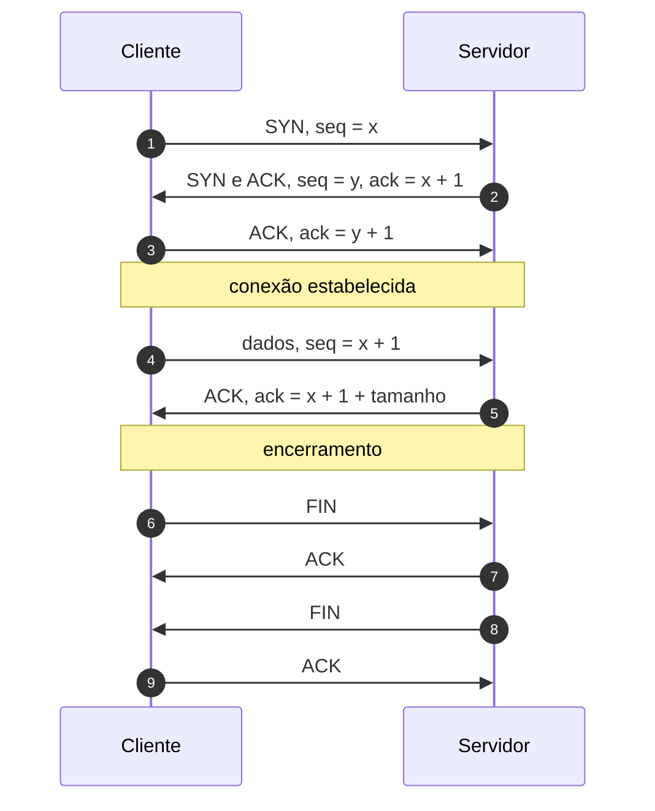

*Esquema 1 (conexão do TCP).* A abertura em três vias ([RFC 9293](https://www.rfc-editor.org/rfc/rfc9293), seção 3.5) sincroniza os números de sequência: cada lado escolhe o seu e o outro o confirma somando 1. O encerramento (seção 3.6) fecha cada sentido separadamente: cada lado envia o seu FIN e recebe o ACK dele.

O número de sequência identifica o **byte**, e não o segmento. O ACK é **cumulativo**: ele diz "recebi tudo até o byte anterior a este número, e espero este" (seção 3.4).

### 2.3 Os estados da conexão

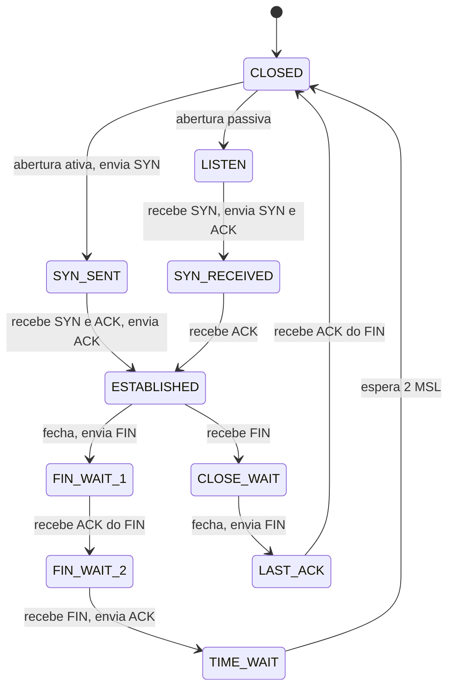

*Esquema 2 (estados principais).* É o caminho comum da máquina de estados da [RFC 9293](https://www.rfc-editor.org/rfc/rfc9293), seção 3.3.2 (Figura 5). Os casos de fechamento simultâneo (CLOSING) e de reinício (RST) foram omitidos para manter o desenho legível.

O estado **TIME-WAIT** mantém a conexão por um tempo (2 vezes o MSL, *Maximum Segment Lifetime*) para que segmentos atrasados da conexão antiga não sejam confundidos com os de uma nova.

### 2.4 O cabeçalho TCP

| Campo | Tamanho | Função |
| --- | --- | --- |
| Porta de origem e de destino | 16 bits cada | identificam os processos |
| Número de sequência | 32 bits | posição, no fluxo, do primeiro byte do segmento |
| Número de confirmação | 32 bits | próximo byte esperado, quando o bit ACK está ligado |
| Deslocamento de dados | 4 bits | tamanho do cabeçalho em palavras de 32 bits |
| Flags | 8 bits | CWR, ECE, URG, ACK, PSH, RST, SYN e FIN |
| Janela | 16 bits | espaço livre no receptor (rwnd) |
| Checksum | 16 bits | cobre cabeçalho, dados e um pseudocabeçalho com os endereços IP |
| Ponteiro urgente e opções | variável | por exemplo, SACK ([RFC 2018](https://www.rfc-editor.org/rfc/rfc2018)) |

O cabeçalho tem 20 bytes quando não há opções ([RFC 9293](https://www.rfc-editor.org/rfc/rfc9293), seção 3.1).

### 2.5 Janelas: quanto o emissor pode enviar

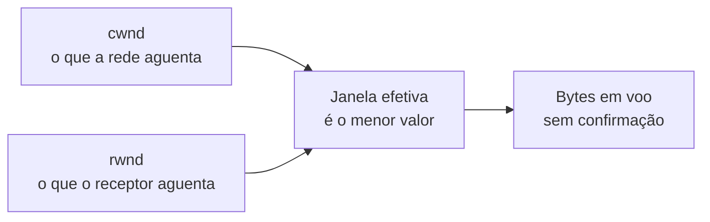

*Esquema 3 (janela efetiva).* O emissor mantém em voo, no máximo, o **menor** entre a janela de congestionamento (cwnd) e a janela anunciada pelo receptor (rwnd).

- A **rwnd** protege o receptor (controle de fluxo, [RFC 9293](https://www.rfc-editor.org/rfc/rfc9293), seção 3.8.6).
- A **cwnd** protege a rede (controle de congestionamento, [RFC 5681](https://www.rfc-editor.org/rfc/rfc5681)).

### 2.6 O controle de congestionamento

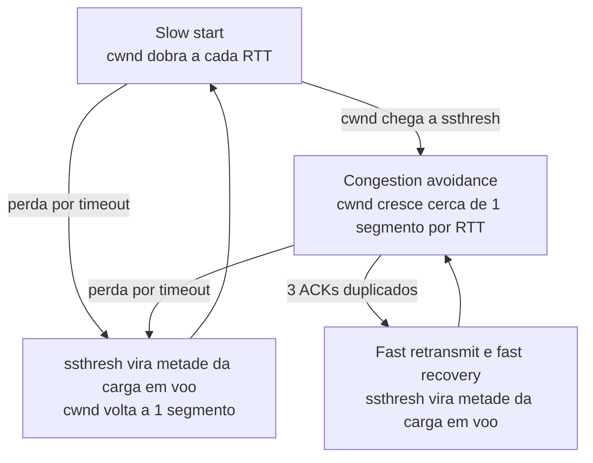

*Esquema 4 (fases do controle de congestionamento).* Segue a [RFC 5681](https://www.rfc-editor.org/rfc/rfc5681): o *slow start* cresce depressa até o limiar (*ssthresh*), e depois a *congestion avoidance* cresce devagar. Uma perda é lida como sinal de congestionamento, e a janela é reduzida.

Dois sinais de perda têm custos muito diferentes:

| Sinal | Como o emissor percebe | Reação |
| --- | --- | --- |
| Três ACKs duplicados | segmentos seguintes chegam, mas o ACK não avança | retransmite logo (*fast retransmit*) e reduz a cwnd pela metade |
| Timeout (RTO) | nenhum ACK volta antes do prazo | cwnd volta a 1 segmento e recomeça no slow start |

O prazo de retransmissão (RTO) é calculado a partir do RTT medido ([RFC 6298](https://www.rfc-editor.org/rfc/rfc6298), que a [RFC 9293](https://www.rfc-editor.org/rfc/rfc9293) adota na seção 3.8.1). Com **SACK** ([RFC 2018](https://www.rfc-editor.org/rfc/rfc2018)), o receptor informa também os blocos recebidos fora de ordem, e o emissor reenvia só o que falta.

### 2.7 Como ler o diagrama do simulador

- **Diagrama de sequência:** cada seta é um segmento. A seta com X é um segmento perdido. No modo de download, cada seta representa uma **rodada** (uma janela inteira), para o desenho caber na tela.
- **Estado da conexão (painel lateral):** mostra o estado TCP de cada ponta, e a cwnd, o ssthresh e o RTO no instante atual.
- **Modos:** *TCP: conexão* mostra abertura, crescimento da janela, perdas e encerramento. *TCP: download* mostra um arquivo grande, com a fila do roteador e a vazão. *Comparação TCP x UDP* envia a mesma carga pelos dois protocolos na mesma rede.
- **O relógio:** o tempo avança com o botão Passo ou com a reprodução, e os painéis acompanham o instante atual.

### 2.8 Limites do modelo e do diagrama

- O simulador mostra o **caminho típico** da máquina de estados e do controle de congestionamento. Ele não simula CUBIC, BBR, *Nagle*, ACK atrasado nem reinício por RST.
- Os tempos, os tamanhos e a fila do roteador são **didáticos**: servem para comparar comportamentos, e não para prever o desempenho de uma rede real.
- O controle de congestionamento segue a [RFC 5681](https://www.rfc-editor.org/rfc/rfc5681) (estilo Reno), com SACK opcional. Implementações reais variam, e o simulador não reproduz um sistema operacional específico.

## 3. Como ler os diagramas

Este documento usa até dois tipos de diagrama. Cada figura traz uma legenda com o tipo, o que mostra e a que modo ou cenário se refere.

| Tipo | O que é | Vale para | Equivale, no simulador, a |
| --- | --- | --- | --- |
| B, sequência | As mensagens na ordem do tempo, entre os participantes. É dinâmico. | Um único cenário, com a configuração indicada | Ao diagrama de sequência e à aba Captura |

### 3.1 Legenda dos diagramas

**Tipo B (sequência)**

- Cada coluna é um participante (cliente, servidor, roteador ou outro). O tempo corre de cima para baixo.
- Seta cheia: mensagem enviada. Seta com X: mensagem perdida.
- `[cifrado]` no início do rótulo: a mensagem viaja cifrada.
- Faixa horizontal com texto: início de uma fase do cenário.
- A ordem é a da aba Captura; os intervalos de tempo não são desenhados em escala.

### 3.2 Lista de figuras

**Tipo B (sequência)**

- [Figura 6.1.1](#611-handshake-e-encerramento): sequência de "Handshake e encerramento"
- [Figura 6.1.2](#612-slow-start): sequência de "Slow start"
- [Figura 6.1.3](#613-fast-retransmit): sequência de "Fast retransmit"
- [Figura 6.1.4](#614-timeout-rto): sequência de "Timeout (RTO)"
- [Figura 6.1.5](#615-janela-do-receptor): sequência de "Janela do receptor"
- [Figura 6.1.6](#616-perdas-aleatórias): sequência de "Perdas aleatórias"
- [Figura 6.1.7](#617-várias-perdas-sem-sack): sequência de "Várias perdas sem SACK"
- [Figura 6.1.8](#618-várias-perdas-com-sack): sequência de "Várias perdas com SACK"
- [Figura 6.2.1](#621-download-de-arquivo): sequência de "Download de arquivo"
- [Figura 6.2.2](#622-download-com-perdas): sequência de "Download com perdas"
- [Figura 6.2.3](#623-download-limitado-pela-janela): sequência de "Download limitado pela janela"
- [Figura 6.2.4](#624-download-com-rtt-alto): sequência de "Download com RTT alto"
- [Figura 6.3.1](#631-tcp-x-udp-10-de-perda): sequência de "TCP x UDP: 10% de perda"
- [Figura 6.3.2](#632-tcp-x-udp-reordenação): sequência de "TCP x UDP: reordenação"

## 4. Abas da bancada

Cenário, Captura, Mensagem, Janela (cwnd) (modos: TCP: conexão; TCP: download; Comparação TCP x UDP), Resultados, Experimento, Referência e Log.

## 5. Configurações (campos do painel)

### 5.1 Transferência

- **Segmentos**. Valores: 1; 2; 3; 4; 5; 6; 8; 10; 12; 15; 20; 25; 30; 40. Padrão: 20. Modos: TCP: conexão; Comparação TCP x UDP.
  - Quantos segmentos (TCP) ou datagramas (UDP) de 1000 bytes serão enviados.
  - Cada segmento carrega 1000 bytes de dados (o MSS). 20 segmentos equivalem a um arquivo de 20 kB.
  - Com mais segmentos, o crescimento da janela de congestionamento fica mais visível.
- **Tamanho do arquivo**. Valores: 1 MB; 5 MB; 20 MB. Padrão: 5 MB. Modos: TCP: download.
  - Tamanho do arquivo baixado do servidor.
  - Cada 1 MB equivale a 1000 segmentos de 1000 bytes.
  - Arquivos grandes mostram o regime estável (dente de serra da cwnd). Arquivos pequenos são dominados pelo handshake e pelo slow start.

### 5.2 Rede

- **RTT (ms)**. Valores: 5; 10; 15; 20; 50; 100; 200. Padrão: 15. Modos: todos.
  - Tempo de ida e volta na rede, sem contar a transmissão.
  - Metade do RTT é o atraso de propagação em cada sentido.
  - Ele define o custo do handshake (1 RTT antes do primeiro dado), o ritmo do slow start (a janela dobra a cada RTT) e o valor do RTO.
  - Referências: cerca de 1 ms em rede local, 15 ms em uma rede metropolitana e de 100 a 200 ms entre continentes.
- **Banda (Mbps)**. Valores: 1; 2; 5; 10; 20; 50. Padrão: 1. Modos: TCP: conexão; Comparação TCP x UDP; TCP: download.
  - Capacidade do enlace em megabits por segundo.
  - Define o tempo de transmissão de cada segmento: 1000 bytes levam 8 ms a 1 Mbps e 1,6 ms a 5 Mbps. Por isso as setas saem espaçadas no diagrama. Os valores de 10 a 50 Mbps servem ao download e ao vídeo.
  - O produto banda × RTT indica quantos dados precisam estar em voo para ocupar o enlace inteiro.
- **Perda (%)**. Valores: 0; 1; 2; 3; 5; 8; 10; 15; 20; 30. Padrão: 0. Modos: todos.
  - Probabilidade de cada segmento de dados ser descartado na rede.
  - O sorteio vale para cada transmissão, inclusive as retransmissões, e é definido pela semente.
  - No DNS, vale para a consulta e para a resposta.
  - Exemplo: 1% já é uma perda alta em redes cabeadas; redes sem fio congestionadas podem passar de 5%.
- **Semente**. Valores: 1; 2; 3; 5; 7; 11; 42; 99; 1234; 9999. Padrão: 7. Modos: todos.
  - Número que define o sorteio das perdas e dos atrasos.
  - A mesma semente gera sempre as mesmas perdas: a simulação se repete igual em aula.
  - No modo Comparação, TCP e UDP sofrem exatamente as mesmas perdas.
  - Troque o valor para ver outra sequência de perdas com a mesma taxa.
- **Reordenação (%)** (ajuste avançado). Valores: 0; 5; 10; 15; 20; 30. Padrão: 0. Modos: TCP: conexão; Comparação TCP x UDP.
  - Probabilidade de um pacote atrasar e chegar depois dos seguintes.
  - Simula pacotes que seguem caminhos diferentes ou ficam mais tempo em uma fila.
  - No TCP, o receptor guarda o pacote adiantado e repete o ACK do que falta (ACK duplicado). Se a desordem gerar 3 ACKs duplicados, o emissor retransmite sem necessidade.
  - No UDP, a aplicação recebe os datagramas fora de ordem.
- **Descartar na 1ª transmissão (nº)** (ajuste avançado). Valores: nenhum; #1; #3; #5; #6; #8; #10; #15; #5, #7 e #9; #3, #6 e #9. Padrão: nenhum. Modos: TCP: conexão; Comparação TCP x UDP; TCP: download.
  - Números dos segmentos que se perdem na primeira vez que são enviados.
  - Escolha o número do segmento (ou uma combinação pronta). A retransmissão desses segmentos não é descartada, a não ser pela perda aleatória.
  - Permite criar situações exatas: perder um segmento do meio provoca fast retransmit; perder o último provoca timeout.
  - No DNS, "#1" descarta a primeira consulta.
- **Perda também nos ACKs** (ajuste avançado). Valores: caixa de seleção. Padrão: não. Modos: TCP: conexão; Comparação TCP x UDP.
  - Aplica a mesma taxa de perda aos ACKs do servidor.
  - Como o ACK do TCP é cumulativo, o ACK seguinte confirma também o que o ACK perdido confirmaria.
  - Por isso a perda de ACKs raramente causa retransmissão; na maioria das vezes, só atrasa um pouco o crescimento da janela.

### 5.3 TCP

- **SACK (confirmação seletiva)**. Valores: caixa de seleção. Padrão: não. Modos: TCP: conexão; Comparação TCP x UDP; TCP: download.
  - Liga a opção SACK do TCP ([RFC 2018](https://www.rfc-editor.org/rfc/rfc2018)).
  - Os dois lados negociam a opção no handshake (SACK_PERM). Nos ACKs duplicados, o receptor informa os blocos de bytes que já chegaram além da lacuna (SLE e SRE).
  - Ligado, o emissor repõe todos os buracos de uma janela em cerca de 1 RTT. Desligado, vale o NewReno: uma lacuna por RTT, descoberta pelos ACKs parciais.
  - Faz diferença quando há várias perdas na mesma janela. Com uma só perda, os dois se comportam quase igual.
- **Janela inicial** (ajuste avançado). Valores: 1 seg.; 4 seg.; 10 seg.. Padrão: 1 seg.. Modos: TCP: conexão; Comparação TCP x UDP; TCP: download.
  - Valor da cwnd no início da transferência, em segmentos.
  - É quantos segmentos o emissor pode enviar antes do primeiro ACK.
  - O valor original era 1; a [RFC 5681](https://www.rfc-editor.org/rfc/rfc5681) permite de 2 a 4 e o Linux usa 10 ([RFC 6928](https://www.rfc-editor.org/rfc/rfc6928), de status Experimental).
  - Com 1, o slow start fica bem visível: 1, 2, 4, 8 segmentos por RTT.
- **rwnd (seg.)** (ajuste avançado). Valores: 4; 8; 16; 32; 64; 256; 1024. Padrão: 16. Modos: TCP: conexão; Comparação TCP x UDP; TCP: download.
  - Espaço de buffer que o servidor anuncia em cada ACK.
  - É o controle de fluxo: protege o receptor de receber mais do que consegue guardar. O valor aparece no campo Janela dos ACKs (16 segmentos = 16000 bytes).
  - O emissor nunca tem mais que o mínimo entre cwnd e rwnd em voo. Com rwnd = 4, a cwnd pode crescer, mas o envio fica limitado a 4 segmentos.
- **ssthresh inicial** (ajuste avançado). Valores: 64 seg.; 8 seg.; sem limite. Padrão: 64 seg.. Modos: TCP: conexão; Comparação TCP x UDP; TCP: download.
  - Limiar entre o slow start e o congestion avoidance.
  - Abaixo do ssthresh, a cwnd cresce exponencialmente (slow start). Acima, cresce cerca de 1 segmento por RTT (congestion avoidance).
  - Com 64, o slow start vai até a primeira perda ou até o limite da rwnd. Com 8, a mudança de fase aparece cedo. Com "sem limite", só a primeira perda encerra o slow start (útil no download).
  - Depois de uma perda, o TCP recalcula o ssthresh como metade do que estava em voo.

## 6. Cenários

### 6.1 Modo: TCP: conexão

> **Grupo:** TCP

Conexão confiável: abertura e encerramento, controle de congestionamento, controle de fluxo e recuperação de perdas.

#### 6.1.1 Handshake e encerramento

*Abertura em três vias, transferência e encerramento.*

**Configuração aplicada:** Segmentos = 3; Perda (%) = 0; Descartar na 1ª transmissão (nº) = ; Janela inicial = 1; rwnd (seg.) = 16; ssthresh inicial = 64; Reordenação (%) = 0

Três segmentos na abertura (SYN, SYN-ACK, ACK), três de dados e quatro no encerramento (FIN e ACK em cada sentido).

Acompanhe os estados no painel. O primeiro byte de dados só sai depois de 1 RTT, e o cliente termina em TIME_WAIT.

**Conceito.** O TCP é orientado a conexão. Antes de enviar dados, cliente e servidor trocam **SYN**, **SYN-ACK** e **ACK** (three-way handshake), combinando os números de sequência iniciais (ISN). No fim, cada lado fecha o próprio sentido com **FIN** e recebe um ACK; o lado que fecha primeiro espera em **TIME_WAIT** antes de liberar a conexão.

**O que observar**

- No diagrama: o primeiro byte de dados só sai depois de 1 RTT, o custo do handshake.
- Na aba Mensagem: os números de sequência e de confirmação; o SYN e o FIN consomem um número de sequência cada.
- No quadro de estados: a troca de estados do cliente e do servidor até TIME_WAIT.

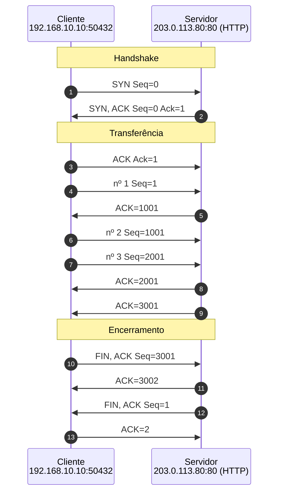

*Figura 6.1.1 (Tipo B, sequência).* Mensagens do cenário "Handshake e encerramento", na ordem do tempo, entre Cliente, Servidor: 13 mensagens, numeradas de 1 a 13 na ordem da comunicação (em 4 fases). Corresponde ao diagrama de sequência e à aba Captura, no modo "TCP: conexão", com a configuração aplicada acima.

**Mensagens**

| Mensagem | Significado | Origem |
| --- | --- | --- |
| SYN | pede a abertura e anuncia o ISN do cliente | cliente |
| SYN-ACK | aceita e anuncia o ISN do servidor | servidor |
| ACK | confirma; a conexão fica estabelecida | cliente |
| FIN e ACK | encerram cada sentido da conexão | os dois lados |

**Por que importa.** O handshake garante que os dois lados estão prontos e sincronizados, mas custa 1 RTT antes do primeiro byte. Também é o alvo do SYN flood, que deixa conexões presas na metade (veja o simulador de Ataques e defesas TCP/UDP).

#### 6.1.2 Slow start

*A janela de congestionamento dobra a cada RTT até o ssthresh.*

**Configuração aplicada:** Segmentos = 30; Perda (%) = 0; Descartar na 1ª transmissão (nº) = ; Janela inicial = 1; rwnd (seg.) = 32; ssthresh inicial = 8; Reordenação (%) = 0

A cwnd começa em 1 e cresce 1 segmento por ACK: as rajadas dobram a cada RTT (1, 2, 4, 8). Ao atingir o ssthresh (8), passa a crescer cerca de 1 segmento por RTT.

Veja a aba Janela (cwnd). Repare também que os ACKs voltam espaçados e cadenciam os próximos envios (ACK clocking).

**Conceito.** O **slow start** é como o TCP descobre quanto a rede aguenta. A janela de congestionamento (**cwnd**) começa pequena e cresce 1 segmento a cada ACK, o que a dobra a cada RTT. Ao alcançar o limiar **ssthresh**, o TCP passa para o **congestion avoidance** e cresce só cerca de 1 segmento por RTT.

**O que observar**

- Na aba Janela (cwnd): o crescimento 1, 2, 4, 8 e a mudança de inclinação no ssthresh (8).
- No diagrama: rajadas cada vez maiores, cadenciadas pelos ACKs (ACK clocking).
- Na aba Resultados: o tempo total da transferência.

```mermaid
sequenceDiagram
  autonumber
  participant n_c as Cliente<br/>192.168.10.10:50432
  participant n_s as Servidor<br/>203.0.113.80:80 (HTTP)
  Note over n_c,n_s: Handshake
  n_c ->> n_s: SYN Seq=0
  n_s ->> n_c: SYN, ACK Seq=0 Ack=1
  Note over n_c,n_s: Transferência
  n_c ->> n_s: ACK Ack=1
  n_c ->> n_s: nº 1 Seq=1
  n_s ->> n_c: ACK=1001
  n_c ->> n_s: nº 2 Seq=1001
  n_c ->> n_s: nº 3 Seq=2001
  n_s ->> n_c: ACK=2001
  n_c ->> n_s: nº 4 Seq=3001
  n_s ->> n_c: ACK=3001
  n_c ->> n_s: nº 5 Seq=4001
  n_s ->> n_c: ACK=4001
  n_c ->> n_s: nº 6 Seq=5001
  n_s ->> n_c: ACK=5001
  n_c ->> n_s: nº 7 Seq=6001
  n_s ->> n_c: ACK=6001
  n_c ->> n_s: nº 8 Seq=7001
  n_s ->> n_c: ACK=7001
  n_c ->> n_s: nº 9 Seq=8001
  n_s ->> n_c: ACK=8001
  n_c ->> n_s: nº 10 Seq=9001
  n_s ->> n_c: ACK=9001
  n_c ->> n_s: nº 11 Seq=10001
  n_s ->> n_c: ACK=10001
  n_c ->> n_s: nº 12 Seq=11001
  n_s ->> n_c: ACK=11001
  n_c ->> n_s: nº 13 Seq=12001
  n_s ->> n_c: ACK=12001
  n_c ->> n_s: nº 14 Seq=13001
  n_s ->> n_c: ACK=13001
  n_c ->> n_s: nº 15 Seq=14001
  n_s ->> n_c: ACK=14001
  n_c ->> n_s: nº 16 Seq=15001
  n_s ->> n_c: ACK=15001
  n_c ->> n_s: nº 17 Seq=16001
  n_s ->> n_c: ACK=16001
  n_c ->> n_s: nº 18 Seq=17001
  n_s ->> n_c: ACK=17001
  n_c ->> n_s: nº 19 Seq=18001
  n_s ->> n_c: ACK=18001
  n_c ->> n_s: nº 20 Seq=19001
  n_s ->> n_c: ACK=19001
  n_c ->> n_s: nº 21 Seq=20001
  n_s ->> n_c: ACK=20001
  n_c ->> n_s: nº 22 Seq=21001
  n_s ->> n_c: ACK=21001
  n_c ->> n_s: nº 23 Seq=22001
  n_s ->> n_c: ACK=22001
  n_c ->> n_s: nº 24 Seq=23001
  n_s ->> n_c: ACK=23001
  n_c ->> n_s: nº 25 Seq=24001
  n_s ->> n_c: ACK=24001
  n_c ->> n_s: nº 26 Seq=25001
  n_s ->> n_c: ACK=25001
  n_c ->> n_s: nº 27 Seq=26001
  n_s ->> n_c: ACK=26001
  n_c ->> n_s: nº 28 Seq=27001
  n_s ->> n_c: ACK=27001
  n_c ->> n_s: nº 29 Seq=28001
  n_s ->> n_c: ACK=28001
  n_c ->> n_s: nº 30 Seq=29001
  n_s ->> n_c: ACK=29001
  n_s ->> n_c: ACK=30001
  Note over n_c,n_s: Encerramento
  n_c ->> n_s: FIN, ACK Seq=30001
  n_s ->> n_c: ACK=30002
  n_s ->> n_c: FIN, ACK Seq=1
  n_c ->> n_s: ACK=2
```

*Figura 6.1.2 (Tipo B, sequência).* Mensagens do cenário "Slow start", na ordem do tempo, entre Cliente, Servidor: 67 mensagens, numeradas de 1 a 67 na ordem da comunicação (em 4 fases). Corresponde ao diagrama de sequência e à aba Captura, no modo "TCP: conexão", com a configuração aplicada acima.

**Mensagens**

| Mensagem | Significado | Origem |
| --- | --- | --- |
| Dados | segmentos de 1000 bytes | cliente |
| ACK | confirma e libera novos envios | servidor |

**Por que importa.** Evita que um emissor recém-chegado inunde a rede ([RFC 5681](https://www.rfc-editor.org/rfc/rfc5681)). O Linux começa com janela 10 ([RFC 6928](https://www.rfc-editor.org/rfc/rfc6928), de status Experimental) para acelerar transferências curtas.

#### 6.1.3 Fast retransmit

*Três ACKs duplicados disparam a retransmissão sem esperar o timeout.*

**Configuração aplicada:** Segmentos = 20; Perda (%) = 0; Descartar na 1ª transmissão (nº) = 8; Janela inicial = 4; rwnd (seg.) = 16; ssthresh inicial = 64; Reordenação (%) = 0

O segmento #8 se perde. Os seguintes chegam fora de ordem e o receptor repete o ACK do que falta. No terceiro ACK duplicado, o emissor retransmite sem esperar o timeout e reduz a janela à metade (fast recovery).

No gráfico, a cwnd cai à metade em vez de voltar a 1.

**Conceito.** Quando um segmento se perde e os seguintes chegam, o receptor repete o ACK do primeiro byte que falta (**ACK duplicado**). Três ACKs duplicados indicam uma perda isolada: o emissor faz o **fast retransmit**, retransmite na hora e entra em **fast recovery**, cortando a janela à metade em vez de voltar a 1.

**O que observar**

- No diagrama: o #8 se perde e os ACKs seguintes repetem o mesmo número.
- No terceiro ACK duplicado, a retransmissão do #8 sai sem esperar o RTO.
- Na aba Janela (cwnd): a queda à metade, não a 1.

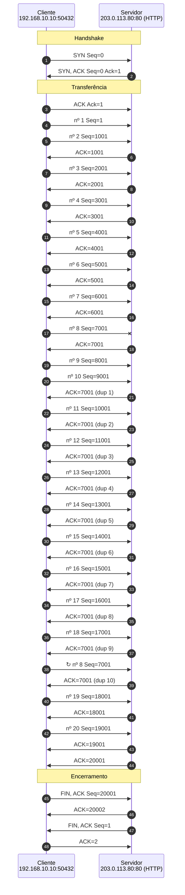

*Figura 6.1.3 (Tipo B, sequência).* Mensagens do cenário "Fast retransmit", na ordem do tempo, entre Cliente, Servidor: 48 mensagens, numeradas de 1 a 48 na ordem da comunicação (em 4 fases; 1 perdida). Corresponde ao diagrama de sequência e à aba Captura, no modo "TCP: conexão", com a configuração aplicada acima.

**Mensagens**

| Mensagem | Significado | Origem |
| --- | --- | --- |
| Dados #8 | perdido na rede | cliente |
| ACK duplicado | pede de novo o #8 | servidor |
| Retransmissão | reenvia o #8 | cliente |

**Por que importa.** Recupera perdas isoladas em cerca de 1 RTT e preserva boa parte da vazão. É o caso mais comum de perda em redes congestionadas.

#### 6.1.4 Timeout (RTO)

*Sem ACKs duplicados, só o temporizador percebe a perda.*

**Configuração aplicada:** Segmentos = 6; Perda (%) = 0; Descartar na 1ª transmissão (nº) = 6; Janela inicial = 4; rwnd (seg.) = 16; ssthresh inicial = 64; Reordenação (%) = 0

O último segmento (#6) se perde. Sem segmentos depois dele, não surgem ACKs duplicados: só o temporizador RTO percebe a perda.

Depois do timeout, a cwnd volta a 1 e o RTO dobra. Compare o tempo gasto com o do fast retransmit.

**Conceito.** O **RTO** (Retransmission Timeout) é quanto o emissor espera por um ACK antes de concluir que o segmento se perdeu. Ele é calculado a partir do RTT medido ([RFC 6298](https://www.rfc-editor.org/rfc/rfc6298)) e dobra a cada timeout seguido. Depois de um timeout, o TCP trata a rede como muito congestionada: a cwnd volta a 1 e o slow start recomeça.

**O que observar**

- O #6 é o último segmento: não há segmentos depois dele para gerar ACKs duplicados.
- No diagrama: a espera longa até o temporizador estourar.
- Na aba Janela (cwnd): a queda para 1. Compare o tempo total com o cenário Fast retransmit.

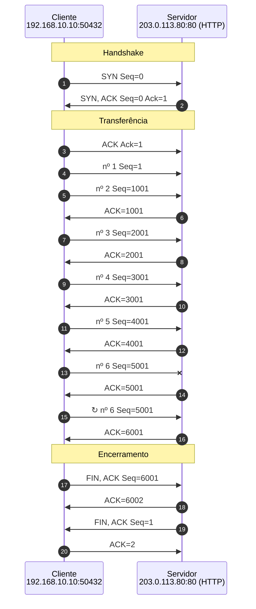

*Figura 6.1.4 (Tipo B, sequência).* Mensagens do cenário "Timeout (RTO)", na ordem do tempo, entre Cliente, Servidor: 20 mensagens, numeradas de 1 a 20 na ordem da comunicação (em 4 fases; 1 perdida). Corresponde ao diagrama de sequência e à aba Captura, no modo "TCP: conexão", com a configuração aplicada acima.

**Mensagens**

| Mensagem | Significado | Origem |
| --- | --- | --- |
| Dados #6 | perdido na rede | cliente |
| Retransmissão | sai depois do RTO | cliente |
| ACK | confirma tudo | servidor |

**Por que importa.** Timeouts custam caro: a conexão fica parada e a janela recomeça do zero. Por isso perdas no fim de transferências curtas pesam tanto no carregamento de páginas web.

#### 6.1.5 Janela do receptor

*O receptor limita quanto o emissor pode ter em voo.*

**Configuração aplicada:** Segmentos = 20; Perda (%) = 0; Descartar na 1ª transmissão (nº) = ; Janela inicial = 10; rwnd (seg.) = 4; ssthresh inicial = 64; Reordenação (%) = 0

A cwnd começa em 10, mas o receptor anuncia rwnd = 4 segmentos. O emissor nunca tem mais de 4 segmentos em voo: é o controle de fluxo, que protege o buffer do receptor.

Compare com rwnd = 16 e veja a diferença no tempo total.

**Conceito.** O **controle de fluxo** protege o receptor: em cada ACK, ele anuncia no campo Janela quanto espaço livre tem no buffer (**rwnd**). O emissor nunca mantém em voo mais que o mínimo entre a cwnd (limite da rede) e a rwnd (limite do receptor).

**O que observar**

- A cwnd começa em 10, mas nunca há mais de 4 segmentos em voo.
- Na aba Mensagem: o campo Janela dos ACKs (4 segmentos = 4000 bytes).
- Na aba Janela (cwnd): a cwnd cresce, mas o envio fica preso à rwnd.

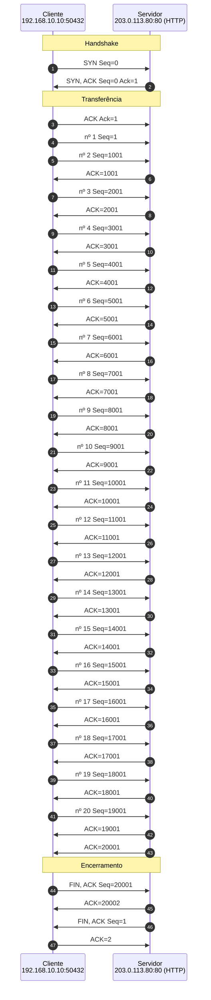

*Figura 6.1.5 (Tipo B, sequência).* Mensagens do cenário "Janela do receptor", na ordem do tempo, entre Cliente, Servidor: 47 mensagens, numeradas de 1 a 47 na ordem da comunicação (em 4 fases). Corresponde ao diagrama de sequência e à aba Captura, no modo "TCP: conexão", com a configuração aplicada acima.

**Mensagens**

| Mensagem | Significado | Origem |
| --- | --- | --- |
| ACK | anuncia rwnd = 4 segmentos | servidor |
| Dados | no máximo 4 em voo | cliente |

**Por que importa.** Controle de fluxo (receptor) e controle de congestionamento (rede) são mecanismos diferentes. Uma janela anunciada pequena limita a vazão mesmo em uma rede rápida.

#### 6.1.6 Perdas aleatórias

*Perdas sorteadas: o TCP combina todos os mecanismos de recuperação.*

**Configuração aplicada:** Segmentos = 30; Perda (%) = 8; Descartar na 1ª transmissão (nº) = ; Janela inicial = 4; rwnd (seg.) = 16; ssthresh inicial = 64; Reordenação (%) = 0

8% de perda nos dados, sorteada pela semente. O TCP combina fast retransmit, ACKs parciais e, às vezes, timeouts.

Troque a semente para ver outras sequências de perdas com a mesma taxa.

**Conceito.** Com **8% de perda aleatória**, aparecem ao mesmo tempo perdas isoladas (fast retransmit), várias perdas na mesma janela (ACKs parciais do NewReno, [RFC 6582](https://www.rfc-editor.org/rfc/rfc6582)) e, às vezes, timeouts. A **semente** define o sorteio: a mesma semente repete exatamente as mesmas perdas.

**O que observar**

- No diagrama: quais segmentos se perderam e como cada um foi recuperado.
- Na aba Janela (cwnd): o formato em dente de serra, típico do TCP sob perda.
- Troque a semente e compare o tempo total com a mesma taxa de perda.

```mermaid
sequenceDiagram
  autonumber
  participant n_c as Cliente<br/>192.168.10.10:50432
  participant n_s as Servidor<br/>203.0.113.80:80 (HTTP)
  Note over n_c,n_s: Handshake
  n_c ->> n_s: SYN Seq=0
  n_s ->> n_c: SYN, ACK Seq=0 Ack=1
  Note over n_c,n_s: Transferência
  n_c ->> n_s: ACK Ack=1
  n_c ->> n_s: nº 1 Seq=1
  n_c ->> n_s: nº 2 Seq=1001
  n_s ->> n_c: ACK=1001
  n_c ->> n_s: nº 3 Seq=2001
  n_s ->> n_c: ACK=2001
  n_c ->> n_s: nº 4 Seq=3001
  n_s ->> n_c: ACK=3001
  n_c -x n_s: nº 5 Seq=4001
  n_s ->> n_c: ACK=4001
  n_c ->> n_s: nº 6 Seq=5001
  n_c ->> n_s: nº 7 Seq=6001
  n_s ->> n_c: ACK=4001 (dup 1)
  n_c ->> n_s: nº 8 Seq=7001
  n_s ->> n_c: ACK=4001 (dup 2)
  n_c -x n_s: nº 9 Seq=8001
  n_s ->> n_c: ACK=4001 (dup 3)
  n_c ->> n_s: nº 10 Seq=9001
  n_c -x n_s: nº 11 Seq=10001
  n_s ->> n_c: ACK=4001 (dup 4)
  n_c ->> n_s: nº 12 Seq=11001
  n_c ->> n_s: ↻ nº 5 Seq=4001
  n_s ->> n_c: ACK=4001 (dup 5)
  n_c ->> n_s: nº 13 Seq=12001
  n_s ->> n_c: ACK=8001
  n_c ->> n_s: ↻ nº 9 Seq=8001
  n_s ->> n_c: ACK=8001 (dup 1)
  n_c ->> n_s: nº 14 Seq=13001
  n_s ->> n_c: ACK=10001
  n_c ->> n_s: nº 15 Seq=14001
  n_s ->> n_c: ACK=10001 (dup 1)
  n_c ->> n_s: ↻ nº 11 Seq=10001
  n_s ->> n_c: ACK=10001 (dup 2)
  n_c ->> n_s: nº 16 Seq=15001
  n_s ->> n_c: ACK=15001
  n_c ->> n_s: nº 17 Seq=16001
  n_s ->> n_c: ACK=16001
  n_c ->> n_s: nº 18 Seq=17001
  n_s ->> n_c: ACK=17001
  n_c ->> n_s: nº 19 Seq=18001
  n_s ->> n_c: ACK=18001
  n_c ->> n_s: nº 20 Seq=19001
  n_s ->> n_c: ACK=19001
  n_c ->> n_s: nº 21 Seq=20001
  n_s ->> n_c: ACK=20001
  n_c ->> n_s: nº 22 Seq=21001
  n_s ->> n_c: ACK=21001
  n_c ->> n_s: nº 23 Seq=22001
  n_s ->> n_c: ACK=22001
  n_c -x n_s: nº 24 Seq=23001
  n_s ->> n_c: ACK=23001
  n_c ->> n_s: nº 25 Seq=24001
  n_c ->> n_s: nº 26 Seq=25001
  n_s ->> n_c: ACK=23001 (dup 1)
  n_c ->> n_s: nº 27 Seq=26001
  n_s ->> n_c: ACK=23001 (dup 2)
  n_c ->> n_s: nº 28 Seq=27001
  n_s ->> n_c: ACK=23001 (dup 3)
  n_c ->> n_s: ↻ nº 24 Seq=23001
  n_s ->> n_c: ACK=23001 (dup 4)
  n_c ->> n_s: nº 29 Seq=28001
  n_s ->> n_c: ACK=28001
  n_c ->> n_s: nº 30 Seq=29001
  n_s ->> n_c: ACK=29001
  n_s ->> n_c: ACK=30001
  Note over n_c,n_s: Encerramento
  n_c ->> n_s: FIN, ACK Seq=30001
  n_s ->> n_c: ACK=30002
  n_s ->> n_c: FIN, ACK Seq=1
  n_c ->> n_s: ACK=2
```

*Figura 6.1.6 (Tipo B, sequência).* Mensagens do cenário "Perdas aleatórias", na ordem do tempo, entre Cliente, Servidor: 71 mensagens, numeradas de 1 a 71 na ordem da comunicação (em 4 fases; 4 perdidas). Corresponde ao diagrama de sequência e à aba Captura, no modo "TCP: conexão", com a configuração aplicada acima.

**Mensagens**

| Mensagem | Significado | Origem |
| --- | --- | --- |
| Dados | 8% se perdem | cliente |
| ACK duplicado ou parcial | indica o que falta | servidor |
| Retransmissão | por fast retransmit ou depois do RTO | cliente |

**Por que importa.** Mostra por que a vazão do TCP cai rápido com a perda: cada perda corta a janela. Em redes sem fio, perdas que não vêm de congestionamento também reduzem a janela.

#### 6.1.7 Várias perdas sem SACK

*Com várias perdas na mesma janela, o ACK cumulativo revela uma lacuna por RTT.*

**Configuração aplicada:** Segmentos = 20; Perda (%) = 0; Descartar na 1ª transmissão (nº) = 5, 7, 9; Janela inicial = 10; rwnd (seg.) = 16; ssthresh inicial = 64; Reordenação (%) = 0; SACK (confirmação seletiva) = não; RTT (ms) = 100; Banda (Mbps) = 5

Os segmentos #5, #7 e #9 da primeira janela se perdem. Sem SACK, o emissor só enxerga o ACK cumulativo: descobre uma lacuna por vez.

O fast retransmit repõe o #5; o ACK parcial revela o #7, que leva mais um RTT; depois o #9. Três perdas custam três RTTs de recuperação (NewReno).

**Conceito.** O ACK do TCP é **cumulativo**: informa só até onde os dados chegaram em ordem. Quando várias perdas ocorrem na mesma janela, o emissor só descobre uma lacuna de cada vez. O **NewReno** ([RFC 6582](https://www.rfc-editor.org/rfc/rfc6582)) usa o **ACK parcial**, que avança até o próximo buraco, para retransmitir um segmento por RTT, ainda dentro do fast recovery.

**O que observar**

- No diagrama: a retransmissão do #5 e, um RTT depois, a do #7, e depois a do #9.
- Os ACKs duplicados repetem sempre o mesmo número (5001), sem dizer o que já chegou.
- Na aba Resultados: o tempo total, para comparar com o cenário com SACK.

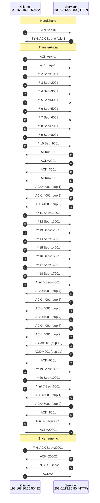

*Figura 6.1.7 (Tipo B, sequência).* Mensagens do cenário "Várias perdas sem SACK", na ordem do tempo, entre Cliente, Servidor: 50 mensagens, numeradas de 1 a 50 na ordem da comunicação (em 4 fases; 3 perdidas). Corresponde ao diagrama de sequência e à aba Captura, no modo "TCP: conexão", com a configuração aplicada acima.

**Mensagens**

| Mensagem | Significado | Origem |
| --- | --- | --- |
| Dados #5, #7, #9 | perdidos na rede | cliente |
| ACK duplicado | repete o ACK do primeiro buraco | servidor |
| ACK parcial | confirma até o buraco seguinte | servidor |
| Retransmissões | uma por RTT | cliente |

**Por que importa.** Com perdas em rajada (comuns em filas cheias e em redes sem fio), a recuperação sem SACK é lenta: a conexão passa vários RTTs presa na recuperação, com a janela reduzida.

#### 6.1.8 Várias perdas com SACK

*SACK informa o que já chegou e permite repor todos os buracos de uma vez.*

**Configuração aplicada:** Segmentos = 20; Perda (%) = 0; Descartar na 1ª transmissão (nº) = 5, 7, 9; Janela inicial = 10; rwnd (seg.) = 16; ssthresh inicial = 64; Reordenação (%) = 0; SACK (confirmação seletiva) = sim; RTT (ms) = 100; Banda (Mbps) = 5

As mesmas três perdas (#5, #7 e #9), agora com SACK negociado no handshake. Cada ACK duplicado informa os blocos que já chegaram (SLE e SRE).

O emissor sabe exatamente o que falta e repõe os três buracos juntos, em cerca de 1 RTT. Compare o tempo total e a cwnd com o cenário sem SACK.

**Conceito.** O **SACK** ([RFC 2018](https://www.rfc-editor.org/rfc/rfc2018)) é uma opção TCP negociada no handshake (**SACK_PERM**). Nos ACKs duplicados, o receptor acrescenta até 3 **blocos** com os intervalos de bytes que já chegaram além da lacuna (**SLE**, borda esquerda, e **SRE**, borda direita). O emissor monta um placar do que o receptor tem e repõe só os buracos, todos de uma vez, sem retransmitir o que já chegou.

**O que observar**

- No handshake: a opção SACK_PERM no SYN e no SYN-ACK (aba Mensagem).
- Nos ACKs duplicados: os blocos SLE e SRE, com os segmentos recebidos além dos buracos (aba Mensagem).
- No diagrama: #5, #7 e #9 retransmitidos juntos, em cerca de 1 RTT; compare o tempo com o cenário sem SACK.

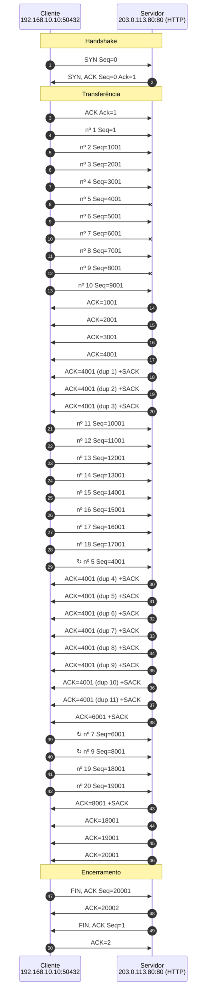

*Figura 6.1.8 (Tipo B, sequência).* Mensagens do cenário "Várias perdas com SACK", na ordem do tempo, entre Cliente, Servidor: 50 mensagens, numeradas de 1 a 50 na ordem da comunicação (em 4 fases; 3 perdidas). Corresponde ao diagrama de sequência e à aba Captura, no modo "TCP: conexão", com a configuração aplicada acima.

**Mensagens**

| Mensagem | Significado | Origem |
| --- | --- | --- |
| SYN e SYN-ACK com SACK_PERM | negociam o uso do SACK | os dois lados |
| ACK duplicado com SACK | informa os blocos recebidos além da lacuna | servidor |
| Retransmissões | só os buracos, em paralelo | cliente |

**Por que importa.** O SACK é padrão em todos os sistemas atuais. Ele faz o TCP recuperar várias perdas por janela em cerca de 1 RTT e é a base de técnicas como o RACK e a sonda de cauda (TLP).

### 6.2 Modo: TCP: download

> **Grupo:** Download

Um arquivo grande por TCP: abertura, crescimento da janela, fila do roteador, perdas e limites de vazão.

#### 6.2.1 Download de arquivo

*Slow start, fila do roteador estourando e o dente de serra da cwnd.*

**Configuração aplicada:** Tamanho do arquivo = 5; RTT (ms) = 20; Banda (Mbps) = 10; Perda (%) = 0; Descartar na 1ª transmissão (nº) = ; Janela inicial = 10; rwnd (seg.) = 1024; ssthresh inicial = 1000; Reordenação (%) = 0; SACK (confirmação seletiva) = sim

Um arquivo de 5 MB é baixado por um enlace de 10 Mbps com RTT de 20 ms. A janela começa em 10 segmentos e dobra a cada RTT (slow start).

Não há perda aleatória: a perda vem da própria rede. Quando a janela passa do que o enlace e a fila do roteador comportam, o excesso é descartado, o TCP corta a janela e o ciclo recomeça (dente de serra).

**Conceito.** Num **download**, o servidor envia o arquivo e o cliente só confirma. O TCP começa com a janela pequena e a **dobra a cada RTT** (slow start) até a rede perder um segmento. Como não enxerga a fila do roteador, só percebe que passou do limite quando a fila enche e o excesso é descartado. Então reduz a janela à metade e passa a crescer devagar, até estourar de novo: o **dente de serra** da cwnd. O limite é o **produto banda × RTT** (o que cabe no enlace) mais a fila do roteador.

**O que observar**

- No diagrama: cada seta é uma rodada (uma janela inteira por RTT). Veja as rajadas dobrando: 10, 20, 40, 80.
- Na aba Janela (cwnd): a primeira queda, quando a fila enche, e depois o dente de serra.
- Na aba Resultados: a vazão útil perto da capacidade do enlace e o tempo ideal para comparar.

```mermaid
sequenceDiagram
  autonumber
  participant n_c as Cliente<br/>192.168.10.10:50432
  participant n_s as Servidor<br/>203.0.113.80:80 (HTTP)
  Note over n_c,n_s: Handshake
  n_c ->> n_s: SYN Seq=0
  n_s ->> n_c: SYN, ACK Seq=0 Ack=1
  Note over n_c,n_s: Pedido GET
  n_c ->> n_s: ACK + GET /arquivo.bin
  n_s ->> n_c: 10 seg. nº 1-10
  Note over n_c,n_s: Primeiro byte
  n_c ->> n_s: ACK=10001
  n_s ->> n_c: 20 seg. nº 11-30
  n_s ->> n_c: 40 seg. nº 31-70
  n_c ->> n_s: ACK=30001
  n_s ->> n_c: 50 seg. nº 71-150
  n_s -x n_c: 30 perdidos (fila cheia)
  n_c ->> n_s: ACK=70001
  n_c ->> n_s: ACK parcial (SACK)
  n_s ->> n_c: ↻ 40 seg. (30 retransm.)
  n_s ->> n_c: 41 seg. nº 161-201
  n_c ->> n_s: ACK=160001
  n_s ->> n_c: 42 seg. nº 202-243
  n_c ->> n_s: ACK=201001
  n_s ->> n_c: 43 seg. nº 244-286
  n_c ->> n_s: ACK=243001
  n_s ->> n_c: 44 seg. nº 287-330
  n_c ->> n_s: ACK=286001
  n_s ->> n_c: 45 seg. nº 331-375
  n_c ->> n_s: ACK=330001
  n_s ->> n_c: 46 seg. nº 376-421
  n_c ->> n_s: ACK=375001
  n_s ->> n_c: 47 seg. nº 422-468
  n_c ->> n_s: ACK=421001
  n_s ->> n_c: 48 seg. nº 469-516
  n_c ->> n_s: ACK=468001
  n_c ->> n_s: ACK=516001
  n_s ->> n_c: 50 seg. nº 616-666
  n_s -x n_c: 1 perdido (fila cheia)
  n_c ->> n_s: ACK parcial (SACK)
  n_s ->> n_c: ↻ 25 seg. (1 retransm.)
  n_c ->> n_s: ACK=690001
  n_s ->> n_c: 28 seg. nº 744-771
  n_c ->> n_s: ACK=771001
  n_s ->> n_c: 31 seg. nº 831-861
  n_c ->> n_s: ACK=861001
  n_s ->> n_c: 34 seg. nº 927-960
  n_c ->> n_s: ACK=960001
  n_s ->> n_c: 37 seg. nº 1032-1068
  n_c ->> n_s: ACK=1068001
  n_s ->> n_c: 40 seg. nº 1146-1185
  n_c ->> n_s: ACK=1185001
  n_s ->> n_c: 43 seg. nº 1269-1311
  n_c ->> n_s: ACK=1311001
  n_s ->> n_c: 46 seg. nº 1401-1446
  n_c ->> n_s: ACK=1446001
  n_s ->> n_c: 49 seg. nº 1542-1590
  n_c ->> n_s: ACK=1590001
  n_s ->> n_c: 50 seg. nº 1641-1691
  n_s -x n_c: 1 perdido (fila cheia)
  n_c ->> n_s: ACK parcial (SACK)
  n_s ->> n_c: ↻ 25 seg. (1 retransm.)
  n_s ->> n_c: 26 seg. nº 1716-1741
  n_c ->> n_s: ACK=1715001
  n_c ->> n_s: ACK=1741001
  n_s ->> n_c: 29 seg. nº 1797-1825
  n_c ->> n_s: ACK=1825001
  n_s ->> n_c: 32 seg. nº 1887-1918
  n_c ->> n_s: ACK=1918001
  n_s ->> n_c: 35 seg. nº 1986-2020
  n_c ->> n_s: ACK=2020001
  n_s ->> n_c: 38 seg. nº 2094-2131
  n_c ->> n_s: ACK=2131001
  n_s ->> n_c: 41 seg. nº 2211-2251
  n_c ->> n_s: ACK=2251001
  n_s ->> n_c: 44 seg. nº 2337-2380
  n_c ->> n_s: ACK=2380001
  n_s ->> n_c: 47 seg. nº 2472-2518
  n_c ->> n_s: ACK=2518001
  n_s ->> n_c: 50 seg. nº 2616-2665
  n_s ->> n_c: 50 seg. nº 2666-2716
  n_s -x n_c: 1 perdido (fila cheia)
  n_c ->> n_s: ACK=2665001
  n_c ->> n_s: ACK parcial (SACK)
  n_s ->> n_c: ↻ 25 seg. (1 retransm.)
  n_c ->> n_s: ACK=2740001
  n_s ->> n_c: 27 seg. nº 2767-2793
  n_c ->> n_s: ACK=2793001
  n_s ->> n_c: 30 seg. nº 2851-2880
  n_c ->> n_s: ACK=2880001
  n_s ->> n_c: 33 seg. nº 2944-2976
  n_c ->> n_s: ACK=2976001
  n_s ->> n_c: 36 seg. nº 3046-3081
  n_c ->> n_s: ACK=3081001
  n_s ->> n_c: 39 seg. nº 3157-3195
  n_c ->> n_s: ACK=3195001
  n_s ->> n_c: 42 seg. nº 3277-3318
  n_c ->> n_s: ACK=3318001
  n_s ->> n_c: 45 seg. nº 3406-3450
  n_c ->> n_s: ACK=3450001
  n_s ->> n_c: 48 seg. nº 3544-3591
  n_c ->> n_s: ACK=3591001
  n_s ->> n_c: 50 seg. nº 3691-3741
  n_s -x n_c: 1 perdido (fila cheia)
  n_c ->> n_s: ACK parcial (SACK)
  n_s ->> n_c: ↻ 25 seg. (1 retransm.)
  n_c ->> n_s: ACK=3765001
  n_s ->> n_c: 28 seg. nº 3819-3846
  n_c ->> n_s: ACK=3846001
  n_s ->> n_c: 31 seg. nº 3906-3936
  n_c ->> n_s: ACK=3936001
  n_s ->> n_c: 34 seg. nº 4002-4035
  n_c ->> n_s: ACK=4035001
  n_s ->> n_c: 37 seg. nº 4107-4143
  n_c ->> n_s: ACK=4143001
  n_s ->> n_c: 40 seg. nº 4221-4260
  n_c ->> n_s: ACK=4260001
  n_s ->> n_c: 43 seg. nº 4344-4386
  n_c ->> n_s: ACK=4386001
  n_s ->> n_c: 46 seg. nº 4476-4521
  n_c ->> n_s: ACK=4521001
  n_s ->> n_c: 49 seg. nº 4617-4665
  n_c ->> n_s: ACK=4665001
  n_s ->> n_c: 50 seg. nº 4716-4766
  n_s -x n_c: 1 perdido (fila cheia)
  n_c ->> n_s: ACK parcial (SACK)
  n_s ->> n_c: ↻ 25 seg. (1 retransm.)
  n_s ->> n_c: 26 seg. nº 4791-4816
  n_c ->> n_s: ACK=4790001
  n_c ->> n_s: ACK=4816001
  n_s ->> n_c: 29 seg. nº 4872-4900
  n_c ->> n_s: ACK=4900001
  n_s ->> n_c: 32 seg. nº 4962-4993
  n_s ->> n_c: 7 seg. nº 4994-5000
  n_c ->> n_s: ACK=4993001
  Note over n_c,n_s: Último byte
  n_c ->> n_s: ACK=5000001
  Note over n_c,n_s: Encerramento
  n_s ->> n_c: FIN, ACK
  n_c ->> n_s: ACK=5000002
  n_c ->> n_s: FIN, ACK
  n_s ->> n_c: ACK=122
```

*Figura 6.2.1 (Tipo B, sequência).* Mensagens do cenário "Download de arquivo", na ordem do tempo, entre Cliente, Servidor: 133 mensagens, numeradas de 1 a 133 na ordem da comunicação (em 6 fases; 6 perdidas). Corresponde ao diagrama de sequência e à aba Captura, no modo "TCP: download", com a configuração aplicada acima.

**Mensagens**

| Mensagem | Significado | Origem |
| --- | --- | --- |
| SYN, SYN-ACK, ACK + GET | abertura e pedido do arquivo (2 RTT até o primeiro byte) | os dois lados |
| Rajada de dados | uma janela de segmentos por rodada | servidor |
| ACK ou ACKs duplicados (SACK) | confirmam e informam lacunas | cliente |
| FIN e ACK | encerramento da conexão | os dois lados |

**Por que importa.** É o comportamento de qualquer download ou envio de arquivo: a vazão do TCP se ajusta sozinha à capacidade do caminho, mas só descobre o limite perdendo pacotes. Por isso o tamanho da fila do roteador (bufferbloat) e o RTT pesam tanto na experiência.

#### 6.2.2 Download com perdas

*Com perda aleatória, a vazão fica muito abaixo da capacidade do enlace.*

**Configuração aplicada:** Tamanho do arquivo = 5; RTT (ms) = 50; Banda (Mbps) = 20; Perda (%) = 1; Descartar na 1ª transmissão (nº) = ; Janela inicial = 10; rwnd (seg.) = 1024; ssthresh inicial = 1000; Reordenação (%) = 0; SACK (confirmação seletiva) = sim

O mesmo tipo de download, agora com 1% de perda aleatória, RTT de 50 ms e enlace de 20 Mbps.

Cada perda corta a janela, que nunca chega a encher o enlace. A vazão fica muito abaixo dos 20 Mbps, e trocar a semente muda as perdas, mas não a ordem de grandeza.

**Conceito.** O TCP trata cada perda como sinal de congestionamento e corta a janela à metade. Com perda aleatória (por exemplo, em um enlace sem fio), a janela nunca chega a encher o enlace. A vazão média fica perto de **MSS / (RTT × √perda)** (aproximação de Mathis), qualquer que seja a banda disponível.

**O que observar**

- Na aba Janela (cwnd): a janela fica baixa e irregular, com muitos cortes.
- Na aba Resultados: a vazão útil muito abaixo dos 20 Mbps do enlace.
- Aumente a banda para 50 Mbps e veja que quase nada muda: a perda é o fator limitante.

```mermaid
sequenceDiagram
  autonumber
  participant n_c as Cliente<br/>192.168.10.10:50432
  participant n_s as Servidor<br/>203.0.113.80:80 (HTTP)
  Note over n_c,n_s: Handshake
  n_c ->> n_s: SYN Seq=0
  n_s ->> n_c: SYN, ACK Seq=0 Ack=1
  Note over n_c,n_s: Pedido GET
  n_c ->> n_s: ACK + GET /arquivo.bin
  n_s ->> n_c: 9 seg. nº 1-10
  n_s -x n_c: 1 perdido
  Note over n_c,n_s: Primeiro byte
  n_c ->> n_s: ACKs duplicados (SACK)
  n_s ->> n_c: ↻ 5 seg. (1 retransm.)
  n_c ->> n_s: ACK=14001
  n_s ->> n_c: 6 seg. nº 15-20
  n_c ->> n_s: ACK=20001
  n_s ->> n_c: 7 seg. nº 21-27
  n_c ->> n_s: ACK=27001
  n_s ->> n_c: 8 seg. nº 28-35
  n_c ->> n_s: ACK=35001
  n_s ->> n_c: 9 seg. nº 36-44
  n_c ->> n_s: ACK=44001
  n_s ->> n_c: 10 seg. nº 45-54
  n_c ->> n_s: ACK=54001
  n_s ->> n_c: 11 seg. nº 55-65
  n_c ->> n_s: ACK=65001
  n_s ->> n_c: 12 seg. nº 66-77
  n_c ->> n_s: ACK=77001
  n_s ->> n_c: 13 seg. nº 78-90
  n_c ->> n_s: ACK=90001
  n_s ->> n_c: 13 seg. nº 91-104
  n_s -x n_c: 1 perdido
  n_c ->> n_s: ACKs duplicados (SACK)
  n_s ->> n_c: ↻ 7 seg. (1 retransm.)
  n_c ->> n_s: ACK=110001
  n_s ->> n_c: 8 seg. nº 111-118
  n_c ->> n_s: ACK=118001
  n_s ->> n_c: 16 seg. nº 219-235
  n_s -x n_c: 1 perdido
  n_c ->> n_s: ACKs duplicados (SACK)
  n_s ->> n_c: ↻ 8 seg. (1 retransm.)
  n_c ->> n_s: ACK=242001
  n_s ->> n_c: 9 seg. nº 252-261
  n_s -x n_c: 1 perdido
  n_c ->> n_s: ACK parcial (SACK)
  n_s ->> n_c: ↻ 5 seg. (1 retransm.)
  n_c ->> n_s: ACK=265001
  n_s ->> n_c: 12 seg. nº 329-341
  n_s -x n_c: 1 perdido
  n_c ->> n_s: ACKs duplicados (SACK)
  n_s ->> n_c: ↻ 6 seg. (1 retransm.)
  n_c ->> n_s: ACK=346001
  n_s ->> n_c: 27 seg. nº 732-760
  n_s -x n_c: 2 perdidos
  n_c ->> n_s: ACKs duplicados (SACK)
  n_s ->> n_c: ↻ 14 seg. (2 retransm.)
  n_c ->> n_s: ACK=772001
  n_s ->> n_c: 19 seg. nº 858-877
  n_s -x n_c: 1 perdido
  n_c ->> n_s: ACKs duplicados (SACK)
  n_s ->> n_c: ↻ 10 seg. (1 retransm.)
  n_c ->> n_s: ACK=886001
  n_s ->> n_c: 10 seg. nº 887-897
  n_s -x n_c: 1 perdido
  n_c ->> n_s: ACK parcial (SACK)
  n_s ->> n_c: ↻ 5 seg. (1 retransm.)
  n_c ->> n_s: ACK=901001
  n_s ->> n_c: 9 seg. nº 932-941
  n_s -x n_c: 1 perdido
  n_c ->> n_s: ACKs duplicados (SACK)
  n_s ->> n_c: ↻ 5 seg. (1 retransm.)
  n_c ->> n_s: ACK=945001
  n_s ->> n_c: 7 seg. nº 959-966
  n_s -x n_c: 1 perdido
  n_c ->> n_s: ACKs duplicados (SACK)
  n_s ->> n_c: ↻ 4 seg. (1 retransm.)
  n_c ->> n_s: ACK=969001
  n_s ->> n_c: 9 seg. nº 1005-1014
  n_s -x n_c: 1 perdido
  n_c ->> n_s: ACK parcial (SACK)
  n_s ->> n_c: ↻ 5 seg. (1 retransm.)
  n_c ->> n_s: ACK=1018001
  n_s ->> n_c: 10 seg. nº 1059-1069
  n_s -x n_c: 1 perdido
  n_c ->> n_s: ACKs duplicados (SACK)
  n_s ->> n_c: ↻ 5 seg. (1 retransm.)
  n_c ->> n_s: ACK=1073001
  n_s ->> n_c: 8 seg. nº 1095-1103
  n_s -x n_c: 1 perdido
  n_c ->> n_s: ACKs duplicados (SACK)
  n_s ->> n_c: ↻ 4 seg. (1 retransm.)
  n_c ->> n_s: ACK=1106001
  n_s ->> n_c: 20 seg. nº 1287-1306
  n_c ->> n_s: ACK=1306001
  n_s ->> n_c: 21 seg. nº 1328-1349
  n_s -x n_c: 1 perdido
  n_c ->> n_s: ACKs duplicados (SACK)
  n_s ->> n_c: ↻ 10 seg. (1 retransm.)
  n_s -x n_c: 1 perdido
  n_c ->> n_s: ACKs duplicados (SACK)
  n_s ->> n_c: ↻ 5 seg. (1 retransm.)
  n_c ->> n_s: ACK=1363001
  n_s ->> n_c: 17 seg. nº 1502-1519
  n_s -x n_c: 1 perdido
  n_c ->> n_s: ACKs duplicados (SACK)
  n_s ->> n_c: ↻ 9 seg. (1 retransm.)
  n_c ->> n_s: ACK=1527001
  n_s ->> n_c: 15 seg. nº 1603-1618
  n_s -x n_c: 1 perdido
  n_c ->> n_s: ACKs duplicados (SACK)
  n_s ->> n_c: ↻ 8 seg. (1 retransm.)
  n_c ->> n_s: ACK=1625001
  n_s ->> n_c: 8 seg. nº 1626-1634
  n_s -x n_c: 1 perdido
  n_c ->> n_s: ACKs duplicados (SACK)
  n_s ->> n_c: ↻ 4 seg. (1 retransm.)
  n_c ->> n_s: ACK=1637001
  n_s ->> n_c: 6 seg. nº 1649-1655
  n_s -x n_c: 1 perdido
  n_c ->> n_s: ACKs duplicados (SACK)
  n_s ->> n_c: ↻ 3 seg. (1 retransm.)
  n_c ->> n_s: ACK=1657001
  n_s ->> n_c: 8 seg. nº 1688-1696
  n_s -x n_c: 1 perdido
  n_c ->> n_s: ACKs duplicados (SACK)
  n_s ->> n_c: ↻ 4 seg. (1 retransm.)
  n_c ->> n_s: ACK=1699001
  n_s ->> n_c: 9 seg. nº 1735-1744
  n_s -x n_c: 1 perdido
  n_c ->> n_s: ACKs duplicados (SACK)
  n_s ->> n_c: ↻ 5 seg. (1 retransm.)
  n_c ->> n_s: ACK=1748001
  n_s ->> n_c: 16 seg. nº 1870-1886
  n_s -x n_c: 1 perdido
  n_c ->> n_s: ACKs duplicados (SACK)
  n_s ->> n_c: ↻ 8 seg. (1 retransm.)
  n_c ->> n_s: ACK=1893001
  n_s ->> n_c: 24 seg. nº 2158-2182
  n_s -x n_c: 1 perdido
  n_c ->> n_s: ACKs duplicados (SACK)
  n_s ->> n_c: ↻ 12 seg. (1 retransm.)
  n_c ->> n_s: ACK=2193001
  n_s ->> n_c: 26 seg. nº 2467-2493
  n_s -x n_c: 1 perdido
  n_c ->> n_s: ACKs duplicados (SACK)
  n_s ->> n_c: ↻ 13 seg. (1 retransm.)
  n_c ->> n_s: ACK=2505001
  n_s ->> n_c: 18 seg. nº 2586-2604
  n_s -x n_c: 1 perdido
  n_c ->> n_s: ACKs duplicados (SACK)
  n_s ->> n_c: ↻ 9 seg. (1 retransm.)
  n_c ->> n_s: ACK=2612001
  n_s ->> n_c: 10 seg. nº 2613-2622
  n_c ->> n_s: ACK=2622001
  n_s ->> n_c: 19 seg. nº 2758-2777
  n_s -x n_c: 1 perdido
  n_c ->> n_s: ACKs duplicados (SACK)
  n_s ->> n_c: ↻ 9 seg. (1 retransm.)
  n_s -x n_c: 1 perdido
  n_c ->> n_s: ACKs duplicados (SACK)
  n_s ->> n_c: ↻ 5 seg. (1 retransm.)
  n_c ->> n_s: ACK=3706001
  n_s ->> n_c: 3 seg. nº 4998-5000
  Note over n_c,n_s: Último byte
  n_c ->> n_s: ACK=5000001
  Note over n_c,n_s: Encerramento
  n_s ->> n_c: FIN, ACK
  n_c ->> n_s: ACK=5000002
  n_c ->> n_s: FIN, ACK
  n_s ->> n_c: ACK=122
```

*Figura 6.2.2 (Tipo B, sequência).* Mensagens do cenário "Download com perdas", na ordem do tempo, entre Cliente, Servidor: 162 mensagens, numeradas de 1 a 162 na ordem da comunicação (em 6 fases; 27 perdidas). Corresponde ao diagrama de sequência e à aba Captura, no modo "TCP: download", com a configuração aplicada acima.

**Mensagens**

| Mensagem | Significado | Origem |
| --- | --- | --- |
| Rajada de dados | uma janela por rodada, com perdas | servidor |
| ACKs duplicados (SACK) | indicam quais segmentos faltam | cliente |
| Retransmissões | repõem os segmentos perdidos | servidor |

**Por que importa.** Explica por que enlaces com perda que não vem de congestionamento (Wi-Fi fraco, rádio, satélite) rendem pouco com o TCP clássico, e por que algoritmos como CUBIC e BBR reagem de formas diferentes à perda.

#### 6.2.3 Download limitado pela janela

*A janela do receptor limita a vazão, mesmo com o enlace livre.*

**Configuração aplicada:** Tamanho do arquivo = 1; RTT (ms) = 100; Banda (Mbps) = 20; Perda (%) = 0; Descartar na 1ª transmissão (nº) = ; Janela inicial = 10; rwnd (seg.) = 16; ssthresh inicial = 1000; Reordenação (%) = 0; SACK (confirmação seletiva) = sim

Um arquivo de 1 MB por um enlace livre de 20 Mbps, mas o receptor anuncia só 16 segmentos (16 kB) de janela e o RTT é de 100 ms.

No máximo 16 kB chegam por RTT: cerca de 1,3 Mbps. A rede está quase ociosa, e o limite é o buffer do receptor.

**Conceito.** O emissor nunca mantém em voo mais que o mínimo entre a cwnd e a **rwnd**. Com rwnd = 16 segmentos (16 kB) e RTT de 100 ms, no máximo 16 kB chegam por RTT: **rwnd / RTT**, cerca de 1,3 Mbps, num enlace de 20 Mbps. O limite não vem da rede, e sim do buffer do receptor.

**O que observar**

- No diagrama: toda rodada tem 16 segmentos e a janela não cresce mais.
- Na aba Resultados: a vazão útil perto de 1,3 Mbps, com o enlace quase ocioso.
- Troque a rwnd para 256 e compare o tempo total.

```mermaid
sequenceDiagram
  autonumber
  participant n_c as Cliente<br/>192.168.10.10:50432
  participant n_s as Servidor<br/>203.0.113.80:80 (HTTP)
  Note over n_c,n_s: Handshake
  n_c ->> n_s: SYN Seq=0
  n_s ->> n_c: SYN, ACK Seq=0 Ack=1
  Note over n_c,n_s: Pedido GET
  n_c ->> n_s: ACK + GET /arquivo.bin
  n_s ->> n_c: 10 seg. nº 1-10
  Note over n_c,n_s: Primeiro byte
  n_c ->> n_s: ACK=10001
  n_s ->> n_c: 16 seg. nº 11-26
  n_c ->> n_s: ACK=26001
  n_s ->> n_c: 16 seg. nº 27-42
  n_c ->> n_s: ACK=42001
  n_s ->> n_c: 16 seg. nº 43-58
  n_c ->> n_s: ACK=58001
  n_s ->> n_c: 16 seg. nº 59-74
  n_c ->> n_s: ACK=74001
  n_s ->> n_c: 16 seg. nº 75-90
  n_c ->> n_s: ACK=90001
  n_s ->> n_c: 16 seg. nº 91-106
  n_c ->> n_s: ACK=106001
  n_s ->> n_c: 16 seg. nº 107-122
  n_c ->> n_s: ACK=122001
  n_s ->> n_c: 16 seg. nº 123-138
  n_c ->> n_s: ACK=138001
  n_s ->> n_c: 16 seg. nº 139-154
  n_c ->> n_s: ACK=154001
  n_s ->> n_c: 16 seg. nº 155-170
  n_c ->> n_s: ACK=170001
  n_s ->> n_c: 16 seg. nº 171-186
  n_c ->> n_s: ACK=186001
  n_s ->> n_c: 16 seg. nº 187-202
  n_c ->> n_s: ACK=202001
  n_s ->> n_c: 16 seg. nº 203-218
  n_c ->> n_s: ACK=218001
  n_s ->> n_c: 16 seg. nº 219-234
  n_c ->> n_s: ACK=234001
  n_s ->> n_c: 16 seg. nº 235-250
  n_c ->> n_s: ACK=250001
  n_s ->> n_c: 16 seg. nº 251-266
  n_c ->> n_s: ACK=266001
  n_s ->> n_c: 16 seg. nº 267-282
  n_c ->> n_s: ACK=282001
  n_s ->> n_c: 16 seg. nº 283-298
  n_c ->> n_s: ACK=298001
  n_s ->> n_c: 16 seg. nº 299-314
  n_c ->> n_s: ACK=314001
  n_s ->> n_c: 16 seg. nº 315-330
  n_c ->> n_s: ACK=330001
  n_s ->> n_c: 16 seg. nº 331-346
  n_c ->> n_s: ACK=346001
  n_s ->> n_c: 16 seg. nº 347-362
  n_c ->> n_s: ACK=362001
  n_s ->> n_c: 16 seg. nº 363-378
  n_c ->> n_s: ACK=378001
  n_s ->> n_c: 16 seg. nº 379-394
  n_c ->> n_s: ACK=394001
  n_s ->> n_c: 16 seg. nº 395-410
  n_c ->> n_s: ACK=410001
  n_s ->> n_c: 16 seg. nº 411-426
  n_c ->> n_s: ACK=426001
  n_s ->> n_c: 16 seg. nº 427-442
  n_c ->> n_s: ACK=442001
  n_s ->> n_c: 16 seg. nº 443-458
  n_c ->> n_s: ACK=458001
  n_s ->> n_c: 16 seg. nº 459-474
  n_c ->> n_s: ACK=474001
  n_s ->> n_c: 16 seg. nº 475-490
  n_c ->> n_s: ACK=490001
  n_s ->> n_c: 16 seg. nº 491-506
  n_c ->> n_s: ACK=506001
  n_s ->> n_c: 16 seg. nº 507-522
  n_c ->> n_s: ACK=522001
  n_s ->> n_c: 16 seg. nº 523-538
  n_c ->> n_s: ACK=538001
  n_s ->> n_c: 16 seg. nº 539-554
  n_c ->> n_s: ACK=554001
  n_s ->> n_c: 16 seg. nº 555-570
  n_c ->> n_s: ACK=570001
  n_s ->> n_c: 16 seg. nº 571-586
  n_c ->> n_s: ACK=586001
  n_s ->> n_c: 16 seg. nº 587-602
  n_c ->> n_s: ACK=602001
  n_s ->> n_c: 16 seg. nº 603-618
  n_c ->> n_s: ACK=618001
  n_s ->> n_c: 16 seg. nº 619-634
  n_c ->> n_s: ACK=634001
  n_s ->> n_c: 16 seg. nº 635-650
  n_c ->> n_s: ACK=650001
  n_s ->> n_c: 16 seg. nº 651-666
  n_c ->> n_s: ACK=666001
  n_s ->> n_c: 16 seg. nº 667-682
  n_c ->> n_s: ACK=682001
  n_s ->> n_c: 16 seg. nº 683-698
  n_c ->> n_s: ACK=698001
  n_s ->> n_c: 16 seg. nº 699-714
  n_c ->> n_s: ACK=714001
  n_s ->> n_c: 16 seg. nº 715-730
  n_c ->> n_s: ACK=730001
  n_s ->> n_c: 16 seg. nº 731-746
  n_c ->> n_s: ACK=746001
  n_s ->> n_c: 16 seg. nº 747-762
  n_c ->> n_s: ACK=762001
  n_s ->> n_c: 16 seg. nº 763-778
  n_c ->> n_s: ACK=778001
  n_s ->> n_c: 16 seg. nº 779-794
  n_c ->> n_s: ACK=794001
  n_s ->> n_c: 16 seg. nº 795-810
  n_c ->> n_s: ACK=810001
  n_s ->> n_c: 16 seg. nº 811-826
  n_c ->> n_s: ACK=826001
  n_s ->> n_c: 16 seg. nº 827-842
  n_c ->> n_s: ACK=842001
  n_s ->> n_c: 16 seg. nº 843-858
  n_c ->> n_s: ACK=858001
  n_s ->> n_c: 16 seg. nº 859-874
  n_c ->> n_s: ACK=874001
  n_s ->> n_c: 16 seg. nº 875-890
  n_c ->> n_s: ACK=890001
  n_s ->> n_c: 16 seg. nº 891-906
  n_c ->> n_s: ACK=906001
  n_s ->> n_c: 16 seg. nº 907-922
  n_c ->> n_s: ACK=922001
  n_s ->> n_c: 16 seg. nº 923-938
  n_c ->> n_s: ACK=938001
  n_s ->> n_c: 16 seg. nº 939-954
  n_c ->> n_s: ACK=954001
  n_s ->> n_c: 16 seg. nº 955-970
  n_c ->> n_s: ACK=970001
  n_s ->> n_c: 16 seg. nº 971-986
  n_c ->> n_s: ACK=986001
  n_s ->> n_c: 14 seg. nº 987-1000
  Note over n_c,n_s: Último byte
  n_c ->> n_s: ACK=1000001
  Note over n_c,n_s: Encerramento
  n_s ->> n_c: FIN, ACK
  n_c ->> n_s: ACK=1000002
  n_c ->> n_s: FIN, ACK
  n_s ->> n_c: ACK=122
```

*Figura 6.2.3 (Tipo B, sequência).* Mensagens do cenário "Download limitado pela janela", na ordem do tempo, entre Cliente, Servidor: 133 mensagens, numeradas de 1 a 133 na ordem da comunicação (em 6 fases). Corresponde ao diagrama de sequência e à aba Captura, no modo "TCP: download", com a configuração aplicada acima.

**Mensagens**

| Mensagem | Significado | Origem |
| --- | --- | --- |
| ACK | anuncia a janela do receptor (rwnd) | cliente |
| Rajada de dados | no máximo rwnd segmentos por rodada | servidor |

**Por que importa.** Por isso existe a escala de janela (window scale, [RFC 7323](https://www.rfc-editor.org/rfc/rfc7323)): sem ela, a janela máxima de 64 kB limita a vazão em caminhos de RTT alto.

#### 6.2.4 Download com RTT alto

*Em RTT alto, o handshake e o slow start dominam o tempo de um arquivo pequeno.*

**Configuração aplicada:** Tamanho do arquivo = 1; RTT (ms) = 200; Banda (Mbps) = 10; Perda (%) = 0; Descartar na 1ª transmissão (nº) = ; Janela inicial = 10; rwnd (seg.) = 1024; ssthresh inicial = 1000; Reordenação (%) = 0; SACK (confirmação seletiva) = sim

Um arquivo de 1 MB por um enlace de longa distância (RTT de 200 ms, 10 Mbps).

O primeiro byte só chega 400 ms depois do início, e o slow start ainda precisa de vários RTTs para encher o enlace. A maior parte do tempo é espera, não transmissão.

**Conceito.** Com RTT de 200 ms, cada passo do TCP custa caro: o primeiro byte só chega depois de 2 RTT (400 ms) e o slow start ainda leva vários RTTs para encher o enlace. Para um arquivo de 1 MB, a maior parte do tempo é espera, e não transmissão.

**O que observar**

- No diagrama: o handshake e o pedido ocupam boa parte da linha do tempo.
- Na aba Resultados: compare o tempo ideal (enlace cheio desde o início) com o tempo real.
- Reduza o RTT para 20 ms e compare a eficiência.

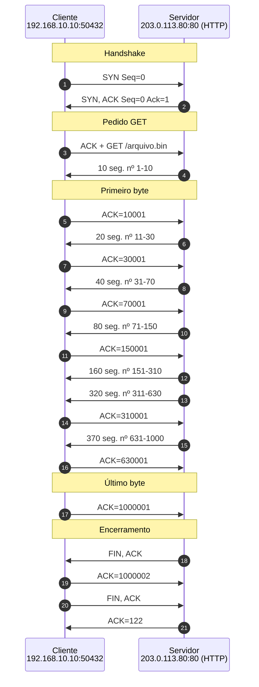

*Figura 6.2.4 (Tipo B, sequência).* Mensagens do cenário "Download com RTT alto", na ordem do tempo, entre Cliente, Servidor: 21 mensagens, numeradas de 1 a 21 na ordem da comunicação (em 6 fases). Corresponde ao diagrama de sequência e à aba Captura, no modo "TCP: download", com a configuração aplicada acima.

**Mensagens**

| Mensagem | Significado | Origem |
| --- | --- | --- |
| SYN, SYN-ACK, ACK + GET | 2 RTT até o primeiro byte | os dois lados |
| Rajadas de dados | crescem a cada RTT | servidor |

**Por que importa.** É a razão de HTTP/2, conexões persistentes, TLS 1.3, TCP Fast Open e QUIC: evitar pagar novos RTTs de handshake e partir de uma janela maior.

### 6.3 Modo: Comparação TCP x UDP

> **Grupo:** Comparação

Os dois protocolos lado a lado, na mesma rede e com as mesmas perdas.

#### 6.3.1 TCP x UDP: 10% de perda

*O que o TCP faz para entregar tudo, comparado ao UDP sem garantias.*

**Configuração aplicada:** Segmentos = 20; Perda (%) = 10; Descartar na 1ª transmissão (nº) = ; Janela inicial = 4; rwnd (seg.) = 16; ssthresh inicial = 64; Reordenação (%) = 0

O TCP e o UDP enviam 20 segmentos pela mesma rede, com as mesmas perdas. Observe o que só o **TCP** faz: detecta cada perda, retransmite e entrega tudo em ordem, ao custo de mais tempo.

Veja a aba Resultados.

**Conceito.** O TCP e o UDP enviam o mesmo volume pela mesma rede, com **as mesmas perdas** (mesma semente). O UDP serve só de referência: termina antes e entrega o que chegou. O TCP detecta cada perda por ACKs duplicados ou por timeout, retransmite e entrega todos os dados, em ordem, e por isso demora mais.

**O que observar**

- No diagrama: as retransmissões do TCP, que o UDP não faz.
- Na aba Janela (cwnd): como cada perda reduz a janela do TCP.
- Na aba Resultados: o tempo extra do TCP e o fato de ele entregar 100% dos dados.

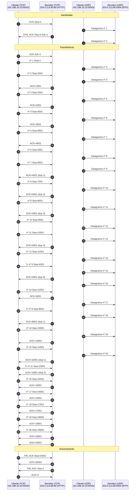

*Figura 6.3.1 (Tipo B, sequência).* Mensagens do cenário "TCP x UDP: 10% de perda", na ordem do tempo, entre Cliente (TCP), Servidor (TCP), Cliente (UDP), Servidor (UDP): 70 mensagens, numeradas de 1 a 70 na ordem da comunicação (em 4 fases; 6 perdidas). Corresponde ao diagrama de sequência e à aba Captura, no modo "Comparação TCP x UDP", com a configuração aplicada acima.

**Mensagens**

| Mensagem | Significado | Origem |
| --- | --- | --- |
| Segmento TCP | com ACK e retransmissão | cliente |
| Datagrama UDP | referência, sem confirmação | cliente |

**Por que importa.** Mostra o preço da confiabilidade: a garantia de entrega vem de confirmações e retransmissões, que custam tempo.

#### 6.3.2 TCP x UDP: reordenação

*O TCP reordena os dados; a desordem pode gerar retransmissão desnecessária.*

**Configuração aplicada:** Segmentos = 20; Perda (%) = 0; Descartar na 1ª transmissão (nº) = ; Janela inicial = 4; rwnd (seg.) = 16; ssthresh inicial = 64; Reordenação (%) = 15

Sem perdas, mas com 15% dos pacotes atrasados na rede. O **TCP** reordena no buffer do receptor e pode até retransmitir sem necessidade, se a desordem gerar três ACKs duplicados. O UDP, de referência, entrega fora de ordem.

**Conceito.** A **reordenação** acontece quando pacotes seguem caminhos diferentes ou esperam mais em alguma fila. O TCP guarda no buffer o que chega adiantado e entrega à aplicação na ordem certa. Cada segmento fora de ordem gera um ACK duplicado, e três deles disparam o fast retransmit, mesmo sem perda.

**O que observar**

- No TCP: ACKs duplicados causados só pela desordem, sem nenhuma perda.
- Se surgirem três ACKs duplicados, o TCP retransmite sem necessidade (retransmissão espúria).
- Na aba Resultados: o UDP, de referência, entregou fora de ordem.

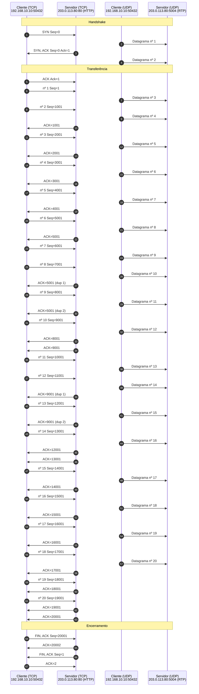

*Figura 6.3.2 (Tipo B, sequência).* Mensagens do cenário "TCP x UDP: reordenação", na ordem do tempo, entre Cliente (TCP), Servidor (TCP), Cliente (UDP), Servidor (UDP): 67 mensagens, numeradas de 1 a 67 na ordem da comunicação (em 4 fases). Corresponde ao diagrama de sequência e à aba Captura, no modo "Comparação TCP x UDP", com a configuração aplicada acima.

**Mensagens**

| Mensagem | Significado | Origem |
| --- | --- | --- |
| Segmento atrasado | chega depois dos seguintes | rede |
| ACK duplicado | causado pela desordem | servidor |

**Por que importa.** Mostra que ACK duplicado nem sempre significa perda. Pilhas modernas detectam retransmissões espúrias e desfazem a redução da janela.

## 7. Referência

### 7.1 A camada de transporte

O IP entrega pacotes entre **hosts**, sem garantias. A camada de transporte entrega dados entre **processos**, identificados por **portas**. O **UDP** ([RFC 768](https://www.rfc-editor.org/rfc/rfc768)) acrescenta apenas portas, comprimento e checksum: cada datagrama é independente, sem conexão, sem confirmação, sem ordem e sem controle de taxa. O **TCP** ([RFC 9293](https://www.rfc-editor.org/rfc/rfc9293)) oferece um fluxo de bytes confiável e ordenado, com controle de fluxo e de congestionamento, ao custo de abrir uma conexão e de esperar confirmações.

| Aspecto | TCP | UDP |
| --- | --- | --- |
| Conexão | Sim (three-way handshake) | Não |
| Confiabilidade | ACKs e retransmissão | Nenhuma (a aplicação decide) |
| Ordem | Garantida (números de sequência) | Ordem de chegada |
| Controle de fluxo | Janela do receptor (rwnd) | Não |
| Controle de congestionamento | Sim (cwnd) | Não |
| Cabeçalho | 20 a 60 bytes | 8 bytes |
| Usos típicos | Web (HTTP/1.1 e 2), SSH, e-mail, transferência de arquivos | DNS, voz e vídeo (RTP), DHCP, NTP, QUIC (HTTP/3) |

O UDP, o DNS e o vídeo em streaming têm simulador próprio.

### 7.2 Conexão TCP

- **Abertura:** SYN, SYN-ACK e ACK. Cada lado escolhe um número de sequência inicial (ISN). O Wireshark, assim como este simulador, mostra números **relativos** (o ISN aparece como 0).
- **Estados:** o cliente passa por SYN_SENT e ESTABLISHED; o servidor por LISTEN, SYN_RCVD e ESTABLISHED.
- **Encerramento:** cada sentido é fechado com FIN e ACK. Quem fecha primeiro passa por FIN_WAIT_1, FIN_WAIT_2 e **TIME_WAIT**, onde espera 2×MSL (a [RFC 9293](https://www.rfc-editor.org/rfc/rfc9293) usa MSL de 2 min; o Linux fixa 60 s) para absorver segmentos atrasados da conexão.

### 7.3 Confiabilidade e janela deslizante

- **ACK cumulativo:** informa o próximo byte esperado. Um segmento que chega fora de ordem faz o receptor repetir o último ACK (**ACK duplicado**).
- **RTO ([RFC 6298](https://www.rfc-editor.org/rfc/rfc6298)):** o temporizador de retransmissão vale SRTT + 4×RTTVAR. Pelo **algoritmo de Karn**, segmentos retransmitidos não geram amostra de RTT. A cada timeout, o RTO dobra (backoff exponencial). A RFC recomenda mínimo de 1 s; o Linux usa 200 ms, valor adotado aqui.
- **Controle de fluxo:** o receptor anuncia quanto ainda consegue armazenar (rwnd). O emissor nunca tem mais dados em voo que min(cwnd, rwnd).

### 7.4 Controle de congestionamento ([RFC 5681](https://www.rfc-editor.org/rfc/rfc5681) e [RFC 6582](https://www.rfc-editor.org/rfc/rfc6582))

- **Slow start:** a cwnd começa pequena (1 a 4 segmentos; 10 no Linux; a [RFC 6928](https://www.rfc-editor.org/rfc/rfc6928) é Experimental) e cresce 1 segmento por ACK, o que a **dobra a cada RTT**.
- **Congestion avoidance:** acima do ssthresh, cresce cerca de 1 segmento por RTT (crescimento linear).
- **Fast retransmit e fast recovery:** 3 ACKs duplicados indicam uma perda isolada. O emissor retransmite sem esperar o RTO e faz ssthresh = metade do que está em voo (no mínimo 2 segmentos, [RFC 5681](https://www.rfc-editor.org/rfc/rfc5681)). O NewReno trata os ACKs parciais quando há várias perdas na mesma janela.
- **Timeout:** sinal de congestionamento grave. ssthresh = metade do que está em voo e cwnd = 1.
- **SACK ([RFC 2018](https://www.rfc-editor.org/rfc/rfc2018)):** opção negociada no SYN (SACK_PERM). Cada ACK duplicado leva até 4 blocos (3 quando a opção Timestamps está em uso) (SLE e SRE) com os bytes recebidos além da lacuna, e o emissor mantém um placar (scoreboard). Este simulador usa uma versão simplificada: dá como perdido todo buraco abaixo do maior byte confirmado (ideia do antigo FACK; o Linux atual usa RACK-TLP, [RFC 8985](https://www.rfc-editor.org/rfc/rfc8985), e o sysctl tcp_fack já não tem efeito), sem DSACK e sem os detalhes da [RFC 6675](https://www.rfc-editor.org/rfc/rfc6675).
- O Linux usa **CUBIC** ([RFC 9438](https://www.rfc-editor.org/rfc/rfc9438)) por padrão. A lógica de crescer até perceber perda e então reduzir é a mesma mostrada aqui com Reno/NewReno.

### 7.5 Download de arquivo com TCP

- **Custo da conexão:** o primeiro byte do arquivo só chega depois de 2 RTT (handshake mais pedido HTTP). Em arquivos pequenos, esse custo e o slow start dominam o tempo.
- **Slow start e fila do roteador:** a janela dobra a cada RTT até a rede não aguentar. O que passa da capacidade do caminho (banda × RTT mais a fila do roteador) é descartado no fim da fila (tail drop), o TCP reduz a janela e volta a crescer: é o dente de serra da cwnd.
- **O que limita a vazão:** a capacidade do enlace, a janela do receptor (vazão máxima de cerca de rwnd / RTT) e as perdas (aproximação de Mathis: vazão de cerca de MSS / (RTT × √perda)).
- **SACK:** a caixa "SACK" liga a confirmação seletiva ([RFC 2018](https://www.rfc-editor.org/rfc/rfc2018)), padrão nos sistemas atuais. Ligado, o receptor informa os blocos que chegaram e o emissor repõe todas as lacunas de uma janela em cerca de 1 RTT. Desligado, o NewReno repõe uma lacuna por RTT.
- **Perdas no fim da janela:** sem segmentos depois da perda, não há ACKs duplicados. As pilhas atuais, com SACK, usam a sonda de cauda (TLP, [RFC 8985](https://www.rfc-editor.org/rfc/rfc8985)): cerca de 2 RTT depois, o emissor reenvia o último segmento, descobre o que falta e recupera sem esperar o RTO. Só a perda de uma janela inteira cai em timeout.
- **Modelo desta tela:** o simulador trabalha por rodada (uma janela inteira por RTT) e desenha uma seta por rodada. Rodadas parecidas são omitidas do diagrama, mas entram no gráfico e nas métricas.

### 7.6 Segurança do TCP

- **SYN flood:** muitos SYN sem o ACK final esgotam a fila de conexões semiabertas do servidor. SYN cookies ([RFC 4987](https://www.rfc-editor.org/rfc/rfc4987)) evitam reservar estado antes do handshake terminar.
- **Números de sequência:** um ISN previsível permite injetar segmentos ou derrubar conexões de fora do caminho. Pilhas modernas sorteiam o ISN ([RFC 9293](https://www.rfc-editor.org/rfc/rfc9293)) e só aceitam RST com a sequência exata ([RFC 5961](https://www.rfc-editor.org/rfc/rfc5961)).
- **Varreduras:** o TCP responde SYN-ACK em porta aberta e RST em porta fechada; o UDP só denuncia porta fechada com ICMP Port Unreachable. Política padrão de descarte e firewall stateful reduzem o que a varredura revela.
- **Download:** o TCP entrega os bytes, mas não garante que são os bytes certos. Use HTTPS (TLS) e confira o hash do arquivo; sem TLS, um atacante no caminho pode alterar a transferência.
- Para praticar a defesa contra esses ataques, use o Simulador de Ataques e Defesas TCP/UDP.

### 7.7 Limitações do simulador

- Cada segmento é confirmado por um ACK. Os ACKs atrasados (um ACK a cada dois segmentos, [RFC 1122](https://www.rfc-editor.org/rfc/rfc1122) e [RFC 5681](https://www.rfc-editor.org/rfc/rfc5681)) não são simulados; com eles, a cwnd cresceria cerca de 1,5 vez por RTT, e não 2.
- O handshake não negocia Window Scale nem Timestamps ([RFC 7323](https://www.rfc-editor.org/rfc/rfc7323)). Por isso a rwnd de 256 e 1024 segmentos (acima de 64 kB) é um valor didático: na prática exigiria a opção Window Scale.
- Não são simulados o algoritmo de Nagle, o TCP Fast Open, o ECN, o PMTUD nem o CUBIC; o controle de congestionamento é o Reno/NewReno.
- O RTO mínimo de 200 ms é um valor didático.
- O simulador trabalha por rodada (uma janela por RTT) e usa SACK simplificado, sem DSACK e sem os detalhes da [RFC 6675](https://www.rfc-editor.org/rfc/rfc6675).

### 7.8 Roteiro de exercícios

1. **Handshake e encerramento:** identifique na aba Captura os números de sequência e de confirmação de cada segmento. Por que o SYN e o FIN consomem um número de sequência?
2. **Slow start:** acompanhe a aba Janela (cwnd) e mostre que a janela dobra a cada RTT. Em que momento o crescimento passa a ser linear?
3. **Fast retransmit** e **Timeout (RTO):** compare o tempo total e a cwnd depois da perda nos dois cenários. Por que o timeout é tratado como sinal mais grave?
4. **Várias perdas sem SACK** e **com SACK:** compare o tempo total, a aba Janela (cwnd) e os ACKs duplicados. O que os blocos SLE e SRE permitem ao emissor saber?
5. **Janela do receptor:** quem limita a transmissão, a rede ou o receptor? Como você percebe isso na aba Janela (cwnd)?
6. **TCP x UDP: 10% de perda:** compare o tempo e os dados entregues. Para voz em tempo real e para transferência de arquivos, qual protocolo você escolheria, e por quê?
7. **Download de arquivo:** descubra em que rodada a fila do roteador estourou e como a cwnd reagiu. Quanto do tempo total foi slow start? Calcule banda × RTT e compare com a maior janela usada.
8. **Download limitado pela janela:** calcule rwnd × 1000 bytes / RTT e compare com a vazão útil medida. O que muda com rwnd = 256?

## 8. Glossário

Significado e finalidade das siglas usadas neste documento.

| Sigla | Significado | Para que serve |
| --- | --- | --- |
| **ACK** | Acknowledgment, confirmação | flag que confirma o recebimento de dados anteriores |
| **BBR** | Bottleneck Bandwidth and Round-trip propagation time | controle de congestionamento que estima a banda e o RTT do caminho, em vez de reagir só à perda de pacotes |
| **DHCP** | Dynamic Host Configuration Protocol, protocolo de configuração dinâmica de hosts | entrega ao cliente endereço IP, máscara, gateway e DNS, por empréstimo (lease) |
| **DNS** | Domain Name System, sistema de nomes de domínio | traduz nomes (www.exemplo.org) em endereços IP e guarda outros registros do domínio |
| **DSACK** | Duplicate SACK, SACK de duplicata | extensão do SACK em que o receptor avisa que recebeu dados em duplicidade |
| **ECN** | Explicit Congestion Notification, notificação explícita de congestionamento | os roteadores marcam os pacotes quando há congestionamento, e o TCP reduz a taxa sem precisar de perda |
| **FACK** | Forward Acknowledgment, confirmação adiante | algoritmo antigo de recuperação de perdas que usa o SACK para estimar os dados em trânsito |
| **FIN** | Finish | flag do TCP que encerra a conexão de forma ordenada |
| **HTTP** | Hypertext Transfer Protocol, protocolo de transferência de hipertexto | transporta páginas e dados entre navegador e servidor web |
| **HTTP/1** | HTTP versão 1.1 | versão textual do HTTP, com uma requisição por vez em cada conexão |
| **HTTP/2** | HTTP versão 2 | versão binária do HTTP que multiplexa vários fluxos em uma só conexão TCP |
| **HTTP/3** | HTTP versão 3 | versão do HTTP sobre QUIC e UDP, que evita o bloqueio de um fluxo por perda em outro |
| **HTTPS** | HTTP Secure | HTTP protegido por TLS: cifra o conteúdo e autentica o servidor |
| **ICMP** | Internet Control Message Protocol | leva mensagens de controle e de erro da camada IP, como o eco do ping e o aviso de destino inalcançável |
| **IP** | Internet Protocol, protocolo de internet | endereça e encaminha pacotes entre redes, de origem a destino |
| **ISN** | Initial Sequence Number, número de sequência inicial | primeiro número de sequência de uma conexão TCP, escolhido de forma imprevisível |
| **MSL** | Maximum Segment Lifetime, tempo máximo de vida do segmento | tempo máximo que um segmento pode existir na rede; define a espera do estado TIME-WAIT |
| **MSS** | Maximum Segment Size, tamanho máximo de segmento | maior quantidade de dados que o TCP aceita por segmento; negociada no SYN |
| **NTP** | Network Time Protocol | sincroniza o relógio dos equipamentos com uma fonte de tempo confiável |
| **PMTUD** | Path MTU Discovery, descoberta da MTU do caminho | descobre o maior pacote que passa pelo caminho sem fragmentar, usando mensagens ICMP |
| **QUIC** | nome do protocolo, que não é uma sigla oficial | transporte sobre UDP com criptografia embutida e múltiplos fluxos independentes; base do HTTP/3 |
| **RACK** | Recent Acknowledgment, confirmação recente | detecta perdas pelo tempo de chegada dos ACKs, no lugar de contar ACKs duplicados |
| **RFC** | Request for Comments, pedido de comentários | documento numerado do IETF que define ou descreve um protocolo da Internet; cada documento do projeto cita as RFCs com link para o RFC Editor |
| **RST** | Reset | flag do TCP que derruba a conexão de imediato, por exemplo ao receber segmento de uma conexão que não existe |
| **RTO** | Retransmission Timeout, tempo limite de retransmissão | tempo que o TCP espera por um ACK antes de retransmitir |
| **RTP** | Real-time Transport Protocol, protocolo de transporte em tempo real | leva voz e vídeo sobre UDP, com numeração e marcas de tempo |
| **RTT** | Round-Trip Time, tempo de ida e volta | mede o tempo entre enviar um pacote e receber a resposta; base dos temporizadores e da latência |
| **RTTVAR** | Round-Trip Time Variation, variação do RTT | estimativa da variação do RTT, somada ao SRTT no cálculo do RTO |
| **SACK** | Selective Acknowledgment, confirmação seletiva | o receptor informa quais blocos chegaram fora de ordem, e o emissor reenvia só o que faltou |
| **SLE** | SACK Left Edge, borda esquerda do bloco SACK | início de um bloco de bytes recebidos fora de ordem, na notação de ferramentas como o Wireshark |
| **SRE** | SACK Right Edge, borda direita do bloco SACK | fim de um bloco de bytes recebidos fora de ordem, na notação de ferramentas como o Wireshark |
| **SRTT** | Smoothed Round-Trip Time, RTT suavizado | média móvel do RTT medido, usada para calcular o RTO |
| **SSH** | Secure Shell | acesso remoto e transferência de arquivos por um canal cifrado, com autenticação do servidor e do usuário |
| **SYN** | Synchronize | flag do TCP que inicia uma conexão e sincroniza os números de sequência |
| **SYN-ACK** | Synchronize-Acknowledge | resposta do servidor ao SYN no handshake de três vias: aceita a conexão e envia o próprio número de sequência |
| **TCP** | Transmission Control Protocol, protocolo de controle de transmissão | entrega dados de forma ordenada e confiável, com conexão, confirmação e controle de congestionamento |
| **TCP/UDP** | Transmission Control Protocol e User Datagram Protocol | refere-se aos dois protocolos de transporte da pilha da Internet |
| **TLP** | Tail Loss Probe, sonda de perda na cauda | envia um segmento de teste quando o ACK demora, para recuperar perdas no fim da transmissão sem esperar o RTO |
| **TLS** | Transport Layer Security, segurança da camada de transporte | estabelece um canal cifrado e autenticado entre dois pontos, a base do HTTPS |
| **UDP** | User Datagram Protocol | entrega datagramas sem conexão nem confirmação, com baixo custo; usado em consultas curtas e em tempo real |

---

*Simul-Net é um projeto mantido pelo Prof. Dr. Laerte Peotta de Melo, com apoio de IA generativa no processo de desenvolvimento, com sua estrita supervisão, revisão técnica e responsabilidade. Uso exclusivo para fins de ensino e pesquisa. Universidade de Brasília (UnB) - Departamento de Engenharia Elétrica. Código aberto (licença MIT).*
