# UDP

UDP em diagrama de sequência: fluxo de datagramas com perda e reordenação, consulta DNS com timeout e nova tentativa, vídeo em streaming com buffer de jitter e comparação com o TCP.

- **Categoria:** Camada de transporte e segurança
- **Motor:** nativo (TypeScript puro, apresentado pela bancada genérica)
- **Código-fonte:** `src/sims/udp/`
- **RFCs e padrões:** [RFC 768](https://www.rfc-editor.org/rfc/rfc768) (UDP), [RFC 3550](https://www.rfc-editor.org/rfc/rfc3550) (RTP), [RFC 1035](https://www.rfc-editor.org/rfc/rfc1035) (DNS), [RFC 9293](https://www.rfc-editor.org/rfc/rfc9293) (TCP (comparação))
- **Tópicos:** Datagramas sem garantia; DNS sobre UDP; Vídeo em streaming; Comparação com o TCP

## 1. Modos

| Modo | Cenário inicial | Cenários |
| --- | --- | --- |
| UDP: fluxo | Fluxo com perdas | 6.1.1 |
| UDP: DNS | DNS com repetição | 6.2.1 |
| UDP: vídeo | Vídeo em streaming | 6.3.1 a 6.3.4 |
| Comparação UDP x TCP | TCP x UDP: 10% de perda | 6.4.1 e 6.4.2 |

## 2. Fundamentação

### 2.1 O problema que o UDP resolve

O IP entrega datagramas entre **hosts**. Falta dizer para **qual processo** do host o dado vai. O UDP (*User Datagram Protocol*, [RFC 768](https://www.rfc-editor.org/rfc/rfc768)) acrescenta ao IP só o mínimo para isso: **portas**, **comprimento** e **checksum**. Ele está na camada 4 e não cria conexão, não confirma, não reordena e não controla a taxa.

Isso não é um defeito: é uma escolha. Cada datagrama é independente, então não há handshake para esperar, nem fila de retransmissão que atrase os dados novos. O UDP serve quando a **rapidez** importa mais que a entrega perfeita, ou quando a própria aplicação quer decidir como recuperar perdas.

**O que você aprende com este simulador.**

- Explicar o que o UDP acrescenta ao IP (portas, comprimento e checksum) e o que ele deixa de fazer.
- Ler o cabeçalho UDP campo a campo e entender o checksum com o pseudocabeçalho.
- Comparar o UDP com o TCP e saber quando cada um é a escolha certa.
- Reconhecer como a aplicação recupera perdas, ordem e taxa por conta própria (DNS, vídeo).
- Entender por que a falta de handshake torna o UDP um alvo de abuso, e quais defesas existem.

### 2.2 O diagrama do datagrama

*Esquema 1 (caminho de um datagrama UDP).* Cada chamada de envio da aplicação vira **um** datagrama, e cada datagrama chega inteiro ou não chega. O UDP preserva as **fronteiras das mensagens**, ao contrário do TCP, que entrega um fluxo contínuo de bytes.

A porta de destino escolhe o processo: o IP entrega ao protocolo 17 (UDP), e o UDP entrega à aplicação que abriu aquela porta.

### 2.3 O cabeçalho UDP

O datagrama UDP é o cabeçalho de 8 bytes seguido dos dados da aplicação. O desenho mostra o cabeçalho e o início dos dados em linhas de 32 bits, na ordem de transmissão ([RFC 768](https://www.rfc-editor.org/rfc/rfc768)).

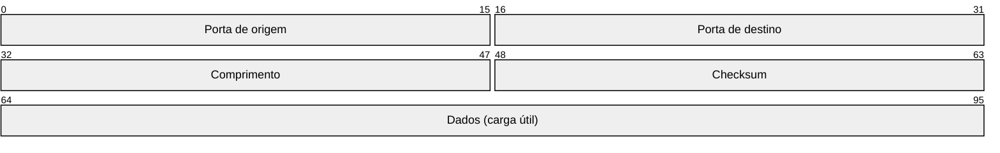

*Esquema 2 (o datagrama UDP).* Cada linha tem 32 bits, numerados de 0 a 31 da esquerda para a direita. O cabeçalho ocupa só as duas primeiras linhas (64 bits, ou 8 bytes), contra os 20 bytes do TCP sem opções. A tabela abaixo descreve todos os campos, em ordem.

| Campo | Posição (bits) | Tamanho | Função |
| --- | --- | --- | --- |
| Porta de origem | 0 a 15 | 16 bits | porta de quem enviou (pode ser zero se não há resposta) |
| Porta de destino | 16 a 31 | 16 bits | escolhe o processo no receptor |
| Comprimento | 32 a 47 | 16 bits | cabeçalho mais dados, em bytes (mínimo 8) |
| Checksum | 48 a 63 | 16 bits | cobre o pseudocabeçalho IP, o cabeçalho UDP e os dados |

No IPv4, o checksum pode ser zero, o que significa que o emissor não o calculou. Quando ele existe, o receptor descarta o datagrama que não confere. No IPv6, o checksum é obrigatório ([RFC 8200](https://www.rfc-editor.org/rfc/rfc8200), seção 8.1).

### 2.4 O checksum e o pseudocabeçalho

O checksum do UDP não protege só o UDP: ele inclui um **pseudocabeçalho** com campos do IP, para que o receptor perceba um datagrama entregue ao host errado ou com o protocolo trocado. Esses campos não viajam de novo, pois já estão no cabeçalho IP; são apenas somados no cálculo.

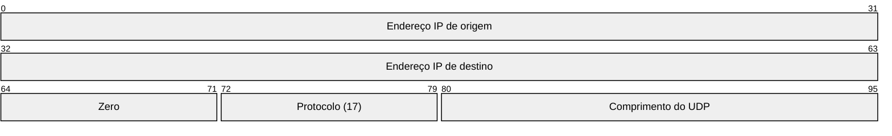

*Esquema 3 (o pseudocabeçalho IPv4 do checksum).* O cálculo é a soma em complemento de um, em palavras de 16 bits, do pseudocabeçalho, do cabeçalho UDP (com o checksum zerado) e dos dados, com o resultado complementado ([RFC 768](https://www.rfc-editor.org/rfc/rfc768); [RFC 1071](https://www.rfc-editor.org/rfc/rfc1071)). O receptor refaz a soma, e o resultado correto fecha em zero.

| Campo | Bits no desenho | Tamanho | Função |
| --- | --- | --- | --- |
| Endereço IP de origem | 0 a 31 | 32 bits | o IP de origem do datagrama, copiado do cabeçalho IP |
| Endereço IP de destino | 32 a 63 | 32 bits | o IP de destino do datagrama, copiado do cabeçalho IP |
| Zero | 64 a 71 | 8 bits | preenchimento com zeros |
| Protocolo | 72 a 79 | 8 bits | 17, o número do UDP no cabeçalho IP |
| Comprimento do UDP | 80 a 95 | 16 bits | cabeçalho UDP mais dados, em bytes, o mesmo do cabeçalho UDP |

O pseudocabeçalho não é transmitido: o emissor e o receptor o montam só para calcular o checksum.

### 2.5 O tamanho do datagrama

O campo de comprimento tem 16 bits, e o IPv4 limita o pacote a 65.535 bytes, então a carga útil máxima teórica é de **65.507 bytes** (65.535 menos 20 do IP e 8 do UDP). Na prática, o limite útil é a MTU: em Ethernet (1500 bytes), cabem **1472 bytes** de dados sem fragmentar (1500 menos 20 e menos 8). Datagramas maiores são fragmentados pelo IP, e a perda de um fragmento descarta o datagrama inteiro, por isso as aplicações costumam manter o UDP abaixo da MTU ([RFC 8085](https://www.rfc-editor.org/rfc/rfc8085), seção 3.2).

### 2.6 UDP e TCP lado a lado

| Característica | UDP | TCP |
| --- | --- | --- |
| Conexão | nenhuma | abertura em três vias e encerramento |
| Entrega | melhor esforço, sem confirmação | confiável, com confirmação e retransmissão |
| Ordem | não garante | garante, no fluxo de bytes |
| Fronteiras das mensagens | preservadas (um datagrama, uma mensagem) | não existem (fluxo contínuo) |
| Cabeçalho | 8 bytes | 20 bytes ou mais |
| Controle de fluxo e de congestionamento | nenhum (cabe à aplicação) | rwnd e cwnd |
| Usos típicos | DNS, DHCP, NTP, voz, vídeo, QUIC | web, e-mail, SSH, transferência de arquivos |

### 2.7 O que a aplicação ganha e o que passa a ser dela

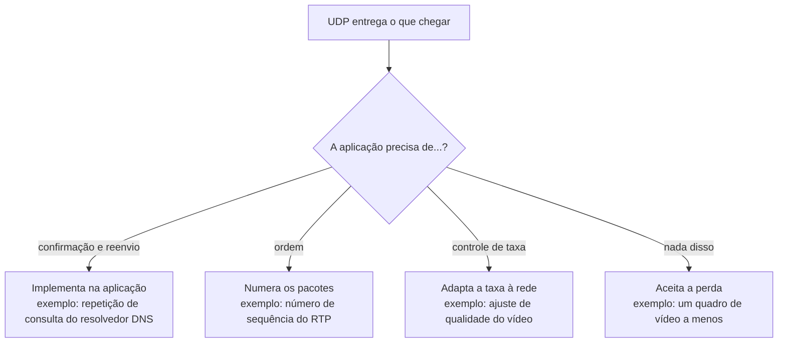

*Esquema 4 (responsabilidades que sobram para a aplicação).* Tudo o que o TCP faz por baixo, no UDP é decisão da aplicação. As diretrizes para usar o UDP com cuidado estão na [RFC 8085](https://www.rfc-editor.org/rfc/rfc8085), em especial a necessidade de a aplicação controlar o congestionamento.

| Uso | Por que UDP | Como lida com a perda |
| --- | --- | --- |
| DNS ([RFC 1035](https://www.rfc-editor.org/rfc/rfc1035)) | uma pergunta e uma resposta pequenas, sem custo de conexão | o resolvedor repete a consulta se não houver resposta |
| Vídeo e voz (RTP, [RFC 3550](https://www.rfc-editor.org/rfc/rfc3550)) | um dado atrasado perde o valor | número de sequência e *timestamp* no RTP, buffer no player |

Algumas portas conhecidas sobre UDP: **53** (DNS), **67 e 68** (DHCP, servidor e cliente), **123** (NTP) e **443** (QUIC, que acrescenta confiabilidade e controle de congestionamento acima do UDP). O registro oficial está na IANA ("Service Name and Transport Protocol Port Number Registry").

### 2.8 UDP e segurança: a ausência de handshake

Sem handshake, o UDP não confirma que o remetente é quem diz ser: o endereço de origem de um datagrama pode ser **forjado**. Um servidor que responde a qualquer datagrama pode ser usado para enviar respostas à vítima, e, quando a resposta é maior que a consulta, o tráfego é **amplificado** ([RFC 8085](https://www.rfc-editor.org/rfc/rfc8085), seção 5). Este documento trata do tema no nível defensivo; o simulador de ataques a TCP e UDP mostra o efeito.

As defesas são três: filtrar na borda os pacotes com origem falsificada ([BCP 38](https://www.rfc-editor.org/info/bcp38), [RFC 2827](https://www.rfc-editor.org/rfc/rfc2827)), limitar a taxa de respostas e não expor serviços UDP que não precisam ser públicos.

### 2.9 O que cada modo e aba do simulador mostram

- **Diagrama de sequência:** cada seta é um datagrama, sem handshake antes e sem ACK depois. A seta com X é um datagrama perdido, e o UDP não percebe isso.
- **Modos:** *UDP: fluxo* mostra datagramas de mídia com perda e reordenação. *UDP: DNS* mostra a repetição feita pelo **resolvedor**, e não pelo UDP. *UDP: vídeo* mostra um streaming, com taxa, jitter e buffer do player. *Comparação UDP x TCP* envia a mesma carga pelos dois protocolos na mesma rede.
- **Sem conexão:** o UDP não tem estados de conexão para mostrar, e o que se observa é o destino de cada datagrama: entregue, perdido ou entregue fora de ordem.

Para ver a perda sem recuperação, use o cenário "Fluxo com perdas". Para ver quem repete a consulta, use "DNS com repetição". Para o efeito de taxa, jitter e buffer, use "Vídeo em streaming", "Vídeo com perdas", "Vídeo acima da capacidade" e "Jitter e buffer do player". Para comparar com o TCP, use "TCP x UDP: 10% de perda" e "TCP x UDP: reordenação".

### 2.10 Limites do modelo e do diagrama

- O simulador não implementa o RTP nem o DNS por completo: usa o comportamento essencial de cada um para mostrar como a aplicação lida com a perda.
- Os tempos, as taxas e o buffer do player são **didáticos**, e não medem uma rede real.
- Fragmentação IP, multicast e QUIC (que usa UDP, mas acrescenta confiabilidade e controle de congestionamento) não são simulados.

## 3. Como ler os diagramas

Este documento usa até dois tipos de diagrama. Cada figura traz uma legenda com o tipo, o que mostra e a que modo ou cenário se refere.

| Tipo | O que é | Vale para | Equivale, no simulador, a |
| --- | --- | --- | --- |
| B, sequência | As mensagens na ordem do tempo, entre os participantes. É dinâmico. | Um único cenário, com a configuração indicada | Ao diagrama de sequência e à aba Captura |

### 3.1 Legenda dos diagramas

**Tipo B (sequência)**

- Cada coluna é um participante (cliente, servidor, roteador ou outro). O tempo corre de cima para baixo.
- Seta cheia: mensagem enviada. Seta com X: mensagem perdida.
- `[cifrado]` no início do rótulo: a mensagem viaja cifrada.
- Faixa horizontal com texto: início de uma fase do cenário.
- A ordem é a da aba Captura; os intervalos de tempo não são desenhados em escala.

### 3.2 Lista de figuras

**Tipo B (sequência)**

- [Figura 6.1.1](#611-fluxo-com-perdas): sequência de "Fluxo com perdas"
- [Figura 6.2.1](#621-dns-com-repetição): sequência de "DNS com repetição"
- [Figura 6.3.1](#631-vídeo-em-streaming): sequência de "Vídeo em streaming"
- [Figura 6.3.2](#632-vídeo-com-perdas): sequência de "Vídeo com perdas"
- [Figura 6.3.3](#633-vídeo-acima-da-capacidade): sequência de "Vídeo acima da capacidade"
- [Figura 6.3.4](#634-jitter-e-buffer-do-player): sequência de "Jitter e buffer do player"
- [Figura 6.4.1](#641-tcp-x-udp-10-de-perda): sequência de "TCP x UDP: 10% de perda"
- [Figura 6.4.2](#642-tcp-x-udp-reordenação): sequência de "TCP x UDP: reordenação"

## 4. Abas da bancada

Cenário, Captura, Mensagem, Janela (cwnd) (modos: Comparação UDP x TCP), Taxa do vídeo (modos: UDP: vídeo), Resultados, Experimento, Referência e Log.

## 5. Configurações (campos do painel)

### 5.1 Transferência

- **Segmentos**. Valores: 1; 2; 3; 4; 5; 6; 8; 10; 12; 15; 20; 25; 30; 40. Padrão: 20. Modos: Comparação UDP x TCP; UDP: fluxo.
  - Quantos segmentos (TCP) ou datagramas (UDP) de 1000 bytes serão enviados.
  - Cada segmento carrega 1000 bytes de dados (o MSS). 20 segmentos equivalem a um arquivo de 20 kB.
  - Com mais segmentos, o crescimento da janela de congestionamento fica mais visível.

### 5.2 Rede

- **RTT (ms)**. Valores: 5; 10; 15; 20; 50; 100; 200. Padrão: 15. Modos: todos.
  - Tempo de ida e volta na rede, sem contar a transmissão.
  - Metade do RTT é o atraso de propagação em cada sentido.
  - Ele define o custo do handshake (1 RTT antes do primeiro dado), o ritmo do slow start (a janela dobra a cada RTT) e o valor do RTO.
  - Referências: cerca de 1 ms em rede local, 15 ms em uma rede metropolitana e de 100 a 200 ms entre continentes.
- **Banda (Mbps)**. Valores: 1; 2; 5; 10; 20; 50. Padrão: 1. Modos: Comparação UDP x TCP; UDP: fluxo; UDP: vídeo.
  - Capacidade do enlace em megabits por segundo.
  - Define o tempo de transmissão de cada segmento: 1000 bytes levam 8 ms a 1 Mbps e 1,6 ms a 5 Mbps. Por isso as setas saem espaçadas no diagrama. Os valores de 10 a 50 Mbps servem ao download e ao vídeo.
  - O produto banda × RTT indica quantos dados precisam estar em voo para ocupar o enlace inteiro.
- **Perda (%)**. Valores: 0; 1; 2; 3; 5; 8; 10; 15; 20; 30. Padrão: 0. Modos: todos.
  - Probabilidade de cada segmento de dados ser descartado na rede.
  - O sorteio vale para cada transmissão, inclusive as retransmissões, e é definido pela semente.
  - No DNS, vale para a consulta e para a resposta.
  - Exemplo: 1% já é uma perda alta em redes cabeadas; redes sem fio congestionadas podem passar de 5%.
- **Semente**. Valores: 1; 2; 3; 5; 7; 11; 42; 99; 1234; 9999. Padrão: 7. Modos: todos.
  - Número que define o sorteio das perdas e dos atrasos.
  - A mesma semente gera sempre as mesmas perdas: a simulação se repete igual em aula.
  - No modo Comparação, TCP e UDP sofrem exatamente as mesmas perdas.
  - Troque o valor para ver outra sequência de perdas com a mesma taxa.
- **Reordenação (%)** (ajuste avançado). Valores: 0; 5; 10; 15; 20; 30. Padrão: 0. Modos: Comparação UDP x TCP; UDP: fluxo; UDP: vídeo.
  - Probabilidade de um pacote atrasar e chegar depois dos seguintes.
  - Simula pacotes que seguem caminhos diferentes ou ficam mais tempo em uma fila.
  - No TCP, o receptor guarda o pacote adiantado e repete o ACK do que falta (ACK duplicado). Se a desordem gerar 3 ACKs duplicados, o emissor retransmite sem necessidade.
  - No UDP, a aplicação recebe os datagramas fora de ordem.
- **Descartar na 1ª transmissão (nº)** (ajuste avançado). Valores: nenhum; #1; #3; #5; #6; #8; #10; #15; #5, #7 e #9; #3, #6 e #9. Padrão: nenhum. Modos: Comparação UDP x TCP; UDP: fluxo; UDP: DNS.
  - Números dos segmentos que se perdem na primeira vez que são enviados.
  - Escolha o número do segmento (ou uma combinação pronta). A retransmissão desses segmentos não é descartada, a não ser pela perda aleatória.
  - Permite criar situações exatas: perder um segmento do meio provoca fast retransmit; perder o último provoca timeout.
  - No DNS, "#1" descarta a primeira consulta.
- **Perda também nos ACKs** (ajuste avançado). Valores: caixa de seleção. Padrão: não. Modos: Comparação UDP x TCP.
  - Aplica a mesma taxa de perda aos ACKs do servidor.
  - Como o ACK do TCP é cumulativo, o ACK seguinte confirma também o que o ACK perdido confirmaria.
  - Por isso a perda de ACKs raramente causa retransmissão; na maioria das vezes, só atrasa um pouco o crescimento da janela.

### 5.3 Vídeo

- **Taxa do vídeo**. Valores: 500 kbit/s; 1000 kbit/s; 2500 kbit/s; 4000 kbit/s. Padrão: 2500 kbit/s. Modos: UDP: vídeo.
  - Quantos kbit/s o codificador produz, em média.
  - O vídeo tem 25 quadros por segundo. O quadro I (um por segundo) carrega cerca de 6 vezes mais dados que um quadro P.
  - Se a taxa passar da banda do enlace, o UDP não reduz o envio e o excesso é descartado na fila.
- **Duração**. Valores: 2 s; 5 s; 10 s. Padrão: 5 s. Modos: UDP: vídeo.
  - Quanto tempo de vídeo é transmitido.
  - Cada segundo tem 25 quadros: 5 s equivalem a 125 quadros.
  - Durações maiores mostram mais ciclos de quadros I.
- **Jitter da rede**. Valores: 0 ms; 10 ms; 20 ms; 40 ms; 80 ms. Padrão: 20 ms. Modos: UDP: vídeo.
  - Variação aleatória do atraso de cada pacote.
  - Cada pacote recebe um atraso extra sorteado entre 0 e o valor escolhido, somado ao atraso da fila.
  - O buffer do player precisa cobrir essa variação. Se não cobrir, os pacotes chegam depois do prazo e são descartados.
- **Buffer do player**. Valores: 20 ms; 60 ms; 100 ms; 200 ms; 400 ms. Padrão: 100 ms. Modos: UDP: vídeo.
  - Tempo que o player espera antes de exibir cada quadro.
  - É o buffer de jitter. Cada quadro é exibido no instante do envio + 40 ms (duração do quadro) + atraso de propagação + buffer.
  - O pacote que chega depois desse prazo é descartado. Buffer maior perde menos pacotes, mas aumenta o atraso entre a captura e a imagem.

### 5.4 TCP

- **SACK (confirmação seletiva)**. Valores: caixa de seleção. Padrão: não. Modos: Comparação UDP x TCP.
  - Liga a opção SACK do TCP ([RFC 2018](https://www.rfc-editor.org/rfc/rfc2018)).
  - Os dois lados negociam a opção no handshake (SACK_PERM). Nos ACKs duplicados, o receptor informa os blocos de bytes que já chegaram além da lacuna (SLE e SRE).
  - Ligado, o emissor repõe todos os buracos de uma janela em cerca de 1 RTT. Desligado, vale o NewReno: uma lacuna por RTT, descoberta pelos ACKs parciais.
  - Faz diferença quando há várias perdas na mesma janela. Com uma só perda, os dois se comportam quase igual.
- **Janela inicial** (ajuste avançado). Valores: 1 seg.; 4 seg.; 10 seg.. Padrão: 1 seg.. Modos: Comparação UDP x TCP.
  - Valor da cwnd no início da transferência, em segmentos.
  - É quantos segmentos o emissor pode enviar antes do primeiro ACK.
  - O valor original era 1; a [RFC 5681](https://www.rfc-editor.org/rfc/rfc5681) permite de 2 a 4 e o Linux usa 10 ([RFC 6928](https://www.rfc-editor.org/rfc/rfc6928), de status Experimental).
  - Com 1, o slow start fica bem visível: 1, 2, 4, 8 segmentos por RTT.
- **rwnd (seg.)** (ajuste avançado). Valores: 4; 8; 16; 32; 64; 256; 1024. Padrão: 16. Modos: Comparação UDP x TCP.
  - Espaço de buffer que o servidor anuncia em cada ACK.
  - É o controle de fluxo: protege o receptor de receber mais do que consegue guardar. O valor aparece no campo Janela dos ACKs (16 segmentos = 16000 bytes).
  - O emissor nunca tem mais que o mínimo entre cwnd e rwnd em voo. Com rwnd = 4, a cwnd pode crescer, mas o envio fica limitado a 4 segmentos.
- **ssthresh inicial** (ajuste avançado). Valores: 64 seg.; 8 seg.; sem limite. Padrão: 64 seg.. Modos: Comparação UDP x TCP.
  - Limiar entre o slow start e o congestion avoidance.
  - Abaixo do ssthresh, a cwnd cresce exponencialmente (slow start). Acima, cresce cerca de 1 segmento por RTT (congestion avoidance).
  - Com 64, o slow start vai até a primeira perda ou até o limite da rwnd. Com 8, a mudança de fase aparece cedo. Com "sem limite", só a primeira perda encerra o slow start (útil no download).
  - Depois de uma perda, o TCP recalcula o ssthresh como metade do que estava em voo.

## 6. Cenários

### 6.1 Modo: UDP: fluxo

> **Grupo:** UDP

Datagramas sem conexão: o que a aplicação ganha em rapidez e o que precisa fazer por conta própria.

#### 6.1.1 Fluxo com perdas

*Datagramas sem conexão: perdas e desordem chegam à aplicação.*

**Configuração aplicada:** Segmentos = 20; Perda (%) = 10; Descartar na 1ª transmissão (nº) = ; Reordenação (%) = 10

Vinte datagramas de mídia saem sem handshake e sem esperar confirmação. Os perdidos não são recuperados e os atrasados chegam fora de ordem.

Para voz e vídeo, isso é aceitável: um áudio atrasado já não serve.

**Conceito.** O **UDP** não tem conexão, confirmação nem retransmissão: cada datagrama é independente. O que se perde não volta, e o que atrasa chega fora de ordem. Para mídia em tempo real (RTP sobre UDP), isso é melhor do que esperar: um áudio atrasado já não serve.

**O que observar**

- No diagrama: nenhum handshake e nenhum ACK; o envio segue no ritmo do enlace.
- Os datagramas perdidos não são reenviados.
- Na aba Resultados: quantos chegaram e quantos chegaram fora de ordem.

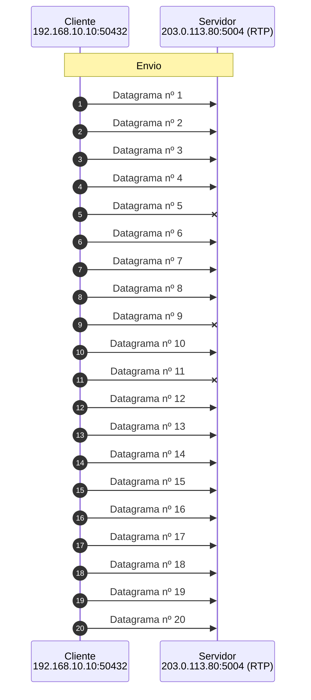

*Figura 6.1.1 (Tipo B, sequência).* Mensagens do cenário "Fluxo com perdas", na ordem do tempo, entre Cliente, Servidor: 20 mensagens, numeradas de 1 a 20 na ordem da comunicação (em 2 fases; 3 perdidas). Corresponde ao diagrama de sequência e à aba Captura, no modo "UDP: fluxo", com a configuração aplicada acima.

**Mensagens**

| Mensagem | Significado | Origem |
| --- | --- | --- |
| UDP | mídia para a porta 5004 (RTP) | cliente |

**Por que importa.** Como não confirma nada, o UDP também não verifica a origem: é a base da falsificação, da reflexão e da amplificação (veja o simulador de Ataques e defesas TCP/UDP).

### 6.2 Modo: UDP: DNS

> **Grupo:** UDP

Datagramas sem conexão: o que a aplicação ganha em rapidez e o que precisa fazer por conta própria.

#### 6.2.1 DNS com repetição

*A aplicação, não o UDP, percebe a perda e repete a consulta.*

**Configuração aplicada:** Perda (%) = 0; Descartar na 1ª transmissão (nº) = 1; Reordenação (%) = 0

A primeira consulta se perde. O UDP não percebe; quem percebe é o resolvedor, que espera 1 s (valor didático; a [RFC 1035](https://www.rfc-editor.org/rfc/rfc1035), seção 7.2, sugere intervalo mínimo de 2 a 5 s) e repete a consulta.

É o padrão de quem usa UDP: a confiabilidade, quando necessária, fica com a aplicação.

**Conceito.** O **DNS** usa UDP na porta 53, com uma consulta e uma resposta. Se a resposta não chega no tempo limite, o UDP não faz nada: é o **resolvedor** (a aplicação) que repete a consulta.

**O que observar**

- No diagrama: a primeira consulta se perde e nada volta.
- Depois de 1 s, a aplicação envia a mesma consulta de novo.
- O tempo total inclui essa espera.

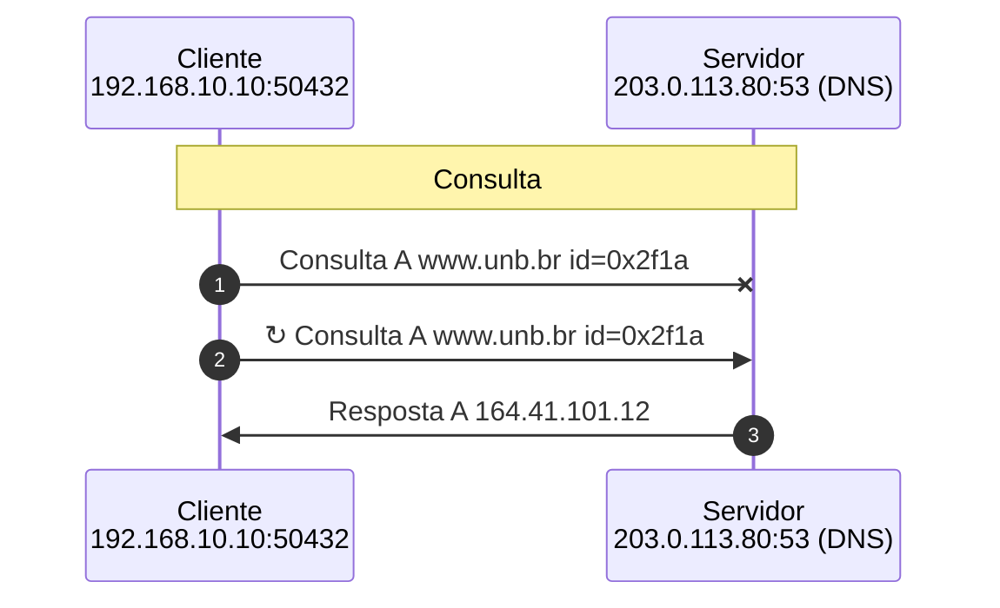

*Figura 6.2.1 (Tipo B, sequência).* Mensagens do cenário "DNS com repetição", na ordem do tempo, entre Cliente, Servidor: 3 mensagens, numeradas de 1 a 3 na ordem da comunicação (em 2 fases; 1 perdida). Corresponde ao diagrama de sequência e à aba Captura, no modo "UDP: DNS", com a configuração aplicada acima.

**Mensagens**

| Mensagem | Significado | Origem |
| --- | --- | --- |
| Consulta DNS | UDP para a porta 53 | cliente |
| Resposta DNS | UDP a partir da porta 53 | servidor |

**Por que importa.** Quem usa UDP assume a confiabilidade de que precisa. O DNS sobre UDP também é alvo de amplificação e de respostas forjadas; o identificador da consulta e a porta de origem aleatória dificultam o envenenamento de cache.

### 6.3 Modo: UDP: vídeo

> **Grupo:** Vídeo

Vídeo ao vivo por UDP (RTP): quadros I e P, perdas sem retransmissão, jitter e buffer do player.

#### 6.3.1 Vídeo em streaming

*25 quadros por segundo sobre UDP, sem handshake, com buffer no player.*

**Configuração aplicada:** Taxa do vídeo = 2500; Duração = 5; RTT (ms) = 50; Banda (Mbps) = 5; Perda (%) = 0; Descartar na 1ª transmissão (nº) = ; Reordenação (%) = 0; Jitter da rede = 20; Buffer do player = 100

Cinco segundos de vídeo a 2500 kbit/s, 25 quadros por segundo, num enlace de 5 Mbps com jitter de até 20 ms e buffer de 100 ms no player.

O quadro I, bem maior, cria um pico de envio a cada segundo e uma fila momentânea, mas o buffer absorve a variação e todos os quadros saem sem defeito.

**Conceito.** O **streaming de vídeo ao vivo** envia os quadros em pacotes **RTP** sobre UDP. Há um quadro **I** por segundo (completo e grande) e quadros **P** (só a diferença para o anterior). O servidor espaça os pacotes ao longo de cada quadro, e o **player** mantém um pequeno buffer (aqui, 100 ms) para absorver as variações de atraso (jitter).

**O que observar**

- No diagrama: uma seta por quadro. Os quadros I (rotulados) são maiores e demoram mais para chegar.
- Na aba Vazão e qualidade: o pico de envio a cada segundo (quadro I) e a faixa de quadros toda verde.
- Na aba Resultados: jitter, atraso até a exibição e nenhum quadro com defeito.

```mermaid
sequenceDiagram
  autonumber
  participant n_c as Cliente (player)<br/>192.168.10.10:50432
  participant n_s as Servidor de vídeo<br/>203.0.113.80:5004 (RTP)
  Note over n_c,n_s: Envio
  n_s ->> n_c: I nº 1 (53 pacotes)
  n_s ->> n_c: 5004 → 50432 RTP quadro P nº 2: 9 pacotes, 10417 bytes
  n_s ->> n_c: 5004 → 50432 RTP quadro P nº 3: 9 pacotes, 10417 bytes
  n_s ->> n_c: 5004 → 50432 RTP quadro P nº 4: 9 pacotes, 10417 bytes
  n_s ->> n_c: 5004 → 50432 RTP quadro P nº 5: 9 pacotes, 10417 bytes
  Note over n_c,n_s: Primeiro quadro
  n_s ->> n_c: 5004 → 50432 RTP quadro P nº 6: 9 pacotes, 10417 bytes
  n_s ->> n_c: 5004 → 50432 RTP quadro P nº 7: 9 pacotes, 10417 bytes
  n_s ->> n_c: 5004 → 50432 RTP quadro P nº 8: 9 pacotes, 10417 bytes
  n_s ->> n_c: 5004 → 50432 RTP quadro P nº 9: 9 pacotes, 10417 bytes
  n_s ->> n_c: 5004 → 50432 RTP quadro P nº 10: 9 pacotes, 10417 bytes
  n_s ->> n_c: 5004 → 50432 RTP quadro P nº 11: 9 pacotes, 10417 bytes
  n_s ->> n_c: 5004 → 50432 RTP quadro P nº 12: 9 pacotes, 10417 bytes
  n_s ->> n_c: 5004 → 50432 RTP quadro P nº 13: 9 pacotes, 10417 bytes
  n_s ->> n_c: 5004 → 50432 RTP quadro P nº 14: 9 pacotes, 10417 bytes
  n_s ->> n_c: 5004 → 50432 RTP quadro P nº 15: 9 pacotes, 10417 bytes
  n_s ->> n_c: 5004 → 50432 RTP quadro P nº 16: 9 pacotes, 10417 bytes
  n_s ->> n_c: 5004 → 50432 RTP quadro P nº 17: 9 pacotes, 10417 bytes
  n_s ->> n_c: 5004 → 50432 RTP quadro P nº 18: 9 pacotes, 10417 bytes
  n_s ->> n_c: 5004 → 50432 RTP quadro P nº 19: 9 pacotes, 10417 bytes
  n_s ->> n_c: 5004 → 50432 RTP quadro P nº 20: 9 pacotes, 10417 bytes
  n_s ->> n_c: 5004 → 50432 RTP quadro P nº 21: 9 pacotes, 10417 bytes
  n_s ->> n_c: 5004 → 50432 RTP quadro P nº 22: 9 pacotes, 10417 bytes
  n_s ->> n_c: 5004 → 50432 RTP quadro P nº 23: 9 pacotes, 10417 bytes
  n_s ->> n_c: 5004 → 50432 RTP quadro P nº 24: 9 pacotes, 10417 bytes
  n_s ->> n_c: 5004 → 50432 RTP quadro P nº 25: 9 pacotes, 10417 bytes
  n_s ->> n_c: I nº 26 (53 pacotes)
  n_s ->> n_c: 5004 → 50432 RTP quadro P nº 27: 9 pacotes, 10417 bytes
  n_s ->> n_c: 5004 → 50432 RTP quadro P nº 28: 9 pacotes, 10417 bytes
  n_s ->> n_c: 5004 → 50432 RTP quadro P nº 29: 9 pacotes, 10417 bytes
  n_s ->> n_c: 5004 → 50432 RTP quadro P nº 30: 9 pacotes, 10417 bytes
  n_s ->> n_c: 5004 → 50432 RTP quadro P nº 31: 9 pacotes, 10417 bytes
  n_s ->> n_c: 5004 → 50432 RTP quadro P nº 32: 9 pacotes, 10417 bytes
  n_s ->> n_c: 5004 → 50432 RTP quadro P nº 33: 9 pacotes, 10417 bytes
  n_s ->> n_c: 5004 → 50432 RTP quadro P nº 34: 9 pacotes, 10417 bytes
  n_s ->> n_c: 5004 → 50432 RTP quadro P nº 35: 9 pacotes, 10417 bytes
  n_s ->> n_c: 5004 → 50432 RTP quadro P nº 36: 9 pacotes, 10417 bytes
  n_s ->> n_c: 5004 → 50432 RTP quadro P nº 37: 9 pacotes, 10417 bytes
  n_s ->> n_c: 5004 → 50432 RTP quadro P nº 38: 9 pacotes, 10417 bytes
  n_s ->> n_c: 5004 → 50432 RTP quadro P nº 39: 9 pacotes, 10417 bytes
  n_s ->> n_c: 5004 → 50432 RTP quadro P nº 40: 9 pacotes, 10417 bytes
  n_s ->> n_c: 5004 → 50432 RTP quadro P nº 41: 9 pacotes, 10417 bytes
  n_s ->> n_c: 5004 → 50432 RTP quadro P nº 42: 9 pacotes, 10417 bytes
  n_s ->> n_c: 5004 → 50432 RTP quadro P nº 43: 9 pacotes, 10417 bytes
  n_s ->> n_c: 5004 → 50432 RTP quadro P nº 44: 9 pacotes, 10417 bytes
  n_s ->> n_c: 5004 → 50432 RTP quadro P nº 45: 9 pacotes, 10417 bytes
  n_s ->> n_c: 5004 → 50432 RTP quadro P nº 46: 9 pacotes, 10417 bytes
  n_s ->> n_c: 5004 → 50432 RTP quadro P nº 47: 9 pacotes, 10417 bytes
  n_s ->> n_c: 5004 → 50432 RTP quadro P nº 48: 9 pacotes, 10417 bytes
  n_s ->> n_c: 5004 → 50432 RTP quadro P nº 49: 9 pacotes, 10417 bytes
  n_s ->> n_c: 5004 → 50432 RTP quadro P nº 50: 9 pacotes, 10417 bytes
  n_s ->> n_c: I nº 51 (53 pacotes)
  n_s ->> n_c: 5004 → 50432 RTP quadro P nº 52: 9 pacotes, 10417 bytes
  n_s ->> n_c: 5004 → 50432 RTP quadro P nº 53: 9 pacotes, 10417 bytes
  n_s ->> n_c: 5004 → 50432 RTP quadro P nº 54: 9 pacotes, 10417 bytes
  n_s ->> n_c: 5004 → 50432 RTP quadro P nº 55: 9 pacotes, 10417 bytes
  n_s ->> n_c: 5004 → 50432 RTP quadro P nº 56: 9 pacotes, 10417 bytes
  n_s ->> n_c: 5004 → 50432 RTP quadro P nº 57: 9 pacotes, 10417 bytes
  n_s ->> n_c: 5004 → 50432 RTP quadro P nº 58: 9 pacotes, 10417 bytes
  n_s ->> n_c: 5004 → 50432 RTP quadro P nº 59: 9 pacotes, 10417 bytes
  n_s ->> n_c: 5004 → 50432 RTP quadro P nº 60: 9 pacotes, 10417 bytes
  n_s ->> n_c: 5004 → 50432 RTP quadro P nº 61: 9 pacotes, 10417 bytes
  n_s ->> n_c: 5004 → 50432 RTP quadro P nº 62: 9 pacotes, 10417 bytes
  n_s ->> n_c: 5004 → 50432 RTP quadro P nº 63: 9 pacotes, 10417 bytes
  n_s ->> n_c: 5004 → 50432 RTP quadro P nº 64: 9 pacotes, 10417 bytes
  n_s ->> n_c: 5004 → 50432 RTP quadro P nº 65: 9 pacotes, 10417 bytes
  n_s ->> n_c: 5004 → 50432 RTP quadro P nº 66: 9 pacotes, 10417 bytes
  n_s ->> n_c: 5004 → 50432 RTP quadro P nº 67: 9 pacotes, 10417 bytes
  n_s ->> n_c: 5004 → 50432 RTP quadro P nº 68: 9 pacotes, 10417 bytes
  n_s ->> n_c: 5004 → 50432 RTP quadro P nº 69: 9 pacotes, 10417 bytes
  n_s ->> n_c: 5004 → 50432 RTP quadro P nº 70: 9 pacotes, 10417 bytes
  n_s ->> n_c: 5004 → 50432 RTP quadro P nº 71: 9 pacotes, 10417 bytes
  n_s ->> n_c: 5004 → 50432 RTP quadro P nº 72: 9 pacotes, 10417 bytes
  n_s ->> n_c: 5004 → 50432 RTP quadro P nº 73: 9 pacotes, 10417 bytes
  n_s ->> n_c: 5004 → 50432 RTP quadro P nº 74: 9 pacotes, 10417 bytes
  n_s ->> n_c: 5004 → 50432 RTP quadro P nº 75: 9 pacotes, 10417 bytes
  n_s ->> n_c: I nº 76 (53 pacotes)
  n_s ->> n_c: 5004 → 50432 RTP quadro P nº 77: 9 pacotes, 10417 bytes
  n_s ->> n_c: 5004 → 50432 RTP quadro P nº 78: 9 pacotes, 10417 bytes
  n_s ->> n_c: 5004 → 50432 RTP quadro P nº 79: 9 pacotes, 10417 bytes
  n_s ->> n_c: 5004 → 50432 RTP quadro P nº 80: 9 pacotes, 10417 bytes
  n_s ->> n_c: 5004 → 50432 RTP quadro P nº 81: 9 pacotes, 10417 bytes
  n_s ->> n_c: 5004 → 50432 RTP quadro P nº 82: 9 pacotes, 10417 bytes
  n_s ->> n_c: 5004 → 50432 RTP quadro P nº 83: 9 pacotes, 10417 bytes
  n_s ->> n_c: 5004 → 50432 RTP quadro P nº 84: 9 pacotes, 10417 bytes
  n_s ->> n_c: 5004 → 50432 RTP quadro P nº 85: 9 pacotes, 10417 bytes
  n_s ->> n_c: 5004 → 50432 RTP quadro P nº 86: 9 pacotes, 10417 bytes
  n_s ->> n_c: 5004 → 50432 RTP quadro P nº 87: 9 pacotes, 10417 bytes
  n_s ->> n_c: 5004 → 50432 RTP quadro P nº 88: 9 pacotes, 10417 bytes
  n_s ->> n_c: 5004 → 50432 RTP quadro P nº 89: 9 pacotes, 10417 bytes
  n_s ->> n_c: 5004 → 50432 RTP quadro P nº 90: 9 pacotes, 10417 bytes
  n_s ->> n_c: 5004 → 50432 RTP quadro P nº 91: 9 pacotes, 10417 bytes
  n_s ->> n_c: 5004 → 50432 RTP quadro P nº 92: 9 pacotes, 10417 bytes
  n_s ->> n_c: 5004 → 50432 RTP quadro P nº 93: 9 pacotes, 10417 bytes
  n_s ->> n_c: 5004 → 50432 RTP quadro P nº 94: 9 pacotes, 10417 bytes
  n_s ->> n_c: 5004 → 50432 RTP quadro P nº 95: 9 pacotes, 10417 bytes
  n_s ->> n_c: 5004 → 50432 RTP quadro P nº 96: 9 pacotes, 10417 bytes
  n_s ->> n_c: 5004 → 50432 RTP quadro P nº 97: 9 pacotes, 10417 bytes
  n_s ->> n_c: 5004 → 50432 RTP quadro P nº 98: 9 pacotes, 10417 bytes
  n_s ->> n_c: 5004 → 50432 RTP quadro P nº 99: 9 pacotes, 10417 bytes
  n_s ->> n_c: 5004 → 50432 RTP quadro P nº 100: 9 pacotes, 10417 bytes
  n_s ->> n_c: I nº 101 (53 pacotes)
  n_s ->> n_c: 5004 → 50432 RTP quadro P nº 102: 9 pacotes, 10417 bytes
  n_s ->> n_c: 5004 → 50432 RTP quadro P nº 103: 9 pacotes, 10417 bytes
  n_s ->> n_c: 5004 → 50432 RTP quadro P nº 104: 9 pacotes, 10417 bytes
  n_s ->> n_c: 5004 → 50432 RTP quadro P nº 105: 9 pacotes, 10417 bytes
  n_s ->> n_c: 5004 → 50432 RTP quadro P nº 106: 9 pacotes, 10417 bytes
  n_s ->> n_c: 5004 → 50432 RTP quadro P nº 107: 9 pacotes, 10417 bytes
  n_s ->> n_c: 5004 → 50432 RTP quadro P nº 108: 9 pacotes, 10417 bytes
  n_s ->> n_c: 5004 → 50432 RTP quadro P nº 109: 9 pacotes, 10417 bytes
  n_s ->> n_c: 5004 → 50432 RTP quadro P nº 110: 9 pacotes, 10417 bytes
  n_s ->> n_c: 5004 → 50432 RTP quadro P nº 111: 9 pacotes, 10417 bytes
  n_s ->> n_c: 5004 → 50432 RTP quadro P nº 112: 9 pacotes, 10417 bytes
  n_s ->> n_c: 5004 → 50432 RTP quadro P nº 113: 9 pacotes, 10417 bytes
  n_s ->> n_c: 5004 → 50432 RTP quadro P nº 114: 9 pacotes, 10417 bytes
  n_s ->> n_c: 5004 → 50432 RTP quadro P nº 115: 9 pacotes, 10417 bytes
  n_s ->> n_c: 5004 → 50432 RTP quadro P nº 116: 9 pacotes, 10417 bytes
  n_s ->> n_c: 5004 → 50432 RTP quadro P nº 117: 9 pacotes, 10417 bytes
  n_s ->> n_c: 5004 → 50432 RTP quadro P nº 118: 9 pacotes, 10417 bytes
  n_s ->> n_c: 5004 → 50432 RTP quadro P nº 119: 9 pacotes, 10417 bytes
  n_s ->> n_c: 5004 → 50432 RTP quadro P nº 120: 9 pacotes, 10417 bytes
  n_s ->> n_c: 5004 → 50432 RTP quadro P nº 121: 9 pacotes, 10417 bytes
  n_s ->> n_c: 5004 → 50432 RTP quadro P nº 122: 9 pacotes, 10417 bytes
  n_s ->> n_c: 5004 → 50432 RTP quadro P nº 123: 9 pacotes, 10417 bytes
  n_s ->> n_c: 5004 → 50432 RTP quadro P nº 124: 9 pacotes, 10417 bytes
  n_s ->> n_c: 5004 → 50432 RTP quadro P nº 125: 9 pacotes, 10417 bytes
```

*Figura 6.3.1 (Tipo B, sequência).* Mensagens do cenário "Vídeo em streaming", na ordem do tempo, entre Cliente (player), Servidor de vídeo: 125 mensagens, numeradas de 1 a 125 na ordem da comunicação (em 4 fases). Corresponde ao diagrama de sequência e à aba Captura, no modo "UDP: vídeo", com a configuração aplicada acima.

**Mensagens**

| Mensagem | Significado | Origem |
| --- | --- | --- |
| Quadro I | imagem completa, a cada 25 quadros (1 s) | servidor |
| Quadro P | diferença em relação ao quadro anterior | servidor |
| Pacote RTP (UDP) | até 1200 bytes, com sequência e marca de tempo | servidor |

**Por que importa.** Em vídeo ao vivo, é melhor perder um pacote do que esperar a retransmissão: o quadro atrasado já não pode ser exibido. Por isso voz, vídeo e videoconferência preferem o UDP.

#### 6.3.2 Vídeo com perdas

*Cada pacote perdido deixa um quadro incompleto, e o erro se propaga.*

**Configuração aplicada:** Taxa do vídeo = 2500; Duração = 5; RTT (ms) = 50; Banda (Mbps) = 5; Perda (%) = 3; Descartar na 1ª transmissão (nº) = ; Reordenação (%) = 0; Jitter da rede = 20; Buffer do player = 100

O mesmo vídeo, agora com 3% de perda aleatória. Nada é retransmitido.

Pacotes perdidos deixam quadros incompletos: os P viram artefatos que se propagam até o próximo I, e um I incompleto congela a imagem. Troque a semente para ver onde caem as perdas.

**Conceito.** Com 3% de perda aleatória, alguns pacotes não chegam e **ninguém os repõe**. Se faltar pacote de um quadro P, o player o exibe com artefatos e os quadros seguintes herdam o erro até o próximo I. Se faltar pacote de um quadro I, a imagem congela até o próximo I (até 1 s). Os quadros I pesam mais porque têm mais pacotes (maior chance de perder algum) e porque os outros dependem deles.

**O que observar**

- No diagrama: setas vermelhas nos quadros com problema.
- Na aba Vazão e qualidade: trechos âmbar (artefatos) e vermelhos (congelados) na faixa inferior.
- Na aba Resultados: quantos quadros ficaram sem defeito apesar de poucos pacotes perdidos.

```mermaid
sequenceDiagram
  autonumber
  participant n_c as Cliente (player)<br/>192.168.10.10:50432
  participant n_s as Servidor de vídeo<br/>203.0.113.80:5004 (RTP)
  Note over n_c,n_s: Envio
  n_s ->> n_c: I nº 1 (53 pacotes)
  n_s ->> n_c: 5004 → 50432 RTP quadro P nº 2: 9 pacotes, 10417 bytes
  n_s ->> n_c: 5004 → 50432 RTP quadro P nº 3: 9 pacotes, 10417 bytes
  n_s ->> n_c: 5004 → 50432 RTP quadro P nº 4: 9 pacotes, 10417 bytes
  n_s ->> n_c: 5004 → 50432 RTP quadro P nº 5: 9 pacotes, 10417 bytes
  Note over n_c,n_s: Primeiro quadro
  n_s ->> n_c: P nº 6 incompleto: artefatos
  n_s ->> n_c: P nº 7 incompleto: artefatos
  n_s ->> n_c: P nº 8 incompleto: artefatos
  n_s ->> n_c: P nº 9 incompleto: artefatos
  n_s ->> n_c: 5004 → 50432 RTP quadro P nº 10: 9 pacotes, 10417 bytes
  n_s ->> n_c: 5004 → 50432 RTP quadro P nº 11: 9 pacotes, 10417 bytes
  n_s ->> n_c: 5004 → 50432 RTP quadro P nº 12: 9 pacotes, 10417 bytes
  n_s ->> n_c: 5004 → 50432 RTP quadro P nº 13: 9 pacotes, 10417 bytes
  n_s ->> n_c: 5004 → 50432 RTP quadro P nº 14: 9 pacotes, 10417 bytes
  n_s ->> n_c: 5004 → 50432 RTP quadro P nº 15: 9 pacotes, 10417 bytes
  n_s ->> n_c: 5004 → 50432 RTP quadro P nº 16: 9 pacotes, 10417 bytes
  n_s ->> n_c: 5004 → 50432 RTP quadro P nº 17: 9 pacotes, 10417 bytes
  n_s ->> n_c: P nº 18 incompleto: artefatos
  n_s ->> n_c: 5004 → 50432 RTP quadro P nº 19: 9 pacotes, 10417 bytes
  n_s ->> n_c: P nº 20 incompleto: artefatos
  n_s ->> n_c: 5004 → 50432 RTP quadro P nº 21: 9 pacotes, 10417 bytes
  n_s ->> n_c: 5004 → 50432 RTP quadro P nº 22: 9 pacotes, 10417 bytes
  n_s ->> n_c: P nº 23 incompleto: artefatos
  n_s ->> n_c: P nº 24 incompleto: artefatos
  n_s ->> n_c: P nº 25 incompleto: artefatos
  n_s ->> n_c: I nº 26 (53 pacotes)
  n_s ->> n_c: 5004 → 50432 RTP quadro P nº 27: 9 pacotes, 10417 bytes
  n_s ->> n_c: 5004 → 50432 RTP quadro P nº 28: 9 pacotes, 10417 bytes
  n_s ->> n_c: 5004 → 50432 RTP quadro P nº 29: 9 pacotes, 10417 bytes
  n_s ->> n_c: 5004 → 50432 RTP quadro P nº 30: 9 pacotes, 10417 bytes
  n_s ->> n_c: P nº 31 incompleto: artefatos
  n_s ->> n_c: 5004 → 50432 RTP quadro P nº 32: 9 pacotes, 10417 bytes
  n_s ->> n_c: P nº 33 incompleto: artefatos
  n_s ->> n_c: 5004 → 50432 RTP quadro P nº 34: 9 pacotes, 10417 bytes
  n_s ->> n_c: 5004 → 50432 RTP quadro P nº 35: 9 pacotes, 10417 bytes
  n_s ->> n_c: 5004 → 50432 RTP quadro P nº 36: 9 pacotes, 10417 bytes
  n_s ->> n_c: 5004 → 50432 RTP quadro P nº 37: 9 pacotes, 10417 bytes
  n_s ->> n_c: 5004 → 50432 RTP quadro P nº 38: 9 pacotes, 10417 bytes
  n_s ->> n_c: 5004 → 50432 RTP quadro P nº 39: 9 pacotes, 10417 bytes
  n_s ->> n_c: 5004 → 50432 RTP quadro P nº 40: 9 pacotes, 10417 bytes
  n_s ->> n_c: P nº 41 incompleto: artefatos
  n_s ->> n_c: 5004 → 50432 RTP quadro P nº 42: 9 pacotes, 10417 bytes
  n_s ->> n_c: 5004 → 50432 RTP quadro P nº 43: 9 pacotes, 10417 bytes
  n_s ->> n_c: 5004 → 50432 RTP quadro P nº 44: 9 pacotes, 10417 bytes
  n_s ->> n_c: 5004 → 50432 RTP quadro P nº 45: 9 pacotes, 10417 bytes
  n_s ->> n_c: 5004 → 50432 RTP quadro P nº 46: 9 pacotes, 10417 bytes
  n_s ->> n_c: 5004 → 50432 RTP quadro P nº 47: 9 pacotes, 10417 bytes
  n_s ->> n_c: 5004 → 50432 RTP quadro P nº 48: 9 pacotes, 10417 bytes
  n_s ->> n_c: 5004 → 50432 RTP quadro P nº 49: 9 pacotes, 10417 bytes
  n_s ->> n_c: P nº 50 incompleto: artefatos
  n_s ->> n_c: I nº 51 incompleto: congela
  n_s ->> n_c: 5004 → 50432 RTP quadro P nº 52: 9 pacotes, 10417 bytes
  n_s ->> n_c: 5004 → 50432 RTP quadro P nº 53: 9 pacotes, 10417 bytes
  n_s ->> n_c: 5004 → 50432 RTP quadro P nº 54: 9 pacotes, 10417 bytes (1 pacote(s) perdido(s) na rede, q
  n_s ->> n_c: 5004 → 50432 RTP quadro P nº 55: 9 pacotes, 10417 bytes
  n_s ->> n_c: 5004 → 50432 RTP quadro P nº 56: 9 pacotes, 10417 bytes (1 pacote(s) perdido(s) na rede, q
  n_s ->> n_c: 5004 → 50432 RTP quadro P nº 57: 9 pacotes, 10417 bytes
  n_s ->> n_c: 5004 → 50432 RTP quadro P nº 58: 9 pacotes, 10417 bytes (1 pacote(s) perdido(s) na rede, q
  n_s ->> n_c: 5004 → 50432 RTP quadro P nº 59: 9 pacotes, 10417 bytes
  n_s ->> n_c: 5004 → 50432 RTP quadro P nº 60: 9 pacotes, 10417 bytes
  n_s ->> n_c: 5004 → 50432 RTP quadro P nº 61: 9 pacotes, 10417 bytes
  n_s ->> n_c: 5004 → 50432 RTP quadro P nº 62: 9 pacotes, 10417 bytes (1 pacote(s) perdido(s) na rede, q
  n_s ->> n_c: 5004 → 50432 RTP quadro P nº 63: 9 pacotes, 10417 bytes (1 pacote(s) perdido(s) na rede, q
  n_s ->> n_c: 5004 → 50432 RTP quadro P nº 64: 9 pacotes, 10417 bytes
  n_s ->> n_c: 5004 → 50432 RTP quadro P nº 65: 9 pacotes, 10417 bytes (1 pacote(s) perdido(s) na rede, q
  n_s ->> n_c: 5004 → 50432 RTP quadro P nº 66: 9 pacotes, 10417 bytes (1 pacote(s) perdido(s) na rede, q
  n_s ->> n_c: 5004 → 50432 RTP quadro P nº 67: 9 pacotes, 10417 bytes
  n_s ->> n_c: 5004 → 50432 RTP quadro P nº 68: 9 pacotes, 10417 bytes
  n_s ->> n_c: 5004 → 50432 RTP quadro P nº 69: 9 pacotes, 10417 bytes
  n_s ->> n_c: 5004 → 50432 RTP quadro P nº 70: 9 pacotes, 10417 bytes
  n_s ->> n_c: 5004 → 50432 RTP quadro P nº 71: 9 pacotes, 10417 bytes (1 pacote(s) perdido(s) na rede, q
  n_s ->> n_c: 5004 → 50432 RTP quadro P nº 72: 9 pacotes, 10417 bytes
  n_s ->> n_c: 5004 → 50432 RTP quadro P nº 73: 9 pacotes, 10417 bytes
  n_s ->> n_c: 5004 → 50432 RTP quadro P nº 74: 9 pacotes, 10417 bytes (1 pacote(s) perdido(s) na rede, q
  n_s ->> n_c: 5004 → 50432 RTP quadro P nº 75: 9 pacotes, 10417 bytes
  n_s ->> n_c: I nº 76 (53 pacotes)
  n_s ->> n_c: P nº 77 incompleto: artefatos
  n_s ->> n_c: 5004 → 50432 RTP quadro P nº 78: 9 pacotes, 10417 bytes
  n_s ->> n_c: 5004 → 50432 RTP quadro P nº 79: 9 pacotes, 10417 bytes
  n_s ->> n_c: 5004 → 50432 RTP quadro P nº 80: 9 pacotes, 10417 bytes
  n_s ->> n_c: P nº 81 incompleto: artefatos
  n_s ->> n_c: 5004 → 50432 RTP quadro P nº 82: 9 pacotes, 10417 bytes
  n_s ->> n_c: P nº 83 incompleto: artefatos
  n_s ->> n_c: P nº 84 incompleto: artefatos
  n_s ->> n_c: 5004 → 50432 RTP quadro P nº 85: 9 pacotes, 10417 bytes
  n_s ->> n_c: 5004 → 50432 RTP quadro P nº 86: 9 pacotes, 10417 bytes
  n_s ->> n_c: P nº 87 incompleto: artefatos
  n_s ->> n_c: 5004 → 50432 RTP quadro P nº 88: 9 pacotes, 10417 bytes
  n_s ->> n_c: 5004 → 50432 RTP quadro P nº 89: 9 pacotes, 10417 bytes
  n_s ->> n_c: 5004 → 50432 RTP quadro P nº 90: 9 pacotes, 10417 bytes
  n_s ->> n_c: 5004 → 50432 RTP quadro P nº 91: 9 pacotes, 10417 bytes
  n_s ->> n_c: P nº 92 incompleto: artefatos
  n_s ->> n_c: P nº 93 incompleto: artefatos
  n_s ->> n_c: P nº 94 incompleto: artefatos
  n_s ->> n_c: 5004 → 50432 RTP quadro P nº 95: 9 pacotes, 10417 bytes
  n_s ->> n_c: 5004 → 50432 RTP quadro P nº 96: 9 pacotes, 10417 bytes
  n_s ->> n_c: 5004 → 50432 RTP quadro P nº 97: 9 pacotes, 10417 bytes
  n_s ->> n_c: 5004 → 50432 RTP quadro P nº 98: 9 pacotes, 10417 bytes
  n_s ->> n_c: 5004 → 50432 RTP quadro P nº 99: 9 pacotes, 10417 bytes
  n_s ->> n_c: 5004 → 50432 RTP quadro P nº 100: 9 pacotes, 10417 bytes
  n_s ->> n_c: I nº 101 (53 pacotes)
  n_s ->> n_c: 5004 → 50432 RTP quadro P nº 102: 9 pacotes, 10417 bytes
  n_s ->> n_c: 5004 → 50432 RTP quadro P nº 103: 9 pacotes, 10417 bytes
  n_s ->> n_c: 5004 → 50432 RTP quadro P nº 104: 9 pacotes, 10417 bytes
  n_s ->> n_c: 5004 → 50432 RTP quadro P nº 105: 9 pacotes, 10417 bytes
  n_s ->> n_c: 5004 → 50432 RTP quadro P nº 106: 9 pacotes, 10417 bytes
  n_s ->> n_c: 5004 → 50432 RTP quadro P nº 107: 9 pacotes, 10417 bytes
  n_s ->> n_c: 5004 → 50432 RTP quadro P nº 108: 9 pacotes, 10417 bytes
  n_s ->> n_c: 5004 → 50432 RTP quadro P nº 109: 9 pacotes, 10417 bytes
  n_s ->> n_c: 5004 → 50432 RTP quadro P nº 110: 9 pacotes, 10417 bytes
  n_s ->> n_c: P nº 111 incompleto: artefatos
  n_s ->> n_c: P nº 112 incompleto: artefatos
  n_s ->> n_c: 5004 → 50432 RTP quadro P nº 113: 9 pacotes, 10417 bytes
  n_s ->> n_c: 5004 → 50432 RTP quadro P nº 114: 9 pacotes, 10417 bytes
  n_s ->> n_c: 5004 → 50432 RTP quadro P nº 115: 9 pacotes, 10417 bytes
  n_s ->> n_c: 5004 → 50432 RTP quadro P nº 116: 9 pacotes, 10417 bytes
  n_s ->> n_c: 5004 → 50432 RTP quadro P nº 117: 9 pacotes, 10417 bytes
  n_s ->> n_c: 5004 → 50432 RTP quadro P nº 118: 9 pacotes, 10417 bytes
  n_s ->> n_c: P nº 119 incompleto: artefatos
  n_s ->> n_c: 5004 → 50432 RTP quadro P nº 120: 9 pacotes, 10417 bytes
  n_s ->> n_c: P nº 121 incompleto: artefatos
  n_s ->> n_c: 5004 → 50432 RTP quadro P nº 122: 9 pacotes, 10417 bytes
  n_s ->> n_c: 5004 → 50432 RTP quadro P nº 123: 9 pacotes, 10417 bytes
  n_s ->> n_c: 5004 → 50432 RTP quadro P nº 124: 9 pacotes, 10417 bytes
  n_s ->> n_c: P nº 125 incompleto: artefatos
```

*Figura 6.3.2 (Tipo B, sequência).* Mensagens do cenário "Vídeo com perdas", na ordem do tempo, entre Cliente (player), Servidor de vídeo: 125 mensagens, numeradas de 1 a 125 na ordem da comunicação (em 4 fases). Corresponde ao diagrama de sequência e à aba Captura, no modo "UDP: vídeo", com a configuração aplicada acima.

**Mensagens**

| Mensagem | Significado | Origem |
| --- | --- | --- |
| Quadro I | perdas aqui congelam a imagem até o próximo I | servidor |
| Quadro P | perdas aqui geram artefatos que se propagam | servidor |

**Por que importa.** Mostra por que redes de vídeo usam FEC (redundância), retransmissão seletiva e quadros I mais frequentes, e por que 3% de perda já degrada muito a experiência.

#### 6.3.3 Vídeo acima da capacidade

*O UDP não reduz a taxa: o excesso de vídeo é descartado na fila.*

**Configuração aplicada:** Taxa do vídeo = 4000; Duração = 5; RTT (ms) = 50; Banda (Mbps) = 2; Perda (%) = 0; Descartar na 1ª transmissão (nº) = ; Reordenação (%) = 0; Jitter da rede = 20; Buffer do player = 100

O vídeo precisa de 4000 kbit/s, mas o enlace entrega 2 Mbps. O UDP não reduz o envio.

A fila do roteador enche, passa de 100 ms e o excesso é descartado em todos os quadros. O resultado é uma imagem quase sempre congelada ou com artefatos.

**Conceito.** O vídeo precisa de 4000 kbit/s, mas o enlace entrega 2000. O UDP não tem **controle de congestionamento** e continua enviando na mesma taxa. A fila do roteador enche, passa de 100 ms e os pacotes excedentes são descartados em todos os quadros, inclusive nos I. A imagem fica quase sempre congelada ou com artefatos.

**O que observar**

- Na aba Resultados: os pacotes descartados na fila e a taxa entregue, limitada a cerca de 2000 kbit/s.
- Na aba Vazão e qualidade: a taxa enviada acima da linha tracejada (capacidade do enlace).
- Compare com o download: o TCP reduziria a janela e dividiria o enlace; o UDP não.

```mermaid
sequenceDiagram
  autonumber
  participant n_c as Cliente (player)<br/>192.168.10.10:50432
  participant n_s as Servidor de vídeo<br/>203.0.113.80:5004 (RTP)
  Note over n_c,n_s: Envio
  n_s ->> n_c: I nº 1 incompleto: congela
  n_s ->> n_c: 5004 → 50432 RTP quadro P nº 2: 14 pacotes, 16667 bytes (6 descartado(s) na fila do enlace
  n_s ->> n_c: 5004 → 50432 RTP quadro P nº 3: 14 pacotes, 16667 bytes (5 descartado(s) na fila do enlace
  n_s ->> n_c: 5004 → 50432 RTP quadro P nº 4: 14 pacotes, 16667 bytes (6 descartado(s) na fila do enlace
  n_s ->> n_c: 5004 → 50432 RTP quadro P nº 5: 14 pacotes, 16667 bytes (6 descartado(s) na fila do enlace
  Note over n_c,n_s: Primeiro quadro
  n_s ->> n_c: 5004 → 50432 RTP quadro P nº 6: 14 pacotes, 16667 bytes (5 descartado(s) na fila do enlace
  n_s ->> n_c: 5004 → 50432 RTP quadro P nº 7: 14 pacotes, 16667 bytes (6 descartado(s) na fila do enlace
  n_s ->> n_c: 5004 → 50432 RTP quadro P nº 8: 14 pacotes, 16667 bytes (5 descartado(s) na fila do enlace
  n_s ->> n_c: 5004 → 50432 RTP quadro P nº 9: 14 pacotes, 16667 bytes (6 descartado(s) na fila do enlace
  n_s ->> n_c: 5004 → 50432 RTP quadro P nº 10: 14 pacotes, 16667 bytes (6 descartado(s) na fila do enlac
  n_s ->> n_c: 5004 → 50432 RTP quadro P nº 11: 14 pacotes, 16667 bytes (5 descartado(s) na fila do enlac
  n_s ->> n_c: 5004 → 50432 RTP quadro P nº 12: 14 pacotes, 16667 bytes (6 descartado(s) na fila do enlac
  n_s ->> n_c: 5004 → 50432 RTP quadro P nº 13: 14 pacotes, 16667 bytes (5 descartado(s) na fila do enlac
  n_s ->> n_c: 5004 → 50432 RTP quadro P nº 14: 14 pacotes, 16667 bytes (6 descartado(s) na fila do enlac
  n_s ->> n_c: 5004 → 50432 RTP quadro P nº 15: 14 pacotes, 16667 bytes (6 descartado(s) na fila do enlac
  n_s ->> n_c: 5004 → 50432 RTP quadro P nº 16: 14 pacotes, 16667 bytes (5 descartado(s) na fila do enlac
  n_s ->> n_c: 5004 → 50432 RTP quadro P nº 17: 14 pacotes, 16667 bytes (6 descartado(s) na fila do enlac
  n_s ->> n_c: 5004 → 50432 RTP quadro P nº 18: 14 pacotes, 16667 bytes (5 descartado(s) na fila do enlac
  n_s ->> n_c: 5004 → 50432 RTP quadro P nº 19: 14 pacotes, 16667 bytes (6 descartado(s) na fila do enlac
  n_s ->> n_c: 5004 → 50432 RTP quadro P nº 20: 14 pacotes, 16667 bytes (6 descartado(s) na fila do enlac
  n_s ->> n_c: 5004 → 50432 RTP quadro P nº 21: 14 pacotes, 16667 bytes (5 descartado(s) na fila do enlac
  n_s ->> n_c: 5004 → 50432 RTP quadro P nº 22: 14 pacotes, 16667 bytes (6 descartado(s) na fila do enlac
  n_s ->> n_c: 5004 → 50432 RTP quadro P nº 23: 14 pacotes, 16667 bytes (5 descartado(s) na fila do enlac
  n_s ->> n_c: 5004 → 50432 RTP quadro P nº 24: 14 pacotes, 16667 bytes (6 descartado(s) na fila do enlac
  n_s ->> n_c: 5004 → 50432 RTP quadro P nº 25: 14 pacotes, 16667 bytes (6 descartado(s) na fila do enlac
  n_s ->> n_c: I nº 26 incompleto: congela
  n_s ->> n_c: 5004 → 50432 RTP quadro P nº 27: 14 pacotes, 16667 bytes (6 descartado(s) na fila do enlac
  n_s ->> n_c: 5004 → 50432 RTP quadro P nº 28: 14 pacotes, 16667 bytes (5 descartado(s) na fila do enlac
  n_s ->> n_c: 5004 → 50432 RTP quadro P nº 29: 14 pacotes, 16667 bytes (6 descartado(s) na fila do enlac
  n_s ->> n_c: 5004 → 50432 RTP quadro P nº 30: 14 pacotes, 16667 bytes (6 descartado(s) na fila do enlac
  n_s ->> n_c: 5004 → 50432 RTP quadro P nº 31: 14 pacotes, 16667 bytes (5 descartado(s) na fila do enlac
  n_s ->> n_c: 5004 → 50432 RTP quadro P nº 32: 14 pacotes, 16667 bytes (6 descartado(s) na fila do enlac
  n_s ->> n_c: 5004 → 50432 RTP quadro P nº 33: 14 pacotes, 16667 bytes (5 descartado(s) na fila do enlac
  n_s ->> n_c: 5004 → 50432 RTP quadro P nº 34: 14 pacotes, 16667 bytes (6 descartado(s) na fila do enlac
  n_s ->> n_c: 5004 → 50432 RTP quadro P nº 35: 14 pacotes, 16667 bytes (6 descartado(s) na fila do enlac
  n_s ->> n_c: 5004 → 50432 RTP quadro P nº 36: 14 pacotes, 16667 bytes (5 descartado(s) na fila do enlac
  n_s ->> n_c: 5004 → 50432 RTP quadro P nº 37: 14 pacotes, 16667 bytes (6 descartado(s) na fila do enlac
  n_s ->> n_c: 5004 → 50432 RTP quadro P nº 38: 14 pacotes, 16667 bytes (5 descartado(s) na fila do enlac
  n_s ->> n_c: 5004 → 50432 RTP quadro P nº 39: 14 pacotes, 16667 bytes (6 descartado(s) na fila do enlac
  n_s ->> n_c: 5004 → 50432 RTP quadro P nº 40: 14 pacotes, 16667 bytes (6 descartado(s) na fila do enlac
  n_s ->> n_c: 5004 → 50432 RTP quadro P nº 41: 14 pacotes, 16667 bytes (5 descartado(s) na fila do enlac
  n_s ->> n_c: 5004 → 50432 RTP quadro P nº 42: 14 pacotes, 16667 bytes (6 descartado(s) na fila do enlac
  n_s ->> n_c: 5004 → 50432 RTP quadro P nº 43: 14 pacotes, 16667 bytes (5 descartado(s) na fila do enlac
  n_s ->> n_c: 5004 → 50432 RTP quadro P nº 44: 14 pacotes, 16667 bytes (6 descartado(s) na fila do enlac
  n_s ->> n_c: 5004 → 50432 RTP quadro P nº 45: 14 pacotes, 16667 bytes (6 descartado(s) na fila do enlac
  n_s ->> n_c: 5004 → 50432 RTP quadro P nº 46: 14 pacotes, 16667 bytes (5 descartado(s) na fila do enlac
  n_s ->> n_c: 5004 → 50432 RTP quadro P nº 47: 14 pacotes, 16667 bytes (6 descartado(s) na fila do enlac
  n_s ->> n_c: 5004 → 50432 RTP quadro P nº 48: 14 pacotes, 16667 bytes (5 descartado(s) na fila do enlac
  n_s ->> n_c: 5004 → 50432 RTP quadro P nº 49: 14 pacotes, 16667 bytes (6 descartado(s) na fila do enlac
  n_s ->> n_c: 5004 → 50432 RTP quadro P nº 50: 14 pacotes, 16667 bytes (6 descartado(s) na fila do enlac
  n_s ->> n_c: I nº 51 incompleto: congela
  n_s ->> n_c: 5004 → 50432 RTP quadro P nº 52: 14 pacotes, 16667 bytes (6 descartado(s) na fila do enlac
  n_s ->> n_c: 5004 → 50432 RTP quadro P nº 53: 14 pacotes, 16667 bytes (5 descartado(s) na fila do enlac
  n_s ->> n_c: 5004 → 50432 RTP quadro P nº 54: 14 pacotes, 16667 bytes (6 descartado(s) na fila do enlac
  n_s ->> n_c: 5004 → 50432 RTP quadro P nº 55: 14 pacotes, 16667 bytes (6 descartado(s) na fila do enlac
  n_s ->> n_c: 5004 → 50432 RTP quadro P nº 56: 14 pacotes, 16667 bytes (5 descartado(s) na fila do enlac
  n_s ->> n_c: 5004 → 50432 RTP quadro P nº 57: 14 pacotes, 16667 bytes (6 descartado(s) na fila do enlac
  n_s ->> n_c: 5004 → 50432 RTP quadro P nº 58: 14 pacotes, 16667 bytes (5 descartado(s) na fila do enlac
  n_s ->> n_c: 5004 → 50432 RTP quadro P nº 59: 14 pacotes, 16667 bytes (6 descartado(s) na fila do enlac
  n_s ->> n_c: 5004 → 50432 RTP quadro P nº 60: 14 pacotes, 16667 bytes (6 descartado(s) na fila do enlac
  n_s ->> n_c: 5004 → 50432 RTP quadro P nº 61: 14 pacotes, 16667 bytes (5 descartado(s) na fila do enlac
  n_s ->> n_c: 5004 → 50432 RTP quadro P nº 62: 14 pacotes, 16667 bytes (6 descartado(s) na fila do enlac
  n_s ->> n_c: 5004 → 50432 RTP quadro P nº 63: 14 pacotes, 16667 bytes (5 descartado(s) na fila do enlac
  n_s ->> n_c: 5004 → 50432 RTP quadro P nº 64: 14 pacotes, 16667 bytes (6 descartado(s) na fila do enlac
  n_s ->> n_c: 5004 → 50432 RTP quadro P nº 65: 14 pacotes, 16667 bytes (6 descartado(s) na fila do enlac
  n_s ->> n_c: 5004 → 50432 RTP quadro P nº 66: 14 pacotes, 16667 bytes (5 descartado(s) na fila do enlac
  n_s ->> n_c: 5004 → 50432 RTP quadro P nº 67: 14 pacotes, 16667 bytes (6 descartado(s) na fila do enlac
  n_s ->> n_c: 5004 → 50432 RTP quadro P nº 68: 14 pacotes, 16667 bytes (5 descartado(s) na fila do enlac
  n_s ->> n_c: 5004 → 50432 RTP quadro P nº 69: 14 pacotes, 16667 bytes (6 descartado(s) na fila do enlac
  n_s ->> n_c: 5004 → 50432 RTP quadro P nº 70: 14 pacotes, 16667 bytes (6 descartado(s) na fila do enlac
  n_s ->> n_c: 5004 → 50432 RTP quadro P nº 71: 14 pacotes, 16667 bytes (5 descartado(s) na fila do enlac
  n_s ->> n_c: 5004 → 50432 RTP quadro P nº 72: 14 pacotes, 16667 bytes (6 descartado(s) na fila do enlac
  n_s ->> n_c: 5004 → 50432 RTP quadro P nº 73: 14 pacotes, 16667 bytes (5 descartado(s) na fila do enlac
  n_s ->> n_c: 5004 → 50432 RTP quadro P nº 74: 14 pacotes, 16667 bytes (6 descartado(s) na fila do enlac
  n_s ->> n_c: 5004 → 50432 RTP quadro P nº 75: 14 pacotes, 16667 bytes (6 descartado(s) na fila do enlac
  n_s ->> n_c: I nº 76 incompleto: congela
  n_s ->> n_c: 5004 → 50432 RTP quadro P nº 77: 14 pacotes, 16667 bytes (6 descartado(s) na fila do enlac
  n_s ->> n_c: 5004 → 50432 RTP quadro P nº 78: 14 pacotes, 16667 bytes (5 descartado(s) na fila do enlac
  n_s ->> n_c: 5004 → 50432 RTP quadro P nº 79: 14 pacotes, 16667 bytes (6 descartado(s) na fila do enlac
  n_s ->> n_c: 5004 → 50432 RTP quadro P nº 80: 14 pacotes, 16667 bytes (6 descartado(s) na fila do enlac
  n_s ->> n_c: 5004 → 50432 RTP quadro P nº 81: 14 pacotes, 16667 bytes (5 descartado(s) na fila do enlac
  n_s ->> n_c: 5004 → 50432 RTP quadro P nº 82: 14 pacotes, 16667 bytes (6 descartado(s) na fila do enlac
  n_s ->> n_c: 5004 → 50432 RTP quadro P nº 83: 14 pacotes, 16667 bytes (5 descartado(s) na fila do enlac
  n_s ->> n_c: 5004 → 50432 RTP quadro P nº 84: 14 pacotes, 16667 bytes (6 descartado(s) na fila do enlac
  n_s ->> n_c: 5004 → 50432 RTP quadro P nº 85: 14 pacotes, 16667 bytes (6 descartado(s) na fila do enlac
  n_s ->> n_c: 5004 → 50432 RTP quadro P nº 86: 14 pacotes, 16667 bytes (5 descartado(s) na fila do enlac
  n_s ->> n_c: 5004 → 50432 RTP quadro P nº 87: 14 pacotes, 16667 bytes (6 descartado(s) na fila do enlac
  n_s ->> n_c: 5004 → 50432 RTP quadro P nº 88: 14 pacotes, 16667 bytes (5 descartado(s) na fila do enlac
  n_s ->> n_c: 5004 → 50432 RTP quadro P nº 89: 14 pacotes, 16667 bytes (6 descartado(s) na fila do enlac
  n_s ->> n_c: 5004 → 50432 RTP quadro P nº 90: 14 pacotes, 16667 bytes (6 descartado(s) na fila do enlac
  n_s ->> n_c: 5004 → 50432 RTP quadro P nº 91: 14 pacotes, 16667 bytes (5 descartado(s) na fila do enlac
  n_s ->> n_c: 5004 → 50432 RTP quadro P nº 92: 14 pacotes, 16667 bytes (6 descartado(s) na fila do enlac
  n_s ->> n_c: 5004 → 50432 RTP quadro P nº 93: 14 pacotes, 16667 bytes (5 descartado(s) na fila do enlac
  n_s ->> n_c: 5004 → 50432 RTP quadro P nº 94: 14 pacotes, 16667 bytes (6 descartado(s) na fila do enlac
  n_s ->> n_c: 5004 → 50432 RTP quadro P nº 95: 14 pacotes, 16667 bytes (6 descartado(s) na fila do enlac
  n_s ->> n_c: 5004 → 50432 RTP quadro P nº 96: 14 pacotes, 16667 bytes (5 descartado(s) na fila do enlac
  n_s ->> n_c: 5004 → 50432 RTP quadro P nº 97: 14 pacotes, 16667 bytes (6 descartado(s) na fila do enlac
  n_s ->> n_c: 5004 → 50432 RTP quadro P nº 98: 14 pacotes, 16667 bytes (6 descartado(s) na fila do enlac
  n_s ->> n_c: 5004 → 50432 RTP quadro P nº 99: 14 pacotes, 16667 bytes (5 descartado(s) na fila do enlac
  n_s ->> n_c: 5004 → 50432 RTP quadro P nº 100: 14 pacotes, 16667 bytes (6 descartado(s) na fila do enla
  n_s ->> n_c: I nº 101 incompleto: congela
  n_s ->> n_c: 5004 → 50432 RTP quadro P nº 102: 14 pacotes, 16667 bytes (6 descartado(s) na fila do enla
  n_s ->> n_c: 5004 → 50432 RTP quadro P nº 103: 14 pacotes, 16667 bytes (6 descartado(s) na fila do enla
  n_s ->> n_c: 5004 → 50432 RTP quadro P nº 104: 14 pacotes, 16667 bytes (5 descartado(s) na fila do enla
  n_s ->> n_c: 5004 → 50432 RTP quadro P nº 105: 14 pacotes, 16667 bytes (6 descartado(s) na fila do enla
  n_s ->> n_c: 5004 → 50432 RTP quadro P nº 106: 14 pacotes, 16667 bytes (6 descartado(s) na fila do enla
  n_s ->> n_c: 5004 → 50432 RTP quadro P nº 107: 14 pacotes, 16667 bytes (5 descartado(s) na fila do enla
  n_s ->> n_c: 5004 → 50432 RTP quadro P nº 108: 14 pacotes, 16667 bytes (6 descartado(s) na fila do enla
  n_s ->> n_c: 5004 → 50432 RTP quadro P nº 109: 14 pacotes, 16667 bytes (5 descartado(s) na fila do enla
  n_s ->> n_c: 5004 → 50432 RTP quadro P nº 110: 14 pacotes, 16667 bytes (6 descartado(s) na fila do enla
  n_s ->> n_c: 5004 → 50432 RTP quadro P nº 111: 14 pacotes, 16667 bytes (6 descartado(s) na fila do enla
  n_s ->> n_c: 5004 → 50432 RTP quadro P nº 112: 14 pacotes, 16667 bytes (5 descartado(s) na fila do enla
  n_s ->> n_c: 5004 → 50432 RTP quadro P nº 113: 14 pacotes, 16667 bytes (6 descartado(s) na fila do enla
  n_s ->> n_c: 5004 → 50432 RTP quadro P nº 114: 14 pacotes, 16667 bytes (5 descartado(s) na fila do enla
  n_s ->> n_c: 5004 → 50432 RTP quadro P nº 115: 14 pacotes, 16667 bytes (6 descartado(s) na fila do enla
  n_s ->> n_c: 5004 → 50432 RTP quadro P nº 116: 14 pacotes, 16667 bytes (6 descartado(s) na fila do enla
  n_s ->> n_c: 5004 → 50432 RTP quadro P nº 117: 14 pacotes, 16667 bytes (5 descartado(s) na fila do enla
  n_s ->> n_c: 5004 → 50432 RTP quadro P nº 118: 14 pacotes, 16667 bytes (6 descartado(s) na fila do enla
  n_s ->> n_c: 5004 → 50432 RTP quadro P nº 119: 14 pacotes, 16667 bytes (5 descartado(s) na fila do enla
  n_s ->> n_c: 5004 → 50432 RTP quadro P nº 120: 14 pacotes, 16667 bytes (6 descartado(s) na fila do enla
  n_s ->> n_c: 5004 → 50432 RTP quadro P nº 121: 14 pacotes, 16667 bytes (6 descartado(s) na fila do enla
  n_s ->> n_c: 5004 → 50432 RTP quadro P nº 122: 14 pacotes, 16667 bytes (5 descartado(s) na fila do enla
  n_s ->> n_c: 5004 → 50432 RTP quadro P nº 123: 14 pacotes, 16667 bytes (6 descartado(s) na fila do enla
  n_s ->> n_c: 5004 → 50432 RTP quadro P nº 124: 14 pacotes, 16667 bytes (5 descartado(s) na fila do enla
  n_s ->> n_c: 5004 → 50432 RTP quadro P nº 125: 14 pacotes, 16667 bytes (6 descartado(s) na fila do enla
```

*Figura 6.3.3 (Tipo B, sequência).* Mensagens do cenário "Vídeo acima da capacidade", na ordem do tempo, entre Cliente (player), Servidor de vídeo: 125 mensagens, numeradas de 1 a 125 na ordem da comunicação (em 4 fases). Corresponde ao diagrama de sequência e à aba Captura, no modo "UDP: vídeo", com a configuração aplicada acima.

**Mensagens**

| Mensagem | Significado | Origem |
| --- | --- | --- |
| Quadros I e P | enviados na taxa do vídeo, sem adaptação | servidor |
| Pacotes excedentes | descartados na fila do roteador | rede |

**Por que importa.** Aplicações de mídia sobre UDP precisam implementar a própria adaptação (taxa adaptativa, RTCP, controle de congestionamento do WebRTC). Sem isso, um fluxo UDP pode sufocar os fluxos TCP que dividem o enlace.

#### 6.3.4 Jitter e buffer do player

*Se o atraso varia mais do que o buffer cobre, pacotes chegam tarde demais.*

**Configuração aplicada:** Taxa do vídeo = 2500; Duração = 5; RTT (ms) = 50; Banda (Mbps) = 5; Perda (%) = 0; Descartar na 1ª transmissão (nº) = ; Reordenação (%) = 0; Jitter da rede = 80; Buffer do player = 20

A rede agora acrescenta até 80 ms de jitter a cada pacote, mas o buffer do player tem só 20 ms.

Muitos pacotes chegam depois do prazo de exibição e são descartados. Aumente o buffer para 200 ms e compare: menos defeitos, porém mais atraso até a imagem.

**Conceito.** **Jitter** é a variação do atraso entre pacotes. O player compensa com um **buffer de reprodução**: cada quadro só é exibido depois de um intervalo fixo, esperando os pacotes atrasados. Um pacote que chega depois do seu prazo é descartado. Aqui o jitter da rede chega a 80 ms e o buffer é de apenas 20 ms, então muitos pacotes chegam tarde.

**O que observar**

- Na aba Resultados: os pacotes fora do prazo e o jitter medido ([RFC 3550](https://www.rfc-editor.org/rfc/rfc3550)).
- Aumente o buffer para 200 ms e veja os atrasos deixarem de causar defeitos.
- Compare o atraso até a exibição nos dois casos: o buffer maior custa tempo.

```mermaid
sequenceDiagram
  autonumber
  participant n_c as Cliente (player)<br/>192.168.10.10:50432
  participant n_s as Servidor de vídeo<br/>203.0.113.80:5004 (RTP)
  Note over n_c,n_s: Envio
  n_s ->> n_c: I nº 1 incompleto: congela
  n_s ->> n_c: 5004 → 50432 RTP quadro P nº 2: 9 pacotes, 10417 bytes (9 fora do prazo (descartado(s) pel
  n_s ->> n_c: 5004 → 50432 RTP quadro P nº 3: 9 pacotes, 10417 bytes (9 fora do prazo (descartado(s) pel
  Note over n_c,n_s: Primeiro quadro
  n_s ->> n_c: 5004 → 50432 RTP quadro P nº 4: 9 pacotes, 10417 bytes (5 fora do prazo (descartado(s) pel
  n_s ->> n_c: 5004 → 50432 RTP quadro P nº 5: 9 pacotes, 10417 bytes (2 fora do prazo (descartado(s) pel
  n_s ->> n_c: 5004 → 50432 RTP quadro P nº 6: 9 pacotes, 10417 bytes (6 fora do prazo (descartado(s) pel
  n_s ->> n_c: 5004 → 50432 RTP quadro P nº 7: 9 pacotes, 10417 bytes (4 fora do prazo (descartado(s) pel
  n_s ->> n_c: 5004 → 50432 RTP quadro P nº 8: 9 pacotes, 10417 bytes (5 fora do prazo (descartado(s) pel
  n_s ->> n_c: 5004 → 50432 RTP quadro P nº 9: 9 pacotes, 10417 bytes (4 fora do prazo (descartado(s) pel
  n_s ->> n_c: 5004 → 50432 RTP quadro P nº 10: 9 pacotes, 10417 bytes (1 fora do prazo (descartado(s) pe
  n_s ->> n_c: 5004 → 50432 RTP quadro P nº 11: 9 pacotes, 10417 bytes (4 fora do prazo (descartado(s) pe
  n_s ->> n_c: 5004 → 50432 RTP quadro P nº 12: 9 pacotes, 10417 bytes (6 fora do prazo (descartado(s) pe
  n_s ->> n_c: 5004 → 50432 RTP quadro P nº 13: 9 pacotes, 10417 bytes (5 fora do prazo (descartado(s) pe
  n_s ->> n_c: 5004 → 50432 RTP quadro P nº 14: 9 pacotes, 10417 bytes (3 fora do prazo (descartado(s) pe
  n_s ->> n_c: 5004 → 50432 RTP quadro P nº 15: 9 pacotes, 10417 bytes (6 fora do prazo (descartado(s) pe
  n_s ->> n_c: 5004 → 50432 RTP quadro P nº 16: 9 pacotes, 10417 bytes (4 fora do prazo (descartado(s) pe
  n_s ->> n_c: 5004 → 50432 RTP quadro P nº 17: 9 pacotes, 10417 bytes (4 fora do prazo (descartado(s) pe
  n_s ->> n_c: 5004 → 50432 RTP quadro P nº 18: 9 pacotes, 10417 bytes (3 fora do prazo (descartado(s) pe
  n_s ->> n_c: 5004 → 50432 RTP quadro P nº 19: 9 pacotes, 10417 bytes (4 fora do prazo (descartado(s) pe
  n_s ->> n_c: 5004 → 50432 RTP quadro P nº 20: 9 pacotes, 10417 bytes (5 fora do prazo (descartado(s) pe
  n_s ->> n_c: 5004 → 50432 RTP quadro P nº 21: 9 pacotes, 10417 bytes (6 fora do prazo (descartado(s) pe
  n_s ->> n_c: 5004 → 50432 RTP quadro P nº 22: 9 pacotes, 10417 bytes (7 fora do prazo (descartado(s) pe
  n_s ->> n_c: 5004 → 50432 RTP quadro P nº 23: 9 pacotes, 10417 bytes (5 fora do prazo (descartado(s) pe
  n_s ->> n_c: 5004 → 50432 RTP quadro P nº 24: 9 pacotes, 10417 bytes (3 fora do prazo (descartado(s) pe
  n_s ->> n_c: 5004 → 50432 RTP quadro P nº 25: 9 pacotes, 10417 bytes (6 fora do prazo (descartado(s) pe
  n_s ->> n_c: I nº 26 incompleto: congela
  n_s ->> n_c: 5004 → 50432 RTP quadro P nº 27: 9 pacotes, 10417 bytes (9 fora do prazo (descartado(s) pe
  n_s ->> n_c: 5004 → 50432 RTP quadro P nº 28: 9 pacotes, 10417 bytes (5 fora do prazo (descartado(s) pe
  n_s ->> n_c: 5004 → 50432 RTP quadro P nº 29: 9 pacotes, 10417 bytes (5 fora do prazo (descartado(s) pe
  n_s ->> n_c: 5004 → 50432 RTP quadro P nº 30: 9 pacotes, 10417 bytes (4 fora do prazo (descartado(s) pe
  n_s ->> n_c: 5004 → 50432 RTP quadro P nº 31: 9 pacotes, 10417 bytes (5 fora do prazo (descartado(s) pe
  n_s ->> n_c: 5004 → 50432 RTP quadro P nº 32: 9 pacotes, 10417 bytes (5 fora do prazo (descartado(s) pe
  n_s ->> n_c: 5004 → 50432 RTP quadro P nº 33: 9 pacotes, 10417 bytes (4 fora do prazo (descartado(s) pe
  n_s ->> n_c: 5004 → 50432 RTP quadro P nº 34: 9 pacotes, 10417 bytes (6 fora do prazo (descartado(s) pe
  n_s ->> n_c: 5004 → 50432 RTP quadro P nº 35: 9 pacotes, 10417 bytes (4 fora do prazo (descartado(s) pe
  n_s ->> n_c: 5004 → 50432 RTP quadro P nº 36: 9 pacotes, 10417 bytes (5 fora do prazo (descartado(s) pe
  n_s ->> n_c: 5004 → 50432 RTP quadro P nº 37: 9 pacotes, 10417 bytes (5 fora do prazo (descartado(s) pe
  n_s ->> n_c: 5004 → 50432 RTP quadro P nº 38: 9 pacotes, 10417 bytes (1 fora do prazo (descartado(s) pe
  n_s ->> n_c: 5004 → 50432 RTP quadro P nº 39: 9 pacotes, 10417 bytes (4 fora do prazo (descartado(s) pe
  n_s ->> n_c: 5004 → 50432 RTP quadro P nº 40: 9 pacotes, 10417 bytes (5 fora do prazo (descartado(s) pe
  n_s ->> n_c: 5004 → 50432 RTP quadro P nº 41: 9 pacotes, 10417 bytes (3 fora do prazo (descartado(s) pe
  n_s ->> n_c: 5004 → 50432 RTP quadro P nº 42: 9 pacotes, 10417 bytes (8 fora do prazo (descartado(s) pe
  n_s ->> n_c: 5004 → 50432 RTP quadro P nº 43: 9 pacotes, 10417 bytes (5 fora do prazo (descartado(s) pe
  n_s ->> n_c: 5004 → 50432 RTP quadro P nº 44: 9 pacotes, 10417 bytes (5 fora do prazo (descartado(s) pe
  n_s ->> n_c: 5004 → 50432 RTP quadro P nº 45: 9 pacotes, 10417 bytes (3 fora do prazo (descartado(s) pe
  n_s ->> n_c: 5004 → 50432 RTP quadro P nº 46: 9 pacotes, 10417 bytes (6 fora do prazo (descartado(s) pe
  n_s ->> n_c: 5004 → 50432 RTP quadro P nº 47: 9 pacotes, 10417 bytes (2 fora do prazo (descartado(s) pe
  n_s ->> n_c: 5004 → 50432 RTP quadro P nº 48: 9 pacotes, 10417 bytes (5 fora do prazo (descartado(s) pe
  n_s ->> n_c: 5004 → 50432 RTP quadro P nº 49: 9 pacotes, 10417 bytes (4 fora do prazo (descartado(s) pe
  n_s ->> n_c: 5004 → 50432 RTP quadro P nº 50: 9 pacotes, 10417 bytes (5 fora do prazo (descartado(s) pe
  n_s ->> n_c: I nº 51 incompleto: congela
  n_s ->> n_c: 5004 → 50432 RTP quadro P nº 52: 9 pacotes, 10417 bytes (9 fora do prazo (descartado(s) pe
  n_s ->> n_c: 5004 → 50432 RTP quadro P nº 53: 9 pacotes, 10417 bytes (5 fora do prazo (descartado(s) pe
  n_s ->> n_c: 5004 → 50432 RTP quadro P nº 54: 9 pacotes, 10417 bytes (5 fora do prazo (descartado(s) pe
  n_s ->> n_c: 5004 → 50432 RTP quadro P nº 55: 9 pacotes, 10417 bytes (7 fora do prazo (descartado(s) pe
  n_s ->> n_c: 5004 → 50432 RTP quadro P nº 56: 9 pacotes, 10417 bytes (7 fora do prazo (descartado(s) pe
  n_s ->> n_c: 5004 → 50432 RTP quadro P nº 57: 9 pacotes, 10417 bytes (3 fora do prazo (descartado(s) pe
  n_s ->> n_c: 5004 → 50432 RTP quadro P nº 58: 9 pacotes, 10417 bytes (5 fora do prazo (descartado(s) pe
  n_s ->> n_c: 5004 → 50432 RTP quadro P nº 59: 9 pacotes, 10417 bytes (6 fora do prazo (descartado(s) pe
  n_s ->> n_c: 5004 → 50432 RTP quadro P nº 60: 9 pacotes, 10417 bytes (7 fora do prazo (descartado(s) pe
  n_s ->> n_c: 5004 → 50432 RTP quadro P nº 61: 9 pacotes, 10417 bytes (4 fora do prazo (descartado(s) pe
  n_s ->> n_c: 5004 → 50432 RTP quadro P nº 62: 9 pacotes, 10417 bytes (5 fora do prazo (descartado(s) pe
  n_s ->> n_c: 5004 → 50432 RTP quadro P nº 63: 9 pacotes, 10417 bytes (2 fora do prazo (descartado(s) pe
  n_s ->> n_c: 5004 → 50432 RTP quadro P nº 64: 9 pacotes, 10417 bytes (3 fora do prazo (descartado(s) pe
  n_s ->> n_c: 5004 → 50432 RTP quadro P nº 65: 9 pacotes, 10417 bytes (4 fora do prazo (descartado(s) pe
  n_s ->> n_c: 5004 → 50432 RTP quadro P nº 66: 9 pacotes, 10417 bytes (3 fora do prazo (descartado(s) pe
  n_s ->> n_c: 5004 → 50432 RTP quadro P nº 67: 9 pacotes, 10417 bytes (4 fora do prazo (descartado(s) pe
  n_s ->> n_c: 5004 → 50432 RTP quadro P nº 68: 9 pacotes, 10417 bytes (3 fora do prazo (descartado(s) pe
  n_s ->> n_c: 5004 → 50432 RTP quadro P nº 69: 9 pacotes, 10417 bytes (4 fora do prazo (descartado(s) pe
  n_s ->> n_c: 5004 → 50432 RTP quadro P nº 70: 9 pacotes, 10417 bytes (5 fora do prazo (descartado(s) pe
  n_s ->> n_c: 5004 → 50432 RTP quadro P nº 71: 9 pacotes, 10417 bytes (5 fora do prazo (descartado(s) pe
  n_s ->> n_c: 5004 → 50432 RTP quadro P nº 72: 9 pacotes, 10417 bytes (4 fora do prazo (descartado(s) pe
  n_s ->> n_c: 5004 → 50432 RTP quadro P nº 73: 9 pacotes, 10417 bytes (4 fora do prazo (descartado(s) pe
  n_s ->> n_c: 5004 → 50432 RTP quadro P nº 74: 9 pacotes, 10417 bytes (2 fora do prazo (descartado(s) pe
  n_s ->> n_c: 5004 → 50432 RTP quadro P nº 75: 9 pacotes, 10417 bytes (3 fora do prazo (descartado(s) pe
  n_s ->> n_c: I nº 76 incompleto: congela
  n_s ->> n_c: 5004 → 50432 RTP quadro P nº 77: 9 pacotes, 10417 bytes (9 fora do prazo (descartado(s) pe
  n_s ->> n_c: 5004 → 50432 RTP quadro P nº 78: 9 pacotes, 10417 bytes (7 fora do prazo (descartado(s) pe
  n_s ->> n_c: 5004 → 50432 RTP quadro P nº 79: 9 pacotes, 10417 bytes (6 fora do prazo (descartado(s) pe
  n_s ->> n_c: 5004 → 50432 RTP quadro P nº 80: 9 pacotes, 10417 bytes (6 fora do prazo (descartado(s) pe
  n_s ->> n_c: 5004 → 50432 RTP quadro P nº 81: 9 pacotes, 10417 bytes (5 fora do prazo (descartado(s) pe
  n_s ->> n_c: 5004 → 50432 RTP quadro P nº 82: 9 pacotes, 10417 bytes (5 fora do prazo (descartado(s) pe
  n_s ->> n_c: 5004 → 50432 RTP quadro P nº 83: 9 pacotes, 10417 bytes (5 fora do prazo (descartado(s) pe
  n_s ->> n_c: 5004 → 50432 RTP quadro P nº 84: 9 pacotes, 10417 bytes (7 fora do prazo (descartado(s) pe
  n_s ->> n_c: 5004 → 50432 RTP quadro P nº 85: 9 pacotes, 10417 bytes (4 fora do prazo (descartado(s) pe
  n_s ->> n_c: 5004 → 50432 RTP quadro P nº 86: 9 pacotes, 10417 bytes (6 fora do prazo (descartado(s) pe
  n_s ->> n_c: 5004 → 50432 RTP quadro P nº 87: 9 pacotes, 10417 bytes (6 fora do prazo (descartado(s) pe
  n_s ->> n_c: 5004 → 50432 RTP quadro P nº 88: 9 pacotes, 10417 bytes (4 fora do prazo (descartado(s) pe
  n_s ->> n_c: 5004 → 50432 RTP quadro P nº 89: 9 pacotes, 10417 bytes (6 fora do prazo (descartado(s) pe
  n_s ->> n_c: 5004 → 50432 RTP quadro P nº 90: 9 pacotes, 10417 bytes (6 fora do prazo (descartado(s) pe
  n_s ->> n_c: 5004 → 50432 RTP quadro P nº 91: 9 pacotes, 10417 bytes (7 fora do prazo (descartado(s) pe
  n_s ->> n_c: 5004 → 50432 RTP quadro P nº 92: 9 pacotes, 10417 bytes (5 fora do prazo (descartado(s) pe
  n_s ->> n_c: 5004 → 50432 RTP quadro P nº 93: 9 pacotes, 10417 bytes (3 fora do prazo (descartado(s) pe
  n_s ->> n_c: 5004 → 50432 RTP quadro P nº 94: 9 pacotes, 10417 bytes (5 fora do prazo (descartado(s) pe
  n_s ->> n_c: 5004 → 50432 RTP quadro P nº 95: 9 pacotes, 10417 bytes (3 fora do prazo (descartado(s) pe
  n_s ->> n_c: 5004 → 50432 RTP quadro P nº 96: 9 pacotes, 10417 bytes (4 fora do prazo (descartado(s) pe
  n_s ->> n_c: 5004 → 50432 RTP quadro P nº 97: 9 pacotes, 10417 bytes (4 fora do prazo (descartado(s) pe
  n_s ->> n_c: 5004 → 50432 RTP quadro P nº 98: 9 pacotes, 10417 bytes (2 fora do prazo (descartado(s) pe
  n_s ->> n_c: 5004 → 50432 RTP quadro P nº 99: 9 pacotes, 10417 bytes (3 fora do prazo (descartado(s) pe
  n_s ->> n_c: 5004 → 50432 RTP quadro P nº 100: 9 pacotes, 10417 bytes (7 fora do prazo (descartado(s) p
  n_s ->> n_c: I nº 101 incompleto: congela
  n_s ->> n_c: 5004 → 50432 RTP quadro P nº 102: 9 pacotes, 10417 bytes (9 fora do prazo (descartado(s) p
  n_s ->> n_c: 5004 → 50432 RTP quadro P nº 103: 9 pacotes, 10417 bytes (5 fora do prazo (descartado(s) p
  n_s ->> n_c: 5004 → 50432 RTP quadro P nº 104: 9 pacotes, 10417 bytes (4 fora do prazo (descartado(s) p
  n_s ->> n_c: 5004 → 50432 RTP quadro P nº 105: 9 pacotes, 10417 bytes (6 fora do prazo (descartado(s) p
  n_s ->> n_c: 5004 → 50432 RTP quadro P nº 106: 9 pacotes, 10417 bytes (2 fora do prazo (descartado(s) p
  n_s ->> n_c: 5004 → 50432 RTP quadro P nº 107: 9 pacotes, 10417 bytes (5 fora do prazo (descartado(s) p
  n_s ->> n_c: 5004 → 50432 RTP quadro P nº 108: 9 pacotes, 10417 bytes (4 fora do prazo (descartado(s) p
  n_s ->> n_c: 5004 → 50432 RTP quadro P nº 109: 9 pacotes, 10417 bytes (5 fora do prazo (descartado(s) p
  n_s ->> n_c: 5004 → 50432 RTP quadro P nº 110: 9 pacotes, 10417 bytes (6 fora do prazo (descartado(s) p
  n_s ->> n_c: 5004 → 50432 RTP quadro P nº 111: 9 pacotes, 10417 bytes (4 fora do prazo (descartado(s) p
  n_s ->> n_c: 5004 → 50432 RTP quadro P nº 112: 9 pacotes, 10417 bytes (2 fora do prazo (descartado(s) p
  n_s ->> n_c: 5004 → 50432 RTP quadro P nº 113: 9 pacotes, 10417 bytes (4 fora do prazo (descartado(s) p
  n_s ->> n_c: 5004 → 50432 RTP quadro P nº 114: 9 pacotes, 10417 bytes (7 fora do prazo (descartado(s) p
  n_s ->> n_c: 5004 → 50432 RTP quadro P nº 115: 9 pacotes, 10417 bytes (3 fora do prazo (descartado(s) p
  n_s ->> n_c: 5004 → 50432 RTP quadro P nº 116: 9 pacotes, 10417 bytes (4 fora do prazo (descartado(s) p
  n_s ->> n_c: 5004 → 50432 RTP quadro P nº 117: 9 pacotes, 10417 bytes (2 fora do prazo (descartado(s) p
  n_s ->> n_c: 5004 → 50432 RTP quadro P nº 118: 9 pacotes, 10417 bytes (5 fora do prazo (descartado(s) p
  n_s ->> n_c: 5004 → 50432 RTP quadro P nº 119: 9 pacotes, 10417 bytes (2 fora do prazo (descartado(s) p
  n_s ->> n_c: 5004 → 50432 RTP quadro P nº 120: 9 pacotes, 10417 bytes (4 fora do prazo (descartado(s) p
  n_s ->> n_c: 5004 → 50432 RTP quadro P nº 121: 9 pacotes, 10417 bytes (7 fora do prazo (descartado(s) p
  n_s ->> n_c: 5004 → 50432 RTP quadro P nº 122: 9 pacotes, 10417 bytes (5 fora do prazo (descartado(s) p
  n_s ->> n_c: 5004 → 50432 RTP quadro P nº 123: 9 pacotes, 10417 bytes (4 fora do prazo (descartado(s) p
  n_s ->> n_c: 5004 → 50432 RTP quadro P nº 124: 9 pacotes, 10417 bytes (4 fora do prazo (descartado(s) p
  n_s ->> n_c: 5004 → 50432 RTP quadro P nº 125: 9 pacotes, 10417 bytes (4 fora do prazo (descartado(s) p
```

*Figura 6.3.4 (Tipo B, sequência).* Mensagens do cenário "Jitter e buffer do player", na ordem do tempo, entre Cliente (player), Servidor de vídeo: 125 mensagens, numeradas de 1 a 125 na ordem da comunicação (em 4 fases). Corresponde ao diagrama de sequência e à aba Captura, no modo "UDP: vídeo", com a configuração aplicada acima.

**Mensagens**

| Mensagem | Significado | Origem |
| --- | --- | --- |
| Pacote RTP | chega com atraso variável | servidor |
| Buffer do player | segura os quadros até o prazo de exibição | cliente |

**Por que importa.** Em vídeo ao vivo e em chamadas, o tamanho do buffer é um compromisso entre fluidez e latência. Chamadas de voz toleram poucos milissegundos; transmissões gravadas toleram segundos.

### 6.4 Modo: Comparação UDP x TCP

> **Grupo:** Comparação

Os dois protocolos lado a lado, na mesma rede e com as mesmas perdas.

#### 6.4.1 TCP x UDP: 10% de perda

*O UDP é mais rápido e entrega só o que chegou; o TCP, de referência, entrega tudo.*

**Configuração aplicada:** Segmentos = 20; Perda (%) = 10; Descartar na 1ª transmissão (nº) = ; Janela inicial = 4; rwnd (seg.) = 16; ssthresh inicial = 64; Reordenação (%) = 0

Os dois protocolos enviam 20 datagramas ou segmentos pela mesma rede, com as mesmas perdas. Observe o que o **UDP** faz: termina antes e entrega só o que chegou, deixando as lacunas para a aplicação decidir.

Veja a aba Resultados.

**Conceito.** O UDP e o TCP enviam o mesmo volume pela mesma rede, com **as mesmas perdas** (mesma semente). O UDP não espera confirmação nem retransmite: termina antes e entrega apenas o que chegou, e cabe à aplicação tolerar ou tratar as lacunas. O TCP serve de referência: demora mais, mas entrega tudo, em ordem.

**O que observar**

- Na aba Resultados: o tempo total e a quantidade entregue pelo UDP, comparados aos do TCP.
- No diagrama: as lacunas do UDP, sem nenhuma retransmissão.
- Na aba Experimento: a comparação explicada a partir da execução.

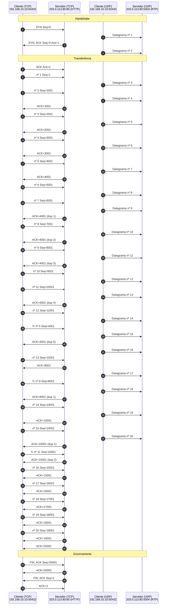

*Figura 6.4.1 (Tipo B, sequência).* Mensagens do cenário "TCP x UDP: 10% de perda", na ordem do tempo, entre Cliente (TCP), Servidor (TCP), Cliente (UDP), Servidor (UDP): 70 mensagens, numeradas de 1 a 70 na ordem da comunicação (em 4 fases; 6 perdidas). Corresponde ao diagrama de sequência e à aba Captura, no modo "Comparação UDP x TCP", com a configuração aplicada acima.

**Mensagens**

| Mensagem | Significado | Origem |
| --- | --- | --- |
| Datagrama UDP | sem confirmação | cliente |
| Segmento TCP | referência, com ACK e retransmissão | cliente |

**Por que importa.** Voz e vídeo em tempo real preferem perder um pacote a esperar por ele: o UDP entrega o que chegou na hora, e a aplicação esconde a perda.

#### 6.4.2 TCP x UDP: reordenação

*O UDP entrega na ordem de chegada; reordenar é problema da aplicação.*

**Configuração aplicada:** Segmentos = 20; Perda (%) = 0; Descartar na 1ª transmissão (nº) = ; Janela inicial = 4; rwnd (seg.) = 16; ssthresh inicial = 64; Reordenação (%) = 15

Sem perdas, mas com 15% dos pacotes atrasados na rede. O **UDP** entrega os datagramas na ordem em que chegam, fora de ordem. O TCP, de referência, reordena no buffer do receptor.

**Conceito.** A **reordenação** acontece quando pacotes seguem caminhos diferentes ou esperam mais em alguma fila. O UDP não tem números de sequência: entrega os datagramas na ordem em que chegaram. Quem precisa de ordem, como o RTP, numera os pacotes por conta própria e usa um buffer. O TCP, de referência, reordena sozinho.

**O que observar**

- Na aba Resultados: quantos datagramas UDP chegaram fora de ordem.
- No diagrama: o datagrama atrasado chega depois dos seguintes, sem nenhuma correção.
- Compare com o TCP, que guarda o que chega adiantado e entrega na ordem certa.

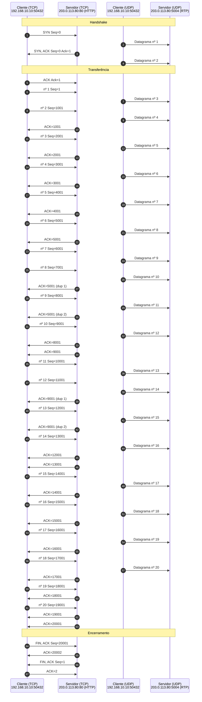

*Figura 6.4.2 (Tipo B, sequência).* Mensagens do cenário "TCP x UDP: reordenação", na ordem do tempo, entre Cliente (TCP), Servidor (TCP), Cliente (UDP), Servidor (UDP): 67 mensagens, numeradas de 1 a 67 na ordem da comunicação (em 4 fases). Corresponde ao diagrama de sequência e à aba Captura, no modo "Comparação UDP x TCP", com a configuração aplicada acima.

**Mensagens**

| Mensagem | Significado | Origem |
| --- | --- | --- |
| Datagrama atrasado | chega depois dos seguintes | rede |
| Datagrama UDP | entregue na ordem de chegada | servidor |

**Por que importa.** Mostra que, no UDP, ordem e perda são assuntos da aplicação: por isso o RTP numera os pacotes e o player usa um buffer.

## 7. Referência

### 7.1 A camada de transporte

O IP entrega pacotes entre **hosts**, sem garantias. A camada de transporte entrega dados entre **processos**, identificados por **portas**. O **UDP** ([RFC 768](https://www.rfc-editor.org/rfc/rfc768)) acrescenta apenas portas, comprimento e checksum: cada datagrama é independente, sem conexão, sem confirmação, sem ordem e sem controle de taxa. O **TCP** ([RFC 9293](https://www.rfc-editor.org/rfc/rfc9293)) oferece um fluxo de bytes confiável e ordenado, com controle de fluxo e de congestionamento, ao custo de abrir uma conexão e de esperar confirmações.

| Aspecto | TCP | UDP |
| --- | --- | --- |
| Conexão | Sim (three-way handshake) | Não |
| Confiabilidade | ACKs e retransmissão | Nenhuma (a aplicação decide) |
| Ordem | Garantida (números de sequência) | Ordem de chegada |
| Controle de fluxo | Janela do receptor (rwnd) | Não |
| Controle de congestionamento | Sim (cwnd) | Não |
| Cabeçalho | 20 a 60 bytes | 8 bytes |
| Usos típicos | Web (HTTP/1.1 e 2), SSH, e-mail, transferência de arquivos | DNS, voz e vídeo (RTP), DHCP, NTP, QUIC (HTTP/3) |

O TCP (conexão, controle de congestionamento e download) tem simulador próprio.

### 7.2 UDP na prática

Quem usa UDP assume o que precisa. O **DNS** repete a consulta se a resposta não chegar no tempo limite. A **voz e o vídeo** preferem perder um pacote a esperar por ele, porque um áudio atrasado já não serve. O **QUIC** ([RFC 9000](https://www.rfc-editor.org/rfc/rfc9000)) implementa sobre o UDP a confiabilidade e o controle de congestionamento, com criptografia embutida.

### 7.3 Vídeo em streaming com UDP

- **RTP sobre UDP** ([RFC 3550](https://www.rfc-editor.org/rfc/rfc3550)): cada pacote leva número de sequência e marca de tempo. O UDP não retransmite; o receptor usa esses campos para reordenar e para medir perdas e jitter.
- **Quadros I e P:** o quadro I é completo e grande; os quadros P guardam só a diferença para o anterior. Por isso um pacote perdido num P estraga os quadros seguintes até o próximo I, e a perda num I congela a imagem até o próximo I.
- **Buffer de reprodução (jitter buffer):** o player atrasa a exibição para esperar pacotes que atrasaram. O pacote que chega depois do prazo é descartado. Mais buffer protege melhor, mas aumenta o atraso, que em transmissão ao vivo conta como qualidade.
- **Sem controle de congestionamento:** o UDP não reduz a taxa quando a fila enche. Na prática, as aplicações usam taxa adaptativa (vários bitrates, como no DASH e no HLS) ou controle de taxa no próprio RTP (RTCP e algoritmos como o GCC do WebRTC).
- **Recuperação de perdas:** pode usar FEC (redundância enviada junto) ou retransmissão seletiva (NACK do RTCP) quando o atraso permite. O simulador mostra o caso sem nenhuma proteção.

### 7.4 Segurança do UDP

- **UDP sem conexão:** nada confirma a origem de um datagrama. Isso permite falsificação, reflexão e amplificação (DNS, NTP, memcached). A defesa começa na rede de origem ([BCP 38](https://www.rfc-editor.org/info/bcp38)) e no próprio serviço (sem recursão aberta, limite de respostas).
- **Varreduras:** o TCP responde SYN-ACK em porta aberta e RST em porta fechada; o UDP só denuncia porta fechada com ICMP Port Unreachable. Política padrão de descarte e firewall stateful reduzem o que a varredura revela.
- **Streaming:** o RTP simples vai em claro e sem autenticação; use SRTP ([RFC 3711](https://www.rfc-editor.org/rfc/rfc3711)) ou DTLS-SRTP. Servidores de mídia UDP expostos também podem ser usados em ataques de reflexão e inundação.
- Para praticar a defesa contra esses ataques, use o Simulador de Ataques e Defesas TCP/UDP.

### 7.5 Limitações do simulador

- O tempo de repetição do DNS (1 s) é um valor didático.

### 7.6 Roteiro de exercícios

1. **DNS com repetição:** o que a aplicação precisa fazer por conta própria quando usa UDP e a resposta se perde?
2. **TCP x UDP: 10% de perda:** compare o tempo e os dados entregues. Para voz em tempo real e para transferência de arquivos, qual protocolo você escolheria, e por quê?
3. **Vídeo em streaming** e **Vídeo com perdas:** por que uma perda no quadro I pesa mais que uma no quadro P? O que aconteceria se o servidor retransmitisse os pacotes perdidos?
4. **Jitter e buffer do player** e **Vídeo acima da capacidade:** qual o preço de aumentar o buffer? O UDP reduz a taxa quando o enlace congestiona? Que mecanismos uma aplicação real usaria?

## 8. Glossário

Significado e finalidade das siglas usadas neste documento.

| Sigla | Significado | Para que serve |
| --- | --- | --- |
| **ACK** | Acknowledgment, confirmação | flag que confirma o recebimento de dados anteriores |
| **BCP** | Best Current Practice, melhor prática atual | série de RFCs com práticas recomendadas de operação, como a [BCP 38](https://www.rfc-editor.org/info/bcp38) (filtragem de endereços de origem forjados) |
| **DASH** | Dynamic Adaptive Streaming over HTTP | vídeo sob demanda em pedaços sobre HTTP, com a qualidade ajustada à banda disponível |
| **DHCP** | Dynamic Host Configuration Protocol, protocolo de configuração dinâmica de hosts | entrega ao cliente endereço IP, máscara, gateway e DNS, por empréstimo (lease) |
| **DNS** | Domain Name System, sistema de nomes de domínio | traduz nomes (www.exemplo.org) em endereços IP e guarda outros registros do domínio |
| **FEC** | Forward Error Correction, correção antecipada de erros | envia redundância junto com os dados para o receptor recuperar perdas sem retransmissão |
| **GCC** | Google Congestion Control, controle de congestionamento do Google | algoritmo do WebRTC que ajusta a taxa de envio de voz e vídeo conforme o atraso e a perda |
| **HLS** | HTTP Live Streaming | transmissão de vídeo em pedaços sobre HTTP, criada pela Apple |
| **HTTP/1** | HTTP versão 1.1 | versão textual do HTTP, com uma requisição por vez em cada conexão |
| **HTTP/3** | HTTP versão 3 | versão do HTTP sobre QUIC e UDP, que evita o bloqueio de um fluxo por perda em outro |
| **IANA** | Internet Assigned Numbers Authority | mantém os registros de números e nomes usados nos protocolos, como portas, tipos de mensagem e números de sistema autônomo |
| **ICMP** | Internet Control Message Protocol | leva mensagens de controle e de erro da camada IP, como o eco do ping e o aviso de destino inalcançável |
| **IP** | Internet Protocol, protocolo de internet | endereça e encaminha pacotes entre redes, de origem a destino |
| **MSS** | Maximum Segment Size, tamanho máximo de segmento | maior quantidade de dados que o TCP aceita por segmento; negociada no SYN |
| **MTU** | Maximum Transmission Unit, unidade máxima de transmissão | maior pacote que um enlace transporta sem fragmentar |
| **NACK** | Negative Acknowledgment, confirmação negativa | o receptor pede o reenvio de um pacote específico que não chegou |
| **NTP** | Network Time Protocol | sincroniza o relógio dos equipamentos com uma fonte de tempo confiável |
| **QUIC** | nome do protocolo, que não é uma sigla oficial | transporte sobre UDP com criptografia embutida e múltiplos fluxos independentes; base do HTTP/3 |
| **RST** | Reset | flag do TCP que derruba a conexão de imediato, por exemplo ao receber segmento de uma conexão que não existe |
| **RTCP** | RTP Control Protocol, protocolo de controle do RTP | leva estatísticas de qualidade da sessão RTP |
| **RTO** | Retransmission Timeout, tempo limite de retransmissão | tempo que o TCP espera por um ACK antes de retransmitir |
| **RTP** | Real-time Transport Protocol, protocolo de transporte em tempo real | leva voz e vídeo sobre UDP, com numeração e marcas de tempo |
| **RTT** | Round-Trip Time, tempo de ida e volta | mede o tempo entre enviar um pacote e receber a resposta; base dos temporizadores e da latência |
| **SACK** | Selective Acknowledgment, confirmação seletiva | o receptor informa quais blocos chegaram fora de ordem, e o emissor reenvia só o que faltou |
| **SLE** | SACK Left Edge, borda esquerda do bloco SACK | início de um bloco de bytes recebidos fora de ordem, na notação de ferramentas como o Wireshark |
| **SRE** | SACK Right Edge, borda direita do bloco SACK | fim de um bloco de bytes recebidos fora de ordem, na notação de ferramentas como o Wireshark |
| **SRTP** | Secure Real-time Transport Protocol | RTP com cifra e autenticação dos pacotes |
| **SSH** | Secure Shell | acesso remoto e transferência de arquivos por um canal cifrado, com autenticação do servidor e do usuário |
| **SYN-ACK** | Synchronize-Acknowledge | resposta do servidor ao SYN no handshake de três vias: aceita a conexão e envia o próprio número de sequência |
| **TCP** | Transmission Control Protocol, protocolo de controle de transmissão | entrega dados de forma ordenada e confiável, com conexão, confirmação e controle de congestionamento |
| **TCP/UDP** | Transmission Control Protocol e User Datagram Protocol | refere-se aos dois protocolos de transporte da pilha da Internet |
| **UDP** | User Datagram Protocol | entrega datagramas sem conexão nem confirmação, com baixo custo; usado em consultas curtas e em tempo real |

---

*Simul-Net é um projeto mantido pelo Prof. Dr. Laerte Peotta de Melo, com apoio de IA generativa no processo de desenvolvimento, com sua estrita supervisão, revisão técnica e responsabilidade. Uso exclusivo para fins de ensino e pesquisa. Universidade de Brasília (UnB) - Departamento de Engenharia Elétrica. Código aberto (licença MIT).*
