# VLAN e trunking (802.1Q)

Segmentação da rede local: marcação 802.1Q, portas de acesso e de tronco, VLAN nativa, roteamento entre VLANs e as defesas contra VLAN hopping.

- **Categoria:** Camada de enlace e redes locais
- **Motor:** nativo (TypeScript puro, apresentado pela bancada genérica)
- **Código-fonte:** `src/sims/vlan/`
- **RFCs e padrões:** IEEE 802.1Q
- **Tópicos:** Marcação 802.1Q: acesso e tronco; Isolamento e domínios de broadcast; Roteamento entre VLANs (router-on-a-stick); VLAN nativa e divergência entre as pontas; VLAN hopping e defesas

## 1. Modos

| Modo | Cenário inicial | Cenários |
| --- | --- | --- |
| Marcação 802.1Q | O quadro ganha a tag no tronco | 6.1.1 a 6.1.3 |
| Segmentação | Mesma VLAN em dois switches | 6.2.1 a 6.2.3 |
| Roteamento entre VLANs | A para B pelo roteador | 6.3.1 a 6.3.4 |
| VLAN nativa | Mesma nativa nas duas pontas | 6.4.1 a 6.4.3 |
| VLAN hopping | Porta dinâmica aceita virar tronco | 6.5.1 a 6.5.4 |

## 2. Como ler os diagramas

Este documento usa até dois tipos de diagrama. Cada figura traz uma legenda com o tipo, o que mostra e a que modo ou cenário se refere.

| Tipo | O que é | Vale para | Equivale, no simulador, a |
| --- | --- | --- | --- |
| A, topologia | Os elementos da rede e os enlaces que os ligam. É estático. | Um modo inteiro | A visão "Topologia" do quadro principal |
| B, sequência | As mensagens na ordem do tempo, entre os participantes. É dinâmico. | Um único cenário, com a configuração indicada | Ao diagrama de sequência e à aba Captura |

### 2.1 Legenda dos diagramas

**Tipo A (topologia)**

- Retângulo: host (computador ou servidor final).
- Hexágono: switch.
- Retângulo arredondado: roteador, ou dispositivo que encaminha ou traduz.
- Estádio (cantos bem arredondados): servidor ou rede externa.
- Retângulo vermelho: atacante (quando existe no modo).
- Linha contínua: enlace. Linha tracejada: enlace alternativo, forjado ou caído, conforme o rótulo e o cenário.
- O Mermaid posiciona os elementos automaticamente: o layout difere do simulador, as ligações não.

**Tipo B (sequência)**

- Cada coluna é um participante (cliente, servidor, roteador ou outro). O tempo corre de cima para baixo.
- Seta cheia: mensagem enviada. Seta com X: mensagem perdida.
- `[cifrado]` no início do rótulo: a mensagem viaja cifrada.
- Faixa horizontal com texto: início de uma fase do cenário.
- A ordem é a da aba Captura; os intervalos de tempo não são desenhados em escala.

### 2.2 Lista de figuras

**Tipo A (topologia)**

- [Figura 3.1a](#31-marcação-8021q): topologia do modo "Marcação 802.1Q", variante a
- [Figura 3.1b](#31-marcação-8021q): topologia do modo "Marcação 802.1Q", variante b
- [Figura 3.1c](#31-marcação-8021q): topologia do modo "Marcação 802.1Q", variante c
- [Figura 3.2](#32-segmentação): topologia do modo "Segmentação"
- [Figura 3.3a](#33-roteamento-entre-vlans): topologia do modo "Roteamento entre VLANs", variante a
- [Figura 3.3b](#33-roteamento-entre-vlans): topologia do modo "Roteamento entre VLANs", variante b
- [Figura 3.4a](#34-vlan-nativa): topologia do modo "VLAN nativa", variante a
- [Figura 3.4b](#34-vlan-nativa): topologia do modo "VLAN nativa", variante b
- [Figura 3.5a](#35-vlan-hopping): topologia do modo "VLAN hopping", variante a
- [Figura 3.5b](#35-vlan-hopping): topologia do modo "VLAN hopping", variante b
- [Figura 3.5c](#35-vlan-hopping): topologia do modo "VLAN hopping", variante c
- [Figura 3.5d](#35-vlan-hopping): topologia do modo "VLAN hopping", variante d

**Tipo B (sequência)**

- [Figura 6.1.1](#611-o-quadro-ganha-a-tag-no-tronco): sequência de "O quadro ganha a tag no tronco"
- [Figura 6.1.2](#612-a-vlan-nativa-não-leva-tag): sequência de "A VLAN nativa não leva tag"
- [Figura 6.1.3](#613-vlan-fora-da-lista-do-tronco): sequência de "VLAN fora da lista do tronco"
- [Figura 6.2.1](#621-mesma-vlan-em-dois-switches): sequência de "Mesma VLAN em dois switches"
- [Figura 6.2.2](#622-o-broadcast-fica-na-vlan): sequência de "O broadcast fica na VLAN"
- [Figura 6.2.3](#623-entre-vlans-não-há-caminho): sequência de "Entre VLANs não há caminho"
- [Figura 6.3.1](#631-a-para-b-pelo-roteador): sequência de "A para B pelo roteador"
- [Figura 6.3.2](#632-a-para-d-cruzando-o-tronco): sequência de "A para D, cruzando o tronco"
- [Figura 6.3.3](#633-falta-a-subinterface-da-vlan-20): sequência de "Falta a subinterface da VLAN 20"
- [Figura 6.3.4](#634-tronco-do-r1-sem-a-vlan-20): sequência de "Tronco do R1 sem a VLAN 20"
- [Figura 6.4.1](#641-mesma-nativa-nas-duas-pontas): sequência de "Mesma nativa nas duas pontas"
- [Figura 6.4.2](#642-divergência-o-quadro-muda-de-vlan): sequência de "Divergência: o quadro muda de VLAN"
- [Figura 6.4.3](#643-o-tráfego-com-tag-não-é-afetado): sequência de "O tráfego com tag não é afetado"
- [Figura 6.5.1](#651-porta-dinâmica-aceita-virar-tronco): sequência de "Porta dinâmica aceita virar tronco"
- [Figura 6.5.2](#652-defesa-porta-fixa-em-acesso): sequência de "Defesa: porta fixa em acesso"
- [Figura 6.5.3](#653-nativa-igual-à-vlan-do-invasor): sequência de "Nativa igual à VLAN do invasor"
- [Figura 6.5.4](#654-defesa-nativa-em-vlan-sem-uso): sequência de "Defesa: nativa em VLAN sem uso"

## 3. Topologia

Figuras do Tipo A, uma por modo (e uma por variante do desenho, quando a rede muda entre cenários). Foram geradas a partir da mesma definição de topologia que a bancada usa.

### 3.1 Marcação 802.1Q

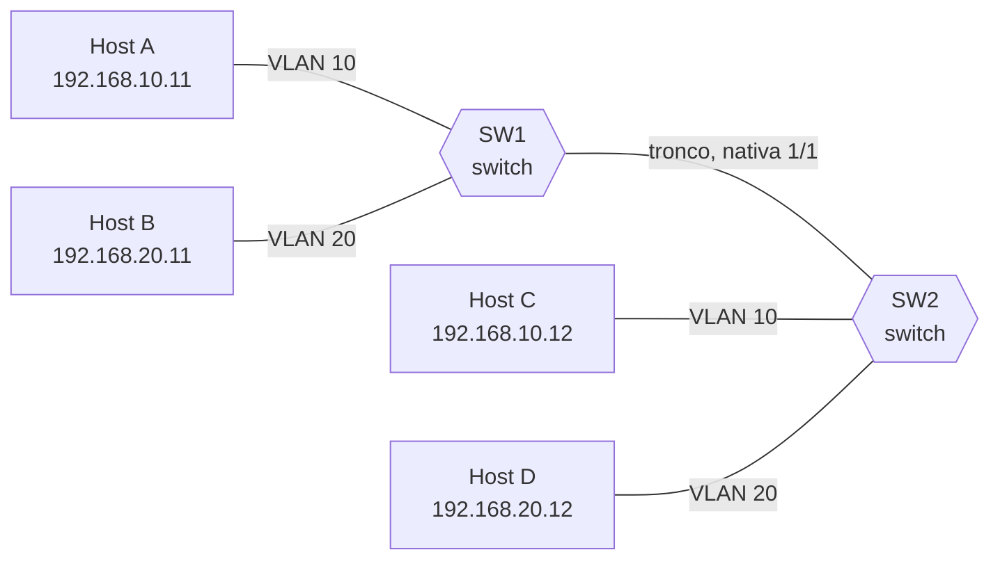

*Figura 3.1a (Tipo A, topologia).* Elementos do modo "Marcação 802.1Q": SW1 (switch); SW2 (switch); Host A (192.168.10.11); Host B (192.168.20.11); Host C (192.168.10.12); Host D (192.168.20.12). Vale para os cenários (6.1.1).


*Figura 3.1b (Tipo A, topologia).* Elementos do modo "Marcação 802.1Q": SW1 (switch); SW2 (switch); Host A (192.168.10.11); Host B (192.168.20.11); Host C (192.168.10.12); Host D (192.168.20.12). Vale para os cenários (6.1.2).

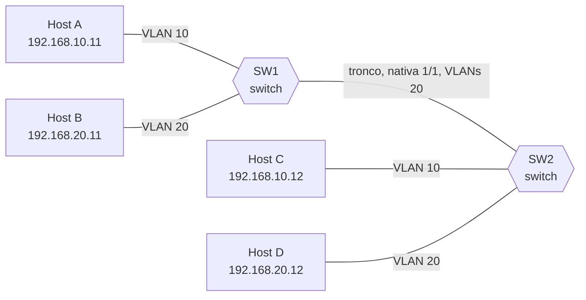

*Figura 3.1c (Tipo A, topologia).* Elementos do modo "Marcação 802.1Q": SW1 (switch); SW2 (switch); Host A (192.168.10.11); Host B (192.168.20.11); Host C (192.168.10.12); Host D (192.168.20.12). Vale para os cenários (6.1.3).

### 3.2 Segmentação


*Figura 3.2 (Tipo A, topologia).* Elementos do modo "Segmentação": SW1 (switch); SW2 (switch); Host A (192.168.10.11); Host B (192.168.20.11); Host C (192.168.10.12); Host D (192.168.20.12). Vale para todos os cenários do modo (6.2.1 a 6.2.3).

### 3.3 Roteamento entre VLANs

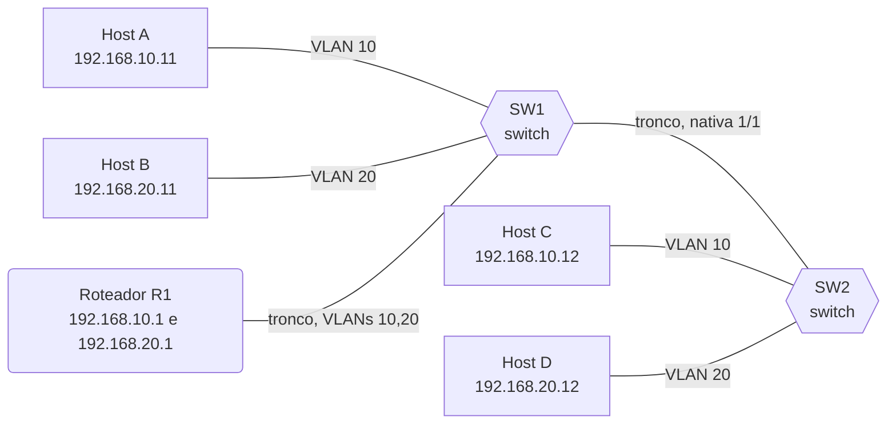

*Figura 3.3a (Tipo A, topologia).* Elementos do modo "Roteamento entre VLANs": SW1 (switch); SW2 (switch); Host A (192.168.10.11); Host B (192.168.20.11); Host C (192.168.10.12); Host D (192.168.20.12); Roteador R1 (192.168.10.1 e 192.168.20.1). Vale para os cenários (6.3.1 a 6.3.3).

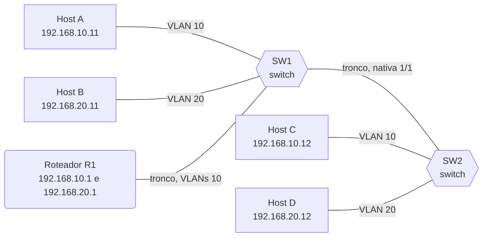

*Figura 3.3b (Tipo A, topologia).* Elementos do modo "Roteamento entre VLANs": SW1 (switch); SW2 (switch); Host A (192.168.10.11); Host B (192.168.20.11); Host C (192.168.10.12); Host D (192.168.20.12); Roteador R1 (192.168.10.1 e 192.168.20.1). Vale para os cenários (6.3.4).

### 3.4 VLAN nativa


*Figura 3.4a (Tipo A, topologia).* Elementos do modo "VLAN nativa": SW1 (switch); SW2 (switch); Host A (192.168.10.11); Host B (192.168.20.11); Host C (192.168.10.12); Host D (192.168.20.12). Vale para os cenários (6.4.1).

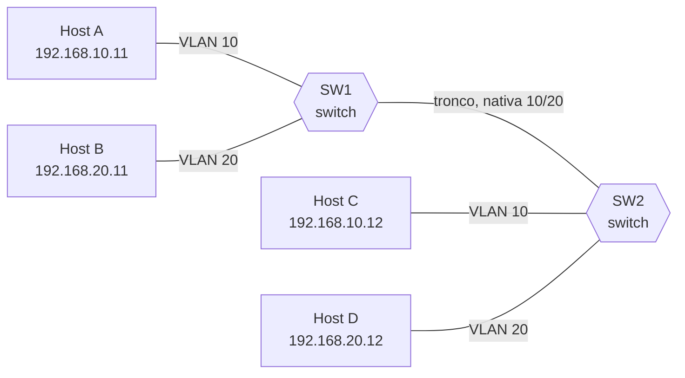

*Figura 3.4b (Tipo A, topologia).* Elementos do modo "VLAN nativa": SW1 (switch); SW2 (switch); Host A (192.168.10.11); Host B (192.168.20.11); Host C (192.168.10.12); Host D (192.168.20.12). Vale para os cenários (6.4.2 e 6.4.3).

### 3.5 VLAN hopping

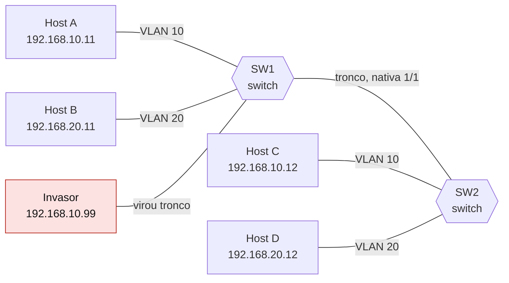

*Figura 3.5a (Tipo A, topologia).* Elementos do modo "VLAN hopping": SW1 (switch); SW2 (switch); Host A (192.168.10.11); Host B (192.168.20.11); Host C (192.168.10.12); Host D (192.168.20.12); Invasor (192.168.10.99). Vale para os cenários (6.5.1).

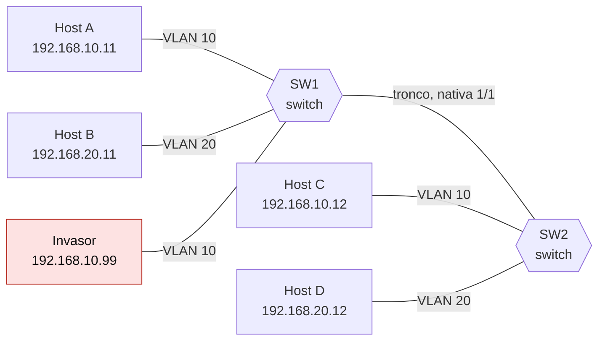

*Figura 3.5b (Tipo A, topologia).* Elementos do modo "VLAN hopping": SW1 (switch); SW2 (switch); Host A (192.168.10.11); Host B (192.168.20.11); Host C (192.168.10.12); Host D (192.168.20.12); Invasor (192.168.10.99). Vale para os cenários (6.5.2).

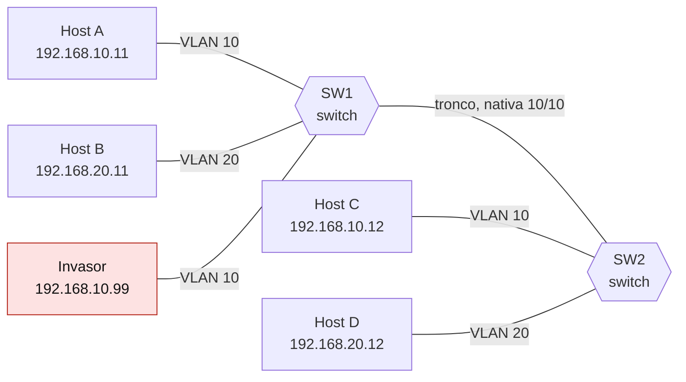

*Figura 3.5c (Tipo A, topologia).* Elementos do modo "VLAN hopping": SW1 (switch); SW2 (switch); Host A (192.168.10.11); Host B (192.168.20.11); Host C (192.168.10.12); Host D (192.168.20.12); Invasor (192.168.10.99). Vale para os cenários (6.5.3).

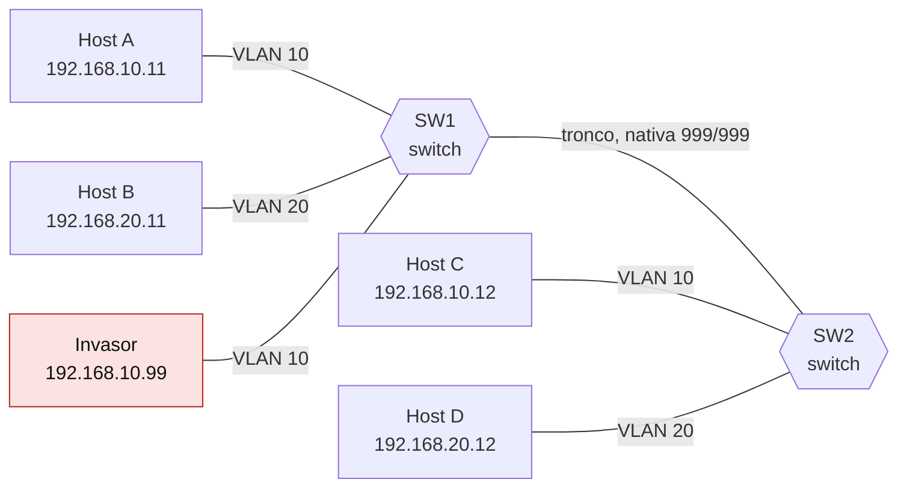

*Figura 3.5d (Tipo A, topologia).* Elementos do modo "VLAN hopping": SW1 (switch); SW2 (switch); Host A (192.168.10.11); Host B (192.168.20.11); Host C (192.168.10.12); Host D (192.168.20.12); Invasor (192.168.10.99). Vale para os cenários (6.5.4).

## 4. Abas da bancada

Cenário, Captura, Mensagem, Portas, Roteador (modos: Roteamento entre VLANs), Experimento, Referência e Log.

## 5. Configurações (campos do painel)

### 5.1 Rede

- **RTT (ms)**. Valores: 1; 2; 5; 20; 100. Padrão: 2. Modos: todos.
  - Tempo de ida e volta entre dois equipamentos vizinhos.
  - Num enlace Ethernet o atraso é de microssegundos a poucos milissegundos. Valores altos servem para ver o diagrama mais espaçado.
  - Não muda o que as VLANs fazem: a decisão do switch depende só da configuração das portas.

### 5.2 Tronco

- **VLAN nativa do tronco**. Valores: VLAN 1 (padrão); VLAN 10 (a do Host A). Padrão: VLAN 1 (padrão). Modos: Marcação 802.1Q.
  - A VLAN cujos quadros trafegam sem tag no tronco.
  - Com a nativa em **1**, o quadro da VLAN 10 sai marcado (tag 10) no tronco.
  - Com a nativa em **10**, o quadro da VLAN 10 sai **sem tag**, e o switch do outro lado o devolve à VLAN 10 porque a nativa dele é a mesma. Aqui as duas pontas usam o mesmo valor; a divergência entre elas é tratada no modo VLAN nativa.
- **VLANs permitidas no tronco**. Valores: Todas; Só a VLAN 20 (a VLAN 10 foi retirada). Padrão: Todas. Modos: Marcação 802.1Q.
  - Lista de VLANs que o tronco aceita carregar.
  - **Todas:** qualquer VLAN criada passa pelo tronco. É o padrão e o mais cômodo, mas leva tráfego a lugares onde ele não é necessário.
  - **Só a VLAN 20:** a prática recomendada é permitir apenas as VLANs que precisam atravessar. Aqui a VLAN 10 foi retirada por engano, e o Host C deixa de ser alcançado.
- **VLAN nativa no SW1**. Valores: VLAN 1; VLAN 10; VLAN 20. Padrão: VLAN 10. Modos: VLAN nativa.
  - Como o SW1 trata os quadros sem tag que saem ou entram pelo tronco.
  - O quadro da VLAN nativa sai do SW1 sem tag. Quem decide a que VLAN ele pertence, ao chegar, é o switch do outro lado.
- **VLAN nativa no SW2**. Valores: VLAN 1; VLAN 10; VLAN 20. Padrão: VLAN 10. Modos: VLAN nativa.
  - O mesmo ajuste, na outra ponta.
  - Se as duas pontas discordam, um quadro sem tag muda de VLAN ao atravessar o tronco. Os quadros que saem marcados não sofrem isso.

### 5.3 Tráfego

- **O que o Host A envia**. Valores: Ping para o Host C (mesma VLAN, outro switch); Broadcast (ARP) na VLAN 10; Quadro para o Host B (outra VLAN, sem roteador). Padrão: Ping para o Host C (mesma VLAN, outro switch). Modos: Segmentação.
  - Três formas de testar o isolamento das VLANs.
  - **Ping para C:** unicast na mesma VLAN. O tronco leva o quadro de um switch ao outro e só o Host C o recebe.
  - **Broadcast:** o quadro é entregue a todas as portas da VLAN 10, em qualquer switch, e a nenhuma da VLAN 20. Cada VLAN é um domínio de broadcast.
  - **Para B:** mesmo que A conheça o MAC de B, o switch só encaminha dentro da VLAN 10. Sem um roteador, não há caminho para a VLAN 20.
- **Destino do Host A**. Valores: Host B (VLAN 20, no mesmo switch); Host D (VLAN 20, no outro switch). Padrão: Host B (VLAN 20, no mesmo switch). Modos: Roteamento entre VLANs.
  - Os dois hosts da VLAN 20.
  - Em ambos os casos o quadro precisa ir até o roteador e voltar. Com o Host D, depois de voltar, o quadro ainda cruza o tronco entre os switches, agora com a tag 20.
- **Quem envia o ping**. Valores: Host A, da VLAN 10, para o Host C; Host B, da VLAN 20, para o Host D. Padrão: Host A, da VLAN 10, para o Host C. Modos: VLAN nativa.
  - A VLAN do remetente decide se o quadro sai com ou sem tag.
  - O quadro da VLAN igual à nativa do SW1 sai **sem tag**, e é ele que sofre com a divergência. O de outra VLAN sai com tag e chega certo.

### 5.4 Roteador

- **Configuração do R1**. Valores: Correta (subinterfaces .10 e .20); Falta a subinterface da VLAN 20; Tronco do R1 sem a VLAN 20. Padrão: Correta (subinterfaces .10 e .20). Modos: Roteamento entre VLANs.
  - Os dois defeitos mais comuns no router-on-a-stick.
  - **Correta:** uma subinterface por VLAN (.10 e .20), cada uma com o IP de gateway da sua sub-rede e a encapsulação 802.1Q da sua VLAN.
  - **Falta a subinterface:** o R1 não tem rota para a sub-rede 192.168.20.0/24 e responde com ICMP Destination Unreachable.
  - **Tronco sem a VLAN 20:** o R1 tem as duas subinterfaces, mas a porta do SW1 só permite a VLAN 10. O R1 roteia, e o SW1 descarta o quadro de volta.

### 5.5 Ataque

- **Técnica do invasor**. Valores: Fingir ser um switch (negociar um tronco); Duas tags no mesmo quadro. Padrão: Fingir ser um switch (negociar um tronco). Modos: VLAN hopping.
  - Duas formas conhecidas de sair da própria VLAN.
  - **Fingir ser um switch:** se a porta aceita negociar tronco, o invasor passa a enviar quadros marcados com qualquer VLAN.
  - **Duas tags:** funciona quando a VLAN nativa do tronco é a da porta do invasor: o primeiro switch remove a tag externa e o segundo obedece à interna. Só vale em um sentido e só chega a outro switch.

### 5.6 Defesa

- **Defesa aplicada**. Valores: Nenhuma (configuração padrão); Defesa para esta técnica. Padrão: Nenhuma (configuração padrão). Modos: VLAN hopping.
  - A defesa depende da técnica escolhida.
  - **Contra o fingimento de switch:** fixar a porta em modo acesso e desligar a negociação de tronco.
  - **Contra as duas tags:** usar como nativa do tronco uma VLAN sem hosts (aqui, a 999), e nunca a VLAN de portas de acesso.

## 6. Cenários

### 6.1 Modo: Marcação 802.1Q

> **Grupo:** Marcação

O host não sabe que existem VLANs. A porta de acesso põe o quadro numa VLAN, e a porta de tronco carrega várias VLANs ao mesmo tempo, distinguindo-as por uma tag de 4 bytes (IEEE 802.1Q).

#### 6.1.1 O quadro ganha a tag no tronco

*A tag nasce e morre no tronco.*

**Configuração aplicada:** VLAN nativa do tronco = 1; VLANs permitidas no tronco = all

O Host A envia um quadro comum, **sem tag**. O SW1 o põe na VLAN 10 pela porta de acesso e, no tronco, **insere a tag 10**. O SW2 remove a tag e entrega o quadro limpo ao Host C.

**Conceito.** Um quadro Ethernet comum não leva informação de VLAN. O switch a atribui pela porta de entrada: numa porta de acesso, a VLAN configurada nela. No tronco, o switch insere uma tag de 4 bytes (TPID 0x8100, PCP, DEI e VID de 12 bits) para que o switch do outro lado saiba a VLAN. Na porta de acesso do destino, a tag é removida e o host recebe um quadro comum.

**O que observar**

- O primeiro enlace (Host A para SW1) é sem tag.
- No tronco, o quadro leva a tag 10 e o tamanho sobe 4 bytes.
- O último enlace (SW2 para Host C) volta a ser sem tag.

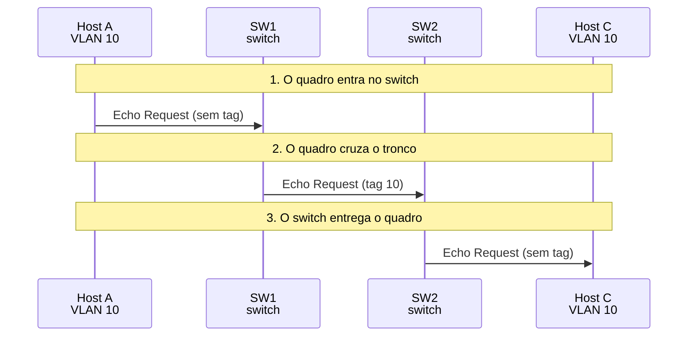

*Figura 6.1.1 (Tipo B, sequência).* Mensagens do cenário "O quadro ganha a tag no tronco", na ordem do tempo, entre Host A, SW1, SW2, Host C: 3 mensagens (em 4 fases). Corresponde ao diagrama de sequência e à aba Captura, no modo "Marcação 802.1Q", com a configuração aplicada acima.

**Mensagens**

| Mensagem | Significado | Origem |
| --- | --- | --- |
| Echo Request (sem tag) | o ping do Host A | Host A para SW1 |
| Echo Request (tag 10) | o mesmo quadro no tronco | SW1 para SW2 |
| Echo Request (sem tag) | entregue ao destino | SW2 para Host C |

**Por que importa.** É assim que uma só ligação física carrega várias redes lógicas sem que os hosts precisem saber.

#### 6.1.2 A VLAN nativa não leva tag

*Na VLAN nativa, o quadro vai sem tag.*

**Configuração aplicada:** VLAN nativa do tronco = 10; VLANs permitidas no tronco = all

A VLAN nativa do tronco é a 10. O quadro da VLAN 10 atravessa o tronco **sem tag**, e o SW2 o devolve à VLAN 10 porque a nativa dele é a mesma.

**Conceito.** O tronco tem uma VLAN nativa: os quadros dela trafegam sem tag, e um quadro que chega sem tag é classificado nela. Aqui as duas pontas usam a VLAN 10 como nativa, e por isso o quadro da VLAN 10 atravessa o tronco sem tag e continua na VLAN 10.

**O que observar**

- No tronco, o quadro está sem tag.
- O SW2 classifica o quadro sem tag na VLAN nativa (10).

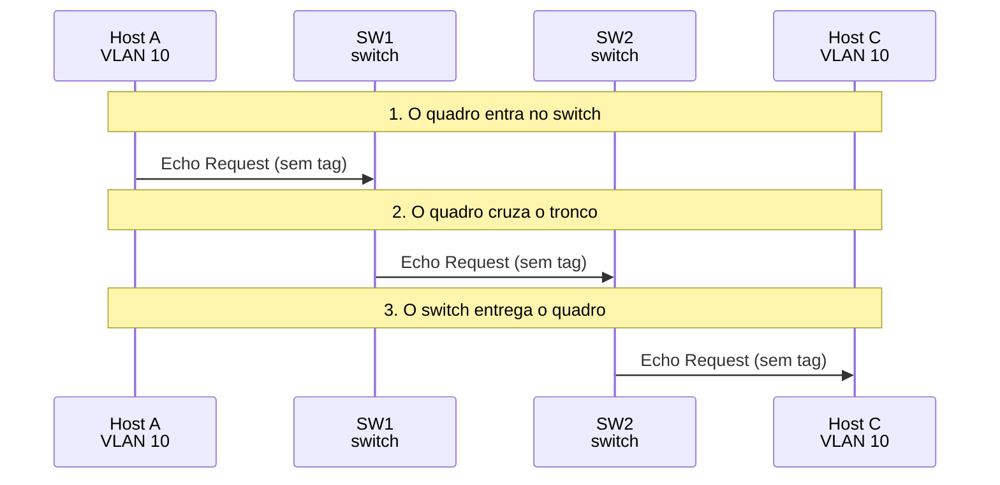

*Figura 6.1.2 (Tipo B, sequência).* Mensagens do cenário "A VLAN nativa não leva tag", na ordem do tempo, entre Host A, SW1, SW2, Host C: 3 mensagens (em 4 fases). Corresponde ao diagrama de sequência e à aba Captura, no modo "Marcação 802.1Q", com a configuração aplicada acima.

**Mensagens**

| Mensagem | Significado | Origem |
| --- | --- | --- |
| Echo Request (sem tag) | a VLAN nativa não leva tag | SW1 para SW2 |

**Por que importa.** A nativa existe por compatibilidade com equipamentos que não entendem a tag. Ela só funciona bem se as duas pontas concordam.

#### 6.1.3 VLAN fora da lista do tronco

*O tronco só carrega o que foi permitido.*

**Configuração aplicada:** VLAN nativa do tronco = 1; VLANs permitidas no tronco = no10

A VLAN 10 foi retirada da lista de VLANs permitidas no tronco. O SW1 **descarta** o quadro em vez de enviá-lo, e o Host C fica isolado do Host A.

**Conceito.** Cada tronco tem uma lista de VLANs permitidas. Uma VLAN fora da lista não atravessa o enlace: o switch não encaminha os quadros dela por aquela porta. Retirar uma VLAN por engano é uma causa clássica de "o outro switch não me enxerga".

**O que observar**

- O SW1 não envia o quadro pelo tronco.
- Nenhuma mensagem chega ao SW2.

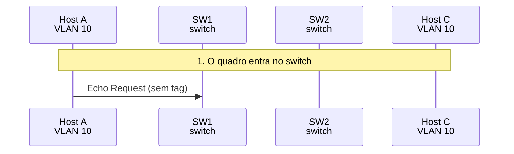

*Figura 6.1.3 (Tipo B, sequência).* Mensagens do cenário "VLAN fora da lista do tronco", na ordem do tempo, entre Host A, SW1, SW2, Host C: 1 mensagem (em 2 fases). Corresponde ao diagrama de sequência e à aba Captura, no modo "Marcação 802.1Q", com a configuração aplicada acima.

**Mensagens**

| Mensagem | Significado | Origem |
| --- | --- | --- |
| Echo Request (sem tag) | o único quadro enviado | Host A para SW1 |

**Por que importa.** Limitar as VLANs do tronco ao necessário é também uma defesa: reduz até onde um problema de uma VLAN pode se espalhar.

### 6.2 Modo: Segmentação

> **Grupo:** Isolamento

Cada VLAN é um domínio de broadcast separado, mesmo espalhada por vários switches. Um quadro só é encaminhado dentro da VLAN em que entrou.

#### 6.2.1 Mesma VLAN em dois switches

*Unicast só até o destino.*

**Configuração aplicada:** O que o Host A envia = uni

Hosts da VLAN 10 em switches diferentes se alcançam pelo tronco, como se estivessem no mesmo switch. O quadro vai só até o **Host C**.

**Conceito.** O switch conhece o MAC do Host C na VLAN 10 e encaminha o quadro só pelas portas que levam a ele: o tronco no SW1 e a porta de C no SW2. O Host B e o Host D não veem nada.

**O que observar**

- Só quatro enlaces são usados.
- B e D não recebem nada.

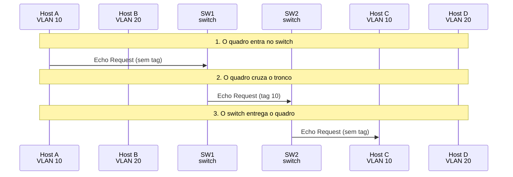

*Figura 6.2.1 (Tipo B, sequência).* Mensagens do cenário "Mesma VLAN em dois switches", na ordem do tempo, entre Host A, Host B, SW1, SW2, Host C, Host D: 3 mensagens (em 4 fases). Corresponde ao diagrama de sequência e à aba Captura, no modo "Segmentação", com a configuração aplicada acima.

**Mensagens**

| Mensagem | Significado | Origem |
| --- | --- | --- |
| Echo Request | ping de A para C | A, SW1, SW2 e C |

**Por que importa.** A mesma VLAN em dois switches se comporta como um único segmento de rede local.

#### 6.2.2 O broadcast fica na VLAN

*Cada VLAN é um domínio de broadcast.*

**Configuração aplicada:** O que o Host A envia = bc

Um broadcast do Host A é entregue a **todos da VLAN 10** (no SW1 e no SW2) e a ninguém da VLAN 20. Cada VLAN é um domínio de broadcast próprio.

**Conceito.** Um broadcast é entregue a todas as portas da VLAN em que entrou, em qualquer switch. Aqui o ARP do Host A chega ao Host C pelo tronco e não chega a B nem a D, que estão na VLAN 20.

**O que observar**

- O quadro atravessa o tronco com a tag 10.
- B e D não recebem nada.

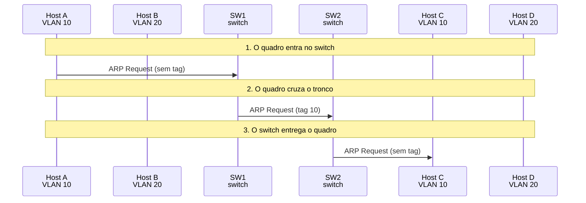

*Figura 6.2.2 (Tipo B, sequência).* Mensagens do cenário "O broadcast fica na VLAN", na ordem do tempo, entre Host A, Host B, SW1, SW2, Host C, Host D: 3 mensagens (em 4 fases). Corresponde ao diagrama de sequência e à aba Captura, no modo "Segmentação", com a configuração aplicada acima.

**Mensagens**

| Mensagem | Significado | Origem |
| --- | --- | --- |
| ARP Request | broadcast do Host A | A, SW1, SW2 e C |

**Por que importa.** Separar em VLANs reduz o domínio de broadcast, melhora o desempenho e limita o alcance de varreduras e ataques de camada 2.

#### 6.2.3 Entre VLANs não há caminho

*Sem roteador, VLANs não se falam.*

**Configuração aplicada:** O que o Host A envia = cross

O Host A usa o MAC do Host B (VLAN 20). Sem roteador, o switch só encaminha dentro da VLAN 10, e o quadro **nunca chega** à VLAN 20.

**Conceito.** O Host A usa o MAC do Host B como destino, mas o quadro entra na VLAN 10. O switch procura B na VLAN 10, não o encontra e inunda o quadro só nessa VLAN. B, que está na VLAN 20, não o recebe, e C o ignora porque o MAC não é o dele.

**O que observar**

- O quadro é inundado na VLAN 10, inclusive pelo tronco.
- O Host C recebe e ignora.
- B e D não recebem nada.


*Figura 6.2.3 (Tipo B, sequência).* Mensagens do cenário "Entre VLANs não há caminho", na ordem do tempo, entre Host A, Host B, SW1, SW2, Host C, Host D: 3 mensagens (em 4 fases). Corresponde ao diagrama de sequência e à aba Captura, no modo "Segmentação", com a configuração aplicada acima.

**Mensagens**

| Mensagem | Significado | Origem |
| --- | --- | --- |
| Echo Request | inundado na VLAN 10 | A, SW1, SW2 e C |

**Por que importa.** O isolamento é da camada 2: para falar com outra VLAN é preciso passar por um dispositivo de camada 3.

### 6.3 Modo: Roteamento entre VLANs

> **Grupo:** Router-on-a-stick

Hosts de VLANs diferentes estão em sub-redes IP diferentes e só se falam por um dispositivo de camada 3. No router-on-a-stick, um roteador usa um único cabo de tronco e uma subinterface por VLAN.

#### 6.3.1 A para B pelo roteador

*O quadro sobe com a tag 10 e volta com a 20.*

**Configuração aplicada:** Destino do Host A = b; Configuração do R1 = ok

O quadro do Host A sobe ao R1 com a **tag 10**, é roteado e volta pelo mesmo cabo com a **tag 20**. O SW1 o entrega ao Host B. O TTL cai de 64 para 63.

**Conceito.** O Host A envia ao MAC do gateway (o R1), que está em outra sub-rede. O quadro chega ao R1 pela subinterface .10, o R1 consulta a tabela de rotas, reduz o TTL e o devolve pelo mesmo cabo, agora marcado com a VLAN 20 e com o MAC do Host B.

**O que observar**

- O quadro de ida leva a tag 10; o de volta, a tag 20.
- Os MACs de origem e de destino mudam no roteador.
- O TTL passa de 64 para 63.

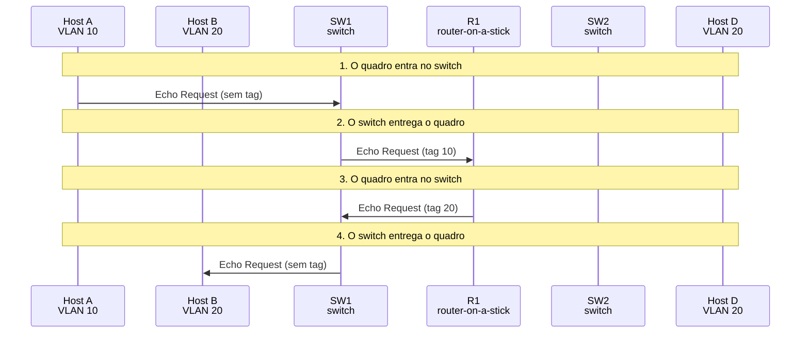

*Figura 6.3.1 (Tipo B, sequência).* Mensagens do cenário "A para B pelo roteador", na ordem do tempo, entre Host A, Host B, SW1, R1, SW2, Host D: 4 mensagens (em 5 fases). Corresponde ao diagrama de sequência e à aba Captura, no modo "Roteamento entre VLANs", com a configuração aplicada acima.

**Mensagens**

| Mensagem | Significado | Origem |
| --- | --- | --- |
| Echo Request (tag 10) | de A para o R1 | SW1 para R1 |
| Echo Request (tag 20) | do R1 de volta, roteado | R1 para SW1 |

**Por que importa.** O roteador atravessa o mesmo cabo duas vezes, que é o gargalo da solução. Um switch de camada 3 faz o mesmo internamente.

#### 6.3.2 A para D, cruzando o tronco

*Depois do roteador, ainda há o tronco.*

**Configuração aplicada:** Destino do Host A = d; Configuração do R1 = ok

O mesmo caminho até o R1, mas o destino está no outro switch. Depois de voltar com a tag 20, o quadro ainda **cruza o tronco** entre SW1 e SW2.

**Conceito.** O caminho até o R1 é o mesmo, mas o destino está no outro switch. Depois que o R1 devolve o quadro com a tag 20, o SW1 o encaminha pelo tronco até o SW2.

**O que observar**

- O primeiro trecho, até o R1, não passa pelo SW2.
- O tronco SW1-SW2 só é usado depois do roteador, uma vez.

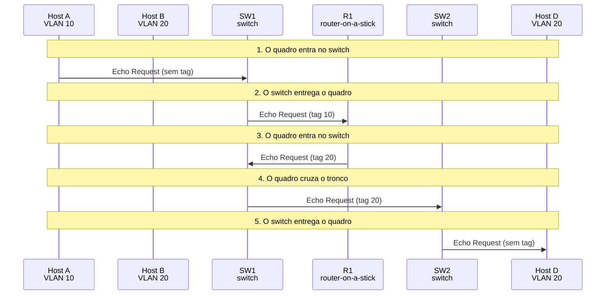

*Figura 6.3.2 (Tipo B, sequência).* Mensagens do cenário "A para D, cruzando o tronco", na ordem do tempo, entre Host A, Host B, SW1, R1, SW2, Host D: 5 mensagens (em 6 fases). Corresponde ao diagrama de sequência e à aba Captura, no modo "Roteamento entre VLANs", com a configuração aplicada acima.

**Mensagens**

| Mensagem | Significado | Origem |
| --- | --- | --- |
| Echo Request (tag 20) | depois do roteador | SW1 para SW2 |

**Por que importa.** O roteamento entre VLANs fica no ponto de interligação, mesmo que os hosts estejam em switches distantes.

> **Grupo:** Falhas no roteador

Os dois defeitos mais comuns: faltar a subinterface de uma VLAN, ou o tronco do roteador não permitir uma VLAN que ele precisa usar.

#### 6.3.3 Falta a subinterface da VLAN 20

*Sem a subinterface, não há rota.*

**Configuração aplicada:** Destino do Host A = b; Configuração do R1 = nosubif

O R1 só tem a subinterface da VLAN 10. Ele não conhece a sub-rede da VLAN 20 e responde ao Host A com **ICMP Destination Unreachable**.

**Conceito.** O R1 só tem a subinterface da VLAN 10 (192.168.10.1/24). A sub-rede 192.168.20.0/24 não está ligada a ele, e sem rota o roteador descarta o pacote e informa o remetente com ICMP Destination Unreachable ([RFC 792](https://www.rfc-editor.org/rfc/rfc792)).

**O que observar**

- O R1 recebe o quadro e não o encaminha.
- O Host A recebe um ICMP de rede inalcançável.

```mermaid
sequenceDiagram
  participant n_a as Host A<br/>VLAN 10
  participant n_b as Host B<br/>VLAN 20
  participant n_sw1 as SW1<br/>switch
  participant n_r1 as R1<br/>router-on-a-stick
  participant n_sw2 as SW2<br/>switch
  participant n_d as Host D<br/>VLAN 20
  Note over n_a,n_d: 1. O quadro entra no switch
  n_a ->> n_sw1: Echo Request (sem tag)
  Note over n_a,n_d: 2. O switch entrega o quadro
  n_sw1 ->> n_r1: Echo Request (tag 10)
  Note over n_a,n_d: 3. O quadro entra no switch
  n_r1 ->> n_sw1: Net Unreachable (tag 10)
  Note over n_a,n_d: 4. O switch entrega o quadro
  n_sw1 ->> n_a: Net Unreachable (sem tag)
```

*Figura 6.3.3 (Tipo B, sequência).* Mensagens do cenário "Falta a subinterface da VLAN 20", na ordem do tempo, entre Host A, Host B, SW1, R1, SW2, Host D: 4 mensagens (em 5 fases). Corresponde ao diagrama de sequência e à aba Captura, no modo "Roteamento entre VLANs", com a configuração aplicada acima.

**Mensagens**

| Mensagem | Significado | Origem |
| --- | --- | --- |
| Net Unreachable (tag 10) | resposta do roteador | R1 para A |

**Por que importa.** É o primeiro defeito a conferir quando uma VLAN alcança o gateway mas não alcança as demais.

#### 6.3.4 Tronco do R1 sem a VLAN 20

*O roteador respondeu, o switch barrou.*

**Configuração aplicada:** Destino do Host A = b; Configuração do R1 = poda

O R1 roteia certo, mas a porta do SW1 para o R1 só permite a VLAN 10. O quadro de volta, marcado com 20, é **descartado** pelo SW1.

**Conceito.** O R1 tem as duas subinterfaces e roteia corretamente. Mas a porta do SW1 para o R1 só permite a VLAN 10, e o quadro que volta marcado com 20 é descartado na entrada do switch.

**O que observar**

- O R1 envia o quadro com a tag 20.
- O SW1 o descarta na porta do roteador.

```mermaid
sequenceDiagram
  participant n_a as Host A<br/>VLAN 10
  participant n_b as Host B<br/>VLAN 20
  participant n_sw1 as SW1<br/>switch
  participant n_r1 as R1<br/>router-on-a-stick
  participant n_sw2 as SW2<br/>switch
  participant n_d as Host D<br/>VLAN 20
  Note over n_a,n_d: 1. O quadro entra no switch
  n_a ->> n_sw1: Echo Request (sem tag)
  Note over n_a,n_d: 2. O switch entrega o quadro
  n_sw1 ->> n_r1: Echo Request (tag 10)
  Note over n_a,n_d: 3. O quadro entra no switch
  n_r1 -x n_sw1: Echo Request (tag 20)
```

*Figura 6.3.4 (Tipo B, sequência).* Mensagens do cenário "Tronco do R1 sem a VLAN 20", na ordem do tempo, entre Host A, Host B, SW1, R1, SW2, Host D: 3 mensagens (em 4 fases; 1 perdida). Corresponde ao diagrama de sequência e à aba Captura, no modo "Roteamento entre VLANs", com a configuração aplicada acima.

**Mensagens**

| Mensagem | Significado | Origem |
| --- | --- | --- |
| Echo Request (tag 20) | descartado pelo SW1 | R1 para SW1 |

**Por que importa.** A lista de VLANs permitidas vale nos dois sentidos, inclusive para o roteador.

### 6.4 Modo: VLAN nativa

> **Grupo:** Nativa igual

A VLAN nativa é a única cujos quadros trafegam sem tag no tronco. Quando as duas pontas concordam, a distinção é transparente.

#### 6.4.1 Mesma nativa nas duas pontas

*Pontas iguais: funciona.*

**Configuração aplicada:** VLAN nativa no SW1 = 10; VLAN nativa no SW2 = 10; Quem envia o ping = a

A nativa é a 10 nos dois switches. O quadro do Host A (VLAN 10) trafega **sem tag** no tronco e chega à VLAN 10 do outro lado. Funciona, mas só porque as pontas concordam.

**Conceito.** A nativa é a mesma nos dois lados. O quadro da VLAN 10 trafega sem tag e o SW2 o devolve à VLAN 10.

**O que observar**

- No tronco, o quadro está sem tag.
- O Host C recebe.

```mermaid
sequenceDiagram
  participant n_a as Host A<br/>VLAN 10
  participant n_b as Host B<br/>VLAN 20
  participant n_sw1 as SW1<br/>switch
  participant n_sw2 as SW2<br/>switch
  participant n_c as Host C<br/>VLAN 10
  participant n_d as Host D<br/>VLAN 20
  Note over n_a,n_d: 1. O quadro entra no switch
  n_a ->> n_sw1: Echo Request (sem tag)
  Note over n_a,n_d: 2. O quadro cruza o tronco
  n_sw1 ->> n_sw2: Echo Request (sem tag)
  Note over n_a,n_d: 3. O switch entrega o quadro
  n_sw2 ->> n_c: Echo Request (sem tag)
```

*Figura 6.4.1 (Tipo B, sequência).* Mensagens do cenário "Mesma nativa nas duas pontas", na ordem do tempo, entre Host A, Host B, SW1, SW2, Host C, Host D: 3 mensagens (em 4 fases). Corresponde ao diagrama de sequência e à aba Captura, no modo "VLAN nativa", com a configuração aplicada acima.

**Mensagens**

| Mensagem | Significado | Origem |
| --- | --- | --- |
| Echo Request (sem tag) | a nativa não leva tag | SW1 para SW2 |

**Por que importa.** É o comportamento esperado, e mostra por que a divergência passa despercebida enquanto as pontas coincidem.

> **Grupo:** Nativa diferente

Se as pontas do tronco discordam sobre a VLAN nativa, um quadro sem tag muda de VLAN ao atravessar o enlace. Os quadros com tag não são afetados.

#### 6.4.2 Divergência: o quadro muda de VLAN

*Divergência: o quadro muda de VLAN.*

**Configuração aplicada:** VLAN nativa no SW1 = 10; VLAN nativa no SW2 = 20; Quem envia o ping = a

A nativa é 10 no SW1 e 20 no SW2. O quadro da VLAN 10 sai sem tag e o SW2 o classifica na **VLAN 20**. O Host C nunca o vê, e o tráfego **vaza** para o Host D.

**Conceito.** O SW1 envia o quadro da VLAN 10 sem tag (a nativa dele é 10). O SW2 recebe um quadro sem tag e o classifica na sua própria nativa, a 20. Como o MAC do Host C não existe na VLAN 20, o switch inunda o quadro na VLAN 20, e o Host D o recebe e ignora.

**O que observar**

- O SW2 classifica o quadro na VLAN 20.
- O Host C não recebe.
- O Host D recebe e ignora (mas um sniffer o leria).

```mermaid
sequenceDiagram
  participant n_a as Host A<br/>VLAN 10
  participant n_b as Host B<br/>VLAN 20
  participant n_sw1 as SW1<br/>switch
  participant n_sw2 as SW2<br/>switch
  participant n_c as Host C<br/>VLAN 10
  participant n_d as Host D<br/>VLAN 20
  Note over n_a,n_d: 1. O quadro entra no switch
  n_a ->> n_sw1: Echo Request (sem tag)
  Note over n_a,n_d: 2. O quadro cruza o tronco
  n_sw1 ->> n_sw2: Echo Request (sem tag)
  Note over n_a,n_d: 3. O switch entrega o quadro
  n_sw2 ->> n_d: Echo Request (sem tag)
```

*Figura 6.4.2 (Tipo B, sequência).* Mensagens do cenário "Divergência: o quadro muda de VLAN", na ordem do tempo, entre Host A, Host B, SW1, SW2, Host C, Host D: 3 mensagens (em 4 fases). Corresponde ao diagrama de sequência e à aba Captura, no modo "VLAN nativa", com a configuração aplicada acima.

**Mensagens**

| Mensagem | Significado | Origem |
| --- | --- | --- |
| Echo Request (sem tag) | atravessa o tronco | SW1 para SW2 |
| Echo Request (sem tag) | vazou para a VLAN 20 | SW2 para D |

**Por que importa.** Quebra o isolamento entre VLANs e derruba a comunicação. Equipamentos costumam avisar da divergência, e ela deve ser tratada como erro de configuração.

#### 6.4.3 O tráfego com tag não é afetado

*Com tag, a divergência não importa.*

**Configuração aplicada:** VLAN nativa no SW1 = 10; VLAN nativa no SW2 = 20; Quem envia o ping = b

Com a mesma divergência, o Host B (VLAN 20) fala com o Host D. O quadro sai **com tag 20** e chega certo: só os quadros da VLAN nativa sofrem com a divergência.

**Conceito.** O Host B está na VLAN 20, que não é a nativa do SW1 (10). O quadro sai com tag 20 e o SW2 obedece à tag, sem consultar a nativa.

**O que observar**

- No tronco, o quadro leva a tag 20.
- O Host D recebe.

```mermaid
sequenceDiagram
  participant n_a as Host A<br/>VLAN 10
  participant n_b as Host B<br/>VLAN 20
  participant n_sw1 as SW1<br/>switch
  participant n_sw2 as SW2<br/>switch
  participant n_c as Host C<br/>VLAN 10
  participant n_d as Host D<br/>VLAN 20
  Note over n_a,n_d: 1. O quadro entra no switch
  n_b ->> n_sw1: Echo Request (sem tag)
  Note over n_a,n_d: 2. O quadro cruza o tronco
  n_sw1 ->> n_sw2: Echo Request (tag 20)
  Note over n_a,n_d: 3. O switch entrega o quadro
  n_sw2 ->> n_d: Echo Request (sem tag)
```

*Figura 6.4.3 (Tipo B, sequência).* Mensagens do cenário "O tráfego com tag não é afetado", na ordem do tempo, entre Host A, Host B, SW1, SW2, Host C, Host D: 3 mensagens (em 4 fases). Corresponde ao diagrama de sequência e à aba Captura, no modo "VLAN nativa", com a configuração aplicada acima.

**Mensagens**

| Mensagem | Significado | Origem |
| --- | --- | --- |
| Echo Request (tag 20) | com tag, a nativa não interfere | SW1 para SW2 |

**Por que importa.** O defeito só aparece para a VLAN nativa, o que dificulta o diagnóstico.

### 6.5 Modo: VLAN hopping

> **Grupo:** Fingir ser um switch

Uma porta que aceita negociar o modo tronco pode ser convertida por um host. Nível defensivo: aviso, efeito e defesa.

#### 6.5.1 Porta dinâmica aceita virar tronco

*A porta aceita virar tronco.*

**Configuração aplicada:** Técnica do invasor = spoof; Defesa aplicada = none

A porta do invasor negocia tronco. Aceita, ela passa a carregar **qualquer VLAN**, e o invasor envia um quadro marcado com a VLAN 20 ao Host D.

**Conceito.** Em portas dinâmicas, o switch aceita negociar o modo tronco com quem pedir. O invasor se apresenta como switch, a porta vira tronco e passa a aceitar quadros marcados com qualquer VLAN. Ele então envia um quadro com a tag da VLAN 20 e o switch o encaminha como tráfego legítimo dessa VLAN.

**O que observar**

- O SW1 aceita o pedido de tronco.
- O quadro com a tag 20 sai da porta do invasor e chega ao Host D.

```mermaid
sequenceDiagram
  participant n_m as Invasor<br/>porta de acesso do SW1
  participant n_a as Host A<br/>VLAN 10
  participant n_sw1 as SW1<br/>switch
  participant n_sw2 as SW2<br/>switch
  participant n_c as Host C<br/>VLAN 10
  participant n_d as Host D<br/>VLAN 20
  Note over n_m,n_d: 1. O invasor tenta negociar um tronco
  n_m ->> n_sw1: Pedido de tronco
  n_sw1 ->> n_m: Aceita o tronco
  Note over n_m,n_d: 1. O quadro entra no switch
  n_m ->> n_sw1: Echo Request (tag 20)
  Note over n_m,n_d: 2. O quadro cruza o tronco
  n_sw1 ->> n_sw2: Echo Request (tag 20)
  Note over n_m,n_d: 3. O switch entrega o quadro
  n_sw2 ->> n_d: Echo Request (sem tag)
```

*Figura 6.5.1 (Tipo B, sequência).* Mensagens do cenário "Porta dinâmica aceita virar tronco", na ordem do tempo, entre Invasor, Host A, SW1, SW2, Host C, Host D: 5 mensagens (em 5 fases). Corresponde ao diagrama de sequência e à aba Captura, no modo "VLAN hopping", com a configuração aplicada acima.

**Mensagens**

| Mensagem | Significado | Origem |
| --- | --- | --- |
| Pedido de tronco | o invasor se apresenta como switch | invasor para SW1 |
| Aceita o tronco | a porta muda de modo | SW1 para invasor |
| Echo Request (tag 20) | tráfego da VLAN 20 | invasor para D |

**Por que importa.** A negociação automática é uma comodidade que vira risco numa porta de usuário. A negociação é recurso de fabricantes e não faz parte do 802.1Q.

#### 6.5.2 Defesa: porta fixa em acesso

*Porta de acesso fixa.*

**Configuração aplicada:** Técnica do invasor = spoof; Defesa aplicada = def

A porta é fixa em modo acesso e não negocia. O SW1 ignora o pedido e **descarta** o quadro marcado com outra VLAN.

**Conceito.** Com a porta fixada em modo acesso e a negociação desligada, o pedido é ignorado. O quadro marcado com a VLAN 20 que o invasor tenta enviar é descartado, porque uma porta de acesso da VLAN 10 não aceita uma tag diferente.

**O que observar**

- O SW1 ignora o pedido de tronco.
- O quadro com a tag 20 é descartado na porta de entrada.

```mermaid
sequenceDiagram
  participant n_m as Invasor<br/>porta de acesso do SW1
  participant n_a as Host A<br/>VLAN 10
  participant n_sw1 as SW1<br/>switch
  participant n_sw2 as SW2<br/>switch
  participant n_c as Host C<br/>VLAN 10
  participant n_d as Host D<br/>VLAN 20
  Note over n_m,n_d: 1. O invasor tenta negociar um tronco
  n_m ->> n_sw1: Pedido de tronco
  Note over n_m,n_d: 1. O quadro entra no switch
  n_m -x n_sw1: Echo Request (tag 20)
```

*Figura 6.5.2 (Tipo B, sequência).* Mensagens do cenário "Defesa: porta fixa em acesso", na ordem do tempo, entre Invasor, Host A, SW1, SW2, Host C, Host D: 2 mensagens (em 3 fases; 1 perdida). Corresponde ao diagrama de sequência e à aba Captura, no modo "VLAN hopping", com a configuração aplicada acima.

**Mensagens**

| Mensagem | Significado | Origem |
| --- | --- | --- |
| Pedido de tronco | ignorado | invasor para SW1 |
| Echo Request (tag 20) | descartado | invasor para SW1 |

**Por que importa.** Portas de usuário devem ser sempre de acesso e fixas, e as portas não usadas, desativadas.

> **Grupo:** Duas tags

Um quadro com duas tags explora a remoção da tag externa na VLAN nativa. Nível defensivo: aviso, efeito e defesa.

#### 6.5.3 Nativa igual à VLAN do invasor

*A tag externa some no tronco.*

**Configuração aplicada:** Técnica do invasor = double; Defesa aplicada = none

A nativa do tronco é a 10, a mesma VLAN do invasor. O SW1 remove a tag externa ao encaminhar, e o SW2 **obedece à tag interna**: o quadro cai na VLAN 20. A resposta, porém, não volta.

**Conceito.** O invasor está na VLAN 10, que também é a VLAN nativa do tronco. Ele envia um quadro com duas tags: a externa (10) e a interna (20). O SW1 aceita a externa e, ao encaminhar pela porta de tronco, a remove por ser a VLAN nativa. No tronco o quadro chega com só uma tag, a 20, e o SW2 o entrega à VLAN 20. O ataque é unidirecional: a resposta não volta, e só alcança hosts de outro switch.

**O que observar**

- O quadro entra com as tags 10 e 20.
- No tronco, só resta a tag 20.
- O Host D recebe o quadro; o Host A o recebe e ignora.

```mermaid
sequenceDiagram
  participant n_m as Invasor<br/>porta de acesso do SW1
  participant n_a as Host A<br/>VLAN 10
  participant n_sw1 as SW1<br/>switch
  participant n_sw2 as SW2<br/>switch
  participant n_c as Host C<br/>VLAN 10
  participant n_d as Host D<br/>VLAN 20
  Note over n_m,n_d: 1. O quadro entra no switch
  n_m ->> n_sw1: Echo Request (tags 10 e 20)
  Note over n_m,n_d: 2. O switch entrega o quadro
  n_sw1 ->> n_a: Echo Request (tag 20)
  Note over n_m,n_d: 3. O quadro cruza o tronco
  n_sw1 ->> n_sw2: Echo Request (tag 20)
  Note over n_m,n_d: 4. O switch entrega o quadro
  n_sw2 ->> n_d: Echo Request (sem tag)
```

*Figura 6.5.3 (Tipo B, sequência).* Mensagens do cenário "Nativa igual à VLAN do invasor", na ordem do tempo, entre Invasor, Host A, SW1, SW2, Host C, Host D: 4 mensagens (em 5 fases). Corresponde ao diagrama de sequência e à aba Captura, no modo "VLAN hopping", com a configuração aplicada acima.

**Mensagens**

| Mensagem | Significado | Origem |
| --- | --- | --- |
| Echo Request (tags 10 e 20) | entra pela porta do invasor | invasor para SW1 |
| Echo Request (tag 20) | a externa foi removida | SW1 para SW2 |

**Por que importa.** Mostra por que a VLAN nativa não deve ser a de portas de acesso.

#### 6.5.4 Defesa: nativa em VLAN sem uso

*A nativa em VLAN sem uso.*

**Configuração aplicada:** Técnica do invasor = double; Defesa aplicada = def

A nativa do tronco é a 999, sem hosts. A tag externa (10) não é removida no tronco, o SW2 classifica o quadro na VLAN 10 e a tag interna deixa de valer: **nada chega à VLAN 20**.

**Conceito.** Com a nativa em uma VLAN sem hosts (a 999), o quadro da VLAN 10 recebe tag no tronco e chega ao SW2 com as duas tags. O SW2 usa a externa (10), e a interna fica como conteúdo. O quadro é inundado na VLAN 10 e nunca entra na VLAN 20.

**O que observar**

- No tronco, o quadro mantém as duas tags.
- O SW2 classifica o quadro na VLAN 10.
- O Host D não recebe nada.

```mermaid
sequenceDiagram
  participant n_m as Invasor<br/>porta de acesso do SW1
  participant n_a as Host A<br/>VLAN 10
  participant n_sw1 as SW1<br/>switch
  participant n_sw2 as SW2<br/>switch
  participant n_c as Host C<br/>VLAN 10
  participant n_d as Host D<br/>VLAN 20
  Note over n_m,n_d: 1. O quadro entra no switch
  n_m ->> n_sw1: Echo Request (tags 10 e 20)
  Note over n_m,n_d: 2. O switch entrega o quadro
  n_sw1 ->> n_a: Echo Request (tag 20)
  Note over n_m,n_d: 3. O quadro cruza o tronco
  n_sw1 ->> n_sw2: Echo Request (tags 10 e 20)
  Note over n_m,n_d: 4. O switch entrega o quadro
  n_sw2 ->> n_c: Echo Request (tag 20)
```

*Figura 6.5.4 (Tipo B, sequência).* Mensagens do cenário "Defesa: nativa em VLAN sem uso", na ordem do tempo, entre Invasor, Host A, SW1, SW2, Host C, Host D: 4 mensagens (em 5 fases). Corresponde ao diagrama de sequência e à aba Captura, no modo "VLAN hopping", com a configuração aplicada acima.

**Mensagens**

| Mensagem | Significado | Origem |
| --- | --- | --- |
| Echo Request (tags 10 e 20) | a nativa não é a 10 | SW1 para SW2 |

**Por que importa.** Uma VLAN nativa dedicada e sem uso elimina o caso em que uma tag é removida de graça.

## 7. Referência

### 7.1 Para que serve

Uma **VLAN** divide uma rede local física em redes lógicas separadas. Cada VLAN é um domínio de broadcast próprio, com a sua sub-rede IP, e pode se espalhar por vários switches. O padrão é o **IEEE 802.1Q**, que define a tag de VLAN e o comportamento das portas. A edição vigente é o IEEE 802.1Q-2022, que incorpora as anteriores, inclusive o IEEE 802.1ad (empilhamento de tags, ou QinQ), o 802.1s (MSTP) e o 802.1w (RSTP). Confira o texto oficial do IEEE antes de citar uma cláusula.

### 7.2 A tag 802.1Q

| Campo | Tamanho | Função |
| --- | --- | --- |
| TPID | 16 bits | 0x8100: identifica o quadro como marcado (ocupa o lugar do campo Tipo) |
| PCP | 3 bits | prioridade do quadro (classe de serviço) |
| DEI | 1 bit | elegibilidade para descarte quando há congestionamento |
| VID | 12 bits | identificador da VLAN: 1 a 4094 em uso; 0 indica só prioridade, e 4095 é reservado |

A tag soma **4 bytes**, e o quadro marcado pode chegar a 1522 bytes (IEEE 802.3ac, hoje parte do IEEE 802.3). Depois da tag vem o campo Tipo real (0x0800 para IPv4, 0x0806 para ARP). Os tamanhos mostrados no simulador não incluem o FCS nem o preenchimento mínimo.

### 7.3 Portas de acesso e de tronco

| Porta | Quadro que chega | Quadro que sai |
| --- | --- | --- |
| Acesso | sem tag: entra na VLAN da porta. Com tag: aceito só se a tag for a da VLAN da porta (comportamento comum em implementações; o simulador o adota) | sempre sem tag, e só os quadros da VLAN da porta |
| Tronco | com tag: entra na VLAN da tag, se permitida. Sem tag: entra na VLAN nativa | com tag, exceto a VLAN nativa, que sai sem tag |

- Um switch só encaminha um quadro dentro da VLAN em que ele entrou. Se o MAC de destino é conhecido nessa VLAN, usa a porta dele; senão, **inunda** as portas da VLAN (unicast desconhecido).
- Um **broadcast** vai a todas as portas da VLAN, em todos os switches ligados por troncos que a carreguem.
- A **lista de VLANs permitidas** do tronco limita o que o enlace carrega. A boa prática é permitir só as VLANs necessárias.

### 7.4 VLAN nativa

No 802.1Q, a VLAN nativa é a do identificador de VLAN da porta (PVID) quando o quadro chega sem tag. No tronco, o quadro dela costuma ir sem tag por compatibilidade com equipamentos que não entendem a tag. Dois cuidados: **(1)** as duas pontas do tronco devem concordar sobre a nativa; se discordam, um quadro sem tag muda de VLAN ao atravessar o enlace; **(2)** a nativa não deve ser a VLAN de portas de acesso, pelo motivo do VLAN hopping abaixo. Alguns fabricantes avisam da divergência; isso não é parte do 802.1Q.

### 7.5 Roteamento entre VLANs

Hosts de VLANs diferentes estão em sub-redes diferentes e só se falam por um dispositivo de camada 3. Cada host envia ao **gateway** os pacotes de outras sub-redes: o MAC de destino é o do gateway, e o IP de destino continua o do destino final ([RFC 1122](https://www.rfc-editor.org/rfc/rfc1122), seção 3.3.1).

- **Router-on-a-stick** (modelado aqui): um roteador com **uma interface física em tronco** e uma **subinterface por VLAN**, cada uma com o IP de gateway e a encapsulação 802.1Q da sua VLAN. O quadro vai e volta pelo mesmo cabo, o que limita a vazão.
- **SVI em switch de camada 3** (não modelada): o switch tem uma interface virtual por VLAN e roteia internamente, em hardware, sem enlace único como gargalo. É a solução de redes maiores.

Ao rotear, o roteador reescreve os MACs, reduz o TTL em 1 ([RFC 791](https://www.rfc-editor.org/rfc/rfc791), seção 3.1; [RFC 1812](https://www.rfc-editor.org/rfc/rfc1812), seção 5.3.1) e, se não há rota, descarta o pacote e responde com ICMP Destination Unreachable ([RFC 792](https://www.rfc-editor.org/rfc/rfc792), "Destination Unreachable Message").

### 7.6 VLAN hopping e defesas (nível defensivo)

VLAN hopping é a obtenção de acesso a uma VLAN que não é a da porta. O simulador mostra duas técnicas, só para explicar o risco e a defesa.

| Técnica | Condição | Efeito | Defesa |
| --- | --- | --- | --- |
| Fingir ser um switch | a porta aceita negociar o modo tronco (negociação automática, recurso proprietário de alguns fabricantes) | a porta vira tronco e aceita quadros de qualquer VLAN | fixar as portas de usuário em acesso, desligar a negociação e desativar as portas sem uso |
| Duas tags | a VLAN do invasor é a nativa do tronco | a tag externa é removida no primeiro tronco e a interna é obedecida no segundo switch; só no sentido de ida | nativa dedicada e sem hosts; não usar a nativa em portas de acesso; permitir só as VLANs necessárias |

Nenhuma das duas técnicas funciona dentro do mesmo switch ou contra uma porta configurada como acima. O simulador não reproduz o formato de nenhuma mensagem proprietária de negociação.

### 7.7 O que o simulador simplifica

- Sem spanning tree: a topologia é uma árvore (não há laços). O comportamento com o STP está no simulador de STP, RSTP e MSTP.
- Sem tabela MAC dinâmica nem envelhecimento: o MAC de um destino é considerado conhecido na VLAN dele, e fora dela o quadro é inundado.
- Sem GVRP/MVRP (registro dinâmico de VLANs), sem VLANs privadas, sem QinQ completo (TPID 0x88a8) e sem VTP ou DTP (protocolos proprietários).
- Um só roteador com a porta de tronco no SW1; o ARP prévio do gateway e as respostas de eco não são mostrados, exceto o ICMP Destination Unreachable.
- Os endereços MAC seguem a faixa de documentação ([RFC 7042](https://www.rfc-editor.org/rfc/rfc7042)) e as sub-redes são as privadas 192.168.10.0/24 e 192.168.20.0/24 ([RFC 1918](https://www.rfc-editor.org/rfc/rfc1918)).


---

*Simul-Net é um projeto mantido pelo Prof. Dr. Laerte Peotta de Melo, com apoio de IA generativa no processo de desenvolvimento, com sua estrita supervisão, revisão técnica e responsabilidade. Uso exclusivo para fins de ensino e pesquisa. Universidade de Brasília (UnB) - Departamento de Engenharia Elétrica. Código aberto (licença MIT).*
